# LAB 001 · ส่วนที่ 1: ติดตั้งและใช้งานเบื้องต้น (Claude Code + Codex CLI)

เวลาโดยประมาณสำหรับส่วนนี้: 45–60 นาที ขึ้นอยู่กับการติดตั้งและล็อกอิน

**สิ่งที่จะได้:** ติดตั้งเครื่องมือ ตั้งค่าหลายบัญชี ล็อกอิน เลือกโมเดล และทดลองถามโจทย์ง่าย ๆ ผ่านหน้าสนทนาและคำสั่ง shell

บทเรียนที่เชื่อมโยง: [AI Agent Routing](../ai-agent-routing.html) หัวข้อ 1.0 และ 4.0–4.3

ขอบเขต: Claude Code และ Codex CLI เท่านั้น

## เส้นทางการเรียนรู้

| ส่วน | เนื้อหา | เอกสาร |
|---|---|---|
| **1 · ติดตั้งและใช้งานเบื้องต้น** | ขั้นที่ 1–3: เตรียมเครื่องมือ ตั้งค่าหลายบัญชี ล็อกอิน เลือกโมเดล และลองคำถามง่าย ๆ | ไฟล์นี้ |

ทำตามขั้นที่ 1–3 เพื่อให้ทั้งสองเครื่องมือพร้อมใช้งาน

## ขั้นที่ 1 · เตรียมเครื่องมือ (🖥️ Terminal + 💬 AI | ~15 นาที)

### 🎯 เป้าหมายของขั้นนี้
ติดตั้ง Claude Code และ Codex CLI บนเครื่อง Ubuntu ให้เรียกดูเวอร์ชันได้ทั้งสองเครื่องมือ แล้วเปิด Claude Code เป็น “AI ตัวช่วยตั้งค่า” สำหรับขั้นที่ 2

### 1.1 ตรวจว่ามี Claude Code อยู่แล้วหรือไม่ (🖥️ Terminal)

```bash
claude --version
```

- ได้ตัวเลขเวอร์ชัน → ข้ามไป 1.3
- ได้ `command not found` → ทำ 1.2

### 1.2 ติดตั้ง Claude Code (🖥️ Terminal)

**ติดตั้งก่อน** — คัดลอกคำสั่งนี้ไปวางใน Terminal แล้วกด Enter

```bash
curl -fsSL https://claude.ai/install.sh | bash
```

รอจนติดตั้งเสร็จและเห็นข้อความ `Claude Code successfully installed!`

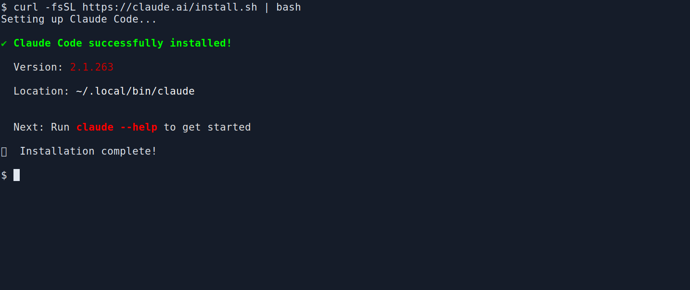

**จากนั้นตรวจเวอร์ชัน** — พิมพ์คำสั่งนี้แล้วกด Enter

```bash
claude --version
```

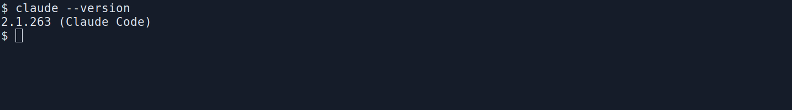

เห็นเลขเวอร์ชันแล้วไปหัวข้อ 1.3 ได้เลย ตัวเลขอาจต่างจากภาพ

### 1.3 ตรวจและติดตั้ง Codex CLI (🖥️ Terminal)

**ตรวจว่ามี Codex CLI อยู่แล้วหรือไม่** — พิมพ์คำสั่งนี้ใน Terminal

```bash
codex --version
```

- ได้ `codex-cli` ตามด้วยเลขเวอร์ชัน → ข้ามไป 1.4
- ได้ `command not found` → ติดตั้งด้วยคำสั่งด้านล่าง

**ติดตั้ง Codex CLI** — ใช้ตัวติดตั้งสำหรับ Linux ตาม [เอกสารทางการของ OpenAI](https://learn.chatgpt.com/docs/codex/cli)

```bash
curl -fsSL https://chatgpt.com/codex/install.sh | sh
```

รอจนติดตั้งเสร็จ หากตัวติดตั้งแสดงขั้นตอนเพิ่มตำแหน่งโปรแกรมใน `PATH` ให้ทำตามข้อความนั้น แล้วเปิด Terminal ใหม่

**ตรวจเวอร์ชันหลังติดตั้ง**

```bash
codex --version
```

ควรเห็น `codex-cli` ตามด้วยเลขเวอร์ชัน เช่น `codex-cli 0.155.1` ตัวเลขอาจต่างจากตัวอย่าง หากยังขึ้น `command not found` ให้ตรวจข้อความเรื่อง `PATH` จากตัวติดตั้งและลองอีกครั้งก่อนทำขั้นถัดไป

ตอนนี้ยังไม่ต้องล็อกอิน Codex ให้ไปหัวข้อ 1.4 เพื่อเปิด Claude Code ตั้งค่าหลายบัญชีในขั้นที่ 2 แล้วจึงล็อกอิน Codex ผ่าน `cyolo1` ในขั้นที่ 3 ส่วน B

### 1.4 เปิดและล็อกอิน Claude Code เพื่อเตรียมทำขั้นที่ 2

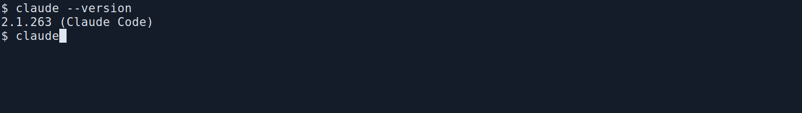

1. เปิด 🖥️ Terminal ในโฟลเดอร์งาน แล้วพิมพ์:
   ```bash
   claude
   ```
2. ล็อกอินด้วยบัญชีของตัวเองตามคำแนะนำบนหน้าจอ หากยังไม่ได้ล็อกอิน ให้พิมพ์ `/login` ในช่องสนทนา Claude Code แล้วทำตามขั้นตอน
3. เมื่อพร้อมใช้งาน ให้เปิด Claude Code ค้างไว้ แล้วไปขั้นที่ 2 เพื่อคัดลอกพรอมต์ทั้งกรอบมาวางใน 💬 ช่องสนทนา Claude Code

เมื่อจบขั้นนี้ ทั้ง Claude Code และ Codex CLI ต้องเรียกดูเวอร์ชันได้ โดยเปิดและล็อกอิน Claude Code ไว้เป็น AI ตัวช่วย ส่วนการสร้างคำสั่งแยกบัญชีของทั้งสองเครื่องมือจะให้ AI ดำเนินการในขั้นที่ 2

### ✅ Expected Output (ตัวอย่างสำหรับเทียบ — ไม่ใช่ผลการรันจริง)
| CHECK | ACTUAL EXAMPLE |
|---|---|
| `claude --version` | `2.1.258 (Claude Code)` |
| `codex --version` | `codex-cli 0.155.1` |
| AI ตัวช่วยตั้งค่า | เปิด Claude Code และล็อกอินพร้อมใช้งานแล้ว |
- **ต้องตรง:** (1) มีเวอร์ชันทั้ง Claude Code และ Codex CLI (2) เปิด AI ตัวช่วยได้
- **ต่างได้:** ตัวเลขเวอร์ชัน

## ขั้นที่ 2 · ให้ Claude Code ตั้งค่าหลายบัญชี (~20 นาที)

ให้ Claude Code ตรวจเครื่องมือที่ติดตั้งจากขั้นที่ 1 และสร้างคำสั่ง `yolo1`–`yolo5` กับ `cyolo1`–`cyolo5` สำหรับใช้งานหลายบัญชี โดยแยกข้อมูลแต่ละบัญชีและยังไม่ล็อกอินบัญชีเหล่านี้

คัดลอกพรอมต์ทั้งกรอบไปวางใน Claude Code ที่เปิดไว้จากขั้นที่ 1

### 📋 พรอมต์สำหรับคัดลอก (คัดลอกทั้งกรอบ วางใน 💬 ช่องสนทนา AI แล้ว Enter)
```text
สร้าง CLI บน Ubuntu สำหรับรัน Claude Code และ Codex CLI หลายบัญชี
ตรวจ claude --version และ codex --version ก่อนตั้งค่าหลายบัญชี ใช้เครื่องมือที่ติดตั้งแล้ว หากยังขาดเครื่องมือใดให้ติดตั้งเฉพาะเครื่องมือนั้น
แยก credential/config กัน 100% ห้ามอ่านไฟล์ README ของ LAB เพื่อหาเฉลย

## ตัวแปรตั้งค่า (แก้ที่นี่ที่เดียว ที่อื่นต้องอ้างอิงตัวแปรนี้)
BASE_PATH="$HOME/ai-accounts"

## คำสั่งที่ต้องได้
- yolo1..yolo5   → Claude Code + บัญชี Anthropic คนละบัญชี
- cyolo1..cyolo5 → Codex CLI + บัญชี OpenAI/ChatGPT คนละบัญชี

## โครงสร้าง
$BASE_PATH/
├── .Claude/
│   ├── yolo1/ … yolo5/     # config root ต่อบัญชี (CLAUDE_CONFIG_DIR) credential/session/history/cache แยกกัน
│   └── shared/
│       ├── skills/         # skill ใช้ร่วมทุก yoloN
│       └── mcp/            # MCP config ใช้ร่วมทุก yoloN
└── .Codex/
    ├── cyolo1/ … cyolo5/   # config root ต่อบัญชี (CODEX_HOME)
    └── shared/
        ├── skills/
        └── mcp/

หลักการ: <tool>/<account>/ = ของใครของมัน, <tool>/shared/ = แก้ครั้งเดียวทุกบัญชีของ CLI นั้นเห็น

## Isolation
1. ทุกบัญชีแยก credential/config/session/history/cache สมบูรณ์ เปิดพร้อมกันได้ไม่ชน
2. ห้ามเปลี่ยน $HOME ใช้กลไก official ของแต่ละ CLI เท่านั้น
   (Claude Code: CLAUDE_CONFIG_DIR, Codex CLI: CODEX_HOME)
3. ห้ามแก้ .bashrc, Git config, SSH config หรือ environment เดิมโดยไม่จำเป็น
   ถ้าต้องเพิ่ม PATH ให้บอกบรรทัดที่เพิ่มและขอยืนยันก่อน

## Wrapper
4. ทุกคำสั่งส่งต่อ "$@" ครบ และรันแบบข้ามการขออนุญาตด้วย flag ล่าสุดของแต่ละ CLI
   - yoloN  → claude --dangerously-skip-permissions
   - cyoloN → codex --dangerously-bypass-approvals-and-sandbox
   ตรวจชื่อ flag จาก --help ของเวอร์ชันที่ติดตั้งจริงก่อนใช้
5. wrapper ต้องแสดงข้อความชัดเจนถ้าโฟลเดอร์บัญชียังไม่มี และต้องไม่พิมพ์ข้อมูลลับใด ๆ ออกหน้าจอ

## Shared
6. Skills/MCP ใน <tool>/shared เป็น source เดียว ถ้า CLI ใดไม่รองรับส่วนใด ให้ระบุชัดและทำเท่าที่รองรับ

## Installer
7. รันซ้ำได้โดยไม่ลบหรือเขียนทับ credential/config เดิม
8. วิธีติดตั้งและตำแหน่งวางไฟล์ให้เลือกเอง พร้อมอธิบายเหตุผลสั้น ๆ

## Docs
9. ตรวจ official docs และ --help ของเวอร์ชันจริงก่อน implement ห้ามเดา env/path/flag
   - https://code.claude.com/docs/
   - https://github.com/openai/codex

## หมายเหตุจากการทดลองจริง (ตรวจว่ายังจริงกับเวอร์ชันบนเครื่องนี้หรือไม่)
- ถ้ารันเป็น root ต้องตั้ง IS_SANDBOX=1 ไม่งั้น claude ปฏิเสธ --dangerously-skip-permissions
- CODEX_HOME ต้อง mkdir -p ก่อน codex ไม่สร้างโฟลเดอร์ให้เอง
- codex login status ไม่ตรวจว่า token ยังใช้ได้ ให้ยืนยันด้วย codex exec เท่านั้น

## ทดสอบ (รายงานตามจริง PASS / FAIL / SKIP)
- yolo1..yolo5 --version และ cyolo1..cyolo5 --version ทำงานครบ 10 ตัว
- แต่ละคำสั่งชี้ config root คนละโฟลเดอร์ ตรวจด้วย find <root>
- installer รอบ 2 ไม่ทำลายของเดิม
- Git/SSH ทำงานปกติ
- ทุกอย่างที่ต้องล็อกอินหรือใช้ credential จริง รอบนี้เป็น SKIP เจ้าของบัญชีจะทำเองภายหลัง

## รายงาน
เขียน 3 ไฟล์ในโฟลเดอร์ปัจจุบัน: setup-report.md (โครงสร้าง config root ตำแหน่ง credential ข้อจำกัด),
login-guide.md (ขั้นตอนล็อกอินทีละบัญชีที่ผู้ใช้ทำเองใน Terminal), checklist.md (ตาราง รายการ | หลักฐาน | PASS/FAIL/SKIP | เหตุผล)
ห้ามใส่ข้อมูลลับในไฟล์ใด ๆ

ทำเฉพาะขั้นนี้ เมื่อเสร็จให้แสดงเนื้อหาสำคัญของไฟล์ที่สร้าง (ไม่ใช่แค่ชื่อไฟล์) เป็นตารางที่ฉันอ่านตรวจได้ แล้วหยุดรอ ห้ามล็อกอินแทนฉัน ห้ามทำขั้นถัดไปเอง
```

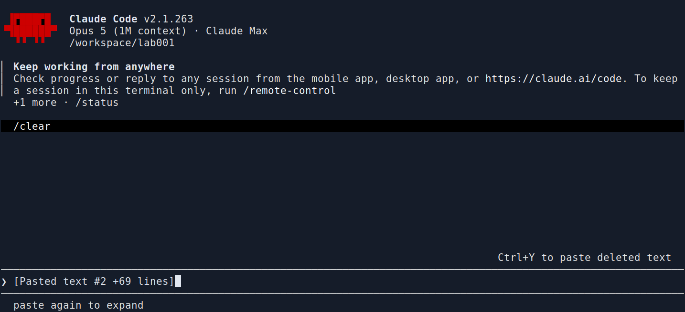

ข้อความ `[Pasted text …]` คือพรอมต์ที่วางแล้ว กด Enter เพื่อเริ่มทำงาน

### ✅ Expected Output (ตัวอย่างสำหรับเทียบ — ไม่ใช่ผลการรันจริง)
| CHECK | ACTUAL EXAMPLE |
|---|---|
| CLI | 2 PASS: `2.1.258 / 0.153.4` |
| yolo | 5/5 PASS (`--version` ผ่าน) |
| cyolo | 5/5 PASS (`--version` ผ่าน) |
| config root แยก | `.Claude/yolo1`…`yolo5`, `.Codex/cyolo1`…`cyolo5` คนละ path |
| reports | `setup-report.md`, `login-guide.md`, `checklist.md` |
| real login | SKIP |
- **ต้องตรง:** (1) CLI = 2 (2) wrapper = 10 (3) ไฟล์รายงาน 3 ไฟล์ และ login = `SKIP`
- **ต่างได้:** (1) เวอร์ชัน (2) `BASE_PATH` (3) ถ้อยคำ/ลำดับ

### 🔍 จุดที่ผู้เรียนต้องตรวจ (🖥️ Terminal เปิดหน้าต่างใหม่)
```bash
yolo1 --version; cyolo1 --version
yolo2 --version; cyolo2 --version
yolo3 --version; cyolo3 --version
```

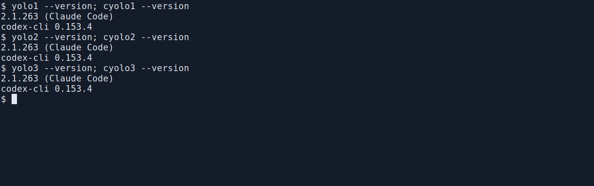

- [ ] คำสั่งของบัญชี 1–3 ทั้งสอง CLI แสดงเวอร์ชันครบ 6 ตัว
- [ ] มีไฟล์รายงาน 3 ไฟล์ในโฟลเดอร์งาน
- [ ] งานที่ใช้บัญชีจริงเป็น `SKIP` พร้อมเหตุผล
- [ ] ไม่มีข้อมูลลับในไฟล์และบนหน้าจอ

## ขั้นที่ 3 · ทดลองใช้งานแยกตามเครื่องมือ (~10 นาที)

ใช้บัญชี `yolo1` และ `cyolo1` จากขั้นที่ 2 ทำงานในโฟลเดอร์เดียวกันตลอดแลป ทำส่วน A ของ Claude Code ให้ครบก่อน แล้วทำส่วน B ของ Codex จากนั้นเปรียบเทียบผลในส่วน C

แต่ละเครื่องมือเรียงเหมือนกัน: **ล็อกอิน → วิธีที่ 1 ใช้หน้าสนทนา AI → วิธีที่ 2 ใช้คำสั่งจาก shell** โดยมีเส้นคั่นระหว่างแต่ละช่วง

ผู้เรียนยืนยันตัวตนในเบราว์เซอร์ด้วยตัวเอง ไม่ส่งรหัสหรือข้อมูลบัญชีให้ AI

### โจทย์เดียวกันสำหรับทั้งสองเครื่องมือ

ใช้ **Claude Code: Fable · medium** และ **Codex: Astra · medium** ส่งคำถามเดียวกันทั้งสองวิธี เพื่อเปรียบเทียบผลได้ตรงกัน

```text
ร้านค้าลดราคา 10% เมื่อซื้อครบ 1000 บาท จงคำนวณยอดจ่ายสำหรับยอดซื้อ 999, 1000 และ 1500 บาท ตอบเป็นตารางยอดซื้อและยอดจ่ายทศนิยม 2 ตำแหน่ง ตามด้วยคำอธิบายสั้น ๆ และข้อควรระวัง 1 ข้อ ไม่ต้องสร้างไฟล์หรือรันคำสั่งอื่น
```

*ใช้ภาพ Terminal และผลทดลองเดิมประกอบบทเรียน หน้าหลังล็อกอินถ่ายด้วยข้อมูล subscription ที่ได้รับอนุญาตในเครื่องทดสอบ ไม่ได้บันทึกขั้นยืนยันตัวตนในเบราว์เซอร์ ชื่อโมเดลเริ่มต้นอาจต่างจากภาพ ให้เลือกโมเดลตามขั้นตอนของแต่ละเครื่องมือด้านล่าง*

---

### 3.1 · ส่วน A: Claude Code (yolo1)

ทำทั้งสามช่วงต่อไปนี้ใน Claude Code ให้ครบ แล้วจึงไปส่วน B

#### A.1 · เปิดโปรแกรมและล็อกอิน

**1. เปิดโปรแกรมและเลือกบัญชี subscription**

```bash
yolo1
```

หากมีหน้าจอเลือกธีม ให้เลือกธีมก่อน จากนั้นเลือก **Claude account with subscription** แล้วกด Enter

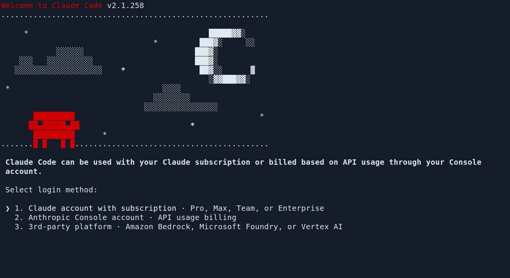

**2. ยืนยันบัญชีในเบราว์เซอร์**

เปิดลิงก์ที่ Terminal แสดง ล็อกอินด้วยบัญชี Claude ที่มี subscription และยืนยันการเชื่อมต่อ หากหน้าจอให้คัดลอกรหัสกลับมา ให้ทำตามขั้นตอนนั้นด้วยตัวเอง

**3. ยืนยันโฟลเดอร์และโหมดของแลป**

กลับมาที่ Terminal หากเป็นโฟลเดอร์แลปที่เตรียมไว้ ให้เลือก **Yes, I trust this folder**

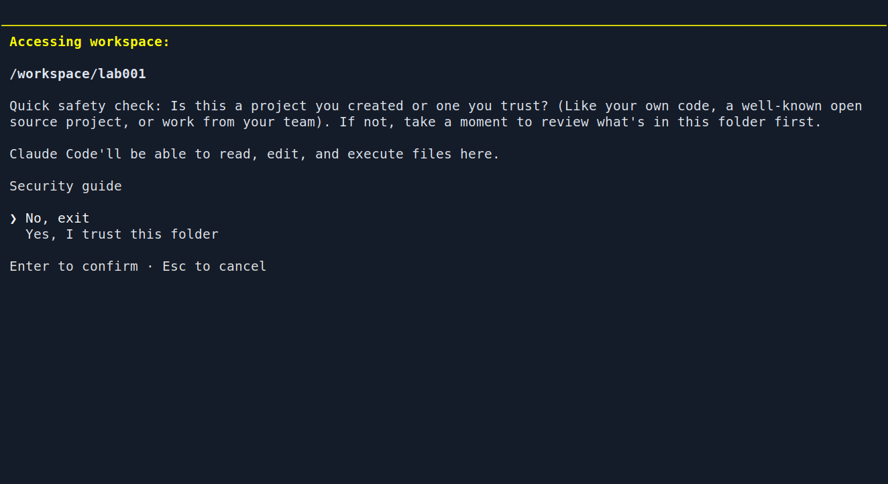

คำสั่ง yolo1 จากขั้นที่ 2 เปิดโหมด Bypass Permissions หากกำลังใช้คอนเทนเนอร์แลปที่เตรียมไว้ ให้เลือก **Yes, I accept** เพื่อทำต่อ

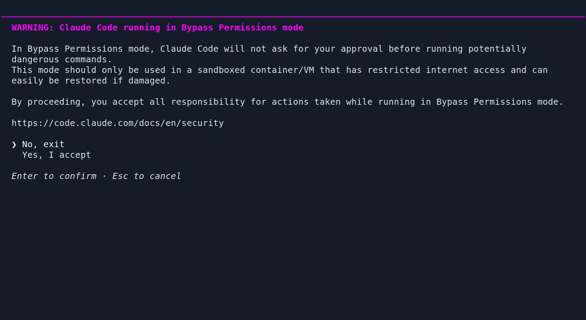

**4. พร้อมพิมพ์พรอมต์**

เห็นหน้า Claude Code และช่องพิมพ์ข้อความ แสดงว่ามาถึงหน้าสนทนาแล้ว

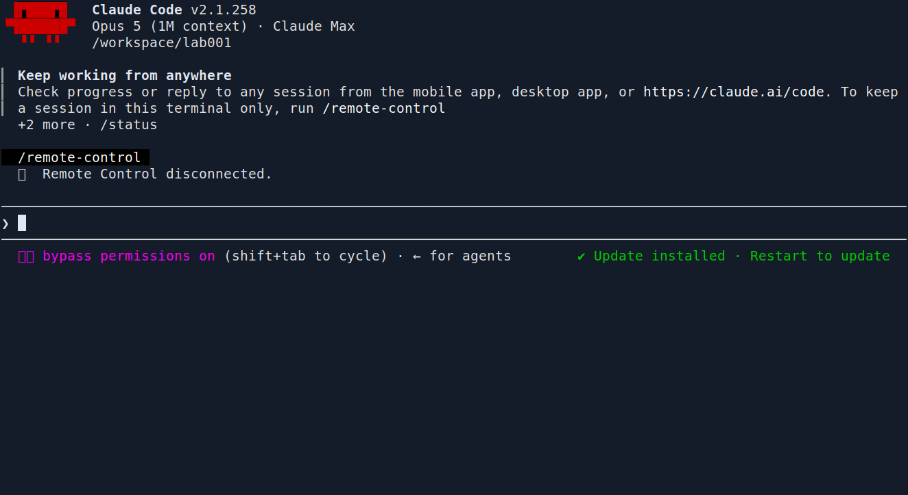

---

#### A.2 · วิธีที่ 1: พิมพ์ในหน้าสนทนา AI

เริ่มจากหน้า Claude Code ที่เพิ่งล็อกอินในหัวข้อ A.1 เลือกโมเดลและระดับ effort ก่อนวางคำถาม

**1. เลือก Fable และปรับ effort**

พิมพ์ `/model` แล้วกด Enter เลื่อนมาที่ **Fable** ใช้ลูกศรซ้าย/ขวาปรับเป็น **Medium** แล้วกด Enter ยืนยัน

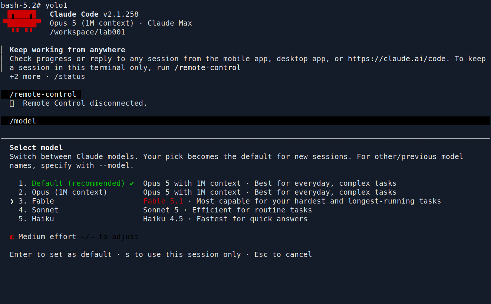

**2. วางคำถาม**

คัดลอกคำถามด้านบนมาวางในช่องสนทนา ตรวจว่าหน้าจอแสดง Fable และ medium

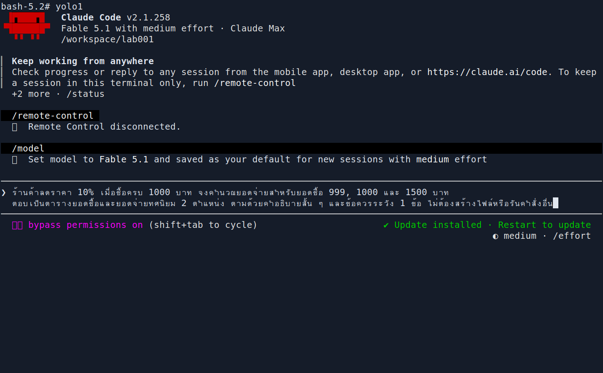

**3. ส่งและดูคำตอบ**

กด Enter แล้วรอจนตอบจบ จะเห็นตารางยอดจ่ายพร้อมคำอธิบาย และยังพิมพ์ถามต่อในหน้าเดิมได้

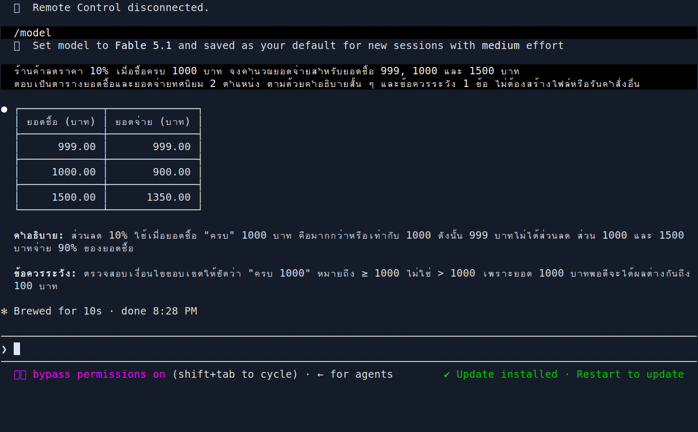

---

#### A.3 · วิธีที่ 2: ส่งด้วยคำสั่งจาก shell

เมื่อดูคำตอบจากหน้าสนทนาแล้ว ให้ออกจากหน้า AI กลับมาที่ shell โดยกด Ctrl+C สองครั้ง จากนั้นรันคำสั่งด้านล่างในโฟลเดอร์งานเดิม คำสั่งนี้ระบุโมเดล ระดับ effort และคำถามไว้ด้วยกัน เมื่อ AI ตอบจบจะกลับมาที่ shell

```bash
yolo1 --model fable --effort medium -p 'ร้านค้าลดราคา 10% เมื่อซื้อครบ 1000 บาท จงคำนวณยอดจ่ายสำหรับยอดซื้อ 999, 1000 และ 1500 บาท ตอบเป็นตารางยอดซื้อและยอดจ่ายทศนิยม 2 ตำแหน่ง ตามด้วยคำอธิบายสั้น ๆ และข้อควรระวัง 1 ข้อ ไม่ต้องสร้างไฟล์หรือรันคำสั่งอื่น'
```

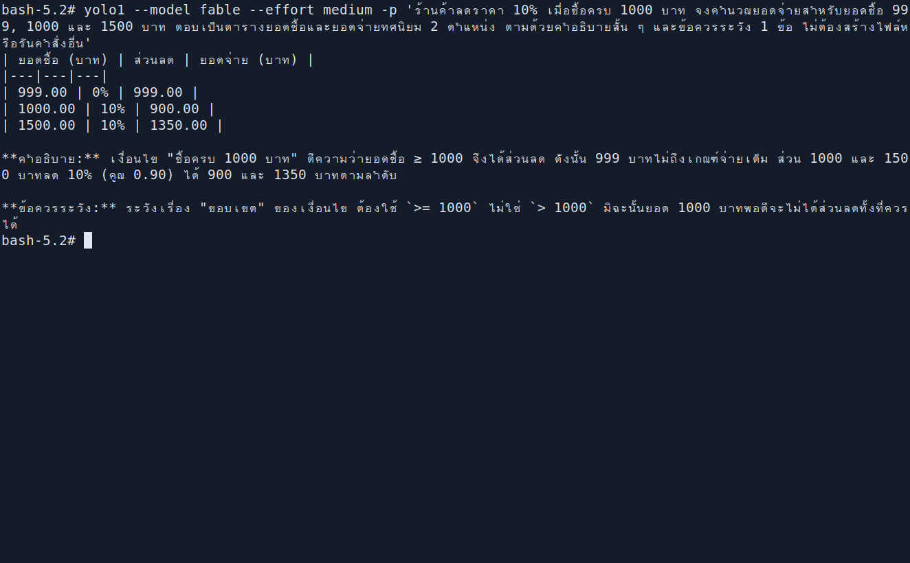

เก็บภาพคำตอบจาก Claude Code ทั้งสองวิธี แล้วไปทดลอง Codex ในส่วน B

---

### 3.2 · ส่วน B: Codex (cyolo1)

ทำในโฟลเดอร์งานเดิม โดยใช้คำถามเดียวกับส่วน A

#### B.1 · เปิดโปรแกรมและล็อกอิน

**1. เปิดโปรแกรมและเลือก Sign in with ChatGPT**

```bash
cyolo1
```

เลือก **Sign in with ChatGPT** แล้วกด Enter เพื่อใช้บัญชี ChatGPT ที่มีสิทธิ์ใช้งาน Codex

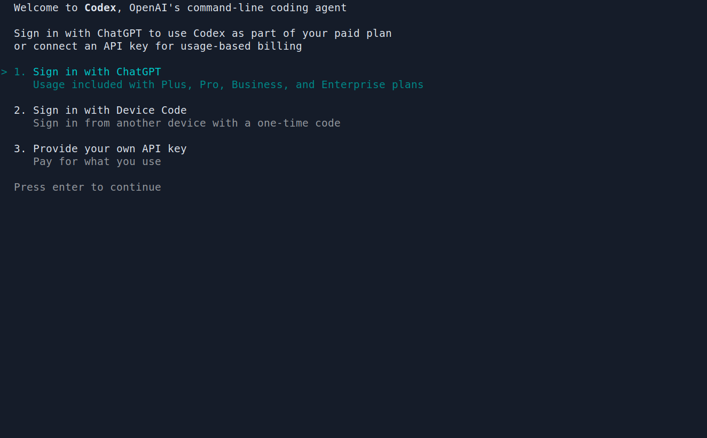

**2. ยืนยันบัญชีในเบราว์เซอร์**

ล็อกอินด้วยบัญชี ChatGPT ที่ต้องการใช้และยืนยันการเชื่อมต่อ หากใช้ SSH แล้วเบราว์เซอร์กลับมาที่ CLI ไม่ได้ ให้เลือก **Sign in with Device Code** และทำตามขั้นตอนบนหน้าจอ

**3. ยืนยันโฟลเดอร์งาน**

กลับมาที่ Terminal หากเป็นโฟลเดอร์แลปที่เตรียมไว้ ให้เลือก **Yes, continue**

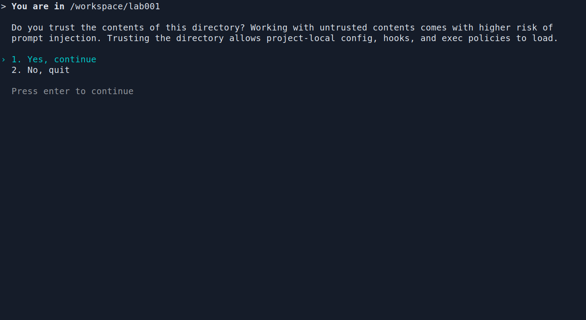

**4. พร้อมพิมพ์พรอมต์**

เห็นหน้า Codex พร้อมชื่อโมเดลและช่องพิมพ์ข้อความ แสดงว่ามาถึงหน้าสนทนาแล้ว

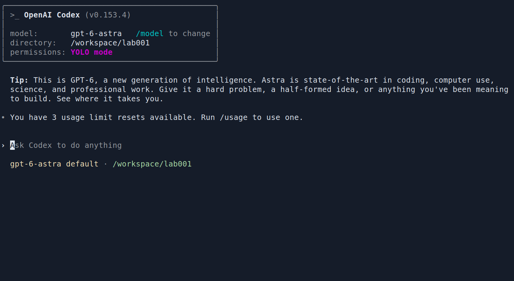

---

#### B.2 · วิธีที่ 1: พิมพ์ในหน้าสนทนา AI

เริ่มจากหน้า Codex ที่เพิ่งล็อกอินในหัวข้อ B.1 เลือกโมเดลและระดับ effort ก่อนวางคำถาม

**1. เลือก Astra**

ในหน้าสนทนา Codex พิมพ์ `/model` แล้วกด Enter เลือก **gpt-6-astra** และกด Enter อีกครั้ง

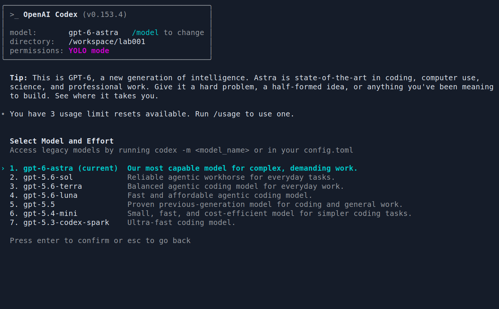

**2. ปรับ effort**

หน้าถัดไปให้เลือกระดับ reasoning เป็น **Medium** แล้วกด Enter ยืนยัน

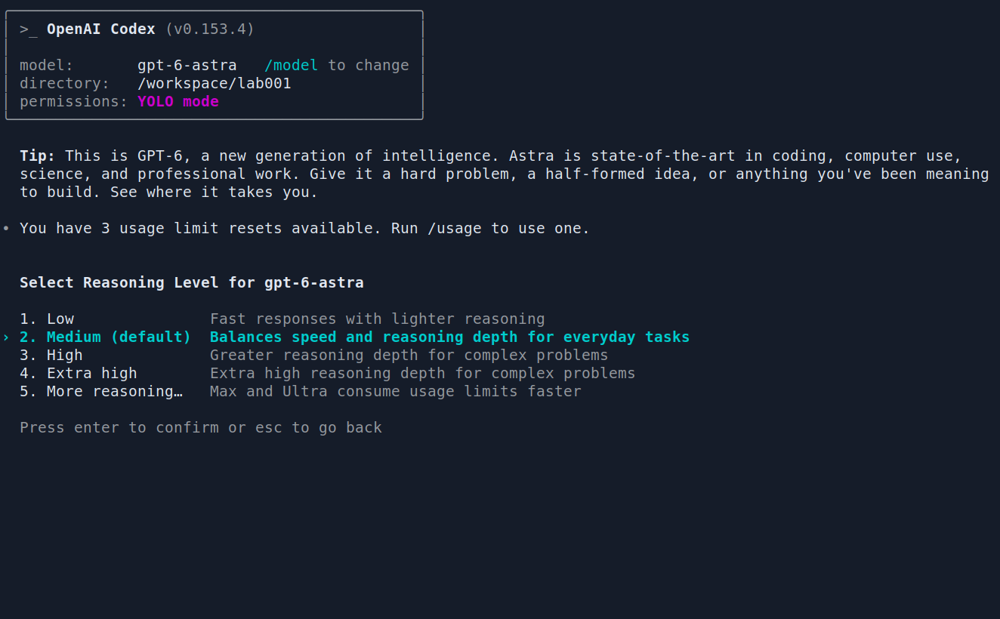

**3. วางคำถามเดียวกัน**

คัดลอกคำถามด้านบนมาวางในช่องสนทนา ตรวจว่าหน้าจอแสดง `gpt-6-astra medium`

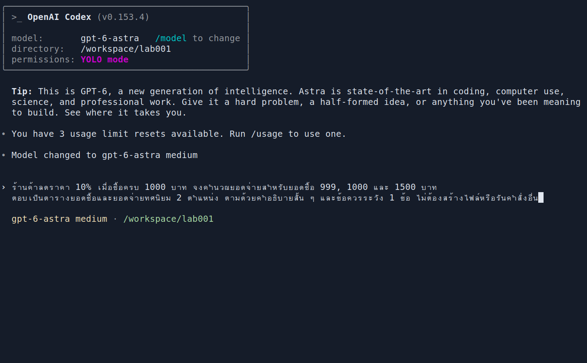

**4. ส่งและดูคำตอบ**

กด Enter แล้วรอจนตอบจบ เช่นเดียวกับ Claude หน้าสนทนาจะยังเปิดไว้ให้ถามต่อได้

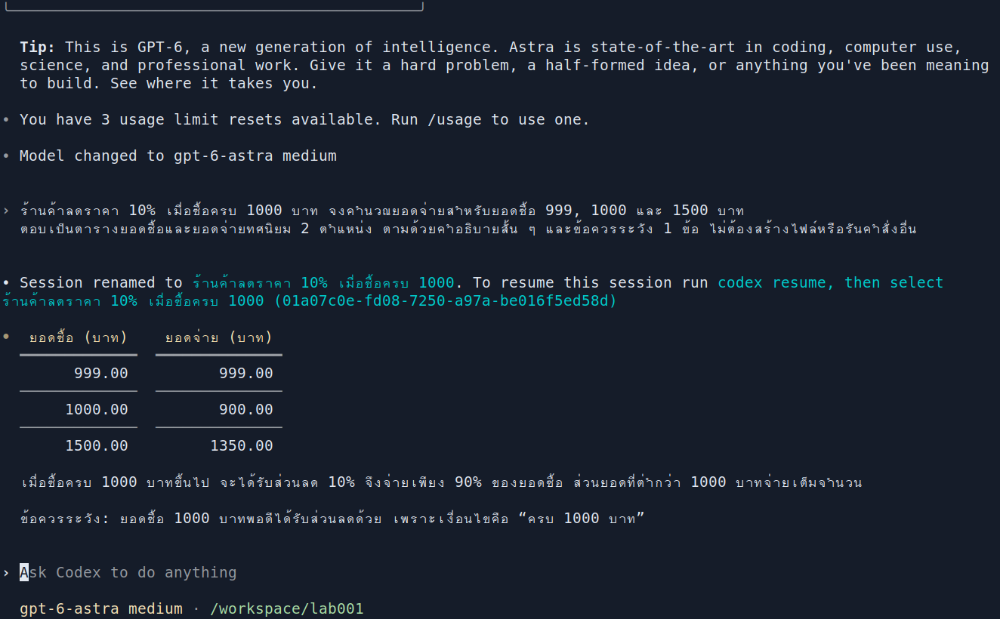

---

#### B.3 · วิธีที่ 2: ส่งด้วยคำสั่งจาก shell

เมื่อดูคำตอบจากหน้าสนทนาแล้ว ให้ออกจากหน้า AI กลับมาที่ shell โดยกด Ctrl+C สองครั้ง จากนั้นรันคำสั่งด้านล่างในโฟลเดอร์งานเดิม คำสั่งนี้ระบุโมเดล ระดับ effort และคำถามไว้ด้วยกัน เมื่อ AI ตอบจบจะกลับมาที่ shell

```bash
cyolo1 exec --skip-git-repo-check --model gpt-6-astra -c model_reasoning_effort=medium 'ร้านค้าลดราคา 10% เมื่อซื้อครบ 1000 บาท จงคำนวณยอดจ่ายสำหรับยอดซื้อ 999, 1000 และ 1500 บาท ตอบเป็นตารางยอดซื้อและยอดจ่ายทศนิยม 2 ตำแหน่ง ตามด้วยคำอธิบายสั้น ๆ และข้อควรระวัง 1 ข้อ ไม่ต้องสร้างไฟล์หรือรันคำสั่งอื่น'
```

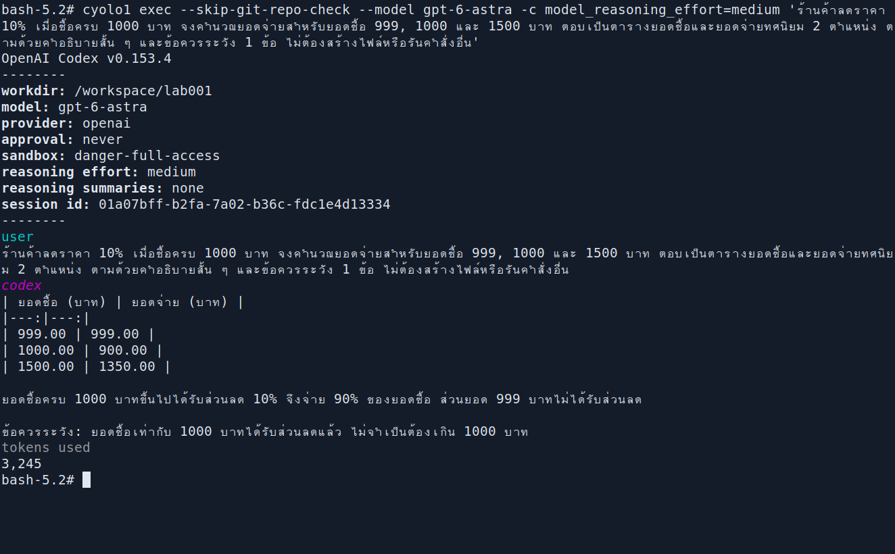

เก็บภาพคำตอบจาก Codex ทั้งสองวิธี แล้วเปรียบเทียบกับ Claude Code ในส่วน C

---

### 3.3 · ส่วน C: เปรียบเทียบผลของ Fable และ Astra

ตารางนี้สรุปผลจากภาพการทดลองเดิมของ Claude Code และ Codex ด้านบน แยกตามโมเดลและวิธีส่งคำถาม ทั้งสองโมเดลใช้ effort **medium**

| คำตอบที่ถูกต้อง | Fable: หน้าสนทนา | Fable: shell | Astra: หน้าสนทนา | Astra: shell |
|---|---|---|---|---|
| 999.00 | 999.00 | 999.00 | 999.00 | 999.00 |
| 900.00 | 900.00 | 900.00 | 900.00 | 900.00 |
| 1350.00 | 1350.00 | 1350.00 | 1350.00 | 1350.00 |

**ผล:** Fable และ Astra คำนวณถูกครบทั้งสองวิธี โดยลด 10% ตั้งแต่ยอดซื้อ 1000 บาทขึ้นไป ถ้อยคำอาจต่างกันได้ แต่ยอดจ่ายต้องตรงตาราง

เมื่อทดลองเอง ให้ตรวจชื่อโมเดลและ effort จากหน้าจอ แล้วเก็บภาพคำตอบไว้เทียบ หากรันไม่ได้ ให้บันทึกว่า **ยังไม่ได้ทดลอง**
