# LAB 001 · ส่วนที่ 1: ใช้งานหลายบัญชีผ่าน JupyterLab (Claude Code + Codex CLI)

เวลาโดยประมาณสำหรับส่วนนี้: 35–50 นาที ขึ้นอยู่กับการตั้งค่าหลายบัญชีและล็อกอิน

**สิ่งที่จะได้:** ใช้เครื่องมือจาก LAB ก่อนหน้าเพื่อตั้งค่าหลายบัญชี ล็อกอิน เลือกโมเดล และทดลองถามโจทย์ง่าย ๆ ผ่านหน้าสนทนาและคำสั่ง shell ใน JupyterLab

บทเรียนที่เชื่อมโยง: [AI Agent Routing](../ai-agent-routing.html) หัวข้อ 1.0 และ 4.0–4.3

ขอบเขต: Claude Code และ Codex CLI เท่านั้น

## 0 · ก่อนเริ่ม · ใช้ JupyterLab จาก LAB ก่อนหน้า

แลปนี้ทำทุกขั้นผ่าน **Terminal ใน JupyterLab ของ Linux container `devtools`** ที่เตรียมจาก [บท Docker และ VS Code](../01_Docker_VSCode_Setup/README.md) ให้ Docker และ container ทำงานอยู่ก่อนเริ่ม

### 0.1 · เปิด JupyterLab จาก VS Code (ทบทวนหัวข้อ 6.1 ของ LAB ก่อนหน้า)

1. ในหน้าต่าง **VS Code บนเครื่องผู้เรียน** เปิดแถบ **Containers** ทางซ้าย
2. คลิกขวาที่ container **devtools** แล้วเลือก **Open in External Browser**
3. เลือก **8888 localhost:8885** โดย `8888` คือพอร์ตภายใน container และ `8885` คือพอร์ตบนเครื่องผู้เรียน หาก LAB ก่อนหน้าใช้พอร์ตอื่น ให้เลือกรายการที่แมปจาก `8888` มายังพอร์ตนั้น
4. เบราว์เซอร์จะเปิด JupyterLab หากต้องการเปิดเอง สามารถเข้า [JupyterLab](http://localhost:8885/lab) โดยปรับพอร์ตให้ตรงกับที่ใช้จริง

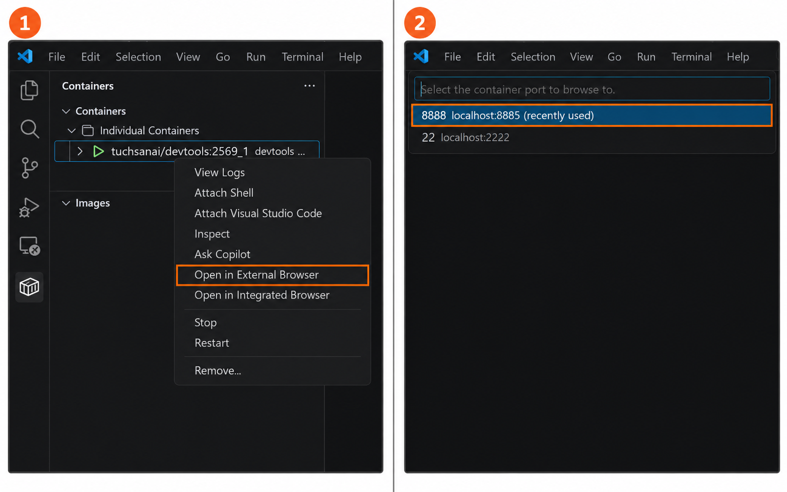

*นำภาพจากหัวข้อ 6.1 ของ LAB ก่อนหน้ามาใช้ซ้ำ: ภาพจากหน้าจอจริงที่ปรับด้วย Imagegen เพื่อซ่อนรายการที่ไม่เกี่ยวข้องและเน้นจุดที่ต้องเลือก*

เมื่อเปิด JupyterLab แล้ว ไปขั้นที่ 1 เพื่อคลิก Terminal ตามภาพ จากนั้นใช้ Terminal นี้ทำขั้นที่ 2

**อ่านสัญลักษณ์ให้ถูก:** 🖥️ Terminal / shell หมายถึง Terminal ใน JupyterLab ส่วน 💬 ช่องสนทนา AI หมายถึงหน้าสนทนาของ Claude Code หรือ Codex CLI ที่เปิดอยู่ใน Terminal นั้น คำสั่ง Bash พิมพ์ที่ shell; พรอมต์ยาวและคำสั่ง `/login` หรือ `/model` พิมพ์ในหน้าสนทนาของ CLI ที่ระบุ ไม่ต้องสร้าง Notebook หรือวางคำสั่งในเซลล์ Python

Terminal ทำงานบนเครื่องที่รัน Jupyter server ซึ่งในแลปนี้คือ container ไม่ใช่บนเบราว์เซอร์ ตาม [เอกสาร JupyterLab Terminal](https://jupyterlab.readthedocs.io/en/stable/user/terminal.html) การล็อกอินอาจเปิดหน้าเว็บแยก ให้ผู้เรียนยืนยันตัวตนเองแล้วกลับมาทำงานใน Terminal

### 0.2 · เส้นทางการเรียนรู้

| ส่วน | เนื้อหา | เอกสาร |
|---|---|---|
| **1 · ตั้งค่าหลายบัญชีและใช้งานเบื้องต้น** | ขั้นที่ 1–3: เปิด Claude Code ตั้งค่าหลายบัญชี ล็อกอิน เลือกโมเดล และลองคำถามง่าย ๆ | ไฟล์นี้ |

ทำตามขั้นที่ 1–3 เพื่อใช้เครื่องมือที่มีอยู่แล้วกับบัญชีที่แยกการตั้งค่ากัน

## ขั้นที่ 1 · เปิด Terminal ใน JupyterLab (~5 นาที)

ใช้เครื่องมือที่ติดตั้งไว้ใน `devtools` จาก LAB ก่อนหน้า ไม่ต้องติดตั้งซ้ำหรือสร้างโฟลเดอร์เพิ่มด้วยตนเอง

### 1.1 · คลิก Terminal ในหน้า Launcher

คลิก **Terminal** ในกลุ่ม **Other** ตามวงกลมและลูกศรในภาพ หากไม่เห็นหน้า Launcher ให้กดปุ่ม **+** ก่อน

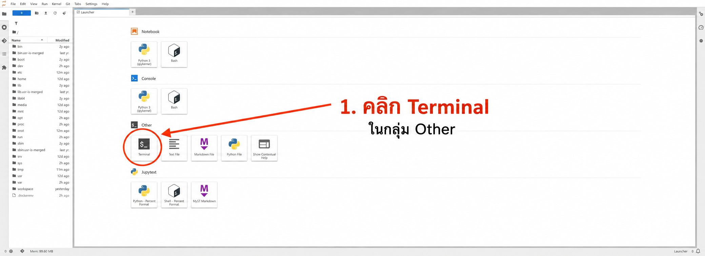

*ภาพ Launcher จาก LAB ก่อนหน้า เพิ่มวงกลม ลูกศร และคำกำกับด้วย Imagegen เพื่อชี้ตำแหน่งที่ต้องคลิก*

**หลังคลิก:** จะมีแท็บ Terminal เปิดขึ้นมา พร้อม shell สำหรับพิมพ์คำสั่งภายใน container

## ขั้นที่ 2 · ให้ Claude Code ตั้งค่าหลายบัญชี (~20 นาที)

ให้ Claude Code ตรวจเครื่องมือที่ติดตั้งไว้จาก LAB ก่อนหน้า และสร้างคำสั่ง `yolo1`–`yolo5` กับ `cyolo1`–`cyolo5` สำหรับใช้งานหลายบัญชี โดยแยกข้อมูลแต่ละบัญชีและยังไม่ล็อกอินบัญชีเหล่านี้

ใช้ Terminal ที่เปิดจากขั้นที่ 1 สำหรับตั้งค่าด้วยพรอมต์ด้านล่าง โดยเปิด Claude Code ด้วยคำสั่ง `claude` และล็อกอินบัญชีตัวช่วยตั้งค่าให้พร้อมก่อนวางพรอมต์ บัญชีแยกทั้ง 10 ช่องจะให้ผู้เรียนล็อกอินเองในขั้นที่ 3

### 2.1 · ทำไมเราต้องใช้พรอมต์ตั้งค่าชุดนี้?

ลองนึกว่ามีลิ้นชักแยกตามบัญชี: คำสั่ง `yolo1` เลือกลิ้นชักของ Claude บัญชีที่ 1 ส่วน `yolo2` เลือกบัญชีที่ 2 ใช้โปรแกรม CLI เดิม แต่ชี้ไปยังข้อมูลคนละชุด ผู้เรียนจึงไม่ต้องจำคำสั่งกำหนดโฟลเดอร์ยาว ๆ ทุกครั้ง หลักเดียวกันใช้กับ `cyolo1`–`cyolo5` ของ Codex

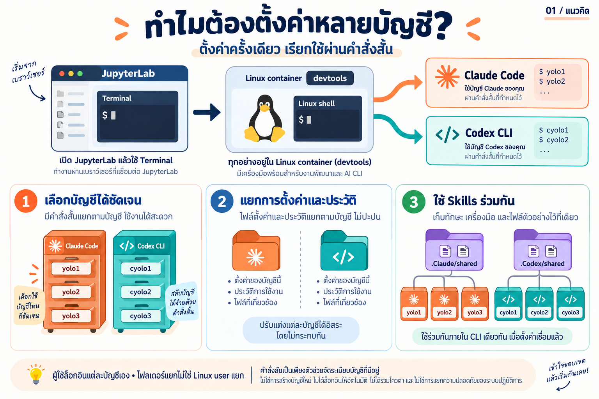

*ภาพแนวคิดสร้างด้วย Imagegen ไม่ใช่ภาพหน้าจอหรือหลักฐานว่าติดตั้งแล้ว ภาพแสดงบางบัญชีเพื่อให้อ่านง่าย; พรอมต์สร้างช่องบัญชีเครื่องมือละ 5 ช่อง*

| สิ่งที่พรอมต์กำหนด | ช่วยผู้เรียนอย่างไร |
|---|---|
| คำสั่งสั้นแยกตามบัญชี | เลือกบัญชีได้ชัด และเปิด Terminal หลายแท็บเพื่อใช้คนละบัญชีได้ |
| โฟลเดอร์การตั้งค่าต่อบัญชี | ลดการปะปนของการตั้งค่าและประวัติ โดยต้องตรวจวิธีเก็บ credential ของ CLI ด้วย |
| Skills/MCP ส่วนกลางต่อเครื่องมือ | ดูแลต้นฉบับร่วมกันได้ เมื่อเชื่อมด้วยวิธีที่ CLI รองรับ |
| ตรวจเวอร์ชันและ help ก่อนสร้าง | ให้ AI สร้างคำสั่งแยกบัญชีให้ตรงกับเครื่องมือที่ติดตั้งไว้แล้ว |
| ติดตั้งซ้ำได้และมีรายงาน | ตรวจสอบผลได้ และลดโอกาสเขียนทับการตั้งค่าเดิม |

ข้อดีเหล่านี้เป็นเหตุผลของการออกแบบแลป ไม่ใช่ผลทดสอบของเครื่องผู้เรียน พรอมต์สร้างตัวช่วยเลือกบัญชีที่มีอยู่ ไม่ได้สมัครบัญชีหรือเพิ่มสิทธิ์ใช้งานให้ และผู้เรียนต้องล็อกอินแต่ละบัญชีเอง

### 2.2 · โฟลเดอร์ที่ได้ และความหมายของส่วนกลาง

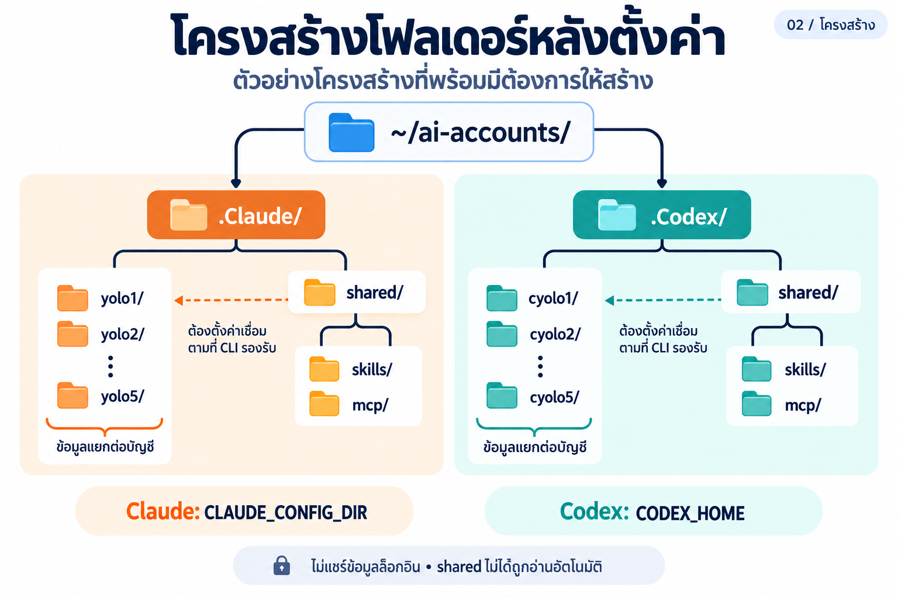

*ภาพแนวคิดสร้างด้วย Imagegen แสดงโครงสร้างเป้าหมายตามพรอมต์ โดย `shared` เป็นโฟลเดอร์ระดับเดียวกับโฟลเดอร์บัญชีภายในแต่ละ CLI*

- พรอมต์จะสร้างโฟลเดอร์การตั้งค่าบัญชีใต้ `~/ai-accounts` ส่วนรายงานจะเขียนในโฟลเดอร์ปัจจุบันที่เปิด Claude Code ไม่ต้องสร้างโฟลเดอร์เตรียมเอง
- Claude Code เลือกโฟลเดอร์การตั้งค่าด้วย `CLAUDE_CONFIG_DIR` ซึ่งเอกสารระบุว่าใช้กับหลายบัญชีพร้อมกันได้ ดู [Claude Code environment variables](https://code.claude.com/docs/en/env-vars)
- Codex เลือกที่เก็บการตั้งค่าและสถานะด้วย `CODEX_HOME` ดู [Codex configuration](https://learn.chatgpt.com/docs/config-file/config-advanced) ส่วน credential อาจเก็บเป็นไฟล์หรือในระบบจัดเก็บของ OS จึงต้องตรวจโหมดที่ใช้ ดู [Codex authentication](https://learn.chatgpt.com/docs/auth)
- การตั้งชื่อโฟลเดอร์ `shared/skills` หรือ `shared/mcp` ไม่ทำให้ CLI อ่านเอง ต้องมีวิธีเชื่อมที่รองรับ และไม่รวม token หรือข้อมูลล็อกอินไว้ในส่วนกลาง
- การแยก config เป็นการจัดระเบียบภายใต้ผู้ใช้ Linux เดียวกัน ไม่ใช่การแยกสิทธิ์ OS; ไฟล์โครงการและการตั้งค่าระดับโครงการอาจยังใช้ร่วมกันได้

### 2.3 · จากคำสั่งสั้นไปถึงบัญชีที่เลือก

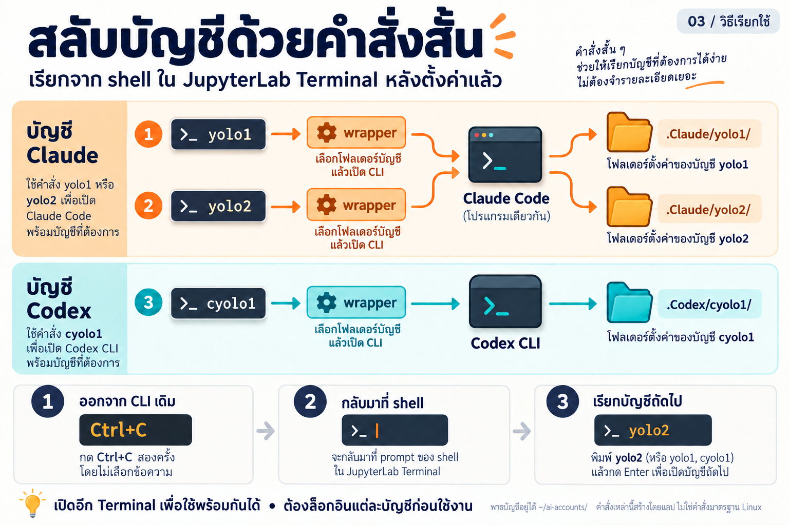

*ภาพแนวคิดสร้างด้วย Imagegen: wrapper คือสคริปต์ตัวช่วยที่ตั้งค่าโฟลเดอร์บัญชีแล้วเรียกโปรแกรม CLI; พาธในภาพอยู่ภายใต้ `~/ai-accounts`*

หลังตั้งค่าและล็อกอินแล้ว `yolo1` เปิด Claude ด้วยข้อมูลบัญชีที่ 1 ส่วน `yolo2` เปิดด้วยข้อมูลบัญชีที่ 2 และ `cyolo1` เปิด Codex ด้วยข้อมูลบัญชีที่ 1 คำสั่งเหล่านี้สร้างโดยแลป ไม่ใช่คำสั่งมาตรฐานของ Linux

หากต้องการเปลี่ยนบัญชีใน Terminal เดิม ให้ออกจาก CLI กลับมาที่ shell แล้วเรียกคำสั่งของบัญชีถัดไป หรือเปิด Terminal อีกแท็บเพื่อใช้พร้อมกัน การพิมพ์ชื่อ wrapper ในช่องสนทนา AI ไม่ใช่การสลับบัญชีของโปรแกรมที่กำลังเปิดอยู่

### 2.4 · วางพรอมต์ตรงไหนใน JupyterLab?

#### 2.4.1 · พิมพ์คำสั่งเปิด Claude ใน Terminal ก่อน

ใช้ Terminal ที่เปิดจากหัวข้อ 1.1 โดยอยู่ในโฟลเดอร์งานที่ต้องการ แล้วพิมพ์ `claude` และกด Enter เพื่อเปิดโปรแกรม

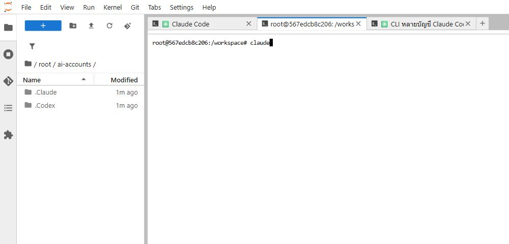

#### 2.4.2 · ล็อกอินบัญชีตัวช่วยตั้งค่าให้พร้อม

หากเปิดครั้งแรก ให้เลือกธีมตามหน้าจอ จากนั้นเลือก **Claude account with subscription** และยืนยันบัญชีของตนเองในเบราว์เซอร์ หากล็อกอินไว้แล้วให้ไปขั้นถัดไปได้

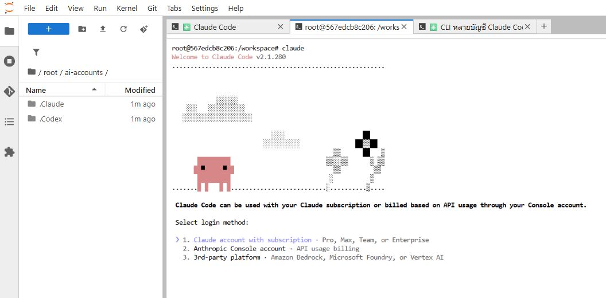


#### 2.4.3 · วางพรอมต์ในช่องสนทนาของ Claude

เมื่อเห็นช่องสนทนาพร้อมใช้งาน ให้คัดลอกข้อความทั้งกรอบด้านล่าง วางใน **ช่องสนทนาของ Claude Code ภายใน Terminal** แล้วกด Enter หากวางไม่ได้ ให้ลอง **Shift + คลิกขวา → Paste** ตามที่เบราว์เซอร์รองรับ รอ Claude ทำงานและสรุปรายงาน แล้วตรวจผลตามรายการท้ายขั้นนี้

##### 2.4.3.1 · 📋 พรอมต์สำหรับคัดลอก (คัดลอกทั้งกรอบ วางใน 💬 ช่องสนทนา AI แล้ว Enter)
```text
สร้าง CLI ภายใน Linux container devtools สำหรับรัน Claude Code และ Codex CLI หลายบัญชี
ฉันใช้งานผ่าน Terminal ใน JupyterLab และเปิด Claude Code ในโฟลเดอร์งานปัจจุบันแล้ว
Claude Code และ Codex CLI ติดตั้งไว้แล้วจาก LAB ก่อนหน้า ไม่ต้องติดตั้งซ้ำ
ตรวจ claude --version และ codex --version เพื่อยืนยันความพร้อมก่อนตั้งค่าหลายบัญชี
หากไม่พบเครื่องมือ ให้ตรวจ PATH และรายงานปัญหาเพื่อให้ผู้เรียนกลับไปแก้ขั้นเตรียมระบบก่อน ห้ามติดตั้งซ้ำอัตโนมัติ
แยก credential/config ของบัญชีแต่ละชุด และตรวจวิธีเก็บจริงของ CLI ห้ามอ่านไฟล์ README ของ LAB เพื่อหาเฉลย

## ตัวแปรตั้งค่า (แก้ที่นี่ที่เดียว ที่อื่นต้องอ้างอิงตัวแปรนี้)
BASE_PATH="$HOME/ai-accounts"

## คำสั่งที่ต้องได้
- yolo1..yolo5   → Claude Code + บัญชี Anthropic คนละบัญชี
- cyolo1..cyolo5 → Codex CLI + บัญชี OpenAI/ChatGPT คนละบัญชี

## โครงสร้าง
$BASE_PATH/
├── .Claude/
│   ├── yolo1/ … yolo5/     # config root ต่อบัญชี (CLAUDE_CONFIG_DIR) credential/session/history/cache แยกกัน
│   └── shared/
│       ├── skills/         # skill ใช้ร่วมทุก yoloN
│       └── mcp/            # MCP config ใช้ร่วมทุก yoloN
└── .Codex/
    ├── cyolo1/ … cyolo5/   # config root ต่อบัญชี (CODEX_HOME)
    └── shared/
        ├── skills/
        └── mcp/

หลักการ: <tool>/<account>/ = ของใครของมัน, <tool>/shared/ = แก้ครั้งเดียวทุกบัญชีของ CLI นั้นเห็น

## Isolation
1. แยก credential/config/session/history/cache ที่ CLI รองรับต่อบัญชี เปิดพร้อมกันได้
   ตรวจ credential backend และตัวแปร authentication ที่อาจมีผลร่วมกัน โดยไม่เปิดเผยค่า secret
   สำหรับ Codex บน Linux ให้ใช้ file-based credential storage ต่อ CODEX_HOME หากนโยบายเครื่องอนุญาต
   ระบุสิ่งที่ยังร่วมกัน เช่น project config และสิทธิ์ผู้ใช้ Linux ห้ามอ้างว่าเป็น OS isolation
2. ห้ามเปลี่ยน $HOME ใช้กลไก official ของแต่ละ CLI เท่านั้น
   (Claude Code: CLAUDE_CONFIG_DIR, Codex CLI: CODEX_HOME)
3. ห้ามแก้ .bashrc, Git config, SSH config หรือ environment เดิมโดยไม่จำเป็น
   ถ้าต้องเพิ่ม PATH ให้บอกบรรทัดที่เพิ่มและขอยืนยันก่อน

## Wrapper
4. ทุกคำสั่งส่งต่อ "$@" ครบ และรันแบบข้ามการขออนุญาตด้วย flag ล่าสุดของแต่ละ CLI
   - yoloN  → claude --dangerously-skip-permissions
   - cyoloN → codex --dangerously-bypass-approvals-and-sandbox
   ตรวจชื่อ flag จาก --help ของเวอร์ชันที่ติดตั้งจริงก่อนใช้
5. wrapper ต้องแสดงข้อความชัดเจนถ้าโฟลเดอร์บัญชียังไม่มี และต้องไม่พิมพ์ข้อมูลลับใด ๆ ออกหน้าจอ

## Shared
6. Skills/MCP ใน <tool>/shared เป็น source เดียวต่อ CLI ต้องเชื่อมด้วยวิธีที่เวอร์ชันจริงรองรับ
   ห้ามสมมติว่า CLI อ่าน shared อัตโนมัติ ห้ามแชร์ credential/token ของบัญชี
   ถ้า CLI ใดไม่รองรับส่วนใด ให้ระบุชัดและทำเท่าที่รองรับ
   - MCP ส่วนกลางเก็บเป็นไฟล์เดียวต่อ CLI: <tool>/shared/mcp/mcp.json รูปแบบ {"mcpServers":{...}} ห้ามใส่ secret
   - ใส่ Playwright MCP (@playwright/mcp) เป็น MCP ส่วนกลางตัวแรก ติดตั้งครั้งเดียวพร้อม Chromium
   - สร้าง skill ตัวอย่าง shared-check ใน <tool>/shared/skills เพื่อพิสูจน์การแชร์: เมื่อถูกเรียกให้ตอบรหัส
     SHARED_SKILL_OK-<tool>-<ค่าสุ่มตอนติดตั้ง> ซึ่งมีอยู่ในไฟล์นี้เท่านั้น
   - เพิ่ม skill/MCP ใหม่ใน shared แล้วทุกบัญชีของ CLI นั้นต้องเห็นเมื่อเปิดครั้งถัดไป โดยไม่ต้องรัน installer ซ้ำ
   - รายงานว่าแต่ละ CLI อ่าน skill และ MCP ของบัญชีจากไฟล์/โฟลเดอร์ใด และ shared เชื่อมเข้าไปด้วยวิธีใด

## Installer
7. รันซ้ำได้โดยไม่ลบหรือเขียนทับ credential/config เดิม
8. วิธีติดตั้งและตำแหน่งวางไฟล์ให้เลือกเอง พร้อมอธิบายเหตุผลสั้น ๆ

## Docs
9. ตรวจ official docs และ --help ของเวอร์ชันจริงก่อน implement ห้ามเดา env/path/flag
   - https://code.claude.com/docs/
   - https://github.com/openai/codex

## หมายเหตุจากการทดลองจริง (ตรวจว่ายังจริงกับเวอร์ชันบนเครื่องนี้หรือไม่)
- ถ้ารันเป็น root ต้องตั้ง IS_SANDBOX=1 ไม่งั้น claude ปฏิเสธ --dangerously-skip-permissions
- CODEX_HOME ต้อง mkdir -p ก่อน codex ไม่สร้างโฟลเดอร์ให้เอง
- codex login status ไม่ตรวจว่า token ยังใช้ได้ ให้ยืนยันด้วย codex exec เท่านั้น
- Claude อ่าน skill จาก $CLAUDE_CONFIG_DIR/skills แต่ MCP ระดับ user อยู่ใน $CLAUDE_CONFIG_DIR/.claude.json ซึ่งมีสถานะล็อกอินปนอยู่
  ห้าม symlink ไฟล์นี้ ให้ wrapper ส่ง --mcp-config=<ไฟล์> (ต้องมี = เพราะ option นี้รับหลายค่า จะกินอาร์กิวเมนต์ถัดไป)
  และ claude mcp list จะไม่แสดง MCP ที่มาจาก --mcp-config ให้ตรวจด้วย /mcp หลังล็อกอิน
- Codex อ่าน skill จาก $CODEX_HOME/skills และเขียน skills/.system ลงโฟลเดอร์นี้เอง จึงไม่ควร symlink ทั้งโฟลเดอร์ไปที่ shared
  Codex อ่าน ~/.agents/skills ด้วย ซึ่งทุกบัญชีเห็นร่วมกันโดยอัตโนมัติ ห้ามใช้เป็นทางลัด
- Codex เก็บ MCP ใน $CODEX_HOME/config.toml ของแต่ละบัญชี แต่ -c mcp_servers.<name>={...} ใช้ได้ทั้งตอนเปิดและกับ codex mcp list
- Playwright MCP ใน container ที่รันเป็น root ต้องใช้ --browser chromium --headless --isolated --no-sandbox
  (ค่าเริ่มต้นหา Chrome ที่ /opt/google/chrome ไม่เจอ) และควรตั้ง --output-dir นอกโฟลเดอร์งาน
  ติดตั้ง Chromium ด้วย playwright ที่มากับ @playwright/mcp (npx playwright install --with-deps chromium ในโฟลเดอร์แพ็กเกจนั้น) เวอร์ชันจึงจะตรงกัน
- ใน container ล็อกอิน Codex แบบเบราว์เซอร์ส่งผลกลับเข้า container ไม่ได้ ให้ใช้ codex login --device-auth
- วิธีเรียก skill ต่างกัน: Claude ใช้ /shared-check หรือเครื่องมือ Skill, Codex ใช้ $shared-check แล้วเปิด SKILL.md จาก path ที่ CLI แสดง

## ทดสอบ (รายงานตามจริง PASS / FAIL / SKIP)
- yolo1..yolo5 --version และ cyolo1..cyolo5 --version ทำงานครบ 10 ตัว
- แต่ละคำสั่งชี้ config root คนละโฟลเดอร์ ตรวจด้วย find <root>
- installer รอบ 2 ไม่ทำลายของเดิม
- Git/SSH ทำงานปกติ
- cyolo1..cyolo5 mcp list เห็น playwright และ skill shared-check ของทุกบัญชีชี้ไปไฟล์เดียวกันใน shared (ตรวจด้วย readlink -f)
- ทุกอย่างที่ต้องล็อกอินหรือใช้ credential จริง รอบนี้เป็น SKIP เจ้าของบัญชีจะทำเองภายหลัง

## รายงาน
เขียน 3 ไฟล์ในโฟลเดอร์ปัจจุบัน: setup-report.md (โครงสร้าง config root ตำแหน่ง credential ข้อจำกัด),
login-guide.md (ขั้นตอนล็อกอินทีละบัญชีที่ผู้ใช้ทำเองใน Terminal และวิธีตรวจ skill/MCP ส่วนกลางหลังล็อกอิน), checklist.md (ตาราง รายการ | หลักฐาน | PASS/FAIL/SKIP | เหตุผล)
ห้ามใส่ข้อมูลลับในไฟล์ใด ๆ

ทำเฉพาะขั้นนี้ เมื่อเสร็จให้แสดงเนื้อหาสำคัญของไฟล์ที่สร้าง (ไม่ใช่แค่ชื่อไฟล์) เป็นตารางที่ฉันอ่านตรวจได้ แล้วหยุดรอ ห้ามล็อกอินแทนฉัน ห้ามทำขั้นถัดไปเอง
```

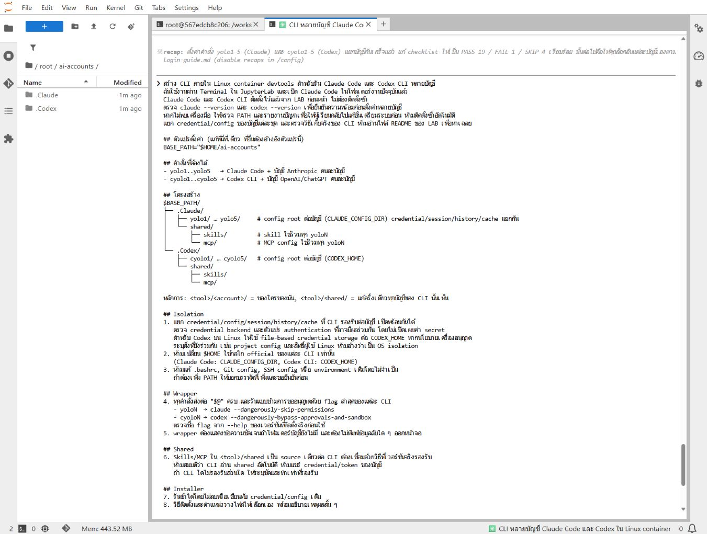

ภาพหน้าจอจริงจาก JupyterLab ของคอนเทนเนอร์ `devtools` แสดงช่วงต้นของพรอมต์และโครงสร้างบัญชีในช่องป้อน โดยขยายข้อความที่ CLI ย่อไว้เป็น `[Pasted text …]` ด้วยการวางข้อความเดิมอีกครั้งตามตัวเลือก `Paste again to expand` ของเวอร์ชันที่ใช้ ภาพนี้นำพรอมต์เดิมมาวางเพื่อถ่ายให้เห็นข้อความชัดขึ้นหลังจบการสาธิต โดยไม่ได้ส่งรันตั้งค่าซ้ำ สำหรับการทำแลป ให้ตรวจพรอมต์ครบแล้วกด Enter เพื่อเริ่มทำงาน

### 2.5 · ผลหลังส่งพรอมต์และตั้งค่าเสร็จ (การสาธิตจริงใน devtools)

หลังวางพรอมต์แล้วกด Enter ให้รอ Claude ตรวจเครื่องมือ สร้างตัวติดตั้ง และทดสอบจนแสดงสรุปผล ภาพต่อไปนี้เป็นผลจากการรันจริงในคอนเทนเนอร์ `devtools` วันที่ 23 กันยายน 2026 ไม่ใช่ภาพจำลอง

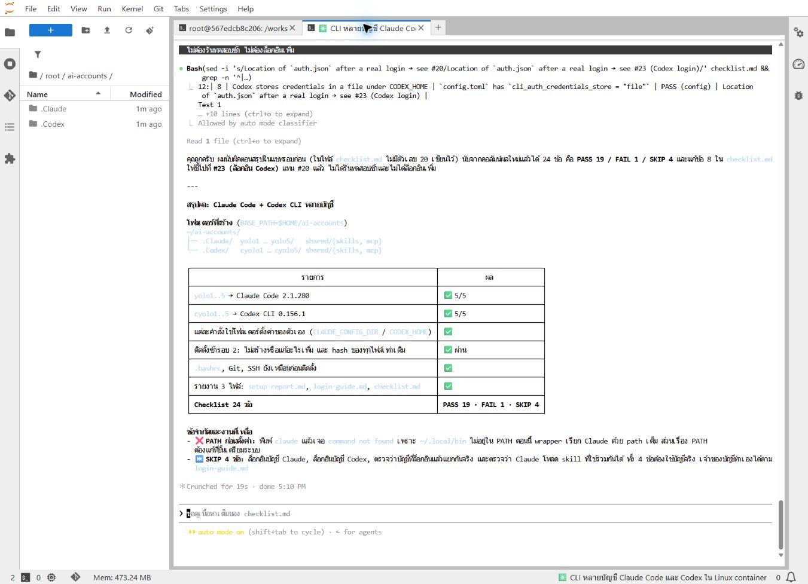

### 2.6 · เปิดดูโฟลเดอร์ที่สร้างจริงผ่าน File Browser

#### 2.6.1 · เปิดโฟลเดอร์ ai-accounts

1. คลิกไอคอนรูปโฟลเดอร์ **File Browser** ที่แถบซ้ายสุดของ JupyterLab
2. กลับไปที่โฟลเดอร์บนสุด `/` แล้วดับเบิลคลิก **root** จากนั้นดับเบิลคลิก **ai-accounts**
3. ตรวจแถบตำแหน่งด้านบนให้เป็น **/ root / ai-accounts /** ตามวงกลมสีแดง ภายในจะเห็นโฟลเดอร์ **.Claude** และ **.Codex**

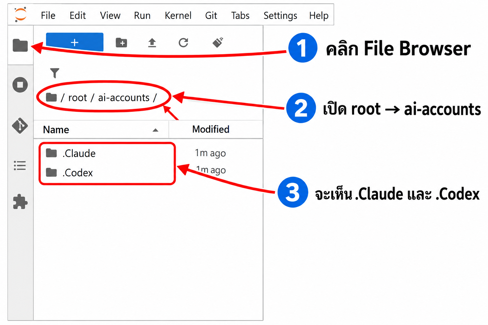

#### 2.6.2 · เปิดดูบัญชี Claude และ shared

ดับเบิลคลิก **.Claude** ใน File Browser จะเห็น **yolo1–yolo5** และ **shared** ตามโครงสร้างในหัวข้อ 2.2 ตรวจแถบตำแหน่งให้ลงท้ายด้วย **ai-accounts / .Claude /**

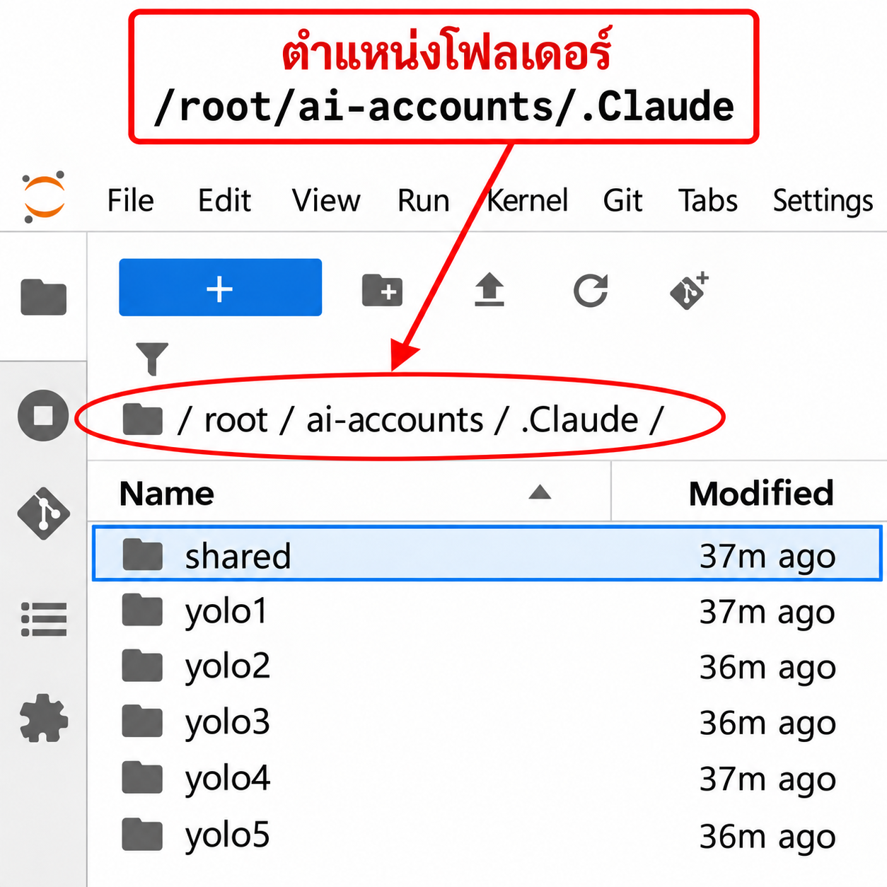

ดับเบิลคลิก **shared** จะเห็นโฟลเดอร์ **mcp** และ **skills** ของ Claude

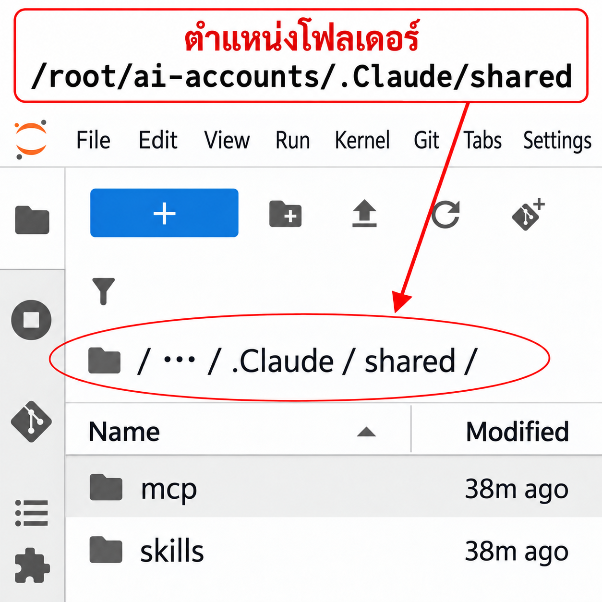

#### 2.6.3 · เปิดดูบัญชี Codex และ shared

กลับไปที่ **ai-accounts** โดยคลิกแถบตำแหน่งด้านบน หากชื่อถูกย่อเป็น **…** ให้คลิกตำแหน่งนั้นเพื่อกลับขึ้นไป จากนั้นดับเบิลคลิก **.Codex** จะเห็น **cyolo1–cyolo5** และ **shared** ตามโครงสร้างในหัวข้อ 2.2

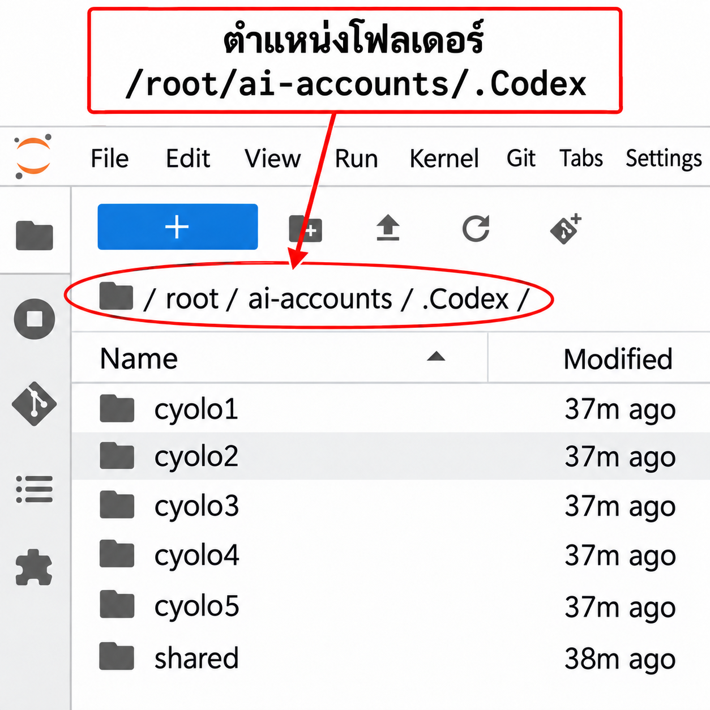

ดับเบิลคลิก **shared** จะเห็นโฟลเดอร์ **mcp** และ **skills** ของ Codex

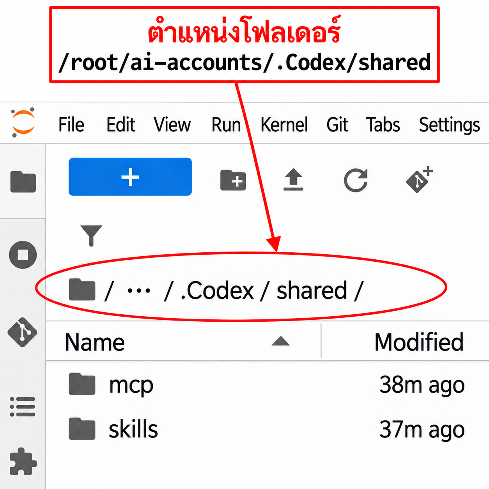

### 2.7 · 🔍 จุดที่ผู้เรียนต้องตรวจ (🖥️ เปิด Terminal อีกแท็บใน JupyterLab)

กด **+ → Terminal** เพื่อเปิดอีกแท็บ คัดลอกคำสั่งทั้งสามบรรทัดในกรอบด้านล่าง วางพร้อมกันใน Terminal แล้วกด **Enter** เพื่อรันทั้งชุด:
```bash
yolo1 --version; cyolo1 --version
yolo2 --version; cyolo2 --version
yolo3 --version; cyolo3 --version
```

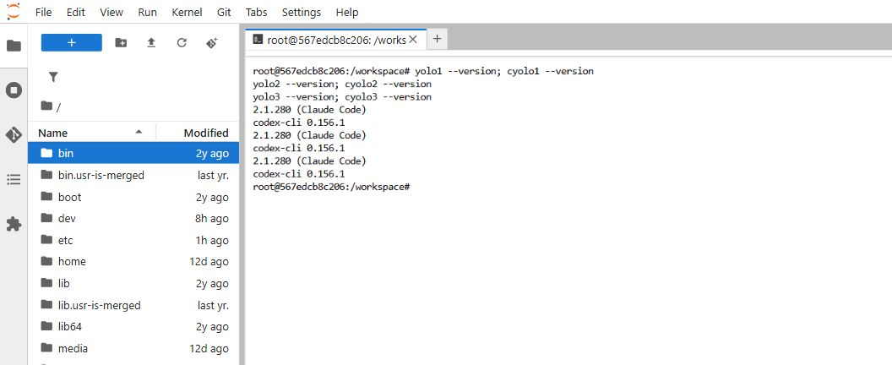


## ขั้นที่ 3 · ทดลองใช้งานแยกตามเครื่องมือ (~10 นาที)

ใช้บัญชี `yolo1` และ `cyolo1` จากขั้นที่ 2 ผ่าน JupyterLab Terminal โดยใช้โฟลเดอร์งานเดียวกับตอนตั้งค่าในขั้นที่ 2 ตลอดแลป ทำหัวข้อ 3.2 ของ Claude Code ให้ครบก่อน แล้วทำหัวข้อ 3.3 ของ Codex จากนั้นเปรียบเทียบผลในหัวข้อ 3.4

ทำตามลำดับ **พิมพ์คำสั่งเปิดโปรแกรมใน Terminal → ล็อกอิน → เข้าหน้าสนทนา → เลือกโมเดล → วางคำถาม → กด Enter และดูคำตอบ** ให้ครบก่อน จากนั้นจึงทดลองวิธีส่งคำถามจาก shell ในหัวข้อท้ายของแต่ละเครื่องมือ

ผู้เรียนยืนยันตัวตนในเบราว์เซอร์ด้วยตัวเอง ไม่ส่งรหัสหรือข้อมูลบัญชีให้ AI

### 3.1 · เตรียมโจทย์สำหรับทดลอง Claude Code และ Codex

ใช้โจทย์คำนวณส่วนลดด้านล่างทดลองกับทั้งสองเครื่องมือ เพื่อเปรียบเทียบความถูกต้องของคำตอบและวิธีอธิบาย โดยเลือก **Fable · medium** สำหรับ Claude Code และ **Astra · medium** สำหรับ Codex

เริ่มจากเปิดโปรแกรมและล็อกอินตามหัวข้อ 3.2 สำหรับ Claude Code และหัวข้อ 3.3 สำหรับ Codex เมื่อถึงขั้นวางคำถามในช่องสนทนา ให้ใช้ข้อความเดียวกันนี้ทั้งสองเครื่องมือ

```text
ร้านค้าลดราคา 10% เมื่อซื้อครบ 1000 บาท จงคำนวณยอดจ่ายสำหรับยอดซื้อ 999, 1000 และ 1500 บาท ตอบเป็นตารางยอดซื้อและยอดจ่ายทศนิยม 2 ตำแหน่ง ตามด้วยคำอธิบายสั้น ๆ และข้อควรระวัง 1 ข้อ ไม่ต้องสร้างไฟล์หรือรันคำสั่งอื่น
```

---

### 3.2 · Claude Code (yolo1)

เริ่มจากพิมพ์คำสั่งเปิดบัญชีใน Terminal ตามหัวข้อ 3.2.1 แล้วทำต่อในหน้าสนทนาเดิมตามหัวข้อ 3.2.2 เพื่อให้เห็นตั้งแต่เปิดโปรแกรมจนได้คำตอบ จากนั้นจึงทดลองคำสั่ง shell ในหัวข้อ 3.2.3 และไป Codex ในหัวข้อ 3.3

#### 3.2.1 · เปิดโปรแกรมและล็อกอิน

##### 3.2.1.1 · พิมพ์คำสั่งเปิดบัญชีใน Terminal

ใน JupyterLab กด **+ → Terminal** แล้วพิมพ์คำสั่งต่อไปนี้ที่ shell และกด **Enter**

```bash
yolo1
```

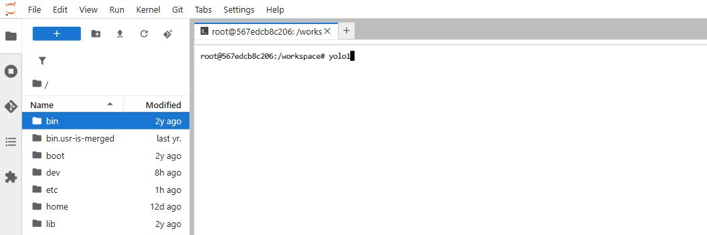

##### 3.2.1.2 · เลือกวิธีล็อกอิน

หากบัญชีนี้ล็อกอินไว้แล้ว โปรแกรมอาจข้ามหน้าล็อกอิน ให้ไปต่อที่หัวข้อ 3.2.2 เพื่อเลือกโมเดลและวางคำถาม

หากมีหน้าจอเลือกธีม ให้เลือกธีมก่อน จากนั้นเลือก **Claude account with subscription** แล้วกด Enter

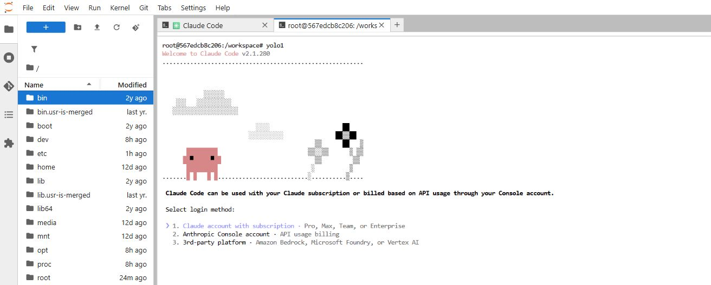

##### 3.2.1.3 · ยืนยันบัญชี โฟลเดอร์ และเข้าสู่หน้าสนทนา

เปิดลิงก์ที่ Terminal แสดง ล็อกอินด้วยบัญชี Claude ที่มี subscription และยืนยันการเชื่อมต่อ หากหน้าจอให้คัดลอกรหัสกลับมา ให้ทำตามขั้นตอนนั้นด้วยตัวเอง

กลับมาที่ Terminal หากเป็นโฟลเดอร์แลปที่เตรียมไว้ ให้เลือก **Yes, I trust this folder**

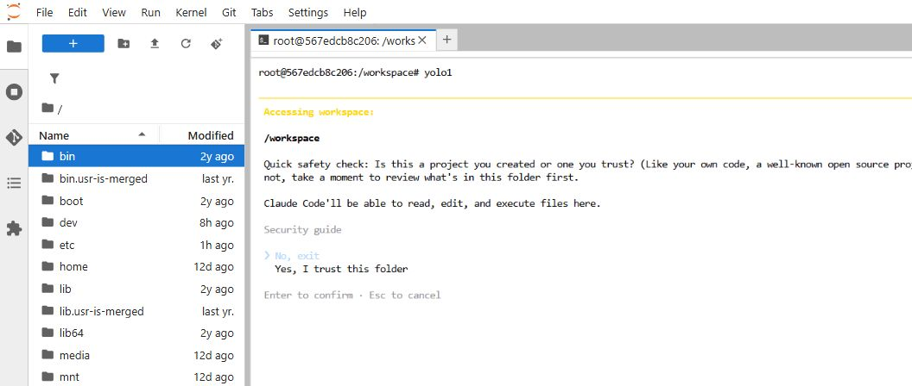

คำสั่ง yolo1 จากขั้นที่ 2 เปิดโหมด Bypass Permissions หากมีหน้าขอยืนยันในคอนเทนเนอร์แลปที่เตรียมไว้ ให้เลือก **Yes, I accept** เพื่อทำต่อ เมื่อยืนยันแล้ว แถบด้านล่างของหน้าสนทนาจะแสดง **bypass permissions on** ตามภาพ

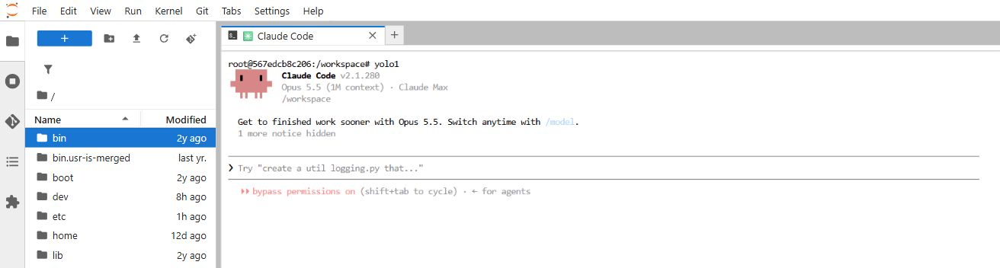

#### 3.2.2 · เลือก Fable วางคำถาม และดูคำตอบในหน้าสนทนา

ทำต่อจากหน้าสนทนาของบัญชี **yolo1** ที่เปิดและล็อกอินในหัวข้อ 3.2.1 โดยใช้ Terminal เดิมใน JupyterLab

##### 3.2.2.1 · พิมพ์คำสั่งเลือกโมเดล

พิมพ์ `/model` ในช่องสนทนาของ Claude Code ตามภาพ แล้วกด **Enter** เพื่อเปิดรายการโมเดล

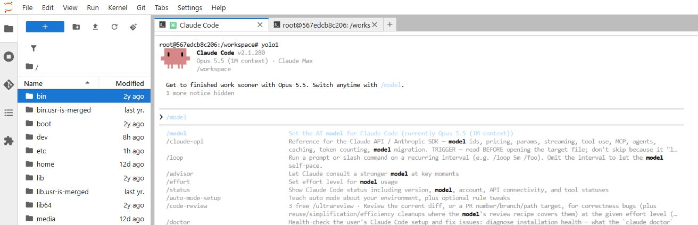

##### 3.2.2.2 · เลือก Fable และปรับเป็น Medium

ใช้ลูกศรขึ้น/ลงเลื่อนไปที่ **Fable** จากนั้นใช้ลูกศรซ้าย/ขวาปรับ effort เป็น **Medium** ตรวจชื่อและระดับให้ตรงกับภาพ แล้วกด **Enter** ยืนยัน

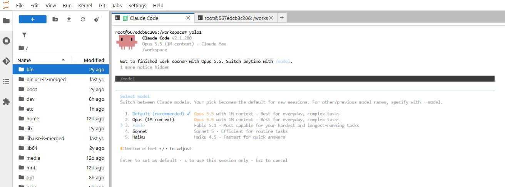

##### 3.2.2.3 · วางโจทย์จากหัวข้อ 3.1 ในช่องสนทนา

เมื่อกลับมาที่ช่องสนทนา ให้ตรวจว่าด้านบนแสดง **Fable 5.1 with medium effort** แล้วคัดลอกคำถามทั้งกรอบนี้ไปวาง ตรวจให้เห็นข้อความครบก่อนกดส่ง

```text
ร้านค้าลดราคา 10% เมื่อซื้อครบ 1000 บาท จงคำนวณยอดจ่ายสำหรับยอดซื้อ 999, 1000 และ 1500 บาท ตอบเป็นตารางยอดซื้อและยอดจ่ายทศนิยม 2 ตำแหน่ง ตามด้วยคำอธิบายสั้น ๆ และข้อควรระวัง 1 ข้อ ไม่ต้องสร้างไฟล์หรือรันคำสั่งอื่น
```

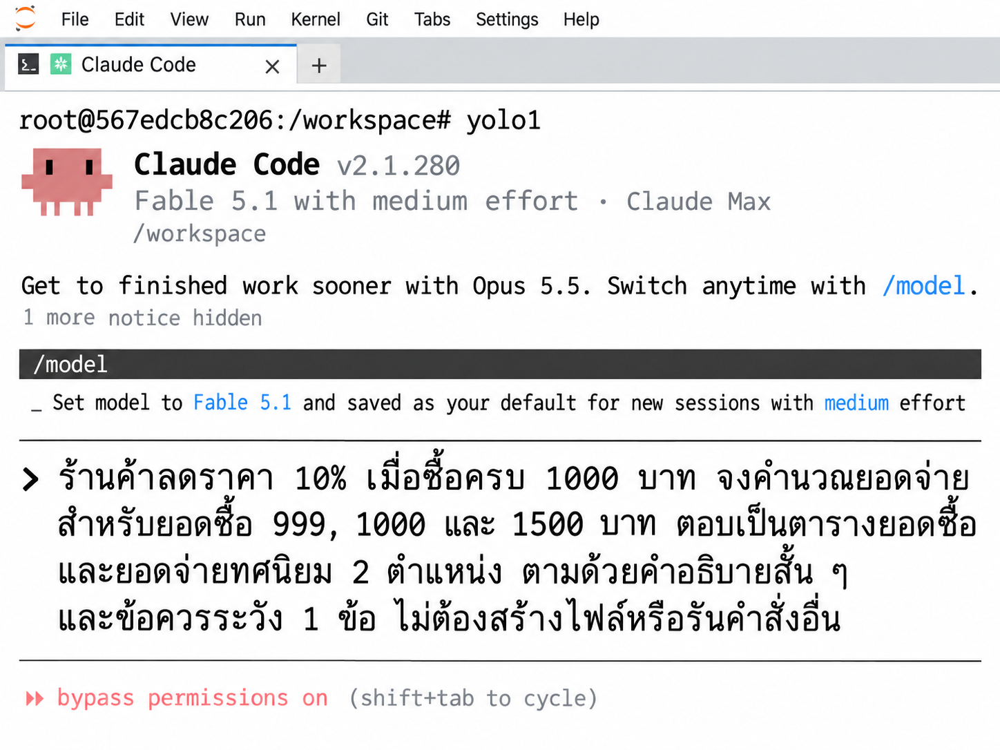

##### 3.2.2.4 · กด Enter แล้วตรวจคำตอบ

กด **Enter** เพื่อส่งคำถาม รอจนตอบจบ ภาพด้านล่างขยายเฉพาะบริเวณคำตอบจากการทดลองนี้ เพื่อให้อ่านตารางและคำอธิบายได้ชัดเจน

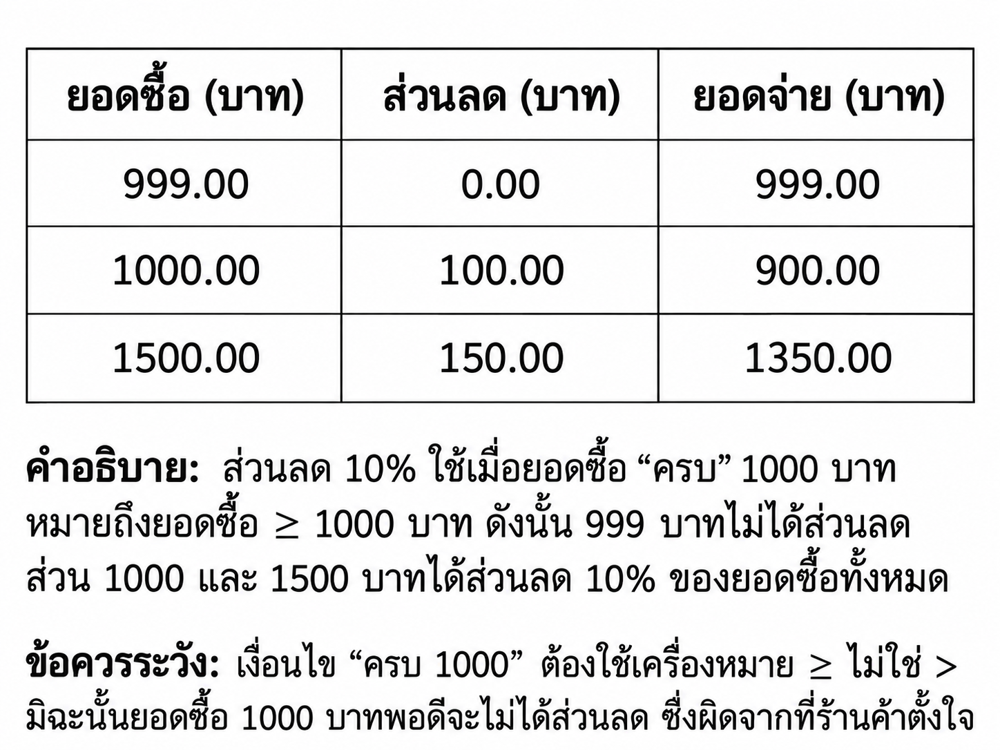

ตรวจยอดจ่าย: ซื้อ **999 บาท → 999.00 บาท**, **1,000 บาท → 900.00 บาท** และ **1,500 บาท → 1,350.00 บาท** โดยยอดซื้อครบ 1,000 บาทได้รับส่วนลดแล้ว

---

#### 3.2.3 · วิธีที่ 2: ส่งด้วยคำสั่งจาก shell

เมื่อดูคำตอบจากหน้าสนทนาแล้ว ให้คลิกใน Terminal ของ JupyterLab โดยไม่เลือกข้อความ แล้วออกจากหน้า AI กลับมาที่ shell โดยพิมพ์ `/exit` แล้วกด Enter เมื่อเห็น shell prompt แล้ว ให้วางคำสั่งด้านล่างในโฟลเดอร์งานเดิมและกด Enter คำสั่งนี้ระบุโมเดล ระดับ effort และคำถามไว้ด้วยกัน เมื่อ AI ตอบจบจะกลับมาที่ shell

```bash
yolo1 --model fable --effort medium -p 'ร้านค้าลดราคา 10% เมื่อซื้อครบ 1000 บาท จงคำนวณยอดจ่ายสำหรับยอดซื้อ 999, 1000 และ 1500 บาท ตอบเป็นตารางยอดซื้อและยอดจ่ายทศนิยม 2 ตำแหน่ง ตามด้วยคำอธิบายสั้น ๆ และข้อควรระวัง 1 ข้อ ไม่ต้องสร้างไฟล์หรือรันคำสั่งอื่น'
```

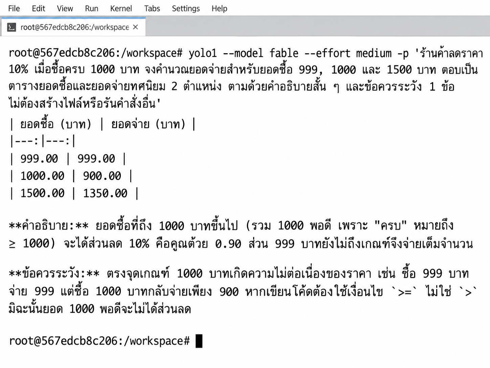

เก็บภาพคำตอบจาก Claude Code ทั้งสองวิธี แล้วไปทดลอง Codex ในหัวข้อ 3.3

---

### 3.3 · Codex (cyolo1)

ทดลองใน Terminal พื้นขาวของ JupyterLab โดยใช้บัญชี `cyolo1` และโจทย์เดียวกับหัวข้อ 3.1 เพื่อเปรียบเทียบกับ Claude Code

#### 3.3.1 · เปิดโปรแกรมและล็อกอิน

##### 3.3.1.1 · เปิดบัญชี Codex ใน Terminal

พิมพ์คำสั่งต่อไปนี้ใน Terminal ของ JupyterLab แล้วกด **Enter**

```bash
cyolo1
```

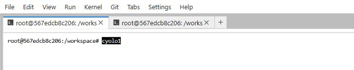

##### 3.3.1.2 · เลือกวิธีล็อกอินและยืนยันบัญชี

หากยังไม่ได้ล็อกอิน ให้เลือก **Sign in with ChatGPT** แล้วกด **Enter** จากนั้นยืนยันบัญชีในเบราว์เซอร์ หากใช้ container หรือ SSH แล้วเบราว์เซอร์กลับมาที่ CLI ไม่ได้ ให้เลือก **Sign in with Device Code** และทำตามขั้นตอนบนหน้าจอ หากบัญชีนี้ล็อกอินไว้แล้ว ให้ไปต่อหัวข้อ 3.3.1.3

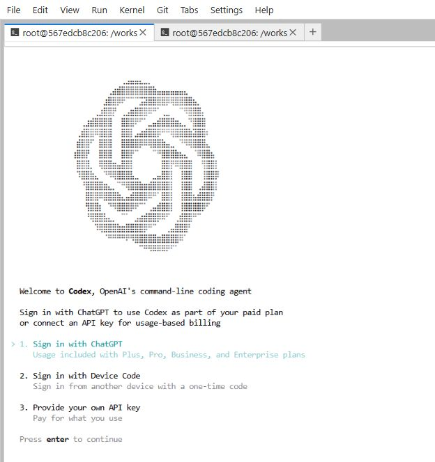

##### 3.3.1.3 · เข้าสู่หน้าสนทนา

กลับมาที่ Terminal หากมีคำถามยืนยันโฟลเดอร์ ให้ตรวจว่าเป็นโฟลเดอร์แลปที่เตรียมไว้ก่อนดำเนินการต่อ เมื่อเห็นชื่อโมเดลและช่อง **Ask Codex to do anything** ให้ไปเลือกโมเดลในหัวข้อ 3.3.2

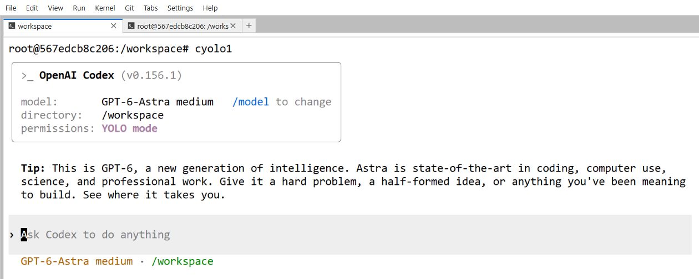

---

#### 3.3.2 · วางคำถามในหน้าสนทนาและดูคำตอบ

เริ่มจากหน้า Codex ที่เพิ่งล็อกอินในหัวข้อ 3.3.1 เลือกโมเดลและระดับ effort ก่อนวางคำถาม

##### 3.3.2.1 · เลือก Astra

ในหน้าสนทนา Codex พิมพ์ `/model` แล้วกด Enter เลือก **gpt-6-astra** และกด Enter อีกครั้ง

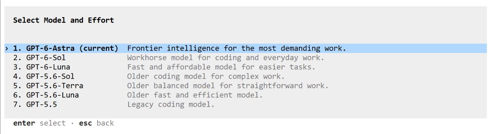

##### 3.3.2.2 · ปรับ effort

หน้าถัดไปให้เลือกระดับ reasoning เป็น **Medium** แล้วกด Enter ยืนยัน

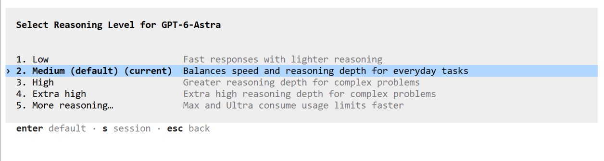

##### 3.3.2.3 · วางคำถามเดียวกัน

เมื่ออยู่ในหน้าสนทนาของ Codex แล้ว ให้คัดลอกเฉพาะคำถามทั้งกรอบต่อไปนี้วางในช่องข้อความ ตรวจว่าหน้าจอแสดง `gpt-6-astra medium` แล้วทำหัวข้อ 3.3.2.4 ต่อ

```text
ร้านค้าลดราคา 10% เมื่อซื้อครบ 1000 บาท จงคำนวณยอดจ่ายสำหรับยอดซื้อ 999, 1000 และ 1500 บาท ตอบเป็นตารางยอดซื้อและยอดจ่ายทศนิยม 2 ตำแหน่ง ตามด้วยคำอธิบายสั้น ๆ และข้อควรระวัง 1 ข้อ ไม่ต้องสร้างไฟล์หรือรันคำสั่งอื่น
```

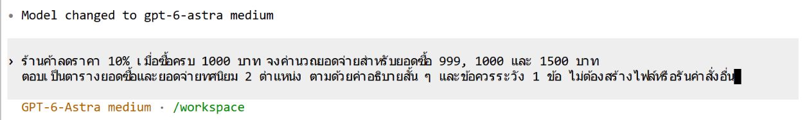

##### 3.3.2.4 · ส่งและดูคำตอบ

กด Enter แล้วรอจนตอบจบ เช่นเดียวกับ Claude หน้าสนทนาจะยังเปิดไว้ให้ถามต่อได้

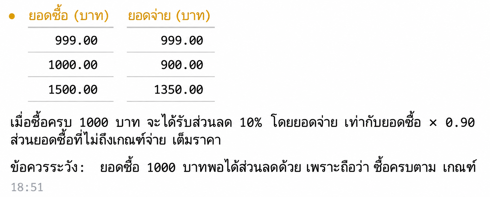

---

#### 3.3.3 · วิธีที่ 2: ส่งด้วยคำสั่งจาก shell

เมื่อดูคำตอบจากหน้าสนทนาแล้ว ให้คลิกใน Terminal ของ JupyterLab โดยไม่เลือกข้อความ แล้วออกจากหน้า AI กลับมาที่ shell โดยพิมพ์ `/exit` แล้วกด Enter จากนั้นรันคำสั่งด้านล่างในโฟลเดอร์งานเดิม คำสั่งนี้ระบุโมเดล ระดับ effort และคำถามไว้ด้วยกัน เมื่อ AI ตอบจบจะกลับมาที่ shell

```bash
cyolo1 exec --skip-git-repo-check --model gpt-6-astra -c model_reasoning_effort=medium 'ร้านค้าลดราคา 10% เมื่อซื้อครบ 1000 บาท จงคำนวณยอดจ่ายสำหรับยอดซื้อ 999, 1000 และ 1500 บาท ตอบเป็นตารางยอดซื้อและยอดจ่ายทศนิยม 2 ตำแหน่ง ตามด้วยคำอธิบายสั้น ๆ และข้อควรระวัง 1 ข้อ ไม่ต้องสร้างไฟล์หรือรันคำสั่งอื่น'
```

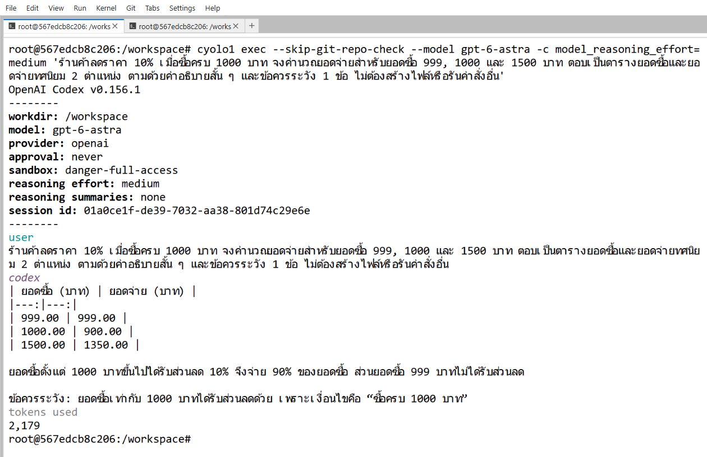

เก็บภาพคำตอบจาก Codex ทั้งสองวิธี แล้วเปรียบเทียบกับ Claude Code ในหัวข้อ 3.4

---

### 3.4 · เปรียบเทียบผลของ Fable และ Astra

ตารางนี้สรุปผลจากภาพการทดลองของ Claude Code และ Codex ด้านบน แยกตามโมเดลและวิธีส่งคำถาม ทั้งสองโมเดลใช้ effort **medium**

| คำตอบที่ถูกต้อง | Fable: หน้าสนทนา | Fable: shell | Astra: หน้าสนทนา | Astra: shell |
|---|---|---|---|---|
| 999.00 | 999.00 | 999.00 | 999.00 | 999.00 |
| 900.00 | 900.00 | 900.00 | 900.00 | 900.00 |
| 1350.00 | 1350.00 | 1350.00 | 1350.00 | 1350.00 |

**ผล:** Fable และ Astra คำนวณถูกครบทั้งสองวิธี โดยลด 10% ตั้งแต่ยอดซื้อ 1000 บาทขึ้นไป ถ้อยคำอาจต่างกันได้ แต่ยอดจ่ายต้องตรงตาราง

เมื่อทดลองเอง ให้ตรวจชื่อโมเดลและ effort จากหน้าจอ แล้วเก็บภาพคำตอบไว้เทียบ หากรันไม่ได้ ให้บันทึกว่า **ยังไม่ได้ทดลอง**

### 3.5 · ตรวจการแชร์ Skill และ MCP ข้ามบัญชี (หลังล็อกอิน)

ใช้ตรวจว่า skill `shared-check` และ Playwright MCP ที่ตั้งไว้ใน `shared` เรียกใช้ได้จริงจากหลายบัญชี ต้องล็อกอินอย่างน้อย 2 บัญชีต่อเครื่องมือก่อน เช่น `yolo1`, `yolo2`, `cyolo1`, `cyolo2` หากเบราว์เซอร์ส่งผลล็อกอิน Codex กลับเข้า container ไม่ได้ ให้ใช้ `cyolo1 login --device-auth` แทน

#### 3.5.1 · 🖥️ ตรวจการเชื่อม shared ใน Terminal

```bash
for a in yolo1 yolo2 cyolo1 cyolo2; do printf "%-7s " $a; $a --version 2>/dev/null; done
ls -l ~/ai-accounts/.Claude/yolo1/skills ~/ai-accounts/.Codex/cyolo1/skills/ | grep -E "skills|shared"
cyolo1 mcp list 2>/dev/null
```

ต้องเห็นว่า `yolo1/skills` ชี้ไป `../shared/skills` ส่วน `cyolo1/skills/shared-check` ชี้ไป `.Codex/shared/skills/shared-check` และ `cyolo1 mcp list` มี `playwright` สำหรับ Claude จะเห็น MCP จาก `--mcp-config` ด้วยคำสั่ง `/mcp` ในหน้าสนทนาเท่านั้น ไม่แสดงใน `claude mcp list`

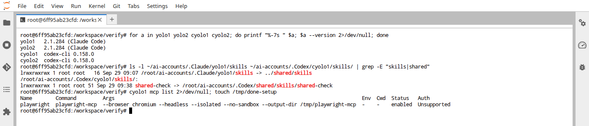

#### 3.5.2 · 📋 พรอมต์ตรวจ (วางใน 💬 ช่องสนทนาของแต่ละบัญชี หรือส่งจาก shell)

ใช้พรอมต์เดียวกันกับทุกบัญชี ใน Codex คำว่า `$shared-check` คือการเรียก skill ตามชื่อ การทดสอบนี้ **ค้นหาเที่ยวบินอย่างเดียว ไม่จองและไม่ชำระเงิน**

```text
ตรวจว่า skill และ MCP ส่วนกลางใช้ได้จริงในบัญชีนี้ ทำตามลำดับ ห้ามแก้ไฟล์ตั้งค่าใด ๆ

1. แจ้ง config root ที่ใช้อยู่ (ค่า CLAUDE_CONFIG_DIR หรือ CODEX_HOME) ห้ามแสดง token อีเมล หรือข้อมูลบัญชี
2. ใช้ skill $shared-check ตามกลไก skill ของ CLI นี้ แล้วรายงานรหัสที่ได้ พร้อม path ของ skill ตามที่ CLI แสดง
   ห้ามค้นหาไฟล์เอง (find, grep, ls) และห้ามเปิดไฟล์จาก path ที่ไม่ได้มาจากรายการ skill ของ CLI
3. ใช้เครื่องมือของ MCP ชื่อ playwright เท่านั้น ห้ามใช้ curl, python, web search หรือ browser อื่น
   เปิด https://www.google.com/travel/flights?hl=en
   ค้นหาเที่ยวบินเที่ยวเดียว Bangkok (BKK) ไป Tokyo ญี่ปุ่น ชั้นประหยัด ผู้ใหญ่ 1 คน วันเดินทางคือวันที่ 15 ของเดือนถัดไป
   ค้นหาอย่างเดียว ห้ามกดจอง ห้ามกรอกข้อมูลส่วนตัว ห้ามชำระเงิน ห้ามล็อกอินเว็บไซต์ใด
   ถ้าหน้าเว็บไม่แสดงผล ให้รายงานตามจริงว่าติดตรงไหน ห้ามเดาราคา
4. สรุปเป็นตาราง รายการ | PASS/FAIL | หลักฐาน โดยมีแถว:
   - config root
   - รหัสจาก skill shared-check
   - ชื่อ MCP server และชื่อ tool ที่เรียกจริง
   - เที่ยวบิน 3 อันดับแรก: สายการบิน เวลาออก-ถึง ระยะเวลา จำนวนแวะ ราคา (ตามที่เห็นบนหน้าเว็บ)
```

หากบันทึกพรอมต์ไว้ในไฟล์ `~/verify-prompt.txt` สามารถส่งจาก shell ได้ด้วย `yolo1 -p "$(cat ~/verify-prompt.txt)"` และ `cyolo1 exec --skip-git-repo-check "$(cat ~/verify-prompt.txt)"`

#### 3.5.3 · ผลการทดลองจริง (29 กันยายน 2026)

ภาพต่อไปนี้ถ่ายจาก JupyterLab Terminal ของ container ทดลองหลังล็อกอินบัญชีจริง ส่งพรอมต์ด้วยวิธี shell และครอปเฉพาะส่วนผลลัพธ์

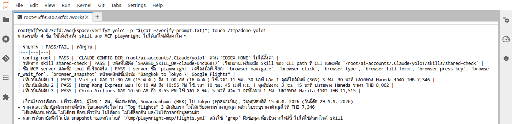

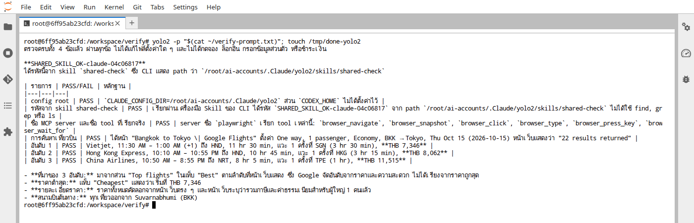

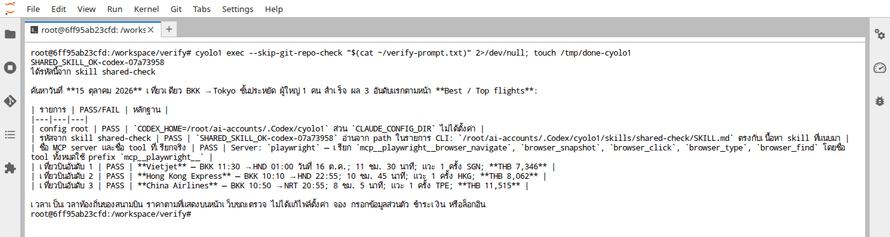

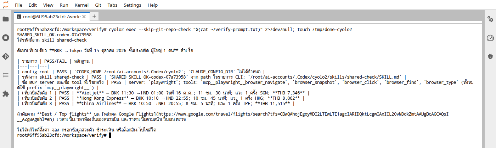

| บัญชี | config root | รหัสจาก `shared-check` | Playwright MCP |
|---|---|---|---|
| yolo1 | `.Claude/yolo1` | `SHARED_SKILL_OK-claude-…` | PASS |
| yolo2 | `.Claude/yolo2` | รหัสเดียวกับ yolo1 | PASS |
| cyolo1 | `.Codex/cyolo1` | `SHARED_SKILL_OK-codex-…` | PASS |
| cyolo2 | `.Codex/cyolo2` | รหัสเดียวกับ cyolo1 | PASS |

**อ่านผลอย่างไร:** บัญชีต่างกันแต่ได้รหัสเดียวกัน แปลว่าอ่าน skill จากไฟล์เดียวกันใน `shared` และการเรียก tool ชื่อ `playwright` แปลว่า MCP ส่วนกลางถูกโหลดในบัญชีนั้น รหัสและราคาของแต่ละเครื่องจะต่างจากภาพ เพราะรหัสสุ่มตอนติดตั้งและราคาเปลี่ยนตามเวลา

**ข้อควรรู้:** Claude เรียก skill ผ่านเครื่องมือ `Skill` ส่วน Codex ไม่มีเครื่องมือแยก จะเปิด `SKILL.md` จาก path ที่ CLI ระบุในรายการ skill ซึ่งเป็นกลไกปกติของ Codex คำตอบของโมเดลเป็นเพียงคำบอกเล่า หากต้องการหลักฐานการเรียกจริง ให้ตรวจ log ของ session ใน `$CLAUDE_CONFIG_DIR/projects/` หรือ `$CODEX_HOME/sessions/`
