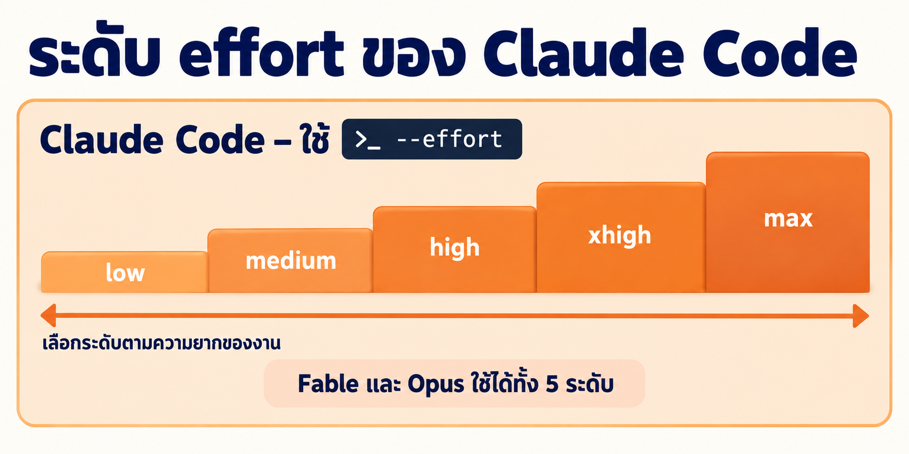
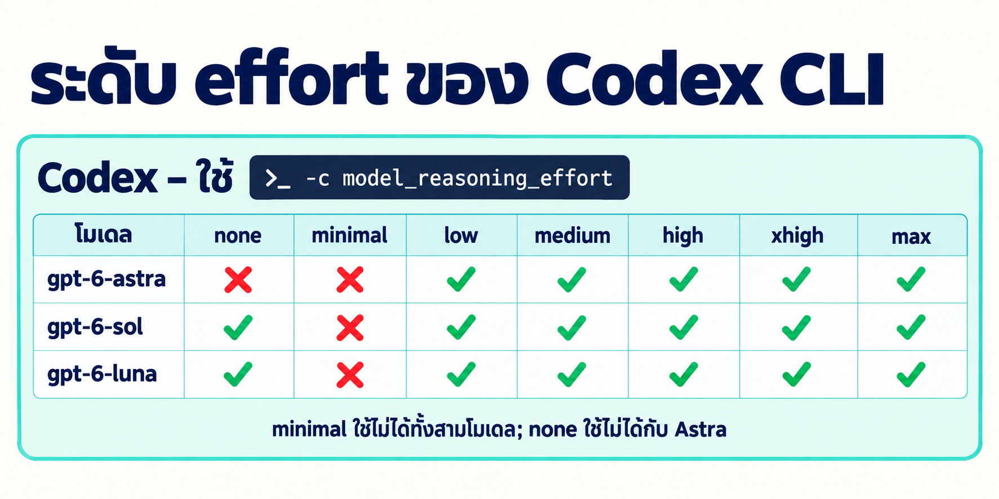
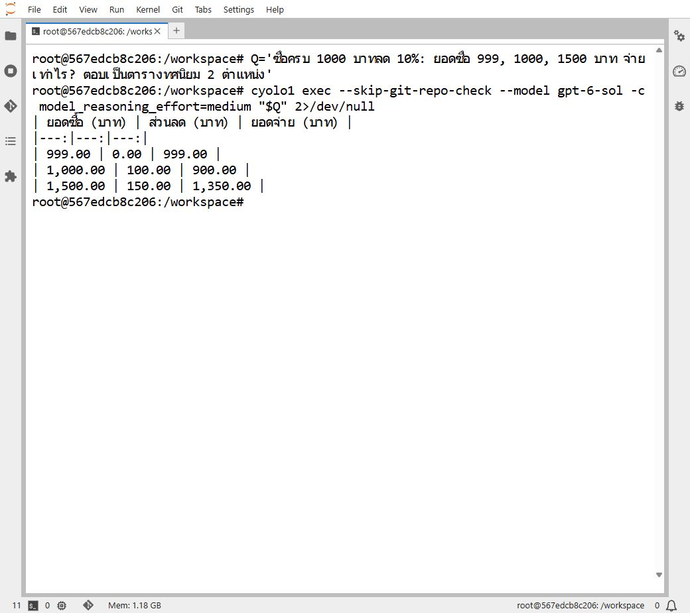
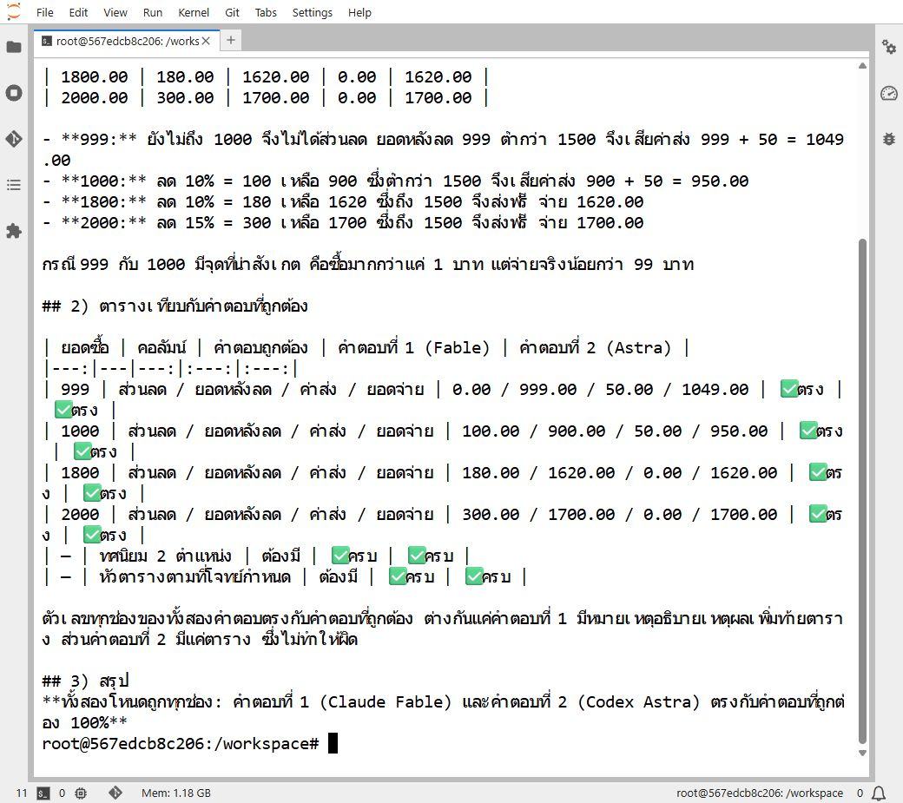

# LAB · เรียกโมเดลจาก shell: ตารางคำสั่งของ Claude และ Codex

**สิ่งที่จะได้:** อ่านคำสั่งเรียกโมเดลจาก shell ออกทีละส่วน เขียนคำสั่งของ Claude และ Codex ได้ครบทุกโมเดลและทุกระดับ effort และต่อหลายโมเดลเป็น Graph ทั้งแบบส่งงานผ่านไฟล์และผ่านตัวแปรของ shell

ขอบเขต: Claude Code (`yolo1`) และ Codex CLI (`cyolo1`) เท่านั้น

**โครงของแลป**

| หัวข้อ | เนื้อหา | เวลา |
|---|---|---|
| 1 | ตรวจความพร้อมของเครื่อง | 2 นาที |
| 2 | ตารางคำสั่งของ Claude (Fable, Opus) | 15 นาที |
| 3 | ตารางคำสั่งของ Codex (Astra, Sol, Luna) | 10 นาที |
| 4 | เก็บคำตอบและต่อโมเดลเป็น Graph | 20 นาที |

---

## 1 · ก่อนเริ่ม

แลปนี้ถือว่าผู้เรียนมีครบทั้งสามข้อแล้ว

1. มีคำสั่ง `yolo1` และ `cyolo1` บนเครื่อง
2. ล็อกอินบัญชี `yolo1` (Claude) และ `cyolo1` (Codex) แล้ว
3. เปิด 🖥️ Terminal ใน JupyterLab ของ container `devtools` ค้างไว้

ตรวจความพร้อมด้วยคำสั่งนี้ก่อนเสมอ ถ้าบรรทัดไหนไม่ขึ้นเลขเวอร์ชัน ให้กลับไปแก้แลปก่อนหน้า

```bash
yolo1 --version; cyolo1 --version
```

ผลที่ควรได้ (เลขเวอร์ชันของแต่ละเครื่องอาจต่างกัน)

```text
2.1.258 (Claude Code)
codex-cli 0.156.1
```


*ภาพหน้าจอจริงจาก 🖥️ Terminal ของ JupyterLab บน container `devtools` (บันทึก 23 ก.ย. 2026)*

รายการโมเดลและระดับ effort ในหน้านี้ผูกกับเวอร์ชันของเครื่องมือและบัญชีที่ใช้ ถ้าเครื่องผู้เรียนให้ผลไม่ตรงตาราง **ไม่ได้แปลว่าพิมพ์ผิด** ให้ตรวจซ้ำบนเครื่องตัวเองแล้วบันทึกผลที่ได้จริงไว้แทน

---

## 2 · อ่านโครงคำสั่ง แล้วเรียก Claude ครบทุกระดับ: Fable และ Opus (~15 นาที)

คำสั่งเรียก Claude หนึ่งบรรทัดบอกสี่เรื่อง คือ **บัญชีไหน (`yolo1`) · โมเดลไหน (`--model`) · คิดหนักแค่ไหน (`--effort`) · โจทย์อะไร (`-p "$Q"`)**


*ภาพแนวคิดที่สร้างขึ้นเพื่ออธิบายโครงคำสั่งของ Claude ไม่ใช่ภาพหน้าจอจริง*



*ภาพแนวคิดที่สร้างขึ้นเพื่อสรุประดับ `--effort` ของ Claude ไม่ใช่ภาพหน้าจอจริง*

### 2.1 · ตั้งโจทย์ไว้ในตัวแปรก่อน

ทุกคำสั่งในตารางของหัวข้อ 2.2 และ 3.2 ใช้โจทย์เดียวกัน ให้เก็บโจทย์ไว้ในตัวแปรของ shell ก่อน จะได้ไม่ต้องพิมพ์ซ้ำ คัดลอกทั้งกรอบไปวางใน 🖥️ Terminal แล้วกด Enter

```bash
Q='ซื้อครบ 1000 บาทลด 10%: ยอดซื้อ 999, 1000, 1500 บาท จ่ายเท่าไร? ตอบเป็นตารางทศนิยม 2 ตำแหน่ง'
```

ตรวจว่าตัวแปรเก็บค่าแล้วด้วย `echo "$Q"` ตัวแปรนี้อยู่เฉพาะใน Terminal แท็บนั้น เปิดแท็บใหม่ต้องตั้งใหม่

### 2.2 · ตารางคำสั่งครบทุกระดับ

Claude Code รับ effort 5 ระดับ (`claude --help` ระบุ `low, medium, high, xhigh, max`) และทั้งสองโมเดลรับครบทุกระดับ ตารางนี้จึงมี 10 คำสั่ง **รันจริงครบทั้ง 10 คำสั่งแล้ว ผ่านและตอบเลขถูกทั้งหมด**

| # | โมเดล | effort | คำสั่ง (คัดลอกได้ทั้งบรรทัด) |
|---|---|---|---|
| 1 | Fable | low | `yolo1 --model fable --effort low -p "$Q"` |
| 2 | Fable | medium | `yolo1 --model fable --effort medium -p "$Q"` |
| 3 | Fable | high | `yolo1 --model fable --effort high -p "$Q"` |
| 4 | Fable | xhigh | `yolo1 --model fable --effort xhigh -p "$Q"` |
| 5 | Fable | max | `yolo1 --model fable --effort max -p "$Q"` |
| 6 | Opus | low | `yolo1 --model opus --effort low -p "$Q"` |
| 7 | Opus | medium | `yolo1 --model opus --effort medium -p "$Q"` |
| 8 | Opus | high | `yolo1 --model opus --effort high -p "$Q"` |
| 9 | Opus | xhigh | `yolo1 --model opus --effort xhigh -p "$Q"` |
| 10 | Opus | max | `yolo1 --model opus --effort max -p "$Q"` |

**ต้องใส่เครื่องหมายคำพูดคู่ครอบ `"$Q"` เสมอ** ถ้าเขียน `-p $Q` เฉย ๆ shell จะตัดโจทย์เป็นหลายชิ้นตามช่องว่าง แล้ว Claude จะได้รับแค่คำแรก

**ภาพหน้าจอจริงจาก 🖥️ Terminal ใน JupyterLab:** ด้านล่างคือการรันสองแถวจากตาราง (แถว 2 และแถว 7) ด้วยโจทย์ `$Q` เดียวกันจากหัวข้อ 2.1

**ตัวอย่างที่ 1 · Fable medium**

```bash
Q='ซื้อครบ 1000 บาทลด 10%: ยอดซื้อ 999, 1000, 1500 บาท จ่ายเท่าไร? ตอบเป็นตารางทศนิยม 2 ตำแหน่ง'
yolo1 --model fable --effort medium -p "$Q"
```


*Fable medium ตอบเป็นตารางที่มีคอลัมน์เข้าเงื่อนไข ส่วนลด และยอดจ่าย พร้อมหมายเหตุสั้น ๆ ว่ายอด 999 ยังไม่เข้าเงื่อนไข*

**ตัวอย่างที่ 2 · Opus medium**

```bash
Q='ซื้อครบ 1000 บาทลด 10%: ยอดซื้อ 999, 1000, 1500 บาท จ่ายเท่าไร? ตอบเป็นตารางทศนิยม 2 ตำแหน่ง'
yolo1 --model opus --effort medium -p "$Q"
```


*Opus medium ตอบเป็นตารางแบบเดียวกัน ระบุเงื่อนไขขั้นต่ำ และเสริมว่าซื้อ 999 บาทจ่ายแพงกว่าซื้อ 1000 บาทอยู่ 99 บาท ทั้งนี้ผลลัพธ์ที่ออกมาบน Terminal ยังติดเครื่องหมาย `**` ของ Markdown มาด้วย*

ทั้งสองโมเดลให้ตัวเลขตรงกันทุกแถว คือ 999.00, 900.00 และ 1350.00 ต่างกันแค่รูปแบบการนำเสนอและรายละเอียดคำอธิบายในการรันรอบนี้ **การรันเพียงรอบเดียวยังสรุปไม่ได้ว่าโมเดลใดดีกว่าโดยทั่วไป** ถ้าอยากเทียบจริงต้องรันซ้ำหลายรอบและเทียบด้วยโจทย์หลายแบบ

### 2.3 · เลือก effort อย่างไร

| ระดับ | เหมาะกับ |
|---|---|
| `low` | งานซ้ำ ๆ ที่รู้คำตอบอยู่แล้ว เช่น จัดรูปแบบข้อความ แปลสั้น ๆ สรุปย่อหน้าเดียว |
| `medium` | งานทั่วไปที่มีหลายขั้นตอนแต่ไม่ซับซ้อน เป็นค่าเริ่มต้นถ้าไม่แน่ใจ |
| `high` | งานที่ต้องคิดหลายชั้น เช่น ไล่หาสาเหตุบั๊ก ออกแบบโครงสร้าง ตรวจงานของโมเดลอื่น |
| `xhigh` / `max` | โจทย์ยากที่ยอมแลกเวลาและโทเคนเพื่อความถูกต้อง เช่น พิสูจน์เงื่อนไขซับซ้อน หรือเป็นโหนดตัดสินใน Graph |

---

## 3 · ตารางคำสั่งของ Codex: Astra, Sol และ Luna (~10 นาที)

ฝั่ง Codex ต่างจาก Claude สามจุด: ถามครั้งเดียวต้องใช้ subcommand `exec`, ระดับ effort ไม่มี flag ตรง ๆ ต้อง override ค่า config ด้วย `-c model_reasoning_effort=...` และโจทย์เป็นอาร์กิวเมนต์สุดท้ายโดยไม่มี `-p` นำหน้า


*ภาพแนวคิดที่สร้างขึ้นเพื่ออธิบายโครงคำสั่งของ Codex ไม่ใช่ภาพหน้าจอจริง*

> 🔍 **จุดที่ผู้เรียนต้องตรวจ:** เขียนคำสั่งของ Codex ด้วย `--effort medium` แล้วรันดู จะได้ error เพราะ Codex ไม่มี flag ชื่อนี้ ลองผิดหนึ่งครั้งเพื่อจำจุดต่าง

### 3.1 · ระดับที่แต่ละโมเดลรับได้ไม่เท่ากัน

**ฝั่ง Codex แต่ละโมเดลรับระดับไม่เท่ากัน** ตารางนี้มาจากการรันจริงทั้ง 21 ช่อง (3 โมเดล × 7 ระดับ)



*ภาพนี้เป็นแผนภาพแนวคิดที่สร้างขึ้นด้วยเครื่องมือ Imagegen เพื่อสรุปการรองรับของฝั่ง Codex จากตารางด้านล่าง ไม่ใช่ภาพหน้าจอจริง*

| โมเดล | `none` | `minimal` | `low` | `medium` | `high` | `xhigh` | `max` |
|---|:--:|:--:|:--:|:--:|:--:|:--:|:--:|
| `gpt-6-astra` | ❌ | ❌ | ✅ | ✅ | ✅ | ✅ | ✅ |
| `gpt-6-sol` | ✅ | ❌ | ✅ | ✅ | ✅ | ✅ | ✅ |
| `gpt-6-luna` | ✅ | ❌ | ✅ | ✅ | ✅ | ✅ | ✅ |

สิ่งที่พบ:

- `minimal` **ใช้ไม่ได้กับทั้งสามโมเดล** แม้ CLI จะยอมรับคำนี้ตอนตรวจรูปแบบ
- `none` ใช้ได้กับ `gpt-6-sol` และ `gpt-6-luna` แต่ **ใช้ไม่ได้กับ `gpt-6-astra`**
- ระดับที่ใช้ได้ครบทั้งสามโมเดลคือ `low`, `medium`, `high`, `xhigh`, `max` สคริปต์ที่ต้องสลับโมเดลได้ควรอยู่ในห้าระดับนี้

### 3.2 · ตารางคำสั่งที่ใช้ได้จริง

ใช้ตัวแปร `$Q` จากหัวข้อ 2.1 **ทุกคำสั่งในตารางนี้รันจริงแล้วและตอบเลขถูกครบทั้ง 17 คำสั่ง**

| # | โมเดล | effort | คำสั่ง (คัดลอกได้ทั้งบรรทัด) |
|---|---|---|---|
| 1 | Astra | low | `cyolo1 exec --skip-git-repo-check --model gpt-6-astra -c model_reasoning_effort=low "$Q"` |
| 2 | Astra | medium | `cyolo1 exec --skip-git-repo-check --model gpt-6-astra -c model_reasoning_effort=medium "$Q"` |
| 3 | Astra | high | `cyolo1 exec --skip-git-repo-check --model gpt-6-astra -c model_reasoning_effort=high "$Q"` |
| 4 | Astra | xhigh | `cyolo1 exec --skip-git-repo-check --model gpt-6-astra -c model_reasoning_effort=xhigh "$Q"` |
| 5 | Astra | max | `cyolo1 exec --skip-git-repo-check --model gpt-6-astra -c model_reasoning_effort=max "$Q"` |
| 6 | Sol | none | `cyolo1 exec --skip-git-repo-check --model gpt-6-sol -c model_reasoning_effort=none "$Q"` |
| 7 | Sol | low | `cyolo1 exec --skip-git-repo-check --model gpt-6-sol -c model_reasoning_effort=low "$Q"` |
| 8 | Sol | medium | `cyolo1 exec --skip-git-repo-check --model gpt-6-sol -c model_reasoning_effort=medium "$Q"` |
| 9 | Sol | high | `cyolo1 exec --skip-git-repo-check --model gpt-6-sol -c model_reasoning_effort=high "$Q"` |
| 10 | Sol | xhigh | `cyolo1 exec --skip-git-repo-check --model gpt-6-sol -c model_reasoning_effort=xhigh "$Q"` |
| 11 | Sol | max | `cyolo1 exec --skip-git-repo-check --model gpt-6-sol -c model_reasoning_effort=max "$Q"` |
| 12 | Luna | none | `cyolo1 exec --skip-git-repo-check --model gpt-6-luna -c model_reasoning_effort=none "$Q"` |
| 13 | Luna | low | `cyolo1 exec --skip-git-repo-check --model gpt-6-luna -c model_reasoning_effort=low "$Q"` |
| 14 | Luna | medium | `cyolo1 exec --skip-git-repo-check --model gpt-6-luna -c model_reasoning_effort=medium "$Q"` |
| 15 | Luna | high | `cyolo1 exec --skip-git-repo-check --model gpt-6-luna -c model_reasoning_effort=high "$Q"` |
| 16 | Luna | xhigh | `cyolo1 exec --skip-git-repo-check --model gpt-6-luna -c model_reasoning_effort=xhigh "$Q"` |
| 17 | Luna | max | `cyolo1 exec --skip-git-repo-check --model gpt-6-luna -c model_reasoning_effort=max "$Q"` |

### 3.3 · ภาพหน้าจอจริง: เทียบ Astra กับ Sol ที่ระดับ medium

ทั้งสองตัวอย่างใช้โจทย์ `$Q` สั้น ๆ ชุดเดียวกันจากหัวข้อ 2.1 และรันใน 🖥️ Terminal ของ JupyterLab

**ตัวอย่างที่ 1 · Astra medium**

```bash
Q='ซื้อครบ 1000 บาทลด 10%: ยอดซื้อ 999, 1000, 1500 บาท จ่ายเท่าไร? ตอบเป็นตารางทศนิยม 2 ตำแหน่ง'
cyolo1 exec --skip-git-repo-check --model gpt-6-astra -c model_reasoning_effort=medium "$Q" 2>/dev/null
```


*Astra medium ตอบเป็นตาราง Markdown ดิบสามคอลัมน์ ไม่มีข้อความอธิบายเพิ่ม บน Terminal จึงเห็นเครื่องหมาย `|` และบรรทัดคั่น `|---:|` ของ Markdown ตรง ๆ*

**ตัวอย่างที่ 2 · Sol medium**

```bash
Q='ซื้อครบ 1000 บาทลด 10%: ยอดซื้อ 999, 1000, 1500 บาท จ่ายเท่าไร? ตอบเป็นตารางทศนิยม 2 ตำแหน่ง'
cyolo1 exec --skip-git-repo-check --model gpt-6-sol -c model_reasoning_effort=medium "$Q" 2>/dev/null
```



---

## 4 · เก็บคำตอบและต่อโมเดลเป็น Graph (~20 นาที)

### 4.1 · เก็บคำตอบไว้ใช้ต่อ

**เก็บลงไฟล์** ฝั่ง Claude ใช้การเปลี่ยนทิศทางของ shell ตามปกติ ฝั่ง Codex มี flag `-o` ที่เขียน **เฉพาะข้อความสุดท้ายของ AI** ลงไฟล์ ไม่มีหัวรายงานปน

```bash
yolo1 --model fable --effort medium -p "$Q" > claude-answer.md
cyolo1 exec --skip-git-repo-check --model gpt-6-astra -c model_reasoning_effort=medium -o codex-answer.md "$Q"
```

**เก็บลงตัวแปร** ใช้ `$( )` ครอบคำสั่ง ซึ่งจับเฉพาะ stdout เท่านั้น ฝั่ง Codex มีหัวรายงาน (ชื่อโมเดล ระดับ effort จำนวนโทเคน) ออกทาง stderr ถ้าไม่เติม `2>/dev/null` หัวรายงานจะไม่เข้าไปใน `CODEX_ANS` แต่จะพิมพ์ขึ้นบนหน้าจอปนกับคำสั่งอื่น เติมไว้เพื่อให้หน้าจอสะอาด

```bash
CLAUDE_ANS=$(yolo1 --model fable --effort medium -p "$Q")
CODEX_ANS=$(cyolo1 exec --skip-git-repo-check --model gpt-6-astra -c model_reasoning_effort=medium "$Q" 2>/dev/null)
echo "$CLAUDE_ANS"
echo "$CODEX_ANS"
```

> 🔍 **จุดที่ผู้เรียนต้องตรวจ:** รันบรรทัด `CODEX_ANS=...` โดย **ตัด** `2>/dev/null` ออกหนึ่งครั้ง แล้ว `echo "$CODEX_ANS"` เทียบกับตอนที่ใส่ คำตอบจะเหมือนเดิม แต่หัวรายงานไปโผล่บนหน้าจอแทนที่จะเข้าไปในตัวแปร


*ภาพแนวคิดของการเก็บคำตอบลงไฟล์เทียบกับเก็บลงตัวแปรของ shell ทั้งฝั่ง Fable และ Astra ไม่ใช่ภาพหน้าจอจากการรันจริง*

### 4.2 · ต่อโมเดลเป็น Graph

เมื่อเก็บคำตอบไว้ในไฟล์หรือตัวแปรได้แล้ว ขั้นต่อไปคือส่งคำตอบนั้นข้ามไปเป็นข้อมูลเข้าของอีกโมเดล

Graph คือการวางโมเดลหลายตัวเป็นโหนด แล้วให้ผลของโหนดหนึ่งไหลไปเป็นข้อมูลเข้าของอีกโหนด ประโยชน์คือ **เลือกโมเดลและ effort ให้เหมาะกับงานแต่ละช่วง** แทนที่จะใช้โมเดลแพงที่สุดทำทุกอย่าง

โจทย์ในหัวข้อนี้ยากกว่าหัวข้อก่อน เพราะมีเงื่อนไขซ้อนกันสามชั้น:

```text
ร้านลด 10% เมื่อซื้อครบ 1000 บาท และลด 15% เมื่อซื้อครบ 2000 บาท โดยใช้สิทธิ์ได้ขั้นเดียว
มีค่าส่ง 50 บาท แต่ยกเว้นค่าส่งเมื่อยอดหลังหักส่วนลดตั้งแต่ 1500 บาทขึ้นไป
จงหายอดที่ต้องจ่ายจริงของยอดซื้อ 999, 1000, 1800 และ 2000 บาท
ตอบเป็นตาราง ยอดซื้อ | ส่วนลด | ยอดหลังลด | ค่าส่ง | ยอดจ่ายจริง ทศนิยม 2 ตำแหน่ง
ห้ามสร้างไฟล์หรือรันคำสั่งอื่น
```

จุดยากคือค่าส่งตัดสินจาก **ยอดหลังหักส่วนลด** ไม่ใช่ยอดซื้อ และสิทธิ์ส่วนลดใช้ได้ขั้นเดียว ไม่ซ้อนกัน


*ภาพแนวคิดของทั้งสองแบบที่จะลงรายละเอียดในหัวข้อ 4.3 และ 4.4 ไม่ใช่ภาพหน้าจอจากการรันจริง*

### 4.3 · แบบที่ 1: ส่งงานต่อผ่านไฟล์

โครงที่ใช้ทดลองจริงคือ **ให้สองค่ายตอบขนานกัน แล้วให้โมเดลที่สามตรวจและตัดสิน**

รันทุกคำสั่งในโฟลเดอร์ปัจจุบันได้เลย ไฟล์ `a-fable.md` `b-astra.md` และ `c-merge.md` จะถูกเขียนลงในโฟลเดอร์ปัจจุบัน ไม่ต้องสร้างหรือย้ายเข้าโฟลเดอร์ใหม่

```bash
# --- เตรียมโจทย์ ---
QG='ร้านลด 10% เมื่อซื้อครบ 1000 บาท และลด 15% เมื่อซื้อครบ 2000 บาท โดยใช้สิทธิ์ได้ขั้นเดียว
มีค่าส่ง 50 บาท แต่ยกเว้นค่าส่งเมื่อยอดหลังหักส่วนลดตั้งแต่ 1500 บาทขึ้นไป
จงหายอดที่ต้องจ่ายจริงของยอดซื้อ 999, 1000, 1800 และ 2000 บาท
ตอบเป็นตาราง ยอดซื้อ | ส่วนลด | ยอดหลังลด | ค่าส่ง | ยอดจ่ายจริง ทศนิยม 2 ตำแหน่ง
ห้ามสร้างไฟล์หรือรันคำสั่งอื่น'

# --- โหนด A และ B ทำงานขนานกัน (เครื่องหมาย & คือสั่งให้ทำงานเบื้องหลัง) ---
yolo1 --model fable --effort medium -p "$QG" > a-fable.md &
cyolo1 exec --skip-git-repo-check --model gpt-6-astra -c model_reasoning_effort=medium -o b-astra.md "$QG" > /dev/null 2>&1 &
wait

# --- โหนด C อ่านทั้งสองไฟล์แล้วตัดสิน ---
yolo1 --model opus --effort high -p "โจทย์ต้นทาง:
$QG

คำตอบที่ 1 (จาก Claude Fable) อยู่ในไฟล์ a-fable.md
คำตอบที่ 2 (จาก Codex Astra) อยู่ในไฟล์ b-astra.md
อ่านทั้งสองไฟล์ในโฟลเดอร์ปัจจุบัน คำนวณเองอีกรอบ แล้วรายงาน:
1) ตารางคำตอบที่ถูกต้อง
2) ตารางเทียบว่าคำตอบที่ 1 และ 2 ตรงหรือต่างจากคำตอบที่ถูกต้องตรงไหน
3) สรุปหนึ่งบรรทัดว่าโหนดไหนถูก
ห้ามแก้ไฟล์ใด ๆ" > c-merge.md

cat c-merge.md
```

จุดที่ต้องเข้าใจ:

- `&` ท้ายคำสั่งสั่งให้ทำงานเบื้องหลัง จึงเรียกสองค่ายพร้อมกันได้ และ `wait` รอให้ทั้งคู่จบก่อนไปโหนดถัดไป
- โหนด C **ไม่ได้รับเนื้อคำตอบในคำสั่ง** แต่ได้ชื่อไฟล์แล้วเปิดอ่านเอง ทำได้เพราะ Claude Code อ่านไฟล์ในโฟลเดอร์ที่เปิดอยู่ได้
- โหนด A และ B ใช้ `medium` เพราะเป็นงานร่าง โหนด C ใช้ `opus` กับ `high` เพราะเป็นงานตรวจและตัดสิน


*ภาพหน้าจอจริงหลังรันจบ: ไฟล์ทั้งสามถูกเขียนลงโฟลเดอร์ปัจจุบันครบ และช่วงต้นของ `c-merge.md` คือตารางคำตอบที่โหนด C คำนวณเองว่าถูกต้อง*



*เลื่อนดูช่วงท้ายของไฟล์เดียวกันจะเห็นส่วนที่ 2 และ 3 ของโหนด C คือตารางเทียบ Fable กับ Astra ทีละช่อง และบรรทัดสรุปว่ารอบนี้ทั้งสองโหนดตอบตรงกับคำตอบที่ถูกต้องทั้งหมด*

ภาพทั้งสองเป็นผลลัพธ์ที่เสร็จแล้ว ไม่ใช่การไหลของข้อความระหว่างที่โมเดลกำลังตอบ เพราะคำสั่งในหัวข้อนี้ใช้ `>` เขียนคำตอบลงไฟล์จนจบก่อน แล้วค่อยเปิดไฟล์ออกมาดู

### 4.4 · แบบที่ 2: ส่งงานต่อผ่านตัวแปรของ shell (ไม่เขียนไฟล์เลย)

ถ้างานจบในรอบเดียวและไม่ต้องย้อนกลับมาดู ไม่จำเป็นต้องสร้างไฟล์ ใช้ตัวแปรของ shell รับคำตอบแล้วส่งต่อเข้าไปในโจทย์ของโหนดถัดไปได้ตรง ๆ

```bash
QG='ร้านลด 10% เมื่อซื้อครบ 1000 บาท และลด 15% เมื่อซื้อครบ 2000 บาท โดยใช้สิทธิ์ได้ขั้นเดียว
มีค่าส่ง 50 บาท แต่ยกเว้นค่าส่งเมื่อยอดหลังหักส่วนลดตั้งแต่ 1500 บาทขึ้นไป
จงหายอดที่ต้องจ่ายจริงของยอดซื้อ 999, 1000, 1800 และ 2000 บาท
ตอบเป็นตาราง ยอดซื้อ | ส่วนลด | ยอดหลังลด | ค่าส่ง | ยอดจ่ายจริง ทศนิยม 2 ตำแหน่ง
ห้ามสร้างไฟล์หรือรันคำสั่งอื่น'

# --- โหนด 1: ร่าง เก็บลงตัวแปร DRAFT ---
DRAFT=$(yolo1 --model fable --effort medium -p "$QG")

# --- โหนด 2: ตรวจ ส่ง DRAFT เข้าไปในโจทย์ เก็บผลลงตัวแปร REVIEW ---
REVIEW=$(cyolo1 exec --skip-git-repo-check --model gpt-6-astra -c model_reasoning_effort=medium \
  "ตรวจคำตอบด้านล่างว่าถูกหรือผิด คำนวณเองอีกรอบก่อนตัดสิน ตอบสั้นเป็นข้อ ๆ

โจทย์:
$QG

คำตอบที่ต้องตรวจ:
$DRAFT" 2>/dev/null)

# --- โหนด 3: สรุป ส่งทั้ง DRAFT และ REVIEW เข้าไป ---
FINAL=$(yolo1 --model opus --effort high -p "โจทย์:
$QG

ร่างจาก Claude Fable:
$DRAFT

ผลตรวจจาก Codex Astra:
$REVIEW

คำนวณใหม่ แล้วตอบตารางพร้อมสรุปว่าร่างและผลตรวจถูกหรือผิดตรงไหน")

echo "$FINAL"
```


*ภาพหน้าจอจริงตอนสั่งงานสามโหนดต่อกัน จะเห็นว่าแต่ละคำสั่งไม่พิมพ์คำตอบออกมาเลย เพราะผลถูกเก็บเข้าตัวแปร `DRAFT`, `REVIEW` และ `FINAL` และเห็นชื่อตัวแปรถูกส่งต่อเข้าไปในโจทย์ของโหนดถัดไปตรง ๆ*


*เมื่อ `echo "$FINAL"` จึงเห็นผลของโหนดสุดท้าย คือตารางคำตอบที่ถูกต้องสี่แถว วิธีคิดรายข้อ และบรรทัดสรุปว่าทั้งร่างและผลตรวจไม่พบจุดผิด*

ภาพทั้งสองเป็นผลลัพธ์ที่เสร็จแล้วเช่นกัน เพราะ `$(...)` จะรอให้โมเดลตอบจนจบแล้วเก็บทั้งก้อนเข้าตัวแปรก่อน จึงไม่เห็นข้อความไหลออกมาระหว่างทาง
