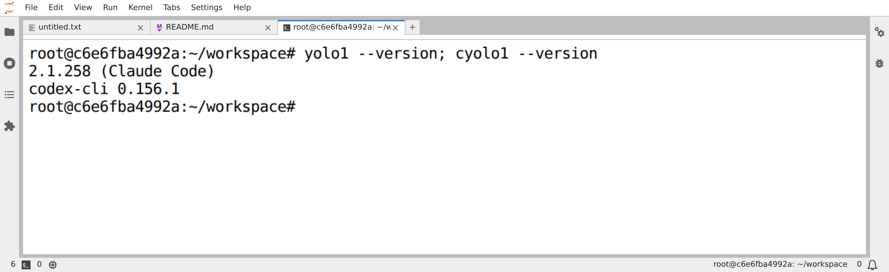
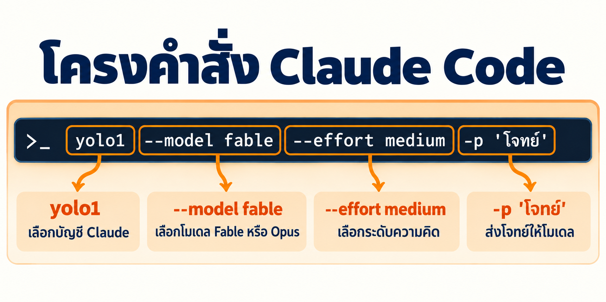
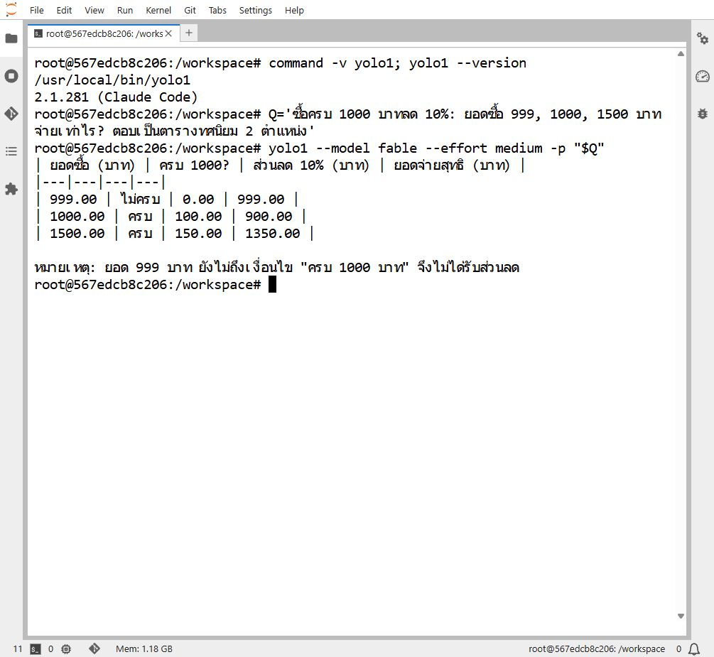
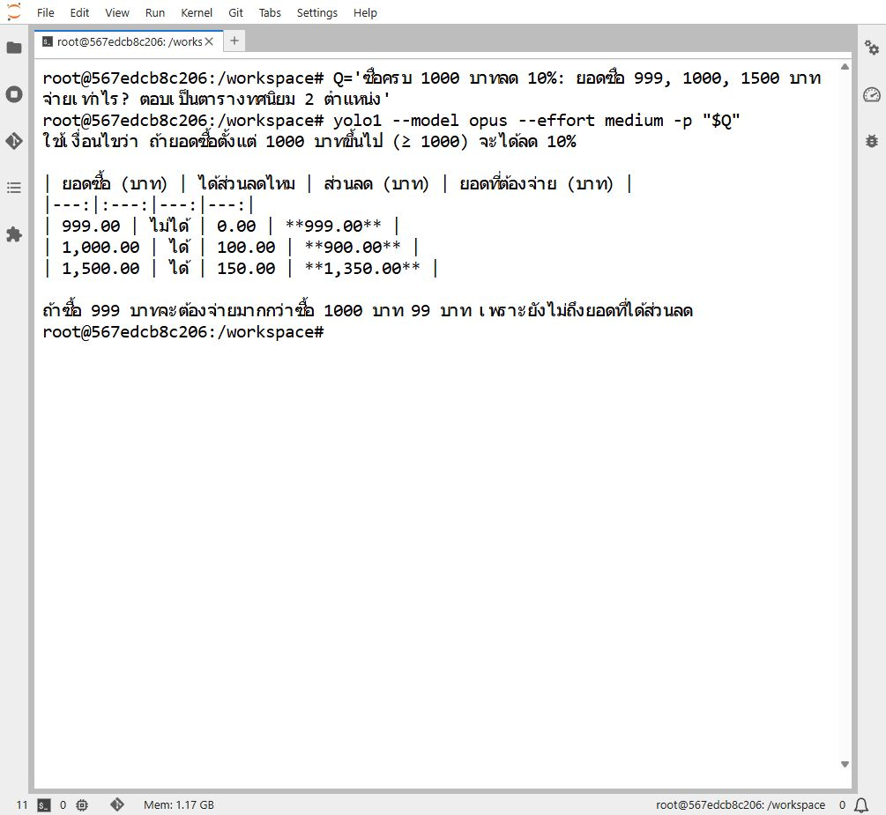
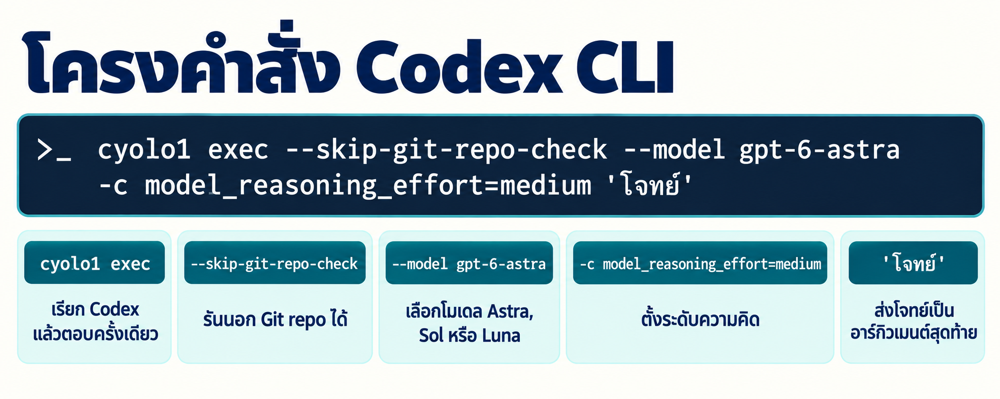
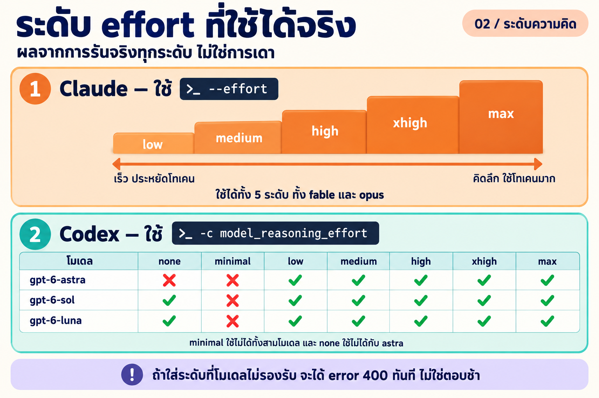
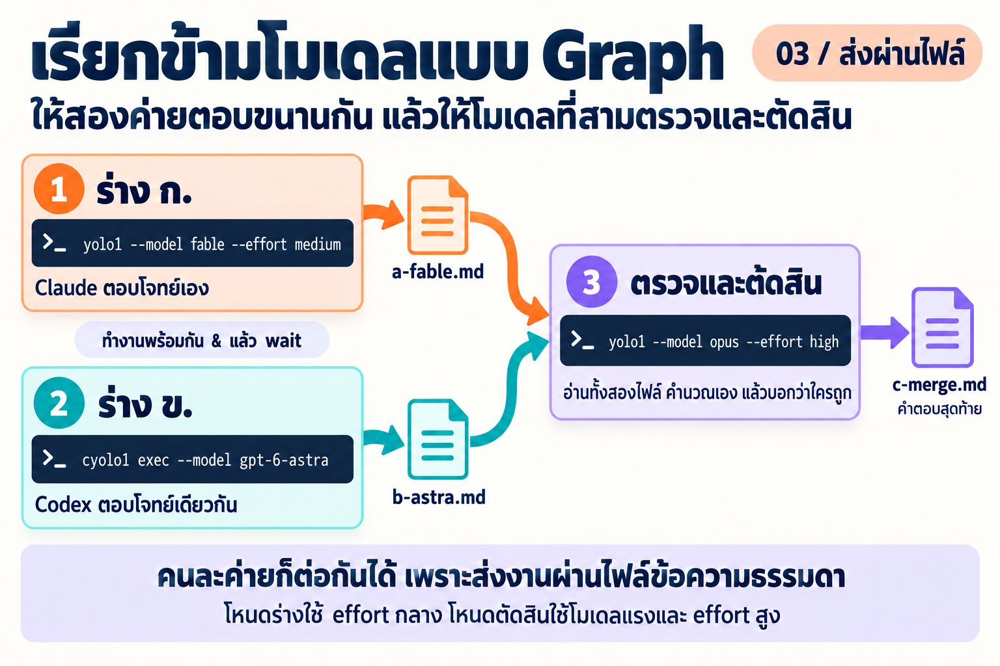
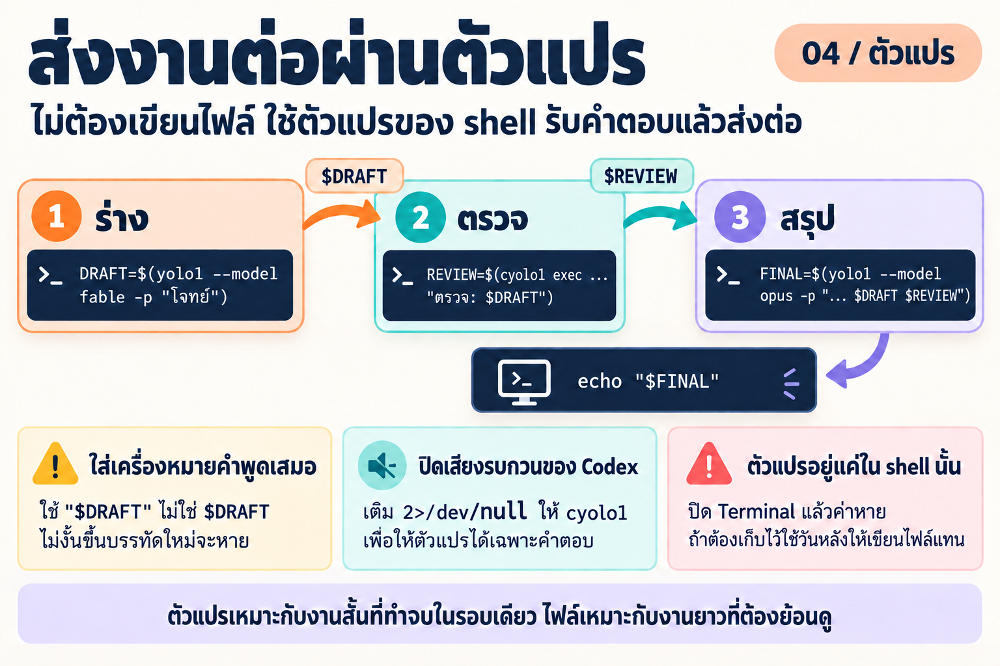

# LAB · เรียกโมเดลจาก shell: ตารางคำสั่งของ Claude และ Codex

**สิ่งที่จะได้:** อ่านคำสั่งเรียกโมเดลจาก shell ออกทีละส่วน เขียนคำสั่งของ Claude และ Codex ได้ครบทุกโมเดลและทุกระดับ effort และต่อหลายโมเดลเป็น Graph ทั้งแบบส่งงานผ่านไฟล์และผ่านตัวแปรของ shell

ขอบเขต: Claude Code (`yolo1`) และ Codex CLI (`cyolo1`) เท่านั้น

**โครงของแลป**

| หัวข้อ | เนื้อหา | เวลา |
|---|---|---|
| 1 | ตรวจความพร้อมของเครื่อง | 2 นาที |
| 2 | ตารางคำสั่งของ Claude (Fable, Opus) | 15 นาที |
| 3 | ตารางคำสั่งของ Codex (Astra, Sol, Luna) | 10 นาที |
| 4 | ตัวอย่างการใช้งานประจำวัน | 5 นาที |
| 5 | ต่อโมเดลเป็น Graph | 15 นาที |
| 6 | สรุปผลการทดลองและวิธีตรวจซ้ำ | อ่านประกอบ |
| 7 | ข้อควรระวัง | อ่านประกอบ |

---

## 1 · ก่อนเริ่ม

แลปนี้ถือว่าผู้เรียนมีครบทั้งสามข้อแล้ว

1. มีคำสั่ง `yolo1` และ `cyolo1` บนเครื่อง
2. ล็อกอินบัญชี `yolo1` (Claude) และ `cyolo1` (Codex) แล้ว
3. เปิด 🖥️ Terminal ใน JupyterLab ของ container `devtools` ค้างไว้

ตรวจความพร้อมด้วยคำสั่งนี้ก่อนเสมอ ถ้าบรรทัดไหนไม่ขึ้นเลขเวอร์ชัน ให้กลับไปแก้แลปก่อนหน้า

```bash
yolo1 --version; cyolo1 --version
```

ผลที่ควรได้ (เลขเวอร์ชันของแต่ละเครื่องอาจต่างกัน)

```text
2.1.258 (Claude Code)
codex-cli 0.156.1
```



*ภาพหน้าจอจริงจาก 🖥️ Terminal ของ JupyterLab บน container `devtools` (บันทึก 23 ก.ย. 2026)*

รายการโมเดลและระดับ effort ในหน้านี้ผูกกับเวอร์ชันของเครื่องมือและบัญชีที่ใช้ ถ้าเครื่องผู้เรียนให้ผลไม่ตรงตาราง **ไม่ได้แปลว่าพิมพ์ผิด** ให้ตรวจซ้ำตามหัวข้อ 6.3 แล้วบันทึกผลของเครื่องตัวเองไว้แทน

---

## 2 · อ่านโครงคำสั่ง แล้วเรียก Claude ครบทุกระดับ: Fable และ Opus (~15 นาที)

คำสั่งเรียก Claude หนึ่งบรรทัดบอกสี่เรื่อง คือ **บัญชีไหน (`yolo1`) · โมเดลไหน (`--model`) · คิดหนักแค่ไหน (`--effort`) · โจทย์อะไร (`-p "$Q"`)**



*ภาพแนวคิดที่สร้างขึ้นเพื่ออธิบายโครงคำสั่งของ Claude ไม่ใช่ภาพหน้าจอจริง*

### 2.1 · ตั้งโจทย์ไว้ในตัวแปรก่อน

ทุกคำสั่งในตารางของหัวข้อ 2.2 และ 3.2 ใช้โจทย์เดียวกัน ให้เก็บโจทย์ไว้ในตัวแปรของ shell ก่อน จะได้ไม่ต้องพิมพ์ซ้ำ คัดลอกทั้งกรอบไปวางใน 🖥️ Terminal แล้วกด Enter

```bash
Q='ซื้อครบ 1000 บาทลด 10%: ยอดซื้อ 999, 1000, 1500 บาท จ่ายเท่าไร? ตอบเป็นตารางทศนิยม 2 ตำแหน่ง'
```

ตรวจว่าตัวแปรเก็บค่าแล้วด้วย `echo "$Q"` ตัวแปรนี้อยู่เฉพาะใน Terminal แท็บนั้น เปิดแท็บใหม่ต้องตั้งใหม่

### 2.2 · ตารางคำสั่งครบทุกระดับ

Claude Code รับ effort 5 ระดับ (`claude --help` ระบุ `low, medium, high, xhigh, max`) และทั้งสองโมเดลรับครบทุกระดับ ตารางนี้จึงมี 10 คำสั่ง **รันจริงครบทั้ง 10 คำสั่งแล้ว ผ่านและตอบเลขถูกทั้งหมด**

| # | โมเดล | effort | คำสั่ง (คัดลอกได้ทั้งบรรทัด) |
|---|---|---|---|
| 1 | Fable | low | `yolo1 --model fable --effort low -p "$Q"` |
| 2 | Fable | medium | `yolo1 --model fable --effort medium -p "$Q"` |
| 3 | Fable | high | `yolo1 --model fable --effort high -p "$Q"` |
| 4 | Fable | xhigh | `yolo1 --model fable --effort xhigh -p "$Q"` |
| 5 | Fable | max | `yolo1 --model fable --effort max -p "$Q"` |
| 6 | Opus | low | `yolo1 --model opus --effort low -p "$Q"` |
| 7 | Opus | medium | `yolo1 --model opus --effort medium -p "$Q"` |
| 8 | Opus | high | `yolo1 --model opus --effort high -p "$Q"` |
| 9 | Opus | xhigh | `yolo1 --model opus --effort xhigh -p "$Q"` |
| 10 | Opus | max | `yolo1 --model opus --effort max -p "$Q"` |

**ต้องใส่เครื่องหมายคำพูดคู่ครอบ `"$Q"` เสมอ** ถ้าเขียน `-p $Q` เฉย ๆ shell จะตัดโจทย์เป็นหลายชิ้นตามช่องว่าง แล้ว Claude จะได้รับแค่คำแรก

**ภาพหน้าจอจริงจาก 🖥️ Terminal ใน JupyterLab:** ด้านล่างคือการรันสองแถวจากตาราง (แถว 2 และแถว 7) ด้วยโจทย์ `$Q` เดียวกันจากหัวข้อ 2.1

**ตัวอย่างที่ 1 · Fable medium**

```bash
Q='ซื้อครบ 1000 บาทลด 10%: ยอดซื้อ 999, 1000, 1500 บาท จ่ายเท่าไร? ตอบเป็นตารางทศนิยม 2 ตำแหน่ง'
yolo1 --model fable --effort medium -p "$Q"
```



*Fable medium ตอบเป็นตารางที่มีคอลัมน์เข้าเงื่อนไข ส่วนลด และยอดจ่าย พร้อมหมายเหตุสั้น ๆ ว่ายอด 999 ยังไม่เข้าเงื่อนไข*

**ตัวอย่างที่ 2 · Opus medium**

```bash
Q='ซื้อครบ 1000 บาทลด 10%: ยอดซื้อ 999, 1000, 1500 บาท จ่ายเท่าไร? ตอบเป็นตารางทศนิยม 2 ตำแหน่ง'
yolo1 --model opus --effort medium -p "$Q"
```



*Opus medium ตอบเป็นตารางแบบเดียวกัน ระบุเงื่อนไขขั้นต่ำ และเสริมว่าซื้อ 999 บาทจ่ายแพงกว่าซื้อ 1000 บาทอยู่ 99 บาท ทั้งนี้ผลลัพธ์ที่ออกมาบน Terminal ยังติดเครื่องหมาย `**` ของ Markdown มาด้วย*

ทั้งสองโมเดลให้ตัวเลขตรงกันทุกแถว คือ 999.00, 900.00 และ 1350.00 ต่างกันแค่รูปแบบการนำเสนอและรายละเอียดคำอธิบายในการรันรอบนี้ **การรันเพียงรอบเดียวยังสรุปไม่ได้ว่าโมเดลใดดีกว่าโดยทั่วไป** ถ้าอยากเทียบจริงต้องรันซ้ำหลายรอบและเทียบด้วยโจทย์หลายแบบ

### 2.3 · เลือก effort อย่างไร

| ระดับ | เหมาะกับ |
|---|---|
| `low` | งานซ้ำ ๆ ที่รู้คำตอบอยู่แล้ว เช่น จัดรูปแบบข้อความ แปลสั้น ๆ สรุปย่อหน้าเดียว |
| `medium` | งานทั่วไปที่มีหลายขั้นตอนแต่ไม่ซับซ้อน เป็นค่าเริ่มต้นถ้าไม่แน่ใจ |
| `high` | งานที่ต้องคิดหลายชั้น เช่น ไล่หาสาเหตุบั๊ก ออกแบบโครงสร้าง ตรวจงานของโมเดลอื่น |
| `xhigh` / `max` | โจทย์ยากที่ยอมแลกเวลาและโทเคนเพื่อความถูกต้อง เช่น พิสูจน์เงื่อนไขซับซ้อน หรือเป็นโหนดตัดสินใน Graph |

---

## 3 · ตารางคำสั่งของ Codex: Astra, Sol และ Luna (~10 นาที)

ฝั่ง Codex ต่างจาก Claude สามจุด: ถามครั้งเดียวต้องใช้ subcommand `exec`, ระดับ effort ไม่มี flag ตรง ๆ ต้อง override ค่า config ด้วย `-c model_reasoning_effort=...` และโจทย์เป็นอาร์กิวเมนต์สุดท้ายโดยไม่มี `-p` นำหน้า



*ภาพแนวคิดที่สร้างขึ้นเพื่ออธิบายโครงคำสั่งของ Codex ไม่ใช่ภาพหน้าจอจริง*

> 🔍 **จุดที่ผู้เรียนต้องตรวจ:** เขียนคำสั่งของ Codex ด้วย `--effort medium` แล้วรันดู จะได้ error เพราะ Codex ไม่มี flag ชื่อนี้ ลองผิดหนึ่งครั้งเพื่อจำจุดต่าง

### 3.1 · ระดับที่แต่ละโมเดลรับได้ไม่เท่ากัน

ฝั่ง Claude ทุกโมเดลรับ 5 ระดับเท่ากัน แต่ **ฝั่ง Codex แต่ละโมเดลรับระดับไม่เท่ากัน** ตารางนี้มาจากการรันจริงทั้ง 21 ช่อง (3 โมเดล × 7 ระดับ)



*ภาพแนวคิดสร้างด้วย Imagegen ผ่าน `cyolo1` สรุปผลจากตารางด้านล่าง*

| โมเดล | `none` | `minimal` | `low` | `medium` | `high` | `xhigh` | `max` |
|---|:--:|:--:|:--:|:--:|:--:|:--:|:--:|
| `gpt-6-astra` | ❌ | ❌ | ✅ | ✅ | ✅ | ✅ | ✅ |
| `gpt-6-sol` | ✅ | ❌ | ✅ | ✅ | ✅ | ✅ | ✅ |
| `gpt-6-luna` | ✅ | ❌ | ✅ | ✅ | ✅ | ✅ | ✅ |

สิ่งที่พบ:

- `minimal` **ใช้ไม่ได้กับทั้งสามโมเดล** แม้ CLI จะยอมรับคำนี้ตอนตรวจรูปแบบ
- `none` ใช้ได้กับ `gpt-6-sol` และ `gpt-6-luna` แต่ **ใช้ไม่ได้กับ `gpt-6-astra`**
- ระดับที่ใช้ได้ครบทั้งสามโมเดลคือ `low`, `medium`, `high`, `xhigh`, `max` สคริปต์ที่ต้องสลับโมเดลได้ควรอยู่ในห้าระดับนี้

### 3.2 · ตารางคำสั่งที่ใช้ได้จริง

ใช้ตัวแปร `$Q` จากหัวข้อ 2.1 **ทุกคำสั่งในตารางนี้รันจริงแล้วและตอบเลขถูกครบทั้ง 17 คำสั่ง**

| # | โมเดล | effort | คำสั่ง (คัดลอกได้ทั้งบรรทัด) |
|---|---|---|---|
| 1 | Astra | low | `cyolo1 exec --skip-git-repo-check --model gpt-6-astra -c model_reasoning_effort=low "$Q"` |
| 2 | Astra | medium | `cyolo1 exec --skip-git-repo-check --model gpt-6-astra -c model_reasoning_effort=medium "$Q"` |
| 3 | Astra | high | `cyolo1 exec --skip-git-repo-check --model gpt-6-astra -c model_reasoning_effort=high "$Q"` |
| 4 | Astra | xhigh | `cyolo1 exec --skip-git-repo-check --model gpt-6-astra -c model_reasoning_effort=xhigh "$Q"` |
| 5 | Astra | max | `cyolo1 exec --skip-git-repo-check --model gpt-6-astra -c model_reasoning_effort=max "$Q"` |
| 6 | Sol | none | `cyolo1 exec --skip-git-repo-check --model gpt-6-sol -c model_reasoning_effort=none "$Q"` |
| 7 | Sol | low | `cyolo1 exec --skip-git-repo-check --model gpt-6-sol -c model_reasoning_effort=low "$Q"` |
| 8 | Sol | medium | `cyolo1 exec --skip-git-repo-check --model gpt-6-sol -c model_reasoning_effort=medium "$Q"` |
| 9 | Sol | high | `cyolo1 exec --skip-git-repo-check --model gpt-6-sol -c model_reasoning_effort=high "$Q"` |
| 10 | Sol | xhigh | `cyolo1 exec --skip-git-repo-check --model gpt-6-sol -c model_reasoning_effort=xhigh "$Q"` |
| 11 | Sol | max | `cyolo1 exec --skip-git-repo-check --model gpt-6-sol -c model_reasoning_effort=max "$Q"` |
| 12 | Luna | none | `cyolo1 exec --skip-git-repo-check --model gpt-6-luna -c model_reasoning_effort=none "$Q"` |
| 13 | Luna | low | `cyolo1 exec --skip-git-repo-check --model gpt-6-luna -c model_reasoning_effort=low "$Q"` |
| 14 | Luna | medium | `cyolo1 exec --skip-git-repo-check --model gpt-6-luna -c model_reasoning_effort=medium "$Q"` |
| 15 | Luna | high | `cyolo1 exec --skip-git-repo-check --model gpt-6-luna -c model_reasoning_effort=high "$Q"` |
| 16 | Luna | xhigh | `cyolo1 exec --skip-git-repo-check --model gpt-6-luna -c model_reasoning_effort=xhigh "$Q"` |
| 17 | Luna | max | `cyolo1 exec --skip-git-repo-check --model gpt-6-luna -c model_reasoning_effort=max "$Q"` |

### 3.3 · คำสั่งที่รันแล้วต้องพัง (ให้ลองจริงหนึ่งครั้ง)

รันคำสั่งนี้เพื่อรู้จักหน้าตาของ error เมื่อใส่ระดับที่โมเดลไม่รองรับ

```bash
cyolo1 exec --skip-git-repo-check --model gpt-6-astra -c model_reasoning_effort=none 'ทดสอบ'
```

ผลที่ได้จริง (ตัดเฉพาะส่วนสำคัญ):

```text
ERROR: {
  "type": "error",
  "error": {
    "type": "invalid_request_error",
    "code": "unsupported_value",
    "message": "Unsupported value: 'none' is not supported with the 'gpt-6-astra' model. Supported values are: 'low', 'medium', 'high', 'xhigh', and 'max'.",
    "param": "reasoning.effort"
  },
  "status": 400
}
```

สังเกตสามเรื่อง:

1. **error เกิดทันที** ใช้เวลา 7–11 วินาทีแล้วจบด้วยรหัสออก `1`
2. **ข้อความ error บอกรายการระดับที่ใช้ได้มาให้เลย** เป็นวิธีตรวจรายการระดับของแต่ละโมเดลที่เร็วที่สุด
3. CLI ส่งคำนี้ออกไปโดยไม่ทักท้วง แล้วถูกปฏิเสธที่ฝั่งบริการ แปลว่า **ดู `--help` อย่างเดียวไม่พอ ต้องรันจริง**

### 3.4 · โทเคนที่ใช้ในแต่ละระดับ

ตัวเลขจากการรันจริงหนึ่งครั้งต่อช่อง ด้วยโจทย์ `$Q` เดียวกัน (ช่องที่รันไม่ผ่านใส่ `—`)

> ตัวเลขชุดนี้วัดด้วยโจทย์ `$Q` ฉบับยาวก่อนย่อ การรันซ้ำด้วย `$Q` ฉบับปัจจุบันจึงไม่ได้ตัวเลขเท่าเดิม

| โมเดล | none | low | medium | high | xhigh | max |
|---|---:|---:|---:|---:|---:|---:|
| `gpt-6-astra` | — | 3,198 | 3,212 | 3,215 | 4,623 | 3,464 |
| `gpt-6-sol` | 14,888 | 3,114 | 3,185 | 3,170 | 3,166 | 3,249 |
| `gpt-6-luna` | 14,730 | 3,749 | 3,739 | 3,792 | 3,821 | 5,130 |

**ข้อสังเกตที่ควรตรวจซ้ำเอง:** ระดับ `none` ของ Sol และ Luna ใช้โทเคนสูงกว่าระดับอื่นราว 4–5 เท่า สวนทางกับที่คาดว่า "ไม่คิดเลยควรใช้น้อยที่สุด" ทั้งที่คำตอบยาวพอ ๆ กัน แลปนี้ยังไม่ได้ตรวจสาเหตุ จึงเป็นข้อสังเกต ไม่ใช่ข้อสรุป **ถ้าจะใช้ `none` เพื่อประหยัด ให้วัดโทเคนจริงก่อนทุกครั้ง**

---

## 4 · ตัวอย่างการใช้งาน `yolo1` และ `cyolo1` (~5 นาที)

### 4.1 · ถามครั้งเดียวแล้วดูคำตอบบนหน้าจอ

```bash
yolo1 --model fable --effort medium -p 'อธิบายความต่างของ RAM กับ SSD ใน 3 บรรทัด'
```

```bash
cyolo1 exec --skip-git-repo-check --model gpt-6-astra -c model_reasoning_effort=medium 'อธิบายความต่างของ RAM กับ SSD ใน 3 บรรทัด'
```

### 4.2 · ถามคำถามเดียวกันสองค่ายติดกันเพื่อเทียบ

```bash
Q2='บอกข้อดีและข้อเสียของการเก็บรหัสผ่านไว้ในไฟล์ .env อย่างละ 2 ข้อ'
echo "----- Claude Fable -----"
yolo1 --model fable --effort medium -p "$Q2"
echo "----- Codex Astra -----"
cyolo1 exec --skip-git-repo-check --model gpt-6-astra -c model_reasoning_effort=medium "$Q2"
```

### 4.3 · เก็บคำตอบไว้ใช้ต่อ

**เก็บลงไฟล์** ฝั่ง Claude ใช้การเปลี่ยนทิศทางของ shell ตามปกติ ฝั่ง Codex มี flag `-o` ที่เขียน **เฉพาะข้อความสุดท้ายของ AI** ลงไฟล์ ไม่มีหัวรายงานปน

```bash
yolo1 --model fable --effort medium -p "$Q" > claude-answer.md
cyolo1 exec --skip-git-repo-check --model gpt-6-astra -c model_reasoning_effort=medium -o codex-answer.md "$Q"
```

**เก็บลงตัวแปร** ใช้ `$( )` ครอบคำสั่ง ฝั่ง Codex ต้องเติม `2>/dev/null` เพราะหัวรายงาน (ชื่อโมเดล ระดับ effort จำนวนโทเคน) ออกทาง stderr ถ้าไม่ปิด ตัวแปรจะได้ของปนมา

```bash
CLAUDE_ANS=$(yolo1 --model fable --effort medium -p "$Q")
CODEX_ANS=$(cyolo1 exec --skip-git-repo-check --model gpt-6-astra -c model_reasoning_effort=medium "$Q" 2>/dev/null)
echo "$CLAUDE_ANS"
echo "$CODEX_ANS"
```

> 🔍 **จุดที่ผู้เรียนต้องตรวจ:** รันบรรทัด `CODEX_ANS=...` โดย **ตัด** `2>/dev/null` ออกหนึ่งครั้ง แล้ว `echo "$CODEX_ANS"` เทียบกับตอนที่ใส่ คำตอบจะเหมือนเดิม แต่หัวรายงานไปโผล่บนหน้าจอแทนที่จะเข้าไปในตัวแปร

---

## 5 · เรียกข้ามโมเดลแบบ Graph (~15 นาที)

Graph คือการวางโมเดลหลายตัวเป็นโหนด แล้วให้ผลของโหนดหนึ่งไหลไปเป็นข้อมูลเข้าของอีกโหนด ประโยชน์คือ **เลือกโมเดลและ effort ให้เหมาะกับงานแต่ละช่วง** แทนที่จะใช้โมเดลแพงที่สุดทำทุกอย่าง

โจทย์ในหัวข้อนี้ยากกว่าหัวข้อก่อน เพราะมีเงื่อนไขซ้อนกันสามชั้น:

```text
ร้านลด 10% เมื่อซื้อครบ 1000 บาท และลด 15% เมื่อซื้อครบ 2000 บาท โดยใช้สิทธิ์ได้ขั้นเดียว
มีค่าส่ง 50 บาท แต่ยกเว้นค่าส่งเมื่อยอดหลังหักส่วนลดตั้งแต่ 1500 บาทขึ้นไป
จงหายอดที่ต้องจ่ายจริงของยอดซื้อ 999, 1000, 1800 และ 2000 บาท
ตอบเป็นตาราง ยอดซื้อ | ส่วนลด | ยอดหลังลด | ค่าส่ง | ยอดจ่ายจริง ทศนิยม 2 ตำแหน่ง
ห้ามสร้างไฟล์หรือรันคำสั่งอื่น
```

จุดยากคือค่าส่งตัดสินจาก **ยอดหลังหักส่วนลด** ไม่ใช่ยอดซื้อ และสิทธิ์ส่วนลดใช้ได้ขั้นเดียว ไม่ซ้อนกัน

### 5.1 · แบบที่ 1: ส่งงานต่อผ่านไฟล์



*ภาพแนวคิดสร้างด้วย Imagegen ผ่าน `cyolo1` แสดงโครงเดียวกับโค้ดด้านล่าง*

โครงที่ใช้ทดลองจริงคือ **ให้สองค่ายตอบขนานกัน แล้วให้โมเดลที่สามตรวจและตัดสิน**

```bash
# --- เตรียมโจทย์ ---
mkdir -p ~/graph-lab && cd ~/graph-lab
QG='ร้านลด 10% เมื่อซื้อครบ 1000 บาท และลด 15% เมื่อซื้อครบ 2000 บาท โดยใช้สิทธิ์ได้ขั้นเดียว
มีค่าส่ง 50 บาท แต่ยกเว้นค่าส่งเมื่อยอดหลังหักส่วนลดตั้งแต่ 1500 บาทขึ้นไป
จงหายอดที่ต้องจ่ายจริงของยอดซื้อ 999, 1000, 1800 และ 2000 บาท
ตอบเป็นตาราง ยอดซื้อ | ส่วนลด | ยอดหลังลด | ค่าส่ง | ยอดจ่ายจริง ทศนิยม 2 ตำแหน่ง
ห้ามสร้างไฟล์หรือรันคำสั่งอื่น'

# --- โหนด A และ B ทำงานขนานกัน (เครื่องหมาย & คือสั่งให้ทำงานเบื้องหลัง) ---
yolo1 --model fable --effort medium -p "$QG" > a-fable.md &
cyolo1 exec --skip-git-repo-check --model gpt-6-astra -c model_reasoning_effort=medium -o b-astra.md "$QG" > /dev/null 2>&1 &
wait

# --- โหนด C อ่านทั้งสองไฟล์แล้วตัดสิน ---
yolo1 --model opus --effort high -p "โจทย์ต้นทาง:
$QG

คำตอบที่ 1 (จาก Claude Fable) อยู่ในไฟล์ a-fable.md
คำตอบที่ 2 (จาก Codex Astra) อยู่ในไฟล์ b-astra.md
อ่านทั้งสองไฟล์ในโฟลเดอร์ปัจจุบัน คำนวณเองอีกรอบ แล้วรายงาน:
1) ตารางคำตอบที่ถูกต้อง
2) ตารางเทียบว่าคำตอบที่ 1 และ 2 ตรงหรือต่างจากคำตอบที่ถูกต้องตรงไหน
3) สรุปหนึ่งบรรทัดว่าโหนดไหนถูก
ห้ามแก้ไฟล์ใด ๆ" > c-merge.md

cat c-merge.md
```

จุดที่ต้องเข้าใจ:

- `&` ท้ายคำสั่งสั่งให้ทำงานเบื้องหลัง จึงเรียกสองค่ายพร้อมกันได้ และ `wait` รอให้ทั้งคู่จบก่อนไปโหนดถัดไป
- โหนด C **ไม่ได้รับเนื้อคำตอบในคำสั่ง** แต่ได้ชื่อไฟล์แล้วเปิดอ่านเอง ทำได้เพราะ Claude Code อ่านไฟล์ในโฟลเดอร์ที่เปิดอยู่ได้
- โหนด A และ B ใช้ `medium` เพราะเป็นงานร่าง โหนด C ใช้ `opus` กับ `high` เพราะเป็นงานตรวจและตัดสิน

### 5.2 · แบบที่ 2: ส่งงานต่อผ่านตัวแปรของ shell (ไม่เขียนไฟล์เลย)



*ภาพแนวคิดสร้างด้วย Imagegen ผ่าน `cyolo1`*

ถ้างานจบในรอบเดียวและไม่ต้องย้อนกลับมาดู ไม่จำเป็นต้องสร้างไฟล์ ใช้ตัวแปรของ shell รับคำตอบแล้วส่งต่อเข้าไปในโจทย์ของโหนดถัดไปได้ตรง ๆ

```bash
QG='ร้านลด 10% เมื่อซื้อครบ 1000 บาท และลด 15% เมื่อซื้อครบ 2000 บาท โดยใช้สิทธิ์ได้ขั้นเดียว
มีค่าส่ง 50 บาท แต่ยกเว้นค่าส่งเมื่อยอดหลังหักส่วนลดตั้งแต่ 1500 บาทขึ้นไป
จงหายอดที่ต้องจ่ายจริงของยอดซื้อ 999, 1000, 1800 และ 2000 บาท
ตอบเป็นตาราง ยอดซื้อ | ส่วนลด | ยอดหลังลด | ค่าส่ง | ยอดจ่ายจริง ทศนิยม 2 ตำแหน่ง
ห้ามสร้างไฟล์หรือรันคำสั่งอื่น'

# --- โหนด 1: ร่าง เก็บลงตัวแปร DRAFT ---
DRAFT=$(yolo1 --model fable --effort medium -p "$QG")

# --- โหนด 2: ตรวจ ส่ง DRAFT เข้าไปในโจทย์ เก็บผลลงตัวแปร REVIEW ---
REVIEW=$(cyolo1 exec --skip-git-repo-check --model gpt-6-astra -c model_reasoning_effort=medium \
  "ตรวจคำตอบด้านล่างว่าถูกหรือผิด คำนวณเองอีกรอบก่อนตัดสิน ตอบสั้นเป็นข้อ ๆ

โจทย์:
$QG

คำตอบที่ต้องตรวจ:
$DRAFT" 2>/dev/null)

# --- โหนด 3: สรุป ส่งทั้ง DRAFT และ REVIEW เข้าไป ---
FINAL=$(yolo1 --model opus --effort high -p "โจทย์:
$QG

ร่างจาก Claude Fable:
$DRAFT

ผลตรวจจาก Codex Astra:
$REVIEW

คำนวณเองอีกรอบ แล้วตอบ: (1) ตารางคำตอบที่ถูกต้อง (2) สรุปหนึ่งบรรทัดว่าร่างและผลตรวจถูกหรือผิดตรงไหน")

echo "$FINAL"
```

**สี่ข้อที่ต้องระวังเมื่อใช้ตัวแปร**

| เรื่อง | ทำอย่างไร | ถ้าทำผิดจะเป็นอย่างไร |
|---|---|---|
| ครอบด้วยเครื่องหมายคำพูดคู่ | เขียน `"$DRAFT"` เสมอ ไม่ใช่ `$DRAFT` | การขึ้นบรรทัดใหม่ในคำตอบหายหมด กลายเป็นบรรทัดเดียว |
| ปิดเสียงรบกวนของ Codex | เติม `2>/dev/null` ท้ายคำสั่ง `cyolo1` | ตัวแปรได้หัวรายงานปนมากับคำตอบ |
| ตัวแปรอยู่แค่ใน Terminal นั้น | ถ้าต้องเก็บไว้ใช้วันหลัง ให้เขียนไฟล์แทน | ปิดแท็บแล้วค่าหายทั้งหมด ย้อนดูไม่ได้ |
| ความยาวของโจทย์ | คำตอบที่ยาวทำให้โจทย์ของโหนดถัดไปยาวตาม | เปลืองโทเคนขึ้นเรื่อย ๆ ตามจำนวนโหนด |

### 5.3 · เลือกแบบไหนดี

| | ส่งผ่านไฟล์ | ส่งผ่านตัวแปร |
|---|---|---|
| เขียนสั้นกว่า | ไม่ | ใช่ |
| ย้อนดูงานแต่ละโหนดภายหลังได้ | ได้ | ไม่ได้ (ถ้าไม่บันทึกเพิ่ม) |
| รันโหนดขนานกันได้ง่าย | ง่าย (`&` + `wait`) | ยากกว่า เพราะ subshell ส่งค่ากลับตรง ๆ ไม่ได้ |
| เหมาะกับ | งานยาว หลายขั้น ต้องตรวจย้อนหลัง | งานสั้น จบในรอบเดียว |

### 5.4 · ผลการรันจริงของทั้งสองแบบ

คำตอบที่ถูกต้อง ตรวจด้วยมือแล้ว:

| ยอดซื้อ | ส่วนลด | ยอดหลังลด | ค่าส่ง | ยอดจ่ายจริง |
|---:|---:|---:|---:|---:|
| 999.00 | 0.00 | 999.00 | 50.00 | 1049.00 |
| 1000.00 | 100.00 | 900.00 | 50.00 | 950.00 |
| 1800.00 | 180.00 | 1620.00 | 0.00 | 1620.00 |
| 2000.00 | 300.00 | 1700.00 | 0.00 | 1700.00 |

ผลที่ได้จริง:

| โครง | โหนด 1 (Fable medium) | โหนด 2 (Astra medium) | โหนด 3 (Opus high) | เวลารวม |
|---|---|---|---|---|
| ส่งผ่านไฟล์ | ถูกครบ 4 แถว | ถูกครบ 4 แถว | ตรวจแล้วยืนยันว่าทั้งสองโหนดถูก | ประมาณ 36 วินาที |
| ส่งผ่านตัวแปร | ถูกครบ 4 แถว | ตรวจแล้วบอกว่าถูก | ตรวจแล้วยืนยันว่าทั้งสองโหนดถูก | ประมาณ 40 วินาที |

ข้อสังเกตจากโหนดตรวจ: Fable แถมหมายเหตุอธิบายเหตุผล ส่วน Astra ตอบเป็นตารางเปล่า **เป็นความต่างเชิงคำอธิบาย ไม่ใช่ความผิดพลาด** โหนดตัดสินรายงานความต่างนี้แยกจากความถูกผิดของตัวเลข

**สิ่งที่แลปนี้ยังไม่ได้พิสูจน์:** ทุกโหนดตอบถูกหมด จึงยังไม่เห็นกรณีที่โหนดตรวจจับผิดได้จริง ถ้าต้องการเห็นประโยชน์ของโหนดตรวจ ให้ลองตั้ง effort ของโหนด 1 เป็น `low` หรือเพิ่มเงื่อนไขในโจทย์อีกชั้น แล้วรันซ้ำหลายรอบ

> 🔍 **จุดที่ผู้เรียนต้องตรวจ:** รันโครงส่งผ่านตัวแปร แล้วเพิ่ม `echo "DRAFT = ${#DRAFT} chars"` หลังโหนด 1 เพื่อดูว่าตัวแปรรับคำตอบมาจริง ถ้าได้ 0 แปลว่าโหนด 1 ล้มเหลว (มักเพราะยังไม่ได้ล็อกอิน)

---

## 6 · สรุปผลการทดลองและวิธีตรวจซ้ำ

### 6.1 · ตารางสรุปผลรวม

ตัวเลขและผลทั้งหมดในหน้านี้มาจากการรันจริงในคอนเทนเนอร์ `devtools` ช่วง **23 กันยายน 2026 เวลา 23:53 น. ถึง 24 กันยายน 2026 เวลา 00:03 น. (เวลาไทย)** ไม่ใช่ตัวเลขที่คัดจากเอกสาร

| รายการทดสอบ | จำนวนที่รัน | ผ่าน | ไม่ผ่าน |
|---|---:|---:|---:|
| Claude: 2 โมเดล × 5 ระดับ effort | 10 | 10 | 0 |
| Codex: 3 โมเดล × 7 ระดับ effort | 21 | 17 | 4 |
| Graph แบบส่งผ่านไฟล์ (3 โหนด) | 1 | 1 | 0 |
| Graph แบบส่งผ่านตัวแปร (3 โหนด) | 1 | 1 | 0 |

สี่ช่องที่ไม่ผ่านคือ `minimal` ของทั้งสามโมเดล และ `none` ของ `gpt-6-astra` ซึ่งเป็น **ข้อจำกัดของโมเดล ไม่ใช่คำสั่งผิด**

### 6.2 · ข้อสรุปที่ยืนยันได้จากการทดลองนี้

1. ชื่อย่อ `fable` และ `opus` ถูกแปลงเป็น `claude-fable-5-1` และ `claude-opus-5` ตามลำดับ (ตรวจจากฟิลด์ `modelUsage` เมื่อรันด้วย `--output-format json`)
2. Claude รับ effort ครบ 5 ระดับทั้งสองโมเดล
3. Codex รับระดับไม่เท่ากันตามโมเดล `minimal` ใช้ไม่ได้เลย และ `none` ใช้ไม่ได้กับ Astra
4. หัวรายงานของ `cyolo1 exec` ออกทาง stderr ส่วนคำตอบออกทาง stdout จึงเก็บคำตอบล้วนลงตัวแปรได้ด้วย `2>/dev/null`
5. flag `-o` ของ Codex เขียนเฉพาะข้อความสุดท้ายของ AI ลงไฟล์ ไม่มีหัวรายงานปน
6. ต่อ Claude กับ Codex เป็น Graph ได้จริง ทั้งแบบส่งผ่านไฟล์และแบบส่งผ่านตัวแปร

### 6.3 · วิธีตรวจซ้ำบนเครื่องตัวเอง

รายการโมเดลและระดับ effort เปลี่ยนได้ตามเวอร์ชันและบัญชี **อย่าเชื่อตารางในหน้านี้โดยไม่ตรวจ** ให้ตรวจสามชั้น

```bash
# ชั้นที่ 1: ดูว่า CLI รับ flag อะไรบ้าง
yolo1 --help | grep -A2 -- "--effort"
cyolo1 exec --help | grep -A2 -- "--model"

# ชั้นที่ 2: ดูว่าชื่อย่อชี้ไปที่รุ่นไหน
yolo1 --model fable --effort low -p 'ตอบเลขเดียว: 1+1' --output-format json

# ชั้นที่ 3: รันจริงหนึ่งครั้งต่อช่อง แล้วดู exit code
cyolo1 exec --skip-git-repo-check --model gpt-6-sol -c model_reasoning_effort=none 'ทดสอบ'; echo "exit=$?"
```

ชั้นที่ 3 สำคัญที่สุด เพราะ `--help` ไม่ได้บอกว่าโมเดลไหนรับระดับไหน รู้ได้จากการรันจริงเท่านั้น

### 6.4 · หลักฐานดิบและสคริปต์ที่ใช้ทดลอง

ผลดิบทุกช่องของตารางในหน้านี้เก็บไว้ในโฟลเดอร์ `.work/` ข้างไฟล์นี้ เปิดดูหรือรันซ้ำได้

| ไฟล์ / โฟลเดอร์ | เนื้อหา |
|---|---|
| `.work/probe-claude.sh` | สคริปต์รัน Claude 2 โมเดล × 5 ระดับ |
| `.work/probe-codex.sh` | สคริปต์รัน Codex 3 โมเดล × 7 ระดับ |
| `.work/run-graph.sh` | สคริปต์ Graph แบบส่งผ่านไฟล์ |
| `.work/run-graph-var.sh` | สคริปต์ Graph แบบส่งผ่านตัวแปร |
| `.work/evidence/` | ผลดิบรายช่อง (`.json` ของ Claude, `.txt` ของ Codex, `.rc` คือรหัสออกและเวลา) |
| `.work/graph/`, `.work/graphvar/` | คำตอบของแต่ละโหนดใน Graph ทั้งสองแบบ |
| `.work/img-prompt-*.txt` | พรอมป์ตที่ใช้สั่ง `cyolo1` สร้างภาพประกอบทั้งสี่ภาพ |
| `.work/model-command-matrix.md` | ตารางรวมคำสั่งทุกโมเดลและทุกระดับ effort ของทั้งสองค่ายในตารางเดียว (สรุปจากหัวข้อ 2.2 และ 3.2) |

---

## 7 · ข้อควรระวัง

| เรื่อง | รายละเอียด |
|---|---|
| ต้องล็อกอินก่อน | คำสั่งทั้งหมดใช้ได้ต่อเมื่อ `yolo1` และ `cyolo1` ล็อกอินแล้ว ถ้ายังไม่ล็อกอินจะได้ error เรื่องสิทธิ์ ไม่ใช่ error เรื่องคำสั่ง |
| ชื่อย่อทำให้ผลไม่คงที่ | `fable` และ `opus` ชี้ไปรุ่นล่าสุดเสมอ ถ้าต้องการผลที่ทำซ้ำได้ให้ระบุชื่อเต็ม เช่น `claude-fable-5-1` |
| effort สูงไม่ได้แปลว่าถูกกว่าเสมอ | ในการทดลองนี้ทุกระดับตอบถูกหมด กับโจทย์ง่ายการเพิ่ม effort จึงเปลืองโทเคนโดยไม่ได้ผลดีขึ้น |
| เวลารวมไม่ใช่ตัวชี้วัด effort | เวลาส่วนใหญ่หมดไปกับการเปิดโปรแกรม ให้ดูจำนวนโทเคนแทน |
| ตัวเลขในหน้านี้วัดครั้งเดียวต่อช่อง | ใช้ดูแนวโน้มได้ แต่ยังไม่พอสรุปเป็นกฎ ถ้าจะอ้างอิงต้องรันซ้ำหลายรอบ |
| อย่าส่งข้อมูลลับเข้าไปในโจทย์ | โจทย์ที่พิมพ์ใน shell ถูกเก็บในประวัติคำสั่ง (`history`) และถูกส่งไปยังบริการของผู้ให้บริการโมเดล |
| โควตาต่อบัญชี | ทุกคำสั่งในหน้านี้ใช้โควตาจริงของบัญชีนั้น รันทุกคำสั่งรวดเดียวใช้มากกว่า 30 ครั้งเรียก |
