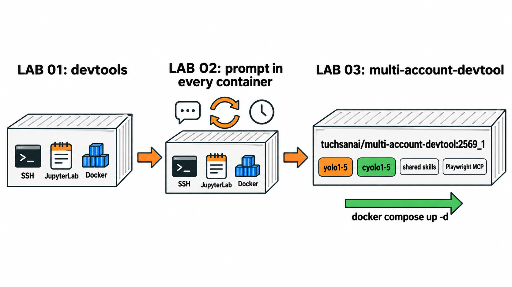
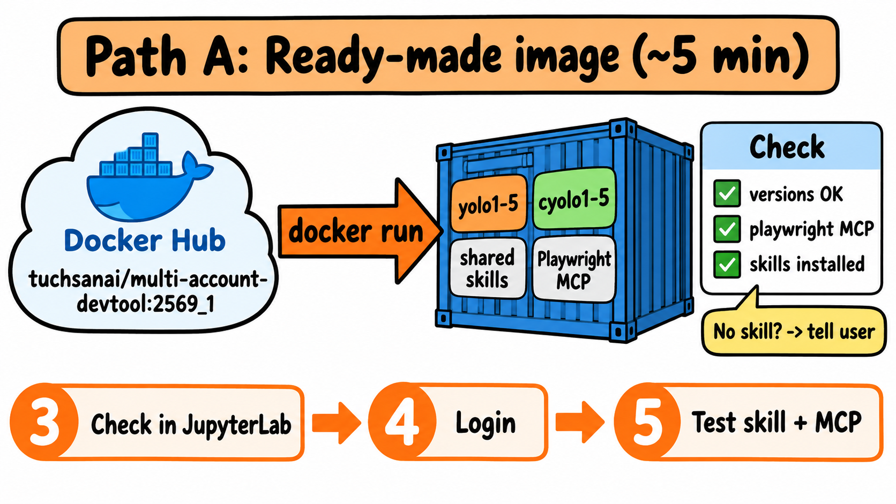
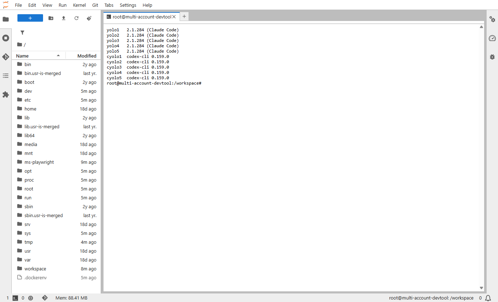
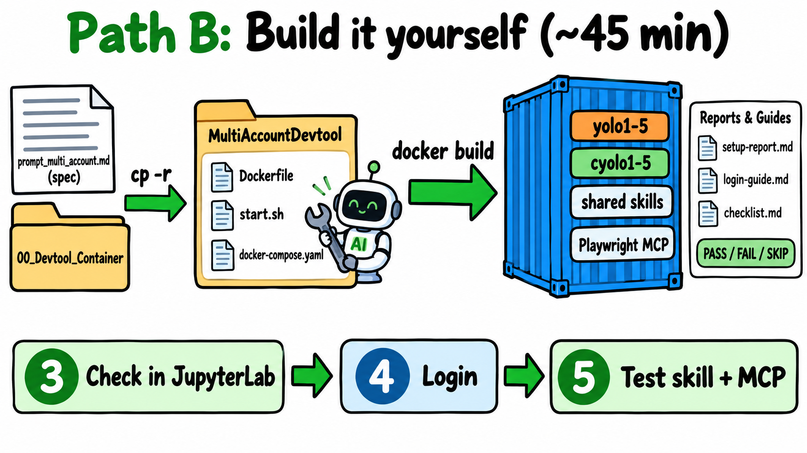
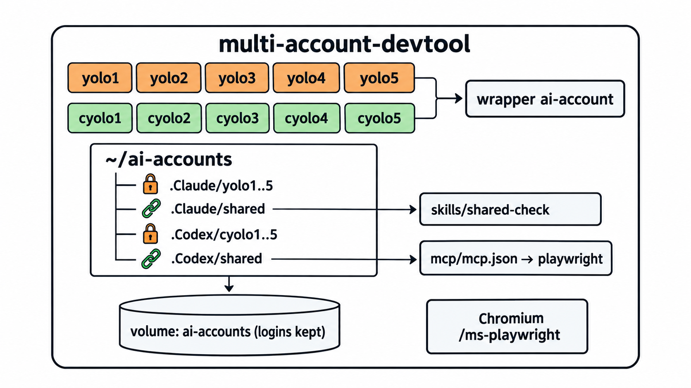
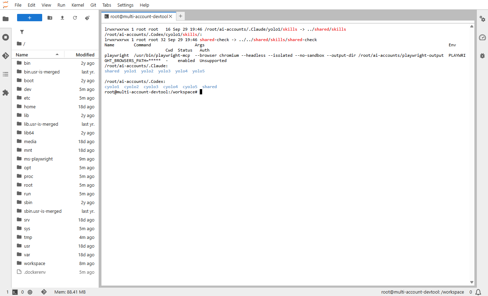
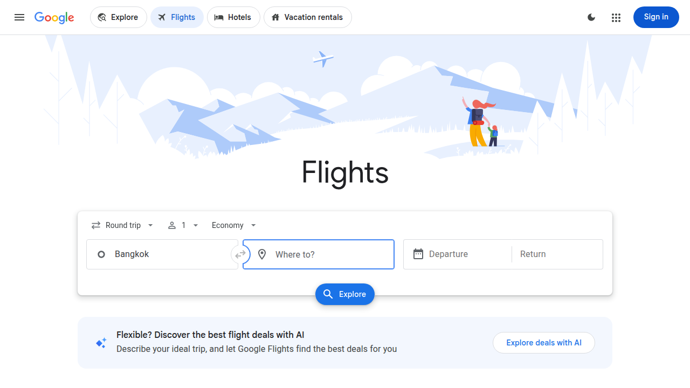
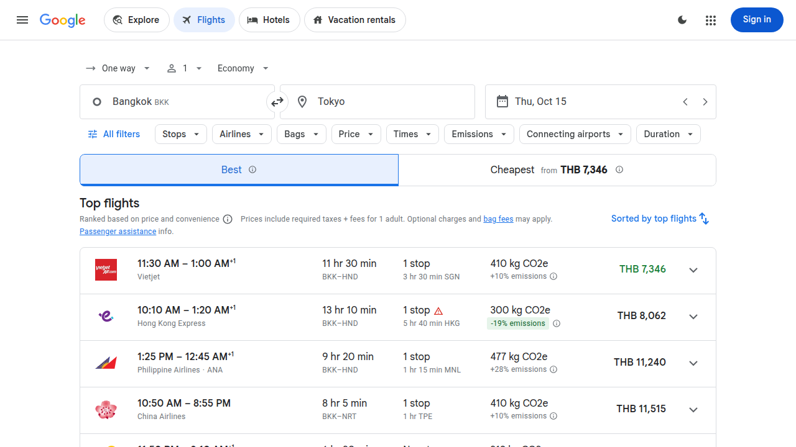

# LAB 003 · Multi-Account Container (Claude Code + Codex CLI หลายบัญชีใน image เดียว)

LAB นี้ให้ Docker image หนึ่งตัวที่เปิดมาแล้วมี Claude Code และ Codex CLI แบบหลายบัญชี (`yolo1`–`yolo5`, `cyolo1`–`cyolo5`) พร้อม skill ส่วนกลางและ Playwright MCP
ไม่ต้องวางพรอมต์ตั้งค่าหลายบัญชีใหม่ทุกครั้งที่สร้าง container แบบ LAB 02 — แค่เปิด container แล้วล็อกอิน

**ต้องมีก่อน:** [LAB 01](../01_Docker_VSCode_Setup/README.md) (Docker Desktop + VS Code + Claude Code) · แนะนำให้ผ่าน [LAB 02](../02_Setup_Multi_Account/README.md) เพื่อเข้าใจ `yolo1`, `cyolo1`, `shared`
**เวลา:** ~45 นาที (ใช้ image สำเร็จรูป) ถึง ~90 นาที (build เอง)


*ภาพแนวคิด (Imagegen): LAB 01 → 02 → 03*

## เลือกเส้นทาง

LAB นี้มี **2 เส้นทาง ให้เลือกทำเส้นทางเดียว** แล้วมาบรรจบกันที่ขั้นที่ 3–5 เหมือนกัน

- **เส้นทาง A · ใช้ image สำเร็จรูป (ขั้นที่ 1):** ดึง image `tuchsanai/multi-account-devtool:2569_1` ที่อบไว้แล้วมารัน → ตรวจว่ามี skill ครบ → ใช้งานได้ทันที
- **เส้นทาง B · build image เอง (ขั้นที่ 2):** ให้ AI ปรับ Dockerfile ตามสเปก `prompt_multi_account.md` แล้ว build / ทดสอบเอง เพื่อเรียนรู้ว่า image หลายบัญชีถูกอบขึ้นมาอย่างไร

| เส้นทาง | เหมาะกับ | ทำขั้นที่ |
|---|---|---|
| **A · ใช้ image สำเร็จรูป** (~5 นาที) | อยากใช้ทันที | [1](#ขั้นที่-1--เส้นทาง-a-เปิด-container-สำเร็จรูป-5-นาที) → [3](#ขั้นที่-3--ตรวจใน-jupyterlab-5-นาที) → 4 → 5 |
| **B · build image เอง** (~45 นาที) | อยากเรียนวิธีอบ image | [2](#ขั้นที่-2--เส้นทาง-b-build-image-เอง-45-นาที) → [3](#ขั้นที่-3--ตรวจใน-jupyterlab-5-นาที) → 4 → 5 |

สัญลักษณ์: 🖥️ = พิมพ์ใน shell · 💬 = วางในช่องสนทนา AI (กรอบ `text` คือพรอมต์ ให้คัดลอกทั้งกรอบ)

## ขั้นที่ 1 · เส้นทาง A: เปิด container สำเร็จรูป (~5 นาที)


*ภาพแนวคิด (Imagegen): เส้นทาง A · ใช้ image สำเร็จรูป*

💬 วางใน **Claude Code ใน VS Code บนเครื่องตัวเอง** (Docker Desktop ต้อง Engine running) → กดส่ง → อนุญาตคำสั่ง `docker` เมื่อถูกถาม

```text

เตรียม container `multi-account-devtool`:

1. ถ้ามี container `multi-account-devtool` อยู่แล้ว ให้ลบด้วย `docker rm -f multi-account-devtool`
   (ห้ามลบ volume `ai-accounts` เพราะเก็บการล็อกอินของทุกบัญชีไว้)

2. ตรวจ port <SSH_PORT>=2223 และ <JUPYTER_PORT>=8886 ถ้าชน ให้ใช้ port ว่างถัดไป

3. หาไฟล์ env ในโฟลเดอร์ปัจจุบัน: ใช้ `.env` ก่อน ถ้าไม่มีใช้ `.env_example` (หรือ `.env.example`)
   แล้วเติม `--env-file <path เต็ม>` ในข้อ 4 (ห้ามแสดงค่าในไฟล์ แสดงได้เฉพาะชื่อตัวแปร)
   - ถ้าใช้ไฟล์ example ให้เตือนว่า "⚠️ ไม่พบ .env — ใช้ <ชื่อไฟล์> แทน ค่าอาจเป็นค่าตัวอย่าง
     กรุณา copy เป็น .env แล้วใส่ค่าจริง" พร้อมบอกชื่อตัวแปรที่ค่าว่างหรือดูเป็นค่าตัวอย่าง
   - ถ้าไม่พบทั้งสองไฟล์ ให้ตัด `--env-file` ออกแล้วรันต่อ และเตือนว่า
     "⚠️ ไม่พบ .env หรือ .env_example — container จะไม่มี environment variable กรุณาสร้าง .env แล้วรันใหม่"

4. รัน:

docker run -dit --name multi-account-devtool --hostname multi-account-devtool --privileged \
  -p <SSH_PORT>:22 -p <JUPYTER_PORT>:8888 \
  --env-file <ENV_FILE> \
  -v ai-accounts:/root/ai-accounts \
  tuchsanai/multi-account-devtool:2569_1

5. รอจน `docker logs multi-account-devtool` มีบรรทัดที่มีข้อความ `jupyter lab :8888`

6. ตรวจ skill `vastai` `yolo` `cyolo` (สำคัญ ห้ามข้าม):

docker exec multi-account-devtool bash -lc \
'B=$HOME/ai-accounts; for t in .Claude .Codex; do for s in vastai yolo cyolo; do [ -d $B/$t/shared/skills/$s ] && echo "$t/$s OK" || echo "$t/$s MISSING"; done; done'

   ถ้ามี MISSING แม้แต่ตัวเดียว ให้แจ้งเตือนฉันเป็นภาษาไทยอย่างชัดเจนว่า
   "⚠️ ยังไม่ได้ติดตั้ง skill — กรุณาติดตั้ง skill ต่อไปนี้ก่อนใช้งาน: <รายชื่อที่ขาด>"
   ห้ามแสดงรหัสหรือเนื้อหาใน SKILL.md
   และห้ามติดตั้ง skill เอง ให้แจ้งเตือนอย่างเดียว

7. ไม่ต้องติดตั้ง Claude Code / Codex เพิ่ม (มีใน image แล้ว) ห้ามล็อกอินแทนฉัน
   สรุปผลเป็นภาษาไทย โดยเรียงดังนี้:
   - ถ้ามีคำเตือน (ใช้ไฟล์ example / ไม่พบไฟล์ env / skill ขาด) ให้แสดงคำเตือนไว้บนสุดของสรุป ก่อนข้อมูลอื่น
   - port ที่ใช้ (SSH / Jupyter)
   - URL ของ JupyterLab
   - สถานะไฟล์ env (ใช้ .env / ใช้ .env_example แทน / ไม่พบ) พร้อมรายชื่อตัวแปรที่โหลด (เฉพาะชื่อ)
   - ผลตรวจ skill (มีครบ / ขาดอะไร)

```

| ตัวแปร | ค่าเริ่มต้น | ใช้ทำอะไร |
|---|---|---|
| `<SSH_PORT>` | `2223` | `ssh root@localhost -p <SSH_PORT>` (password `passwd`) |
| `<JUPYTER_PORT>` | `8886` | http://localhost:<JUPYTER_PORT>/lab (ไม่มีรหัสผ่าน) |

**ผลที่ควรได้:** สรุปภาษาไทยที่มี port SSH / Jupyter, URL `http://localhost:<JUPYTER_PORT>/lab`, สถานะไฟล์ env พร้อมรายชื่อตัวแปร (เฉพาะชื่อ) และผลตรวจ skill **`vastai` `yolo` `cyolo` เป็น `OK` ครบทั้ง 6 บรรทัด** (`.Claude` และ `.Codex`) ถ้ามีคำเตือน (ใช้ `.env_example` / ไม่พบไฟล์ env / skill ขาด) จะอยู่บนสุดของสรุป (ครั้งแรกต้อง pull image อาจนานหลายนาที)

> **ทำไม skill สำคัญ:** ขั้นที่ 5 และ LAB ถัดไปใช้ skill จาก `shared` ถ้า AI แจ้งว่ายังไม่ได้ติดตั้ง skill อย่าเพิ่งไปขั้นต่อไป ให้รัน `docker exec multi-account-devtool ai-accounts-setup` แล้วตรวจซ้ำ ถ้ายังขาดอยู่ ให้ลบ container แล้วรันขั้นที่ 1 ใหม่ (ห้ามลบ volume `ai-accounts`)


*ภาพจริง: รันคำสั่งเดียวกันใน Terminal ของ JupyterLab*

> **เลือกทางเดียว:** `docker run` ข้างบนใช้ volume `ai-accounts` ส่วน `docker compose` (ขั้นที่ 2) ใช้ `multiaccountdevtool_ai-accounts` → ล็อกอินไม่แชร์กัน และชื่อ container ซ้ำกัน (`multi-account-devtool`) จึงรันพร้อมกันไม่ได้

## ขั้นที่ 2 · เส้นทาง B: build image เอง (~45 นาที)


*ภาพแนวคิด (Imagegen): เส้นทาง B · build image เอง*

```text
03_MultiAccount_Container/
├── prompt_multi_account.md   ← สเปกระบบหลายบัญชี (ชุดเดียวกับ LAB 02)
├── 00_Devtool_Container/     ← ต้นฉบับ devtools จาก LAB 01
└── MultiAccountDevtool/      ← เฉลยที่ build และทดสอบแล้ว
```

> ก่อนเริ่ม ให้เปลี่ยนชื่อโฟลเดอร์เฉลยเป็น `MultiAccountDevtool_solution` เพื่อไม่ให้ทับกันและไม่ให้ AI เปิดดูเฉลย

💬 เปิด Claude Code ใน VS Code **บนเครื่องตัวเอง** (ไม่ใช่ใน container) โดยให้โฟลเดอร์งานคือ `03_MultiAccount_Container` แล้ววาง:

```text
ภารกิจ: ปรับ Dockerfile และ docker-compose.yaml ใน ./MultiAccountDevtool ให้ image ใหม่รองรับเงื่อนไขทั้งหมดใน ./prompt_multi_account.md
ตั้งแต่ตอน build แล้ว build / รัน / ทดสอบจริงจนผ่าน ทำงานเฉพาะใน ./MultiAccountDevtool ห้ามแก้ไฟล์นอกโฟลเดอร์นี้
ถ้ายังไม่มี ./MultiAccountDevtool ให้คัดลอกจาก ./00_Devtool_Container ก่อน (cp -r ./00_Devtool_Container ./MultiAccountDevtool) ห้ามแก้ ./00_Devtool_Container

## อ่านก่อน
- ./prompt_multi_account.md = สเปก ทุกข้อใน "เป้าหมาย" "กติกา" "ทดสอบ" "รายงาน" ต้องเป็นจริงใน image ใหม่
  ข้อ "ข้อเท็จจริงจากการทดลอง" ให้ตรวจกับเวอร์ชันที่ติดตั้งจริง (--help, official docs) ถ้าต่างให้ทำตามของจริงและบันทึกในรายงาน
- ./MultiAccountDevtool/ = สำเนาของ devtools เดิม (คัดลอกจาก ./00_Devtool_Container ข้างบน) เก็บความสามารถเดิมให้ครบ: sshd (password + key Devtool_SSH), Docker-in-Docker, JupyterLab
- ห้ามเปิดโฟลเดอร์อื่นเพื่อหาเฉลย ห้ามเดา env/path/flag

## สิ่งที่ต้องอยู่ใน image
1. Dockerfile
   - Claude Code ด้วย curl -fsSL https://claude.ai/install.sh | bash และ Codex ด้วย npm install -g @openai/codex
   - claude และ codex ต้องใช้ได้ทั้งใน JupyterLab Terminal, SSH และ docker exec: symlink เข้า /usr/local/bin ห้ามพึ่ง .bashrc
   - @playwright/mcp ติดตั้ง global แบบ pin เวอร์ชัน แล้วติดตั้ง Chromium + system deps ครั้งเดียวด้วย playwright ที่อยู่ในแพ็กเกจ @playwright/mcp
     (--with-deps chromium) ให้เวอร์ชันตรงกัน เก็บ browser ที่ PLAYWRIGHT_BROWSERS_PATH=/ms-playwright
   - installer ระบบหลายบัญชี + wrapper yolo1..5 / cyolo1..5 อยู่ใน /usr/local/bin (อยู่ใน PATH อยู่แล้ว ไม่ต้องแก้ .bashrc)
2. installer (เช่น /usr/local/bin/ai-accounts-setup) ทำตามสเปกทุกข้อ: BASE_PATH="$HOME/ai-accounts" กำหนดที่เดียว
   รันซ้ำได้ ไม่ทับ credential/config/รหัสสุ่ม shared-check เดิม ห้ามมี credential ใน shared
3. start.sh: คงพฤติกรรมเดิม + เรียก installer ทุกครั้งที่ container start
   (volume ใหม่ได้โครงและรหัสสุ่มของตัวเอง volume เดิมล็อกอินยังอยู่) เก็บ log ไว้ใน /var/log
4. docker-compose.yaml (ปรับจาก docker-compose.yml เดิม):
   - image: tuchsanai/multi-account-devtool:2569_1 และ build: .
   - ports "${SSH_PORT:-2223}:22" และ "${JUPYTER_PORT:-8886}:8888" (ไม่ชน devtools จาก LAB 01)
   - named volume สำหรับ /root/ai-accounts (ล็อกอินอยู่รอดเมื่อสร้าง container ใหม่) + volume ของ Docker-in-Docker
     + ./workspace:/workspace + ./Devtool_SSH:/etc/devtools/ssh
   - env_file ต้องเป็น required: false และเปลี่ยน path ได้ด้วยตัวแปร ห้ามโหลดไฟล์ .env ส่วนตัวเข้า container ทดสอบ

## build (รันใน ./MultiAccountDevtool)
docker build -t tuchsanai/multi-account-devtool:2569_1 .
docker tag tuchsanai/multi-account-devtool:2569_1 tuchsanai/multi-account-devtool:latest
docker push tuchsanai/multi-account-devtool:2569_1
ถ้า push ไม่ผ่านเพราะยังไม่ docker login หรือไม่มีสิทธิ์ ให้รายงานแล้วข้าม ห้ามขอรหัสผ่านหรือ token

## รันและทดสอบจริง
- รัน container ทดสอบด้วย docker compose -p <ชื่อทดสอบ> โดยตั้ง CONTAINER_NAME และพอร์ตที่ยังว่าง
  ห้ามลบ หยุด หรือทับ container/image อื่นที่มีอยู่ (เช่น devtools)
- ทำทุกข้อในหัวข้อ "ทดสอบ" ของสเปกใน container จริง บันทึก PASS/FAIL/SKIP ตามจริง แล้วเพิ่ม:
  claude/codex/yolo1/cyolo1 อยู่ใน PATH ทั้ง docker exec, SSH และ JupyterLab Terminal
  installer รอบ 2 ไม่ทำลายของเดิม (เทียบ checksum รวมรหัส shared-check)
  docker compose up --force-recreate แล้วของใน volume เดิมยังอยู่
  skill ใหม่ใน shared เห็นโดยไม่รัน installer ซ้ำ (ทดสอบแล้วลบออก)
  สั่ง Playwright MCP ตามคำสั่งใน shared/mcp/mcp.json ผ่าน stdio: initialize → tools/list → เปิด https://example.com → screenshot
  JupyterLab /lab ตอบ 200 และ SSH ด้วย key Devtool_SSH/devtoolSSH ได้
- อะไรที่ต้องล็อกอิน = SKIP ห้ามล็อกอินแทนฉัน

## รายงาน (ห้ามมี secret อีเมล token หรือรหัสสุ่ม shared-check) ใน ./MultiAccountDevtool
setup-report.md, login-guide.md, checklist.md ตามหัวข้อ "รายงาน" ของสเปก
เสร็จแล้วสรุปเป็นตาราง PASS/FAIL/SKIP พร้อมชื่อ container ทดสอบ พอร์ต image ID และผล push
ปล่อย container ทดสอบไว้ให้ฉันล็อกอิน แล้วหยุด ห้ามทำขั้นถัดไปเอง
```

ไม่มีสิทธิ์ push เข้า `tuchsanai/`? แทนด้วยชื่อ Docker Hub ของตัวเองทุกจุด หรือลบบรรทัด `docker push` ออก

**สิ่งที่ได้** (หน้าตาเหมือนเฉลย):

```text
MultiAccountDevtool/
├── Dockerfile  start.sh  docker-compose.yaml
├── scripts/            ← ai-accounts.conf, ai-accounts-setup (installer), ai-account (wrapper)
├── setup-report.md  login-guide.md  checklist.md
└── workspace/          ← mount เป็น /workspace
```


*ภาพแนวคิด (Imagegen) ย่อให้อ่านง่าย: ของจริงทั้ง `.Claude/shared` และ `.Codex/shared` มีทั้ง `skills/` และ `mcp/`*

**แนวคิดหลัก:**
- `claude`, `codex` และ wrapper `yolo1..5` / `cyolo1..5` อยู่ใน `/usr/local/bin` → ใช้ได้ทั้ง JupyterLab, SSH, `docker exec` โดยไม่แก้ `.bashrc`
- `BASE_PATH="$HOME/ai-accounts"` กำหนดไว้ไฟล์เดียว (`/etc/ai-accounts.conf`)
- skill ส่วนกลาง: `yoloN/skills` เป็น symlink ทั้งโฟลเดอร์ ส่วน Codex ลิงก์ทีละ skill
- MCP ส่วนกลาง: wrapper ส่ง `shared/mcp/mcp.json` ให้ CLI ทุกครั้งที่เปิดบัญชี
- installer รันทุกครั้งที่ container start และ named volume เก็บล็อกอินไว้ → สร้าง container ใหม่ ล็อกอินไม่หาย

รายละเอียดและผลทดสอบ: [setup-report.md](MultiAccountDevtool/setup-report.md) · [checklist.md](MultiAccountDevtool/checklist.md)

🖥️ รัน image ที่ build เอง: `cd MultiAccountDevtool && docker compose up -d` (พอร์ต 2223/8886)

## ขั้นที่ 3 · ตรวจใน JupyterLab (~5 นาที)

เปิด http://localhost:<JUPYTER_PORT>/lab (ค่าเริ่มต้น http://localhost:8886/lab) → **+ → Terminal** แล้ววาง:

```bash
for a in yolo1 yolo2 yolo3 yolo4 yolo5 cyolo1 cyolo2 cyolo3 cyolo4 cyolo5; do printf "%-7s " $a; $a --version; done
ls -l ~/ai-accounts/.Claude/yolo1/skills ~/ai-accounts/.Codex/cyolo1/skills/
cyolo1 mcp list
```


*ภาพจริง: skill ชี้ไป `shared` และ `playwright` สถานะ `enabled` ตั้งแต่ก่อนล็อกอิน*

โฟลเดอร์บัญชีอยู่ที่ `/root/ai-accounts/` (installer สร้างให้ตอน start) ดูภาพจริงใน File Browser: [.Claude](img/mad-jupyter-claude-folders.png) · [.Codex](img/mad-jupyter-codex-folders.png)

## ขั้นที่ 4 · ล็อกอิน (~15 นาที)

🖥️ Terminal ใน JupyterLab ล็อกอินอย่างน้อย 4 บัญชี:

- `yolo1` → เลือก **Claude account with subscription** → ยืนยันในเบราว์เซอร์ → `/exit`
- `yolo2` → ทำเหมือน `yolo1`
- `cyolo1 login --device-auth` → เปิด URL ในเบราว์เซอร์ ใส่ code
- `cyolo2 login --device-auth` → ทำเหมือน `cyolo1`

ภาพหน้าจอทีละขั้น: [LAB 02 · 3.1 Claude Code](../02_Setup_Multi_Account/README.md#31--claude-code-yolo1) · [LAB 02 · 3.2 Codex](../02_Setup_Multi_Account/README.md#32--codex-cyolo1) · คู่มือเต็ม: [login-guide.md](MultiAccountDevtool/login-guide.md)

> **ล็อกอินเองเสมอ** ห้ามส่งรหัสผ่าน, code, URL ที่มี token หรือไฟล์ credential ให้ AI หรือใคร

## ขั้นที่ 5 · ทดสอบ skill และ MCP ข้ามบัญชี (~20 นาที)

🖥️ เปิด Claude Code ใน container ด้วยบัญชีที่ล็อกอินแล้ว:

```bash
cd /workspace
yolo1
```

💬 วางพรอมต์นี้ในเซสชัน `yolo1` (ค้นหาเที่ยวบินอย่างเดียว ไม่จอง ไม่ชำระเงิน):

```text
ฉันล็อกอิน yolo1 yolo2 cyolo1 cyolo2 แล้ว ทดสอบ skill/MCP ส่วนกลางข้ามบัญชีต่อจากเซสชันนี้
1. บันทึกข้อความใต้เส้น ==== ตามตัวอักษรลง ~/verify-prompt.txt
2. รันทีละบัญชีจาก shell: yolo1 -p "$(cat ~/verify-prompt.txt)", yolo2 เช่นเดียวกัน,
   cyolo1 exec --skip-git-repo-check "$(cat ~/verify-prompt.txt)", cyolo2 เช่นเดียวกัน
   รันแบบ foreground ทีละบัญชี (ไม่ใช้ background) timeout บัญชีละ 15 นาที รอจนจบก่อนไปบัญชีถัดไป
3. คัดลอกภาพ screenshot ที่แต่ละบัญชีรายงานไปเป็น ./evidence/<บัญชี>/1-open.png, 2-search.png, 3-results.png
   พร้อม log คำตอบเป็น ./evidence/<บัญชี>/run.log ห้ามแก้ไฟล์ตั้งค่า
4. สรุปตารางรวม บัญชี | config root | รหัส shared-check | tool ที่เรียก | เที่ยวบินอันดับ 1 | ภาพที่ได้ | PASS/FAIL
   บัญชีต่างกันแต่ CLI เดียวกันต้องได้รหัสเดียวกัน ถ้าบัญชีใดล้มเหลวให้รายงานตามจริง ห้ามแก้แทนหรือเดาผล
====
ตรวจว่า skill และ MCP ส่วนกลางใช้ได้จริงในบัญชีนี้ ทำตามลำดับ ห้ามแก้ไฟล์ตั้งค่าใด ๆ

1. แจ้ง config root ที่ใช้อยู่ (ค่า CLAUDE_CONFIG_DIR หรือ CODEX_HOME) ห้ามแสดง token อีเมล หรือข้อมูลบัญชี
2. ใช้ skill $shared-check ตามกลไก skill ของ CLI นี้ แล้วรายงานรหัสที่ได้ พร้อม path ของ skill ตามที่ CLI แสดง
   ห้ามค้นหาไฟล์เอง (find, grep, ls) และห้ามเปิดไฟล์จาก path ที่ไม่ได้มาจากรายการ skill ของ CLI
3. ใช้เครื่องมือของ MCP ชื่อ playwright เท่านั้น ห้ามใช้ curl, python, web search หรือ browser อื่น
   เปิด https://www.google.com/travel/flights?hl=en
   ค้นหาเที่ยวบินเที่ยวเดียว Bangkok (BKK) ไป Tokyo ญี่ปุ่น ชั้นประหยัด ผู้ใหญ่ 1 คน วันเดินทางคือวันที่ 15 ของเดือนถัดไป
   ค้นหาอย่างเดียว ห้ามกดจอง ห้ามกรอกข้อมูลส่วนตัว ห้ามชำระเงิน ห้ามล็อกอินเว็บไซต์ใด
   ถ้าหน้าเว็บไม่แสดงผล ให้รายงานตามจริงว่าติดตรงไหน ห้ามเดาราคา
4. บันทึกภาพหน้าจอด้วย tool screenshot ของ playwright เฉพาะส่วนที่มองเห็น (ไม่ใช่ทั้งหน้า) 3 ภาพ
   ตั้งชื่อนำหน้าด้วยชื่อโฟลเดอร์ config root เช่น yolo1-1-open.png: <บัญชี>-1-open.png (หน้าเว็บเปิดได้),
   <บัญชี>-2-search.png (กรอกเงื่อนไขครบก่อนกดค้นหา), <บัญชี>-3-results.png (รายการผลเที่ยวบิน) แล้วรายงาน path เต็มของแต่ละภาพ
5. สรุปเป็นตาราง รายการ | PASS/FAIL | หลักฐาน โดยมีแถว:
   - config root
   - รหัสจาก skill shared-check
   - ชื่อ MCP server และชื่อ tool ที่เรียกจริง
   - ภาพหน้าจอ 3 ภาพ (path)
   - เที่ยวบิน 3 อันดับแรก: สายการบิน เวลาออก-ถึง ระยะเวลา จำนวนแวะ ราคา (ตามที่เห็นบนหน้าเว็บ)
```

อยากทดสอบทีละบัญชี → คัดลอกเฉพาะข้อความใต้ `====` ไปวางในบัญชีนั้น
**ไฟล์ที่ได้:** `/workspace/evidence/<บัญชี>/1-open.png`, `2-search.png`, `3-results.png`, `run.log`

ภาพจริงของ `yolo1` จาก Playwright MCP (29 ก.ย. 2026):

| 1-open · เปิดหน้าเว็บได้ | 2-search · กรอกเงื่อนไขครบ | 3-results · รายการเที่ยวบินจริง |
|---|---|---|
|  |  |  |

ผลการรันจริง:
| บัญชี | รหัส shared-check | รหัสตรงกับบัญชี CLI เดียวกัน? | MCP | อันดับ 1 | ผล |
|---|---|---|---|---|---|
| yolo1 | `SHARED_SKILL_OK-claude-…` | ✓ (= yolo2) | playwright | Vietjet THB 7,346 | **PASS** |
| yolo2 | `SHARED_SKILL_OK-claude-…` | ✓ (= yolo1) | playwright | Vietjet THB 7,346 | **PASS** |
| cyolo1 | `SHARED_SKILL_OK-codex-…` | ✓ (= cyolo2) | playwright | Vietjet THB 7,346 | **PASS** |
| cyolo2 | `SHARED_SKILL_OK-codex-…` | ✓ (= cyolo1) | playwright | Vietjet THB 7,346 | **PASS** |

**อ่านผล:** CLI เดียวกันได้รหัสเดียวกัน = skill มาจาก `shared` จริง และทุกบัญชีใช้ MCP `playwright` ใน image ได้ (รหัสของเครื่องคุณจะต่างจากนี้)

ภาพของบัญชีอื่น: [yolo2](img/mad-web-yolo2-3-results.png) · [cyolo1](img/mad-web-cyolo1-3-results.png) · [cyolo2](img/mad-web-cyolo2-3-results.png)

## ข้อควรรู้

- ทุกบัญชีเป็นผู้ใช้ Linux เดียวกัน (`root`) → แยกแค่โฟลเดอร์ config ไม่ใช่ OS isolation
- `docker compose down -v` (หรือลบ volume) = ล็อกอินหายทุกบัญชี ใช้ `docker compose down` เฉย ๆ
- password `passwd` และ key `Devtool_SSH/devtoolSSH` ใช้ใน lab เท่านั้น ห้ามเปิดพอร์ตออก internet
- อย่า mount ไฟล์ `.env` ส่วนตัวที่มี token เข้า container ที่ให้ AI ทดสอบ
- ราคาและลำดับเที่ยวบินเปลี่ยนตามวันเวลาที่ค้นหา

## คำสั่งที่ใช้บ่อย

```bash
# 🖥️ บนเครื่อง — เส้นทาง A · docker run
docker logs -f multi-account-devtool      # ดู log ตอน start
docker stop multi-account-devtool         # หยุด
docker start multi-account-devtool        # เริ่มใหม่
docker rm -f multi-account-devtool        # ลบ container (ล็อกอินยังอยู่ใน volume ai-accounts)
docker exec -it multi-account-devtool bash  # เข้า shell ใน container
# 🖥️ บนเครื่อง — เส้นทาง B · docker compose ในโฟลเดอร์ MultiAccountDevtool/
docker compose up -d          # เริ่ม
docker compose logs -f        # ดู log ตอน start
docker compose down           # หยุด (ล็อกอินยังอยู่)
# 🖥️ ใน container
yolo1 auth status             # สถานะล็อกอิน Claude
cyolo1 mcp list               # ตรวจ MCP ของ Codex
ai-accounts-setup             # รัน installer ซ้ำ (ไม่ทับของเดิม)
```
