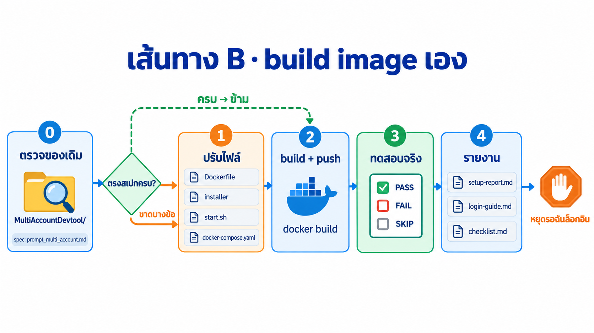
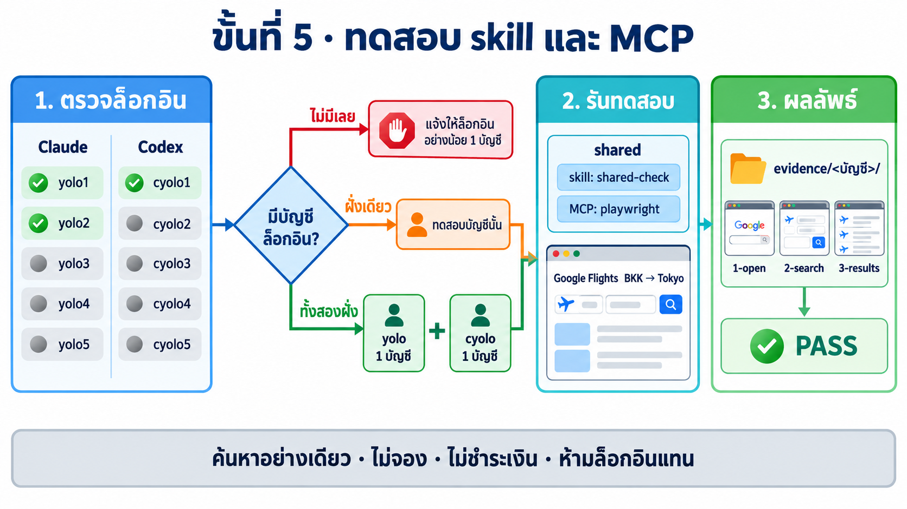

# LAB 003 · Multi-Account Container (Claude Code + Codex CLI หลายบัญชีใน image เดียว)

LAB นี้ให้ Docker image หนึ่งตัวที่เปิดมาแล้วมี Claude Code และ Codex CLI แบบหลายบัญชี (`yolo1`–`yolo5`, `cyolo1`–`cyolo5`) พร้อม skill ส่วนกลางและ Playwright MCP
ไม่ต้องวางพรอมต์ตั้งค่าหลายบัญชีใหม่ทุกครั้งที่สร้าง container แบบ LAB 02 — แค่เปิด container แล้วล็อกอิน

**ต้องมีก่อน:** [LAB 01](../01_Docker_VSCode_Setup/README.md) (Docker Desktop + VS Code + Claude Code) · แนะนำให้ผ่าน [LAB 02](../02_Setup_Multi_Account/README.md) เพื่อเข้าใจ `yolo1`, `cyolo1`, `shared`
**เวลา:** ~45 นาที (ใช้ image สำเร็จรูป) ถึง ~90 นาที (build เอง)


*ภาพแนวคิด (Imagegen): LAB 01 → 02 → 03*

## เลือกเส้นทาง

LAB นี้มี **2 เส้นทาง ให้เลือกทำเส้นทางเดียว** แล้วมาบรรจบกันที่ขั้นที่ 3–5 เหมือนกัน

- **เส้นทาง A · ใช้ image สำเร็จรูป (ขั้นที่ 1):** ดึง image `tuchsanai/multi-account-devtool:2569_1` ที่อบไว้แล้วมารัน → ตรวจว่ามี skill ครบ → ใช้งานได้ทันที
- **เส้นทาง B · build image เอง (ขั้นที่ 2):** ให้ AI ปรับ Dockerfile ตามสเปก `prompt_multi_account.md` แล้ว build / ทดสอบเอง เพื่อเรียนรู้ว่า image หลายบัญชีถูกอบขึ้นมาอย่างไร

| เส้นทาง | เหมาะกับ | ทำขั้นที่ |
|---|---|---|
| **A · ใช้ image สำเร็จรูป** (~5 นาที) | อยากใช้ทันที | [1](#ขั้นที่-1--เส้นทาง-a-เปิด-container-สำเร็จรูป-5-นาที) → [3](#ขั้นที่-3--ตรวจใน-jupyterlab-5-นาที) → 4 → 5 |
| **B · build image เอง** (~45 นาที) | อยากเรียนวิธีอบ image | [2](#ขั้นที่-2--เส้นทาง-b-build-image-เอง-45-นาที) → [3](#ขั้นที่-3--ตรวจใน-jupyterlab-5-นาที) → 4 → 5 |

สัญลักษณ์: 🖥️ = พิมพ์ใน shell · 💬 = วางในช่องสนทนา AI (กรอบ `text` คือพรอมต์ ให้คัดลอกทั้งกรอบ)

## ขั้นที่ 1 · เส้นทาง A: เปิด container สำเร็จรูป (~5 นาที)


*ภาพแนวคิด (Imagegen): เส้นทาง A · ใช้ image สำเร็จรูป*

💬 วางใน **Claude Code ใน VS Code บนเครื่องตัวเอง** (Windows / macOS / Linux · Docker Desktop หรือ Docker Engine ต้องรันอยู่) → กดส่ง → อนุญาตคำสั่ง `docker` เมื่อถูกถาม

```text
เตรียม container `multi-account-devtool` จาก image `tuchsanai/multi-account-devtool:2569_1`

กติกา: ห้ามลบ volume `ai-accounts` (เก็บล็อกอินทุกบัญชี) · ห้ามแสดงค่าในไฟล์ env (แสดงได้แค่ชื่อตัวแปร
ยกเว้น LOCAL_SKILLS_DIR) หรือเนื้อหา SKILL.md · ห้ามติดตั้ง Claude/Codex/skill เอง (ยกเว้น sync ข้อ 3)
· ห้ามล็อกอินแทนฉัน · เก็บคำเตือน ⚠️ ทุกข้อไว้บนสุดของสรุป
ให้เร็ว: ทำแต่ละข้อด้วยคำสั่ง shell เดียว (รวมหลายเช็กในคำสั่งเดียว ข้อ 3–4 รันต่อกันได้) ห้าม sleep รอแยกเป็นหลายรอบ
ใช้ได้ทุก OS: ดูก่อนว่าเครื่องเป็น Windows / macOS / Linux และ shell อะไร แล้วเขียนคำสั่งให้ตรง shell นั้น
(path ใช้ / ได้ทุก OS) · คำสั่ง docker ข้อ 2–4 รันได้ตามตัวอักษรทุก shell ห้ามแก้ quote
(Git Bash บน Windows: ใส่ `export MSYS_NO_PATHCONV=1` ก่อน ไม่งั้น /workspace ถูกแปลงเป็น path ของ Windows)

1. เช็กทุกอย่างในคำสั่งเดียว
   - ยังไม่มี image ในเครื่อง (`docker image inspect`) → เริ่ม `docker pull tuchsanai/multi-account-devtool:2569_1`
     แบบ background แล้วแจ้งฉันทันทีก่อนทำข้อ 2:
     "⏳ ยังไม่มี image ในเครื่อง กำลังดาวน์โหลด (~4.5 GB) ครั้งแรกอาจใช้หลายนาที กรุณารอสักครู่"
   - container ชื่อนี้มีอยู่แล้ว → จะ `docker rm -f` ก่อนข้อ 2
   - port Jupyter=8886 ถ้าชน (container อื่นใช้อยู่ / มีโปรแกรมฟังอยู่) ใช้ port ว่างถัดไป
     (port ที่ `multi-account-devtool` ตัวเดิมถืออยู่ไม่นับว่าชน เพราะจะถูกลบ)
   - env (โฟลเดอร์ปัจจุบัน) → `--env-file <path เต็ม>`: ใช้ `.env` ถ้าไม่มีใช้ `.env_example` / `.env.example`
     (⚠️ "ไม่พบ .env — ใช้ <ไฟล์> แทน กรุณา copy เป็น .env แล้วใส่ค่าจริง" + ชื่อตัวแปรที่ว่าง/เป็นค่าตัวอย่าง)
     ไม่มีสักไฟล์ → ไม่ใส่ (⚠️ "ไม่พบ .env หรือ .env_example — container จะไม่มี environment variable")
     อ่านแค่ชื่อตัวแปรกับค่า LOCAL_SKILLS_DIR ห้ามพิมพ์ทั้งไฟล์ออกมา
   - local skill จาก `LOCAL_SKILLS_DIR` (ตัด quote, path relative นับจากโฟลเดอร์ของไฟล์ env):
     ว่าง/ค่าตัวอย่าง (เช่น /path/to/...) → ไม่ mount · ไม่ใช่โฟลเดอร์ที่มีจริง → ไม่ mount
     (⚠️ "LOCAL_SKILLS_DIR=<path> ไม่พบโฟลเดอร์") · มี SKILL.md ตรงตัว (skill เดี่ยว)
     → `-v "<path>:/opt/local-skills/<ชื่อโฟลเดอร์>:ro"` · เป็นโฟลเดอร์รวม skill → `-v "<path>:/opt/local-skills:ro"`

2. คำสั่งเดียว: (rm -f ถ้ามี) → docker run (ตัด option ที่ข้อ 1 บอกว่าไม่ใช้) → วนเช็กทุก 2 วิ
   (สูงสุด 5 นาที, curl ใส่ timeout) จน http://localhost:<JUPYTER_PORT>/lab ตอบ 200
   docker run ล้ม → หยุดทันทีแล้วรายงาน error ห้ามวนรอต่อ
   docker run แจ้งว่าใช้ port ไม่ได้ (เช่น `ports are not available`, `address already in use` หรือ port ที่ OS สงวนไว้)
   → `docker rm -f` แล้วรันใหม่ด้วย port ว่างถัดไป

docker run -dit --name multi-account-devtool --privileged -w /workspace -p <JUPYTER_PORT>:8888 --env-file <ENV_FILE> -v ai-accounts:/root/ai-accounts <LOCAL_SKILLS_MOUNT> tuchsanai/multi-account-devtool:2569_1

3. ตรวจ skill (ห้ามข้าม) + sync local skill ในคำสั่งเดียว
   ไม่ได้ mount local skill → script ข้ามส่วน sync เอง เหลือตรวจแค่ vastai yolo cyolo (ไม่ต้องแก้คำสั่ง)
   skill ชื่อซ้ำถูกแทนด้วยของ local ยกเว้น shared-check · แสดงแค่ชื่อที่ SYNCED / SKIP
   mount แล้วแต่ TOTAL 0 → ⚠️ "LOCAL_SKILLS_DIR ไม่มีโฟลเดอร์ skill ที่มี SKILL.md"
   มี MISSING → ⚠️ "ยังไม่ได้ติดตั้ง skill — กรุณาติดตั้ง: <รายชื่อที่ขาด>"

docker exec multi-account-devtool bash -lc 'B=$HOME/ai-accounts; K=/tmp/skills.txt; echo vastai yolo cyolo > $K; n=0; for d in /opt/local-skills/*/; do [ -d $d ] || continue; s=$(basename $d); if [ ! -f $d/SKILL.md ]; then echo SKIP $s no-SKILL.md; continue; fi; if [ $s = shared-check ]; then echo SKIP $s reserved; continue; fi; for t in .Claude .Codex; do rm -rf $B/$t/shared/skills/$s; cp -rL $d $B/$t/shared/skills/$s; done; echo SYNCED $s; n=$((n+1)); echo $s >> $K; done; echo TOTAL $n; for t in .Claude .Codex; do for s in $(xargs -n1 < $K | sort -u); do [ -d $B/$t/shared/skills/$s ] && echo $t/$s OK || echo $t/$s MISSING; done; done'

4. ตรวจการล็อกอินทุกบัญชี (ห้ามแสดง token หรืออีเมล) ไม่มี LOGGED_IN เลยสักบัญชี →
   ⚠️ "ยังไม่มีบัญชีไหนล็อกอิน — กรุณาล็อกอินอย่างน้อย 1 บัญชีใน Terminal ของ JupyterLab:
   yolo1 (เลือก Claude account with subscription แล้ว /exit) หรือ cyolo1 login --device-auth"

docker exec multi-account-devtool bash -lc 'for a in yolo1 yolo2 yolo3 yolo4 yolo5; do $a auth status 2>/dev/null | grep -q loggedIn.:.true && echo $a LOGGED_IN || echo $a NOT_LOGGED_IN; done; for a in cyolo1 cyolo2 cyolo3 cyolo4 cyolo5; do $a login status 2>&1 | grep -q ^Logged.in && echo $a LOGGED_IN || echo $a NOT_LOGGED_IN; done'

5. สรุปภาษาไทยตามลำดับ: ⚠️ คำเตือน (ไม่มีให้เขียน "ไม่มี") → URL http://localhost:<JUPYTER_PORT>/lab
   → เข้า shell: `docker exec -it multi-account-devtool bash` (เริ่มที่ /workspace) → ไฟล์ env ที่ใช้ + ชื่อตัวแปร
   → local skill (path ที่ mount หรือ "ไม่ได้กำหนด", SYNCED/SKIP) → ผลตรวจ skill
   → ตารางล็อกอิน บัญชี | ล็อกอินแล้ว? (yolo1–5, cyolo1–5)
```

| ตัวแปร | ค่าเริ่มต้น | ใช้ทำอะไร |
|---|---|---|
| `<JUPYTER_PORT>` | `8886` | http://localhost:<JUPYTER_PORT>/lab (ไม่มีรหัสผ่าน) |
| `LOCAL_SKILLS_DIR` (ใน `.env`) | ว่าง = ไม่ใช้ | โฟลเดอร์ skill บนเครื่อง (แต่ละ skill = โฟลเดอร์ย่อยที่มี `SKILL.md` หรือชี้ไปที่ skill เดียวก็ได้) → mount เป็น `/opt/local-skills` (อ่านอย่างเดียว) แล้ว copy เข้า `.Claude/shared/skills` และ `.Codex/shared/skills` ให้ทุกบัญชีใช้ร่วมกัน |

**ผลที่ควรได้:** สรุปภาษาไทยที่มี URL `http://localhost:<JUPYTER_PORT>/lab`, คำสั่ง `docker exec -it multi-account-devtool bash`, สถานะไฟล์ env พร้อมรายชื่อตัวแปร (เฉพาะชื่อ), รายชื่อ local skill ที่ sync (ถ้ากำหนด `LOCAL_SKILLS_DIR`) และผลตรวจ skill **`vastai` `yolo` `cyolo` (และ local skill) เป็น `OK` ครบทั้ง `.Claude` และ `.Codex`** และตารางล็อกอิน `yolo1–5` / `cyolo1–5` ถ้ามีคำเตือน (ใช้ `.env_example` / ไม่พบไฟล์ env / `LOCAL_SKILLS_DIR` ใช้ไม่ได้ / skill ขาด / ยังไม่มีบัญชีไหนล็อกอิน) จะอยู่บนสุดของสรุป (ครั้งแรกต้อง pull image อาจนานหลายนาที)

> **ทำไม skill สำคัญ:** ขั้นที่ 5 และ LAB ถัดไปใช้ skill จาก `shared` ถ้า AI แจ้งว่ายังไม่ได้ติดตั้ง skill อย่าเพิ่งไปขั้นต่อไป ให้รัน `docker exec multi-account-devtool ai-accounts-setup` แล้วตรวจซ้ำ ถ้ายังขาดอยู่ ให้ลบ container แล้วรันขั้นที่ 1 ใหม่ (ห้ามลบ volume `ai-accounts`)
>
> **local skill:** skill จาก `LOCAL_SKILLS_DIR` ถูก **copy** เข้า volume `ai-accounts` จึงยังอยู่แม้รันครั้งหน้าไม่ได้กำหนดตัวแปรนี้ ถ้าแก้ skill บนเครื่องแล้ว ให้รัน prompt ขั้นที่ 1 ใหม่เพื่อ sync เวอร์ชันล่าสุด (skill ชื่อซ้ำจะถูกแทนด้วยของ local ยกเว้น `shared-check`)


*ภาพจริง: รันคำสั่งเดียวกันใน Terminal ของ JupyterLab*

> **เลือกทางเดียว:** `docker run` ข้างบนใช้ volume `ai-accounts` ส่วน `docker compose` (ขั้นที่ 2) ใช้ `multiaccountdevtool_ai-accounts` → ล็อกอินไม่แชร์กัน และชื่อ container ซ้ำกัน (`multi-account-devtool`) จึงรันพร้อมกันไม่ได้

## ขั้นที่ 2 · เส้นทาง B: build image เอง (~45 นาที)


*ภาพแนวคิด (Imagegen): เส้นทาง B · ลำดับขั้น 0 → 4 ในพรอมต์ (ตรงสเปกครบแล้วข้ามข้อ 1 ได้)*

```text
03_MultiAccount_Container/
├── prompt_multi_account.md   ← สเปกระบบหลายบัญชี (ชุดเดียวกับ LAB 02)
├── 00_Devtool_Container/     ← ต้นฉบับ devtools จาก LAB 01
└── MultiAccountDevtool/      ← เฉลยที่ build และทดสอบแล้ว
```

> ก่อนเริ่ม ให้เปลี่ยนชื่อโฟลเดอร์เฉลยเป็น `MultiAccountDevtool_solution` เพื่อไม่ให้ทับกันและไม่ให้ AI เปิดดูเฉลย

💬 เปิด Claude Code ใน VS Code **บนเครื่องตัวเอง** (ไม่ใช่ใน container) โดยให้โฟลเดอร์งานคือ `03_MultiAccount_Container` แล้ววาง:

```text
ภารกิจ: build image `tuchsanai/multi-account-devtool:2569_1` ที่มีระบบหลายบัญชีตาม ./prompt_multi_account.md แล้วทดสอบจนผ่าน

## ขอบเขต
- ทำงานในโฟลเดอร์ ./MultiAccountDevtool เท่านั้น
- ห้ามแก้ ./00_Devtool_Container ห้ามเปิดโฟลเดอร์อื่นเพื่อหาเฉลย ห้ามเดา env/path/flag
- ./prompt_multi_account.md คือสเปก: ทุกข้อใน "เป้าหมาย" "กติกา" "ทดสอบ" "รายงาน" ต้องเป็นจริงใน image
  ส่วน "ข้อเท็จจริงจากการทดลอง" ให้ตรวจกับเวอร์ชันจริง (--help / docs) ถ้าต่างให้ทำตามของจริงแล้วบันทึกในรายงาน
- ความสามารถเดิมต้องอยู่ครบ: sshd (password + key Devtool_SSH), Docker-in-Docker, JupyterLab

## 0. ตรวจของเดิมก่อน
ถ้ามี ./MultiAccountDevtool อยู่แล้ว ให้ตรวจ Dockerfile, start.sh, docker-compose.yaml และ installer
เทียบกับสเปก ./prompt_multi_account.md และเงื่อนไขในข้อ 1
- ตรงครบทุกข้อ → ข้ามข้อ 1 ไปข้อ 2 (build) ได้เลย และบอกฉันว่าข้ามเพราะอะไร
- ขาดหรือไม่ตรงบางข้อ → แก้เฉพาะส่วนที่ขาดในข้อ 1 แล้วระบุว่าแก้อะไร
- ยังไม่มีโฟลเดอร์ → คัดลอกจาก ./00_Devtool_Container แล้วทำข้อ 1 ตามปกติ

## 1. ปรับไฟล์
- Dockerfile
  - ติดตั้ง Claude Code (curl -fsSL https://claude.ai/install.sh | bash) และ Codex (npm install -g @openai/codex)
  - @playwright/mcp แบบ pin เวอร์ชัน + Chromium ด้วย playwright ในแพ็กเกจเดียวกัน (--with-deps chromium)
    เก็บที่ PLAYWRIGHT_BROWSERS_PATH=/ms-playwright
  - claude, codex, installer และ wrapper yolo1..5 / cyolo1..5 อยู่ใน /usr/local/bin
    → ใช้ได้ทั้ง JupyterLab Terminal, SSH, docker exec โดยไม่แก้ .bashrc
- installer (/usr/local/bin/ai-accounts-setup): ทำตามสเปก กำหนด BASE_PATH="$HOME/ai-accounts" ที่เดียว
  รันซ้ำได้โดยไม่ทับ credential/config/รหัสสุ่ม shared-check เดิม และไม่มี credential ใน shared
- start.sh: คงของเดิม + เรียก installer ทุกครั้งที่ container start (เก็บ log ใน /var/log)
- docker-compose.yaml (ปรับจาก docker-compose.yml เดิม)
  - image: tuchsanai/multi-account-devtool:2569_1 + build: .
  - ports "${SSH_PORT:-2223}:22" และ "${JUPYTER_PORT:-8886}:8888"
  - named volume ให้ /root/ai-accounts และ Docker-in-Docker
    + ./workspace:/workspace + ./Devtool_SSH:/etc/devtools/ssh
  - env_file แบบ required: false เปลี่ยน path ได้ด้วยตัวแปร (ห้ามโหลด .env ส่วนตัวเข้า container ทดสอบ)

## 2. build และ push (รันใน ./MultiAccountDevtool)
docker build -t tuchsanai/multi-account-devtool:2569_1 .
docker tag tuchsanai/multi-account-devtool:2569_1 tuchsanai/multi-account-devtool:latest
docker push tuchsanai/multi-account-devtool:2569_1
push ไม่ผ่าน (ยังไม่ docker login / ไม่มีสิทธิ์) ให้รายงานแล้วข้าม ห้ามขอรหัสผ่านหรือ token

## 3. ทดสอบใน container จริง
รันด้วย docker compose -p <ชื่อทดสอบ> โดยตั้ง CONTAINER_NAME และพอร์ตที่ยังว่าง
ห้ามลบ หยุด หรือทับ container/image อื่น ทำทุกข้อใน "ทดสอบ" ของสเปก และเพิ่ม:
- claude / codex / yolo1 / cyolo1 เรียกได้ทั้ง docker exec, SSH, JupyterLab Terminal
- installer รอบ 2 ไม่ทำลายของเดิม (เทียบ checksum รวมรหัส shared-check)
- docker compose up --force-recreate แล้วของใน volume ยังอยู่
- เพิ่ม skill ใหม่ใน shared แล้วทุกบัญชีเห็นโดยไม่รัน installer ซ้ำ (ทดสอบเสร็จลบออก)
- Playwright MCP ตาม shared/mcp/mcp.json ผ่าน stdio: initialize → tools/list → เปิด https://example.com → screenshot
- JupyterLab /lab ตอบ 200 และ ssh -i Devtool_SSH/devtoolSSH เข้าได้
บันทึก PASS/FAIL/SKIP ตามจริง อะไรที่ต้องล็อกอิน = SKIP ห้ามล็อกอินแทนฉัน

## 4. รายงาน
เขียน setup-report.md, login-guide.md, checklist.md ใน ./MultiAccountDevtool ตามหัวข้อ "รายงาน" ของสเปก
(ห้ามมี secret อีเมล token หรือรหัสสุ่ม shared-check)
สรุปเป็นตาราง PASS/FAIL/SKIP + ชื่อ container ทดสอบ พอร์ต image ID และผล push
ปล่อย container ทดสอบไว้ให้ฉันล็อกอิน แล้วหยุด ห้ามทำขั้นถัดไปเอง
```

ไม่มีสิทธิ์ push เข้า `tuchsanai/`? แทนด้วยชื่อ Docker Hub ของตัวเองทุกจุด หรือลบบรรทัด `docker push` ออก

**สิ่งที่ได้** (หน้าตาเหมือนเฉลย):

```text
MultiAccountDevtool/
├── Dockerfile  start.sh  docker-compose.yaml
├── scripts/            ← ai-accounts.conf, ai-accounts-setup (installer), ai-account (wrapper)
├── setup-report.md  login-guide.md  checklist.md
└── workspace/          ← mount เป็น /workspace
```


*ภาพแนวคิด (Imagegen) ย่อให้อ่านง่าย: ของจริงทั้ง `.Claude/shared` และ `.Codex/shared` มีทั้ง `skills/` และ `mcp/`*

**แนวคิดหลัก:**
- `claude`, `codex` และ wrapper `yolo1..5` / `cyolo1..5` อยู่ใน `/usr/local/bin` → ใช้ได้ทั้ง JupyterLab, SSH, `docker exec` โดยไม่แก้ `.bashrc`
- `BASE_PATH="$HOME/ai-accounts"` กำหนดไว้ไฟล์เดียว (`/etc/ai-accounts.conf`)
- skill ส่วนกลาง: `yoloN/skills` เป็น symlink ทั้งโฟลเดอร์ ส่วน Codex ลิงก์ทีละ skill
- MCP ส่วนกลาง: wrapper ส่ง `shared/mcp/mcp.json` ให้ CLI ทุกครั้งที่เปิดบัญชี
- installer รันทุกครั้งที่ container start และ named volume เก็บล็อกอินไว้ → สร้าง container ใหม่ ล็อกอินไม่หาย

รายละเอียดและผลทดสอบ: [setup-report.md](MultiAccountDevtool/setup-report.md) · [checklist.md](MultiAccountDevtool/checklist.md)

🖥️ รัน image ที่ build เอง: `cd MultiAccountDevtool && docker compose up -d` (พอร์ต 2223/8886)

## ขั้นที่ 3 · ตรวจใน JupyterLab (~5 นาที)

ตรวจว่า image พร้อมใช้ **ก่อนล็อกอิน**: มีครบ 10 คำสั่ง, skill ชี้ไป `shared` และ MCP `playwright` พร้อมใช้

🖥️ เปิด http://localhost:<JUPYTER_PORT>/lab (ค่าเริ่มต้น http://localhost:8886/lab) → **+ → Terminal** แล้ววาง:

```bash
for a in yolo1 yolo2 yolo3 yolo4 yolo5 cyolo1 cyolo2 cyolo3 cyolo4 cyolo5; do printf "%-7s " $a; $a --version; done
ls -l ~/ai-accounts/.Claude/yolo1/skills ~/ai-accounts/.Codex/cyolo1/skills/
cyolo1 mcp list
```

| คำสั่ง | ควรเห็น |
|---|---|
| `for ... --version` | เวอร์ชันครบ 10 บรรทัด (`yolo1..5` = Claude Code, `cyolo1..5` = Codex) |
| `ls -l ...skills` | `yolo1/skills` → `../shared/skills` และ `cyolo1/skills/shared-check` → `shared` |
| `cyolo1 mcp list` | `playwright` สถานะ `enabled` |


*ภาพจริง: skill ชี้ไป `shared` และ `playwright` สถานะ `enabled` ตั้งแต่ก่อนล็อกอิน*

โฟลเดอร์บัญชีอยู่ที่ `/root/ai-accounts/` (installer สร้างให้ตอน start) ดูภาพจริงใน File Browser: [.Claude](img/mad-jupyter-claude-folders.png) · [.Codex](img/mad-jupyter-codex-folders.png)

## ขั้นที่ 4 · ล็อกอิน (~15 นาที)


*ภาพแนวคิด (Imagegen): ล็อกอิน yolo1 + cyolo1 แล้วตรวจสถานะ ล็อกอินเก็บใน volume จึงไม่หายเมื่อสร้าง container ใหม่*

🖥️ ใน Terminal ของ JupyterLab ล็อกอินอย่างน้อย **yolo 1 บัญชี และ cyolo 1 บัญชี**:

| บัญชี | ล็อกอิน | ตรวจ → ควรเห็น |
|---|---|---|
| `yolo1` | พิมพ์ `yolo1` → เลือก **Claude account with subscription** → ยืนยันในเบราว์เซอร์ → `/exit` | `yolo1 auth status \| grep loggedIn` → `"loggedIn": true` |
| `cyolo1` | `cyolo1 login --device-auth` → เปิด URL ในเบราว์เซอร์ → ใส่ code | `cyolo1 login status` → `Logged in using ChatGPT` |

มีหลายบัญชี? ล็อกอินเพิ่มที่ `yolo2..5` / `cyolo2..5` ด้วยวิธีเดียวกัน

ภาพหน้าจอทีละขั้น: [LAB 02 · 3.1 Claude Code](../02_Setup_Multi_Account/README.md#31--claude-code-yolo1) · [LAB 02 · 3.2 Codex](../02_Setup_Multi_Account/README.md#32--codex-cyolo1) · คู่มือเต็ม: [login-guide.md](MultiAccountDevtool/login-guide.md)

> **ล็อกอินเองเสมอ** ห้ามส่งรหัสผ่าน, code, URL ที่มี token หรือไฟล์ credential ให้ AI หรือใคร

## ขั้นที่ 5 · ทดสอบ skill และ MCP ข้ามบัญชี (~20 นาที)


*ภาพแนวคิด (Imagegen): ตรวจล็อกอิน → เลือกบัญชี → ทดสอบ skill/MCP → เก็บหลักฐาน*

**ทำอะไร:** AI ตรวจว่าบัญชีไหนล็อกอินแล้ว → เลือก yolo 1 บัญชี + cyolo 1 บัญชี → ให้แต่ละบัญชีเรียก skill `shared-check` และใช้ MCP `playwright` ค้นเที่ยวบินบน Google Flights (ค้นหาอย่างเดียว ไม่จอง ไม่ชำระเงิน) → เก็บภาพและสรุปผล

พรอมต์มี 2 ส่วน:
- **เหนือเส้น `====`** = งานของเซสชันที่คุณเปิด: ตรวจล็อกอิน เลือกบัญชี สั่งรัน และสรุปผลรวม
- **ใต้เส้น `====`** = งานที่แต่ละบัญชีทำ: รายงาน config root, เรียก `shared-check`, ค้นเที่ยวบินด้วย `playwright`, ถ่ายภาพ 3 ภาพ

🖥️ **1.** ใน Terminal ของ JupyterLab ดูว่าบัญชีไหนล็อกอินแล้ว:

```bash
cd /workspace
for a in yolo1 yolo2 yolo3 yolo4 yolo5; do printf "%-7s " $a; $a auth status 2>/dev/null | grep -q '"loggedIn": true' && echo "✅ ล็อกอินแล้ว" || echo "—"; done
for a in cyolo1 cyolo2 cyolo3 cyolo4 cyolo5; do printf "%-7s " $a; $a login status 2>&1 | grep -q '^Logged in' && echo "✅ ล็อกอินแล้ว" || echo "—"; done
```

แล้วเปิดบัญชีที่ขึ้น ✅ มา 1 บัญชี เช่น `yolo1` หรือ `cyolo1` ถ้าไม่มี ✅ เลย ให้กลับไป[ขั้นที่ 4](#ขั้นที่-4--ล็อกอิน-15-นาที)

💬 **2.** วางพรอมต์นี้ในเซสชันนั้น:

```text
ทดสอบ skill/MCP ส่วนกลางด้วยบัญชีที่ล็อกอินแล้ว

1. ตรวจการล็อกอินทุกบัญชี (ห้ามแสดง token หรืออีเมล):
   yolo1..yolo5   : yoloN auth status    → ล็อกอินแล้วเมื่อมี "loggedIn": true
   cyolo1..cyolo5 : cyoloN login status  → ล็อกอินแล้วเมื่อขึ้น "Logged in"
   แสดงตาราง บัญชี | ล็อกอินแล้ว?

2. เลือกบัญชีที่จะทดสอบ:
   - ฝั่ง yolo เลือกบัญชีแรกที่ล็อกอินแล้ว 1 บัญชี และฝั่ง cyolo เลือกบัญชีแรกที่ล็อกอินแล้ว 1 บัญชี
   - ถ้าล็อกอินแค่ฝั่งเดียว ให้ทดสอบเฉพาะบัญชีนั้น และบอกว่าอีกฝั่งข้ามเพราะยังไม่ล็อกอิน
   - ถ้ายังไม่ล็อกอินเลยสักบัญชี ให้แจ้งฉันว่า
     "⚠️ ยังไม่มีบัญชีที่ล็อกอิน — กรุณาล็อกอินอย่างน้อย 1 บัญชีใน Terminal ของ JupyterLab:
      yolo1 (เลือก Claude account with subscription แล้ว /exit) หรือ cyolo1 login --device-auth"
     แล้วหยุดรอ ห้ามล็อกอินแทนฉัน

3. บันทึกข้อความใต้เส้น ==== ตามตัวอักษรลง ~/verify-prompt.txt แล้วรันกับบัญชีที่เลือกทีละบัญชี
   (foreground timeout บัญชีละ 15 นาที):
   yoloN  -p "$(cat ~/verify-prompt.txt)"
   cyoloN exec --skip-git-repo-check "$(cat ~/verify-prompt.txt)"

4. เก็บผลของแต่ละบัญชีไว้ที่ ./evidence/<บัญชี>/ : 1-open.png 2-search.png 3-results.png run.log
   ห้ามแก้ไฟล์ตั้งค่า

5. สรุปตาราง บัญชี | รหัส shared-check | tool ที่เรียก | เที่ยวบินอันดับ 1 | PASS/FAIL/SKIP
   ถ้าบัญชีใดล้มเหลวให้รายงานตามจริง ห้ามแก้แทนหรือเดาผล
====
ตรวจว่า skill และ MCP ส่วนกลางใช้ได้จริงในบัญชีนี้ ทำตามลำดับ ห้ามแก้ไฟล์ตั้งค่าใด ๆ

1. แจ้ง config root ที่ใช้อยู่ (ค่า CLAUDE_CONFIG_DIR หรือ CODEX_HOME) ห้ามแสดง token อีเมล หรือข้อมูลบัญชี
2. ใช้ skill $shared-check ตามกลไก skill ของ CLI นี้ แล้วรายงานรหัสที่ได้ พร้อม path ของ skill ตามที่ CLI แสดง
   ห้ามค้นหาไฟล์เอง (find, grep, ls) และห้ามเปิดไฟล์จาก path ที่ไม่ได้มาจากรายการ skill ของ CLI
3. ใช้เครื่องมือของ MCP ชื่อ playwright เท่านั้น ห้ามใช้ curl, python, web search หรือ browser อื่น
   เปิด https://www.google.com/travel/flights?hl=en
   ค้นหาเที่ยวบินเที่ยวเดียว Bangkok (BKK) ไป Tokyo ญี่ปุ่น ชั้นประหยัด ผู้ใหญ่ 1 คน วันเดินทางคือวันที่ 15 ของเดือนถัดไป
   ค้นหาอย่างเดียว ห้ามกดจอง ห้ามกรอกข้อมูลส่วนตัว ห้ามชำระเงิน ห้ามล็อกอินเว็บไซต์ใด
   ถ้าหน้าเว็บไม่แสดงผล ให้รายงานตามจริงว่าติดตรงไหน ห้ามเดาราคา
4. บันทึกภาพหน้าจอด้วย tool screenshot ของ playwright เฉพาะส่วนที่มองเห็น (ไม่ใช่ทั้งหน้า) 3 ภาพ
   ตั้งชื่อนำหน้าด้วยชื่อโฟลเดอร์ config root เช่น yolo1-1-open.png: <บัญชี>-1-open.png (หน้าเว็บเปิดได้),
   <บัญชี>-2-search.png (กรอกเงื่อนไขครบก่อนกดค้นหา), <บัญชี>-3-results.png (รายการผลเที่ยวบิน) แล้วรายงาน path เต็มของแต่ละภาพ
5. สรุปเป็นตาราง รายการ | PASS/FAIL | หลักฐาน โดยมีแถว:
   - config root
   - รหัสจาก skill shared-check
   - ชื่อ MCP server และชื่อ tool ที่เรียกจริง
   - ภาพหน้าจอ 3 ภาพ (path)
   - เที่ยวบิน 3 อันดับแรก: สายการบิน เวลาออก-ถึง ระยะเวลา จำนวนแวะ ราคา (ตามที่เห็นบนหน้าเว็บ)
```

> อยากทดสอบบัญชีเดียวด้วยมือ → คัดลอกเฉพาะข้อความใต้ `====` ไปวางในเซสชันของบัญชีนั้น

**ผลที่ควรได้:**
- ไฟล์ `/workspace/evidence/<บัญชี>/1-open.png`, `2-search.png`, `3-results.png`, `run.log` ของทุกบัญชีที่ทดสอบ
- ตารางสรุปที่แต่ละบัญชีได้รหัส `SHARED_SKILL_OK-<claude|codex>-…`, เรียก tool ของ `playwright` จริง และเป็น **PASS** (ฝั่งที่ยังไม่ล็อกอิน = SKIP)
- ถ้าทดสอบหลายบัญชีของ CLI เดียวกัน รหัสต้องตรงกัน = skill มาจาก `shared` จริง (รหัสของเครื่องคุณจะต่างจากตัวอย่าง)

### ตัวอย่างผลจริง (29 ก.ย. 2026 · รอบนั้นทดสอบ 4 บัญชี)

ภาพของ `yolo1` จาก Playwright MCP:

| 1-open · เปิดหน้าเว็บได้ | 2-search · กรอกเงื่อนไขครบ | 3-results · รายการเที่ยวบินจริง |
|---|---|---|
|  |  |  |

| บัญชี | รหัส shared-check | รหัสตรงกับบัญชี CLI เดียวกัน? | MCP | อันดับ 1 | ผล |
|---|---|---|---|---|---|
| yolo1 | `SHARED_SKILL_OK-claude-…` | ✓ (= yolo2) | playwright | Vietjet THB 7,346 | **PASS** |
| yolo2 | `SHARED_SKILL_OK-claude-…` | ✓ (= yolo1) | playwright | Vietjet THB 7,346 | **PASS** |
| cyolo1 | `SHARED_SKILL_OK-codex-…` | ✓ (= cyolo2) | playwright | Vietjet THB 7,346 | **PASS** |
| cyolo2 | `SHARED_SKILL_OK-codex-…` | ✓ (= cyolo1) | playwright | Vietjet THB 7,346 | **PASS** |

ภาพผลค้นหาของบัญชีอื่น: [yolo2](img/mad-web-yolo2-3-results.png) · [cyolo1](img/mad-web-cyolo1-3-results.png) · [cyolo2](img/mad-web-cyolo2-3-results.png)

## ข้อควรรู้

- ทุกบัญชีเป็นผู้ใช้ Linux เดียวกัน (`root`) → แยกแค่โฟลเดอร์ config ไม่ใช่ OS isolation
- ล็อกอินเก็บอยู่ใน volume → ลบ volume (`docker compose down -v` หรือ `docker volume rm`) = ล็อกอินหายทุกบัญชี
- password `passwd` และ key `Devtool_SSH/devtoolSSH` ใช้ใน lab เท่านั้น ห้ามเปิดพอร์ตออก internet
- อย่า mount ไฟล์ `.env` ส่วนตัวที่มี token เข้า container ที่ให้ AI ทดสอบ
- ราคาและลำดับเที่ยวบินเปลี่ยนตามวันเวลาที่ค้นหา

## คำสั่งที่ใช้บ่อย

🖥️ บนเครื่อง · เส้นทาง A (`docker run`)

```bash
docker logs -f multi-account-devtool        # ดู log ตอน start
docker stop multi-account-devtool           # หยุด
docker start multi-account-devtool          # เริ่มใหม่
docker rm -f multi-account-devtool          # ลบ container (ล็อกอินยังอยู่ใน volume ai-accounts)
docker exec -it multi-account-devtool bash  # เข้า shell ใน container (เริ่มที่ /workspace)
```

🖥️ บนเครื่อง · เส้นทาง B (`docker compose` ในโฟลเดอร์ `MultiAccountDevtool/`)

```bash
docker compose up -d      # เริ่ม
docker compose logs -f    # ดู log ตอน start
docker compose down       # หยุด (ล็อกอินยังอยู่)
```

🖥️ ใน container

```bash
yolo1 auth status         # สถานะล็อกอิน Claude
cyolo1 login status       # สถานะล็อกอิน Codex
cyolo1 mcp list           # ตรวจ MCP ของ Codex
ai-accounts-setup         # รัน installer ซ้ำ (ไม่ทับของเดิม)
```
