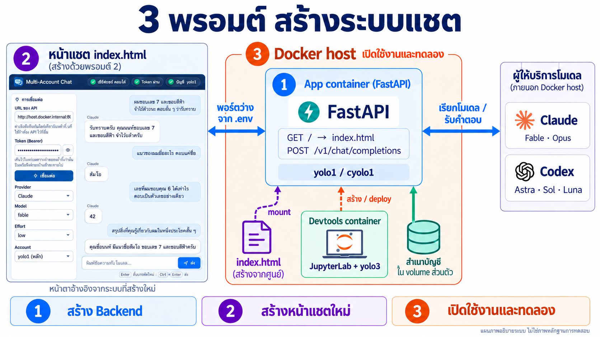
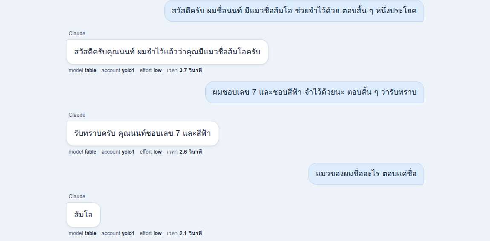
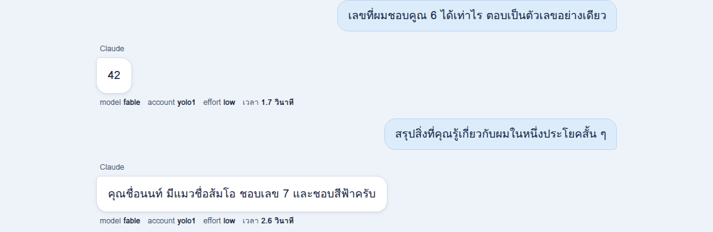
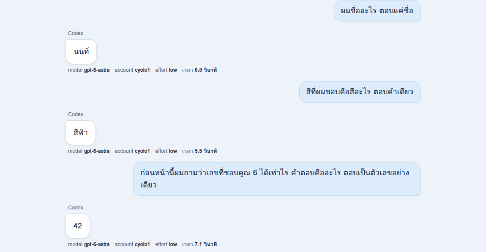
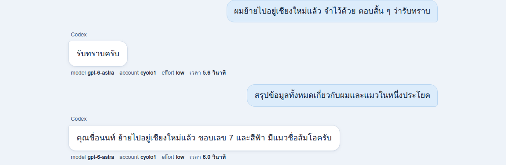
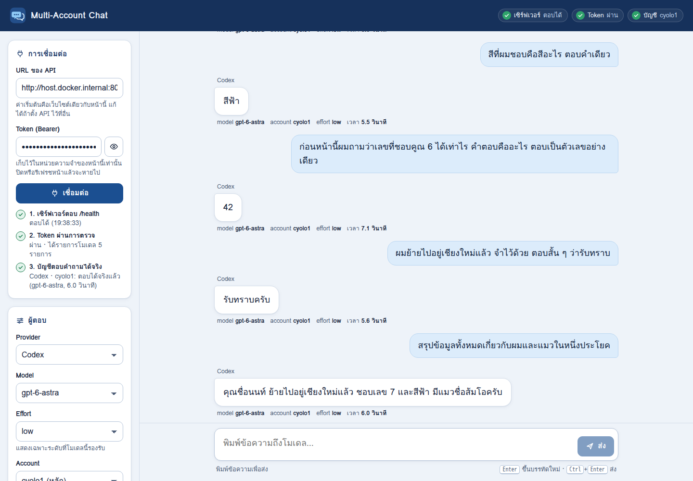
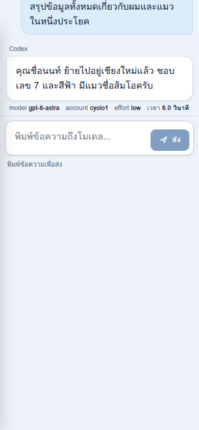
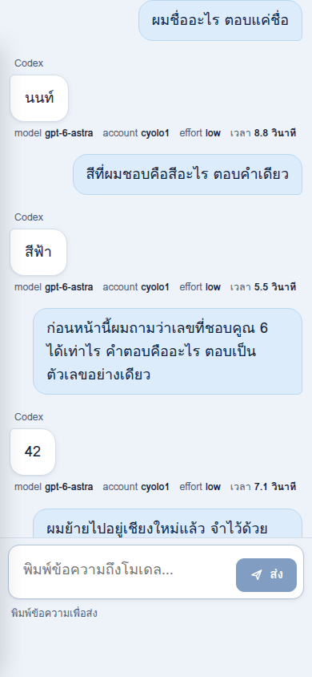
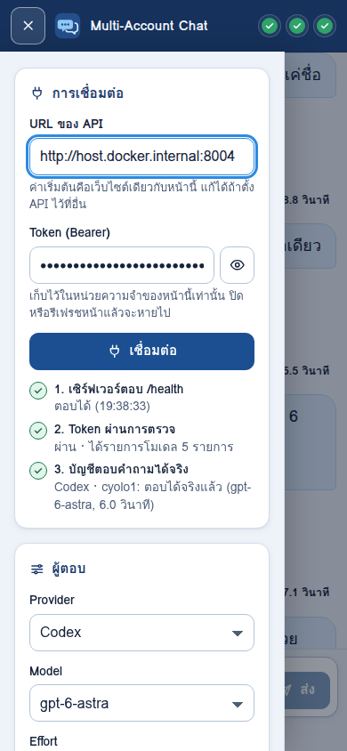

# API หลายบัญชี: FastAPI + หน้าแชต index.html ที่เรียก Claude Code และ Codex CLI

## 1 · ภาพรวมสถาปัตยกรรม



*แผนภาพอธิบายอ้างอิงแนวคิด (ไม่ใช่หลักฐานการทดสอบจริง) · ① Backend (หัวข้อ 2) · ② หน้า HTML (หัวข้อ 3) · ③ Deploy (หัวข้อ 4) · เบราว์เซอร์เชื่อมตรงกับ App (FastAPI) ตัวเดียว · devtools ใช้สร้างและ deploy เท่านั้น · volume credential ต่อกับ App เท่านั้น*

```text
 เบราว์เซอร์บน Windows host
   │ เปิด http://localhost:8004/ (ตัวอย่าง) ▶ app container (FastAPI + yolo/cyolo ของตัวเอง)
   │   ├─ GET /  → ส่ง index.html (ไฟล์ที่สร้างไว้นอก container และ mount แบบอ่านอย่างเดียว)
   │   └─ POST /v1/chat/completions + Bearer token (origin เดียวกัน)
   │                   └─ yolo1 / cyolo1 → Claude Code CLI / Codex CLI
   │                        └─ volume ส่วนตัว: สำเนาข้อมูลล็อกอินที่คัดลอกมาจาก devtools
 devtools (JupyterLab + yolo3) = ศูนย์สั่งงาน: สร้างโค้ด backend และ index.html แล้วสั่ง deploy
   └─ app container รันบน Docker host ชั้นนอก เป็นพี่น้องกับ devtools (ไม่ใช่ Docker ชั้นในของ devtools)
```

เบราว์เซอร์โหลดหน้าแชตและส่งคำถามตรงไปยัง App container เดียวกัน

---

## 2 · สร้าง Backend

พรอมต์ทั้งสามชุดเป็น **ข้อความภาษาธรรมชาติ** ไม่ใช่โค้ด Python ให้คัดลอกข้อความในกรอบไปวางในบทสนทนากับ `yolo3` ที่เปิดอยู่ใน **Terminal ของ JupyterLab** บน devtools (ไม่ใช่วางลง cell ของ notebook เพื่อรัน) วางตามลำดับ 1 → 2 → 3 ในบทสนทนาเดียวกัน พรอมต์สมมติว่ายังไม่มีโค้ด ไฟล์ หรือแลปก่อนหน้าใดเลย และบัญชี yolo/cyolo ใน devtools ล็อกอินไว้แล้ว

##### 📋 พรอมต์ 1 · สร้าง Backend

```text
ช่วยสร้าง backend ใหม่ตั้งแต่ศูนย์ด้วย FastAPI ในโฟลเดอร์ที่ทำงานอยู่ตอนนี้ โดยตั้งชื่อไฟล์และโครงสร้างเองได้
1. devtools นี้เป็นแค่ศูนย์สั่งงาน ตัวแอปจะรันใน container ใหม่ตัวเดียวที่แยกจาก devtools ภายในมี FastAPI และตัวเรียก yolo/cyolo ของตัวเอง
2. container แอปต้องเสิร์ฟไฟล์ index.html ที่ GET / ด้วย ไฟล์นี้จะสร้างในขั้นถัดไปไว้นอก image แล้ว mount เข้ามาแบบอ่านอย่างเดียว จึงไม่ต้องมี web server หรือ container หน้าเว็บแยก ถ้ายังไม่มีไฟล์ให้ตอบ error ที่อ่านเข้าใจได้
3. endpoint ที่ต้องมี: GET /health สำหรับตรวจสุขภาพโดยไม่ต้องใช้ token, GET /v1/models บอกโมเดล effort และบัญชีที่ใช้ได้เพื่อให้หน้าเว็บสร้างตัวเลือก และ POST /v1/chat/completions
4. POST /v1/chat/completions รับ messages, model, reasoning_effort, account และ provider แบบไม่บังคับ ตอบแบบไม่ stream ในรูปแบบเดียวกับ OpenAI โดยคำตอบอยู่ที่ choices[0].message.content
5. โมเดลและ effort ที่ต้องรองรับ: provider claude รุ่น fable และ opus ใช้ low, medium, high, xhigh, max ผ่านบัญชี yolo · provider codex รุ่น gpt-6-astra ใช้ low, medium, high, xhigh, max ส่วน gpt-6-sol และ gpt-6-luna ใช้ none, low, medium, high, xhigh, max ผ่านบัญชี cyolo · คู่อื่นให้ปฏิเสธพร้อมบอกเหตุผล
6. บัญชีหลักคือ yolo1 สำหรับ Claude และ cyolo1 สำหรับ Codex ให้ตรวจหาบัญชีอื่นที่ตั้งค่าไว้จริงใน devtools เพื่อเปิดใช้เพิ่มได้ และห้ามใช้ชื่อบัญชีข้าม provider
7. ตรวจคำสั่ง yolo1 และ cyolo1 ที่ใช้งานได้อยู่แล้วใน devtools ว่าเรียก CLI ตัวใด รุ่นใด และชี้ config ไปที่ใด โดยดูได้แค่เนื้อ wrapper ชื่อไฟล์ และรุ่นของ CLI ห้ามเปิดหรือพิมพ์เนื้อไฟล์ความลับ แล้วติดตั้ง Claude Code CLI และ Codex CLI รุ่นที่เข้ากันได้กับที่ใช้อยู่ใน devtools ไว้ใน container แอปเอง
8. สร้างคำสั่ง yolo1 และ cyolo1 ใน container แอปให้ทำงานได้ด้วยตัวเอง โดยปรับ path ของ wrapper และ config ให้ชี้ไปที่ volume ส่วนตัวของ container ห้ามเรียกโมเดลด้วยการ docker exec เข้า devtools หรือ SSH กลับไป ต้องยังเลือก model และ effort ได้ และแต่ละบัญชีใช้โฟลเดอร์ config ของตัวเองแยกกัน
9. ตอน deploy ให้คัดลอกจากบัญชีต้นฉบับใน devtools เฉพาะไฟล์ล็อกอินและ config ที่จำเป็นไปไว้ใน volume ส่วนตัวนี้ ห้ามแก้หรือเขียนทับต้นฉบับ และห้ามให้ข้อมูลล็อกอินไปอยู่ใน image, log หรือ HTML
10. ใช้เป็นแชตข้อความอย่างเดียว ปิดเครื่องมือของ CLI ที่รันคำสั่งหรือแก้ไฟล์ได้เท่าที่ CLI ที่ติดตั้งจริงรองรับ ห้ามใช้โหมดข้ามการขออนุญาต จำกัดเวลาและทรัพยากรของการเรียก CLI แต่ละครั้งให้เหมาะสม และถ้าปิดไม่ได้ทั้งหมดให้บอกตรง ๆ
11. ส่งประวัติทั้งหมดใน messages ของแต่ละคำขอให้โมเดลเห็น เพราะ CLI ไม่จำข้ามรอบ และตอบเฉพาะคำตอบจริงจากโมเดลเท่านั้น
12. ป้องกัน /v1/models และ /v1/chat/completions ด้วย Bearer token ตั้ง timeout ให้เหมาะสม จำกัดขนาดคำขอและจำนวนข้อความ และส่ง error ที่อ่านเข้าใจได้โดยไม่เผยรายละเอียดภายใน
13. เก็บค่าตั้งค่าไว้ใน .env และทำ .env.example ที่ไม่มีค่าความลับ ห้ามให้ token หรือข้อมูลล็อกอินไปอยู่ใน image, log หรือผลลัพธ์ที่แสดงออกมา
14. ก่อน bind หรือ publish พอร์ตของ container แอปใหม่ ให้ตรวจบน Docker host ที่จะใช้จริงก่อนว่ามีพอร์ตใดถูกใช้หรือถูก publish อยู่แล้วบ้าง ใช้ 8004 เป็นค่าเริ่มต้น ถ้าไม่ว่างให้เลือกพอร์ตว่างอื่นแทน บันทึกพอร์ตที่ใช้จริงไว้ใน .env และให้หน้าเว็บ API และ URL ที่ใช้เปิดหน้าเว็บอ้างค่าเดียวกันนี้ทั้งหมด ห้ามหยุดหรือแก้ container หรือ service อื่นเพื่อแย่งพอร์ตคืน ตอน deploy ให้ตรวจซ้ำอีกครั้งเผื่อพอร์ตถูกใช้ไประหว่างนั้น และรายงานพอร์ตที่เลือกใช้จริง
15. ตรวจ help ของ CLI ที่ติดตั้งอยู่จริงก่อนเลือกวิธีเรียก เขียนเทสต์ที่จำลอง CLI โดยไม่เรียกโมเดลจริงในขั้นนี้ แล้วสรุปสิ่งที่สร้างและผลเทสต์ตามจริง จากนั้นรอพรอมต์ถัดไป
```

---

## 3 · สร้างหน้าแชต

##### 📋 พรอมต์ 2 · สร้างหน้าแชต

```text
ต่อไปช่วยสร้างหน้าแชตเป็นไฟล์ index.html ไฟล์เดียวตั้งแต่ศูนย์ สำหรับ backend ที่เพิ่งสร้าง ให้หน้าตาสวย เรียบร้อย และใช้งานได้จริงตามที่บอกด้านล่าง
1. ทุกอย่างอยู่ในไฟล์นี้ไฟล์เดียว ทั้งหน้าตาและการทำงานเขียนไว้ในไฟล์เอง ห้ามโหลดอะไรจากภายนอก ไม่ว่าจะเป็น CDN ฟอนต์ออนไลน์ รูปภาพ หรือไลบรารี และไม่ต้องมีขั้นตอน build หรือติดตั้งแพ็กเกจ ใช้ฟอนต์ภาษาไทยที่มีในเครื่องผู้ใช้ และวาดไอคอนเองในไฟล์ หน้าเว็บต้องแสดงครบแม้ไม่มีอินเทอร์เน็ต ส่วนการได้คำตอบยังต้องใช้ API และอินเทอร์เน็ตของ provider ตามปกติ
2. เก็บ index.html ไว้นอก image ในโฟลเดอร์ของงานนี้ ให้ container แอปเดิม mount แบบอ่านอย่างเดียวแล้วแสดงที่ GET / โดยไม่ต้องมี web server อื่น
3. ค่าเริ่มต้นให้เรียก API ที่ origin เดียวกับหน้าเว็บ โดยไม่ฝังชื่อ host หรือพอร์ตไว้ในไฟล์ และมีช่องให้แก้ URL ของ API ได้ถ้าผู้ใช้ตั้งค่าไว้ต่างออกไป
4. แถบด้านบนแสดงชื่อ Multi-Account Chat และสถานะการเชื่อมต่อตามจริง บนจอกว้างมีแถบตั้งค่าด้านซ้ายกว้างราว 280–300px ส่วนบทสนทนาอยู่กึ่งกลางพื้นที่หลัก กว้างไม่เกินราว 850–900px และทั้งหน้ากว้างไม่เกินราว 1400–1440px บนมือถือให้แถบตั้งค่าพับเก็บและเปิดได้
5. โทนสีสงบ น้ำเงินกรมท่าและฟ้า การ์ดพื้นขาวขอบบาง ๆ ระยะห่างโปร่ง ตัวอักษรภาษาไทยอ่านง่ายขนาดประมาณ 18px ระยะบรรทัดราว 1.6 รองรับทั้งโหมดสว่างและโหมดมืดตามเครื่อง และสีตัดกันพอให้อ่านสบาย
6. แถบตั้งค่ามีช่อง URL ของ API ช่อง token แบบรหัสผ่านที่ซ่อนไว้เป็นค่าเริ่มต้น และปุ่มเชื่อมต่อ token เก็บไว้ในหน่วยความจำของหน้าเท่านั้น ห้ามฝังความลับในไฟล์ และห้ามบันทึกลงที่เก็บของเบราว์เซอร์หรือ URL
7. สถานะการเชื่อมต่อแยกให้เห็นสามระดับตามจริง คือ เซิร์ฟเวอร์ตอบ /health ได้ token ผ่านการตรวจแล้ว และบัญชีตอบคำถามได้จริงแล้ว ห้ามแสดงว่าเชื่อมต่อสำเร็จหรือสร้างคำตอบปลอมขึ้นเอง
8. ตัวเลือก Provider, Model, Effort และ Account เรียงต่อกันและเปลี่ยนตามตัวที่เลือกก่อนหน้า สร้างจาก GET /v1/models เท่านั้น ห้ามคิดตัวเลือกขึ้นเอง effort ให้แสดงเฉพาะที่โมเดลนั้นรองรับ และ account แสดงเฉพาะบัญชีที่ตั้งค่าไว้จริง ถ้าเชื่อมต่อไม่สำเร็จให้ล้างตัวเลือกทั้งหมดและปิดการส่ง
9. ข้อความของผู้ใช้อยู่ด้านขวาในกล่องสีฟ้าอ่อน คำตอบอยู่ด้านซ้ายในการ์ดสีขาว หรือการ์ดสีเข้มในโหมดมืด ใต้คำตอบแต่ละข้อแสดง model, account, effort ที่ใช้ตอบจริงและเวลาที่ใช้ แสดงข้อความทุกอย่างเป็นข้อความธรรมดาที่ไม่ถูกแปลงหรือรันเป็น HTML
10. ช่องพิมพ์อยู่ติดด้านล่างเสมอ พิมพ์ได้หลายบรรทัด กด Enter เพื่อขึ้นบรรทัดใหม่ และส่งด้วย Ctrl+Enter หรือปุ่มส่ง
11. ระหว่างรอคำตอบให้ปิดการส่งเพื่อกันการส่งซ้ำ แสดงสถานะกำลังรอพร้อมเวลาที่ผ่านไป
12. ถ้าเกิด error ให้แสดงชัด ๆ พร้อมปุ่มลองใหม่ เก็บข้อความที่ยังส่งไม่สำเร็จไว้ให้ และเก็บในประวัติเฉพาะรอบที่ได้คำตอบสำเร็จ
13. เลื่อนลงล่างสุดเมื่อมีข้อความใหม่ แต่ถ้าผู้ใช้กำลังเลื่อนอ่านข้อความเก่าอยู่ห้ามดึงกลับลงไป
14. ส่งประวัติข้อความทั้งหมดไปกับทุกคำถาม ถ้าเปลี่ยน provider หรือ account กลางบทสนทนาให้เตือนว่าผู้รับรายใหม่จะเห็นประวัติทั้งหมด และแสดงตัวนับเทียบกับขีดจำกัดของ API เพื่อไม่ให้ส่งเกิน
15. มีปุ่มเริ่มแชตใหม่ที่ขอยืนยันก่อนถ้ามีข้อความอยู่แล้ว และปุ่มดาวน์โหลดบทสนทนาเป็นไฟล์ JSON ที่ไม่มี token ห้ามเก็บบทสนทนาหรือความลับไว้ในเบราว์เซอร์หลังปิดหน้า
16. ทุกช่องและปุ่มมีป้ายกำกับชัด ใช้งานด้วยคีย์บอร์ดได้ครบ และมองเห็นตำแหน่งที่กำลังเลือกอยู่ชัดเจน
17. ตรวจเองว่าไฟล์ไม่เรียกทรัพยากรภายนอกเลย และเช็กหน้าตาทั้งจอแคบและจอกว้างด้วยเครื่องมือที่มีอยู่แล้ว ถ้ายังไม่มีเบราว์เซอร์ให้ใช้ ให้บันทึกไว้ว่าจะตรวจด้วย Playwright ในพรอมต์ 3 และยังไม่ต้อง build หรือ deploy
18. เสร็จแล้วสรุปสิ่งที่ทำและผลตรวจตามจริง แล้วรอพรอมต์ถัดไป
```

> **หมายเหตุ:** หน้าตาหน้าแชตถูกกำหนดด้วยคำบรรยายในพรอมต์ ไม่ต้องอ้างไฟล์หรือภาพหน้าจอเดิม และหน้าเว็บแสดงได้แบบออฟไลน์ แต่การตอบยังต้องใช้ API และอินเทอร์เน็ต

---

## 4 · เปิดใช้งานและทดลอง

##### 📋 พรอมต์ 3 · เปิดใช้งานและทดลอง

```text
ต่อไปช่วย deploy แอปที่สร้างไว้ให้ใช้งานได้จริง แล้วทดสอบตามลำดับด้านล่าง
1. ก่อนลงมือ ให้อ่านโค้ด backend และ index.html ที่สร้างไว้ในขั้นก่อน เพื่อดูว่าแอปต้องการค่าตั้งค่าอะไรจริง ฟังพอร์ตภายในเท่าไร ต้อง mount ไฟล์และ volume ใดบ้าง และตรวจว่าทุกอย่างยังเป็นไปตามพรอมต์ 1 และ 2
2. พรอมต์นี้ไม่ได้ระบุชื่อ host หรือ path ตายตัว แต่ .env ของงานนี้เก็บค่าการเชื่อมต่อและ path ปลายทางที่ใช้จริงได้ ให้อ่าน .env ที่มีอยู่โดยไม่พิมพ์ค่าออกมา ถ้าขาดค่าที่ไม่ใช่ความลับให้เพิ่มชื่อค่านั้นใน .env.example ถามฉันเฉพาะข้อมูลการเชื่อมต่อที่หาไม่ได้จริง ๆ และห้ามเดาชื่อผู้ใช้ รหัสผ่าน หรือ credential ใด ๆ
3. แอปต้องรันเป็น container ตัวเดียวบน Docker host ชั้นนอก เป็นพี่น้องกับ devtools ให้ยืนยันก่อนว่า Docker daemon ที่คำสั่งเชื่อมต่ออยู่คือ host ที่ตั้งใจจริง ไม่ใช่ Docker ชั้นในของ devtools แล้วดู container, image, volume และ network ที่มีอยู่เดิม ห้ามหยุด ลบ หรือแก้ของที่ไม่เกี่ยวกับงานนี้
4. path ต้นทางของ bind mount จะถูกอ่านบนเครื่องที่ Docker daemon รันอยู่ ไม่ใช่ใน devtools ถ้า daemon อยู่คนละเครื่องหรือคนละ filesystem ให้ส่ง build context และ index.html ไปไว้บน Docker host ในโฟลเดอร์ที่ฉันอนุญาตให้ใช้ และตรวจว่าไฟล์อยู่ที่นั่นจริงก่อน mount แบบอ่านอย่างเดียว ถ้า daemon bind path ต้นทางไม่ได้ ให้คัดลอก index.html ลง private volume ของแอปแล้ว mount แบบอ่านอย่างเดียวพร้อมตรวจ checksum โดยไม่ใส่ source ลงใน image
5. build image ของแอปตัวเดียวที่มี FastAPI, Claude Code CLI, Codex CLI และ wrapper yolo/cyolo ติดตั้งครบในตัว ห้ามมี token หรือข้อมูลล็อกอินอยู่ใน image และห้ามเพิ่ม service หรือ container อื่นที่ไม่จำเป็น
6. เรื่องพอร์ต: ให้ตรวจบน Docker host จริงว่าพอร์ตใดถูกใช้หรือถูก publish อยู่แล้ว ใช้ 8004 ถ้าว่าง ถ้าไม่ว่างให้เลือกพอร์ตว่างอื่น ห้ามหยุด container อื่นเพื่อแย่งพอร์ต และตรวจซ้ำตอนรันจริง
7. ให้แอปใน container ฟังที่ 0.0.0.0 บนพอร์ตภายในที่โค้ดใช้จริง ส่วนฝั่ง host ให้ผูกกับ loopback เป็นค่าเริ่มต้นสำหรับใช้ในเครื่อง หา URL ที่เบราว์เซอร์ของฉันเปิดได้จริง อย่าสับสนกับ localhost ภายใน container หรือภายใน devtools แล้วบันทึกพอร์ตและ URL ที่ใช้จริงไว้ใน .env
8. สร้าง token ของ API แบบสุ่มโดยไม่แสดงค่าในผลลัพธ์หรือ log เก็บไว้ในไฟล์ที่จำกัดสิทธิ์ให้เจ้าของอ่านได้เท่านั้น และบอกวิธีที่ฉันจะอ่านค่าเองเพื่อนำไปกรอกในช่อง token ของหน้าเว็บ
9. คัดลอกเฉพาะไฟล์ล็อกอินและ config ที่จำเป็นของบัญชีที่เลือกใช้ไปไว้ใน volume ส่วนตัวของแอป ตั้งเจ้าของและสิทธิ์ให้ผู้ใช้ที่รันแอปอ่านและเขียนได้ในส่วนที่ CLI ต้องต่ออายุการล็อกอิน ห้ามแตะต้นฉบับใน devtools ห้ามเขียนทับบัญชีที่ใช้ได้อยู่ และห้ามสั่งล็อกอินใหม่ถ้าไม่จำเป็น
10. ก่อนเปิดหน้าเว็บ ให้ตรวจรุ่นของ yolo1 และ cyolo1 ภายใน container แอป และให้แต่ละ provider ตอบคำถามสั้น ๆ จริงหนึ่งครั้งโดยไม่ใช้เครื่องมือ เพื่อยืนยันว่าทำงานได้เองโดยไม่พึ่ง devtools
11. เริ่ม container แล้วรอ /health พร้อมใช้งานภายในเวลาจำกัด ถ้าไม่ผ่านให้ดู log แบบตัดความลับออก วิเคราะห์สาเหตุ แก้แล้วลองใหม่เฉพาะสิ่งที่อยู่ในงานนี้ และห้ามบอกว่าสำเร็จถ้ายังมีขั้นไหนล้มเหลว
12. ทดสอบผ่าน API: GET / ต้องได้ HTML ที่ไม่เรียก CDN ฟอนต์หรือไลบรารีภายนอก, /health ตอบได้, /v1/models ตอบเมื่อ token ถูก และปฏิเสธเมื่อไม่มีหรือผิด, ลองส่ง model หรือ effort ที่ไม่รองรับหนึ่งครั้งต้องได้ error ที่อ่านเข้าใจ
13. ใน devtools อาจไม่มี Computer Use ให้ใช้ Playwright เป็นเครื่องมือหลักในการทดสอบผ่านเบราว์เซอร์ โดยเปิด Chromium จริงไปที่หน้า HTML จริงที่เสิร์ฟจากแอป และเรียก API จริง ห้ามใช้แค่ request test หรือ mock route แทน ถ้ามี Playwright และ Chromium ติดตั้งอยู่แล้วให้ใช้ของเดิม ถ้าไม่มีฉันอนุญาตให้ติดตั้ง Playwright และ Chromium ได้ แต่ต้องติดตั้งแบบแยกเฉพาะงานนี้ เช่น venv หรือโฟลเดอร์ทดสอบในโปรเจกต์ และ browser cache ในโฟลเดอร์นั้น ห้ามติดตั้งแบบ global ห้ามใช้ apt หรือแก้ระบบถ้าไม่จำเป็นจริง ถ้าจำเป็นต้องทำให้รายงานว่าทำอะไรไปและเพราะอะไร ถ้าติดตั้งหรือเปิดเบราว์เซอร์ไม่ได้ ให้รายงานสาเหตุที่เจอจริงและขั้นตอนถัดไปที่ง่ายที่สุด และระบุว่าการทดสอบผ่านเบราว์เซอร์ยังค้างอยู่ ห้ามแต่งผลหรือบอกว่าผ่าน
    URL ที่ Playwright ใช้เปิดจาก devtools อาจไม่ใช่ URL localhost ที่ฉันเปิดจากเครื่องตัวเอง ให้หา URL ที่เข้าถึงได้จริงจาก devtools จาก .env และการตรวจ network จริง (เช่น host.docker.internal เฉพาะเมื่อพบว่าใช้ได้จริงในสภาพแวดล้อมนี้) ห้ามใส่ชื่อ host ตายตัว และรายงานทั้ง URL ที่ใช้ทดสอบและ URL ที่ฉันใช้เปิดเอง
    ในหน้าเว็บให้กรอก token เลือก provider, account, model และ effort จาก dropdown จริง แล้วพิมพ์และกดส่งผ่าน UI คุยในบทสนทนาเดียว 10 รอบ: Fable 5 รอบ แล้วเปลี่ยนเป็น gpt-6-astra อีก 5 รอบ โดยประวัติต่อเนื่องกัน รอคำตอบจริงแต่ละรอบด้วย timeout ที่สมเหตุสมผล ถามให้เห็นว่ายังจำเรื่องก่อนหน้าได้ ตรวจว่าค่าที่เลือกใน dropdown ตรงกับที่ส่งจริงและคำตอบอ้างบริบทเดิมได้ถูกต้อง และตรวจ request ทั้งหมดที่หน้าเว็บเรียกว่าไม่มี CDN ฟอนต์หรือไลบรารีภายนอก ต้องรอให้ Playwright รันจบจริงและอ่านผลก่อนจบงานหรือสรุป ห้ามปล่อยไว้ใน background แล้วจบ turn ก่อน
14. เก็บภาพหน้าจอจริงจาก Playwright ที่ viewport 1440x1000 ให้อ่านออก และทดสอบหน้าจอแคบเพิ่มเพื่อดู responsive แบ่งภาพละ 2-3 รอบคำถามคำตอบ (จับภาพเฉพาะ element ข้อความจริงได้) ห้ามใช้เครื่องมือสร้างภาพหรือ ImageGen มาสร้างหลักฐาน บันทึกบทสนทนาจริงเป็นไฟล์ JSON และ log การรันทดสอบ โดยทั้งสองไฟล์ต้องไม่มี token หรือความลับ
15. สรุปตามจริง: URL ที่ใช้ได้ พอร์ตที่เลือก สถานะ image และ container รุ่นโมเดลที่ทดสอบจริง ผลที่ผ่านและไม่ผ่าน สิ่งที่ยังไม่ได้ทดสอบหรือข้อจำกัดที่เหลือ และวิธีสั่งหยุดและเริ่มใหม่แบบง่าย ๆ เฉพาะแอปที่สร้างในงานนี้ ห้ามใส่ค่าตายตัวในสรุปหรือไฟล์ และห้ามพึ่งไฟล์จากแลปเก่า
```

---

## 5 · ผลการทดลองจากพรอมต์ชุดนี้

ทดลองใหม่ตั้งแต่โฟลเดอร์ว่าง (`prompt-trial-02/project`) หลักฐานทั้งหมดคัดลอกไว้ที่ [`assets/new-trial/`](assets/new-trial/) โดยไม่แก้ไข

| ขั้น | ผลจริง |
|---|---|
| พรอมต์ 1 · Backend | ✅ เทสต์ผ่าน 63 ข้อ ด้วย CLI ปลอม ([log](assets/new-trial/backend-run.log)) |
| พรอมต์ 2 · หน้าแชต | ✅ Playwright กับ API จำลองผ่าน 63 ข้อ ([log](assets/new-trial/frontend-run.log)) |
| พรอมต์ 3 · API จริง | ✅ 10/10 ข้อ ([api-check.log](assets/new-trial/api-check.log)) |
| พรอมต์ 3 · เบราว์เซอร์จริง | ✅ Playwright ผ่าน 70/70 ข้อ คุยครบ 10/10 รอบ ([e2e-run.log](assets/new-trial/e2e-run.log)) |

- **URL ของผู้ใช้:** `http://localhost:8004/` แอปรันเป็น container `ai-chat-app` บน Docker host ชั้นนอก (`docker-desktop`) publish `127.0.0.1:8004->8004`
- **Container เดียว** มี FastAPI + Claude Code CLI + Codex CLI, `index.html` อยู่ใน volume ที่ mount แบบอ่านอย่างเดียว และไฟล์ล็อกอินอยู่ใน volume ส่วนตัวของแอป
- `/health` ตอบ `ok` แค่บอกว่าเซิร์ฟเวอร์ทำงาน ไม่ได้ยืนยันว่าบัญชีใช้ได้ แต่ในรอบนี้ทั้งสอง provider ตอบคำถามจริง
- **ขอบเขต:** ทดสอบจริงเฉพาะ `fable` (low, `yolo1`) 5 รอบ และ `gpt-6-astra` (low, `cyolo1`) 5 รอบ ในบทสนทนาเดียว ส่วนโมเดลและ effort อื่นยังไม่ได้ทดสอบกับโมเดลจริง
- **ตรวจซ้ำโดยอิสระ:** ผู้ประสานงานเปิด `http://localhost:8004` ใน Chrome จริงผ่าน Computer Use คุยกับ `fable` แล้วต่อด้วย `gpt-6-astra` ซึ่งจำชื่อเจ้าของเมย์และร้าน Cloud Cup ได้ และคำนวณลาเต้สองแก้วกับอเมริกาโนหนึ่งแก้วรวม 220 บาท

### บทสนทนาจริง 10 รอบ (จาก [`rounds.json`](assets/new-trial/rounds.json))

| # | โมเดล | คำถาม | คำตอบจริง | วินาที |
|---|---|---|---|---|
| 1 | fable | สวัสดีครับ ผมชื่อนนท์ มีแมวชื่อส้มโอ ช่วยจำไว้ด้วย ตอบสั้น ๆ หนึ่งประโยค | สวัสดีครับคุณนนท์ ผมจำไว้แล้วว่าคุณมีแมวชื่อส้มโอครับ | 3.8 |
| 2 | fable | ผมชอบเลข 7 และชอบสีฟ้า จำไว้ด้วยนะ ตอบสั้น ๆ ว่ารับทราบ | รับทราบครับ คุณนนท์ชอบเลข 7 และสีฟ้า | 2.7 |
| 3 | fable | แมวของผมชื่ออะไร ตอบแค่ชื่อ | ส้มโอ | 2.1 |
| 4 | fable | เลขที่ผมชอบคูณ 6 ได้เท่าไร ตอบเป็นตัวเลขอย่างเดียว | 42 | 1.8 |
| 5 | fable | สรุปสิ่งที่คุณรู้เกี่ยวกับผมในหนึ่งประโยคสั้น ๆ | คุณชื่อนนท์ มีแมวชื่อส้มโอ ชอบเลข 7 และชอบสีฟ้าครับ | 2.6 |
| 6 | gpt-6-astra | ผมชื่ออะไร ตอบแค่ชื่อ | นนท์ | 8.8 |
| 7 | gpt-6-astra | สีที่ผมชอบคือสีอะไร ตอบคำเดียว | สีฟ้า | 5.5 |
| 8 | gpt-6-astra | ก่อนหน้านี้ผมถามว่าเลขที่ชอบคูณ 6 ได้เท่าไร คำตอบคืออะไร ตอบเป็นตัวเลขอย่างเดียว | 42 | 7.1 |
| 9 | gpt-6-astra | ผมย้ายไปอยู่เชียงใหม่แล้ว จำไว้ด้วย ตอบสั้น ๆ ว่ารับทราบ | รับทราบครับ | 5.6 |
| 10 | gpt-6-astra | สรุปข้อมูลทั้งหมดเกี่ยวกับผมและแมวในหนึ่งประโยค | คุณชื่อนนท์ ย้ายไปอยู่เชียงใหม่แล้ว ชอบเลข 7 และสีฟ้า มีแมวชื่อส้มโอครับ | 6.1 |

บทสนทนาเต็มที่ดาวน์โหลดจากหน้าเว็บ: [`conversation.json`](assets/new-trial/conversation.json)

### ภาพหน้าจอจริงจาก Playwright

ภาพตัดเฉพาะกลุ่มข้อความ คลิกที่ภาพเพื่อเปิดภาพเต็มจอ 1440×1000

**รอบ 1–3 · Fable** — แนะนำชื่อ แมว เลขและสีที่ชอบ

[](assets/new-trial/01-rounds-1-3-fable-1440x1000.png)

**รอบ 4–5 · Fable** — คำนวณ 7×6 และสรุปข้อมูล

[](assets/new-trial/02-rounds-4-5-fable-1440x1000.png)

**รอบ 6–8 · gpt-6-astra** — เปลี่ยนโมเดลแล้วยังจำชื่อ สี และ 42 ได้

[](assets/new-trial/03-rounds-6-8-astra-1440x1000.png)

**รอบ 9–10 · gpt-6-astra** — เพิ่มเชียงใหม่ แล้วสรุปทั้งหมด

[](assets/new-trial/04-rounds-9-10-astra-1440x1000.png)

**ภาพรวมหน้าจอเต็ม** (รอบ 9–10)



<details>
<summary>หน้าจอแคบ 390×844</summary>

  

</details>

### ทำซ้ำได้แค่ไหน

- รอบนี้ผู้ประสานงานต้องให้ข้อมูลการเชื่อมต่อ SSH ไปยัง Docker host เพิ่มเอง
- การรันเบราว์เซอร์ครั้งแรกหยุดที่รอบ 10 เพราะงานรันอยู่ใน background แล้ว agent จบ turn ก่อน จึงแก้ให้รอจนจบและรันใหม่ ผ่านครบ 10 รอบ
- พรอมต์ทั้งสามเป็นข้อกำหนดของงาน ไม่ได้รับประกันว่าทุกเครื่องจะเข้าถึง Docker ได้เหมือนกัน
