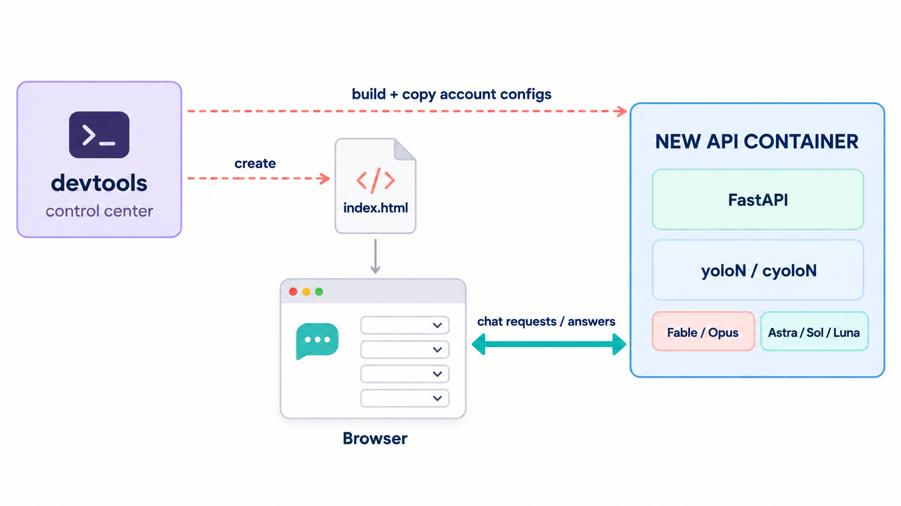
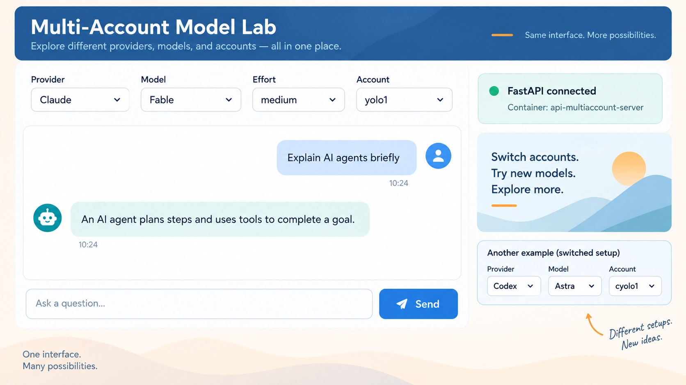
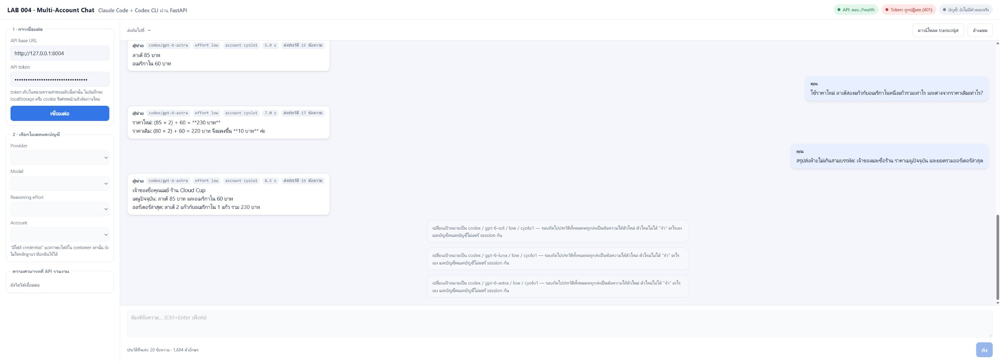
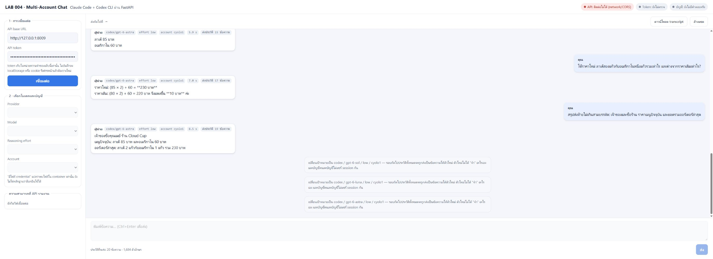
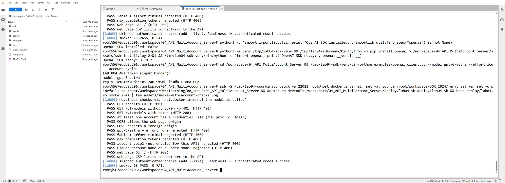
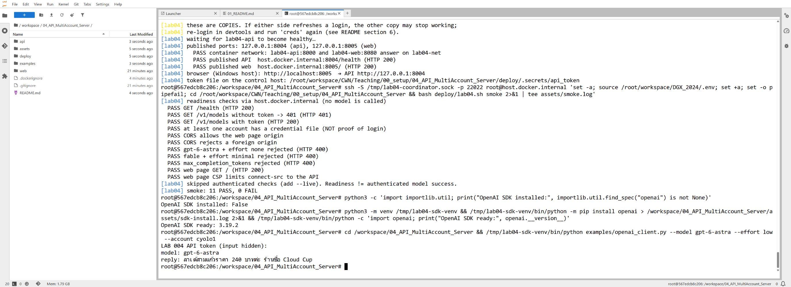

# API หลายบัญชี: FastAPI + หน้าแชต index.html ที่เรียก Claude Code และ Codex CLI

**สิ่งที่จะได้:** ใช้พรอมต์สั่ง `yolo3` ให้สร้าง API จริงด้วย FastAPI ที่เรียก `yolo1` (Claude Code) และ `cyolo1` (Codex CLI) ใน container ใหม่ของตัวเอง พร้อมหน้าแชต `index.html` แยกต่างหากที่เลือก provider · model · effort · account ได้ แล้ว deploy ทั้งสองเป็น container **พี่น้อง (sibling)** ของ `devtools` บน Docker Desktop ชั้นนอก และทดสอบแชตหลายรอบด้วยคำตอบจริง

ขอบเขต: Claude Code ผ่าน `yolo1` และ Codex CLI ผ่าน `cyolo1` เท่านั้น (ค่าเริ่มต้น 1 บัญชีต่อ provider) รายการโมเดลและระดับ effort ใช้ผลที่ตรวจจริงแล้วจาก LAB 003

> **สถานะของเอกสารนี้ (24 ก.ย. 2026):** ผู้ประสานงาน deploy จริงบน daemon `docker-desktop` แล้ว (build · สำเนา credential · up · verify ผ่าน) `smoke` ผ่าน 13/13 (รวมตรวจขอบเขตบัญชี) เรียกผ่าน OpenAI Python SDK ได้จริง และทดสอบแชตจริงในเบราว์เซอร์ 10 รอบ (Fable/low/yolo1 5 รอบ ตามด้วย Astra/low/cyolo1 5 รอบ) หลักฐานดิบอยู่ใน [`assets/`](assets/) · โมเดลและ effort อื่นในแลปนี้ **ยังไม่ได้เรียกจริง** (ตารางโมเดล × effort มาจาก LAB 003) · ภาพแนวคิดทั้งสองภาพยังเป็นฉบับร่าง

---

## 1 · ภาพรวมสถาปัตยกรรม



*ภาพแนวคิด **ฉบับร่าง** ไม่ใช่ภาพหน้าจอจริง และยังไม่ใช่ฉบับสุดท้าย (ฉบับสุดท้ายจะสร้างแยกภายหลัง) ภาพนี้ยังไม่ได้แสดง container ของหน้าเว็บ (`lab04-web`) และเส้นทาง SSH ไปยัง control host ให้ยึดผังข้อความด้านล่างเป็นหลัก*

```text
 เบราว์เซอร์บน Windows host
   │ ① เปิดหน้าเว็บ  http://localhost:8005 ─────────▶ lab04-web  (nginx เสิร์ฟ index.html อย่างเดียว)
   │ ② fetch + Bearer token  http://127.0.0.1:8004 ─▶ lab04-api  (FastAPI)
   │                                                     └─ yolo1 / cyolo1  (wrapper ใน container นี้)
   │                                                          └─ claude -p / codex exec
   │                                                               └─ volume lab04-accounts (สำเนา credential)
 devtools (JupyterLab + yolo3) ── ssh -S <socket> ──▶ control host :22022 ── docker ──▶ daemon "docker-desktop"
   └─ docker ในตัวเอง = daemon ชั้นใน (ไม่ใช้)            (lab04-api, lab04-web, devtools เป็นพี่น้องกัน)
```

| ส่วน | อยู่ที่ไหน | หน้าที่ |
|---|---|---|
| `devtools` | container เดิม (ไม่แก้ไข) | เขียนโค้ดด้วย `yolo3` และสั่ง deploy ผ่าน SSH |
| control host | `host.docker.internal:22022` | รัน `deploy/lab04.sh` ด้วย `docker` ที่คุยกับ `docker-desktop` |
| `lab04-api` | container ใหม่บน daemon ชั้นนอก | FastAPI + Claude Code CLI + Codex CLI + wrapper `yolo1..5` / `cyolo1..5` ของตัวเอง |
| `lab04-accounts` | named volume | **สำเนา** credential ที่เลือก ไม่ใช่ของจริงที่ mount สด และไม่ได้อยู่ใน image |
| `lab04-web` | container ใหม่ (nginx unprivileged) | เสิร์ฟ `index.html` ไฟล์เดียว ไม่ proxy ไปหา API |
| เบราว์เซอร์ | Windows host | โหลดหน้าเว็บจาก `:8005` แล้วเรียก API ที่ `:8004` ตรง ๆ (CORS อนุญาตเฉพาะ origin ของหน้าเว็บ) |

ทำไมหน้าเว็บต้องมี container ของตัวเอง: ถ้าเปิด `index.html` แบบ `file://` เบราว์เซอร์จะส่ง origin เป็น `null` ซึ่ง API ไม่อนุญาต (การอนุญาต `null` เปิดทางให้หน้าเว็บอื่นใช้ได้ด้วย) จึงเลือกทางที่เล็กที่สุดคือ nginx ที่เสิร์ฟไฟล์เดียวบนพอร์ต `8005`



*ภาพแนวคิด **ฉบับร่าง** ไม่ใช่ภาพหน้าจอจริง หน้าเว็บที่สร้างจริงจัดวางต่างจากภาพนี้ (ตั้งค่าอยู่แถบซ้าย สถานะเป็นสามป้ายด้านบน) ข้อความในภาพเป็นตัวอย่างสมมติ ไม่ใช่คำตอบจากโมเดล*

---

## 2 · ประวัติแชตถูกส่งให้ CLI อย่างไร

`claude -p` และ `codex exec` ตอบคำถาม **ครั้งเดียวแล้วจบ** API นี้ยังสั่งไม่ให้เก็บ session (`--no-session-persistence`, `--ephemeral`) ดังนั้น **CLI จำอะไรข้ามรอบไม่ได้เลย** สิ่งที่ทำให้ถามต่อได้คือ **หน้าเว็บส่งประวัติข้อความทั้งหมดไปทุกครั้ง** แล้ว API แปลงเป็นพรอมต์ก้อนเดียว

```text
You are the assistant in a simple web chat application.
The conversation so far is given below as a JSON array of {"role", "content"} objects, oldest first.
...
CONVERSATION_JSON:
[
 {"role": "user", "content": "สวัสดี ฉันชื่อมะลิ"},
 {"role": "assistant", "content": "สวัสดีค่ะคุณมะลิ"},
 {"role": "user", "content": "ฉันชื่ออะไร"}
]
```

| เรื่อง | Chat API จริง (native) | API ของแลปนี้ (transcript → CLI) |
|---|---|---|
| ความจำระหว่างรอบ | ฝั่ง client ส่ง `messages` เหมือนกัน | เหมือนกัน แต่ถูก **รวมเป็นข้อความเดียว** ส่งทาง stdin |
| ขอบเขตของ role | แยกโดยโครงสร้างของ API | ใส่ role ไว้ใน JSON ทำให้ข้อความที่ผู้ใช้พิมพ์ถูก escape อยู่ใน `content` เสมอ แต่ทั้งก้อนยังเป็น **ข้อความธรรมดา** ที่โมเดลอ่าน **ไม่ได้รับประกันว่ากัน prompt injection ได้** ข้อความในประวัติยังชักนำโมเดลได้เหมือนข้อความทั่วไป |
| `system` | system prompt จริง | เป็นแค่ข้อความที่ขอให้โมเดลเคารพ ไม่มีสิทธิ์พิเศษ |
| เปลี่ยนโมเดล/บัญชีกลางบทสนทนา | ส่ง messages เดิมให้โมเดลใหม่ | เหมือนกัน · ตัวใหม่เห็นแค่ **ข้อความ** ไม่รู้ว่ารอบก่อนใครตอบ และบัญชีคนละบัญชีไม่แชร์ session |
| `max_completion_tokens`, `temperature`, `tools`, `stream` | รองรับ | **ปฏิเสธด้วย HTTP 400** เพราะ CLI ไม่ได้รับค่าเหล่านี้ ไม่ทำเป็นว่ารองรับ |
| token usage | มีตัวเลขจริง | `"usage": null` ไม่เดาตัวเลข |
| ต้นทุนต่อรอบ | คิดตาม token | ทุกรอบเริ่ม CLI ใหม่และส่งประวัติทั้งหมด ยิ่งคุยยาวยิ่งช้าและกินโควตา มีเพดาน 40 ข้อความ / 48,000 ตัวอักษร |

---

## 3 · พรอมต์ 1: ตรวจเครื่องและ CLI (~5 นาที)

เปิด `yolo3` ใน 🖥️ Terminal ที่โฟลเดอร์งาน

```bash
mkdir -p /workspace/04_API_MultiAccount_Server && cd /workspace/04_API_MultiAccount_Server && yolo3
```

##### 📋 พรอมต์สำหรับคัดลอก (คัดลอกทั้งกรอบ วางใน 💬 ช่องสนทนา AI แล้ว Enter)

```text
LAB 004 ขั้นที่ 1: ตรวจอย่างเดียว ห้ามแก้ไฟล์ ห้ามล็อกอิน ห้ามเรียกโมเดลจริง
โฟลเดอร์งาน: /workspace/04_API_MultiAccount_Server

ตรวจแล้วรายงานเป็นตาราง รายการ | คำสั่งที่ใช้ | ผลจริง:
1. เวอร์ชันของ claude และ codex ที่ wrapper yolo1 / cyolo1 เรียกจริง (อ่านไฟล์ wrapper ด้วย cat ได้)
2. flag จาก `claude --help` และ `codex exec --help` ของเวอร์ชันนี้ที่เกี่ยวกับ:
   --model, --effort, -p, --output-format, --no-session-persistence, --tools, --permission-mode,
   --setting-sources, --strict-mcp-config, --disable-slash-commands,
   exec, --ephemeral, --sandbox, --ignore-user-config, --ignore-rules, -C, -o, -c model_reasoning_effort, อ่านพรอมต์จาก stdin ด้วย "-"
3. wrapper yolo1/cyolo1 ใน devtools ใช้ flag ข้ามการขออนุญาตตัวไหน (แค่รายงาน ห้ามแก้ wrapper เดิม)
4. ไฟล์บัญชีมีอยู่หรือไม่: ~/ai-accounts/.Claude/yolo1/.credentials.json และ ~/ai-accounts/.Codex/cyolo1/auth.json
   ดูแค่ว่ามีและขนาดไม่เป็นศูนย์ ห้ามเปิดอ่านหรือพิมพ์ค่าในไฟล์ credential
5. `docker info --format '{{.Name}}'` ใน devtools ได้ชื่ออะไร และอธิบายว่าเป็น daemon ชั้นในหรือชั้นนอก
6. ตรวจ flag โดยไม่ใช้ credential ได้ด้วยการรันกับ config dir ว่างชั่วคราว
   (CLAUDE_CONFIG_DIR=$(mktemp -d) / CODEX_HOME=$(mktemp -d)) ต้องไปจบที่ข้อความว่ายังไม่ได้ล็อกอิน ไม่ใช่ error เรื่อง flag

ทำเฉพาะขั้นนี้ แล้วหยุดรอ
```

**สิ่งที่ควรเห็น (จากเครื่องที่ใช้เขียนแลปนี้ 24 ก.ย. 2026):** Claude Code `2.1.281`, codex-cli `0.156.1` · flag ทุกตัวในข้อ 2 มีอยู่จริง · wrapper เดิมใช้ `--dangerously-skip-permissions` และ `--dangerously-bypass-approvals-and-sandbox` · daemon ใน devtools คือ `567edcb8c206` (ชั้นใน) · การรันกับ config ว่างจบที่ `Not logged in` (Claude) และ `401 Unauthorized` (Codex) ซึ่งแปลว่า flag ถูกต้อง

---

## 4 · พรอมต์ 2: สร้าง backend (~20 นาที)

##### 📋 พรอมต์สำหรับคัดลอก (คัดลอกทั้งกรอบ วางใน 💬 ช่องสนทนา AI แล้ว Enter)

```text
LAB 004 ขั้นที่ 2: สร้าง backend ใน /workspace/04_API_MultiAccount_Server/api
ถ้ามีไฟล์อยู่แล้ว ให้ตรวจเทียบกับข้อกำหนดนี้ แก้เฉพาะจุดที่ไม่ตรง แล้วรันเทสต์ ห้ามเขียนทับทั้งโฟลเดอร์
ห้ามล็อกอิน ห้ามเรียกโมเดลจริง ห้าม deploy ห้ามอ่านค่า credential

## Endpoint
- GET /health  ไม่ต้องใช้ token · บอกว่า CLI แต่ละตัวรันได้ (ผ่าน wrapper --version) · ห้ามบอกข้อมูลบัญชี
  ต้องเขียนชัดว่า health ไม่ได้พิสูจน์ว่าล็อกอินใช้ได้
- GET /v1/models  ต้องใช้ Bearer token · รายการโมเดล, effort ต่อโมเดล, บัญชีต่อ provider
  (credential_file_present = ดูแค่ว่ามีไฟล์ ห้ามเปิดไฟล์), limits, พารามิเตอร์ที่รองรับ
- POST /v1/chat/completions  ต้องใช้ Bearer token · รูปแบบคล้าย OpenAI
  ฟิลด์ที่รับ: model, messages, reasoning_effort, account, provider, stream(false เท่านั้น)
  ฟิลด์อื่นทั้งหมดตอบ 400 unsupported_parameter (เช่น max_completion_tokens, max_tokens, temperature, tools)
  ห้ามอ้างว่ารองรับ max_completion_tokens · usage เป็น null

## โมเดลและ effort (มาจากผลจริงของ LAB 003)
- fable, opus (claude): low medium high xhigh max
- gpt-6-astra (codex): low medium high xhigh max
- gpt-6-sol, gpt-6-luna (codex): none low medium high xhigh max
- minimal ห้ามมี · ค่าอื่นตอบ 400 unsupported_reasoning_effort · ค่าเริ่มต้น medium

## บัญชีและ wrapper
- บัญชีตั้งได้ด้วย CLAUDE_ACCOUNTS / CODEX_ACCOUNTS ค่าเริ่มต้น yolo1 / cyolo1 (1 บัญชีต่อ provider)
  ชื่อต้องเป็น yolo1..yolo5 / cyolo1..cyolo5 เท่านั้น บัญชีที่ไม่ได้เปิดตอบ 400 ไม่มีไฟล์ credential ตอบ 503
- API ต้องเรียกโมเดลผ่าน wrapper ชื่อ yoloN / cyoloN ที่อยู่ใน container ของ API เอง (api/wrappers/lab04-cli + symlink)
  ห้ามแก้หรือคัดลอก wrapper เดิมของ devtools · wrapper ใหม่ต้องแคบกว่า:
  - เลือก config dir ที่เป็นสำเนา: CLAUDE_CONFIG_DIR=/data/accounts/claude/yoloN, CODEX_HOME=/data/accounts/codex/cyoloN
  - รับแค่ --model --effort (Codex เพิ่ม --output-last-message ที่ต้องอยู่ใน $TMPDIR) หรือ --version อย่างอื่นปฏิเสธ
  - พรอมต์เข้าทาง stdin · ห้ามใช้ --dangerously-skip-permissions / --dangerously-bypass-approvals-and-sandbox
  - Claude: -p --output-format json --no-session-persistence --tools "" --strict-mcp-config
            --disable-slash-commands --setting-sources "" --permission-mode dontAsk
  - Codex: exec --skip-git-repo-check --ephemeral --ignore-user-config --ignore-rules --sandbox read-only
           --color never -C "$PWD" -c model_reasoning_effort=... -c approval_policy=never
           -c cli_auth_credentials_store=file -o <file> -
  - unset ตัวแปร auth ที่อาจทับบัญชี (ANTHROPIC_API_KEY, OPENAI_API_KEY ฯลฯ)
  ยืนยัน flag ทุกตัวกับ --help ของเวอร์ชันจริงก่อนใช้ ถ้าไม่มีจริงให้รายงาน ห้ามเดา

## การรัน subprocess
- asyncio.create_subprocess_exec แบบ argv list ห้ามใช้ shell · พรอมต์ส่งทาง stdin ไม่ใส่ใน argv
- HOME คงที่เป็น home ของผู้ใช้ app ใน container ห้ามเปลี่ยน HOME ต่อ request
- ต่อ request: cwd ว่างและ TMPDIR ของตัวเอง ลบทิ้งเมื่อจบ · env ขั้นต่ำ ไม่ส่ง env ของ server ต่อ
- timeout (ค่าเริ่ม 300 s) ฆ่าทั้ง process group · จำกัดขนาด stdout/stderr · ตัดคำตอบยาวเกิน 24,000 ตัวอักษร (finish_reason=length)
- จำกัด body 256 KiB ทั้งกรณีมี Content-Length และกรณี chunked ที่ไม่มี Content-Length (นับไบต์ระหว่างอ่าน)
- จำกัด 40 ข้อความ, 8,000 ตัวอักษรต่อข้อความ, 48,000 ตัวอักษรรวม, ข้อความสุดท้ายต้องเป็น user
- concurrency ต่อ (provider, account) ค่าเริ่ม 1 และรวมทั้ง server ค่าเริ่ม 4 · ไม่ว่างตอบ 429

## ความลับและ error
- token: server เก็บแค่ SHA-256 (API_TOKEN_SHA256) เทียบด้วย hmac.compare_digest ไม่มีค่านี้ต้องไม่ยอมเริ่ม
- CORS: origin ที่ระบุชัดเท่านั้น (http://127.0.0.1:8005, http://localhost:8005) ห้าม * และห้าม null · ไม่ใช้ cookie
- error ที่ส่งกลับเป็นข้อความคงที่ตามประเภท (upstream_auth_error, upstream_rate_limited, cli_timeout …) ห้ามส่ง stderr/stdout ดิบ
  Codex พิมพ์พรอมต์ซ้ำใน stderr ให้จัดประเภทจากบรรทัด ERROR เท่านั้น
- log ได้แค่ request id, provider, model, effort, account, จำนวนข้อความ, จำนวนตัวอักษร, สถานะ, เวลา
  ห้าม log เนื้อข้อความ คำตอบ token หรือ traceback · validation error ห้ามสะท้อนค่าที่ส่งมา

## ประวัติแชต
- รวม messages เป็นพรอมต์เดียว: คำอธิบายสั้น + CONVERSATION_JSON (json.dumps, ensure_ascii=False)

## ไฟล์และการทดสอบ
- api/app/{catalog,config,transcript,runner,main}.py, api/wrappers/lab04-cli
- api/requirements.txt pin ทุกแพ็กเกจรวม dependency ย่อย, requirements-dev.txt สำหรับเทสต์
- api/Dockerfile: base image pin tag+digest, ติดตั้ง Claude Code และ Codex เวอร์ชันเดียวกับ devtools,
  symlink yolo1..5 / cyolo1..5 ไปที่ wrapper, ผู้ใช้ไม่ใช่ root, ไม่มี credential ใน image
- .dockerignore กัน credential/secret/เทสต์ออกจาก image
- unittest ด้วย CLI ปลอม (tests/fakes) ครอบคลุม: argv/env/HOME/cwd, wrapper ปฏิเสธ flag อันตราย,
  effort ผิด, max_completion_tokens, บัญชีผิด/ไม่มีไฟล์, body เกินทั้งแบบมีและไม่มี Content-Length,
  timeout, error ไม่รั่ว, log ไม่มีเนื้อข้อความ, concurrency ต่อบัญชี, CORS

รันเทสต์ด้วย venv ชั่วคราวนอกโฟลเดอร์งาน รายงานผลจริง PASS/FAIL พร้อมจำนวนเทสต์
ทำเฉพาะขั้นนี้ แสดงตารางไฟล์ที่สร้าง/แก้และหน้าที่ของแต่ละไฟล์ แล้วหยุดรอ
```

**สิ่งที่ต้องตรวจหลัง `yolo3` ทำเสร็จ**

```bash
cd /workspace/04_API_MultiAccount_Server/api
python3 -m venv /tmp/lab04venv && /tmp/lab04venv/bin/pip install -q -r requirements-dev.txt
/tmp/lab04venv/bin/python -m unittest discover -s tests 2>&1 | tail -3
```

ผลจากโฟลเดอร์ต้นฉบับของแลปนี้ (CLI ปลอม ไม่ได้เรียกโมเดลจริง): `Ran 29 tests … OK`

> 🔍 **จุดที่ผู้เรียนต้องตรวจ:** เปิด `api/wrappers/lab04-cli` แล้วหาคำว่า `dangerously` ต้องเจอเฉพาะในคอมเมนต์ที่บอกว่า **ไม่ใช้** ถ้าไปอยู่ในบรรทัดคำสั่ง แปลว่า wrapper กว้างเกินไป

---

## 5 · พรอมต์ 3: สร้างหน้าแชต `index.html` (~15 นาที)

##### 📋 พรอมต์สำหรับคัดลอก (คัดลอกทั้งกรอบ วางใน 💬 ช่องสนทนา AI แล้ว Enter)

```text
LAB 004 ขั้นที่ 3: สร้างหน้าแชตไฟล์เดียว /workspace/04_API_MultiAccount_Server/web/index.html
และ container เสิร์ฟไฟล์ static แยกจาก API ถ้ามีไฟล์แล้วให้ตรวจเทียบข้อกำหนดและแก้เฉพาะจุด ห้าม deploy

## หน้าเว็บ
- ไฟล์เดียว ไม่มี CDN หรือไฟล์ภายนอก มี <script> และ <style> อย่างละหนึ่งก้อน ไม่มี style= หรือ onclick= ใน HTML
- แถบซ้าย: API base URL (ค่าเริ่ม http://127.0.0.1:8004), ช่อง token แบบ password, ปุ่มเชื่อมต่อ
  token อยู่ในตัวแปร JavaScript เท่านั้น ห้าม localStorage/sessionStorage/cookie
- dropdown Provider → Model → Effort → Account เติมจาก /v1/models เท่านั้น
  effort เปลี่ยนตามโมเดล (Astra ไม่มี none, Sol/Luna มี none) account เปลี่ยนตาม provider
- ป้ายสถานะสามระดับ แยกให้ชัด: API ตอบ /health · Token ผ่าน /v1/models · บัญชีตอบจริงสำเร็จ (เฉพาะหลังได้คำตอบจริง)
- เชื่อมต่อใหม่: ล้าง catalog และสถานะเดิมก่อนเสมอ ถ้าเชื่อมต่อใหม่ไม่ผ่าน dropdown/ช่องพิมพ์ต้องปิด
  ห้ามเหลือตัวเลือกเก่าที่ส่งไป endpoint ที่เพิ่งล้มเหลวได้
  ระหว่างตรวจหรือระหว่างรอคำตอบ ให้ล็อกช่อง URL, token และปุ่มเชื่อมต่อ
- transcript แบบแชตทั่วไป: ข้อความผู้ใช้ชิดขวา ผู้ช่วยชิดซ้าย แต่ละคำตอบมีป้าย provider/model, effort, account, เวลา,
  จำนวนข้อความประวัติที่ส่ง · แสดงเนื้อหาด้วย textContent เท่านั้น (ไม่แปลง Markdown ไม่ใช้ innerHTML)
- ส่ง (ปุ่มหรือ Ctrl+Enter) ส่งประวัติทั้งหมดที่สำเร็จ + ข้อความใหม่ · ถ้าล้มเหลว ข้อความนั้นไม่ถูกนับในประวัติและคืนกลับช่องพิมพ์
- ล้างแชต, ดาวน์โหลด transcript เป็น JSON (ไม่มี token), ตัวนับจำนวนข้อความ/ตัวอักษรเทียบเพดาน
- เปลี่ยนโมเดลหรือบัญชีกลางบทสนทนา ให้แสดงข้อความแจ้งว่าประวัติจะถูกส่งเป็นข้อความให้ตัวใหม่ และบัญชีไม่แชร์ session
- error แสดงประเภท, HTTP status, request id และข้อความจาก API
- รองรับโหมดมืด และจอแคบ

## container ของหน้าเว็บ (web/)
- nginx แบบ unprivileged pin tag+digest เสิร์ฟ index.html อย่างเดียว ไม่ proxy ไป API
- build_csp.py คำนวณ sha256 ของ <script>/<style> ตอน build แล้วใส่ CSP:
  default-src 'none'; script-src/style-src ด้วย hash; img-src data:; connect-src เฉพาะ origin ของ API;
  base-uri 'none'; form-action 'none'; frame-ancestors 'none' พร้อม header nosniff, no-referrer, DENY frame
- .dockerignore ให้เข้า image เฉพาะไฟล์ที่ใช้

ตรวจ syntax ของ JavaScript และลอง build_csp.py ในเครื่อง ห้ามติดตั้งเบราว์เซอร์หรือเปิด server ทดสอบค้างไว้
ทำเฉพาะขั้นนี้ แล้วหยุดรอ
```

---

## 6 · พรอมต์ 4: สคริปต์ deploy และสำเนา credential (~15 นาที)

##### 📋 พรอมต์สำหรับคัดลอก (คัดลอกทั้งกรอบ วางใน 💬 ช่องสนทนา AI แล้ว Enter)

```text
LAB 004 ขั้นที่ 4: เขียนสคริปต์ deploy ใน /workspace/04_API_MultiAccount_Server/deploy ห้ามรันจริงในขั้นนี้
ข้อเท็จจริง: docker ใน devtools คือ daemon ชั้นใน ใช้สร้าง sibling container ไม่ได้
daemon ชั้นนอกชื่อ docker-desktop เข้าได้ผ่าน control host ทาง SSH root@host.docker.internal พอร์ต 22022
control host เองเป็น container ดังนั้น localhost ของมันไม่ใช่พอร์ตที่ Docker Desktop publish

## deploy/lab04.sh (รันบน control host)
- ไม่ยอมทำงานถ้า docker info --format '{{.Name}}' ไม่ใช่ docker-desktop
- ตรวจ config ทุกค่าก่อนนำไปใส่คำสั่ง docker: ชื่อบัญชี yolo[1-5]/cyolo[1-5], ชื่อ container/volume/network,
  พอร์ต, path (ห้าม ..), PROBE_HOST · path ที่ต้อง mkdir ส่งเป็น argument ห้ามต่อเป็นสตริง shell
- แตะเฉพาะของที่มี label lab04=<หน้าที่> (api, web, loader, accounts, net) เจอชื่อซ้ำที่ไม่มี label ให้หยุด ห้ามลบ
- คำสั่งย่อย: check, build, token, creds, up, verify, smoke [--live], status, logs [N], down [--purge]
- token: สุ่ม 32 ไบต์ลง deploy/.secrets/api_token (chmod 600) ห้ามพิมพ์ค่า · container ได้แค่ SHA-256
- creds: สร้าง named volume, container loader ที่หยุดอยู่ (label lab04=loader),
  docker cp จาก devtools เป็น tar stream ส่งต่อเข้า loader ไม่ผ่านดิสก์ ไม่พิมพ์ค่า
  คัดลอกเฉพาะ yoloN/.credentials.json และ cyoloN/auth.json แล้ว chown ให้ uid 10001 · รายงานแค่ว่ามีไฟล์
- up: API และ web ผูก 127.0.0.1:8004 / 127.0.0.1:8005 · --read-only, --cap-drop ALL, no-new-privileges,
  จำกัด pids/memory · tmpfs ที่ /tmp และ /home/app (HOME ต้องเขียนได้) · รอ healthy แล้ว verify
- verify: เช็คสองทาง (ผ่าน network ของ container และผ่านพอร์ตที่ publish ด้วย PROBE_HOST=host.docker.internal)
  FAIL ต้องรายงานว่า FAIL ห้ามเหมาเป็น PASS
- smoke: health, 401 ไม่มี token, models, CORS ของหน้าเว็บ/origin แปลกปลอม, astra+none=400, fable+minimal=400,
  max_completion_tokens=400, บัญชีที่ไม่เปิด=400, CSP ของหน้าเว็บ · --live เท่านั้นที่เรียกโมเดลจริง
- deploy/lab04.env.example ไม่มีความลับ

## deploy/remote.sh (รันใน devtools)
- open: ssh -F /dev/null -o ControlMaster=yes -o ControlPath=<โฟลเดอร์ชั่วคราว 700>/ctl -o ControlPersist=2h -fN
  ผู้ใช้พิมพ์รหัสผ่านเอง · known_hosts อยู่ในโฟลเดอร์ชั่วคราว · ไม่ใช้คีย์ ไม่แก้ ~/.ssh
- ทุกคำสั่งหลังจากนั้นใช้ ssh -S <socket> -o BatchMode=yes
- daemon, sync (tar ไปที่ /root/workspace/CWN/Teaching/00_setup/04_API_MultiAccount_Server ยกเว้น deploy/.secrets),
  run <คำสั่งย่อยที่อนุญาต>, reveal-token (ผู้ใช้รันเองและต้องพิมพ์ yes), close

ตรวจ bash -n และทดสอบการปฏิเสธ config ผิดแบบ offline เท่านั้น ห้ามเปิด SSH ห้าม deploy
ทำเฉพาะขั้นนี้ แล้วหยุดรอ
```

---

## 7 · Deploy ขึ้น Docker Desktop ชั้นนอก (~15 นาที)

### 7.1 · ผู้เรียนเปิดการเชื่อมต่อ SSH เอง (ห้ามให้ AI พิมพ์รหัสผ่าน)

ใน 🖥️ Terminal **อีกแท็บ** (ไม่ใช่ในช่องสนทนาของ `yolo3`)

```bash
cd /workspace/04_API_MultiAccount_Server
bash deploy/remote.sh open      # ถามยืนยัน host key (พิมพ์ yes) แล้วถามรหัสผ่านหนึ่งครั้ง
bash deploy/remote.sh daemon    # ต้องเห็น devtools = daemon ชั้นใน และ control host = docker-desktop
```

socket อยู่ใน `/tmp/lab04-ssh-<uid>/` ใช้ได้เฉพาะผู้ใช้เดียวกันใน devtools `yolo3` จึงใช้การเชื่อมต่อนี้ต่อได้โดยไม่ต้องรู้รหัสผ่าน และปิดเองเมื่อว่าง 2 ชั่วโมง

### 7.2 · ให้ `yolo3` สั่ง deploy ผ่าน socket นั้น

##### 📋 พรอมต์สำหรับคัดลอก (คัดลอกทั้งกรอบ วางใน 💬 ช่องสนทนา AI แล้ว Enter)

```text
LAB 004 ขั้นที่ 5: deploy ผ่าน deploy/remote.sh ที่ฉันเปิดการเชื่อมต่อ SSH ไว้แล้ว
ห้ามพิมพ์หรือเดารหัสผ่าน ห้ามรัน reveal-token ห้ามอ่านไฟล์ใน deploy/.secrets ห้ามเรียก smoke --live
ห้ามใช้ docker ของ devtools สร้าง container

รันตามลำดับ หยุดทันทีที่ขั้นใดล้มเหลว แล้วรายงานข้อความ error จริง:
1. bash deploy/remote.sh daemon
2. bash deploy/remote.sh sync
3. bash deploy/remote.sh run check
4. bash deploy/remote.sh run build
5. bash deploy/remote.sh run token
6. bash deploy/remote.sh run creds
7. bash deploy/remote.sh run up
8. bash deploy/remote.sh run smoke

รายงานเป็นตาราง ขั้น | ผลจริง | PASS/FAIL และระบุชัดว่า smoke เป็นแค่ readiness ยังไม่ใช่หลักฐานว่าบัญชีตอบได้จริง
แล้วหยุดรอ
```

**ผลจริงจากการ deploy ของผู้ประสานงาน (24 ก.ย. 2026)**

ผู้ประสานงานสั่งผ่าน 🖥️ Terminal ใน JupyterLab ด้วย SSH socket ของตัวเอง (`/tmp/lab04-coordinator.sock`) ซึ่งเทียบเท่ากับ `remote.sh run …` และบน control host โหลดค่าจาก `/root/workspace/DGX_2024/.env` ก่อนรัน `deploy/lab04.sh` (ไฟล์นี้เป็นของสภาพแวดล้อมผู้ประสานงาน ไม่ใช่ส่วนของแลป และไม่ได้เปิดเผยค่าในเอกสารนี้)

| ขั้น | ผลจริง | หลักฐานดิบ |
|---|---|---|
| daemon | control host ใช้ `docker-desktop` · devtools คือ `567edcb8c206` (ชั้นใน) | ภาพ [`02-jupyter-outer-docker.png`](assets/02-jupyter-outer-docker.png), [`03-deploy-preflight.png`](assets/03-deploy-preflight.png) |
| build | สร้าง `lab04-api:0.4.0` และ `lab04-web:0.4.0` สำเร็จ · wrapper ใน image รายงาน `2.1.281 (Claude Code)` และ `codex-cli 0.156.1` | [`build.log`](assets/build.log), ภาพ [`04-build-success.png`](assets/04-build-success.png) |
| token | สร้างไฟล์ token บน control host โดยไม่แสดงค่า | [`deploy.log`](assets/deploy.log) |
| creds | คัดลอก `claude/yolo1` และ `codex/cyolo1` · ใน volume มีแค่ `.credentials.json` และ `auth.json` (present) | [`deploy.log`](assets/deploy.log) |
| up + verify | healthy · พอร์ต `127.0.0.1:8004` / `127.0.0.1:8005` · PASS ทั้ง container network และพอร์ตที่ publish ผ่าน `host.docker.internal` | [`deploy.log`](assets/deploy.log) |
| smoke (readiness) รอบแรก | 11 PASS, 0 FAIL · ไม่มีการเรียกโมเดล | [`smoke.log`](assets/smoke.log) |
| smoke รอบล่าสุด (เพิ่มตรวจบัญชี N4) | **13 PASS, 0 FAIL** · ไม่มีการเรียกโมเดล | [`smoke-with-account-checks.log`](assets/smoke-with-account-checks.log), ภาพ [`12-account-checks.png`](assets/12-account-checks.png) |


*ภาพหน้าจอจริงจาก 🖥️ Terminal ของ JupyterLab บน devtools: ขั้น token · creds · up · verify*


*ภาพหน้าจอจริงของ `smoke` รอบแรก (11 รายการ) · รอบล่าสุด 13 รายการที่รวม N4 อยู่ในหัวข้อ 8.3*

ข้อสังเกตจากการ deploy จริง: Claude Code ใน container **ใช้งานได้โดยคัดลอกแค่ `.credentials.json`** (ไม่ต้องใช้ `.claude.json`) และ Codex ตอบได้จริงด้วย `auth.json` อย่างเดียว

### 7.3 · ผู้เรียนดู token และเปิดหน้าเว็บ

```bash
bash deploy/remote.sh reveal-token   # รันเองใน Terminal พิมพ์ yes · ห้ามวางค่าลงในแชตกับ AI หรือในภาพหน้าจอ
```

เปิดเบราว์เซอร์บน Windows ที่ **http://localhost:8005** (หรือ `http://127.0.0.1:8005`) วาง token แล้วกด **เชื่อมต่อ**

---

## 8 · ทดสอบในเบราว์เซอร์: แชตจริง 10 รอบ และการปฏิเสธ (~25 นาที)

### 8.1 · พร้อม ≠ ใช้ได้จริง

| ระดับ | ดูจากไหน | พิสูจน์อะไร | ไม่ได้พิสูจน์อะไร |
|---|---|---|---|
| L0 | ป้าย **API: ตอบ /health** | container รันอยู่ และ wrapper `--version` รันได้ | บัญชีล็อกอินได้ |
| L1 | ป้าย **Token: ผ่าน /v1/models** | token ถูก และ CORS ผ่าน | บัญชีล็อกอินได้ |
| L2 | dropdown บัญชีขึ้น "มีไฟล์ credential" | มีไฟล์สำเนาใน volume | ไฟล์นั้นยังใช้ได้ |
| L3 | ป้าย **ตอบจริงสำเร็จ: claude/yolo1** | บัญชีนั้นตอบโมเดลจริงได้ในรอบนี้ | บัญชีอื่น หรือโมเดล/effort อื่น |

ป้าย L3 ขึ้นเฉพาะหลังได้คำตอบจริงเท่านั้น และแยกต่อ provider/account

### 8.2 · แชตจริง 10 รอบ ในบทสนทนาเดียว

ผู้ประสานงานพิมพ์ในหน้าเว็บจริงที่ `http://localhost:8005/` ผ่าน computer use ไม่มีการจำลองคำตอบ รอบ 1–5 ใช้ **claude / fable / low / yolo1** แล้วเปลี่ยนเป็น **codex / gpt-6-astra / low / cyolo1** ในรอบ 6–10 โดย **ไม่ล้างแชต** ตารางด้านล่างคัดลอกจาก [`assets/ten-exchanges.json`](assets/ten-exchanges.json) ตรงตามที่บันทึก (ข้อความเดียวกันอยู่ใน [`ten-exchanges.txt`](assets/ten-exchanges.txt) และ 5 รอบแรกใน [`fable-five-exchanges.txt`](assets/fable-five-exchanges.txt)) เครื่องหมาย `**` ในคำตอบเป็นข้อความดิบที่โมเดลส่งมา หน้าเว็บไม่ render Markdown

| # | provider / model / effort / account | ข้อความผู้ใช้ | คำตอบจริง | ส่งประวัติ (ข้อความ) | เวลา |
|---|---|---|---|---|---|
| 1 | claude / fable / low / yolo1 | ฉันชื่อเมย์ กำลังเปิดร้านกาแฟชื่อ Cloud Cup มีลาเต้ราคา 80 บาท ช่วยทักทายและจำข้อมูลนี้สำหรับบทสนทนานี้ ตอบสั้น ๆ ไม่เกินสองประโยค | สวัสดีค่ะคุณเมย์ ยินดีที่ได้รู้จักและขอให้ร้าน Cloud Cup ไปได้สวยนะคะ ฉันจำไว้แล้วว่าร้านของคุณมีลาเต้ราคา 80 บาทค่ะ | 1 | 6.1 s |
| 2 | claude / fable / low / yolo1 | ถ้าซื้อลาเต้สองแก้วแล้วลด 10% ต้องจ่ายเท่าไร? แสดงวิธีคิดสั้น ๆ | ลาเต้ 2 แก้ว = 80 × 2 = 160 บาท<br>ลด 10% = 160 × 0.10 = 16 บาท<br>ต้องจ่าย = 160 − 16 = \*\*144 บาท\*\* ค่ะ | 3 | 4.1 s |
| 3 | claude / fable / low / yolo1 | เพิ่มอเมริกาโนราคา 60 บาทในเมนู ช่วยสรุปเมนูของร้านตอนนี้เป็นสองบรรทัด | เมนูร้าน Cloud Cup ตอนนี้ค่ะ<br>- ลาเต้ 80 บาท<br>- อเมริกาโน 60 บาท | 5 | 5.4 s |
| 4 | claude / fable / low / yolo1 | ร้านชื่ออะไร เจ้าของชื่ออะไร และเครื่องดื่มสองอย่างราคาต่างกันกี่บาท? | ร้านชื่อ Cloud Cup เจ้าของชื่อคุณเมย์ค่ะ ลาเต้ 80 บาทกับอเมริกาโน 60 บาท ราคาต่างกัน 20 บาทค่ะ | 7 | 4.7 s |
| 5 | claude / fable / low / yolo1 | ช่วยคิดสโลแกนภาษาไทยหนึ่งประโยคสำหรับร้านนี้ โดยใส่ชื่อร้านด้วย | "Cloud Cup — เติมความสุขให้ทุกวันของคุณ ด้วยกาแฟที่นุ่มดุจก้อนเมฆ" ค่ะ | 9 | 5.1 s |
| 6 | codex / gpt-6-astra / low / cyolo1 | จากประวัติที่ได้รับ ช่วยบอกชื่อเจ้าของ ชื่อร้าน และราคาเครื่องดื่มทั้งสองอย่างอย่างสั้น ๆ | เจ้าของชื่อคุณเมย์ ร้าน Cloud Cup มีลาเต้ราคา 80 บาท และอเมริกาโนราคา 60 บาทค่ะ | 11 | 10.9 s |
| 7 | codex / gpt-6-astra / low / cyolo1 | ลูกค้าซื้อลาเต้หนึ่งแก้วและอเมริกาโนสองแก้ว จ่ายเงิน 500 บาท จะได้เงินทอนเท่าไร? | รวมราคา 80 + (60 × 2) = 200 บาท<br>จ่าย 500 บาท ได้เงินทอน 500 − 200 = \*\*300 บาท\*\* ค่ะ | 13 | 8.6 s |
| 8 | codex / gpt-6-astra / low / cyolo1 | เปลี่ยนราคาลาเต้เป็น 85 บาท ตั้งแต่ตอนนี้ ส่วนอเมริกาโนราคาเดิม สรุปเมนูใหม่สั้น ๆ | ลาเต้ 85 บาท<br>อเมริกาโน 60 บาท | 15 | 5.9 s |
| 9 | codex / gpt-6-astra / low / cyolo1 | ใช้ราคาใหม่ ลาเต้สองแก้วกับอเมริกาโนหนึ่งแก้วรวมเท่าไร และต่างจากราคาเดิมเท่าไร? | ราคาใหม่: (85 × 2) + 60 = \*\*230 บาท\*\*<br>ราคาเดิม: (80 × 2) + 60 = 220 บาท จึงแพงขึ้น \*\*10 บาท\*\* ค่ะ | 17 | 7.0 s |
| 10 | codex / gpt-6-astra / low / cyolo1 | สรุปส่งท้ายไม่เกินสามบรรทัด: เจ้าของและชื่อร้าน ราคาเมนูปัจจุบัน และยอดรวมออร์เดอร์ล่าสุด | เจ้าของชื่อคุณเมย์ ร้าน Cloud Cup<br>เมนูปัจจุบัน: ลาเต้ 85 บาท และอเมริกาโน 60 บาท<br>ออร์เดอร์ล่าสุด: ลาเต้ 2 แก้วกับอเมริกาโน 1 แก้ว รวม 230 บาท | 19 | 8.5 s |

สิ่งที่หลักฐานนี้ยืนยัน

- **บันทึกข้อความจริง 20 ข้อความ** (ผู้ใช้ 10 · ผู้ช่วย 10) และแถบแจ้งเปลี่ยนเป้าหมาย 1 รายการก่อนรอบ 6 ซึ่งไม่นับในประวัติ
- จำนวนประวัติที่ส่งเพิ่มเป็น 1, 3, 5, … 19 ทุกรอบ แปลว่าหน้าเว็บส่ง **ประวัติทั้งหมด** ไปทุกครั้ง
- หลังเปลี่ยนทั้ง provider และบัญชีในรอบ 6 Astra ตอบชื่อเจ้าของ ชื่อร้าน และราคาจากรอบของ Fable ได้ เพราะได้รับประวัติเป็นข้อความ ไม่ใช่เพราะ session ร่วมกัน
- รอบ 8–10 ใช้ราคาใหม่ (ลาเต้ 85 บาท) ที่เพิ่งกำหนดในบทสนทนา
- ป้ายสถานะมุมขวาบนขึ้น **ตอบจริงสำเร็จ: claude/yolo1, codex/cyolo1** (L3) แยกตามบัญชี


*ภาพหน้าจอจริง: Fable 5 รอบแรก (บัญชี yolo1)*


*ภาพหน้าจอจริง: Astra 5 รอบหลัง (บัญชี cyolo1) ในบทสนทนาเดียวกัน*

**ขอบเขตของหลักฐาน:** เรียกจริงแค่ 2 ชุด คือ `fable/low/yolo1` และ `gpt-6-astra/low/cyolo1` · Opus, Sol, Luna และ effort อื่นยังไม่ได้เรียกผ่าน API ของแลปนี้ (ตารางการรองรับมาจากการรันจริงใน LAB 003) · การที่ Codex ตอบได้ **ไม่ใช่** การทดสอบว่า sandbox ห้ามคำสั่ง shell ได้จริง

### 8.3 · ทดสอบการปฏิเสธและขอบเขตบัญชี

| # | ทดสอบ | วิธี | ผลจริง | หลักฐาน |
|---|---|---|---|---|
| N1 | effort ใน dropdown | เลือกแต่ละโมเดลของ Codex แล้วอ่านตัวเลือก | ✅ Sol และ Luna มี `none low medium high xhigh max` · Astra มี `low medium high xhigh max` (ไม่มี `none`) | [`dropdown-checks.json`](assets/dropdown-checks.json) · แถบแจ้งเปลี่ยนเป้าหมายไป sol/luna/astra เห็นในภาพ 09–10 |
| N2 | effort ผิดที่ส่งตรงเข้า API | `smoke` | ✅ `gpt-6-astra + effort none` และ `fable + effort minimal` ได้ HTTP 400 | [`smoke.log`](assets/smoke.log) |
| N3 | `max_completion_tokens` | `smoke` | ✅ HTTP 400 | [`smoke.log`](assets/smoke.log) |
| N4 | บัญชีที่ไม่ได้เปิด / ชื่อบัญชี Claude บนโมเดล Codex | `smoke` รุ่นปัจจุบัน | ✅ `account yolo2 (not enabled for this API) rejected (HTTP 400)` และ `Claude account name on a Codex model rejected (HTTP 400)` · smoke รวม 13 PASS, 0 FAIL · ไม่เรียกโมเดล | [`smoke-with-account-checks.log`](assets/smoke-with-account-checks.log), ภาพ [`12-account-checks.png`](assets/12-account-checks.png) |
| N5 | token ผิด | ใส่ token ผิดแล้วกดเชื่อมต่อ | ✅ ป้าย **Token: ถูกปฏิเสธ (401)** · dropdown ทั้งสี่ว่างและปิด · ช่องพิมพ์และปุ่มส่งปิด · ป้ายบัญชีกลับเป็น "ยังไม่มีคำตอบจริง" | ภาพ [`09-invalid-token.png`](assets/09-invalid-token.png) |
| N6 | เชื่อมต่อใหม่ไป endpoint ผิด | เปลี่ยน URL เป็น `http://127.0.0.1:8009` แล้วกดเชื่อมต่อ | ✅ ป้าย **API: ติดต่อไม่ได้ (network/CORS)** · dropdown ว่างและปิด ส่งต่อไม่ได้ · จากนั้นเชื่อมต่อกลับไป `:8004` ได้ตามปกติ · หมายเหตุ: CSP ของหน้าเว็บ (`connect-src` เฉพาะพอร์ต 8004) ก็บล็อกพอร์ตนี้อยู่แล้ว ข้อความ network/CORS จึงรวมทั้งสองสาเหตุ | ภาพ [`10-invalid-endpoint.png`](assets/10-invalid-endpoint.png) |
| N7 | origin แปลกปลอม | `smoke` | ✅ CORS rejects a foreign origin | [`smoke.log`](assets/smoke.log) |



*ภาพหน้าจอจริง N5: token ผิด*



*ภาพหน้าจอจริง N6: endpoint ผิด*



*ภาพหน้าจอจริง N4: ตรวจขอบเขตบัญชีใน smoke รอบล่าสุด*

### 8.4 · ขอบเขตเมื่อสลับบัญชี

- บัญชีคนละบัญชี = config dir คนละโฟลเดอร์ใน volume โควตาและ subscription แยกกัน ไม่มี session ร่วม
- สิ่งเดียวที่ข้ามไปถึงบัญชีใหม่คือ **ข้อความในประวัติ** ที่หน้าเว็บส่งไป
- การเพิ่มบัญชี (เช่น `yolo2`) ต้องทำครบสามอย่าง: ใส่ใน `CLAUDE_ACCOUNTS` ของ `deploy/lab04.env`, `run creds`, `run up` ถ้าใส่ชื่อแต่ยังไม่ได้คัดลอก API ตอบ 503 `account_not_provisioned`
- ค่าเริ่มต้นของแลปนี้เปิดแค่ 1 บัญชีต่อ provider

### 8.5 · เรียก API จาก Python ด้วย OpenAI SDK

API นี้รับรูปแบบคำขอแบบเดียวกับ Chat Completions จึงใช้ไลบรารี `openai` ได้ โดยมีเงื่อนไข

- key ที่ใส่คือ **token ของ API แลปนี้** (ไฟล์ `deploy/.secrets/api_token` บน control host) **ไม่ใช่** credential ของ OpenAI หรือ Anthropic
- `account` ไม่ใช่ฟิลด์ของ OpenAI จึงส่งผ่าน `extra_body`
- ห้ามส่ง `max_completion_tokens`, `max_tokens`, `temperature`, `tools`, `stream=True` เพราะ API ตอบ 400
- `base_url` ค่าเริ่มต้นสำหรับรัน **ใน devtools** คือ `http://host.docker.internal:8004/v1` ถ้ารันจาก Terminal บน Windows ให้ใช้ `http://localhost:8004/v1`

ติดตั้งแบบแยก venv (ไม่บังคับ และไม่แตะ Python ของระบบ)

```bash
python3 -m venv /tmp/lab04-sdk && /tmp/lab04-sdk/bin/pip install -q openai
/tmp/lab04-sdk/bin/python examples/openai_client.py                     # fable / low / บัญชีค่าเริ่มต้น
/tmp/lab04-sdk/bin/python examples/openai_client.py --model gpt-6-astra --effort low --account cyolo1
```

แกนของโค้ด ([`examples/openai_client.py`](examples/openai_client.py)) ที่คัดลอกไปใช้ได้

```python
import getpass
from openai import OpenAI

client = OpenAI(base_url="http://host.docker.internal:8004/v1",
                api_key=getpass.getpass("LAB 004 API token: "),   # token ของแลป ไม่ใช่ key ของ provider
                max_retries=0, timeout=330)

resp = client.chat.completions.create(
    model="fable",                       # fable | opus | gpt-6-astra | gpt-6-sol | gpt-6-luna
    reasoning_effort="low",              # low medium high xhigh max (sol/luna มี none เพิ่ม)
    messages=[
        {"role": "system", "content": "ตอบเป็นภาษาไทย สั้น ๆ ไม่เกินสองประโยค"},
        {"role": "user", "content": "ฉันชื่อเมย์ เปิดร้านกาแฟชื่อ Cloud Cup ลาเต้ราคา 80 บาท"},
        {"role": "assistant", "content": "รับทราบค่ะคุณเมย์ ร้าน Cloud Cup ลาเต้ 80 บาท"},
        {"role": "user", "content": "ลาเต้สามแก้วราคาเท่าไร และร้านชื่ออะไร"},
    ],
    extra_body={"account": "yolo1"},     # ฟิลด์เฉพาะของแลปนี้
)
print("model:", resp.model)
print("reply:", resp.choices[0].message.content)
```

ข้อความ `system` ในที่นี้ยังเป็นแค่ข้อความในประวัติตามหัวข้อ 2 ไม่ใช่ system prompt จริงของ CLI

**ผลจริง (ผู้ประสานงานรันผ่าน Jupyter ด้วย computer use · `openai` 3.19.2):**

```bash
python examples/openai_client.py --model gpt-6-astra --effort low --account cyolo1
```

```text
model: gpt-6-astra
reply: ลาเต้สามแก้วราคา 240 บาทค่ะ ร้านชื่อ Cloud Cup
```



*ภาพหน้าจอจริง: OpenAI Python SDK เรียก API ของแลปนี้ · คำตอบใช้ประวัติที่ส่งไปในโค้ด (ร้าน Cloud Cup, ลาเต้ 80 บาท) · เป็นการเรียกจริง 1 ครั้งด้วย Astra/low/cyolo1 เท่านั้น*

---

## 9 · ข้อจำกัดด้านความปลอดภัยที่ต้องรู้

| เรื่อง | สิ่งที่ทำ | ข้อจำกัดที่ยังมีอยู่ |
|---|---|---|
| wrapper ใน API | `yoloN`/`cyoloN` ของ container เอง รับแค่ `--model/--effort` ไม่ใช้ flag ข้ามการขออนุญาต | wrapper เดิมใน devtools ยังข้ามการขออนุญาตตามเดิม (ไม่ได้แก้) |
| เครื่องมือของ Claude | `--tools ""` เอา built-in tool ออกทั้งหมด + `--permission-mode dontAsk` | ยืนยันแล้วว่าตอบแชตได้ด้วย flag ชุดนี้ · **ยังไม่ได้ทดสอบเฉพาะ** ว่าโมเดลถูกห้ามใช้เครื่องมือเมื่อพยายามใช้ |
| เครื่องมือของ Codex | `--sandbox read-only`, `approval_policy=never`, cwd ว่าง, ไม่โหลด config/rules ของผู้ใช้ | **ไม่มี flag ที่ตรวจแล้วว่าปิด shell tool ได้** Codex ยังพยายามรันคำสั่งได้ภายใต้ sandbox · sandbox ใช้ bubblewrap ซึ่งอาจรันไม่ได้ภายใต้ seccomp ของ Docker · ยืนยันแล้วว่า Codex **ตอบแชตได้** ใน container แต่ **ยังไม่ได้ทดสอบเฉพาะ** ว่า sandbox บังคับห้ามคำสั่ง shell ได้จริง |
| HOME | คงที่ที่ `/home/app` (tmpfs) · cwd และ TMPDIR แยกต่อ request | ทุกบัญชีใช้ HOME เดียวกัน การแยกบัญชีอาศัย `CLAUDE_CONFIG_DIR` / `CODEX_HOME` ไม่ใช่การแยกระดับ OS |
| credential | สำเนาเฉพาะ `.credentials.json` / `auth.json` ใน named volume ไม่อยู่ใน image (deploy จริงยืนยันว่าพอสำหรับทั้งสอง CLI) | สำเนาสองชุดใช้ refresh token เดียวกัน ถ้าฝั่งหนึ่ง refresh ก่อน อีกฝั่งอาจหลุด ต้องล็อกอินใหม่ใน devtools แล้ว `run creds` ซ้ำ |
| token ของ API | container เห็นแค่ SHA-256 · หน้าเว็บเก็บในหน่วยความจำ | ค่า hash เห็นได้จาก `docker inspect` · ใครมี token ก็ใช้โควตาบัญชีได้ |
| พอร์ต | ผูก `127.0.0.1` ของ Docker Desktop host เท่านั้น | ทุกโปรแกรมบนเครื่อง Windows เครื่องนั้นเรียกได้ถ้ามี token |
| log | เก็บแค่ metadata (โมเดล บัญชี จำนวนตัวอักษร เวลา สถานะ) | CLI เองอาจเขียนข้อมูลลงใน config dir ของบัญชี (เช่น log ของ Codex ใน `CODEX_HOME`) |
| ลบทิ้ง | `run down --purge` ลบ container, volume สำเนา credential และ network ที่มี label `lab04` | ไม่ลบ image และไม่แตะของที่ไม่มี label |

---

## 10 · แก้ปัญหาที่พบบ่อย

| อาการ | สาเหตุที่เป็นไปได้ | ทางแก้ |
|---|---|---|
| `lab04.sh` บอกว่า daemon ไม่ใช่ `docker-desktop` | รันใน devtools ตรง ๆ | ใช้ `deploy/remote.sh run …` |
| `remote.sh` บอก `no open connection` | master หมดอายุหรือถูกปิด | `bash deploy/remote.sh open` ใหม่ |
| `verify` FAIL เฉพาะ published port | `PROBE_HOST` ไม่ตรงกับตำแหน่งของ control host | control host เป็น container ใช้ `host.docker.internal` · รันบน host เองใช้ `127.0.0.1` แล้วยืนยันในเบราว์เซอร์ |
| ป้าย API แดง `network/CORS` | API ไม่รัน หรือเปิดหน้าเว็บจาก origin อื่น (`file://`) | เปิดผ่าน `http://localhost:8005` เท่านั้น |
| `upstream_auth_error` | สำเนา credential หมดอายุหรือถูก refresh ทับ | ล็อกอินใหม่ใน devtools → `run creds` → ลองใหม่ (ไม่ต้อง `up` ใหม่) |
| `upstream_rate_limited` | บัญชีชนเพดานการใช้ | รอ หรือเปลี่ยนบัญชี |
| `busy` (429) | บัญชีนั้นกำลังตอบอีกคำขอ (1 คำขอต่อบัญชี) | รอให้คำตอบก่อนหน้าจบ |
| `transcript_too_long` | ประวัติเกิน 48,000 ตัวอักษร | กดล้างแชต |
| `cli_timeout` | effort สูงกับโจทย์ยาวเกิน 300 s | ลด effort หรือปรับ `CLI_TIMEOUT_S` |

---

## 11 · ไฟล์ในโฟลเดอร์นี้

| ไฟล์ | หน้าที่ |
|---|---|
| `api/app/main.py` | FastAPI: endpoint, token, CORS, จำกัด body, ตรวจคำขอ, concurrency, log แบบไม่มีเนื้อหา |
| `api/app/catalog.py` | โมเดล effort และพารามิเตอร์ที่รับ/ปฏิเสธ |
| `api/app/config.py` | ค่าตั้งจาก env และการตรวจแบบ fail closed |
| `api/app/transcript.py` | แปลง messages เป็นพรอมต์ CONVERSATION_JSON |
| `api/app/runner.py` | เรียก wrapper แบบ argv + stdin, timeout, จำกัด output, จัดประเภท error |
| `api/wrappers/lab04-cli` | wrapper แบบแคบ ติดตั้งเป็น `yolo1..5` / `cyolo1..5` ใน image |
| `api/Dockerfile`, `api/requirements*.txt`, `api/.dockerignore` | image ของ API (ไม่มี credential) และ dependency ที่ pin |
| `api/tests/` | unittest 29 เทสต์ พร้อม CLI ปลอม |
| `web/index.html` | หน้าแชตไฟล์เดียว |
| `web/Dockerfile`, `web/build_csp.py`, `web/nginx.conf.in` | container เสิร์ฟหน้าเว็บ พร้อม CSP แบบ hash |
| `deploy/lab04.sh`, `deploy/lab04.env.example` | deploy บน control host (daemon ชั้นนอก) |
| `deploy/remote.sh` | สั่งงานจาก devtools ผ่าน SSH ControlMaster ชั่วคราว |
| `examples/openai_client.py` | ตัวอย่างเรียก API ด้วย OpenAI Python SDK (token ผ่าน getpass) |
| `assets/architecture.png`, `assets/chat-ui-concept.png` | ภาพแนวคิด **ฉบับร่าง** (ไม่ใช่ภาพหน้าจอ) |
| `assets/01-…png` – `assets/12-…png` | ภาพหน้าจอจริงจากการ deploy และทดสอบของผู้ประสานงาน |
| `assets/build.log`, `deploy.log`, `smoke.log`, `smoke-with-account-checks.log` | log จริงของ build · token/creds/up/verify · smoke รอบแรก (11) และรอบล่าสุด (13) |
| `assets/ten-exchanges.json`, `.txt`, `fable-five-exchanges.txt`, `dropdown-checks.json` | transcript จริง 10 รอบ และผลตรวจ dropdown |
| `assets/authoring-environment-note.md` | บันทึกแพ็กเกจ apt ที่ติดตั้งใน devtools ระหว่างเขียนแลป |

## 12 · สถานะและสิ่งที่ยังค้างอยู่

เสร็จและมีหลักฐานแล้ว

- [x] deploy บน `docker-desktop`: build · creds · up · verify ([`build.log`](assets/build.log), [`deploy.log`](assets/deploy.log))
- [x] `smoke` readiness 13 PASS / 0 FAIL รวมตรวจบัญชี N4 ([`smoke-with-account-checks.log`](assets/smoke-with-account-checks.log)) · รอบแรก 11 PASS ([`smoke.log`](assets/smoke.log))
- [x] Claude Code ใช้ได้ด้วย `.credentials.json` อย่างเดียว · Codex ตอบได้ด้วย `auth.json`
- [x] แชตจริง 10 รอบ (Fable/low/yolo1 × 5 แล้ว Astra/low/cyolo1 × 5) ประวัติครบ 20 ข้อความ
- [x] N1–N7 ครบ
- [x] OpenAI Python SDK (`openai` 3.19.2) เรียก API ได้จริง ([`11-openai-sdk.png`](assets/11-openai-sdk.png))

ยังค้าง (งานที่ขอไว้)

- [ ] ภาพแนวคิดฉบับสุดท้ายแทนฉบับร่างใน `assets/` · **ยังไม่ได้ทำ** รอความชัดเจนเรื่องเครื่องมือสร้างภาพ

ข้อจำกัดที่รู้อยู่ (ทำเพิ่มได้ ไม่ใช่เงื่อนไขของแลปแชตนี้)

- การบังคับห้ามคำสั่ง/เครื่องมือของ sandbox Codex และ `--tools ""` ของ Claude **ยังไม่ได้ทดสอบเฉพาะ** (หัวข้อ 9)
- โมเดลและ effort อื่นนอกจาก Fable/low และ Astra/low ยังไม่ได้เรียกผ่าน API นี้ (อ้างอิง LAB 003)
- แพ็กเกจ apt ใน devtools คงไว้ตามที่บันทึกใน [`authoring-environment-note.md`](assets/authoring-environment-note.md) ไม่มีการลบ
