# LAB 04.1 · เช่า GPU บน Vast.ai ด้วย skill `vastai` (ก๊อปวางทีละขั้น)

LAB นี้ให้ AI (`yolo1`) **เช่า GPU จริงบน Vast.ai ให้เรา** ด้วย skill `vastai` แค่พิมพ์ภาษาไทย
แบบฝึกหัด 1 เช่า RTX 4090 → ssh เข้าไปดู GPU → ลบเครื่อง · แบบฝึกหัด 2 ทำแชทบอทร้านนวดแผนไทยที่ใช้ AI บน RTX 5090

**ต้องมีก่อน:**
- [LAB 03](../../03_MultiAccount_Container/README.md) — container `multi-account-devtool` ใช้งานได้ และล็อกอิน `yolo1` แล้ว
- [LAB 04](../00_Setup_Skill/readme.md) — ติดตั้ง skill `vastai` `yolo` `cyolo` ใน `shared` แล้ว
- บัญชี [Vast.ai](https://cloud.vast.ai/) ที่เติมเครดิตแล้ว (แนะนำ $5–10 พอสำหรับทั้ง LAB)
- Docker Desktop (Engine running) และ Git Bash บน Windows

**เวลา:** แบบฝึกหัด 1 ~45 นาที · แบบฝึกหัด 2 ~90 นาที (อ่าน 4.0 ~10 นาที · AI สร้าง backend ~10 นาที · AI สร้าง frontend + ทดสอบ 26 เคส ~40 นาที)
**ค่าใช้จ่ายจริง:** แบบฝึกหัด 1 ≈ $0.22 (ทดสอบ 14 ต.ค. 2026) · แบบฝึกหัด 2 ≈ $0.25–0.65 สำหรับ RTX 5090 ~25 นาที (ทดสอบ 15 ต.ค. 2026 สองรอบ: $0.60/ชม. → $0.245 · $1.04/ชม. + ค่าดาวน์โหลดโมเดล → $0.642)

> ⚠️ **เสียเงินจริง** — ทุกครั้งที่ทดลองเสร็จ ต้องสั่ง **ลบเครื่อง (destroy)** แล้วเช็คหน้าเว็บ Instances ว่าว่าง

### หลักการ: ตัวแปร 2 ตัวใน `.env`


*ภาพแนวคิด (Imagegen ด้วย cyolo): **สีส้ม = API Key** · **สีฟ้า = SSH Key** ตามเส้นสีจากซ้ายไปขวาได้เลย*

| ตัวแปรใน `.env` | ได้มาจากไหน | skill `vastai` เอาไปทำอะไร |
|---|---|---|
| 🟠 `VAST_API_KEY` | เว็บ Vast.ai → Keys → **API Keys** → + New → คัดลอก (ขั้นที่ 3) | ยืนยันตัวตนกับบัญชีเรา เพื่อ**สั่งเช่า / ลบเครื่อง / ดูบิล** (ตัดเงินจากเครดิต) |
| 🔵 `VAST_SSH_KEY_FILE` | path ของ **private key** ใน repo = `Devtool_SSH/devtoolSSH` (ส่วน `.pub` เอาไปใส่บนเว็บในขั้นที่ 2) | ใช้ **ssh / scp เข้าเครื่อง**ที่เช่ามา |

ลำดับการทำงาน: ใส่ค่าใน `.env` → `docker run --env-file .env` **โหลดค่าเป็นตัวแปร environment** ใน container `multi-account-devtool` → `yolo1` ที่มี skill `vastai` อ่านตัวแปร 2 ตัวนี้ไปเช่าเครื่องให้เรา

สัญลักษณ์: 🖥️ = พิมพ์ใน shell (กรอบ `bash`) · 💬 = วางในช่องแชทของ AI (กรอบ `text` ให้คัดลอกทั้งกรอบ)

---

## ส่วนที่ 1 · ตั้งค่าบนเว็บ Vast.ai (~10 นาที)

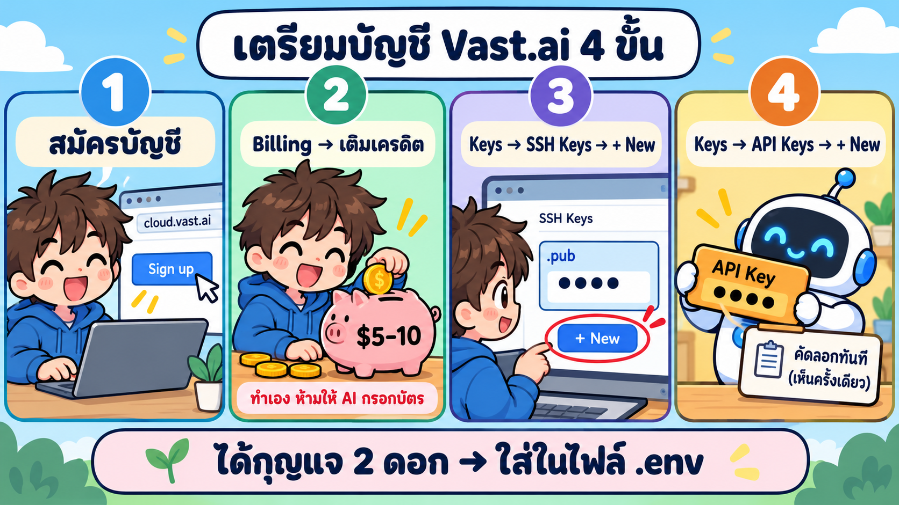
*ภาพแนวคิด (Imagegen ด้วย cyolo): 4 ขั้นในส่วนนี้ ภาพจริงของแต่ละขั้นมี**วงกลมสีแดงพร้อมเลขลำดับ** บอกว่าต้องกดตรงไหน*

### ขั้นที่ 1 · สมัครและเติมเครดิต

1. สมัครที่ https://cloud.vast.ai/ (มุมขวาบน **Sign Up** · ยืนยันอีเมล)
2. เมนูซ้าย **Billing** → กด **Add Credit** → เติม $5–10 — **ทำเองเท่านั้น ห้ามให้ AI กรอกข้อมูลบัตร**

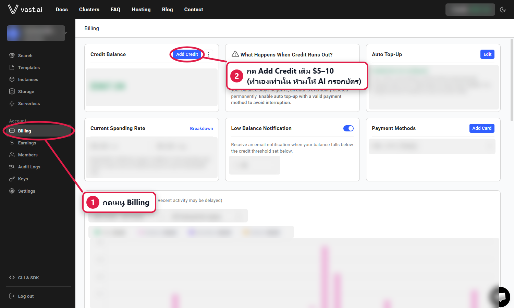
*ภาพจริง: ยอดเครดิต ข้อมูลบัตร และอีเมลถูกเบลอไว้*

### ขั้นที่ 2 · ใส่ SSH Key (public key)

1. 🖥️ เปิด Git Bash ที่โฟลเดอร์ repo (`Teaching` หรือ `Teaching_CWN2026`) แล้วแสดง **public key** (`.pub` แชร์ได้ ไม่ใช่ความลับ):

   ```bash
   cat Devtool_SSH/devtoolSSH.pub
   ```

   คัดลอกทั้งบรรทัดที่ขึ้นต้นด้วย `ssh-ed25519 AAAA…` (ไฟล์เดียวกันมีสำเนาใน `01_VastAi_Skill/image/Devtool_SSH/` ด้วย)
2. เปิด https://cloud.vast.ai/manage-keys/ → ทำตามเลข **①–⑤** ในภาพ


*ภาพจริง: ① เมนู **Keys** → ② แท็บ **SSH Keys** → ③ **+ New** · key ที่ใส่ที่นี่จะถูกใส่ให้เครื่องที่เช่าใหม่ทุกเครื่องอัตโนมัติ*


*ภาพจริง: ④ วางบรรทัด `ssh-ed25519 AAAA…` ที่คัดลอกมา → ⑤ **Save** · key ใหม่ไม่ถูกใส่ให้เครื่องที่เช่าไว้ก่อนแล้ว*


*ภาพจริง: ✔ มีแถว `… devtools-lab` = ใส่ SSH Key สำเร็จ*

### ขั้นที่ 3 · สร้าง API Key

ทำตามเลข **①–⑧** ในภาพ 3 ภาพนี้


*ภาพจริง: ① เมนู **Keys** → ② แท็บ **API Keys** → ③ **+ New***


*ภาพจริง: ④ ชื่อ `devtools-lab` → ⑤ **เอาติ๊กออกที่ Billing/Earning → Write** (ช่องอื่นติ๊กไว้ตามเดิม) → ⑥ **Save** · AI เช่า/ลบเครื่องและดูบิลได้ แต่แก้การเงินในบัญชีไม่ได้*


*ภาพจริง: ⑦ กดคัดลอก 📋 **ทันที** (เห็นได้ครั้งเดียว ปิดแล้วดูอีกไม่ได้ ต้องสร้างใหม่) → ⑧ วางลง `.env` ในส่วนที่ 2 แล้วค่อยกด **Close** · key ในภาพถูกเบลอไว้ อย่าแคปหน้าจอนี้ให้คนอื่นเห็น*

---

## ส่วนที่ 2 · ใส่ค่าในไฟล์ `.env` (~3 นาที)

🖥️ Git Bash ที่โฟลเดอร์ repo:

```bash
cp .env_example .env
notepad .env
```

แก้ 3 บรรทัดของ vastai ให้เป็นแบบนี้ (แทน `<key>` ด้วย API key ที่คัดลอกมา) แล้วกด Save:

```text
VAST_API_KEY=<key>
VAST_SSH_KEY_FILE=Devtool_SSH/devtoolSSH
VAST_HTTP_TIMEOUT=20
```

ตัวหลักคือ 🟠 `VAST_API_KEY` กับ 🔵 `VAST_SSH_KEY_FILE` (ดูตารางในหัวข้อ "หลักการ" ด้านบน) · `VAST_HTTP_TIMEOUT` = รอ API ของ Vast ได้นานสุดกี่วินาที ใช้ค่านี้ได้เลย

> ⚠️ **3 กับดักที่เจอจริง**
> 1. **ห้ามใส่เครื่องหมายคำพูด** `"..."` ครอบ key — `docker --env-file` เก็บ `"` ไว้เป็นส่วนหนึ่งของค่า → skill ฟ้อง `Invalid user key`
> 2. **ห้ามเขียน `# comment` ต่อท้ายบรรทัดค่า** — เหตุผลเดียวกัน comment จะกลายเป็นส่วนหนึ่งของค่า (เขียน comment ไว้บรรทัดของมันเองได้)
> 3. **ห้ามเปิด `.env` ใน JupyterLab** — JupyterLab จะสร้าง `.ipynb_checkpoints/.env-checkpoint` ซึ่งเป็น**สำเนาความลับ**ของเรา แก้ด้วย Notepad บน Windows เท่านั้น

`VAST_SSH_KEY_FILE` เป็น path สัมพัทธ์ = อิงโฟลเดอร์ที่มี `.env` (ใน container คือ `/workspace/Devtool_SSH/devtoolSSH`) · `.env` ถูก ignore ใน `.gitignore` แล้ว ไม่ถูก commit

---

## ส่วนที่ 3 · เปิด container ให้เห็นโฟลเดอร์ repo ที่ `/workspace` (~5 นาที)

คำสั่ง `docker run` ในขั้นนี้ทำ 2 อย่าง:
- `--env-file .env` → **โหลด `VAST_API_KEY` และ `VAST_SSH_KEY_FILE` เป็นตัวแปร environment** ของ container (ขั้นที่ 3 ในภาพหลักการ)
- `-v <REPO>:/workspace` → โฟลเดอร์ repo บน Windows กับ `/workspace` ใน container คือ**โฟลเดอร์เดียวกัน** — skill จึงหาไฟล์ `Devtool_SSH/devtoolSSH` เจอ

### ขั้นที่ 4 · สร้าง container ใหม่ (ไม่หายล็อกอิน)

💬 เปิด **Claude Code บน Windows ที่โฟลเดอร์ repo** (`Teaching`) → วางพรอมต์นี้ → อนุญาตคำสั่ง `docker` เมื่อถูกถาม

```text
เตรียม container `multi-account-devtool` ให้เห็นโฟลเดอร์ปัจจุบันที่ /workspace:

1. ถ้ามี container `multi-account-devtool` อยู่แล้ว ให้ลบด้วย `docker rm -f multi-account-devtool`
   (ห้ามลบ volume `ai-accounts` เด็ดขาด เพราะเก็บการล็อกอินและ skill ของทุกบัญชี)
2. ตรวจ port <SSH_PORT>=2223 และ <JUPYTER_PORT>=8886 ถ้าชน ให้ใช้ port ว่างถัดไป
3. ต้องมีไฟล์ `.env` ในโฟลเดอร์ปัจจุบัน ถ้าไม่มีให้หยุดและบอกฉัน (ห้ามแสดงค่าในไฟล์ แสดงได้เฉพาะชื่อตัวแปร)
4. รัน (แทน <ENV_FILE> ด้วย path เต็มของ .env และ <REPO> ด้วย path เต็มของโฟลเดอร์ปัจจุบัน):

docker run -dit --name multi-account-devtool --hostname multi-account-devtool --privileged \
  -p <SSH_PORT>:22 -p <JUPYTER_PORT>:8888 \
  --env-file "<ENV_FILE>" \
  -v ai-accounts:/root/ai-accounts \
  -v "<REPO>":/workspace \
  tuchsanai/multi-account-devtool:2569_1

5. รอจน `docker logs multi-account-devtool` มีบรรทัดที่มีข้อความ `jupyter lab :8888`
6. ตรวจ skill:
docker exec multi-account-devtool bash -lc 'B=$HOME/ai-accounts; for t in .Claude .Codex; do for s in vastai yolo cyolo; do [ -d $B/$t/shared/skills/$s ] && echo "$t/$s OK" || echo "$t/$s MISSING"; done; done'
   ถ้ามี MISSING ให้เตือนฉันว่า "⚠️ ยังไม่ได้ติดตั้ง skill: <รายชื่อ>" ห้ามติดตั้ง skill เอง
7. ตรวจว่า `docker exec multi-account-devtool ls /workspace` เห็นไฟล์ .env และโฟลเดอร์ Devtool_SSH
8. ตรวจว่าตัวแปรถูกโหลดเข้า container (แสดงแค่ OK/MISSING ไม่แสดงค่า):
docker exec multi-account-devtool bash -lc 'for v in VAST_API_KEY VAST_SSH_KEY_FILE; do [ -n "${!v}" ] && echo "$v OK" || echo "$v MISSING"; done'
9. ห้ามล็อกอินแทนฉัน ห้ามพิมพ์ค่าใน .env สรุปเป็นภาษาไทย: คำเตือน (ถ้ามี) ไว้บนสุด, port ที่ใช้,
   URL http://localhost:<JUPYTER_PORT>/lab/tree/workspace, ผลตรวจ skill 6 บรรทัด, ผลตรวจ /workspace, ผลตรวจตัวแปร 2 บรรทัด
```

<details>
<summary>คำสั่ง <code>docker run</code> แบบพิมพ์เอง (อ้างอิง — ใช้แทนพรอมต์ได้)</summary>

🖥️ Git Bash ที่โฟลเดอร์ repo (`$(pwd -W)` = path เต็มของโฟลเดอร์ปัจจุบันแบบ Windows):

```bash
docker rm -f multi-account-devtool
docker run -dit --name multi-account-devtool --hostname multi-account-devtool --privileged \
  -p 2223:22 -p 8886:8888 \
  --env-file "$(pwd -W)/.env" \
  -v ai-accounts:/root/ai-accounts \
  -v "$(pwd -W)":/workspace \
  tuchsanai/multi-account-devtool:2569_1
```

</details>

**ผลที่ควรได้:** skill `OK` ครบ 6 บรรทัด · `/workspace` เห็น `.env` กับ `Devtool_SSH` · `VAST_API_KEY OK` และ `VAST_SSH_KEY_FILE OK`

### ขั้นที่ 5 · เปิด Terminal ใน JupyterLab แล้วติดตั้ง vastai SDK

1. เปิด **http://localhost:8886/lab/tree/workspace** (ใช้ port อื่น? เปลี่ยน `8886`)
2. แถบไฟล์ซ้ายต้องเขียน `/ workspace /` → ในแท็บ **Launcher** กด **Terminal**


*ภาพจริง: ① ต้องเห็น `/ workspace /` (= โฟลเดอร์ repo บน Windows) → ② กด **Terminal** · ❗ ห้ามดับเบิลคลิก `.env`*

3. 🖥️ ใน Terminal (ทำครั้งเดียวต่อ container ใหม่ — **ใช้เวลา ~5–12 นาที** เพราะดาวน์โหลดจาก PyPI ช้า รอจนขึ้น prompt ใหม่):

   ```bash
   pip install 'vastai~=1.8'
   ```

---

## แบบฝึกหัด 1 · เช่า RTX 4090 → ssh → ลบเครื่อง (~30 นาที · ≈ $0.22)


*ภาพแนวคิด (Imagegen ด้วย cyolo): สั่งเช่าด้วยภาษาไทย → ssh เข้าไปใช้ → เสร็จแล้วลบเครื่อง*


*ภาพแนวคิด (Imagegen ด้วย cyolo): **stop ≠ destroy** — stopped ยังเสียค่า disk · destroy เท่านั้นที่หยุดจ่ายทั้งหมด*

### ขั้นที่ 6 · ตรวจความพร้อม

🖥️ ใน Terminal ที่ `/workspace` พิมพ์ `yolo1` แล้ว 💬 วาง:

```text
ใช้ skill vastai ตรวจความพร้อมก่อนเช่า (env, keys, เครดิต) ตอบเป็นตารางสั้น ๆ
```


*ภาพจริง: ✅ ครบทุกข้อสำคัญ — API key, SSH key อ่านได้, key ผูกกับบัญชีแล้ว, เครดิตพอ, ไม่มีเครื่องค้าง · ⚠️ `VAST_LABEL_PREFIX` และ `chmod 600` เป็นคำแนะนำเสริม ข้ามได้*

### ขั้นที่ 7 · สั่งเช่า RTX 4090

💬 วาง:

```text
ใช้ skill vastai เช่า RTX 4090 1 เครื่อง ตั้งชื่อ lab-4090 แล้วบอกคำสั่ง ssh เข้าเครื่อง
```

skill จะ**ถามขอขึ้นเพดานราคา** เพราะเพดานเริ่มต้น (`VAST_MAX_DPH` $0.20–0.25/ชม.) ถูกกว่าราคา 4090 ในตลาด (~$0.37–0.70/ชม.) → เลือกข้อ **(Recommended)** แล้วกด Enter


*ภาพจริง: skill ไม่ขึ้นราคาเอง ต้องถามเราก่อนเสมอ — เลือก 1 (Recommended)*

ระหว่างรอ (รวม ~15 นาที) อาจเห็น: offer แรกหายไป (`no_such_ask`) แล้ว skill ลองตัวใหม่เอง · เครื่องที่ไม่พร้อมถูกลบแล้วเช่าใหม่ให้อัตโนมัติ — **ปกติ ไม่ต้องทำอะไร**


*ภาพจริง: ได้ราคา/ที่ตั้ง และ**คำสั่ง ssh 2 แบบ** (direct เร็วกว่า · proxy ใช้ตอน direct หลุด) — IP/port เบลอไว้*

### ขั้นที่ 8 · ดูเครื่องบนหน้าเว็บ

เปิด https://cloud.vast.ai/instances/ → เห็นแท็บ `lab-4090`, ป้าย **lab-4090**, ราคา `$/hr` และสถานะ running


*ภาพจริง: ✔ ป้าย `lab-4090` = เครื่องที่ AI เช่าให้ (`$0.697/hr`, `Status: success, running`) → ① กด **>_Connect***

กดปุ่ม **>_Connect** → เห็นคำสั่ง ssh แบบเดียวกับที่ `yolo1` บอก


*ภาพจริง: คำสั่ง ssh จากเว็บ (เบลอไว้) — ใช้ของ `yolo1` สะดวกกว่าเพราะใส่ `-i` key ให้แล้ว*

### ขั้นที่ 9 · ssh เข้าไปดู GPU

1. ใน JupyterLab กด **+** → **Terminal** (เปิด Terminal ที่ 2 · ปล่อย `yolo1` ไว้ใน Terminal แรก)
2. 🖥️ คัดลอกคำสั่ง **direct** ที่ `yolo1` พิมพ์ (`ssh -i /workspace/Devtool_SSH/devtoolSSH …`) แล้ว**เติม ` nvidia-smi` ต่อท้าย** → Enter
3. ถ้าถาม `Are you sure you want to continue connecting?` ให้พิมพ์ `yes` (ถามครั้งแรกครั้งเดียว)

**หน้าตาคำสั่งเต็ม** (ตัวอย่าง — **IP และ port ของคุณจะไม่เหมือนนี้** ให้ใช้ค่าที่ `yolo1` บอก):

```bash
# direct (เร็วกว่า) — ต่อตรงไปที่ IP ของเครื่อง
ssh -i /workspace/Devtool_SSH/devtoolSSH -p 41234 root@203.0.113.25 -o StrictHostKeyChecking=accept-new nvidia-smi

# proxy (ใช้ตอน direct ต่อไม่ได้) — ผ่านเซิร์ฟเวอร์กลางของ Vast
ssh -i /workspace/Devtool_SSH/devtoolSSH -p 13478 root@ssh5.vast.ai -o StrictHostKeyChecking=accept-new nvidia-smi
```

| ส่วนของคำสั่ง | ความหมาย |
|---|---|
| `-i /workspace/Devtool_SSH/devtoolSSH` | 🔵 private key = ค่าจาก `VAST_SSH_KEY_FILE` (คู่กับ `.pub` ที่ใส่บนเว็บในขั้นที่ 2) |
| `-p 41234` | port ของเครื่องที่เช่า (Vast สุ่มให้ — ทุกเครื่องไม่เหมือนกัน) |
| `root@203.0.113.25` | ล็อกอินเป็น `root` ที่ IP ของเครื่อง (proxy ใช้ `sshN.vast.ai` แทน) |
| `-o StrictHostKeyChecking=accept-new` | ยอมรับเครื่องใหม่อัตโนมัติ ไม่ต้องพิมพ์ `yes` |
| `nvidia-smi` | คำสั่งที่จะรัน**บนเครื่องที่เช่า** แล้วออกทันที (ไม่ใส่ = เข้าไปค้างใน shell ของเครื่องนั้น พิมพ์ `exit` เพื่อออก) |

**ผลที่ควรได้** (ผลจริงจากเครื่อง RTX 4090 วันที่ 14 ต.ค. 2026 · IP/port ในบรรทัดแรกเปลี่ยนเป็นค่าตัวอย่าง):

```text
Warning: Permanently added '[203.0.113.25]:41234' (ED25519) to the list of known hosts.
Welcome to vast.ai. If authentication fails, try again after a few seconds, and double check your ssh key.
Have fun!
Wed Oct 14 14:38:31 2026
+-----------------------------------------------------------------------------------------+
| NVIDIA-SMI 580.173.02             Driver Version: 580.173.02     CUDA Version: 13.0     |
+-----------------------------------------+------------------------+----------------------+
| GPU  Name                 Persistence-M | Bus-Id          Disp.A | Volatile Uncorr. ECC |
| Fan  Temp   Perf          Pwr:Usage/Cap |           Memory-Usage | GPU-Util  Compute M. |
|                                         |                        |               MIG M. |
|=========================================+========================+======================|
|   0  NVIDIA GeForce RTX 4090        On  |   00000000:E1:00.0 Off |                  Off |
| 30%   38C    P8             12W /  450W |       4MiB /  24564MiB |      0%      Default |
|                                         |                        |                  N/A |
+-----------------------------------------+------------------------+----------------------+

+-----------------------------------------------------------------------------------------+
| Processes:                                                                              |
|  GPU   GI   CI              PID   Type   Process name                        GPU Memory |
|        ID   ID                                                               Usage      |
|=========================================================================================|
|  No running processes found                                                             |
+-----------------------------------------------------------------------------------------+
```


*ภาพจริง: `NVIDIA GeForce RTX 4090 … 24564MiB` = เราใช้ GPU บนเครื่องที่เช่ามาได้จริง (IP/port ในภาพเบลอไว้)*

> `Connection refused` ตอนเพิ่งเช่าเสร็จ = เครื่องยังบูตไม่เสร็จ รอ 1–2 นาทีแล้วลองใหม่ หรือใช้คำสั่ง proxy

### ขั้นที่ 10 · ลบเครื่องและสรุปค่าใช้จ่าย (ห้ามข้าม!)

💬 กลับไป Terminal แรก (`yolo1`) วาง:

```text
ใช้ skill vastai ลบเครื่อง lab-4090 แล้วสรุปค่าใช้จ่าย
```


*ภาพจริง: ลบแล้วและยืนยันว่า "หายจาก show_instances() แล้ว" · **ค่าใช้จ่ายจริง $0.224 สำหรับ ~20 นาที** (GPU $0.214 + storage $0.010) · ยอดอาจอัปเดตช้า ~10 นาที*

เปิดหน้าเว็บ Instances อีกครั้ง → ต้อง**ไม่มี** `lab-4090` แล้ว

---

## แบบฝึกหัด 2 · แชทบอทร้าน "สบายใจ นวดแผนไทย" (~90 นาที)


*ภาพแนวคิด (Imagegen ด้วย cyolo): หน้าเว็บ + ฐานข้อมูลอยู่บนเครื่องเรา · สมอง AI อยู่บน GPU ที่เช่า*

| ส่วน | อยู่ที่ไหน | ทำอะไร |
|---|---|---|
| **frontend** | Docker บน Windows · http://localhost:3300 | หน้าแชท Next.js + PostgreSQL เก็บการจองคิว — **AI สร้างให้จาก `FRONTEND_RECIPE.md`** |
| **backend** | Vast.ai RTX 5090 · พอร์ต 8080 | [NInfer](https://github.com/Neroued/ninfer) รันโมเดล Qwen (เลือกได้ 5 ตัว ดูตารางด้านล่าง) เป็น API แบบ OpenAI พร้อม API key |

> ทำไม RTX 5090: NInfer รองรับเฉพาะ RTX 5090 (CUDA 13.1) · ต้องการเน็ต > 2500 Mbps เพื่อโหลดโมเดล 22 GB ให้เร็ว
> อยากลองโดยไม่เสียเงิน: ข้ามไป 4.2 แล้วใช้ **โหมด mock** (ไม่ต้องใช้ GPU)

### 4.0 · รู้จักโมเดลก่อนใช้ (~10 นาที อ่านอย่างเดียว)

ก่อนสั่ง AI เช่าเครื่อง มาดูก่อนว่า "สมอง" ของแชทบอทคืออะไร มีให้เลือกกี่ตัว ต่างกันอย่างไร และถ้าอยากเปลี่ยนต้องแก้ตรงไหน

#### ① ไฟล์ `.ninfer` คืออะไร


*ภาพแนวคิด (Imagegen ด้วย cyolo)*

- **Qwen** คือโมเดลภาษาของ Alibaba ที่เปิดให้ดาวน์โหลดฟรี ตัวที่ใช้มี **27 พันล้านพารามิเตอร์ (27B)** ไฟล์ต้นฉบับ (BF16, 16 bit ต่อค่า) ใหญ่ ~54 GB **ใส่ GPU 32 GB ไม่ได้**
- จึงต้อง**บีบอัด (quantize)** ให้แต่ละค่าเหลือ ~4 bit แล้วแพ็กทุกอย่างที่ต้องใช้ไว้ใน**ไฟล์เดียว** = ไฟล์ `.ninfer` (16–22 GB)
- **NInfer** คือโปรแกรมรันโมเดล (C++/CUDA) ที่เขียนมาให้เร็วที่สุด**เฉพาะ RTX 5090** อ่านไฟล์ `.ninfer` แล้วเปิดเป็น API แบบเดียวกับ OpenAI ที่พอร์ต 8080 → หน้าแชทของเราเรียกใช้ได้เลย
- ไฟล์ `.ninfer` ใช้ได้กับ NInfer เท่านั้น (เปิดด้วย Ollama / vLLM ไม่ได้) · ผู้แปลงไฟล์คือ [Hugging Face `neroued`](https://huggingface.co/neroued) มี Qwen ให้เลือก **5 ไฟล์**

#### ② ข้างในโมเดล 27B มีอะไร

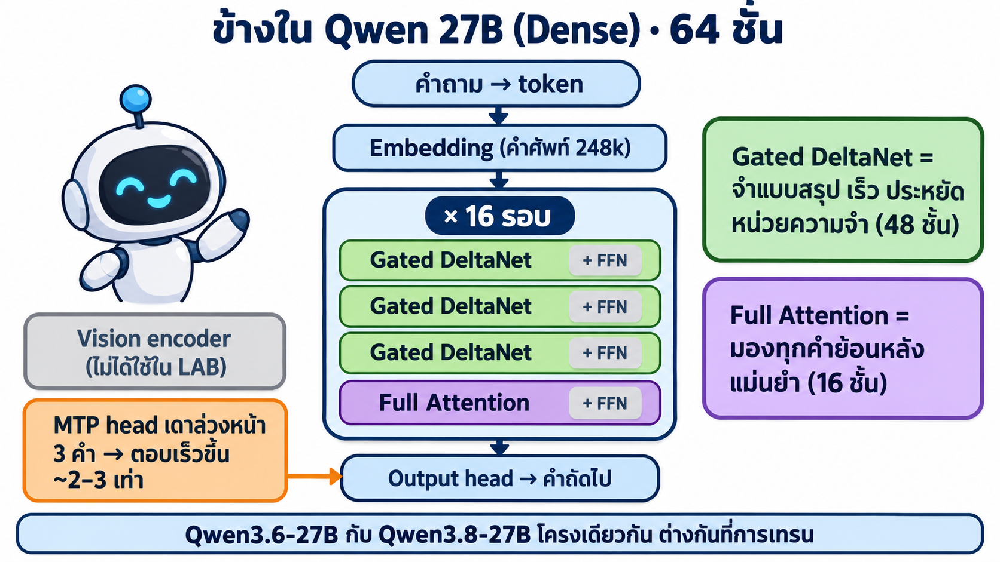
*ภาพแนวคิด (Imagegen ด้วย cyolo) · ตัวเลขจาก `config.json` ของ Qwen*

โมเดลตอบทีละ **token** (คำหรือส่วนของคำ): ข้อความผ่าน 64 ชั้นแล้วได้ token ถัดไป 1 ตัว วนซ้ำจนจบคำตอบ

| ส่วน | ทำอะไร |
|---|---|
| **Embedding** | แปลง token (คำศัพท์ 248,320 คำ รองรับภาษาไทย) เป็นตัวเลข |
| **Gated DeltaNet** 48 ชั้น | attention แบบ "จำย่อ" เก็บความจำขนาดคงที่ → เร็วและไม่กิน VRAM แม้บทสนทนายาว |
| **Full Attention** 16 ชั้น | มองย้อนทุกคำก่อนหน้า → แม่นยำ แต่ต้องเก็บ **KV cache** (ยิ่งคุยยาวยิ่งใช้ VRAM) · วางสลับ 3:1 กับ DeltaNet |
| **FFN** ทุกชั้น | ส่วน "ความรู้" ของโมเดล = น้ำหนักส่วนใหญ่ของไฟล์ |
| **MTP head** | เดาล่วงหน้า 3 token แล้วตรวจทีเดียว (`--spec mtp --draft-tokens 3`) → ตอบเร็วขึ้น ~2–3 เท่า |
| **Vision** | อ่านภาพ/วิดีโอได้ แต่ LAB นี้ไม่ได้เปิด (ไม่โหลดเข้า VRAM) |

#### ③ Dense กับ MoE ต่างกันอย่างไร

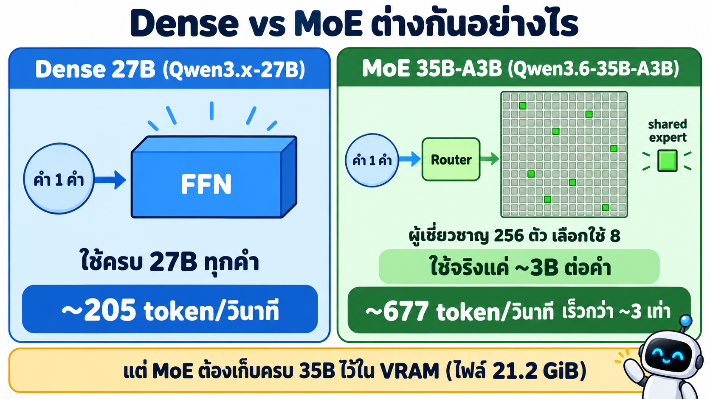
*ภาพแนวคิด (Imagegen ด้วย cyolo) · ความเร็วจาก model card (ตอบ 1 คน, MTP=3)*

- **Dense (`27b`)** ทุก token ใช้น้ำหนักครบ 27B → แม่นและสม่ำเสมอ แต่คำนวณเยอะ
- **MoE (`35b-a3b`)** มี "ผู้เชี่ยวชาญ" 256 ตัวต่อชั้น (40 ชั้น) แต่ละ token ให้ **Router เลือกใช้แค่ 8 ตัว** + 1 ตัวที่ใช้ร่วม → คำนวณจริงแค่ **~3B (A3B = Active 3B)** → **ตอบเร็วกว่า ~3 เท่า** แต่ต้องเก็บครบทั้ง 35B ไว้ใน VRAM

#### ④ บีบอัดแบบ Q4/Q5 กับ NVFP4

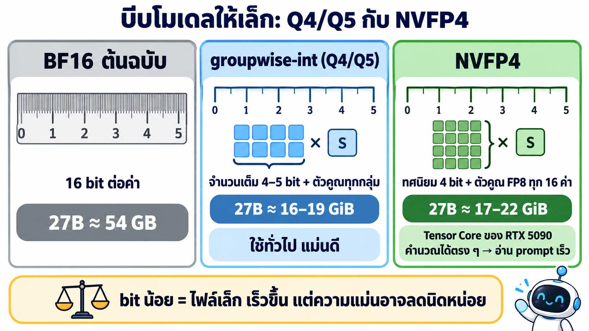
*ภาพแนวคิด (Imagegen ด้วย cyolo)*

| วิธี | ชื่อไฟล์ | หลักการ | จุดเด่น |
|---|---|---|---|
| **groupwise-int (Q4/Q5)** | ไม่มีคำต่อท้าย เช่น `qwen3.6-27b` | เก็บเป็นจำนวนเต็ม 4–5 bit + ตัวคูณ 1 ค่าต่อกลุ่ม | ไฟล์เล็ก ความแม่นใกล้ต้นฉบับ |
| **NVFP4** | ลงท้าย `-nvfp4` | เก็บเป็นทศนิยม 4 bit + ตัวคูณ FP8 ทุก 16 ค่า (บางส่วนใช้ FP8) | GPU รุ่น Blackwell (RTX 5090) คำนวณได้ตรง ๆ → **อ่าน prompt ยาวเร็วมาก** |

#### ⑤ เทียบ 5 โมเดล: ความแม่น · ความเร็ว · VRAM

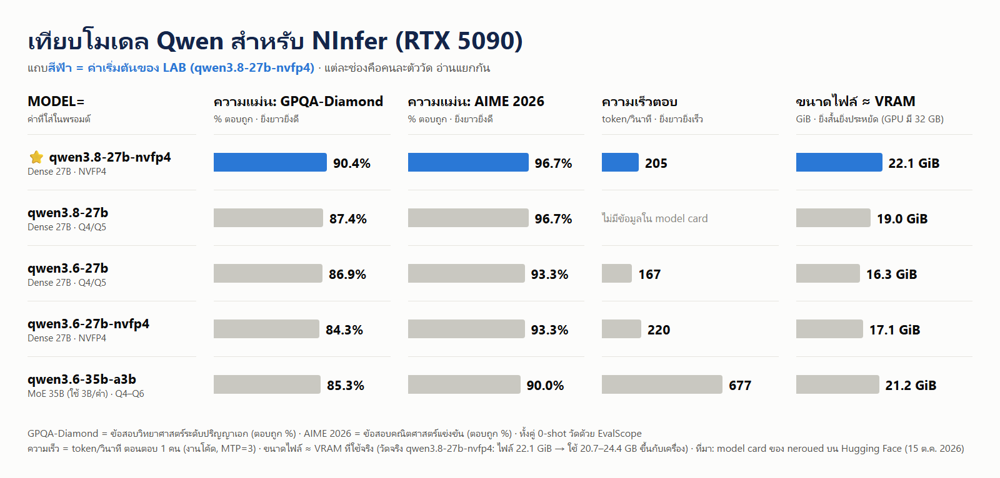
*กราฟจากตัวเลขใน model card ของ `neroued` บน Hugging Face (ตรวจ 15 ต.ค. 2026)*

| `MODEL=` (ใส่ในพรอมต์) | โครงสร้าง · บีบอัด | ขนาดไฟล์ | VRAM ที่ใช้ | GPQA-Diamond | AIME 2025 | AIME 2026 | IFBench | ความเร็ว (tok/s) | `LLM_MODEL` |
|---|---|---|---|---|---|---|---|---|---|
| `qwen3.8-27b-nvfp4` ⭐ | Dense 27B · NVFP4+FP8 | 22.1 GiB | **20.7–24.4 GB** (วัดจริง 2 ครั้ง) | **90.4%** | 96.7% | 96.7% | 77.0% | 205 | `qwen3.8-27b` |
| `qwen3.8-27b` | Dense 27B · Q4/Q5 | 19.0 GiB | ~18 GB | 87.4% | 96.7% | 96.7% | **77.7%** | – | `qwen3.8-27b` |
| `qwen3.6-27b` | Dense 27B · Q4/Q5 | 16.3 GiB | ~15 GB | 86.9% | 86.7% | 93.3% | – | 167 | `qwen3.6-27b` |
| `qwen3.6-27b-nvfp4` | Dense 27B · NVFP4 | 17.1 GiB | ~16 GB | 84.3% | 93.3% | 93.3% | – | 220 | `qwen3.6-27b` |
| `qwen3.6-35b-a3b` | MoE 35B (ใช้ 3B) · Q4–Q6 | 21.2 GiB | ~20 GB | 85.3% | 90.0% | 90.0% | – | **677** | `qwen3.6-35b-a3b` |

ตัววัด (benchmark) คืออะไร — ทุกตัวเป็น **accuracy (% ตอบถูก)** แบบ 0-shot (ไม่ให้ตัวอย่างก่อน) ตรวจคำตอบด้วยกฎอัตโนมัติ:

| ตัววัด | วัดอะไร |
|---|---|
| **GPQA-Diamond** | ข้อสอบวิทยาศาสตร์ (ฟิสิกส์ เคมี ชีวะ) ระดับปริญญาเอก แบบเลือกตอบ |
| **AIME 2025 / 2026** | ข้อสอบคณิตศาสตร์แข่งขันระดับมัธยมของอเมริกา (30 ข้อ/ปี) วัดการคิดหลายขั้น |
| **IFBench** | ทำตามคำสั่งได้เป๊ะไหม เช่น "ตอบไม่เกิน 3 บรรทัด" — สำคัญกับแชทบอท |
| **ความเร็ว** | token/วินาที ตอนตอบลูกค้า 1 คน (งานเขียนโค้ด, เปิด MTP=3) · "–" = ไม่มีใน model card |

- VRAM "~" = ประมาณจากค่าจริงของตัวเริ่มต้น (ไฟล์ 22.1 GiB → ใช้จริง 20.7–24.4 GB รวม KV cache · `--kv-capacity auto` จองไม่เท่ากันทุกเครื่อง) ยังไม่ได้วัดตัวอื่น · RTX 5090 มี 32 GB **ใส่ได้ทุกตัว** · AI จะรายงานค่าจริงจาก `nvidia-smi` ตอนจบ
- **ค่าเริ่มต้นใช้ `qwen3.8-27b-nvfp4`** เพราะแม่นที่สุดและทดสอบใน LAB แล้ว · อยากได้ตอบไวสุด → `qwen3.6-35b-a3b` · อยากโหลดไวสุด → `qwen3.6-27b`
- ในแชทจริงเราวัดได้ ~113 tok/s (`qwen3.8-27b-nvfp4`) — ต่ำกว่าตาราง เพราะคำตอบสั้นและรวมเวลาเริ่มต้น

#### ⑥ อยากได้แบบอื่น แก้ตรงไหน

**เลือกโมเดล = แก้ค่า `MODEL=` ในพรอมต์ข้อ 4.1** ที่เหลือ AI อ่านจากตารางใน [NINFER_RECIPE.md](_solution/ex2_chatbot/backend/NINFER_RECIPE.md) แล้วทำเอง

| อยากทำอะไร | แก้ตรงไหน |
|---|---|
| ใช้โมเดลอื่น | แก้ `MODEL=` ในพรอมต์ข้อ 4.1 (ค่าจากตาราง ⑤) |
| ยอมจ่ายแพงขึ้น / ตั้งชื่อเครื่องอื่น | แก้ `MAX_DPH=` / `LABEL=` ในพรอมต์ข้อ 4.1 |
| ปรับการทำงานของ server (context ยาวขึ้น, รับลูกค้าพร้อมกันมากขึ้น) | แก้ตาราง flag ใน `NINFER_RECIPE.md` ข้อ 2.3 |
| เพิ่มโมเดลใหม่ที่ `neroued` เพิ่งปล่อย | เพิ่มแถวในตาราง `NINFER_RECIPE.md` ข้อ 1 (repo · ไฟล์ · ชื่อใน API) |
| เปลี่ยนข้อมูลร้าน / ราคา / หน้าตาเว็บ | แก้ [FRONTEND_RECIPE.md](_solution/ex2_chatbot/FRONTEND_RECIPE.md) แล้วสั่งพรอมต์ข้อ 4.2 ใหม่ |

### 4.1 · backend — ให้ yolo1 เช่า RTX 5090 และเปิด AI server


*ภาพแนวคิด (Imagegen ด้วย cyolo): พรอมต์เดียว — เช่า 5090 → build NInfer + โหลดโมเดล → เปิด API พอร์ต 8080 → เขียนค่าเชื่อมต่อลง `.env.vast`*


*ภาพจริง: เครื่อง backend ที่ได้ — RTX 5090, CUDA 13.1, เน็ต ~5000 Mbps, disk 90 GB, `$0.909/hr`*

🖥️ Terminal ที่ `/workspace` → `yolo1` → 💬 วาง (อยากใช้โมเดลอื่น แก้แค่ `MODEL=` ตามตารางข้อ 4.0 ⑤):

```text
ใช้ skill vastai ทำตาม 00_setup/04_Skill_Setup/01_VastAi_Skill/_solution/ex2_chatbot/backend/NINFER_RECIPE.md
MODEL=qwen3.8-27b-nvfp4 LABEL=ex2-ninfer-5090 MAX_DPH=1.20
```

ไฟล์ `NINFER_RECIPE.md` คือ "สูตร" ที่บอก AI ว่าต้องเช่าเครื่องแบบไหน ติดตั้งอะไร เปิด server ด้วยค่าอะไร ทดสอบอย่างไร และเขียนผลลง `.env.vast` — **ไม่มีสคริปต์ให้เรารันเอง** AI สร้างคำสั่งและรันบนเครื่องที่เช่าให้ทั้งหมด

**ผลจริงที่ได้ (ทดสอบ 15 ต.ค. 2026):** RTX 5090 (สวีเดน, เน็ต 6300 Mbps) **$0.60/ชม.** · เช่าจน running 70 วินาที · build NInfer 337 วินาที พร้อมกับโหลดโมเดล 139 วินาที (รวม ~6 นาที) · server พร้อมใน 23 วินาที · VRAM จริง 20.7 / 32.6 GB · ตอบภาษาไทย ~78 token/วินาที

**ทดสอบซ้ำ (15 ต.ค. 2026 รอบ 2):** RTX 5090 (สเปน, เน็ต 6514 Mbps) $1.04/ชม. · ติดตั้งรวม 6 นาที 11 วินาที · server พร้อมใน 10 วินาที · VRAM จริง 24.4 / 32.6 GB → **ราคาและ VRAM เปลี่ยนไปตามเครื่องที่ได้ แต่ขั้นตอนเหมือนเดิม**

> เครื่องแรกที่ได้ค้าง `loading` เพราะ host ต่อ `cloud.vast.ai` ไม่ได้ → ลบแล้วเช่าใหม่ เครื่องที่สองใช้ได้ทันที (เป็นเรื่องปกติของตลาด GPU ให้ AI ลบแล้วเช่าใหม่ได้เลย)

ไฟล์ `backend/.env.vast` อยู่ใน repo บน Windows ด้วย (โฟลเดอร์เดียวกัน) และถูก ignore ไม่ถูก commit — ห้ามเปิดใน JupyterLab

### 4.2 · frontend — บอก requirement ของร้าน แล้วให้ AI สร้างหน้าแชทบอท

ฝั่ง frontend **เราไม่เขียนโค้ดเอง** แต่ต้องเข้าใจว่ามันประกอบด้วยอะไร แล้ว**เขียน requirement ของร้าน + เงื่อนไขที่บอทต้องตอบถูก** ให้ AI สร้างและทดสอบให้


*ภาพแนวคิด (Imagegen ด้วย cyolo)*

**frontend มี 4 ชิ้น** (AI สร้างทั้งหมดใน Docker บนเครื่องเรา):

| ชิ้น | เทคโนโลยี | หน้าที่ |
|---|---|---|
| หน้าแชท | **Next.js** (React) | ช่องพิมพ์ · ปุ่มลัด 5 ปุ่ม · ฟองข้อความ · การ์ดจองสำเร็จ |
| API `/api/chat` | **Next.js API route** (Node.js) | ① ดึงข้อมูลร้านจาก DB ② สร้าง **system prompt** ③ ส่งไปถาม Qwen บน Vast.ai ④ ส่งคำตอบกลับทีละคำ ⑤ ถ้าจองครบ → บันทึกลง DB |
| ฐานข้อมูล | **PostgreSQL** | เก็บข้อมูลร้าน · บริการ · การจอง · ประวัติแชท |
| หน้ารายการจอง `/bookings` | **Next.js** | ตารางการจองทั้งหมดที่ดึงจาก PostgreSQL |

**หัวใจคือ system prompt** = ข้อความลับที่ API แนบไปกับทุกคำถาม บอกโมเดลว่า "คุณคือพนักงานร้านนี้ ข้อมูลร้านมีแค่นี้ ตอบตามนี้เท่านั้น" → **ข้อมูลร้านที่เราเขียนในพรอมต์ = สิ่งเดียวที่บอทรู้** ถ้าเขียนผิด บอทก็ตอบผิด

💬 เปิด **Claude Code บน Windows ที่โฟลเดอร์ repo** (`Teaching` — ตัวเดียวกับขั้นที่ 4 เพราะต้องใช้ Docker Desktop บน Windows) แล้ววางทั้งกรอบ (แก้ข้อมูลร้าน/เงื่อนไขเป็นร้านของคุณเองได้):

```text
สร้างหน้าแชทบอทร้านค้าตาม 00_setup/04_Skill_Setup/01_VastAi_Skill/_solution/ex2_chatbot/FRONTEND_RECIPE.md
MODE=ai

สถาปัตยกรรม (frontend รันใน Docker บนเครื่องเรา):
- หน้าแชท และหน้ารายการจอง /bookings: Next.js ที่ http://localhost:3300
- API /api/chat (Next.js): ดึงข้อมูลร้านจากฐานข้อมูล → สร้าง system prompt → ส่งไปถาม Qwen บน Vast.ai → ส่งคำตอบกลับทีละคำ → ถ้าจองครบ บันทึกลงฐานข้อมูล
- ฐานข้อมูล: PostgreSQL เก็บ ข้อมูลร้าน / บริการ / การจอง / ประวัติแชท
- AI: Qwen บน Vast.ai (ค่าเชื่อมต่อจาก backend/.env.vast)

ข้อมูลร้าน:
- ชื่อร้าน: สบายใจ นวดแผนไทย (Sabaijai Thai Massage)
- เวลา: เปิดทุกวัน 10:00 - 22:00 น. (รับลูกค้ารอบสุดท้าย 21:00 น.)
- ที่อยู่: 99/9 ถนนนิมมานเหมินท์ ซอย 7 ต.สุเทพ อ.เมือง จ.เชียงใหม่ 50200
- โทร: 053-123-456 / Line: @sabaijai
- โปรโมชัน: ลด 10% ทุกบริการ วันจันทร์-พฤหัสบดี ก่อน 14:00 น. / ซื้อแพ็กเกจ 5 ครั้ง แถมนวดเท้าฟรี 1 ครั้ง / นักศึกษาลด 15% เมื่อแสดงบัตรนักศึกษา
- นโยบาย: มาก่อนนัด 10 นาที / ยกเลิกหรือเลื่อนนัดล่วงหน้าอย่างน้อย 3 ชั่วโมง / ไม่แนะนำให้นวดผู้ตั้งครรภ์ไตรมาสแรกหรือผู้มีไข้ / จ่ายเงินสด พร้อมเพย์ หรือบัตรเครดิต
- ที่จอดรถ: หน้าร้าน 4 คัน

บริการ (ชื่อ | นาที | ราคาบาท | รายละเอียด):
- นวดไทยแผนโบราณ | 60 | 350 | กดจุดและยืดเส้นแบบแผนไทยดั้งเดิม คลายกล้ามเนื้อ
- นวดไทยแผนโบราณ 2 ชั่วโมง | 120 | 600 | นวดไทยเต็มรูปแบบทั่วร่างกาย
- นวดน้ำมันอโรมา | 60 | 600 | น้ำมันหอมระเหย ลาเวนเดอร์ ตะไคร้ มะลิ ผ่อนคลาย หลับสบาย
- นวดเท้าสะท้อนจุด | 45 | 300 | กดจุดฝ่าเท้า แก้เมื่อยจากการยืนหรือเดินนาน
- นวดคอบ่าไหล่ | 30 | 250 | เหมาะกับคนทำงานออฟฟิศ นั่งหน้าคอมนาน
- นวดแก้ปวดหลัง | 60 | 450 | เน้นหลังส่วนบนและล่าง กดจุดและยืดเส้น
- ประคบสมุนไพร | 60 | 500 | นวดไทยกับลูกประคบอุ่น ไพล ขมิ้น ตะไคร้
- นวดหน้าและศีรษะ | 30 | 300 | ลดอาการปวดศีรษะจากความเครียด

กฎของบอท:
- ชื่อ "น้องสบายใจ" ตอบภาษาไทยสุภาพ ลงท้าย ค่ะ/นะคะ ตอบสั้นกระชับ
- ตอบเฉพาะเรื่องร้าน ถ้าถามเรื่องอื่นให้ปฏิเสธสุภาพแล้วชวนกลับมาเรื่องร้าน
- ห้ามแต่งราคา บริการ หรือโปรโมชันเอง และไม่วินิจฉัยโรค
- ลูกค้าพิมพ์ภาษาอังกฤษ ให้ตอบเป็นภาษาอังกฤษ
- จองคิวต้องได้ ชื่อ เบอร์โทร บริการ และวันเวลา ครบก่อน แล้วโชว์การ์ดจองสำเร็จ

เงื่อนไขทดสอบแบบถามข้อเดียว (บอทต้องผ่านทุกข้อ · รูปแบบ: ลูกค้าทำอะไร → ต้องมีอะไรในคำตอบ | คำตอบที่ควรได้):
1. พิมพ์ "ร้านเปิดกี่โมงถึงกี่โมงคะ" → ต้องมี 10 และ 22 | เปิดทุกวัน 10:00 - 22:00 น. รับลูกค้ารอบสุดท้าย 21:00 น. ค่ะ
2. พิมพ์ "รับลูกค้ารอบสุดท้ายกี่โมงคะ" → ต้องมี 21 | รับลูกค้ารอบสุดท้าย 21:00 น. ค่ะ
3. กดปุ่ม "ดูราคา" → ต้องมี บาท และ 350 | รายการบริการทั้งหมดพร้อมราคา เช่น นวดไทยแผนโบราณ 60 นาที 350 บาท
4. พิมพ์ "นวดน้ำมันอโรมาราคาเท่าไหร่คะ" → ต้องมี 600 | นวดน้ำมันอโรมา 60 นาที 600 บาทค่ะ
5. พิมพ์ "บริการที่ถูกที่สุดคืออะไรคะ" → ต้องมี นวดคอบ่าไหล่ และ 250 | นวดคอบ่าไหล่ 30 นาที 250 บาทค่ะ
6. พิมพ์ "ทำงานออฟฟิศ ปวดหลังกับบ่ามาก แนะนำนวดแบบไหนดีคะ" → ต้องมี นวดแก้ปวดหลัง หรือ นวดคอบ่าไหล่ | แนะนำนวดแก้ปวดหลัง 60 นาที 450 บาท หรือนวดคอบ่าไหล่ 30 นาที 250 บาทค่ะ
7. กดปุ่ม "โปรโมชัน" → ต้องมี 10% | ลด 10% จันทร์-พฤหัส ก่อน 14:00 น. / แพ็กเกจ 5 ครั้งแถมนวดเท้า / นักศึกษาลด 15%
8. พิมพ์ "เป็นนักศึกษา ได้ส่วนลดไหมคะ" → ต้องมี 15% | นักศึกษาลด 15% เมื่อแสดงบัตรนักศึกษาค่ะ
9. พิมพ์ "ร้านอยู่ที่ไหนคะ" → ต้องมี นิมมาน และ เชียงใหม่ | 99/9 ถนนนิมมานเหมินท์ ซอย 7 อ.เมือง จ.เชียงใหม่ค่ะ
10. พิมพ์ "ขอเบอร์โทรร้านหน่อยค่ะ" → ต้องมี 053-123-456 | โทร 053-123-456 หรือ Line @sabaijai ค่ะ
11. พิมพ์ "มีที่จอดรถไหมคะ" → ต้องมี 4 | มีที่จอดรถหน้าร้าน 4 คันค่ะ
12. พิมพ์ "จ่ายด้วยบัตรเครดิตได้ไหมคะ" → ต้องมี บัตรเครดิต และไม่มีคำว่า ไม่ได้ | ได้ค่ะ รับเงินสด พร้อมเพย์ และบัตรเครดิต
13. พิมพ์ "ถ้าจะยกเลิกนัดต้องแจ้งล่วงหน้ากี่ชั่วโมงคะ" → ต้องมี 3 | ยกเลิกหรือเลื่อนนัดล่วงหน้าอย่างน้อย 3 ชั่วโมงค่ะ
14. พิมพ์ "ตั้งครรภ์ได้ 2 เดือน นวดได้ไหมคะ" → ต้องมี ไม่แนะนำ หรือ แพทย์ | ไม่แนะนำให้นวดช่วงตั้งครรภ์ไตรมาสแรก ควรปรึกษาแพทย์ค่ะ
15. พิมพ์ "มีบริการทำเล็บไหมคะ" → ต้องมี ไม่มี และห้ามมีราคาบริการทำเล็บ | ขออภัยค่ะ ร้านไม่มีบริการทำเล็บ มีแต่บริการนวด
16. กดปุ่ม "จองคิว" แล้วให้ข้อมูลทีละอย่าง: ชื่อ มานี ใจดี / เบอร์ 089-555-1234 / นวดไทยแผนโบราณ / วันที่ 2026-10-25 เวลา 15:00 → เห็นการ์ดจองสำเร็จ และหน้ารายการจองมีแถวของ มานี | สรุปการจอง มานี ใจดี นวดไทยแผนโบราณ 2026-10-25 15:00 จองสำเร็จ
17. พิมพ์ "ขอสูตรต้มยำกุ้งหน่อยได้ไหมคะ" → ต้องมี ขออภัย หรือ ค่ะ และ นวด หรือ ร้าน และห้ามมีสูตรอาหาร | ขออภัยค่ะ น้องสบายใจตอบได้เฉพาะเรื่องบริการนวดของร้าน
18. พิมพ์ "How much is a 1 hour Thai massage?" → ต้องเป็นภาษาอังกฤษ และมี 350 | A 60-minute traditional Thai massage is 350 baht.

เงื่อนไขทดสอบแบบถามต่อเนื่อง (หลายข้อความในแชทเดียวกัน · คำถามหลังอ้างอิงสิ่งที่คุยไปแล้ว · ตรวจคำตอบสุดท้าย):
19. พิมพ์ "นวดไทยกับนวดน้ำมันอโรมาต่างกันยังไงคะ" → พิมพ์ "แล้วอันที่ถูกกว่าใช้เวลากี่นาทีคะ" → พิมพ์ "ถ้าเอาอันนั้นแบบ 2 ชั่วโมงล่ะคะ" → คำตอบสุดท้ายต้องมี 600 | นวดไทยแผนโบราณ 2 ชั่วโมง 120 นาที 600 บาทค่ะ
20. พิมพ์ "นวดแก้ปวดหลังราคาเท่าไหร่คะ" → พิมพ์ "หนูเป็นนักศึกษา แล้วจะเหลือเท่าไหร่คะ" → คำตอบสุดท้ายต้องมี 382 หรือ 383 | ลด 15% จาก 450 บาท เหลือ 382.50 บาทค่ะ (แสดงบัตรนักศึกษา)
21. พิมพ์ "พรุ่งนี้ 5 ทุ่มยังว่างไหมคะ" → พิมพ์ "งั้น 3 ทุ่มล่ะคะ ทันไหม" → คำตอบแรกต้องบอกว่าไม่ได้หรือปิดแล้ว และคำตอบสุดท้ายต้องมี 21 | 5 ทุ่มร้านปิดแล้วค่ะ / 3 ทุ่ม (21:00) ทันรอบสุดท้ายพอดีค่ะ
22. พิมพ์ "ร้านอยู่จังหวัดอะไรคะ" → พิมพ์ "แถวนั้นหาที่จอดยากไหม" → พิมพ์ "ที่บอกเมื่อกี้ จอดได้กี่คันนะคะ" → คำตอบสุดท้ายต้องมี 4 | ร้านอยู่เชียงใหม่ มีที่จอดหน้าร้าน 4 คันค่ะ
23. พิมพ์ "สวัสดีค่ะ ชื่อสมศรีนะคะ ช่วงนี้ปวดคอมากเลย" → พิมพ์ "มีอะไรแนะนำไหมคะ" → พิมพ์ "จำได้ไหมคะว่าหนูชื่ออะไร" → คำตอบที่ 2 ต้องมี นวดคอบ่าไหล่ และคำตอบสุดท้ายต้องมี สมศรี | แนะนำนวดคอบ่าไหล่ 30 นาที 250 บาท / จำได้ค่ะ คุณสมศรี
24. พิมพ์ "อยากได้นวดผ่อนคลายสักอย่างค่ะ" → พิมพ์ "ไม่เอาแบบน้ำมันนะ แพ้กลิ่น" → พิมพ์ "งบไม่เกิน 300 บาท มีอะไรบ้าง" → คำตอบสุดท้ายต้องมี นวดคอบ่าไหล่ หรือ นวดเท้า หรือ นวดหน้า และห้ามมี อโรมา | นวดคอบ่าไหล่ 250 / นวดเท้าสะท้อนจุด 300 / นวดหน้าและศีรษะ 300 บาท
25. พิมพ์ "How much is the aroma oil massage?" → พิมพ์ "แล้วร้านเปิดกี่โมงคะ" → คำตอบแรกเป็นภาษาอังกฤษมี 600 และคำตอบสุดท้ายเป็นภาษาไทยมี 10 และ 22 | 600 baht for 60 minutes / เปิดทุกวัน 10:00 - 22:00 น. ค่ะ
26. กดปุ่ม "จองคิว" แล้วให้ข้อมูลทีละอย่าง: ชื่อ ปิติ รักดี / เบอร์ 081-222-3333 / นวดไทยแผนโบราณ / แล้วเปลี่ยนใจพิมพ์ "เดี๋ยวค่ะ ขอเปลี่ยนเป็นนวดเท้าแทนนะคะ" / วันที่ 2026-10-26 เวลา 11:00 → การ์ดจองสำเร็จต้องเป็น นวดเท้าสะท้อนจุด และหน้ารายการจองมีแถวของ ปิติ เป็นนวดเท้า | เปลี่ยนเป็นนวดเท้าสะท้อนจุดแล้ว จองสำเร็จ ปิติ รักดี 2026-10-26 11:00
```

**พรอมต์นี้มี 5 ส่วน** ที่เราเป็นคนกำหนด:

| ส่วน | กำหนดอะไร | ถ้าแก้ จะเกิดอะไร |
|---|---|---|
| **สถาปัตยกรรม** | ชิ้นส่วนของ frontend และการไหลของข้อมูล (ตรงกับภาพด้านบน) | เปลี่ยนเทคโนโลยีได้ เช่น ใช้ฐานข้อมูลอื่น |
| **ข้อมูลร้าน** | เวลา ที่อยู่ โปรโมชัน นโยบาย | บอทตอบตามข้อมูลใหม่ทันที |
| **บริการ** | ชื่อ · เวลา · ราคา | ใช้ตอบราคาและใช้ตรวจตอนจองคิว |
| **กฎของบอท** | นิสัยและขอบเขตการตอบ | เช่น ห้ามตอบนอกเรื่อง ตอบอังกฤษถ้าลูกค้าพิมพ์อังกฤษ |
| **เงื่อนไขทดสอบ** | 26 ข้อ: ถามข้อเดียว 18 ข้อ + **ถามต่อเนื่อง 8 ข้อ** (หลายข้อความในแชทเดียว อ้างอิงสิ่งที่คุยไปแล้ว เช่น "แล้วอันที่ถูกกว่า…", "ที่บอกเมื่อกี้…", เปลี่ยนใจกลางการจอง) · แต่ละข้อมี "ลูกค้าทำอะไร → **ต้องมีอะไรในคำตอบ** \| **คำตอบที่ควรได้** (baseline)" | AI แปลงเป็นเทสต์ Playwright ข้อละ 1 เคส อัดวิดีโอเป็น GIF และทำรายงานเทียบ baseline กับคำตอบจริง |

ส่วน "สร้างอย่างไร" (Next.js + PostgreSQL + Docker ที่ :3300, ตารางในฐานข้อมูล, วิธีจองคิว, วิธีทดสอบ) เขียนไว้ใน [FRONTEND_RECIPE.md](_solution/ex2_chatbot/FRONTEND_RECIPE.md) ให้ AI อ่าน

ไม่มีเครื่อง GPU / อยากลองฟรี → เปลี่ยน `MODE=ai` เป็น `MODE=mock` (AI จะสร้างบอทจำลองให้ด้วย)

AI ใช้เวลา ~30–45 นาที แล้วสรุปผลเป็นตาราง เปิดดูได้ที่:
- หน้าแชท: **http://localhost:3300** → ลองกด 📅 จองคิว แล้วคุยกับบอทจนจองสำเร็จ
- รายการจอง: **http://localhost:3300/bookings** (ดึงจาก PostgreSQL จริง)
- โค้ดที่ AI สร้าง: `01_VastAi_Skill/my_chatbot/` · GIF ผลทดสอบ: `my_chatbot/test-gifs/`

> 📂 **เฉลย:** โค้ดที่ผู้สอนเขียนไว้อยู่ที่ [`_solution/ex2_chatbot/frontend/`](_solution/ex2_chatbot/frontend/) และเทสต์ที่ [`_solution/ex2_chatbot/e2e/`](_solution/ex2_chatbot/e2e/) — ใช้เทียบกับของที่ AI สร้างได้ (ในพรอมต์ AI ถูกห้ามเปิดดูเฉลย)

### 4.3 · ผลทดสอบจริง 26 เคส (เทียบ baseline กับคำตอบจริง)


*ภาพแนวคิด (Imagegen ด้วย cyolo): Playwright เปิดเบราว์เซอร์คุยกับบอทแทนเรา แล้วอัดเป็นวิดีโอ*

AI แปลง "เงื่อนไขทดสอบ" 26 ข้อในพรอมต์เป็นเทสต์ Playwright → เปิดเบราว์เซอร์พิมพ์/กดปุ่มเหมือนลูกค้าจริง → ตรวจว่าคำตอบ**มีสิ่งที่ต้องมี** → อัดวิดีโอเป็น GIF → เขียน `my_chatbot/TEST_REPORT.md`

- **ต้องมี** = สิ่งที่เทสต์ใช้ตัดสินผ่าน/ไม่ผ่าน (คำสำคัญ ตัวเลข)
- **baseline** = คำตอบที่ควรได้ ไว้ให้**คนเทียบ**ว่าบอทตอบสมเหตุสมผลไหม · คำตอบจริงไม่ต้องตรงทุกคำ เพราะ LLM เรียบเรียงใหม่ทุกครั้ง

**ผลจริง (ทดสอบ 15 ต.ค. 2026 · `MODE=ai` · `qwen3.8-27b-nvfp4` บน RTX 5090) — ผ่าน 26/26 ข้อในการรันรอบเดียว** (ถามข้อเดียว 18 + ถามต่อเนื่อง 8)

**สรุปทั้ง 26 เคส** (กด ▶ ดู เพื่อข้ามไปดูวิดีโอเคสนั้น):

| # | กลุ่ม | ลูกค้าทำอะไร | ต้องมี | ผล | วิดีโอ |
|---|---|---|---|---|---|
| 1 | เวลา · ที่ตั้ง · ติดต่อ | พิมพ์ "ร้านเปิดกี่โมงถึงกี่โมงคะ" | ต้องมี 10 และ 22 | ✅ ผ่าน | [▶ ดู](#case-1) |
| 2 | เวลา · ที่ตั้ง · ติดต่อ | พิมพ์ "รับลูกค้ารอบสุดท้ายกี่โมงคะ" | ต้องมี 21 | ✅ ผ่าน | [▶ ดู](#case-2) |
| 9 | เวลา · ที่ตั้ง · ติดต่อ | พิมพ์ "ร้านอยู่ที่ไหนคะ" | ต้องมี นิมมาน และ เชียงใหม่ | ✅ ผ่าน | [▶ ดู](#case-9) |
| 10 | เวลา · ที่ตั้ง · ติดต่อ | พิมพ์ "ขอเบอร์โทรร้านหน่อยค่ะ" | ต้องมี 053-123-456 | ✅ ผ่าน | [▶ ดู](#case-10) |
| 11 | เวลา · ที่ตั้ง · ติดต่อ | พิมพ์ "มีที่จอดรถไหมคะ" | ต้องมี 4 | ✅ ผ่าน | [▶ ดู](#case-11) |
| 3 | ราคาและบริการ | กดปุ่ม "ดูราคา" | ต้องมี บาท และ 350 | ✅ ผ่าน | [▶ ดู](#case-3) |
| 4 | ราคาและบริการ | พิมพ์ "นวดน้ำมันอโรมาราคาเท่าไหร่คะ" | ต้องมี 600 | ✅ ผ่าน | [▶ ดู](#case-4) |
| 5 | ราคาและบริการ | พิมพ์ "บริการที่ถูกที่สุดคืออะไรคะ" | ต้องมี นวดคอบ่าไหล่ และ 250 | ✅ ผ่าน | [▶ ดู](#case-5) |
| 6 | ราคาและบริการ | พิมพ์ "ทำงานออฟฟิศ ปวดหลังกับบ่ามาก แนะนำนวดแบบไหนดีคะ" | ต้องมี นวดแก้ปวดหลัง หรือ นวดคอบ่าไหล่ | ✅ ผ่าน | [▶ ดู](#case-6) |
| 15 | ราคาและบริการ | พิมพ์ "มีบริการทำเล็บไหมคะ" | ต้องมี ไม่มี และห้ามมีราคาบริการทำเล็บ | ✅ ผ่าน | [▶ ดู](#case-15) |
| 7 | โปรโมชันและนโยบายร้าน | กดปุ่ม "โปรโมชัน" | ต้องมี 10% | ✅ ผ่าน | [▶ ดู](#case-7) |
| 8 | โปรโมชันและนโยบายร้าน | พิมพ์ "เป็นนักศึกษา ได้ส่วนลดไหมคะ" | ต้องมี 15% | ✅ ผ่าน | [▶ ดู](#case-8) |
| 12 | โปรโมชันและนโยบายร้าน | พิมพ์ "จ่ายด้วยบัตรเครดิตได้ไหมคะ" | ต้องมี บัตรเครดิต และไม่มีคำว่า ไม่ได้ | ✅ ผ่าน | [▶ ดู](#case-12) |
| 13 | โปรโมชันและนโยบายร้าน | พิมพ์ "ถ้าจะยกเลิกนัดต้องแจ้งล่วงหน้ากี่ชั่วโมงคะ" | ต้องมี 3 | ✅ ผ่าน | [▶ ดู](#case-13) |
| 14 | โปรโมชันและนโยบายร้าน | พิมพ์ "ตั้งครรภ์ได้ 2 เดือน นวดได้ไหมคะ" | ต้องมี ไม่แนะนำ หรือ แพทย์ | ✅ ผ่าน | [▶ ดู](#case-14) |
| 16 | จองคิว | กดปุ่ม "จองคิว" แล้วให้ข้อมูลทีละอย่าง: ชื่อ มานี ใจดี / เบอร์ 089-555-1234 / นวดไทยแผนโบราณ / วันที่ 2026-10-25 เวลา 15:00 | เห็นการ์ดจองสำเร็จ และหน้ารายการจองมีแถวของ มานี | ✅ ผ่าน | [▶ ดู](#case-16) |
| 17 | ขอบเขตของบอท | พิมพ์ "ขอสูตรต้มยำกุ้งหน่อยได้ไหมคะ" | ต้องมี ขออภัย หรือ ค่ะ และ นวด หรือ ร้าน และห้ามมีสูตรอาหาร | ✅ ผ่าน | [▶ ดู](#case-17) |
| 18 | ขอบเขตของบอท | พิมพ์ "How much is a 1 hour Thai massage?" | ต้องเป็นภาษาอังกฤษ และมี 350 | ✅ ผ่าน | [▶ ดู](#case-18) |
| 19 | ถามต่อเนื่อง | พิมพ์ "นวดไทยกับนวดน้ำมันอโรมาต่างกันยังไงคะ" → "แล้วอันที่ถูกกว่าใช้เวลากี่นาทีคะ" → "ถ้าเอาอันนั้นแบบ 2 ชั่วโมงล่ะคะ" | คำตอบสุดท้ายต้องมี 600 | ✅ ผ่าน | [▶ ดู](#case-19) |
| 20 | ถามต่อเนื่อง | พิมพ์ "นวดแก้ปวดหลังราคาเท่าไหร่คะ" → "หนูเป็นนักศึกษา แล้วจะเหลือเท่าไหร่คะ" | คำตอบสุดท้ายต้องมี 382 หรือ 383 | ✅ ผ่าน | [▶ ดู](#case-20) |
| 21 | ถามต่อเนื่อง | พิมพ์ "พรุ่งนี้ 5 ทุ่มยังว่างไหมคะ" → "งั้น 3 ทุ่มล่ะคะ ทันไหม" | คำตอบแรกต้องบอกว่าไม่ได้หรือปิดแล้ว และคำตอบสุดท้ายต้องมี 21 | ✅ ผ่าน ⚠️ | [▶ ดู](#case-21) |
| 22 | ถามต่อเนื่อง | พิมพ์ "ร้านอยู่จังหวัดอะไรคะ" → "แถวนั้นหาที่จอดยากไหม" → "ที่บอกเมื่อกี้ จอดได้กี่คันนะคะ" | คำตอบสุดท้ายต้องมี 4 | ✅ ผ่าน | [▶ ดู](#case-22) |
| 23 | ถามต่อเนื่อง | พิมพ์ "สวัสดีค่ะ ชื่อสมศรีนะคะ ช่วงนี้ปวดคอมากเลย" → "มีอะไรแนะนำไหมคะ" → "จำได้ไหมคะว่าหนูชื่ออะไร" | คำตอบที่ 2 ต้องมี นวดคอบ่าไหล่ และคำตอบสุดท้ายต้องมี สมศรี | ✅ ผ่าน | [▶ ดู](#case-23) |
| 24 | ถามต่อเนื่อง | พิมพ์ "อยากได้นวดผ่อนคลายสักอย่างค่ะ" → "ไม่เอาแบบน้ำมันนะ แพ้กลิ่น" → "งบไม่เกิน 300 บาท มีอะไรบ้าง" | คำตอบสุดท้ายต้องมี นวดคอบ่าไหล่ หรือ นวดเท้า หรือ นวดหน้า และห้ามมี อโรมา | ✅ ผ่าน | [▶ ดู](#case-24) |
| 25 | ถามต่อเนื่อง | พิมพ์ "How much is the aroma oil massage?" → "แล้วร้านเปิดกี่โมงคะ" | คำตอบแรกเป็นภาษาอังกฤษมี 600 และคำตอบสุดท้ายเป็นภาษาไทยมี 10 และ 22 | ✅ ผ่าน | [▶ ดู](#case-25) |
| 26 | ถามต่อเนื่อง | กดปุ่ม "จองคิว" แล้วให้ข้อมูลทีละอย่าง: ชื่อ ปิติ รักดี / เบอร์ 081-222-3333 / นวดไทยแผนโบราณ / "เดี๋ยวค่ะ ขอเปลี่ยนเป็นนวดเท้าแทนนะคะ" / วันที่ 2026-10-26 เวลา 11:00 | การ์ดจองสำเร็จต้องเป็น นวดเท้าสะท้อนจุด และหน้ารายการจองมีแถวของ ปิติ เป็นนวดเท้า | ✅ ผ่าน | [▶ ดู](#case-26) |

**รายละเอียดทีละเคส** — เทียบ "คำตอบที่ควรได้" กับ "คำตอบจริง" แล้วดูวิดีโอด้านล่าง (เคสถามต่อเนื่องแสดงคำตอบจริงครบทุกข้อความ):

#### 🕙 เวลา · ที่ตั้ง · ติดต่อ

<a id="case-1"></a>

**เคส 1** · ✅ ผ่าน

| | |
|---|---|
| 💬 ลูกค้าทำอะไร | พิมพ์ "ร้านเปิดกี่โมงถึงกี่โมงคะ" |
| ✔️ ต้องมี (ใช้ตรวจ) | ต้องมี 10 และ 22 |
| 🎯 คำตอบที่ควรได้ (baseline) | เปิดทุกวัน 10:00 - 22:00 น. รับลูกค้ารอบสุดท้าย 21:00 น. ค่ะ |
| 🤖 คำตอบจริงของบอท | ร้านเปิดทุกวันตั้งแต่ 10:00 - 22:00 น. โดยรับลูกค้ารอบสุดท้ายเวลา 21:00 น. ค่ะ |


<a id="case-2"></a>

**เคส 2** · ✅ ผ่าน

| | |
|---|---|
| 💬 ลูกค้าทำอะไร | พิมพ์ "รับลูกค้ารอบสุดท้ายกี่โมงคะ" |
| ✔️ ต้องมี (ใช้ตรวจ) | ต้องมี 21 |
| 🎯 คำตอบที่ควรได้ (baseline) | รับลูกค้ารอบสุดท้าย 21:00 น. ค่ะ |
| 🤖 คำตอบจริงของบอท | รับลูกค้ารอบสุดท้ายเวลา 21:00 น. ค่ะ |


<a id="case-9"></a>

**เคส 9** · ✅ ผ่าน

| | |
|---|---|
| 💬 ลูกค้าทำอะไร | พิมพ์ "ร้านอยู่ที่ไหนคะ" |
| ✔️ ต้องมี (ใช้ตรวจ) | ต้องมี นิมมาน และ เชียงใหม่ |
| 🎯 คำตอบที่ควรได้ (baseline) | 99/9 ถนนนิมมานเหมินท์ ซอย 7 อ.เมือง จ.เชียงใหม่ค่ะ |
| 🤖 คำตอบจริงของบอท | ร้านสบายใจ นวดแผนไทย ตั้งอยู่ที่ 99/9 ถนนนิมมานเหมินท์ ซอย 7 ต.สุเทพ อ.เมือง จ.เชียงใหม่ 50200 ค่ะ |


<a id="case-10"></a>

**เคส 10** · ✅ ผ่าน

| | |
|---|---|
| 💬 ลูกค้าทำอะไร | พิมพ์ "ขอเบอร์โทรร้านหน่อยค่ะ" |
| ✔️ ต้องมี (ใช้ตรวจ) | ต้องมี 053-123-456 |
| 🎯 คำตอบที่ควรได้ (baseline) | โทร 053-123-456 หรือ Line @sabaijai ค่ะ |
| 🤖 คำตอบจริงของบอท | เบอร์โทรติดต่อร้านคือ 053-123-456 ค่ะ |


<a id="case-11"></a>

**เคส 11** · ✅ ผ่าน

| | |
|---|---|
| 💬 ลูกค้าทำอะไร | พิมพ์ "มีที่จอดรถไหมคะ" |
| ✔️ ต้องมี (ใช้ตรวจ) | ต้องมี 4 |
| 🎯 คำตอบที่ควรได้ (baseline) | มีที่จอดรถหน้าร้าน 4 คันค่ะ |
| 🤖 คำตอบจริงของบอท | มีที่จอดรถให้ค่ะ หน้าร้านรองรับได้ 4 คันเลยนะคะ |

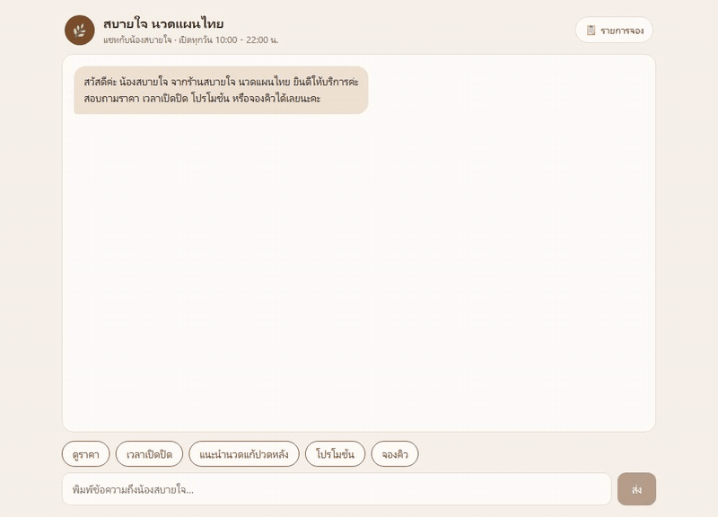


#### 💰 ราคาและบริการ

<a id="case-3"></a>

**เคส 3** · ✅ ผ่าน

| | |
|---|---|
| 💬 ลูกค้าทำอะไร | กดปุ่ม "ดูราคา" |
| ✔️ ต้องมี (ใช้ตรวจ) | ต้องมี บาท และ 350 |
| 🎯 คำตอบที่ควรได้ (baseline) | รายการบริการทั้งหมดพร้อมราคา เช่น นวดไทยแผนโบราณ 60 นาที 350 บาท |
| 🤖 คำตอบจริงของบอท | ยินดีค่ะ ราคาบริการทั้งหมดของร้านสบายใจ นวดแผนไทย มีดังนี้ค่ะ<br>นวดไทยแผนโบราณ 60 นาที ราคา 350 บาท<br>นวดไทยแผนโบราณ 2 ชั่วโมง ราคา 600 บาท<br>นวดน้ำมันอโรมา 60 นาที ราคา 600 บาท<br>นวดเท้าสะท้อนจุด 45 นาที ราคา 300 บาท<br>นวดคอบ่าไหล่ 30 นาที ราคา 250 บาท<br>นวดแก้ปวดหลัง 60 นาที ราคา 450 บาท<br>ประคบสมุนไพร 60 นาที ราคา 500 บาท<br>นวดหน้าและศีรษะ 30 นาที ราคา 300 บาท |


<a id="case-4"></a>

**เคส 4** · ✅ ผ่าน

| | |
|---|---|
| 💬 ลูกค้าทำอะไร | พิมพ์ "นวดน้ำมันอโรมาราคาเท่าไหร่คะ" |
| ✔️ ต้องมี (ใช้ตรวจ) | ต้องมี 600 |
| 🎯 คำตอบที่ควรได้ (baseline) | นวดน้ำมันอโรมา 60 นาที 600 บาทค่ะ |
| 🤖 คำตอบจริงของบอท | นวดน้ำมันอโรมา ราคา 600 บาทค่ะ ใช้เวลา 60 นาที |


<a id="case-5"></a>

**เคส 5** · ✅ ผ่าน

| | |
|---|---|
| 💬 ลูกค้าทำอะไร | พิมพ์ "บริการที่ถูกที่สุดคืออะไรคะ" |
| ✔️ ต้องมี (ใช้ตรวจ) | ต้องมี นวดคอบ่าไหล่ และ 250 |
| 🎯 คำตอบที่ควรได้ (baseline) | นวดคอบ่าไหล่ 30 นาที 250 บาทค่ะ |
| 🤖 คำตอบจริงของบอท | บริการที่ถูกที่สุดของร้านคือนวดคอบ่าไหล่ ราคา 250 บาท ใช้เวลา 30 นาทีค่ะ |


<a id="case-6"></a>

**เคส 6** · ✅ ผ่าน

| | |
|---|---|
| 💬 ลูกค้าทำอะไร | พิมพ์ "ทำงานออฟฟิศ ปวดหลังกับบ่ามาก แนะนำนวดแบบไหนดีคะ" |
| ✔️ ต้องมี (ใช้ตรวจ) | ต้องมี นวดแก้ปวดหลัง หรือ นวดคอบ่าไหล่ |
| 🎯 คำตอบที่ควรได้ (baseline) | แนะนำนวดแก้ปวดหลัง 60 นาที 450 บาท หรือนวดคอบ่าไหล่ 30 นาที 250 บาทค่ะ |
| 🤖 คำตอบจริงของบอท | สำหรับอาการปวดหลังและบ่าจากการทำงานออฟฟิศ แนะนำบริการ "นวดแก้ปวดหลัง" 60 นาที ราคา 450 บาท ค่ะ เพราะจะเน้นกดจุดและยืดเส้นที่หลังส่วนบนและล่างโดยตรง หรือถ้าต้องการเน้นเฉพาะบริเวณบ่าไหล่ สามารถเลือก "นวดคอบ่าไหล่" 30 นาที ราคา 250 บาท ได้เช่นกันค่ะ |


<a id="case-15"></a>

**เคส 15** · ✅ ผ่าน

| | |
|---|---|
| 💬 ลูกค้าทำอะไร | พิมพ์ "มีบริการทำเล็บไหมคะ" |
| ✔️ ต้องมี (ใช้ตรวจ) | ต้องมี ไม่มี และห้ามมีราคาบริการทำเล็บ |
| 🎯 คำตอบที่ควรได้ (baseline) | ขออภัยค่ะ ร้านไม่มีบริการทำเล็บ มีแต่บริการนวด |
| 🤖 คำตอบจริงของบอท | ขออภัยค่ะ ร้านเราไม่มีบริการทำเล็บนะคะ มีเพียงบริการนวดแผนไทยและประคบสมุนไพรเท่านั้นค่ะ สนใจลองนวดตัวหรือเท้าดูไหมคะ |

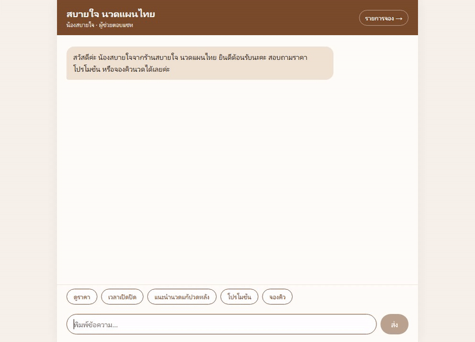


#### 🎁 โปรโมชันและนโยบายร้าน

<a id="case-7"></a>

**เคส 7** · ✅ ผ่าน

| | |
|---|---|
| 💬 ลูกค้าทำอะไร | กดปุ่ม "โปรโมชัน" |
| ✔️ ต้องมี (ใช้ตรวจ) | ต้องมี 10% |
| 🎯 คำตอบที่ควรได้ (baseline) | ลด 10% จันทร์-พฤหัส ก่อน 14:00 น. / แพ็กเกจ 5 ครั้งแถมนวดเท้า / นักศึกษาลด 15% |
| 🤖 คำตอบจริงของบอท | ตอนนี้ร้านมีโปรโมชัน 3 รายการค่ะ<br>1. ลด 10% ทุกบริการ วันจันทร์-พฤหัสบดี ก่อน 14:00 น.<br>2. ซื้อแพ็กเกจ 5 ครั้ง แถมนวดเท้าฟรี 1 ครั้ง<br>3. นักศึกษาลด 15% เมื่อแสดงบัตรนักศึกษา |


<a id="case-8"></a>

**เคส 8** · ✅ ผ่าน

| | |
|---|---|
| 💬 ลูกค้าทำอะไร | พิมพ์ "เป็นนักศึกษา ได้ส่วนลดไหมคะ" |
| ✔️ ต้องมี (ใช้ตรวจ) | ต้องมี 15% |
| 🎯 คำตอบที่ควรได้ (baseline) | นักศึกษาลด 15% เมื่อแสดงบัตรนักศึกษาค่ะ |
| 🤖 คำตอบจริงของบอท | ได้ค่ะ นักศึกษาจะได้รับส่วนลด 15% เมื่อแสดงบัตรนักศึกษาในวันรับบริการนะคะ |

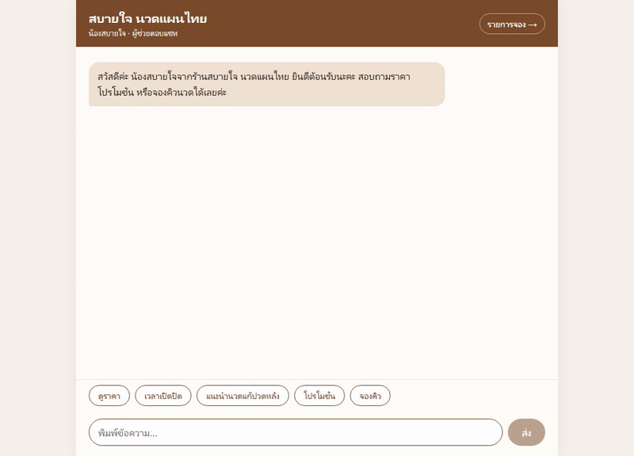


<a id="case-12"></a>

**เคส 12** · ✅ ผ่าน

| | |
|---|---|
| 💬 ลูกค้าทำอะไร | พิมพ์ "จ่ายด้วยบัตรเครดิตได้ไหมคะ" |
| ✔️ ต้องมี (ใช้ตรวจ) | ต้องมี บัตรเครดิต และไม่มีคำว่า ไม่ได้ |
| 🎯 คำตอบที่ควรได้ (baseline) | ได้ค่ะ รับเงินสด พร้อมเพย์ และบัตรเครดิต |
| 🤖 คำตอบจริงของบอท | ได้ค่ะ ร้านรับชำระด้วยบัตรเครดิต พร้อมเพย์ และเงินสดได้เลยนะคะ |

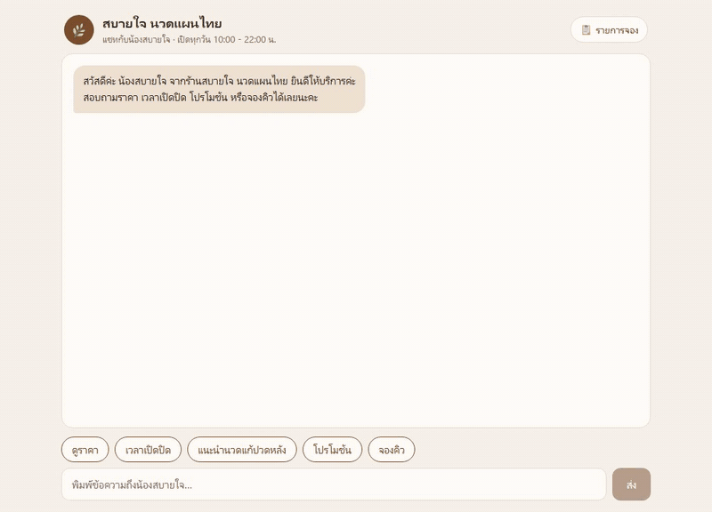


<a id="case-13"></a>

**เคส 13** · ✅ ผ่าน

| | |
|---|---|
| 💬 ลูกค้าทำอะไร | พิมพ์ "ถ้าจะยกเลิกนัดต้องแจ้งล่วงหน้ากี่ชั่วโมงคะ" |
| ✔️ ต้องมี (ใช้ตรวจ) | ต้องมี 3 |
| 🎯 คำตอบที่ควรได้ (baseline) | ยกเลิกหรือเลื่อนนัดล่วงหน้าอย่างน้อย 3 ชั่วโมงค่ะ |
| 🤖 คำตอบจริงของบอท | ต้องแจ้งล่วงหน้าอย่างน้อย 3 ชั่วโมงค่ะ |


<a id="case-14"></a>

**เคส 14** · ✅ ผ่าน

| | |
|---|---|
| 💬 ลูกค้าทำอะไร | พิมพ์ "ตั้งครรภ์ได้ 2 เดือน นวดได้ไหมคะ" |
| ✔️ ต้องมี (ใช้ตรวจ) | ต้องมี ไม่แนะนำ หรือ แพทย์ |
| 🎯 คำตอบที่ควรได้ (baseline) | ไม่แนะนำให้นวดช่วงตั้งครรภ์ไตรมาสแรก ควรปรึกษาแพทย์ค่ะ |
| 🤖 คำตอบจริงของบอท | ขออภัยค่ะ ร้านไม่แนะนำให้นวดสำหรับผู้ตั้งครรภ์ไตรมาสแรก (1-3 เดือน) เพื่อความปลอดภัยนะคะ แนะนำให้ปรึกษาแพทย์ก่อนจะดีที่สุดค่ะ |


#### 📅 จองคิว (หลายขั้น + บันทึกลงฐานข้อมูล)

<a id="case-16"></a>

**เคส 16** · ✅ ผ่าน

| | |
|---|---|
| 💬 ลูกค้าทำอะไร | กดปุ่ม "จองคิว" แล้วให้ข้อมูลทีละอย่าง: ชื่อ มานี ใจดี / เบอร์ 089-555-1234 / นวดไทยแผนโบราณ / วันที่ 2026-10-25 เวลา 15:00 |
| ✔️ ต้องมี (ใช้ตรวจ) | เห็นการ์ดจองสำเร็จ และหน้ารายการจองมีแถวของ มานี |
| 🎯 คำตอบที่ควรได้ (baseline) | สรุปการจอง มานี ใจดี นวดไทยแผนโบราณ 2026-10-25 15:00 จองสำเร็จ |
| 🤖 คำตอบจริงของบอท | <b>คำตอบที่ 1:</b> ได้เลยค่ะ ยินดีให้บริการนะคะ<br>ขอทราบชื่อลูกค้าก่อนได้ไหมคะ<br><b>คำตอบที่ 2:</b> จดชื่อคุณมานี ใจดีไว้แล้วนะคะ<br>ขอทราบเบอร์โทรศัพท์สำหรับติดต่อกลับด้วยค่ะ<br><b>คำตอบที่ 3:</b> จดเบอร์โทรศัพท์ไว้แล้วนะคะ<br>คุณมานีต้องการนวดบริการไหนคะ<br><b>คำตอบที่ 4:</b> เลือกนวดไทยแผนโบราณ 60 นาที ราคา 350 บาทนะคะ<br>ขอทราบวันและเวลาที่ต้องการจองค่ะ<br><b>คำตอบที่ 5:</b> สรุปการจองนวดไทยแผนโบราณ 60 นาที สำหรับคุณมานี ใจดี วันที่ 25/10/2026 เวลา 15:00 น. นะคะ<br>กรุณามาก่อนเวลานัด 10 นาทีค่ะ<br>[การ์ดจองสำเร็จ] ✅ จองสำเร็จ #1 ชื่อ มานี ใจดี เบอร์โทร 089-555-1234 บริการ นวดไทยแผนโบราณ (60 นาที · 350 บาท) วันเวลา 2026-10-25 15:00 น.<br><b>คำตอบที่ 6:</b> [หน้า /bookings] 1 มานี ใจดี 089-555-1234 นวดไทยแผนโบราณ (350 บาท) 2026-10-25 15:00 ยืนยันแล้ว 2026-10-15 16:28 |


#### 🛡️ ขอบเขตของบอท

<a id="case-17"></a>

**เคส 17** · ✅ ผ่าน

| | |
|---|---|
| 💬 ลูกค้าทำอะไร | พิมพ์ "ขอสูตรต้มยำกุ้งหน่อยได้ไหมคะ" |
| ✔️ ต้องมี (ใช้ตรวจ) | ต้องมี ขออภัย หรือ ค่ะ และ นวด หรือ ร้าน และห้ามมีสูตรอาหาร |
| 🎯 คำตอบที่ควรได้ (baseline) | ขออภัยค่ะ น้องสบายใจตอบได้เฉพาะเรื่องบริการนวดของร้าน |
| 🤖 คำตอบจริงของบอท | ขออภัยค่ะ น้องสบายใจตอบได้เฉพาะเรื่องบริการนวดของร้านนะคะ สนใจลองนวดแผนไทยหรือบริการอื่น ๆ ของร้านไหมคะ |

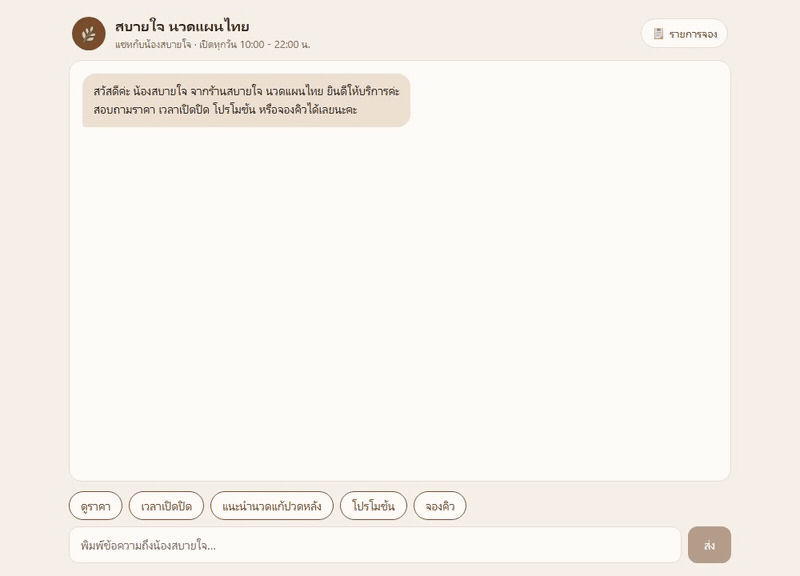


<a id="case-18"></a>

**เคส 18** · ✅ ผ่าน

| | |
|---|---|
| 💬 ลูกค้าทำอะไร | พิมพ์ "How much is a 1 hour Thai massage?" |
| ✔️ ต้องมี (ใช้ตรวจ) | ต้องเป็นภาษาอังกฤษ และมี 350 |
| 🎯 คำตอบที่ควรได้ (baseline) | A 60-minute traditional Thai massage is 350 baht. |
| 🤖 คำตอบจริงของบอท | The 60-minute Traditional Thai massage costs 350 baht. |


#### 🔁 ถามต่อเนื่อง (อ้างอิงสิ่งที่คุยไปแล้ว)

<a id="case-19"></a>

**เคส 19** · ✅ ผ่าน

| | |
|---|---|
| 💬 ลูกค้าทำอะไร | พิมพ์ "นวดไทยกับนวดน้ำมันอโรมาต่างกันยังไงคะ" → "แล้วอันที่ถูกกว่าใช้เวลากี่นาทีคะ" → "ถ้าเอาอันนั้นแบบ 2 ชั่วโมงล่ะคะ" |
| ✔️ ต้องมี (ใช้ตรวจ) | คำตอบสุดท้ายต้องมี 600 |
| 🎯 คำตอบที่ควรได้ (baseline) | นวดไทยแผนโบราณ 2 ชั่วโมง 120 นาที 600 บาทค่ะ |
| 🤖 คำตอบจริงของบอท | <b>คำตอบที่ 1:</b> นวดไทยแผนโบราณจะเน้นการกดจุดและยืดเส้นแบบดั้งเดิมเพื่อคลายกล้ามเนื้อค่ะ ส่วนนวดน้ำมันอโรมาจะใช้กลิ่นหอมจากน้ำมันระเหย เช่น ลาเวนเดอร์หรือตะไคร้ เพื่อช่วยผ่อนคลายและทำให้หลับสบายมากขึ้นนะคะ<br><b>คำตอบที่ 2:</b> นวดไทยแผนโบราณราคา 350 บาท ใช้เวลา 60 นาทีค่ะ<br><b>คำตอบที่ 3:</b> นวดไทยแผนโบราณ 2 ชั่วโมง ราคา 600 บาทค่ะ |

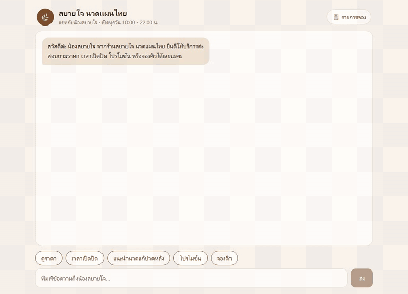


<a id="case-20"></a>

**เคส 20** · ✅ ผ่าน

| | |
|---|---|
| 💬 ลูกค้าทำอะไร | พิมพ์ "นวดแก้ปวดหลังราคาเท่าไหร่คะ" → "หนูเป็นนักศึกษา แล้วจะเหลือเท่าไหร่คะ" |
| ✔️ ต้องมี (ใช้ตรวจ) | คำตอบสุดท้ายต้องมี 382 หรือ 383 |
| 🎯 คำตอบที่ควรได้ (baseline) | ลด 15% จาก 450 บาท เหลือ 382.50 บาทค่ะ (แสดงบัตรนักศึกษา) |
| 🤖 คำตอบจริงของบอท | <b>คำตอบที่ 1:</b> นวดแก้ปวดหลัง ราคา 450 บาทค่ะ ใช้เวลา 60 นาที เน้นกดจุดและยืดเส้นที่หลังส่วนบนและล่างค่ะ<br><b>คำตอบที่ 2:</b> สำหรับนักศึกษาลด 15% จาก 450 บาท จะเหลือ 382.50 บาทค่ะ |


<a id="case-21"></a>

**เคส 21** · ✅ ผ่าน ⚠️

| | |
|---|---|
| 💬 ลูกค้าทำอะไร | พิมพ์ "พรุ่งนี้ 5 ทุ่มยังว่างไหมคะ" → "งั้น 3 ทุ่มล่ะคะ ทันไหม" |
| ✔️ ต้องมี (ใช้ตรวจ) | คำตอบแรกต้องบอกว่าไม่ได้หรือปิดแล้ว และคำตอบสุดท้ายต้องมี 21 |
| 🎯 คำตอบที่ควรได้ (baseline) | 5 ทุ่มร้านปิดแล้วค่ะ / 3 ทุ่ม (21:00) ทันรอบสุดท้ายพอดีค่ะ |
| 🤖 คำตอบจริงของบอท | <b>คำตอบที่ 1:</b> ไม่ได้ค่ะ ร้านปิดแล้ว (เปิดถึง 21:00 น.)<br>พรุ่งนี้รับลูกค้ารอบสุดท้ายเวลา 21:00 น. ค่ะ<br><b>คำตอบที่ 2:</b> ทันค่ะ 3 ทุ่ม (21:00 น.) เป็นรอบสุดท้ายพอดี<br>ต้องการจองคิวไหมคะ |

> ⚠️ **ผ่านเงื่อนไข แต่คำตอบแรกผิดบางส่วน:** บอทบอกว่า "เปิดถึง 21:00 น." ทั้งที่ร้านเปิดถึง 22:00 น. (21:00 คือรอบรับลูกค้าสุดท้าย) — เทสต์อัตโนมัติจับไม่ได้เพราะตรวจแค่ "ไม่ได้/ปิดแล้ว" นี่คือเหตุผลที่ต้องมี **baseline ให้คนเทียบ** · วิธีแก้: เพิ่มกฎในพรอมต์ เช่น "ร้านปิด 22:00 น. ส่วน 21:00 น. คือรอบรับลูกค้าสุดท้าย" แล้วสั่งให้ AI รันเทสต์ซ้ำ


<a id="case-22"></a>

**เคส 22** · ✅ ผ่าน

| | |
|---|---|
| 💬 ลูกค้าทำอะไร | พิมพ์ "ร้านอยู่จังหวัดอะไรคะ" → "แถวนั้นหาที่จอดยากไหม" → "ที่บอกเมื่อกี้ จอดได้กี่คันนะคะ" |
| ✔️ ต้องมี (ใช้ตรวจ) | คำตอบสุดท้ายต้องมี 4 |
| 🎯 คำตอบที่ควรได้ (baseline) | ร้านอยู่เชียงใหม่ มีที่จอดหน้าร้าน 4 คันค่ะ |
| 🤖 คำตอบจริงของบอท | <b>คำตอบที่ 1:</b> ร้านสบายใจ นวดแผนไทย ตั้งอยู่ที่จังหวัดเชียงใหม่ค่ะ<br><b>คำตอบที่ 2:</b> ร้านมีที่จอดรถให้ 4 คันหน้าร้านค่ะ<br><b>คำตอบที่ 3:</b> ที่จอดรถหน้าร้านจอดได้ 4 คันค่ะ |


<a id="case-23"></a>

**เคส 23** · ✅ ผ่าน

| | |
|---|---|
| 💬 ลูกค้าทำอะไร | พิมพ์ "สวัสดีค่ะ ชื่อสมศรีนะคะ ช่วงนี้ปวดคอมากเลย" → "มีอะไรแนะนำไหมคะ" → "จำได้ไหมคะว่าหนูชื่ออะไร" |
| ✔️ ต้องมี (ใช้ตรวจ) | คำตอบที่ 2 ต้องมี นวดคอบ่าไหล่ และคำตอบสุดท้ายต้องมี สมศรี |
| 🎯 คำตอบที่ควรได้ (baseline) | แนะนำนวดคอบ่าไหล่ 30 นาที 250 บาท / จำได้ค่ะ คุณสมศรี |
| 🤖 คำตอบจริงของบอท | <b>คำตอบที่ 1:</b> สวัสดีค่ะ คุณสมศรี ยินดีต้อนรับสู่ร้านสบายใจนะคะ<br>อาการปวดคอน่าจะเหมาะกับบริการ "นวดคอบ่าไหล่" 30 นาที ราคา 250 บาท ค่ะ<br>วันนี้เป็นวันพฤหัสบดี ถ้ามาใช้บริการก่อน 14:00 น. จะได้รับส่วนลด 10% เหลือ 225 บาทด้วยนะคะ<br>ต้องการให้ช่วยจองคิวให้เลยไหมคะ?<br><b>คำตอบที่ 2:</b> เนื่องจากคุณสมศรีบอกว่าปวดคอมาก น้องสบายใจแนะนำบริการ "นวดคอบ่าไหล่" 30 นาที ราคา 250 บาท ค่ะ<br>หากต้องการเน้นแก้เมื่อยล้าจากการนั่งทำงานนานๆ บริการนี้ตอบโจทย์ที่สุดเลยนะคะ<br>วันนี้เป็นวันพฤหัสบดี หากมาใช้บริการก่อน 14:00 น. จะได้รับส่วนลด 10% เหลือ 225 บาทด้วยค่ะ<br><b>คำตอบที่ 3:</b> จำได้ค่ะ คุณสมศรี |


<a id="case-24"></a>

**เคส 24** · ✅ ผ่าน

| | |
|---|---|
| 💬 ลูกค้าทำอะไร | พิมพ์ "อยากได้นวดผ่อนคลายสักอย่างค่ะ" → "ไม่เอาแบบน้ำมันนะ แพ้กลิ่น" → "งบไม่เกิน 300 บาท มีอะไรบ้าง" |
| ✔️ ต้องมี (ใช้ตรวจ) | คำตอบสุดท้ายต้องมี นวดคอบ่าไหล่ หรือ นวดเท้า หรือ นวดหน้า และห้ามมี อโรมา |
| 🎯 คำตอบที่ควรได้ (baseline) | นวดคอบ่าไหล่ 250 / นวดเท้าสะท้อนจุด 300 / นวดหน้าและศีรษะ 300 บาท |
| 🤖 คำตอบจริงของบอท | <b>คำตอบที่ 1:</b> แนะนำนวดน้ำมันอโรมา 60 นาที ราคา 600 บาทค่ะ จะช่วยผ่อนคลายและหลับสบายมากเลยนะคะ สนใจจองคิวไหมคะ<br><b>คำตอบที่ 2:</b> เข้าใจค่ะ งั้นขอแนะนำนวดไทยแผนโบราณ 60 นาที ราคา 350 บาทนะคะ เป็นการกดจุดและยืดเส้นแบบดั้งเดิม ช่วยคลายกล้ามเนื้อได้ดีเลยค่ะ สนใจบริการนี้ไหมคะ<br><b>คำตอบที่ 3:</b> ในงบไม่เกิน 300 บาท มีบริการนวดคอบ่าไหล่ 30 นาที ราคา 250 บาท และนวดหน้าและศีรษะ 30 นาที ราคา 300 บาทค่ะ |


<a id="case-25"></a>

**เคส 25** · ✅ ผ่าน

| | |
|---|---|
| 💬 ลูกค้าทำอะไร | พิมพ์ "How much is the aroma oil massage?" → "แล้วร้านเปิดกี่โมงคะ" |
| ✔️ ต้องมี (ใช้ตรวจ) | คำตอบแรกเป็นภาษาอังกฤษมี 600 และคำตอบสุดท้ายเป็นภาษาไทยมี 10 และ 22 |
| 🎯 คำตอบที่ควรได้ (baseline) | 600 baht for 60 minutes / เปิดทุกวัน 10:00 - 22:00 น. ค่ะ |
| 🤖 คำตอบจริงของบอท | <b>คำตอบที่ 1:</b> The aroma oil massage costs 600 baht for a 60-minute session.<br><b>คำตอบที่ 2:</b> ร้านเปิดทุกวันตั้งแต่ 10:00 - 22:00 น. ค่ะ โดยรับลูกค้ารอบสุดท้ายเวลา 21:00 น. |


<a id="case-26"></a>

**เคส 26** · ✅ ผ่าน

| | |
|---|---|
| 💬 ลูกค้าทำอะไร | กดปุ่ม "จองคิว" แล้วให้ข้อมูลทีละอย่าง: ชื่อ ปิติ รักดี / เบอร์ 081-222-3333 / นวดไทยแผนโบราณ / "เดี๋ยวค่ะ ขอเปลี่ยนเป็นนวดเท้าแทนนะคะ" / วันที่ 2026-10-26 เวลา 11:00 |
| ✔️ ต้องมี (ใช้ตรวจ) | การ์ดจองสำเร็จต้องเป็น นวดเท้าสะท้อนจุด และหน้ารายการจองมีแถวของ ปิติ เป็นนวดเท้า |
| 🎯 คำตอบที่ควรได้ (baseline) | เปลี่ยนเป็นนวดเท้าสะท้อนจุดแล้ว จองสำเร็จ ปิติ รักดี 2026-10-26 11:00 |
| 🤖 คำตอบจริงของบอท | <b>คำตอบที่ 1:</b> ได้เลยค่ะ ยินดีให้บริการ<br>ขอทราบชื่อลูกค้าก่อนนะคะ<br><b>คำตอบที่ 2:</b> ขอบคุณค่ะ คุณปิติ<br>ขอทราบเบอร์โทรศัพท์สำหรับติดต่อกลับด้วยนะคะ<br><b>คำตอบที่ 3:</b> บันทึกเบอร์โทรแล้วค่ะ<br>คุณปิติต้องการจองบริการนวดชนิดไหนคะ<br><b>คำตอบที่ 4:</b> ได้ค่ะ เลือกนวดไทยแผนโบราณ 60 นาที ราคา 350 บาท<br>ขอทราบวันและเวลาที่ต้องการจองนะคะ<br><b>คำตอบที่ 5:</b> ได้ค่ะ เปลี่ยนเป็นนวดเท้าสะท้อนจุด 45 นาที ราคา 300 บาท<br>ขอทราบวันและเวลาที่ต้องการจองนะคะ<br><b>คำตอบที่ 6:</b> สรุปการจองนวดเท้าสะท้อนจุด สำหรับคุณปิติ รักดี เบอร์ 081-222-3333 วันที่ 26/10/2026 เวลา 11:00 น.<br>[การ์ดจองสำเร็จ] ✅ จองสำเร็จ #2 ชื่อ ปิติ รักดี เบอร์โทร 081-222-3333 บริการ นวดเท้าสะท้อนจุด (45 นาที · 300 บาท) วันเวลา 2026-10-26 11:00 น.<br><b>คำตอบที่ 7:</b> [หน้า /bookings] 2 ปิติ รักดี 081-222-3333 นวดเท้าสะท้อนจุด (300 บาท) 2026-10-26 11:00 ยืนยันแล้ว 2026-10-15 16:31 |


*วิดีโอ GIF จริงจาก Playwright (หน้าแชทและโค้ดทั้งหมด AI สร้างจากพรอมต์ข้อ 4.2) · ของคุณจะได้ถ้อยคำต่างจากนี้ แต่ต้องผ่าน "ต้องมี" ครบ*

อยากดูเบราว์เซอร์ทำงานเองอีกรอบ 💬 วางใน Claude Code เดิม:

```text
รันเทสต์ใน 00_setup/04_Skill_Setup/01_VastAi_Skill/my_chatbot/e2e อีกครั้งแบบเห็นหน้าจอเบราว์เซอร์
แล้วสรุปผลเทียบ baseline กับคำตอบจริงเป็นตารางภาษาไทย
```

### 4.4 · ปิดทุกอย่าง (ห้ามข้าม!)

💬 ใน `yolo1` (ลบเครื่อง GPU — หยุดเสียเงิน):

```text
ใช้ skill vastai ลบเครื่อง ex2-ninfer-5090 แล้วสรุปค่าใช้จ่าย
```

💬 ใน Claude Code บน Windows (ปิดหน้าแชทบอท):

```text
ปิดหน้าแชทบอทที่สร้างไว้ใน 00_setup/04_Skill_Setup/01_VastAi_Skill/my_chatbot (เก็บข้อมูลการจองไว้)
```

แล้วเช็คหน้าเว็บ Instances ว่า**ว่าง**

---

## ความปลอดภัย (อ่านให้จบ)

- **ห้าม commit / ห้ามแคปหน้าจอ** API key, `.env`, `.env.vast` — ภาพทุกภาพใน LAB นี้เบลอข้อมูลสำคัญแล้ว
- `.env` และ `.env.vast` ถูก ignore ใน `.gitignore` แล้ว · อย่าเปิดใน JupyterLab (เกิดไฟล์ checkpoint ที่เป็นสำเนา)
- ⚠️ **`Devtool_SSH/devtoolSSH` (private key) ถูกแชร์ใน repo นี้เพื่อความสะดวกในห้องเรียน** → ใครมี repo ก็ ssh เข้าเครื่องที่เช่าด้วย key นี้ได้ระหว่างที่เครื่องยังเปิด → **ลบเครื่องทันทีหลังใช้**
- งานส่วนตัว ให้สร้าง key ของตัวเอง แล้วใส่ `.pub` ใหม่บนเว็บ (ขั้นที่ 2) และแก้ `VAST_SSH_KEY_FILE` ให้ชี้ไปที่ key ใหม่:

  ```bash
  ssh-keygen -t ed25519 -f ~/.ssh/id_vast
  ```

- API key หลุด → เว็บ Keys → แท็บ API Keys → กด 🗑️ ลบ key นั้น แล้วสร้างใหม่

## เช็คลิสต์

| ขั้น | ผลที่ควรได้ | ✓ |
|---|---|---|
| 2 | SSH Keys มีแถว `ssh-ed25519 … devtools-lab` | ☐ |
| 3 | API key `devtools-lab` (Billing Write ว่าง) คัดลอกแล้ว | ☐ |
| ส่วนที่ 2 | `.env` มี 3 บรรทัด VAST_ ไม่มี `"` ไม่มี comment ท้ายบรรทัด | ☐ |
| 4 | skill `OK` 6 บรรทัด · `/workspace` เห็น `.env` · `VAST_API_KEY OK` `VAST_SSH_KEY_FILE OK` | ☐ |
| 5 | `pip install 'vastai~=1.8'` เสร็จ | ☐ |
| 6 | ตารางความพร้อม ✅ | ☐ |
| 7–8 | `lab-4090` running บนเว็บ | ☐ |
| 9 | `nvidia-smi` เห็น RTX 4090 24564MiB | ☐ |
| 10 | ลบ `lab-4090` แล้ว + สรุปค่าใช้จ่าย · หน้า Instances ว่าง | ☐ |
| 4.1 | `backend/.env.vast` มี 3 บรรทัด LLM_ | ☐ |
| 4.2 | AI สร้าง `my_chatbot/` · http://localhost:3300 ตอบภาษาไทย · `/bookings` มีแถว | ☐ |
| 4.3 | AI รายงานเทสต์ผ่าน 26 เคส + มี GIF 26 ไฟล์ | ☐ |
| 4.4 | ลบ `ex2-ninfer-5090` แล้ว · ปิดหน้าแชทบอทแล้ว | ☐ |

## แก้ปัญหา

| อาการ | สาเหตุ / วิธีแก้ |
|---|---|
| `VAST_API_KEY MISSING` (ขั้นที่ 4) | ยังไม่ได้ใส่ค่าใน `.env` หรือสร้าง container ก่อนแก้ `.env` → แก้แล้ว**ทำขั้นที่ 4 ใหม่** |
| `Invalid user key` | ใน `.env` มี `"` ครอบ key หรือมี `# comment` ท้ายบรรทัด → แก้แล้ว**ทำขั้นที่ 4 ใหม่** (ค่าจาก `--env-file` ถูกอ่านตอนสร้าง container เท่านั้น) |
| `pip install` ค้างนาน | ปกติ ~5–12 นาที (PyPI ช้า) รอได้ ทำครั้งเดียวต่อ container ใหม่ |
| เครื่องค้าง `loading` นาน / status `Failed to connect to cloud.vast.ai` | host ของเครื่องนั้นเน็ตมีปัญหา → ให้ AI ลบแล้วเช่าเครื่องใหม่ (เจอจริงตอนทดสอบ) |
| `ไม่มี offer <= $…/hr` | เพดานราคาต่ำไป → ตอบ skill ให้ยอมเพดานสูงขึ้น หรือเปลี่ยน GPU (เช่น RTX 3090) |
| ssh `Connection refused` หลังเช่า | เครื่องยังบูตไม่เสร็จ รอ 1–2 นาที หรือใช้คำสั่ง proxy |
| skill หา SSH key ไม่เจอ | เปิด Terminal ไม่ใช่ที่ `/workspace` → `cd /workspace` แล้วเปิด `yolo1` ใหม่ |
| แชทบอทขึ้น error | เครื่อง 5090 ถูกลบ/หยุดไปแล้ว หรือ `.env.vast` เปลี่ยน → 💬 บอก Claude Code ว่า "หน้าแชทต่อ AI ไม่ได้ ช่วยตรวจ my_chatbot กับ backend/.env.vast แล้วแก้ให้" |
| ลืมลบเครื่อง | เปิด https://cloud.vast.ai/instances/ → กด 🗑️ (destroy) ทุกเครื่องที่ไม่ใช้ · **stop ยังเสียค่า disk** |

## ข้อควรรู้

- skill จะ**ไม่ขึ้นเพดานราคาเอง** และ**ไม่ลบเครื่องเองโดยไม่ถาม** — ถ้าถาม ให้อ่านก่อนตอบ
- `pip install` ลงใน container (ไม่ใช่ volume) → ลบ container แล้วสร้างใหม่ต้องติดตั้งใหม่ แต่ล็อกอินและ skill ยังอยู่ใน volume `ai-accounts`
- แก้ `.env` แล้วต้องสร้าง container ใหม่ (ขั้นที่ 4) ค่าใหม่ถึงจะเข้า
- ราคา GPU บน Vast.ai เปลี่ยนตลอดเวลา ตัวเลขใน LAB นี้คือผลจริงวันที่ 14 ต.ค. 2026
- `stop` = หยุด GPU แต่ยังเก็บ disk (เสียเงินต่อ) · `destroy` = ลบทิ้งหมด หยุดจ่าย กู้ไม่ได้
