# LAB 04.1 · เช่า GPU บน Vast.ai ด้วย skill `vastai` (ก๊อปวางทีละขั้น)

LAB นี้ให้ AI (`yolo1`) **เช่า GPU จริงบน Vast.ai ให้เรา** ด้วย skill `vastai` แค่พิมพ์ภาษาไทย
แบบฝึกหัด 1 เช่า RTX 4090 → ssh เข้าไปดู GPU → ลบเครื่อง · แบบฝึกหัด 2 ทำแชทบอทร้านนวดแผนไทยที่ใช้ AI บน RTX 5090

**ต้องมีก่อน:**
- [LAB 03](../../03_MultiAccount_Container/README.md) — container `multi-account-devtool` ใช้งานได้ และล็อกอิน `yolo1` แล้ว
- [LAB 04](../00_Setup_Skill/readme.md) — ติดตั้ง skill `vastai` `yolo` `cyolo` ใน `shared` แล้ว
- บัญชี [Vast.ai](https://cloud.vast.ai/) ที่เติมเครดิตแล้ว (แนะนำ $5–10 พอสำหรับทั้ง LAB)
- Docker Desktop (Engine running) และ Git Bash บน Windows

**เวลา:** แบบฝึกหัด 1 ~45 นาที · แบบฝึกหัด 2 ~60 นาที
**ค่าใช้จ่ายจริง (ทดสอบ 14 ต.ค. 2026):** แบบฝึกหัด 1 ≈ $0.22 · แบบฝึกหัด 2 ≈ $0.91/ชม. × เวลาที่เปิดเครื่อง

> ⚠️ **เสียเงินจริง** — ทุกครั้งที่ทดลองเสร็จ ต้องสั่ง **ลบเครื่อง (destroy)** แล้วเช็คหน้าเว็บ Instances ว่าว่าง

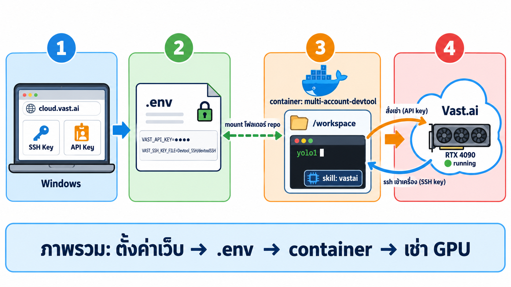
*ภาพแนวคิด (Imagegen ด้วย cyolo): ตั้งค่าเว็บ → `.env` → container → เช่า GPU ตรงกับส่วนที่ 1–3 และแบบฝึกหัดด้านล่าง*

สัญลักษณ์: 🖥️ = พิมพ์ใน shell (กรอบ `bash`) · 💬 = วางในช่องแชทของ AI (กรอบ `text` ให้คัดลอกทั้งกรอบ)

---

## ส่วนที่ 1 · ตั้งค่าบนเว็บ Vast.ai (~10 นาที)


*ภาพแนวคิด (Imagegen ด้วย cyolo): Vast.ai ใช้กุญแจ 2 ดอก — **API Key** ให้ AI สั่งเช่า/ลบเครื่อง, **SSH Key** ให้เราเข้าเครื่อง*

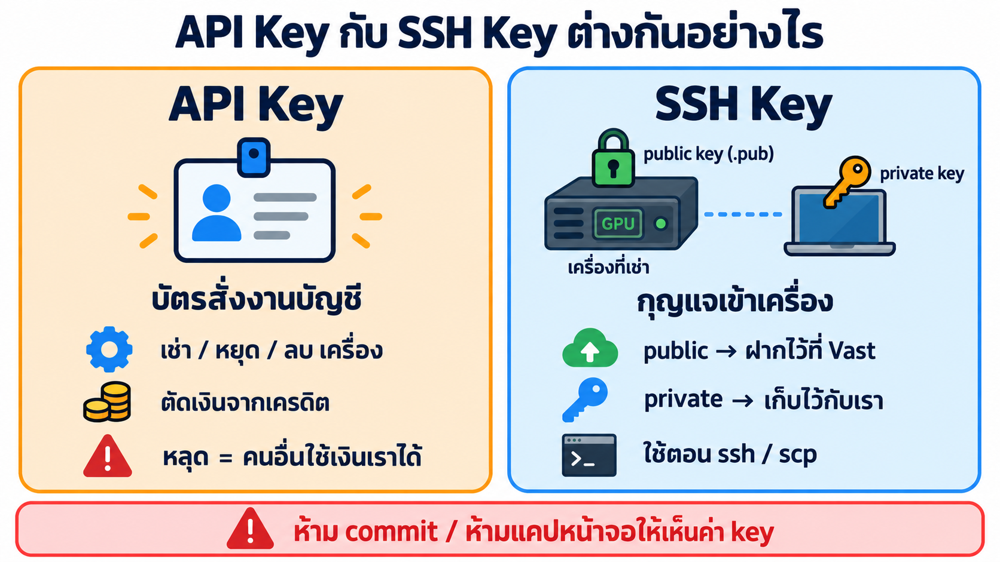
*ภาพแนวคิด (Imagegen ด้วย cyolo): API Key หลุด = คนอื่นใช้เงินเราได้ · SSH Key ส่วน public ฝากไว้ที่ Vast ส่วน private อยู่กับเรา*

### ขั้นที่ 1 · สมัครและเติมเครดิต

สมัครที่ https://cloud.vast.ai/ → เมนู **Billing** → เติมเครดิต (บัตร/ช่องทางที่เว็บรองรับ) — ทำเองนะ ห้ามให้ AI กรอกข้อมูลบัตร

### ขั้นที่ 2 · ใส่ SSH Key (public key)

1. 🖥️ เปิด Git Bash ที่โฟลเดอร์ repo (`Teaching` หรือ `Teaching_CWN2026`) แล้วแสดง **public key** (`.pub` แชร์ได้ ไม่ใช่ความลับ):

   ```bash
   cat Devtool_SSH/devtoolSSH.pub
   ```

   คัดลอกทั้งบรรทัดที่ขึ้นต้นด้วย `ssh-ed25519 AAAA…` (ไฟล์เดียวกันมีสำเนาใน `01_VastAi_Skill/Devtool_SSH/` ด้วย)
2. เปิด https://cloud.vast.ai/manage-keys/ → แท็บ **SSH Keys** → กด **+ New**

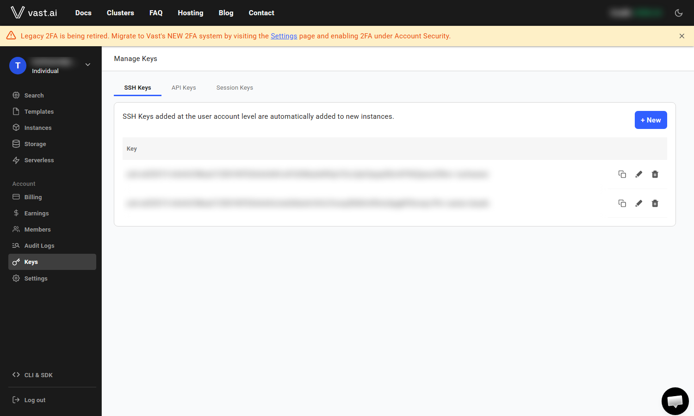
*ภาพจริง: แท็บ SSH Keys — key ที่ใส่ที่นี่จะถูกใส่ให้เครื่องที่เช่าใหม่ทุกเครื่องอัตโนมัติ*

3. วางเนื้อหา `.pub` ลงในช่อง → กด **Save**

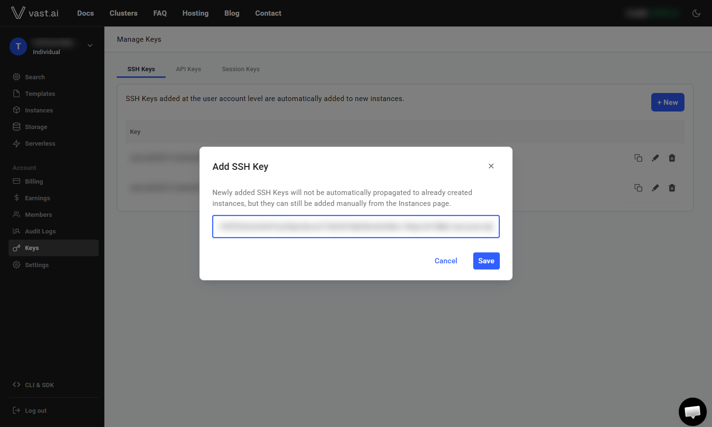
*ภาพจริง: ช่องวาง public key (เบลอไว้) — key ใหม่ไม่ถูกใส่ให้เครื่องที่เช่าไว้ก่อนแล้ว*

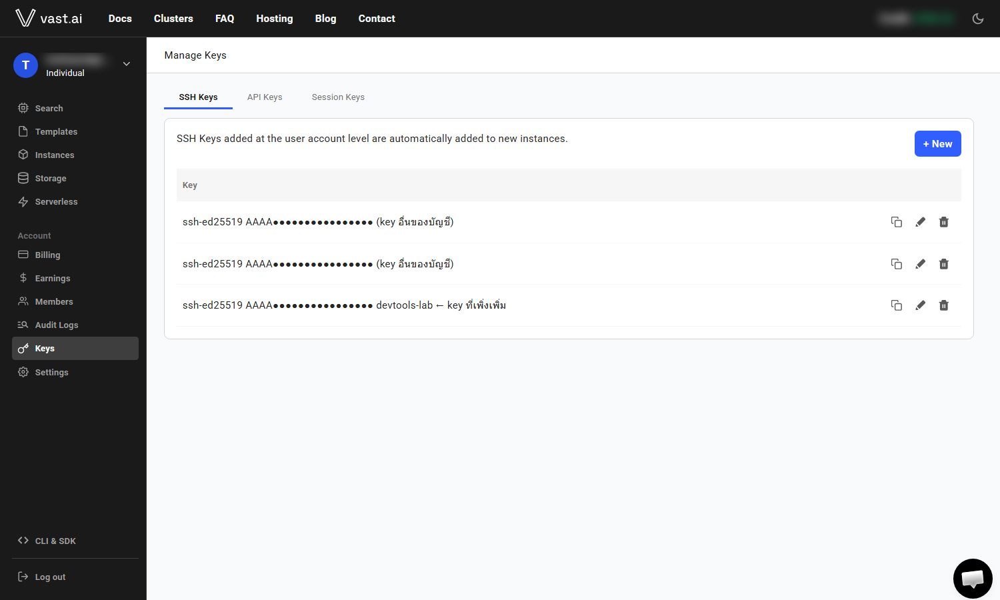
*ภาพจริง: แถวล่างสุด `ssh-ed25519 … devtools-lab` คือ key ที่เพิ่งเพิ่ม*

### ขั้นที่ 3 · สร้าง API Key

1. แท็บ **API Keys** → กด **+ New**

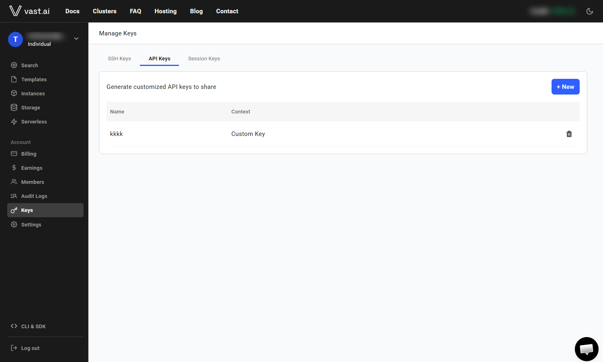
*ภาพจริง: แท็บ API Keys*

2. ช่อง **Name** ใส่ `devtools-lab` → ในตาราง Permission **เอาเครื่องหมายออกที่ Billing/Earning → Write** (ช่องอื่นติ๊กไว้ตามเดิม) → กด **Save**

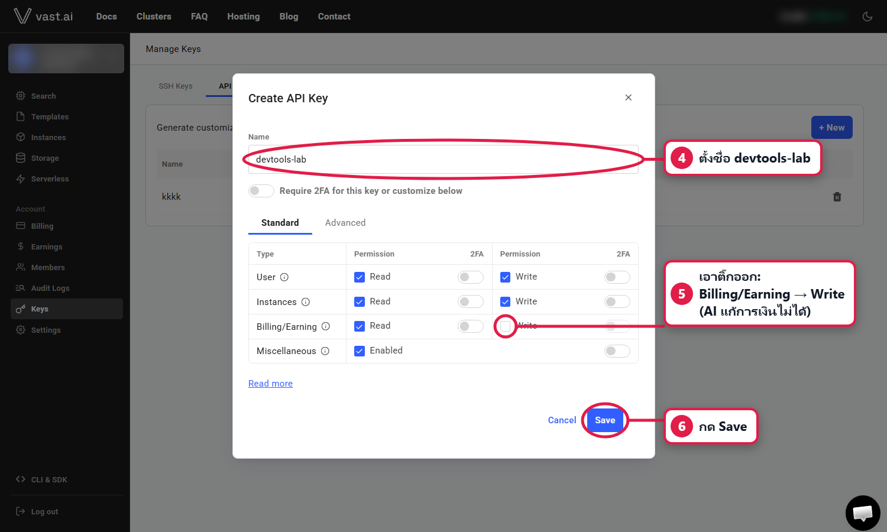
*ภาพจริง: **Billing/Earning Write ว่างไว้โดยตั้งใจ** — AI เช่า/ลบเครื่องและดูบิลได้ แต่แก้การเงินในบัญชีไม่ได้*

3. ขึ้นหน้าต่าง **API key created successfully** → กดปุ่มคัดลอก 📋 ทันที (**เห็นได้ครั้งเดียว** ปิดแล้วดูอีกไม่ได้ ต้องสร้างใหม่)

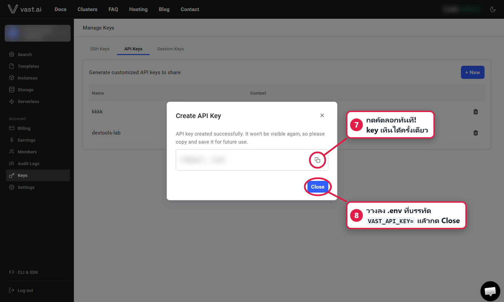
*ภาพจริง: key ถูกเบลอไว้ — อย่าแคปหน้าจอนี้ให้คนอื่นเห็น*

---

## ส่วนที่ 2 · ใส่ค่าในไฟล์ `.env` (~3 นาที)

🖥️ Git Bash ที่โฟลเดอร์ repo:

```bash
cp .env_example .env
notepad .env
```

แก้ 3 บรรทัดของ vastai ให้เป็นแบบนี้ (แทน `<key>` ด้วย API key ที่คัดลอกมา) แล้วกด Save:

```text
VAST_API_KEY=<key>
VAST_SSH_KEY_FILE=Devtool_SSH/devtoolSSH
VAST_HTTP_TIMEOUT=20
```

> ⚠️ **3 กับดักที่เจอจริง**
> 1. **ห้ามใส่เครื่องหมายคำพูด** `"..."` ครอบ key — `docker --env-file` เก็บ `"` ไว้เป็นส่วนหนึ่งของค่า → skill ฟ้อง `Invalid user key`
> 2. **ห้ามเขียน `# comment` ต่อท้ายบรรทัดค่า** — เหตุผลเดียวกัน comment จะกลายเป็นส่วนหนึ่งของค่า (เขียน comment ไว้บรรทัดของมันเองได้)
> 3. **ห้ามเปิด `.env` ใน JupyterLab** — JupyterLab จะสร้าง `.ipynb_checkpoints/.env-checkpoint` ซึ่งเป็น**สำเนาความลับ**ของเรา แก้ด้วย Notepad บน Windows เท่านั้น

`VAST_SSH_KEY_FILE` เป็น path สัมพัทธ์ = อิงโฟลเดอร์ที่มี `.env` (ใน container คือ `/workspace/Devtool_SSH/devtoolSSH`) · `.env` ถูก ignore ใน `.gitignore` แล้ว ไม่ถูก commit

---

## ส่วนที่ 3 · เปิด container ให้เห็นโฟลเดอร์ repo ที่ `/workspace` (~5 นาที)

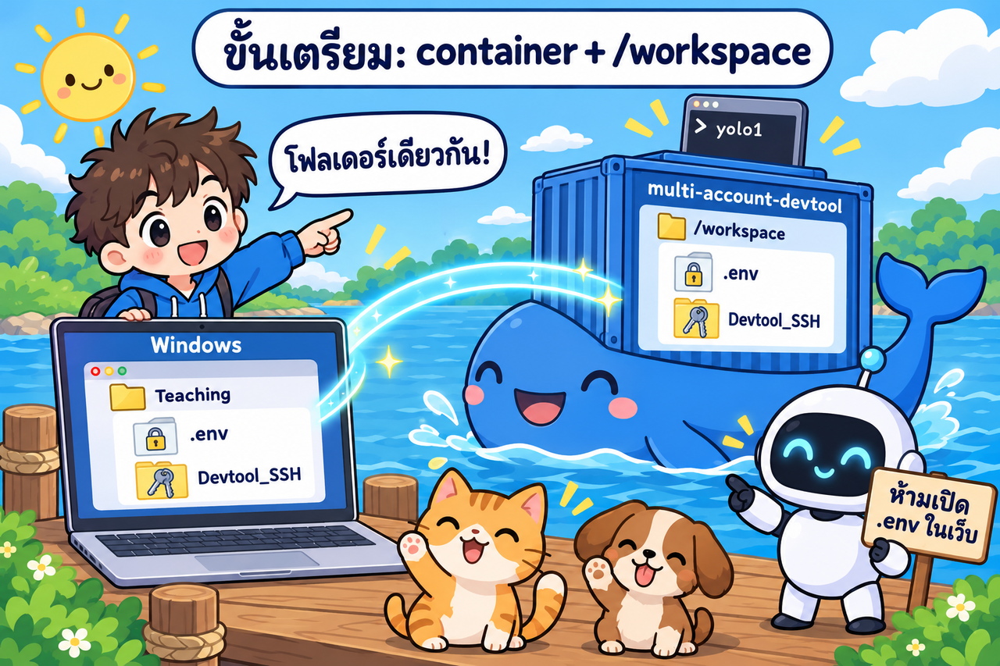
*ภาพแนวคิด (Imagegen ด้วย cyolo): โฟลเดอร์ repo บน Windows กับ `/workspace` ใน container คือ**โฟลเดอร์เดียวกัน** — แก้ฝั่งไหนก็เห็นทั้งสองฝั่ง*

### ขั้นที่ 4 · สร้าง container ใหม่ (ไม่หายล็อกอิน)

💬 เปิด **Claude Code บน Windows ที่โฟลเดอร์ repo** (`Teaching`) → วางพรอมต์นี้ → อนุญาตคำสั่ง `docker` เมื่อถูกถาม

```text
เตรียม container `multi-account-devtool` ให้เห็นโฟลเดอร์ปัจจุบันที่ /workspace:

1. ถ้ามี container `multi-account-devtool` อยู่แล้ว ให้ลบด้วย `docker rm -f multi-account-devtool`
   (ห้ามลบ volume `ai-accounts` เด็ดขาด เพราะเก็บการล็อกอินและ skill ของทุกบัญชี)
2. ตรวจ port <SSH_PORT>=2223 และ <JUPYTER_PORT>=8886 ถ้าชน ให้ใช้ port ว่างถัดไป
3. ต้องมีไฟล์ `.env` ในโฟลเดอร์ปัจจุบัน ถ้าไม่มีให้หยุดและบอกฉัน (ห้ามแสดงค่าในไฟล์ แสดงได้เฉพาะชื่อตัวแปร)
4. รัน (แทน <ENV_FILE> ด้วย path เต็มของ .env และ <REPO> ด้วย path เต็มของโฟลเดอร์ปัจจุบัน):

docker run -dit --name multi-account-devtool --hostname multi-account-devtool --privileged \
  -p <SSH_PORT>:22 -p <JUPYTER_PORT>:8888 \
  --env-file "<ENV_FILE>" \
  -v ai-accounts:/root/ai-accounts \
  -v "<REPO>":/workspace \
  tuchsanai/multi-account-devtool:2569_1

5. รอจน `docker logs multi-account-devtool` มีบรรทัดที่มีข้อความ `jupyter lab :8888`
6. ตรวจ skill:
docker exec multi-account-devtool bash -lc 'B=$HOME/ai-accounts; for t in .Claude .Codex; do for s in vastai yolo cyolo; do [ -d $B/$t/shared/skills/$s ] && echo "$t/$s OK" || echo "$t/$s MISSING"; done; done'
   ถ้ามี MISSING ให้เตือนฉันว่า "⚠️ ยังไม่ได้ติดตั้ง skill: <รายชื่อ>" ห้ามติดตั้ง skill เอง
7. ตรวจว่า `docker exec multi-account-devtool ls /workspace` เห็นไฟล์ .env และโฟลเดอร์ Devtool_SSH
8. ห้ามล็อกอินแทนฉัน ห้ามพิมพ์ค่าใน .env สรุปเป็นภาษาไทย: คำเตือน (ถ้ามี) ไว้บนสุด, port ที่ใช้,
   URL http://localhost:<JUPYTER_PORT>/lab/tree/workspace, ผลตรวจ skill 6 บรรทัด, ผลตรวจ /workspace
```

<details>
<summary>คำสั่ง <code>docker run</code> แบบพิมพ์เอง (อ้างอิง — ใช้แทนพรอมต์ได้)</summary>

🖥️ Git Bash ที่โฟลเดอร์ repo (`$(pwd -W)` = path เต็มของโฟลเดอร์ปัจจุบันแบบ Windows):

```bash
docker rm -f multi-account-devtool
docker run -dit --name multi-account-devtool --hostname multi-account-devtool --privileged \
  -p 2223:22 -p 8886:8888 \
  --env-file "$(pwd -W)/.env" \
  -v ai-accounts:/root/ai-accounts \
  -v "$(pwd -W)":/workspace \
  tuchsanai/multi-account-devtool:2569_1
```

</details>

**ผลที่ควรได้:** skill `OK` ครบ 6 บรรทัด และ `/workspace` เห็น `.env` กับ `Devtool_SSH`

### ขั้นที่ 5 · เปิด Terminal ใน JupyterLab แล้วติดตั้ง vastai SDK

1. เปิด **http://localhost:8886/lab/tree/workspace** (ใช้ port อื่น? เปลี่ยน `8886`)
2. แถบไฟล์ซ้ายต้องเขียน `/ workspace /` → ในแท็บ **Launcher** กด **Terminal**

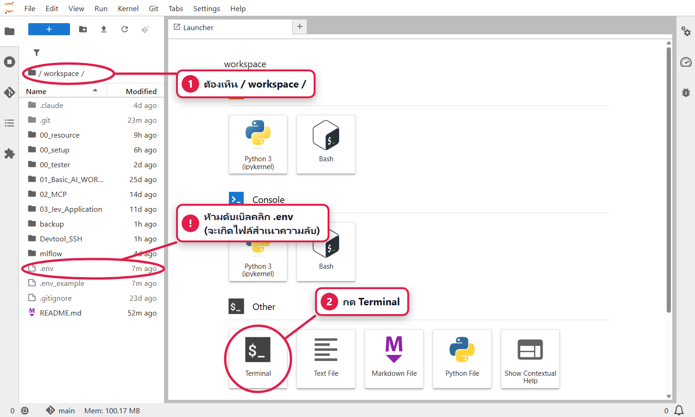
*ภาพจริง: `/workspace` = โฟลเดอร์ repo บน Windows · กด **Terminal** ในหมวด Other (อย่าดับเบิลคลิก `.env`)*

3. 🖥️ ใน Terminal (ทำครั้งเดียวต่อ container ใหม่ — **ใช้เวลา ~5–12 นาที** เพราะดาวน์โหลดจาก PyPI ช้า รอจนขึ้น prompt ใหม่):

   ```bash
   pip install 'vastai~=1.8'
   ```

---

## แบบฝึกหัด 1 · เช่า RTX 4090 → ssh → ลบเครื่อง (~30 นาที · ≈ $0.22)


*ภาพแนวคิด (Imagegen ด้วย cyolo): สั่งเช่าด้วยภาษาไทย → ssh เข้าไปใช้ → เสร็จแล้วลบเครื่อง*

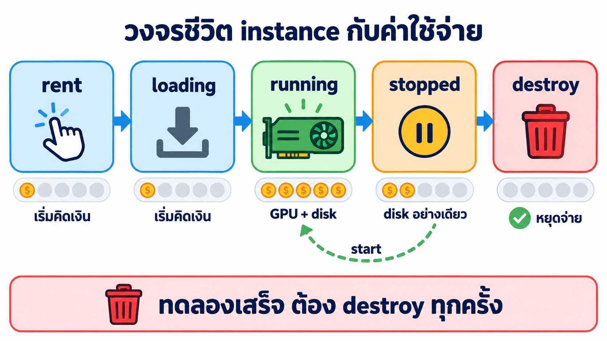
*ภาพแนวคิด (Imagegen ด้วย cyolo): **stop ≠ destroy** — stopped ยังเสียค่า disk · destroy เท่านั้นที่หยุดจ่ายทั้งหมด*

### ขั้นที่ 6 · ตรวจความพร้อม

🖥️ ใน Terminal ที่ `/workspace` พิมพ์ `yolo1` แล้ว 💬 วาง:

```text
ใช้ skill vastai ตรวจความพร้อมก่อนเช่า (env, keys, เครดิต) ตอบเป็นตารางสั้น ๆ
```

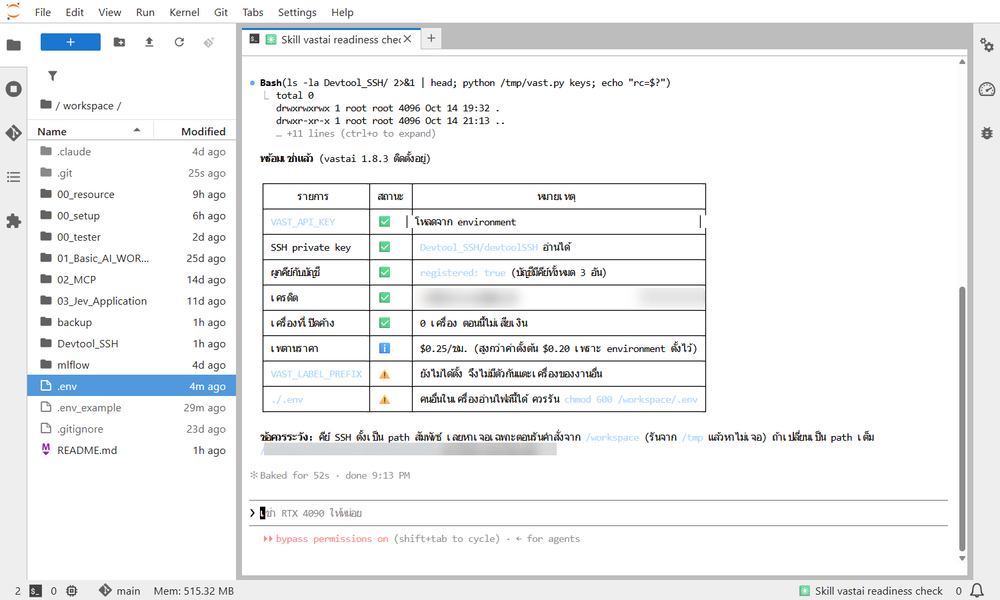
*ภาพจริง: ✅ ครบทุกข้อสำคัญ — API key, SSH key อ่านได้, key ผูกกับบัญชีแล้ว, เครดิตพอ, ไม่มีเครื่องค้าง · ⚠️ `VAST_LABEL_PREFIX` และ `chmod 600` เป็นคำแนะนำเสริม ข้ามได้*

### ขั้นที่ 7 · สั่งเช่า RTX 4090

💬 วาง:

```text
ใช้ skill vastai เช่า RTX 4090 1 เครื่อง ตั้งชื่อ lab-4090 แล้วบอกคำสั่ง ssh เข้าเครื่อง
```

skill จะ**ถามขอขึ้นเพดานราคา** เพราะเพดานเริ่มต้น (`VAST_MAX_DPH` $0.20–0.25/ชม.) ถูกกว่าราคา 4090 ในตลาด (~$0.37–0.70/ชม.) → เลือกข้อ **(Recommended)** แล้วกด Enter

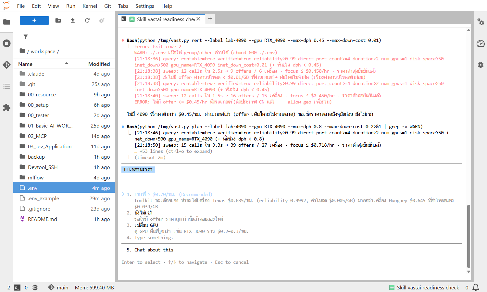
*ภาพจริง: skill ไม่ขึ้นราคาเอง ต้องถามเราก่อนเสมอ — เลือก 1 (Recommended)*

ระหว่างรอ (รวม ~15 นาที) อาจเห็น: offer แรกหายไป (`no_such_ask`) แล้ว skill ลองตัวใหม่เอง · เครื่องที่ไม่พร้อมถูกลบแล้วเช่าใหม่ให้อัตโนมัติ — **ปกติ ไม่ต้องทำอะไร**

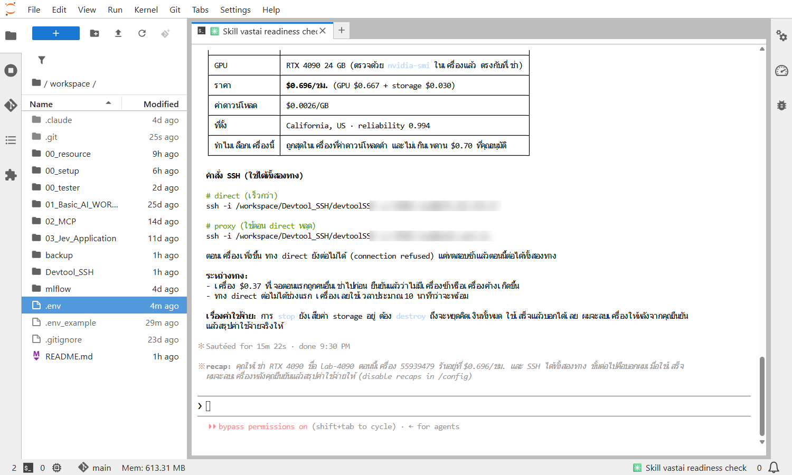
*ภาพจริง: ได้ราคา/ที่ตั้ง และ**คำสั่ง ssh 2 แบบ** (direct เร็วกว่า · proxy ใช้ตอน direct หลุด) — IP/port เบลอไว้*

### ขั้นที่ 8 · ดูเครื่องบนหน้าเว็บ

เปิด https://cloud.vast.ai/instances/ → เห็นแท็บ `lab-4090`, ป้าย **lab-4090**, ราคา `$/hr` และสถานะ running

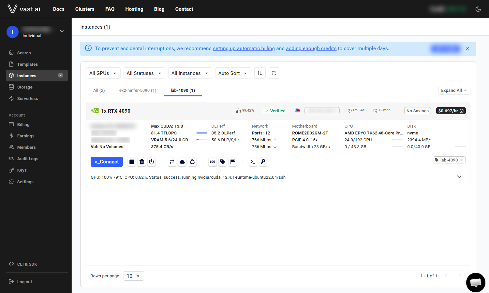
*ภาพจริง: เครื่องที่ AI เช่าให้ ขึ้นบนเว็บจริง (`$0.697/hr`, `Status: success, running`)*

กดปุ่ม **>_Connect** → เห็นคำสั่ง ssh แบบเดียวกับที่ `yolo1` บอก

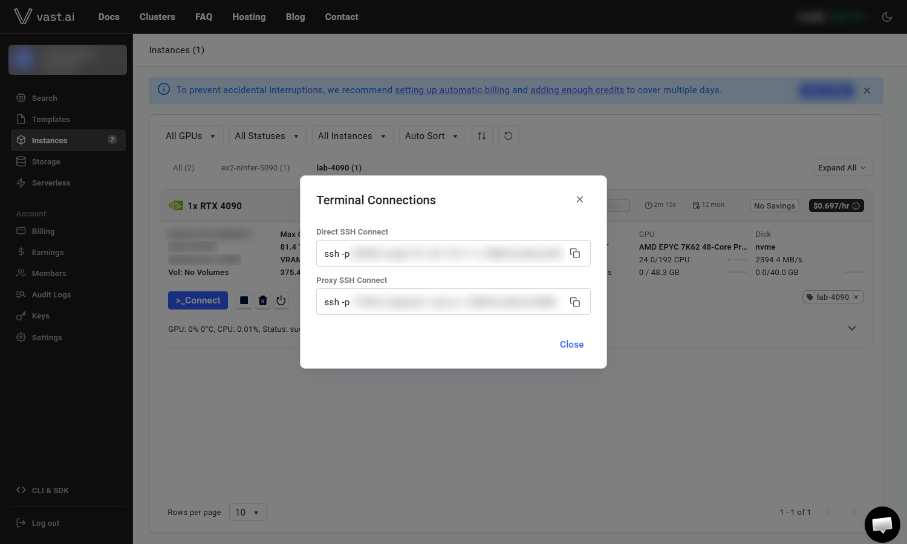
*ภาพจริง: คำสั่ง ssh จากเว็บ (เบลอไว้) — ใช้ของ `yolo1` สะดวกกว่าเพราะใส่ `-i` key ให้แล้ว*

### ขั้นที่ 9 · ssh เข้าไปดู GPU

1. ใน JupyterLab กด **+** → **Terminal** (เปิด Terminal ที่ 2 · ปล่อย `yolo1` ไว้ใน Terminal แรก)
2. 🖥️ คัดลอกคำสั่ง **direct** ที่ `yolo1` พิมพ์ (`ssh -i /workspace/Devtool_SSH/devtoolSSH …`) แล้ว**เติม ` nvidia-smi` ต่อท้าย** → Enter
3. ถ้าถาม `Are you sure you want to continue connecting?` ให้พิมพ์ `yes` (ถามครั้งแรกครั้งเดียว)

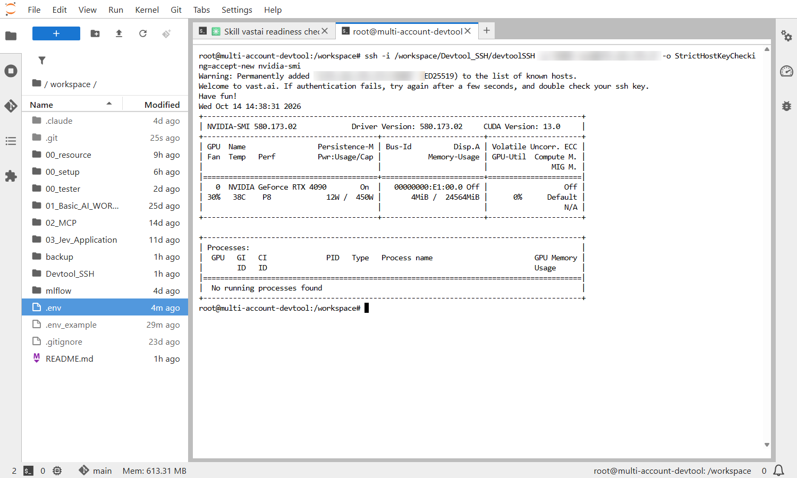
*ภาพจริง: `NVIDIA GeForce RTX 4090 … 24564MiB` = เราใช้ GPU บนเครื่องที่เช่ามาได้จริง*

> `Connection refused` ตอนเพิ่งเช่าเสร็จ = เครื่องยังบูตไม่เสร็จ รอ 1–2 นาทีแล้วลองใหม่ หรือใช้คำสั่ง proxy

### ขั้นที่ 10 · ลบเครื่องและสรุปค่าใช้จ่าย (ห้ามข้าม!)

💬 กลับไป Terminal แรก (`yolo1`) วาง:

```text
ใช้ skill vastai ลบเครื่อง lab-4090 แล้วสรุปค่าใช้จ่าย
```

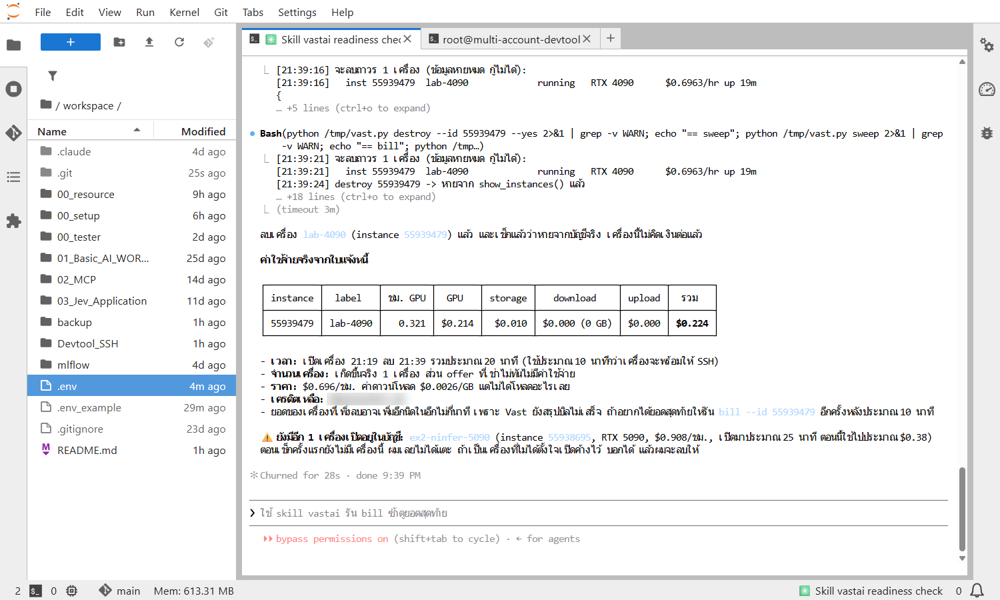
*ภาพจริง: ลบแล้วและยืนยันว่า "หายจาก show_instances() แล้ว" · **ค่าใช้จ่ายจริง $0.224 สำหรับ ~20 นาที** (GPU $0.214 + storage $0.010) · ยอดอาจอัปเดตช้า ~10 นาที*

เปิดหน้าเว็บ Instances อีกครั้ง → ต้อง**ไม่มี** `lab-4090` แล้ว

---

## แบบฝึกหัด 2 · แชทบอทร้าน "สบายใจ นวดแผนไทย" (~60 นาที)


*ภาพแนวคิด (Imagegen ด้วย cyolo): หน้าเว็บ + ฐานข้อมูลอยู่บนเครื่องเรา · สมอง AI อยู่บน GPU ที่เช่า*

| ส่วน | อยู่ที่ไหน | ทำอะไร |
|---|---|---|
| **frontend** | Docker บน Windows · http://localhost:3300 | หน้าแชท Next.js + PostgreSQL เก็บการจองคิว |
| **backend** | Vast.ai RTX 5090 · พอร์ต 8080 | [NInfer](https://github.com/Neroued/ninfer) รันโมเดล Qwen3.8-27B NVFP4 (22 GB, HF `neroued/Qwen3.8-27B-nvfp4-NInfer`) เป็น API แบบ OpenAI พร้อม API key |

> ทำไม RTX 5090: NInfer รองรับเฉพาะ RTX 5090 (CUDA 13.1) · ต้องการเน็ต > 2000 Mbps เพื่อโหลดโมเดล 22 GB ให้เร็ว
> อยากลองโดยไม่เสียเงิน: ข้ามไป 4.2 แล้วใช้ **โหมด mock** (ไม่ต้องใช้ GPU)

### 4.1 · backend — ให้ yolo1 เช่า RTX 5090 และเปิด AI server

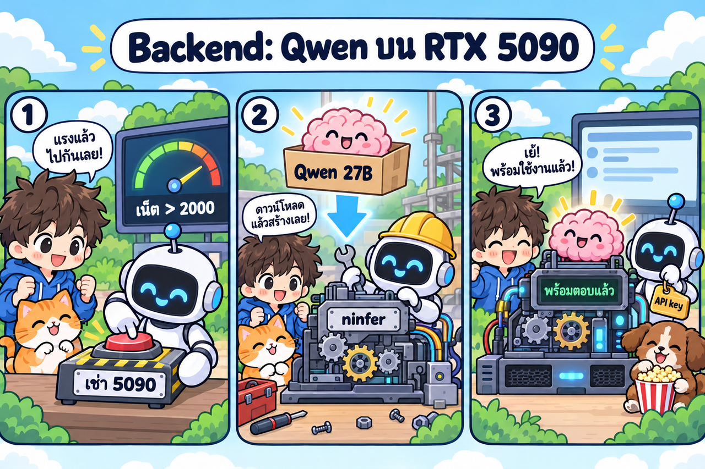
*ภาพแนวคิด (Imagegen ด้วย cyolo): พรอมต์เดียว — เช่า 5090 → build NInfer + โหลดโมเดล → เปิด API พอร์ต 8080 → เขียนค่าเชื่อมต่อลง `.env.vast`*

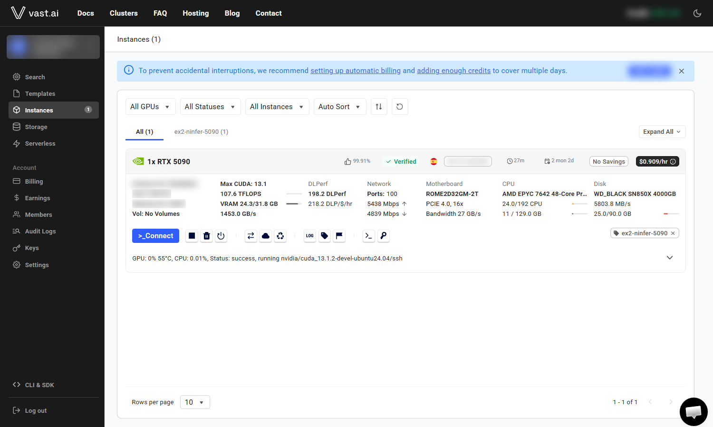
*ภาพจริง: เครื่อง backend ที่ได้ — RTX 5090, CUDA 13.1, เน็ต ~5000 Mbps, disk 90 GB, `$0.909/hr`*

🖥️ Terminal ที่ `/workspace` → `yolo1` → 💬 วาง:

```text
ใช้ skill vastai เช่า RTX 5090 1 เครื่อง ชื่อ ex2-ninfer-5090 ยอมเพดานราคาได้ถึง $1.20/ชม.
เน็ตดาวน์โหลดมากกว่า 2000 Mbps ใช้ image nvidia/cuda:13.1.2-devel-ubuntu24.04 disk 90 GB เปิดพอร์ต 8080 (-p 8080:8080)
จากนั้น push ไฟล์ setup_ninfer.sh และ start_server.sh ในโฟลเดอร์ 00_setup/04_Skill_Setup/01_VastAi_Skill/_solution/ex2_chatbot/backend
ไปที่ /workspace ของเครื่อง แล้วรัน bash setup_ninfer.sh และ bash start_server.sh ตาม README ในโฟลเดอร์นั้น (ไม่ต้องตั้ง NINFER_API_KEY ให้สคริปต์สุ่มเอง)
หา public IP และ port ที่ map กับ 8080/tcp แล้วทดสอบ /health กับถามภาษาไทย 1 ข้อ
สุดท้ายเขียน 3 บรรทัด LLM_BASE_URL=http://<ip>:<port> LLM_MODEL=qwen3.8-27b LLM_API_KEY=<key> (ไม่มีเครื่องหมายคำพูด)
ลงไฟล์ 00_setup/04_Skill_Setup/01_VastAi_Skill/_solution/ex2_chatbot/backend/.env.vast ห้ามพิมพ์ API key บนจอ
```

**ผลจริงที่ได้ (14 ต.ค. 2026):** build NInfer 448 วินาที พร้อมกับโหลดโมเดล 128 วินาที (setup รวม ~8 นาที) · server พร้อมใน 14 วินาที · $0.91/ชม. · ตอบภาษาไทยใน 1.2 วินาที (~113 token/วินาที)

ไฟล์ `backend/.env.vast` อยู่ใน repo บน Windows ด้วย (โฟลเดอร์เดียวกัน) และถูก ignore ไม่ถูก commit — ห้ามเปิดใน JupyterLab

### 4.2 · frontend — เปิดหน้าแชทบนเครื่องเรา

🖥️ Git Bash **บน Windows** ที่โฟลเดอร์ `00_setup/04_Skill_Setup/01_VastAi_Skill/_solution/ex2_chatbot/frontend` (Docker Desktop ต้องเปิดอยู่):

**โหมด AI จริง** (ใช้ค่าจาก `backend/.env.vast`):

```bash
grep -v '^LLM_\(BASE_URL\|MODEL\|API_KEY\)=' .env.example > .env
grep '^LLM_' ../backend/.env.vast >> .env
docker compose up -d --build
```

**โหมด mock** (ฝึกได้ไม่ต้องมี GPU · บอทตอบจากคำตอบสำเร็จรูป):

```bash
cp .env.example .env
docker compose --profile mock up -d --build
```

ครั้งแรก build ~2–5 นาที แล้วเปิด:
- หน้าแชท: **http://localhost:3300** → กดปุ่ม 📅 จองคิว หรือพิมพ์ `จอง นวดไทย ชื่อสมชาย เบอร์ 081-234-5678 วันที่ 2026-10-20 เวลา 14:00`
- รายการจอง: **http://localhost:3300/bookings**

🖥️ ดูว่าการจองเข้า PostgreSQL จริง:

```bash
docker compose exec db psql -U massage -d massage_shop -c "SELECT * FROM bookings;"
```

### 4.3 · ทดสอบอัตโนมัติด้วย Playwright (7 เคส)


*ภาพแนวคิด (Imagegen ด้วย cyolo): Playwright เปิดเบราว์เซอร์คุยกับบอทแทนเรา 7 เคส แล้วอัดเป็น GIF/MP4*

🖥️ Git Bash บน Windows ที่โฟลเดอร์ `_solution/ex2_chatbot/e2e` (ต้องมี Node.js และหน้าแชทเปิดอยู่ที่ :3300):

```bash
npm install
npx playwright install chromium
npx playwright test
```

อยากเห็นเบราว์เซอร์ทำงานใส่ `--headed` · ดูรายงาน `npx playwright show-report` · (ไม่บังคับ) แปลงวิดีโอเป็น GIF/MP4: `node make-media.mjs` (ต้องมี ffmpeg)

**ผลจริงกับโมเดลบน RTX 5090** (MP4 ถ้ามี — ไฟล์ `.mp4` ไม่ถูกเก็บใน git):

| เคส | ทดสอบ | ผล |
|---|---|---|
| 1 | ทักทาย + ถามเวลาเปิดปิด ([MP4](image/ex2/ex2-case1-hours.mp4)) | 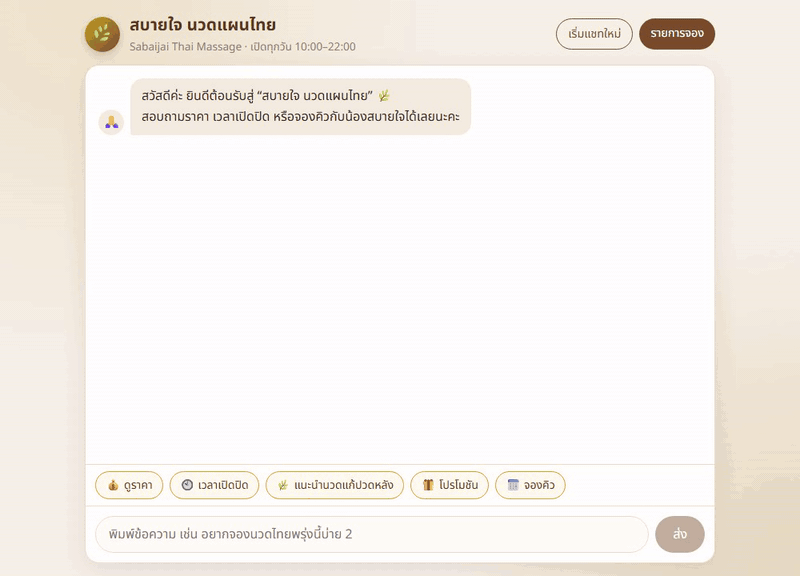 |
| 2 | กดปุ่ม "ดูราคา" ([MP4](image/ex2/ex2-case2-price.mp4)) |  |
| 3 | ขอคำแนะนำนวดแก้ปวดหลัง (ออฟฟิศซินโดรม) ([MP4](image/ex2/ex2-case3-backpain.mp4)) | 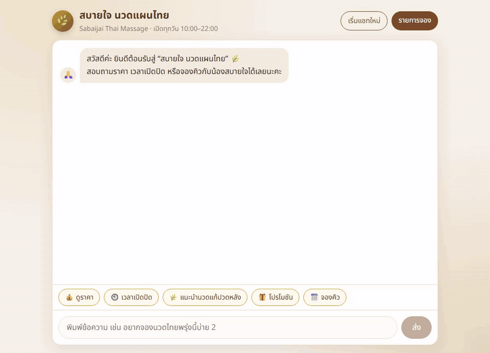 |
| 4 | ถามโปรโมชั่น / ส่วนลดนักศึกษา ([MP4](image/ex2/ex2-case4-promo.mp4)) | 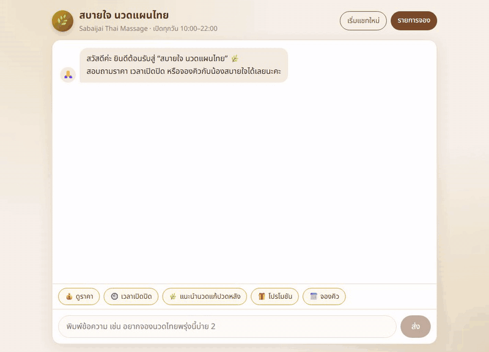 |
| 5 | จองคิวทีละขั้น → การ์ดจองสำเร็จ → `/bookings` มีแถวใหม่**จาก PostgreSQL จริง** ([MP4](image/ex2/ex2-case5-booking.mp4)) | 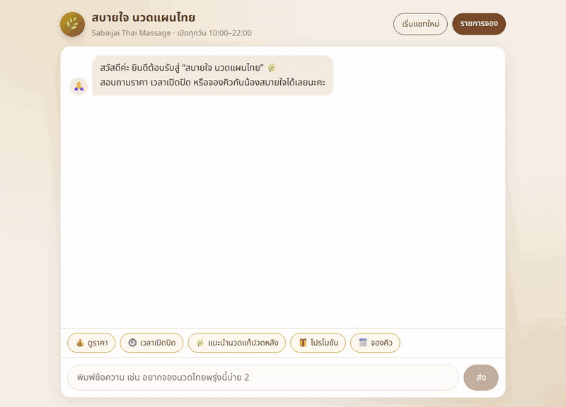 |
| 6 | ถามนอกเรื่อง (สูตรอาหาร) → ตอบสุภาพแล้ววกกลับเรื่องร้าน ([MP4](image/ex2/ex2-case6-offtopic.mp4)) | 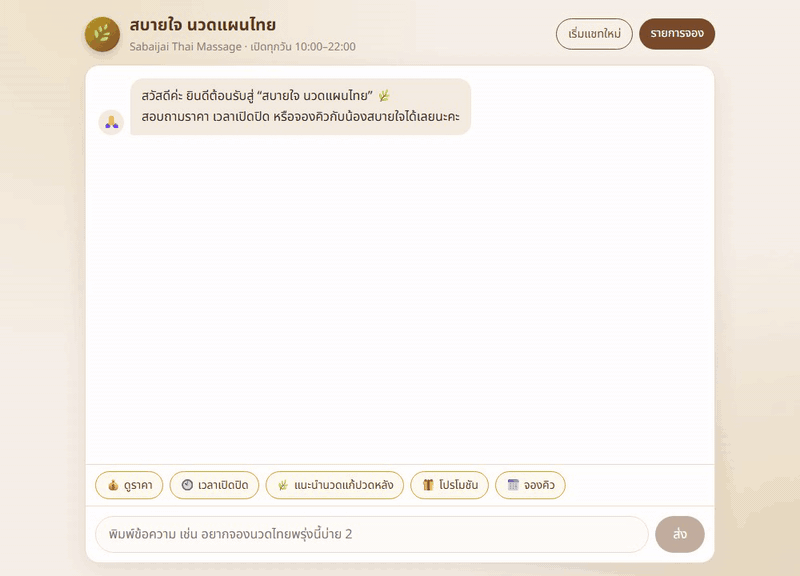 |
| 7 | ลูกค้าพิมพ์ภาษาอังกฤษ ([MP4](image/ex2/ex2-case7-english.mp4)) | 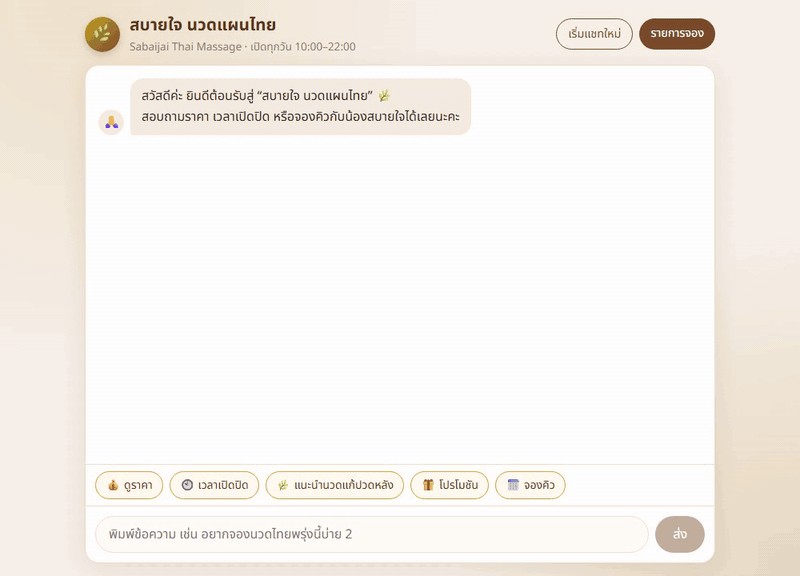 |

*ภาพจริง (GIF จาก Playwright): หน้าแชท "สบายใจ นวดแผนไทย · เปิดทุกวัน 10:00–22:00" พร้อมปุ่มลัด ดูราคา · เวลาเปิดปิด · แนะนำนวดแก้ปวดหลัง · โปรโมชั่น · จองคิว*

### 4.4 · ปิดทุกอย่าง (ห้ามข้าม!)

💬 ใน `yolo1`:

```text
ใช้ skill vastai ลบเครื่อง ex2-ninfer-5090 แล้วสรุปค่าใช้จ่าย
```

🖥️ Git Bash ที่โฟลเดอร์ `frontend`:

```bash
docker compose --profile mock down
```

(ใส่ `-v` ต่อท้ายถ้าต้องการลบข้อมูลการจองทั้งหมด) แล้วเช็คหน้าเว็บ Instances ว่า**ว่าง**

---

## ความปลอดภัย (อ่านให้จบ)

- **ห้าม commit / ห้ามแคปหน้าจอ** API key, `.env`, `.env.vast` — ภาพทุกภาพใน LAB นี้เบลอข้อมูลสำคัญแล้ว
- `.env` และ `.env.vast` ถูก ignore ใน `.gitignore` แล้ว · อย่าเปิดใน JupyterLab (เกิดไฟล์ checkpoint ที่เป็นสำเนา)
- ⚠️ **`Devtool_SSH/devtoolSSH` (private key) ถูกแชร์ใน repo นี้เพื่อความสะดวกในห้องเรียน** → ใครมี repo ก็ ssh เข้าเครื่องที่เช่าด้วย key นี้ได้ระหว่างที่เครื่องยังเปิด → **ลบเครื่องทันทีหลังใช้**
- งานส่วนตัว ให้สร้าง key ของตัวเอง แล้วใส่ `.pub` ใหม่บนเว็บ (ขั้นที่ 2) และแก้ `VAST_SSH_KEY_FILE` ให้ชี้ไปที่ key ใหม่:

  ```bash
  ssh-keygen -t ed25519 -f ~/.ssh/id_vast
  ```

- API key หลุด → เว็บ Keys → แท็บ API Keys → กด 🗑️ ลบ key นั้น แล้วสร้างใหม่

## เช็คลิสต์

| ขั้น | ผลที่ควรได้ | ✓ |
|---|---|---|
| 2 | SSH Keys มีแถว `ssh-ed25519 … devtools-lab` | ☐ |
| 3 | API key `devtools-lab` (Billing Write ว่าง) คัดลอกแล้ว | ☐ |
| ส่วนที่ 2 | `.env` มี 3 บรรทัด VAST_ ไม่มี `"` ไม่มี comment ท้ายบรรทัด | ☐ |
| 4 | skill `OK` 6 บรรทัด · `/workspace` เห็น `.env` | ☐ |
| 5 | `pip install 'vastai~=1.8'` เสร็จ | ☐ |
| 6 | ตารางความพร้อม ✅ | ☐ |
| 7–8 | `lab-4090` running บนเว็บ | ☐ |
| 9 | `nvidia-smi` เห็น RTX 4090 24564MiB | ☐ |
| 10 | ลบ `lab-4090` แล้ว + สรุปค่าใช้จ่าย · หน้า Instances ว่าง | ☐ |
| 4.1 | `backend/.env.vast` มี 3 บรรทัด LLM_ | ☐ |
| 4.2 | http://localhost:3300 ตอบภาษาไทย · `/bookings` มีแถว | ☐ |
| 4.3 | `npx playwright test` ผ่าน 7 เคส | ☐ |
| 4.4 | ลบ `ex2-ninfer-5090` แล้ว · `docker compose down` | ☐ |

## แก้ปัญหา

| อาการ | สาเหตุ / วิธีแก้ |
|---|---|
| `Invalid user key` | ใน `.env` มี `"` ครอบ key หรือมี `# comment` ท้ายบรรทัด → แก้แล้ว**ทำขั้นที่ 4 ใหม่** (ค่าจาก `--env-file` ถูกอ่านตอนสร้าง container เท่านั้น) |
| `pip install` ค้างนาน | ปกติ ~5–12 นาที (PyPI ช้า) รอได้ ทำครั้งเดียวต่อ container ใหม่ |
| `ไม่มี offer <= $…/hr` | เพดานราคาต่ำไป → ตอบ skill ให้ยอมเพดานสูงขึ้น หรือเปลี่ยน GPU (เช่น RTX 3090) |
| ssh `Connection refused` หลังเช่า | เครื่องยังบูตไม่เสร็จ รอ 1–2 นาที หรือใช้คำสั่ง proxy |
| skill หา SSH key ไม่เจอ | เปิด Terminal ไม่ใช่ที่ `/workspace` → `cd /workspace` แล้วเปิด `yolo1` ใหม่ |
| แชทบอทขึ้น error | เช็ค `LLM_BASE_URL` (IP:port ของ 8080/tcp, ไม่มี `/v1`) และเครื่อง 5090 ยัง running → แก้ `.env` แล้ว `docker compose up -d --build web` |
| ลืมลบเครื่อง | เปิด https://cloud.vast.ai/instances/ → กด 🗑️ (destroy) ทุกเครื่องที่ไม่ใช้ · **stop ยังเสียค่า disk** |

## ข้อควรรู้

- skill จะ**ไม่ขึ้นเพดานราคาเอง** และ**ไม่ลบเครื่องเองโดยไม่ถาม** — ถ้าถาม ให้อ่านก่อนตอบ
- `pip install` ลงใน container (ไม่ใช่ volume) → ลบ container แล้วสร้างใหม่ต้องติดตั้งใหม่ แต่ล็อกอินและ skill ยังอยู่ใน volume `ai-accounts`
- แก้ `.env` แล้วต้องสร้าง container ใหม่ (ขั้นที่ 4) ค่าใหม่ถึงจะเข้า
- ราคา GPU บน Vast.ai เปลี่ยนตลอดเวลา ตัวเลขใน LAB นี้คือผลจริงวันที่ 14 ต.ค. 2026
- `stop` = หยุด GPU แต่ยังเก็บ disk (เสียเงินต่อ) · `destroy` = ลบทิ้งหมด หยุดจ่าย กู้ไม่ได้
