# LAB 04.3 · DAG Planner: วางโจทย์ → ได้กราฟงาน (DAG) + ไทม์ไลน์

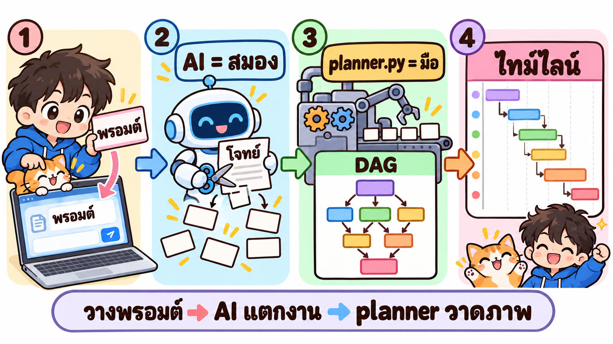

ก่อนให้ทีม AI หลายตัวช่วยกันทำโปรเจกต์ ต้อง**วางแผน**ให้ได้ก่อนว่า งานมีอะไรบ้าง งานไหนต้องรองานไหน และใครทำงานไหน เมื่อไร
LAB นี้ให้ AI ทำแผนนั้นออกมาเป็น**ภาพ 2 ภาพ** โดยเรา copy แล้ว paste พรอมต์อย่างเดียว

| | เราทำ | ได้ภาพ |
|---|---|---|
| **พรอมต์ ①** | วางโจทย์ | **DAG**: กราฟงาน · rank · สายวิกฤต |
| **พรอมต์ ②** | บอกจำนวน agent + บัญชี | **ไทม์ไลน์ (Gantt)**: ใครทำงานไหน นาทีที่เท่าไร |

> 📝 ทำแค่**แผน** ยังไม่สร้างเว็บจริง ใช้เวลาประมาณ 5 นาที · ถ้าอยากให้ทีม AI สร้างจริงตามแผน ไปต่อที่ [LAB 04.2](../04_Multi_Agent_Orchestra/readme.md)

## อะไรเรียกอะไร

| ใคร | ทำอะไร | ใช้โทเคน? |
|---|---|---|
| 👦 **เรา** | copy พรอมต์จากหน้านี้ไปวาง แก้แค่บรรทัดบน ๆ | – |
| 🤖 **AI = สมอง** (Claude Code) | อ่านโจทย์ → คิดว่ามีงานอะไร รอกันอย่างไร → เขียน `tasks.json` → อธิบายผล | ใช้ |
| ⚙️ **planner.py = มือ** ([tools/planner.py](tools/planner.py)) | AI เรียกให้คิด rank · จำลองเวลา · วาด `dag.png` / `gantt.png` | **ไม่ใช้** |
| 🧮 **orch.py = KC-QUEST** ([tools/orch.py](tools/orch.py)) | planner เรียกให้แจกงานตามกติกา: ให้คะแนนบัญชี · เลือกบัญชีที่ทำจบได้ | **ไม่ใช้** |
| 📦 **container `multi-account-devtool`** (ที่เปิดไว้อยู่แล้ว · ไม่บังคับ) | planner เข้าไปอ่าน**โควตาจริง**ของแต่ละบัญชีให้เอง | ไม่ใช้ |

**กติกาทั้งหมดเขียนอยู่ในพรอมต์** อ่านพรอมต์ไปด้วย จะเข้าใจว่า AI ถูกสั่งให้คิดอย่างไร

**เริ่ม:** เปิด **Claude Code ที่โฟลเดอร์นี้** (`02_DAG_Planner`) แล้ววางพรอมต์ทีละกรอบ รอให้ตอบเสร็จก่อนวางกรอบถัดไป

> 🆕 **ใช้ครั้งแรก / เปิดแชทใหม่ก็ได้:** AI ไม่ต้องจำอะไรจากแชทก่อน เพราะพรอมต์บอกให้ AI อ่านวิธีใช้ `planner.py` เอง (`--help`) และทุกพรอมต์มี**ชื่อแผน** ทำให้ AI หาไฟล์เดิมใน `out/<ชื่อแผน>/` ได้ทุกครั้ง · ครั้งแรก Claude Code อาจถามขออนุญาตรันคำสั่ง `python` ให้กด **Allow**

---

## ขั้นที่ 0 · ตรวจเครื่อง + ดูบัญชี

💬 วาง (ข้ามได้ถ้าเคยทำแล้ว):

```text
รัน python tools/planner.py doctor แล้วสรุปเป็นภาษาไทยสั้น ๆ ว่าเครื่องพร้อมไหม ถ้ามี ❌ หรือ ⚠️ ให้บอกวิธีแก้ทีละข้อ
```

📤 **ผลจริง:**

```text
ตรวจเครื่องสำหรับ planner.py
✅ Python 3.13.5
✅ orch.py (KC-QUEST) ที่ tools
✅ ฐานข้อมูล timezone
✅ ตัวแปลงภาพเป็น png (Chromium/Chrome/Edge)
✅ โควตาจริง: container multi-account-devtool รันอยู่
👥 บัญชีที่ล็อกอิน: yolo1 98%, yolo2 100%, yolo3 100%, cyolo1 100%
📁 แผนที่มีอยู่ใน out/: ยังไม่มี

พร้อมใช้ ✅
```

บรรทัด 👥 คือ**ชื่อบัญชีที่ใช้ได้**และโควตาที่เหลือ ให้จดไว้ใช้ในบรรทัด `บัญชี:` ของพรอมต์ ②

> ไม่มี container หรือแปลงเป็น png ไม่ได้ ก็ยังทำ LAB ได้: จะถือว่าทุกบัญชีเหลือเต็ม และได้ภาพเป็น `.svg` แทน (เปิดดูในเบราว์เซอร์ได้)

---

## ขั้นที่ 1 · แตกโจทย์เป็น DAG

### 📖 ทฤษฎี: DAG คืออะไร

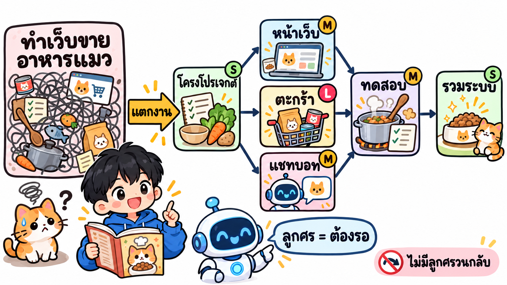

- **DAG** (Directed Acyclic Graph) คือกราฟของงาน ลูกศร `A → B` แปลว่า **B ต้องรอ A เสร็จก่อน** และลูกศร**ห้ามวนกลับ** (ถ้าวน งานจะรอกันเองไม่จบ)
- งานที่ไม่ได้รอกัน **ทำพร้อมกันได้** ตรงนี้คือที่มาของความเร็วเวลาใช้ AI หลายตัว
- แต่ละงานมี**ขนาด** S / M / L หมายถึงประเมินโทเคนไว้ 0.6 / 1.5 / 3 ล้าน (ใช้แทน "ความยาวของงาน")

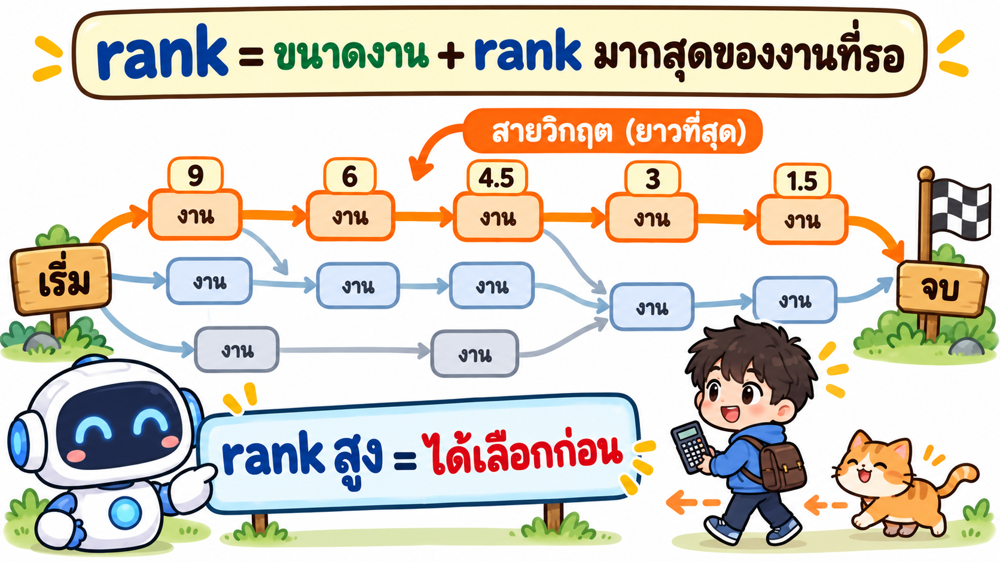

- **rank** คือความยาวจากงานนี้ไปจนจบโปรเจกต์ ให้คิด**ย้อนจากงานสุดท้าย**:

$$\mathrm{rank}(\text{งาน}) = \text{ขนาดของงานนั้น} + \max\big(\mathrm{rank}\ \text{ของงานที่รอมันอยู่}\big)$$

- **สายวิกฤต (critical path)** คือเส้นจากงานแรกถึงงานสุดท้ายที่ยาวที่สุด ถ้างานบนเส้นนี้ช้า ทั้งโปรเจกต์จะช้าตาม งาน rank สูงจึง**ได้เลือกบัญชีก่อน**

### 🧮 ตัวอย่างคิด rank ทีละขั้น (T08 ตะกร้า จากผลจริงด้านล่าง)


จับคู่สีในสูตรกับภาพให้ตรงกัน:

| ในสูตร | ดูที่ไหนในภาพ | T08 |
|---|---|---|
| 🟩 $c_j$ | ขนาดของ**กล่องตัวเอง** (กล่องกลาง) | L = **3** |
| 🟦 $\mathrm{succ}(j)$ | กล่องที่ลูกศร**ออกจาก** j ไปทางขวา (งานที่รอ j) | T12, T09, T10 |
| 🟦 $\mathrm{rank}(k)$ | เลข rank ในกล่องทางขวาแต่ละกล่อง | 7.5, 4.5, 4.5 |
| 🟧 $\max$ | เลือก**ตัวที่มากที่สุดตัวเดียว** | 7.5 (T12) |
| | **rank(T08)** = 🟩 + 🟧 | 3 + 7.5 = **10.5** |

ที่มักสับสน:
- ❌ **ไม่ใช่บวก rank ของทุกงานทางขวา** (3 + 7.5 + 4.5 + 4.5) เพราะ T12 · T09 · T10 **ทำพร้อมกันได้** จึงรอแค่สายที่ยาวที่สุด
- ❌ **ไม่ใช่ดูงานทางซ้าย** (T03 · T04 ที่ T08 ต้องรอ) งานพวกนั้นจะเอา rank ของ T08 ไปใช้ทีหลังแทน
- ❌ **ไม่ต้องบวก c ของงานทางขวา** เพราะรวมอยู่ใน rank ของมันแล้ว ใช้ c ของ**ตัวเอง**ตัวเดียว
- ✅ ต้องรู้ rank ของงานทางขวาก่อน จึง**คิดย้อนจากงานสุดท้าย** (T14 ไม่มีใครรอ → rank = c = 3) แล้วไล่ไปทางซ้าย

<details><summary>อีกตัวอย่าง: T04 มีงานรอ 4 งาน (กดเพื่อดู)</summary>

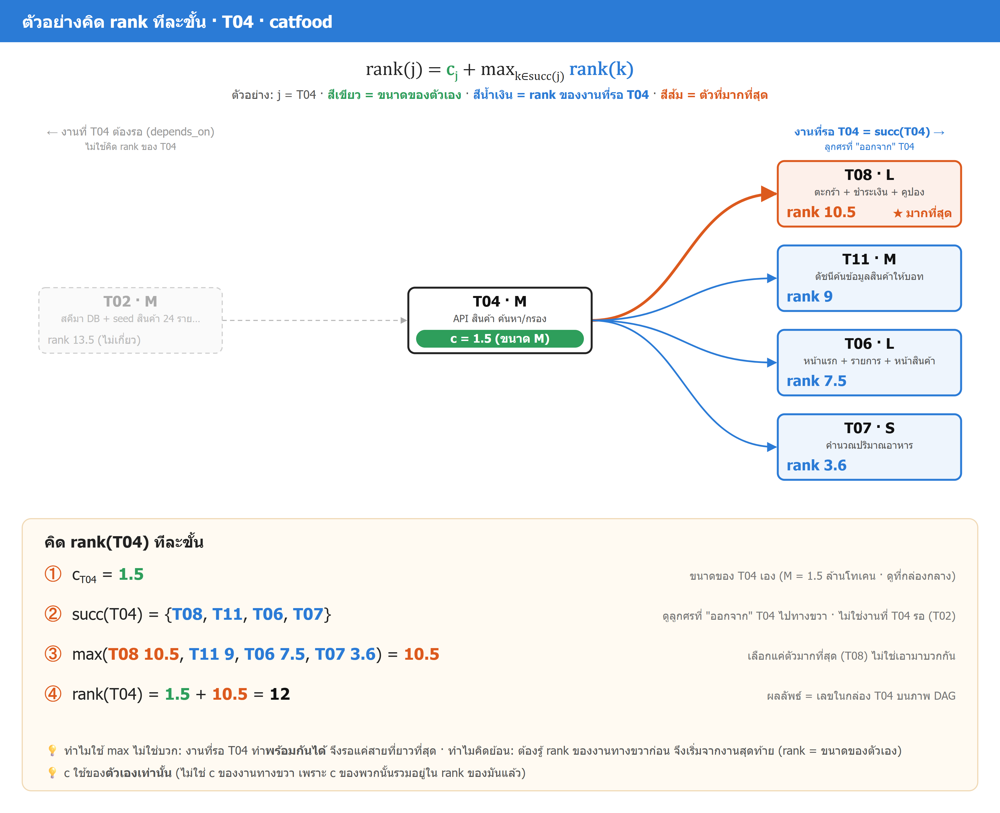

</details>

> 🧑‍🏫 **planner.py มี 2 โหมด** (`--mode`): **`teach` โหมดสอน** = สูตรแทนค่าพร้อมชื่องานเหนือทุกกล่อง + ภาพตัวอย่างแบบข้างบน (`rank-example.png` · เลือกงานเองด้วย `--example T04`) + พิมพ์ลำดับคิดย้อน · **`real` ใช้งานจริง** (ค่าเริ่มต้น) = ภาพกระชับ มีแค่ rank และสายวิกฤต พรอมต์ ① ในหน้านี้ใช้โหมดสอน

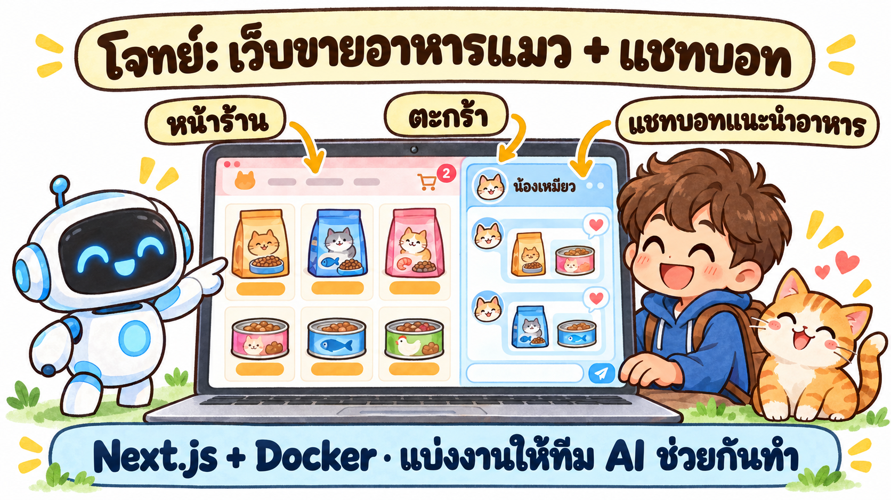

### 💬 พรอมต์ ① (copy ทั้งกรอบ แก้แค่บรรทัด "โจทย์" และ "ชื่อแผน")

```text
โจทย์: อยากทำเว็บขายอาหารแมว ใช้ Next.js กับ Docker มีแชทบอทช่วยแนะนำอาหาร
ชื่อแผน: catfood

ช่วยแตกโจทย์นี้เป็นกราฟงาน (DAG) ยังไม่ต้องเขียนโค้ดของโจทย์ ทำแค่แผน
1. แตกเป็นงานย่อย 8–18 งาน แต่ละงานมี id (T01, T02, …) · ชื่อสั้น ๆ · ขนาด S/M/L (ประเมินโทเคน 0.6 / 1.5 / 3 ล้าน · ถ้าใหญ่กว่า L ต้องแบ่ง) · ประเภท area (backend, frontend, chat, rag, ml, k8s, agent, voice, infra, test, image)
2. ใส่ depends_on เฉพาะงานที่ต้องเสร็จก่อนจริง ๆ: งานแรกคือโครงโปรเจกต์ งานสุดท้ายคือรวมระบบ + ทดสอบ ซึ่งรันคนเดียว (ใส่ "exclusive": true) · งานรูปให้ cyolo ทำ (ใส่ "only": "cyolo")
3. คิด rank ย้อนจากงานสุดท้าย: rank(งาน) = ขนาดของงานนั้น + rank ที่มากที่สุดของงานที่รอมันอยู่
4. สายวิกฤต = เส้นจากงานแรกถึงงานสุดท้ายที่ rank รวมยาวที่สุด
5. บันทึกเป็น out/<ชื่อแผน>/tasks.json แล้ววาดภาพด้วย tools/planner.py คำสั่ง dag แบบ --png โหมดสอน --mode teach (ถ้ายังไม่รู้วิธีใช้ ให้รัน python tools/planner.py --help ก่อน)

ตอบเป็นภาษาไทยสั้น ๆ: ลิงก์ภาพ out/<ชื่อแผน>/dag.png และ rank-example.png (ลิงก์แบบ relative) · ตาราง งาน | ชื่อ | ขนาด | ต้องรอ | rank · สายวิกฤตพร้อมเหตุผล 1 บรรทัด · ตารางคิด rank ย้อนจากงานสุดท้ายไปตามสายวิกฤต 4–5 แถว
```

### 📤 ผลจริง (คำตอบของ AI · 23 ต.ค. 2026)

> ทำแผนเสร็จแล้ว ได้ 14 งาน กราฟไม่มีวงวน และวาดภาพสำเร็จ
>
> | งาน | ชื่อ | ขนาด | ต้องรอ | rank |
> |---|---|---|---|---|
> | **T01** | โครงโปรเจกต์ Next.js + Docker Compose + Postgres | M | – | 15 |
> | **T02** | สคีมา DB + seed สินค้า 24 รายการ | M | T01 | 13.5 |
> | **T03** | สมัครสมาชิก/ล็อกอิน | M | T02 | 12 |
> | T04 | API สินค้า ค้นหา/กรอง | M | T02 | 12 |
> | T05 | รูปสินค้า/แบนเนอร์ด้วย AI (`only: cyolo`) | M | T01 | 9 |
> | T06 | หน้าแรก + รายการ + หน้าสินค้า | L | T04, T05 | 7.5 |
> | T07 | คำนวณปริมาณอาหาร | S | T04 | 3.6 |
> | **T08** | ตะกร้า + ชำระเงิน + คูปอง | L | T03, T04 | 10.5 |
> | T09 | สั่งซื้อประจำ (subscription) | M | T08 | 4.5 |
> | T10 | หลังร้าน admin | M | T08 | 4.5 |
> | T11 | ดัชนีค้นข้อมูลสินค้าให้บอท (rag) | M | T04 | 9 |
> | **T12** | แชทบอท API + mock-llm + ใส่ตะกร้า | L | T08, T11 | 7.5 |
> | **T13** | หน้าต่างแชท "น้องเหมียว" | M | T06, T12 | 4.5 |
> | **T14** | รวมระบบ + ทดสอบ Playwright (`exclusive`) | L | T07, T09, T10, T13 | 3 |
>
> **สายวิกฤต:** T01 → T02 → T03 → T08 → T12 → T13 → T14 (15M tok) ยาวที่สุดเพราะแชทบอทต้องรอตะกร้า (จะได้สั่ง "ใส่ตะกร้าให้") และตะกร้าต้องรอล็อกอิน บนเส้นนี้มีงาน L ถึง 3 งาน
>
> | งาน | ขนาด c | งานที่รออยู่ (rank สูงสุด) | rank |
> |---|---|---|---|
> | T14 | 3 | ไม่มี | 3 |
> | T13 | 1.5 | T14 = 3 | 4.5 |
> | T12 | 3 | T13 = 4.5 | 7.5 |
> | T08 | 3 | max(T12 7.5, T09 4.5, T10 4.5) = 7.5 | 10.5 |
> | T03 | 1.5 | T08 = 10.5 | 12 |

📤 **ภาพที่ได้** `out/catfood/dag.png`:

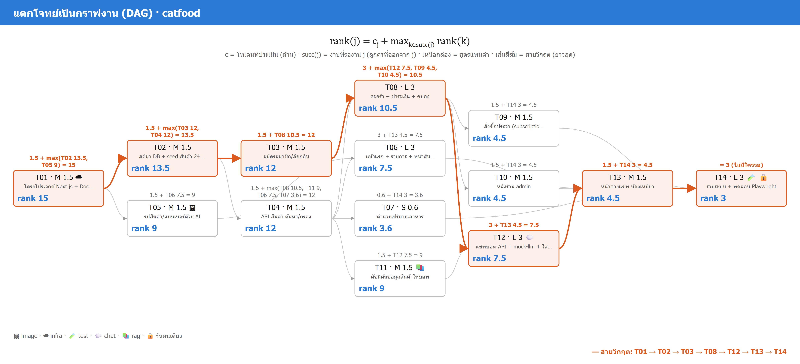

**อ่านภาพ:**
- แต่ละกล่องคือ `id · ขนาด โทเคน` + ชื่องาน + **rank**
- เลขเหนือกล่อง (โหมดสอน) คือสูตรแทนค่าพร้อมชื่องานที่รออยู่ เช่น `3 + max(T12 7.5, T09 4.5, T10 4.5) = 10.5` (เรียงจากมากไปน้อย ตัวแรกคือตัวที่ใช้)
- **เส้นส้ม** คือสายวิกฤต
- ไอคอน: 💬 แชท · 📚 rag · 🧪 ทดสอบ · 🖼 รูป · 🔒 รันคนเดียว

> 💡 AI แต่ละครั้งอาจแตกงานไม่เหมือนกัน (รอบนี้ได้ 14 งาน) ซึ่งไม่ผิด สิ่งที่ต้องดูคือ**ลูกศรสมเหตุสมผลไหม** เช่น "แชทบอทต้องรอตะกร้า" จำเป็นจริงหรือเปล่า

---

## ขั้นที่ 2 · แจกงานให้บัญชี + ไทม์ไลน์

### 📖 ทฤษฎี: KC-QUEST คืออะไร ใช้ทำอะไร (ภาพรวม)

> 🎓 ส่วนนี้เป็น**ภาพรวม**ให้รู้ว่า KC-QUEST ทำอะไรและต่อกับ planner อย่างไร ส่วนสมการทีละขั้นจะมี **LAB แยกที่สอนอัลกอริทึมนี้โดยเฉพาะ**

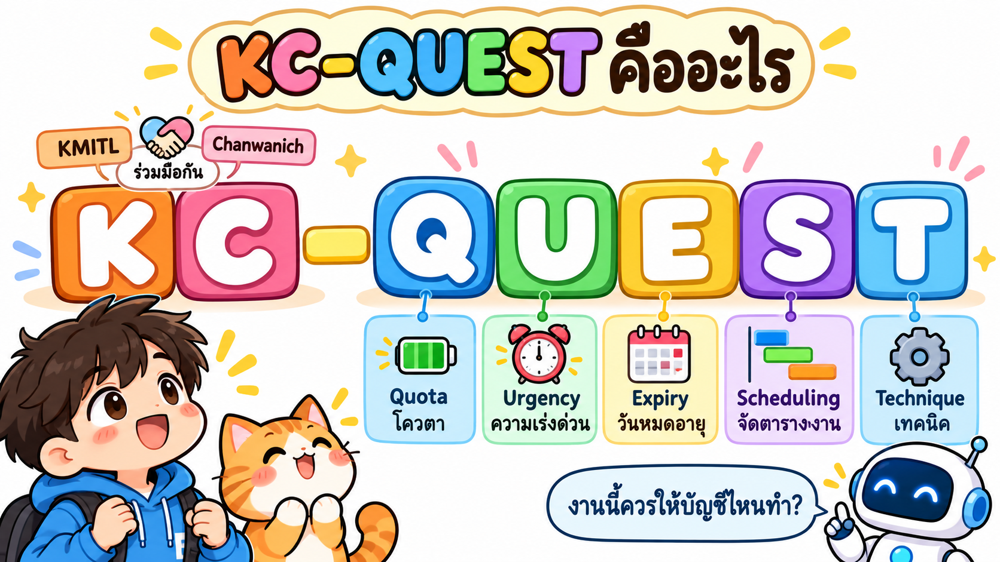

**KC-QUEST** = **K**MITL–**C**hanwanich **Q**uota-**U**rgency **E**xpiry-aware **S**cheduling **T**echnique
แปลว่า *เทคนิคจัดตารางงานที่คำนึงถึงโควตา ความเร่งด่วน และวันหมดอายุ* พัฒนาเป็นสื่อการสอนในความร่วมมือระหว่าง **สถาบันเทคโนโลยีพระจอมเกล้าเจ้าคุณทหารลาดกระบัง (KMITL)** และ **บริษัท จันวณิช (Chanwanich · CWN)**

| ตัวอักษร | มาจาก | ความหมายในอัลกอริทึม |
|---|---|---|
| **K** · **C** | **K**MITL · **C**hanwanich | สององค์กรที่ร่วมกันพัฒนาสื่อการสอนนี้ |
| **Q** | **Q**uota | ดูโควตาที่เหลือของแต่ละบัญชี ให้งานเฉพาะบัญชีที่ทำจบได้ |
| **U** | **U**rgency | งานที่สำคัญ (rank สูง) ได้ก่อน และบัญชีที่โควตาจะหายเร็วได้ใช้ก่อน |
| **E** | **E**xpiry-aware | รู้วันรีเซ็ต/หมดอายุของโควตา ใช้ก่อนที่จะสูญเปล่า |
| **S** · **T** | **S**cheduling **T**echnique | เทคนิคจัดตารางงานให้ทีม AI หลายบัญชี |

KC-QUEST คืออัลกอริทึม**ตอบคำถามเดียว: "งานนี้ควรให้บัญชีไหนทำ"** โดยดูโควตาที่เหลือ วันรีเซ็ต ขนาดงาน และความสำคัญของงาน โค้ดอยู่ที่ [tools/orch.py](tools/orch.py) (ตัวเดียวกับ LAB 04.2)

#### ① ทำไมต้องมี KC-QUEST

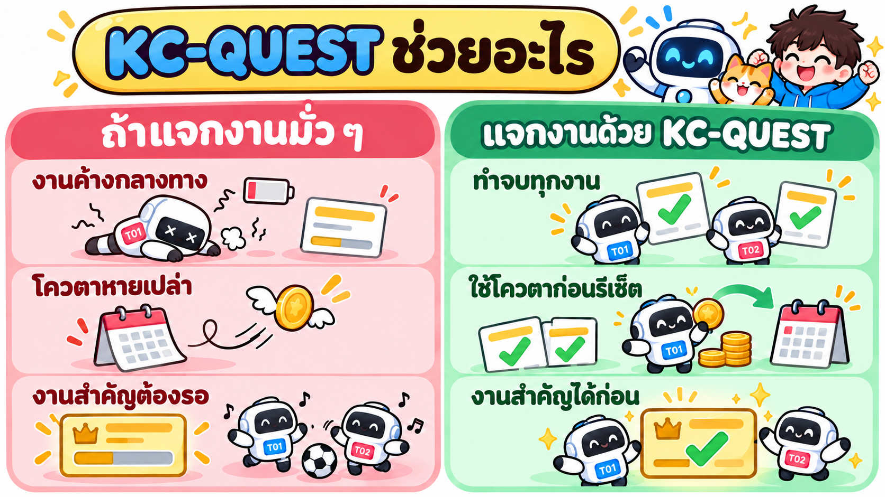

ถ้าแจกงานแบบ "ใครว่างก็ให้คนนั้น" จะเจอ 3 ปัญหา ซึ่ง KC-QUEST ออกแบบมาแก้ทีละข้อ:

| ปัญหาถ้าแจกมั่ว ๆ | KC-QUEST แก้ด้วย | ตัวอย่างจากผลจริงในขั้นนี้ |
|---|---|---|
| 🔋 **งานค้างกลางทาง**: บัญชีโควตาหมดก่อนทำเสร็จ | ให้งานกับบัญชีที่**โควตาพอทำจนจบ**เท่านั้น | yolo1 เหลือ 6% แต่งาน M ใช้ประมาณ 3.9% → ไม่ได้งานเลย |
| 📅 **โควตาหายเปล่า**: บางบัญชีจะรีเซ็ตเร็ว ถ้าไม่ใช้ โควตาที่เหลือก็สูญ | บัญชีที่**ใกล้รีเซ็ต**ได้ใช้ก่อน | yolo2 รีเซ็ตเร็วที่สุด (อีก 78 ชม.) → ได้งานไปมากที่สุด |
| ⏳ **งานสำคัญต้องรอ**: งานบนสายวิกฤตไปต่อคิวหลังงานเล็ก | งาน **rank สูง** ได้เลือกบัญชีก่อน | T01 (rank 15) ได้เลือกก่อนทุกงาน |

#### ② ข้างใน KC-QUEST ทำอะไรบ้าง (4 สถานี)

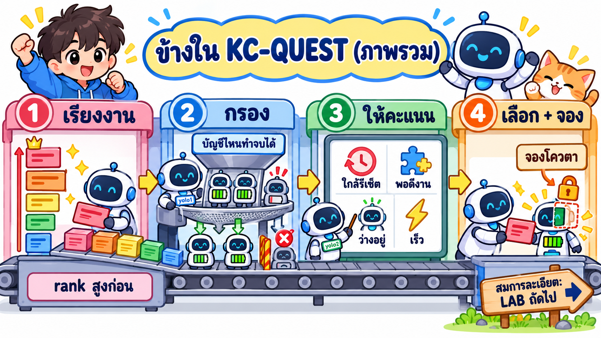

| สถานี | ถามว่า | ตอบด้วยอะไร |
|---|---|---|
| ① **เรียงงาน** | งานไหนได้เลือกก่อน | rank สูงก่อน (งานที่มีบัญชีให้เลือกน้อยก็ได้ก่อนด้วย) |
| ② **กรอง** | บัญชีไหนทำงานนี้จบได้ | โควตาที่เหลือ (ทั้งหน้าต่าง 5 ชม. และรายสัปดาห์) ต้องพอกับขนาดงาน + เผื่อไว้ |
| ③ **ให้คะแนน** | ในบัญชีที่ผ่าน บัญชีไหนเหมาะสุด | ผสม 5 อย่าง: **ใกล้รีเซ็ต** (หนักสุด) · **พอดีงาน** · **ที่ว่างใน 5 ชม.** · **ความเร็ว** (สำคัญกับงานวิกฤต) · **โหลด** ตอนนี้ (ยิ่งงานเยอะยิ่งหักคะแนน) |
| ④ **เลือก + จอง** | แล้วยังไงต่อ | ให้บัญชีคะแนนสูงสุด แล้ว**จองโควตา**ไว้ทันที งานถัดไปจะเห็นโควตาที่ลดลงแล้ว |

ตัวอย่างจากผลจริง: งาน T04 ได้ **yolo3 34.1 คะแนน** ชนะ yolo2 ที่ได้ 31.6 แม้ yolo2 จะใกล้รีเซ็ตกว่า เพราะตอนนั้น yolo2 รับงานไว้หลายตัวแล้ว คะแนนโหลดจึงถูกหัก · เหตุผลแบบนี้ของทุกงานอยู่ใน `out/<ชื่อแผน>/PLAN.md` คอลัมน์ "เหตุผล KC-QUEST"

#### ③ KC-QUEST ต่อกับ planner.py อย่างไร

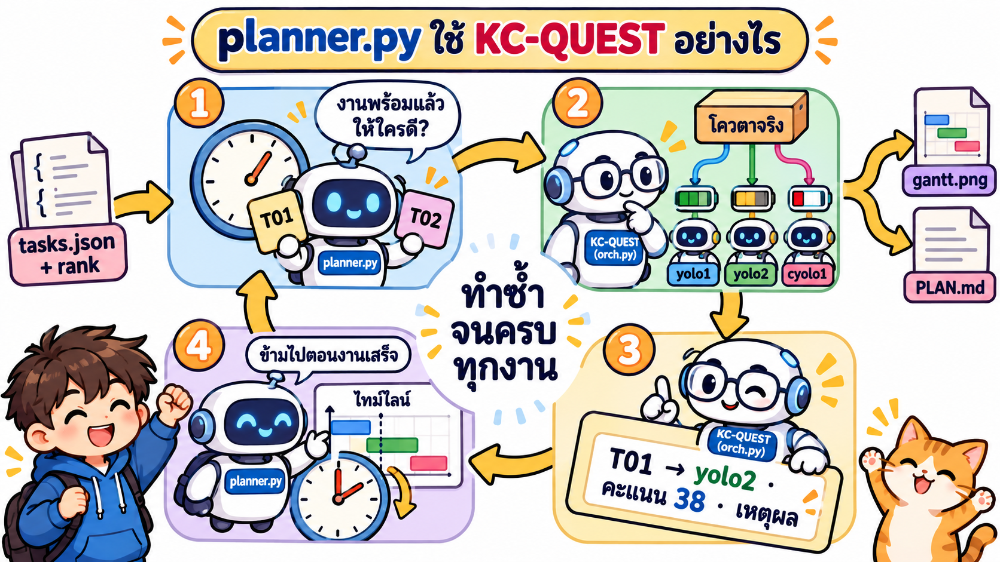

planner.py เป็นคน**เดินนาฬิกา** ส่วน KC-QUEST เป็นคน**ตัดสินใจ** ทั้งสองคุยกันเป็นวงวนแบบนี้:

| # | planner.py ทำ | เรียก KC-QUEST (ใน orch.py) | ได้อะไรกลับมา |
|---|---|---|---|
| 1 | อ่าน `tasks.json` + คิด rank | – | ลำดับความสำคัญของงาน |
| 2 | ขอโควตาของทุกบัญชี | `quota_snapshot` · `score_accounts` | เหลือกี่ % · รีเซ็ตเมื่อไร · รับได้กี่งานพร้อมกัน |
| 3 | นาฬิกาอยู่ที่นาทีที่ X: งานไหน**พร้อม** (งานที่รออยู่เสร็จหมดแล้ว) | `plan_assignments` (ทำ ① ถึง ④) | "งานนี้ → บัญชีนี้ · คะแนน · เหตุผล" |
| 4 | วางแท่งลงไทม์ไลน์ แล้ว**ข้ามนาฬิกาไปตอนที่งานแรกเสร็จ** คืนที่ว่างให้บัญชีนั้น | – | กลับไปข้อ 3 จนครบทุกงาน |
| 5 | วาด `gantt.png` · `dag.png` (ป้ายบัญชี) · เขียน `PLAN.md` | – | ภาพ + รายงาน |

สรุปง่าย ๆ: **rank บอกว่างานไหนสำคัญ · KC-QUEST บอกว่าใครควรทำ · planner บอกว่าทำเมื่อไร แล้ววาดออกมาเป็นภาพ**

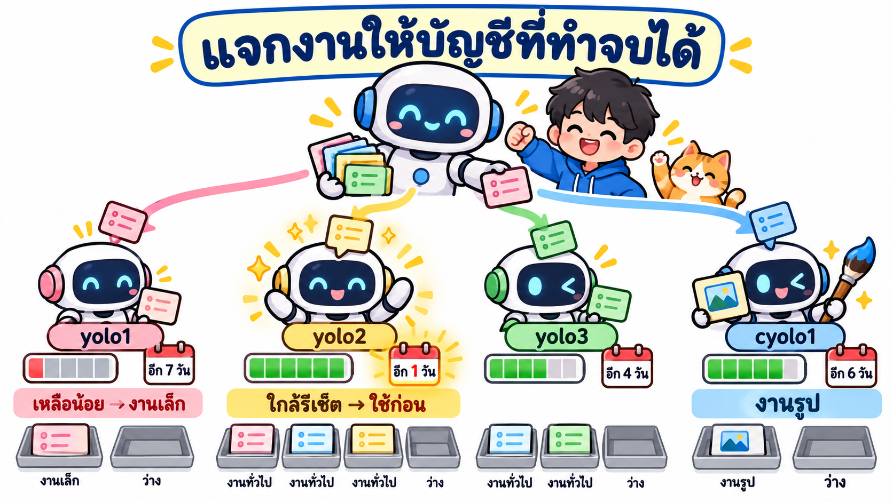

กติกาที่เขียนไว้ในพรอมต์ ② สรุปจากด้านบน: งาน rank สูงเลือกก่อน · บัญชีใกล้รีเซ็ตใช้ก่อน · ให้เฉพาะบัญชีที่ทำจบได้ · บัญชีหนึ่งรับได้หลายงานพร้อมกัน (yolo ≤ 4 · cyolo ≤ 3) แต่ทั้งทีมรวมกัน**ไม่เกินจำนวน agent**

#### ④ ไทม์ไลน์ (Gantt chart)

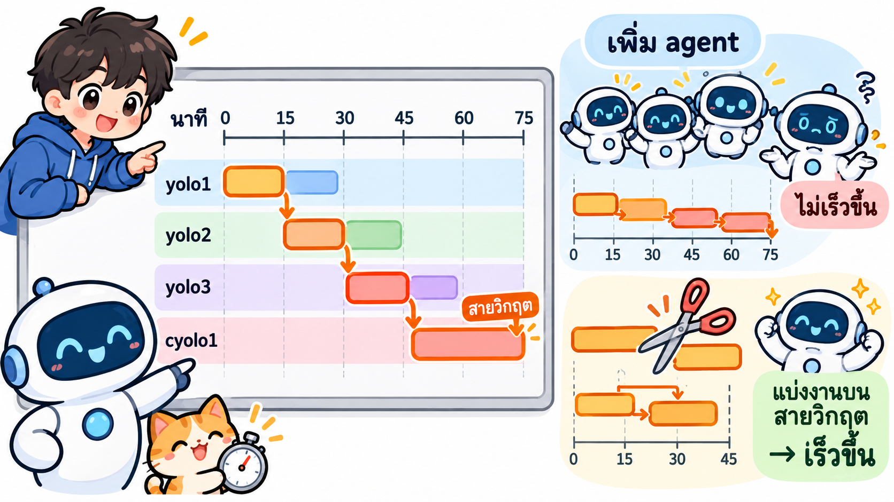

- แกนนอนคือเวลา แต่ละแถวคือบัญชี แท่งสีคืองาน
- เวลารวม**สั้นกว่าสายวิกฤตไม่ได้** เพิ่ม agent ก็ไม่ช่วย
- ถ้าอยากให้เร็วขึ้น ต้อง**แบ่งงานบนสายวิกฤต** หรือ**ตัด dependency** ที่ไม่จำเป็น

### 💬 พรอมต์ ② (วางต่อในแชทเดิม หรือแชทใหม่ก็ได้ · แก้แค่ 3 บรรทัดแรก)

```text
ชื่อแผน: catfood
จำนวน agent สูงสุด: 6
บัญชี: yolo1:6 yolo2 yolo3 cyolo1

ใช้ out/<ชื่อแผน>/tasks.json แจกงานให้บัญชีแล้ววาดไทม์ไลน์ ด้วย tools/planner.py คำสั่ง plan แบบ --png และส่งรายชื่อบัญชีด้วย --accounts (ถ้ายังไม่รู้วิธีใช้ ให้รัน python tools/planner.py --help ก่อน)
กติกาการแจกงาน (KC-QUEST):
- งานที่ rank สูง (อยู่บนสายวิกฤต) ได้เลือกบัญชีก่อน
- บัญชีที่โควตาใกล้รีเซ็ตได้ใช้ก่อน เพราะถ้าไม่ใช้ โควตาจะหายไปเปล่า ๆ
- ให้งานกับบัญชีที่มีโควตาพอทำจนจบเท่านั้น (ตัวเลขหลังชื่อบัญชีคือ % ที่เหลือ เช่น yolo1:6 = เหลือ 6% · ไม่ใส่ = ใช้โควตาจริงจาก container หรือถือว่าเหลือเต็ม)
- บัญชีหนึ่งรับได้หลายงานพร้อมกัน (yolo ≤ 4 · cyolo ≤ 3) · cyolo เขียนโค้ดได้ด้วย ไม่ได้ทำแค่รูป
- ทำพร้อมกันได้ไม่เกินจำนวน agent สูงสุด · งานที่รันคนเดียวต้องรอให้งานอื่นเสร็จก่อน

ตอบเป็นภาษาไทยสั้น ๆ: ลิงก์ภาพ out/<ชื่อแผน>/gantt.png และ dag.png (ลิงก์แบบ relative) · ตาราง งาน | บัญชี | เริ่ม–จบ (นาที) · 3 ตัวเลข (ทำพร้อมกันสูงสุด / เวลารวม / เร็วกว่าทำทีละงานกี่เท่า) · เหตุผลที่บัญชีได้งาน 2–3 ตัวอย่าง
```

> `yolo1:6` คือ**สมมติ**ว่า yolo1 เหลือ 6% ใส่ไว้ให้เห็นว่าบัญชีที่เหลือน้อยจะไม่ได้งาน ถ้าไม่ใส่ % ระบบจะอ่านโควตาจริงจาก container `multi-account-devtool` ให้เอง

### 📤 ผลจริง (คำตอบของ AI)

> แจกงานครบทั้ง 14 งาน (เป็นแผนจำลอง ยังไม่ได้รันจริง)
>
> | งาน | บัญชี | เริ่ม–จบ (นาที) |
> |---|---|---|
> | **T01** | yolo2 | 0–12 |
> | **T02** | yolo2 | 12–25 |
> | T05 (รูป) | cyolo1 | 12–31 |
> | **T03** | yolo2 | 25–38 |
> | T04 | yolo3 | 25–38 |
> | **T08** | yolo2 | 38–62 |
> | T06 | yolo2 | 38–62 |
> | T11 | yolo3 | 38–50 |
> | T07 | cyolo1 | 38–45 |
> | **T12** | yolo3 | 62–87 |
> | T09 | yolo2 | 62–75 |
> | T10 | cyolo1 | 62–81 |
> | **T13** | yolo3 | 87–100 |
> | **T14** 🔒 | yolo2 | 100–125 |
>
> **3 ตัวเลข:** ทำพร้อมกันสูงสุด **4** จากเพดาน 6 (กราฟแตกกิ่งได้ไม่กว้างกว่านี้) · เวลารวม **125 นาที** · เร็วกว่าทำทีละงาน (217 นาที) ประมาณ **1.7 เท่า**
>
> **เหตุผลที่บัญชีได้งาน**
> - **yolo2 ได้ T01 → T02 → T03 → T08 และ T14:** งานบนสายวิกฤตได้เลือกก่อน และ yolo2 รีเซ็ตเร็วที่สุด (อีก 78.5 ชม.) ค่าความเร่งด่วนจึงสูงสุด (0.234)
> - **yolo3 ได้ T04, T11, T12, T13:** รีเซ็ตเป็นลำดับถัดมา จึงรับงานที่ต้องทำขนานกับ yolo2 (T04: yolo3 ได้ 34.1 คะแนน yolo2 ได้ 31.6)
> - **yolo1 ไม่ได้งานเลย:** เหลือแค่ 6% ขณะที่งาน M ใช้ประมาณ 3.9% และงาน L ประมาณ 7.8% ส่วน cyolo1 เหลือเต็มและได้คะแนนสูงกว่า (48.2 เทียบกับ 9.9)

📤 **ภาพที่ได้** `out/catfood/gantt.png`:

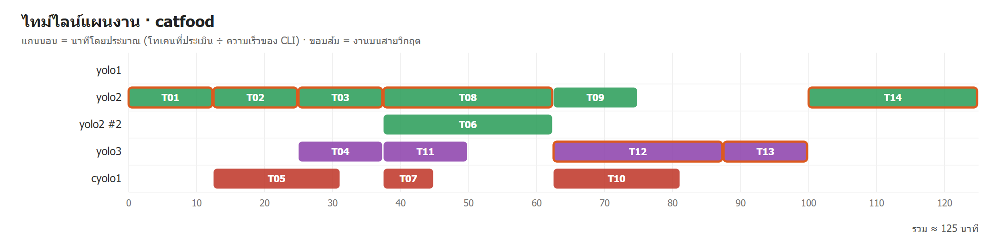

📤 และ `dag.png` ตอนนี้มี**ป้ายสีบอกบัญชี**:

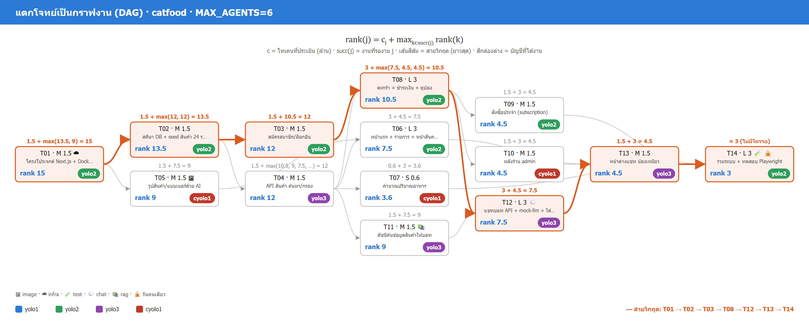

**อ่านภาพ:**
- แต่ละแถวคือบัญชี (`yolo2 #2` = งานที่ 2 ที่ yolo2 ทำพร้อมกัน)
- แกนนอนคือนาทีโดยประมาณ (โทเคน ÷ ความเร็วของ AI) ใช้**เปรียบเทียบแผน** ไม่ใช่เวลาจริง
- **ขอบส้ม** คืองานบนสายวิกฤต จะเห็นว่าต่อกันเป็นทอด ๆ ไม่มีช่องว่าง

---

## ขั้นที่ 3 · ลองเปลี่ยน แล้วดูว่าแผนเปลี่ยนอย่างไร

💬 วาง:

```text
ชื่อแผน: catfood
ลองจำนวน agent สูงสุด 2 แล้ววาดไทม์ไลน์ใหม่ด้วย tools/planner.py เทียบเวลารวมกับแผนเดิมที่ใช้ 6 agent
```

📤 **ผลจริง:**

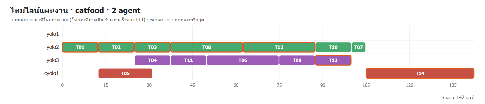

| agent สูงสุด | ทำพร้อมกันจริง | เวลารวม |
|---|---|---|
| 6 | 4 | **125 นาที** |
| 2 | 2 | **142 นาที** |

ตั้งไว้ 6 แต่ใช้จริงแค่ 4 เพราะกราฟแตกกิ่งได้แค่นั้น และเวลารวมไม่ต่ำกว่า 125 นาทีเพราะ**สายวิกฤต**ยาวเท่านี้ ถ้าอยากให้เร็วกว่านี้ ลองพรอมต์ด้านล่าง:

| อยากรู้ | 💬 วาง |
|---|---|
| แบ่งงานแล้วเร็วขึ้นไหม | `ชื่อแผน: catfood · แยก T08 เป็น 2 งาน (ตะกร้า กับ ชำระเงิน) แล้ววาด DAG และไทม์ไลน์ใหม่ บอกว่าสายวิกฤตกับเวลารวมเปลี่ยนอย่างไร` |
| ตัด dependency ที่ไม่จำเป็น | `ชื่อแผน: catfood · แชทบอทจำเป็นต้องรอตะกร้าจริงไหม ถ้าไม่จำเป็นให้ตัดออก แล้ววาดใหม่ทั้ง 2 ภาพ เทียบเวลารวม` |
| บัญชีหนึ่งเหลือน้อย | `ชื่อแผน: catfood · บัญชี yolo2 เหลือแค่ 3% วาดไทม์ไลน์ใหม่ แล้วบอกว่างานย้ายไปบัญชีไหน` |
| ใช้โจทย์ของเราเอง | วางพรอมต์ ① ใหม่ แก้บรรทัด `โจทย์:` และ `ชื่อแผน:` |

---

## ขั้นที่ 4 · โจทย์ที่มี AI: RAG + MLOps + Kubernetes

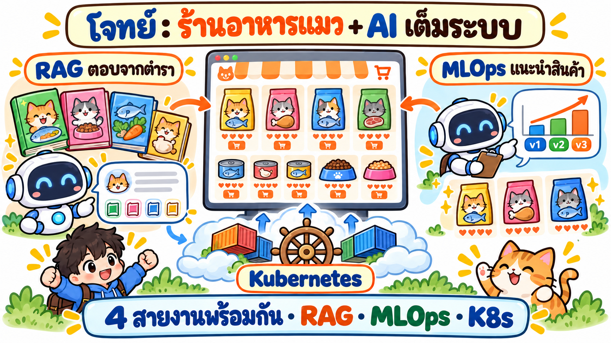

ใช้พรอมต์เดียว ได้ทั้ง 2 ภาพ (แก้ได้ทั้งโจทย์ จำนวน agent และบัญชี):

```text
โจทย์: เว็บขายอาหารแมว Next.js + Docker · แชทบอท RAG จากตำราคู่มือทำอาหารแมว · โมเดลแนะนำสินค้าแบบมีเวอร์ชัน (MLOps ด้วย MLflow) · deploy บน Kubernetes ด้วย Helm
ชื่อแผน: catfood_ai
จำนวน agent สูงสุด: 8
บัญชี: yolo1 yolo2 yolo3 cyolo1

แตกโจทย์เป็น DAG ไม่เกิน 22 งาน แยกสาย RAG (ตำรา → chunk → embedding → vector DB → ตอบพร้อมอ้างอิง) · MLOps (เตรียมข้อมูล → เทรน → ประเมิน → ลงทะเบียนเวอร์ชัน → serve) · Kubernetes (Dockerfile → Helm → deploy)
ขนาด S/M/L · depends_on เท่าที่จำเป็น · งานสุดท้ายคือ deploy บน cluster + ทดสอบรวมที่รันคนเดียว (exclusive) บันทึกเป็น out/<ชื่อแผน>/tasks.json
แล้วใช้ tools/planner.py วาด DAG และแจกงานให้บัญชีพร้อมไทม์ไลน์ คำสั่ง plan แบบ --png (ถ้ายังไม่รู้วิธีใช้ ให้รัน python tools/planner.py --help ก่อน)
ตอบภาษาไทยสั้น ๆ: ลิงก์ dag.png กับ gantt.png · สายวิกฤตอยู่ที่สายไหน เพราะอะไร · เวลารวม
```

📤 **ผลจริง** (21 งาน · 4 บัญชี · 8 agent):

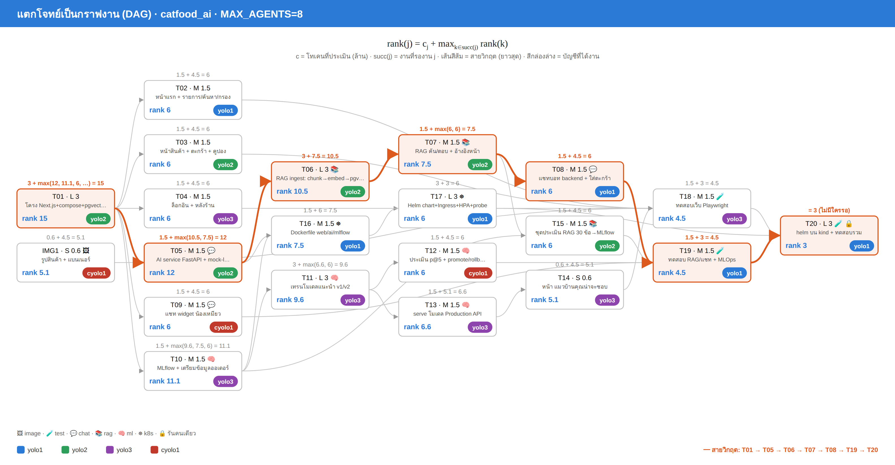

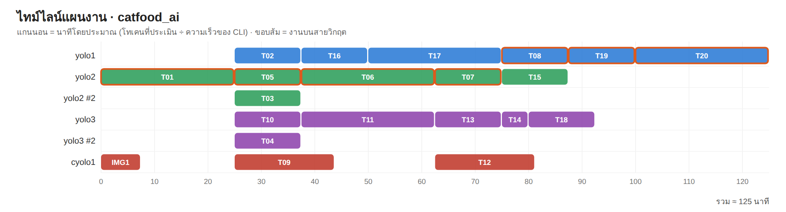

| | ผล |
|---|---|
| สายวิกฤต | **สาย RAG** T01 → T05 → T06 → T07 → T08 → T19 → T20 (ingest ตำราเป็นงานใหญ่ที่ต่อกันยาวที่สุด) |
| ทำพร้อมกัน | 6 จาก 8 (ตัวจำกัดคือ dependency) |
| เวลารวม | 125 นาที (ทำทีละงานประมาณ 310 นาที จึงเร็วขึ้น 2.5 เท่า) |

---

## ขั้นที่ 5 · โจทย์ AI Agent 3 แบบ (เต็มระบบ): ออกแบบต่างกัน → DAG ต่างกัน

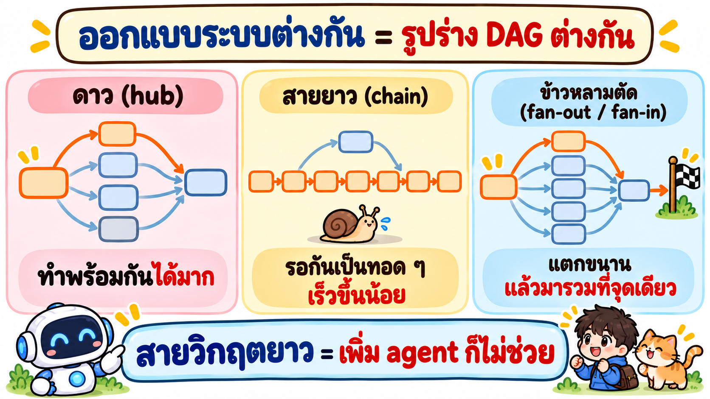

ระบบ AI Agent ในปี 2026 มีหลายแบบ แต่ละแบบให้**รูปร่างของ DAG** ไม่เหมือนกัน และรูปร่างนี้เองที่บอกว่าทีม AI หลายตัวจะช่วยให้เร็วขึ้นได้แค่ไหน
ทุกโจทย์ทำ**เต็มระบบเหมือนงานจริง**: ตัว agent · เว็บแอป · Kafka · Jenkins CI/CD · Kubernetes · monitoring จนถึง deploy production · 8 agent · บัญชี yolo1 yolo2 yolo3 cyolo1

| | โจทย์ | หัวใจของระบบ | deploy แบบ | รูปร่าง DAG |
|---|---|---|---|---|
| 🅰 | ทีม AI Agent ตอบแชทลูกค้า | **Multi-agent + MCP + คนอนุมัติ** (supervisor ส่งงานให้ agent เฉพาะทาง) | canary 10% + rollback (Argo Rollouts) | ⭐ ดาว (hub) |
| 🅱 | Voice Agent รับโทรศัพท์นัดหมอฟัน | **Realtime voice pipeline** (เสียง → ข้อความ → agent → เสียง) | GPU node pool รัน STT/TTS + เบอร์จริง | 🐢 สายยาว (chain) |
| 🅲 | Deep Research Agent | **Plan-and-execute + sub-agent ขนาน** (แตกคำถาม → ค้นพร้อมกัน → รวมเป็นรายงาน) | worker ขยายตามงานค้างใน Kafka (KEDA) | 🔷 ข้าวหลามตัด (fan-out / fan-in) |

ส่วนที่ทุกโจทย์มีเหมือนกัน (ชั้น deploy):

| ชั้น | ใช้ทำอะไร |
|---|---|
| 🌐 เว็บแอป | หน้าลูกค้า + หลังบ้านให้เจ้าหน้าที่ |
| 📨 Kafka | ส่ง event ระหว่าง service (แชทเข้า · นัดใหม่ · งานค้น) ไม่ต้องเรียกกันตรง ๆ |
| 🔧 Jenkins | CI/CD: test → build image → push → deploy อัตโนมัติทุกครั้งที่ push โค้ด |
| ☸ Kubernetes + Helm | รันทุก service · ขยายเครื่องอัตโนมัติ · เก็บ secrets |
| 📈 Prometheus + Grafana | เฝ้าดู latency · ต้นทุน LLM · แจ้งเตือนเมื่อระบบมีปัญหา |

### 🅰 ทีม AI Agent ตอบแชทลูกค้า (Multi-agent + MCP + human-in-the-loop)

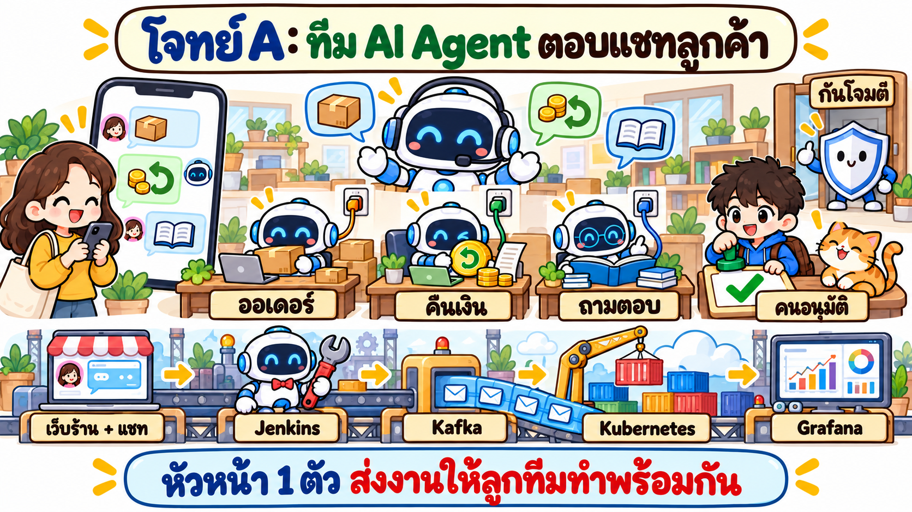

```text
โจทย์: ทีม AI Agent ตอบแชทลูกค้าร้านออนไลน์ · supervisor agent อ่านแชทจาก Kafka แยกเจตนาแล้วส่งต่อ (handoff) ให้ agent เฉพาะทาง 3 ตัว: ออเดอร์ · คืนเงิน · FAQ (RAG จากคู่มือสินค้า) · agent ใช้ระบบหลังร้านผ่าน MCP server · guardrails กัน prompt injection และปิดข้อมูลส่วนตัว · คืนเงินต้องให้คนอนุมัติ (human-in-the-loop) · eval แบบ LLM-as-judge
ทำเต็มระบบ: เว็บแอป (หน้าลูกค้า + หลังบ้าน) · Kafka ส่ง event ระหว่าง service · Docker + Jenkins CI/CD · Kubernetes + Helm · Prometheus/Grafana · ทดสอบบน staging แล้ว deploy production · deploy production แบบ canary 10% + rollback
ชื่อแผน: support_agents
จำนวน agent สูงสุด: 8
บัญชี: yolo1 yolo2 yolo3 cyolo1

แตกโจทย์เป็น DAG ไม่เกิน 26 งาน · ขนาด S/M/L · area ใช้ agent สำหรับงาน agent/MCP และ k8s สำหรับงาน Kubernetes · depends_on เท่าที่จำเป็น · งานทดสอบรวมบน staging และงาน deploy production รันคนเดียว (exclusive) บันทึกเป็น out/<ชื่อแผน>/tasks.json
แล้วใช้ tools/planner.py วาด DAG และแจกงานให้บัญชีพร้อมไทม์ไลน์ คำสั่ง plan แบบ --png (ถ้ายังไม่รู้วิธีใช้ ให้รัน python tools/planner.py --help ก่อน)
ตอบภาษาไทยสั้น ๆ: ลิงก์ dag.png กับ gantt.png · สายวิกฤตอยู่ที่สายไหน เพราะอะไร · ทำพร้อมกันสูงสุด · เวลารวม
```

📤 **ผลจริง** (22 งาน):


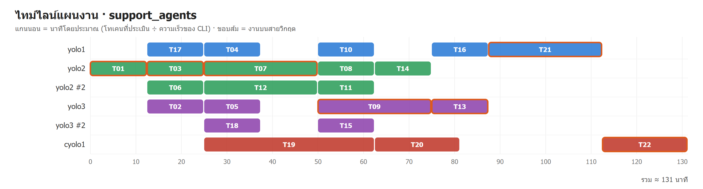

| | ผล |
|---|---|
| สายวิกฤต | T01 → T03 → T07 → T09 → T13 → T21 → T22 (15M tok) · **Kafka → supervisor → สายคืนเงิน** ยาวที่สุด เพราะ refund agent (L) ต้องมีหน้าให้คนอนุมัติต่อท้ายก่อนทดสอบรวม |
| ทำพร้อมกัน | **6** จาก 8 · supervisor (T07) เป็นศูนย์กลางที่แตกออกได้หลายกิ่ง · ชั้น deploy (T17–T20) ทำขนานไปได้ตั้งแต่ต้น ไม่อยู่บนสายวิกฤต |
| เวลารวม | **131 นาที** (ทำทีละงาน ≈ 337 นาที → เร็วขึ้น **2.6 เท่า**) |

### 🅱 Voice Agent รับโทรศัพท์นัดหมอฟัน (Realtime voice pipeline)

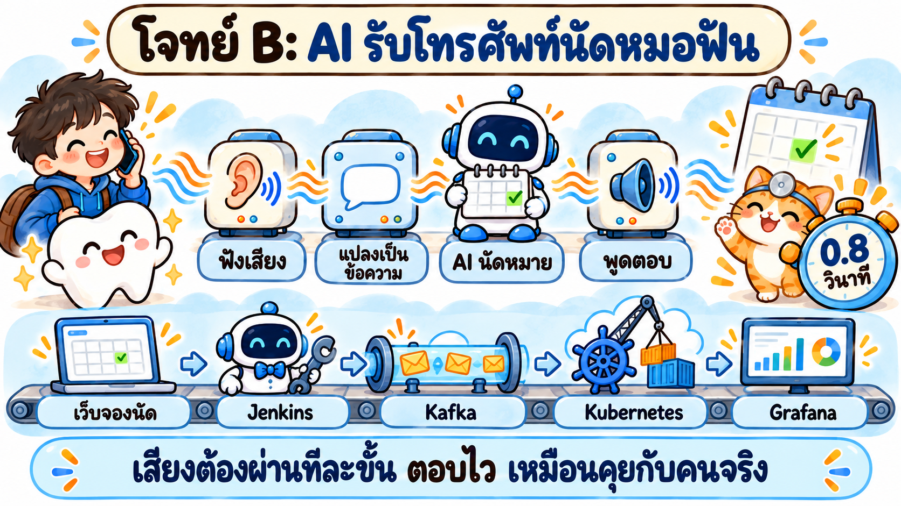

```text
โจทย์: Voice Agent รับโทรศัพท์นัดหมายคลินิกทันตกรรม พูดไทยแบบ realtime · รับสายผ่าน SIP/WebRTC → VAD ตัดช่วงพูด → STT ภาษาไทยแบบ streaming → agent นัดหมายที่เรียก tool เช็กตารางหมอ → TTS ภาษาไทยแบบ streaming · ลูกค้าพูดแทรกได้ (barge-in) · ตอบช้าไม่เกิน 800 ms · ส่ง event สาย/นัดผ่าน Kafka ไปสรุปลง CRM และแจ้งเตือนทาง LINE
ทำเต็มระบบ: เว็บแอป (หน้าลูกค้า + หลังบ้าน) · Kafka ส่ง event ระหว่าง service · Docker + Jenkins CI/CD · Kubernetes + Helm · Prometheus/Grafana · ทดสอบบน staging แล้ว deploy production · STT/TTS รันบน GPU node pool · ใช้เบอร์โทรจริง (SIP trunk)
ชื่อแผน: voice_clinic
จำนวน agent สูงสุด: 8
บัญชี: yolo1 yolo2 yolo3 cyolo1

แตกโจทย์เป็น DAG ไม่เกิน 26 งาน · ขนาด S/M/L · area ใช้ voice สำหรับงานเสียง agent สำหรับงาน agent และ k8s สำหรับงาน Kubernetes · depends_on เท่าที่จำเป็น · งานทดสอบรวมบน staging และงาน deploy production รันคนเดียว (exclusive) บันทึกเป็น out/<ชื่อแผน>/tasks.json
แล้วใช้ tools/planner.py วาด DAG และแจกงานให้บัญชีพร้อมไทม์ไลน์ คำสั่ง plan แบบ --png (ถ้ายังไม่รู้วิธีใช้ ให้รัน python tools/planner.py --help ก่อน)
ตอบภาษาไทยสั้น ๆ: ลิงก์ dag.png กับ gantt.png · สายวิกฤตอยู่ที่สายไหน เพราะอะไร · ทำพร้อมกันสูงสุด · เวลารวม
```

📤 **ผลจริง** (22 งาน):

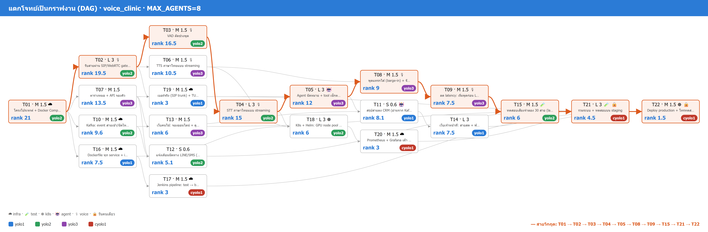

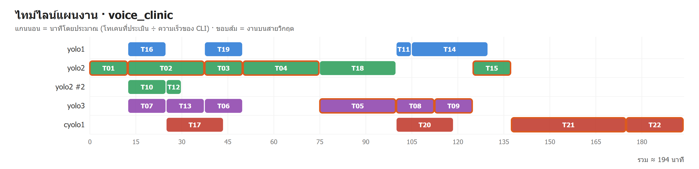

| | ผล |
|---|---|
| สายวิกฤต | T01 → T02 → T03 → T04 → T05 → T08 → T09 → T15 → T21 → T22 (**21M tok** ยาวที่สุดใน 4 โจทย์) · เสียงต้องผ่าน gateway → VAD → STT → agent → barge-in → ลด latency ทีละขั้น ขั้นถัดไปเริ่มไม่ได้จนกว่าขั้นก่อนจะเสร็จ |
| ทำพร้อมกัน | **4** จาก 8 · เพิ่มเว็บ Kafka และชั้น deploy เข้ามาแล้วก็ยังใช้ไม่ถึงครึ่ง เพราะงานพวกนั้นเสร็จเร็วแล้วต้องนั่งรอสายเสียง |
| เวลารวม | **194 นาที** (ทำทีละงาน ≈ 335 นาที → เร็วขึ้นแค่ **1.7 เท่า**) |

> 💡 จะให้เร็วขึ้นต้อง**ตัดสายวิกฤต** เช่น ให้ agent นัดหมาย (T05) ทดสอบด้วย**ข้อความ**ไปก่อน ไม่ต้องรอ STT จริง ลองพรอมต์ `ชื่อแผน: voice_clinic · ให้ T05 รอแค่ T07 โดยทดสอบด้วยข้อความแทนเสียงไปก่อน แล้ววาดใหม่ทั้ง 2 ภาพ เทียบเวลารวม`

### 🅲 Deep Research Agent (Plan-and-execute + sub-agent ขนาน)

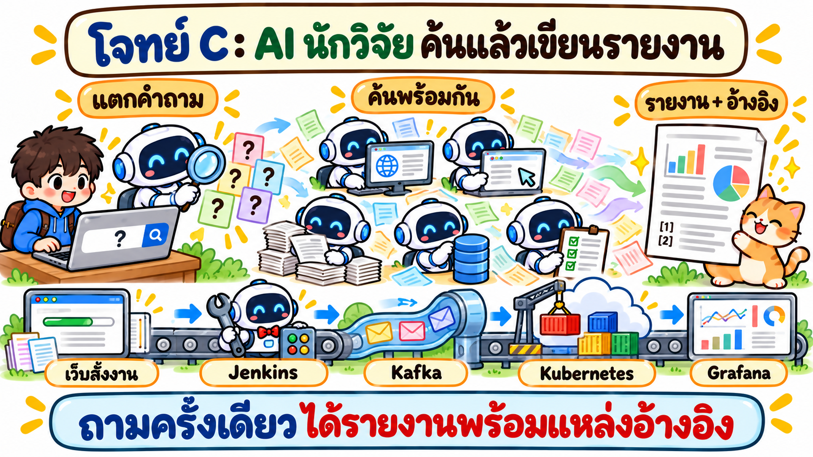

```text
โจทย์: Deep Research Agent พิมพ์หัวข้อเดียวแล้วได้รายงานพร้อมอ้างอิง · planner agent แตกคำถามเป็นคำถามย่อยแล้วส่งเข้าคิว Kafka → sub-agent worker หลายตัวค้นพร้อมกัน (ค้นเว็บ · browser agent ที่คลิกเว็บได้ · อ่าน PDF งานวิจัย · คลังความจำ vector DB) → ตรวจข้อเท็จจริง + จับคู่อ้างอิง → writer agent เรียบเรียงรายงาน + กราฟ + ภาพปก · ตั้งเวลาวิจัยซ้ำได้
ทำเต็มระบบ: เว็บแอป (หน้าลูกค้า + หลังบ้าน) · Kafka ส่ง event ระหว่าง service · Docker + Jenkins CI/CD · Kubernetes + Helm · Prometheus/Grafana · ทดสอบบน staging แล้ว deploy production · worker ขยายอัตโนมัติตามงานค้างใน Kafka (KEDA) · ผู้ใช้ล็อกอินและมีโควตาของตัวเอง
ชื่อแผน: deep_research
จำนวน agent สูงสุด: 8
บัญชี: yolo1 yolo2 yolo3 cyolo1

แตกโจทย์เป็น DAG ไม่เกิน 26 งาน · ขนาด S/M/L · area ใช้ agent สำหรับงาน agent และ k8s สำหรับงาน Kubernetes · งานรูปให้ cyolo ทำ (only: cyolo) · depends_on เท่าที่จำเป็น · งานทดสอบรวมบน staging และงาน deploy production รันคนเดียว (exclusive) บันทึกเป็น out/<ชื่อแผน>/tasks.json
แล้วใช้ tools/planner.py วาด DAG และแจกงานให้บัญชีพร้อมไทม์ไลน์ คำสั่ง plan แบบ --png (ถ้ายังไม่รู้วิธีใช้ ให้รัน python tools/planner.py --help ก่อน)
ตอบภาษาไทยสั้น ๆ: ลิงก์ dag.png กับ gantt.png · สายวิกฤตอยู่ที่สายไหน เพราะอะไร · ทำพร้อมกันสูงสุด · เวลารวม
```

📤 **ผลจริง** (25 งาน):

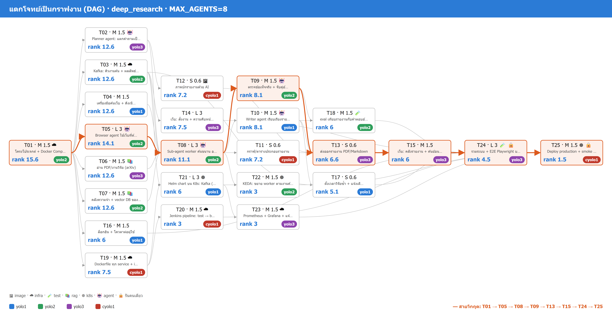

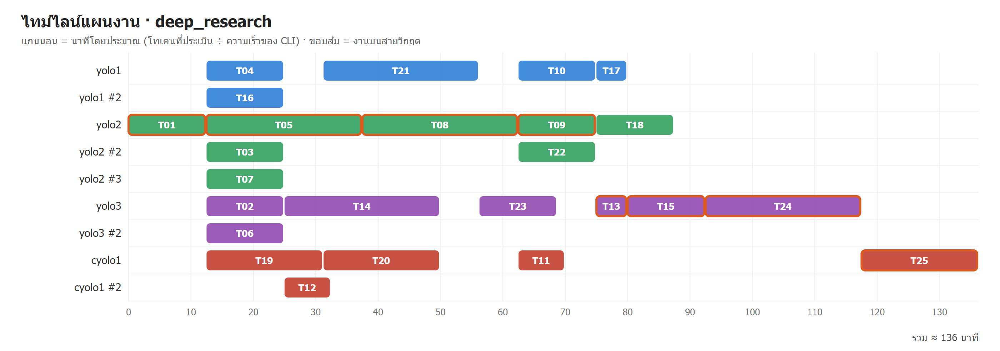

| | ผล |
|---|---|
| สายวิกฤต | T01 → T05 → T08 → T09 → T13 → T15 → T24 → T25 (15.6M tok) · **browser agent** (L) เป็นกิ่งที่ยาวที่สุดในช่วงแตกขนาน ทุกกิ่งจึงต้องรอมันก่อนเข้า T08 |
| ทำพร้อมกัน | **8** จาก 8 (เต็มเพดาน) · ช่วงแตก (fan-out) กว้างถึง 9 กิ่ง แต่ T08 เป็น**คอขวด**ที่ทุกกิ่งต้องมารวม |
| เวลารวม | **136 นาที** (ทำทีละงาน ≈ 345 นาที → เร็วขึ้น **2.5 เท่า**) |

### 📊 เทียบ 4 โจทย์

| โจทย์ | รูปร่าง | งาน | สายวิกฤต (M tok) | ทำพร้อมกันสูงสุด | เวลารวม | ทำทีละงาน | เร็วขึ้น |
|---|---|---|---|---|---|---|---|
| catfood (ขั้นที่ 1–2 · 6 agent) | ผสม | 14 | 15 | 4 | 125 นาที | 217 นาที | 1.7× |
| 🅰 support_agents | ⭐ ดาว | 22 | 15 | 6 | **131 นาที** | 337 นาที | **2.6×** |
| 🅱 voice_clinic | 🐢 สายยาว | 22 | **21** | 4 | **194 นาที** | 335 นาที | **1.7×** |
| 🅲 deep_research | 🔷 ข้าวหลามตัด | 25 | 15.6 | **8** | 136 นาที | 345 นาที | 2.5× |

สิ่งที่เห็น:
- 🅰 กับ 🅱 มี **22 งานเท่ากัน** งานรวมพอ ๆ กัน (≈ 335 นาทีถ้าทำทีละงาน) แต่ 🅱 ช้ากว่าเกือบ 1 ชั่วโมง ตัวกำหนดคือ**ความยาวสายวิกฤต** ไม่ใช่จำนวนงาน
- 🅲 มีงานมากที่สุด (25) แต่เสร็จใกล้ 🅰 เพราะสายวิกฤตยาวพอ ๆ กัน งานที่เพิ่มมาไปอยู่กิ่งข้างที่ทำขนานได้
- **ชั้น deploy** (Docker · Jenkins · Helm · monitoring) ไม่ได้อยู่บนสายวิกฤตของโจทย์ไหนเลย ถ้าเริ่มทำตั้งแต่ต้นคู่ขนานกับตัว agent จะแทบไม่เพิ่มเวลารวม มีแค่ staging + deploy production ที่ต้องรอท้ายสุด
- 🅱 **เพิ่ม agent ไม่ช่วย** ต้องออกแบบให้งานรอกันน้อยลง (เช่น ทดสอบด้วยข้อความแทนเสียงเพื่อตัดสายวิกฤต)

---

## ไฟล์ในโฟลเดอร์นี้

| ไฟล์ | คืออะไร |
|---|---|
| `readme.md` | ทุกอย่างของ LAB: ทฤษฎี + พรอมต์ + ผลจริง (ไฟล์นี้) |
| [tools/planner.py](tools/planner.py) | "มือ" ที่ AI เรียกใช้: คิด rank · จำลองเวลา · วาด DAG/Gantt (`--help` อธิบายวิธีใช้ · `doctor` ตรวจเครื่อง) |
| [tools/orch.py](tools/orch.py) | อัลกอริทึม **KC-QUEST** ที่ planner เรียกใช้แจกงาน: อ่านโควตา · ให้คะแนนบัญชี · เลือกบัญชีที่ทำจบได้ (ตัวเดียวกับ LAB 04.2 · สมการอธิบายไว้ใน [ALGORITHM.md](../04_Multi_Agent_Orchestra/ALGORITHM.md)) |
| `image/` | ภาพในหน้านี้ (`concept-*` คือภาพอธิบาย · `poster-*` คือภาพหัวโจทย์ · `real-*` · `catfood-ai-*` · `agent-*` คือผลจริง) |
| `out/<ชื่อแผน>/` | ผลของเรา: `tasks.json` · `dag.png` · `gantt.png` · `PLAN.md` (รายงานเต็ม + เหตุผลทุกงาน) · ไม่เก็บใน git |

## ติดปัญหา

| อาการ | 💬 วาง |
|---|---|
| ไม่แน่ใจว่าเครื่องพร้อมไหม | `รัน python tools/planner.py doctor แล้วบอกวิธีแก้ทุกข้อที่ไม่ผ่าน` |
| `ไม่พบ tools/orch.py` | `tools/` ต้องมีทั้ง `planner.py` และ `orch.py` (copy ทั้งโฟลเดอร์ `02_DAG_Planner` ไปด้วยกัน) |
| ได้แค่ .svg ไม่มี .png | `ติดตั้ง playwright ด้วย pip แล้ววาดภาพใหม่` (หรือเปิด .svg ในเบราว์เซอร์แทนก็ได้) |
| AI หาแผนเดิมไม่เจอ (เปิดแชทใหม่) | ใส่บรรทัด `ชื่อแผน: <ชื่อ>` ไว้บนสุดของพรอมต์ |
| กราฟดูแปลก | `ชื่อแผน: catfood · อธิบายว่าทำไมงานนี้ต้องรองานนั้น ถ้าไม่จำเป็นให้ตัดออกแล้ววาดใหม่` |

<sub>ทดสอบจริง 22–23 ต.ค. 2026 · Claude Code (opus) วางพรอมต์ ① ② ตามหน้านี้ · บัญชี yolo1–3 + cyolo1 · ภาพอธิบายสร้างด้วย cyolo (Codex)</sub>
