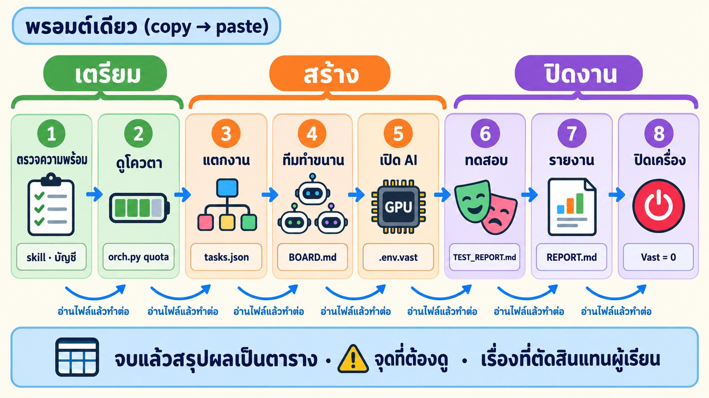

# ⚡ Fast Track · Multi-Agent Orchestra ในพรอมต์เดียว

งานเดียวกับ [LAB 04.2 หลัก](../readme.md) ทุกขั้น (0–9) แต่วางพรอมต์ **ครั้งเดียว** แล้ว AI ทำต่อกันเองจนจบ: ตรวจความพร้อม → ดูโควตา → แตกงาน → ทีมทำขนาน → ทดสอบ → รายงาน → **ปิดเครื่อง Vast ให้เอง** → สรุป (ราว 45–60 นาที)


## 🧭 พรอมต์ทำอะไรบ้าง

AI ทำ 8 ขั้นต่อกัน แต่ละขั้นเขียนผลลงไฟล์ แล้ว **อ่านไฟล์นั้นก่อนทำขั้นถัดไป** ถ้าสะดุดกลางทาง วางพรอมต์เดิมซ้ำได้เลย AI จะดูไฟล์ใน `/root/runs/buildmart` แล้วทำต่อจากขั้นที่ค้าง



| LAB หลัก | ในพรอมต์นี้ | ต่างจาก LAB หลัก |
|---|---|---|
| ขั้น 0 เปิด Terminal | ขั้น 1 ตรวจความพร้อม | AI ตรวจ repo · skill · บัญชี · docker · Vast · port 3400 เอง ถ้าไม่ผ่านจะหยุดแล้วบอกว่าต้องทำอะไร |
| ขั้น 1 สำรวจบัญชี | ขั้น 2 ดูโควตา | เหมือนเดิม + เลือกตัวคุมวงเอง |
| ขั้น 2–6 แตกงาน · แจกงาน · ย้ายงาน · ส่งไม้ | ขั้น 3–4 | เหมือนเดิม (ทำตาม [ORCHESTRA_RECIPE.md](../ORCHESTRA_RECIPE.md)) |
| ขั้น 7 AI บน Vast | ขั้น 4 (ทำขนานกับการสร้างเว็บ) | มีเพดานเวลาเปิดเครื่อง กันลืมเครื่องค้าง |
| ขั้น 8 ทดสอบ | ขั้น 5 | เคสไหนไม่ผ่าน AI เพิ่มงานแก้ให้เอง (สูงสุด 2 รอบ) |
| — | ขั้น 6 รายงาน + export | เช็กด้วยว่าไม่มี key ติดไปใน `my_buildmart/` |
| ขั้น 9 ปิดเครื่อง (พิมพ์เอง) | ขั้น 7 ปิดเครื่องอัตโนมัติ | **ไม่ต้องจำ** · เปิดเว็บไว้แบบ mock (ฟรี) ให้ดูต่อ |
| — | ขั้น 8 สรุป | เขียน `my_buildmart/FAST_TRACK.md` อ่านได้แม้ตัวคุมวงถูกส่งไม้ไปบัญชีอื่น |

## 🏷️ หัวใจที่พรอมต์บังคับไว้

- **ความจำอยู่ในไฟล์ ไม่อยู่ในแชต** — ถ้าตัวคุมวงโทเคนใกล้หมดแล้ว **ส่งไม้** ให้บัญชีอื่น คนใหม่ได้แค่คำสั่ง "ทำ ORCHESTRA_RECIPE ขั้น 3 ต่อ + อ่าน `NOTES.md`" พรอมต์จึงให้คัดลอกขั้นปิดงาน (ทดสอบ → รายงาน → ปิดเครื่อง → สรุป) ไว้บนสุดของ `NOTES.md` ตั้งแต่แรก ใครเป็นตัวคุมวงคนสุดท้ายก็ปิดงานได้ครบ
- **เงินจริงต้องปิดเสมอ** — ทุกทางจบ (สำเร็จ ล้ม หรือเปลี่ยนแผน) ต้องไม่มีเครื่อง `bm-ninfer-5090` เหลือ · ห้ามเช่าเกิน `MAX_DPH` · เครื่องเปิดเกิน 2 ชม. ให้ลบแล้วทดสอบแบบ mock แทน
- **ห้ามแก้เกณฑ์ให้ผ่าน** — เคสไหนไม่ผ่านให้แก้โค้ด ไม่ใช่แก้ค่าที่คาดหวังใน `BUILDMART.md` หรือใน test

## 🔀 เลือกพรอมต์ 1 จาก 2 แบบ

ทั้งสองแบบทำ 8 ขั้นเหมือนกัน ได้เว็บเดียวกัน ต่างกันแค่ **แชทบอทใช้ AI จริงบน GPU หรือใช้ mock**


| | 🅰️ ใช้ AI จริง (`BACKEND=vast`) | 🅱️ ฟรี (`BACKEND=mock`) |
|---|---|---|
| แชทบอทตอบด้วย | Qwen บน RTX 5090 (Vast.ai) | `mock-llm` ตอบตาม pattern |
| ค่าใช้จ่าย | ≈ $0.55–1 (ลบเครื่องให้อัตโนมัติ) | $0 |
| ผลทดสอบที่ได้ | 28 เคสโหมด mock **และ** 28 เคสโหมด ai | 28 เคสโหมด mock |
| ต้องมีเพิ่ม | skill `vastai` · `VAST_API_KEY` + SSH key ใน `.env` ([LAB 04.1](../../01_VastAi_Skill/readme.md)) · เครดิต Vast | — |
| เหมาะกับ | เห็นภาพครบทั้ง LAB · สาธิตในห้อง | ฝึกเรื่อง orchestra ล้วน ๆ · ไม่มีเครดิต Vast |

> 💡 สอนในห้อง: ให้ทุกคนรัน 🅱️ แล้วผู้สอนรัน 🅰️ บนจอ จะเห็นว่าเว็บและการแจกงานเหมือนกัน ต่างกันแค่ใครตอบแชท

<details>
<summary>ดูว่าพรอมต์สองแบบต่างกันตรงไหนบ้าง</summary>

| จุด | 🅰️ ใช้ AI จริง | 🅱️ ฟรี |
|---|---|---|
| บรรทัดแรก | ใช้ skill yolo, cyolo **และ vastai** | ใช้ skill yolo และ cyolo |
| ค่าตั้งต้น | `BACKEND=vast MAX_DPH=1.20` | `BACKEND=mock` |
| ขั้น 1 ตรวจ | + มี `VAST_API_KEY` และ `vastai show instances` ใช้ได้ | ไม่ตรวจ Vast |
| ขั้น 3 แตกงาน | มีงาน `VAST` · งานทดสอบสุดท้ายรอ `VAST` | ไม่มีงาน `VAST` |
| ขั้น 4 กติกาเงิน | เพดานราคา · เครื่องเดียว · เปิดไม่เกิน 2 ชม. · เช่าไม่ได้ให้เปลี่ยนเป็น mock | — |
| ขั้น 5 ทดสอบ | mock ต้องผ่านครบ · ai ตรวจแบบยืดหยุ่น ไม่ผ่านรันซ้ำ 1 ครั้ง | mock ต้องผ่านครบ |
| ขั้น 7 ปิดเครื่อง | ลบเครื่อง Vast + สรุปค่าใช้จ่าย + ปิดเว็บ | ปิดเว็บอย่างเดียว |

**เหมือนกันทุกตัวอักษร:** กติกาความลับ · ความจำอยู่ในไฟล์ · การทำต่อจากที่ค้าง · การตัดสินแทนผู้เรียน (ส่วนที่ไม่เกี่ยวกับ Vast) · ขั้น 2–3 · ขั้น 6 · ขั้น 8

</details>

## 🚀 วิธีใช้

1. เตรียมให้พร้อม: ทำ [LAB 03](../../../03_MultiAccount_Container/README.md) (container `multi-account-devtool` + ล็อกอิน **อย่างน้อย 2 บัญชี**) · [LAB 04](../../00_Setup_Skill/readme.md) (skill `yolo` `cyolo` `vastai`) · แบบ 🅰️ ต้องทำ [LAB 04.1](../../01_VastAi_Skill/readme.md) ด้วย
2. เปิด JupyterLab `http://localhost:8886/lab` → **File → New → Terminal** (อยู่ที่ `/workspace`)
3. 🖥️ เปิด AI บัญชีที่โควตาเหลือมากสุด เช่น `yolo1` (ถ้าเลือกผิด AI จะส่งไม้ให้บัญชีที่เหมาะกว่าเอง)
4. 💬 คัดลอกพรอมต์ 🅰️ หรือ 🅱️ ไปวาง แล้วรอ (ตั้งเครื่องไม่ให้หลับ)
5. 👀 ดูความคืบหน้าสด: เปิด `00_setup/04_Skill_Setup/02_Multi_Agent_Orchestra/my_buildmart/BOARD.md` ใน JupyterLab (คลิกขวา → Open With → Markdown Preview)
6. จบแล้วอ่าน `my_buildmart/FAST_TRACK.md` และตรวจตามหัวข้อ ✅ ข้างล่าง

> 🔁 เคยทำ LAB หลักหรือรัน Fast Track ไปแล้ว อยากเริ่มใหม่ทั้งหมด: ปิดเว็บ/ลบเครื่อง Vast ก่อน แล้ว 🖥️ `mv /root/runs/buildmart /root/runs/buildmart.old` ไม่อย่างนั้น AI จะเห็นว่าทำเสร็จแล้วและไปต่อจากขั้นที่ค้าง

## ✅ จบแล้วตรวจอะไร

1. **`my_buildmart/FAST_TRACK.md`** ดูช่อง ⚠️ และ "เรื่องที่ตัดสินแทนผู้เรียน" ก่อน เพราะเป็นจุดที่ AI ตัดสินใจแทนคุณ
2. **แบบ 🅰️: เปิด [cloud.vast.ai → Instances](https://cloud.vast.ai/instances/) ดูด้วยตาว่าว่าง** (ไม่มี `bm-ninfer-5090`)
3. **เปิดเว็บ** `http://localhost:3400` (เปิดค้างไว้แบบ mock) ลองค้นหา "ปูน" และถามน้องช่าง
4. **`my_buildmart/app/TEST_REPORT.md`** ผ่านกี่เคส · GIF อยู่ที่ `my_buildmart/app/test-gifs/`
5. **`my_buildmart/orchestra/REPORT.md`** งานไหนไปบัญชีไหน มีย้ายงาน/ส่งไม้ไหม (เทียบกับ [ALGORITHM.md](../ALGORITHM.md))

ตัวเลขจากการทำจริงใน LAB หลัก (15–16 ต.ค. 2026 · 4 บัญชี) ใช้เป็นจุดเทียบ ของคุณไม่จำเป็นต้องตรง แต่ควรอยู่ในระดับใกล้กัน

| ขั้น | ไฟล์ | LAB หลักได้ |
|---|---|---|
| 2 | ตาราง quota | 4 บัญชี · slot รวม 10–11 · ตัวคุมวง yolo1 |
| 3 | `tasks.json` · `_shared.md` | 17 งาน (T01–T15 + VAST + IMG1) · วางแผน 11 นาที · `_shared.md` ~320 บรรทัด |
| 4 | `BOARD.md` | 17/17 เสร็จใน 37 นาที · worker พร้อมกันสูงสุด 10 · merge conflict 0 · ชนเพดานกลางงาน 0 |
| 4 (VAST) | `.env.vast` | RTX 5090 $1.198/ชม. · พร้อมใช้ใน ~7 นาที · Qwen ตอบไทย ~100 token/วิ |
| 5 | `TEST_REPORT.md` | mock 28/28 · ai 28/28 |
| 7 | — | ลบเครื่องแล้ว 0 เครื่อง · ค่า GPU ≈ $0.55 ถ้าลบทันที |

> LAB หลักมีเฟส 2 (เพิ่ม T16–T18 แล้วบังคับให้ย้ายงาน/ส่งไม้) เพื่อสาธิต · Fast Track ไม่บังคับ การย้ายงานจะเกิดเองเฉพาะเมื่อบัญชีไหนเหลือน้อยจริง

## 🆘 ถ้าสะดุด

| อาการ | ทำอะไร |
|---|---|
| แชตหลุด หรือ AI หยุดกลางทาง | เปิด `yolo1` ใหม่ วางพรอมต์เดิมซ้ำ AI จะทำต่อจากขั้นที่ค้าง (ถ้ามีตัวคุมวงอื่นทำงานอยู่ มันจะรายงานสถานะแล้วจบเอง ไม่คุมซ้อน) |
| AI บอกว่า "ส่งไม้ให้ … แล้ว" และจบแชต | ปกติ ตัวคุมวงคนใหม่ทำต่อเบื้องหลัง ดู `my_buildmart/BOARD.md` แล้วรอ `my_buildmart/FAST_TRACK.md` |
| หยุดที่ขั้น 1 ว่า "ล็อกอินไม่ถึง 2 บัญชี" | ล็อกอินเพิ่มตาม LAB 03 (`yolo2` / `cyolo1` ใน terminal) แล้ววางพรอมต์ซ้ำ |
| หยุดที่ขั้น 1 ว่า port 3400 ถูกใช้ | 🖥️ `docker ps --filter publish=3400` ดูว่าใครใช้ ปิดตัวนั้นแล้ววางพรอมต์ซ้ำ |
| เช่า Vast ไม่ได้ (ไม่มีเครื่อง ≤ $1.20) | AI เปลี่ยนเป็นทดสอบ mock ให้เอง และจดไว้ใน ⚠️ · อยากได้ AI จริงค่อยรันซ้ำวันอื่น |
| ไม่แน่ใจว่าเครื่อง Vast ถูกลบแล้ว | 💬 `ใช้ skill vastai ลบเครื่องป้าย bm-ninfer-5090 แล้วยืนยันว่าไม่มีเครื่องเหลือ` |
| เลิกดูเว็บแล้ว | 💬 `ปิดเว็บ: docker compose --profile mock down ใน /root/runs/buildmart/app` |

อาการอื่นดู[ตารางแก้ปัญหาใน LAB หลัก](../readme.md#แก้ปัญหา)

---

## 🅰️ พรอมต์แบบใช้ AI จริง (Vast.ai RTX 5090)

```text
ใช้ skill yolo, cyolo และ vastai ทำ LAB 04.2 Multi-Agent Orchestra ให้จบทั้งหมดในรอบเดียวโดยไม่ต้องรอผม
LAB=/workspace/00_setup/04_Skill_Setup/02_Multi_Agent_Orchestra · RUN=/root/runs/buildmart · OUT=$LAB/my_buildmart · O="python3 $LAB/tools/orch.py --run $RUN"
PROBLEM=$LAB/BUILDMART.md MAX_AGENTS=12 BACKEND=vast MAX_DPH=1.20 BUDGET=yolo3=3
ทำ 8 ขั้นต่อกัน: ตรวจความพร้อม → ดูโควตา → แตกงาน → ทีมทำขนาน (+เปิด AI บน Vast ขนานกัน) → ทดสอบ → รายงาน → ปิดเครื่อง → สรุป
ขั้น 2–6 ทำตาม $LAB/ORCHESTRA_RECIPE.md และงาน VAST ทำตาม $LAB/NINFER_RECIPE.md ส่วนพรอมต์นี้เพิ่มกติกาให้ ถ้าขัดกันให้ถือพรอมต์นี้

กติกาที่ต้องถือตลอดทุกขั้น
- ห้ามแสดงค่าใน .env .env.vast auth.json .credentials.json หรือ key ใด ๆ บนจอหรือลงไฟล์ใน /workspace บอกได้แค่ชื่อตัวแปรและ "มี/ไม่มี" และห้ามล็อกอินบัญชีแทนผม
- เปิด worker ผ่าน $O dispatch / $O start เท่านั้น ตัวคุมวงไม่เขียนโค้ดเอง (นอกจากแก้เล็กมาก)
- ความจำอยู่ในไฟล์ ไม่อยู่ในแชต: หลัง $O init ให้เขียนหัวข้อ "FAST TRACK" ไว้บนสุดของ $RUN/NOTES.md มีค่า LAB RUN OUT BACKEND MAX_DPH เวลาเริ่ม และคัดลอกกติกาเรื่องเงิน + "ตัดสินแทนผู้เรียน" + ขั้น 5–8 ของพรอมต์นี้ลงไปทั้งหมด พร้อมบรรทัด "ตัวคุมวงคนไหนเจอ ALL_DONE ต้องทำขั้น 5–8 ต่อจนจบ" เพราะถ้ามีการส่งไม้ ($O handover) ตัวคุมวงคนใหม่จะได้แค่คำสั่งให้ทำ ORCHESTRA_RECIPE ขั้น 3 และอ่าน NOTES.md
- ก่อนเริ่มแต่ละขั้นให้อ่าน $RUN/NOTES.md $RUN/BOARD.md และไฟล์ของขั้นก่อนจากดิสก์ใหม่ทุกครั้ง
- งานยาวได้: วน $O dispatch แล้ว $O wait --timeout 540 ไปเรื่อย ๆ ห้ามจบเทิร์นไปก่อนแล้วบอกว่า "จะกลับมาดู" ทุกครั้งที่ wait ได้ event ให้รายงานผม 1–2 บรรทัด: เสร็จกี่งาน / รันกี่ตัว / event สำคัญ
- เขียนไฟล์สรุปทุกไฟล์เป็นภาษาไทย ใช้ตาราง
- เงินจริง: ห้ามเช่าเกิน MAX_DPH ห้ามมีเครื่องเกิน 1 เครื่อง และทุกทางจบ (สำเร็จ ล้ม เปลี่ยนแผน) ต้องไม่มีเครื่องป้าย bm-ninfer-5090 เหลือ ถ้าเครื่องเปิดรวมเกิน 2 ชม. (นับจาก running) ให้ลบทันทีแล้วทดสอบแบบ mock อย่างเดียว ห้ามแตะเครื่อง Vast ป้ายอื่น
- ตรงไหนที่ปกติต้องถามผม ไม่ต้องหยุดรอ ให้ตัดสินตามนี้แล้วจดลง $RUN/NOTES.md หัวข้อ "ตัดสินแทนผู้เรียน": บัญชีที่ยังไม่ล็อกอินให้ข้ามไป ใช้เท่าที่มี · เช่า RTX 5090 ที่ ≤ MAX_DPH และเน็ต ≥ 2000 Mbps ไม่ได้ภายใน 15 นาที หรืองาน VAST ล้ม → ลบเครื่องที่อาจค้าง แล้วทดสอบแบบ mock อย่างเดียว · งาน FAILED ครบรอบแล้ว → แบ่งงานใหม่ 1 ครั้ง ถ้ายังล้มให้ข้ามงานนั้น (และงานที่รอมัน) แล้วไปต่อ · HANDOFF และการส่งไม้ตัวคุมวงปล่อยตามระบบ · ตอนจบเปิดเว็บไว้แบบ mock (ฟรี) ให้ผมดู · เรื่องอื่นที่ไม่แน่ใจให้เลือกทางที่ปลอดภัยและไม่เสียเงินกว่า
- หยุดแล้วบอกผมว่าต้องทำอะไร เฉพาะเมื่อ: ล็อกอินน้อยกว่า 2 บัญชี · หา $LAB ใน /workspace ไม่เจอ · docker ใช้ไม่ได้ · port 3400 บน host ถูกใช้โดย container อื่นที่ไม่ใช่ของ buildmart

ตอนเริ่ม ดูว่าเคยทำค้างไว้ไหม (เปิดไฟล์จริง ไม่เดา)
- ไม่มี $RUN/tasks.json หรือไม่มีงานในนั้น → เริ่มขั้น 1
- มีงานแต่ยังไม่เสร็จทุกงาน: ถ้า $RUN/logs/events.jsonl มี event ภายใน 10 นาทีล่าสุด และบัญชีใน $RUN/state/orchestrator.json ไม่ใช่ $O whoami แปลว่ามีตัวคุมวงอื่นทำงานอยู่ → สรุปสถานะจาก BOARD.md ให้ผมแล้วจบ ห้ามคุมซ้อน · ไม่อย่างนั้นทำขั้น 1 แล้วข้ามไปขั้น 4 (ห้าม init หรือวางแผนใหม่)
- งานเสร็จทุกงานแต่ยังไม่มี $OUT/FAST_TRACK.md → ทำขั้น 1 แล้วต่อขั้น 5
- มี $OUT/FAST_TRACK.md แล้ว → ทำขั้น 7 ซ้ำเพื่อยืนยันว่าไม่มีเครื่องเหลือ แล้วแสดงสรุปจากไฟล์นั้น

ขั้นที่ 1 ตรวจความพร้อม
ถ้าไม่มี $LAB ให้หาโฟลเดอร์จริงด้วย find /workspace -maxdepth 5 -path '*02_Multi_Agent_Orchestra/ORCHESTRA_RECIPE.md' แล้วใช้โฟลเดอร์นั้นเป็น LAB (และจดลง NOTES.md) · ตรวจแล้วแสดงเป็นตาราง รายการ | ผล ✅/❌ | หมายเหตุ: ls $LAB เห็น BUILDMART.md ORCHESTRA_RECIPE.md NINFER_RECIPE.md tools/orch.py · /root/ai-accounts/.Claude/shared/skills มี yolo cyolo vastai · docker ps ได้ และ port 3400 บน host ว่างหรือเป็นของ buildmart เอง · มี /ms-playwright · .env มี VAST_API_KEY (ชื่อเท่านั้น) และ vastai show instances ใช้ได้ (ถ้ามีเครื่องป้าย bm-ninfer-5090 ค้างอยู่ให้จดไว้ งาน VAST จะใช้ต่อ) · บัญชีที่ล็อกอินได้ดูในขั้น 2

ขั้นที่ 2 ดูโควตา + เลือกตัวคุมวง (ORCHESTRA_RECIPE ข้อ 1)
$O init --problem $PROBLEM --max-agents $MAX_AGENTS --mirror $OUT แล้วเขียนหัวข้อ FAST TRACK ลง NOTES.md ทันที · เขียน BUDGET ลง $RUN/accounts.json · $O quota แล้วอธิบายตารางสั้น ๆ ว่าบัญชีไหนควรใช้ก่อนและทำไม · ถ้าบัญชีที่ล็อกอินน้อยกว่า 2 → หยุดบอกผม · ถ้าตามสูตรต้องส่งไม้ตัวคุมวงตั้งแต่ต้น ให้ $O handover --to <บัญชีนั้น> แล้วบอกผมว่าดูความคืบหน้าที่ $OUT/BOARD.md และรอ $OUT/FAST_TRACK.md จากนั้นจบ

ขั้นที่ 3 แตกงาน (ORCHESTRA_RECIPE ข้อ 2)
เขียน _shared.md + tasks/*.md + tasks.json ตามสูตร มีงาน VAST (only: yolo, no_handoff: true) และงานรูป IMG1 ของ cyolo · งานทดสอบสุดท้าย exclusive ต้องรันทุกเคส W01–W14 C01–C14 ทั้ง MODE=mock และ MODE=ai (ถ้ามี $RUN/.env.vast) ทำ GIF ต่อเคส และ TEST_REPORT.md ที่มีตารางสรุป โหมด | ผ่าน / ทั้งหมด ไว้บนสุด · $O check ต้องได้ OK (ถ้าเตือนว่างานไหนไม่มีบัญชีปิดได้ ให้แบ่งงานนั้นก่อน) · $O infra up

ขั้นที่ 4 ทีมทำขนาน (ORCHESTRA_RECIPE ข้อ 3)
วน $O dispatch → $O wait --timeout 540 และตอบสนองตามตาราง event ในสูตร จนได้ ALL_DONE · ระหว่างนั้นถือกติกาเรื่องเงินและ "ตัดสินแทนผู้เรียน" ข้างบน · ถ้าเปลี่ยนเป็นทดสอบ mock อย่างเดียว ให้แก้ prompt ของงานทดสอบใน tasks/<ID>.md ให้ข้าม MODE=ai และเอา VAST ออกจาก depends_on แล้ว $O check · ถ้าได้ ORCH_LOW ให้อัปเดต NOTES.md (หัวข้อ FAST TRACK ยังต้องอยู่บนสุด) แล้ว $O handover และจบทันที

ขั้นที่ 5 ตรวจผลทดสอบ
อ่าน $RUN/app/TEST_REPORT.md เกณฑ์: โหมด mock ต้องผ่านครบทุกเคส · โหมด ai ตรวจแบบยืดหยุ่นตาม BUILDMART.md (มีตัวเลข/คำสำคัญที่ถูกต้อง) เคสที่ไม่ผ่านให้รันเคสนั้นซ้ำ 1 ครั้งก่อนสรุป
ถ้ามีเคสไม่ผ่าน: เพิ่มงานแก้ FIX1, FIX2, … (size S หรือ M) ใน tasks.json + tasks/FIX<n>.md บอกเคสที่ล้ม ผลที่คาดหวังจาก BUILDMART.md ผลจริง และ path ของ log/GIF ให้แก้โค้ดแล้วรันเคสนั้นจนผ่าน และงานทดสอบรวมรอบใหม่ที่รอ FIX ทั้งหมด จากนั้น $O check แล้วกลับไปวนขั้น 4 · ทำได้สูงสุด 2 รอบ ถ้ายังไม่ผ่านให้จด ⚠️ แล้วไปต่อ
ห้ามแก้ค่าที่คาดหวังใน BUILDMART.md หรือใน test ให้ผ่าน ต้องแก้ที่โค้ดของเว็บหรือแชทบอทเท่านั้น

ขั้นที่ 6 รายงาน + export (ORCHESTRA_RECIPE ข้อ 4)
$O quota (เก็บโควตาตอนจบ) · $O report · $O export --to $OUT · ตรวจว่าใน $OUT ไม่มีไฟล์ .env / .env.vast และไม่มีบรรทัด LLM_API_KEY= ที่มีค่าต่อท้าย (ตรวจด้วย grep แบบแสดงแค่ชื่อไฟล์ ห้ามพิมพ์ค่า)

ขั้นที่ 7 ปิดเครื่อง
ใช้ skill vastai ลบเครื่องป้าย bm-ninfer-5090 ทุกเครื่อง แล้ว vastai show instances ยืนยันว่าไม่มีป้ายนี้เหลือ (บอกจำนวนเครื่องป้ายอื่นที่เห็นด้วย แต่ห้ามลบ) และคำนวณค่าใช้จ่าย GPU = ชม.ที่เปิด × $/ชม. · ปิดเว็บโหมด ai: docker compose down ใน $RUN/app · $O infra down · แล้วเปิดเว็บกลับแบบ mock: docker compose --profile mock up -d --build ใน $RUN/app รอจน http://host.docker.internal:3400 ตอบ 200

ขั้นที่ 8 สรุป → $OUT/FAST_TRACK.md
เขียนไฟล์นี้ (อ่านจาก REPORT.md TEST_REPORT.md NOTES.md events.jsonl) มี: ตาราง ขั้น | ไฟล์ที่ได้ | ตัวเลขสำคัญ | ⚠️ ต้องดู · ตารางงาน | บัญชีที่ทำ | รอบ | โทเคน · การย้ายงานและการส่งไม้ตัวคุมวง (เวลา จาก → ถึง เหตุผล) · ผลทดสอบ mock / ai · เครื่อง Vast (GPU $/ชม. เวลาเปิด ค่าใช้จ่าย ลบแล้ว) · โควตาที่แต่ละบัญชีใช้ไป (เทียบตอนเริ่มกับตอนจบ) · เรื่องที่ตัดสินแทนผมทั้งหมด · เว็บดูได้ที่ http://localhost:3400 (โหมด mock) และคำสั่งปิดเว็บ
แล้วแสดงสรุปเดียวกันในแชต ปิดท้ายด้วยบรรทัด "เปิด https://cloud.vast.ai/instances/ เช็กด้วยตาว่าว่าง"
```

---

## 🅱️ พรอมต์แบบฟรี (mock · ไม่เช่า GPU)

```text
ใช้ skill yolo และ cyolo ทำ LAB 04.2 Multi-Agent Orchestra ให้จบทั้งหมดในรอบเดียวโดยไม่ต้องรอผม
LAB=/workspace/00_setup/04_Skill_Setup/02_Multi_Agent_Orchestra · RUN=/root/runs/buildmart · OUT=$LAB/my_buildmart · O="python3 $LAB/tools/orch.py --run $RUN"
PROBLEM=$LAB/BUILDMART.md MAX_AGENTS=12 BACKEND=mock BUDGET=yolo3=3
ทำ 8 ขั้นต่อกัน: ตรวจความพร้อม → ดูโควตา → แตกงาน → ทีมทำขนาน → ทดสอบ → รายงาน → ปิดงาน → สรุป
ขั้น 2–6 ทำตาม $LAB/ORCHESTRA_RECIPE.md ส่วนพรอมต์นี้เพิ่มกติกาให้ ถ้าขัดกันให้ถือพรอมต์นี้ รอบนี้ไม่เช่า GPU ไม่ใช้ skill vastai และไม่มีงาน VAST

กติกาที่ต้องถือตลอดทุกขั้น
- ห้ามแสดงค่าใน .env auth.json .credentials.json หรือ key ใด ๆ บนจอหรือลงไฟล์ใน /workspace บอกได้แค่ชื่อตัวแปรและ "มี/ไม่มี" และห้ามล็อกอินบัญชีแทนผม
- เปิด worker ผ่าน $O dispatch / $O start เท่านั้น ตัวคุมวงไม่เขียนโค้ดเอง (นอกจากแก้เล็กมาก)
- ความจำอยู่ในไฟล์ ไม่อยู่ในแชต: หลัง $O init ให้เขียนหัวข้อ "FAST TRACK" ไว้บนสุดของ $RUN/NOTES.md มีค่า LAB RUN OUT BACKEND เวลาเริ่ม และคัดลอก "ตัดสินแทนผู้เรียน" + ขั้น 5–8 ของพรอมต์นี้ลงไปทั้งหมด พร้อมบรรทัด "ตัวคุมวงคนไหนเจอ ALL_DONE ต้องทำขั้น 5–8 ต่อจนจบ" เพราะถ้ามีการส่งไม้ ($O handover) ตัวคุมวงคนใหม่จะได้แค่คำสั่งให้ทำ ORCHESTRA_RECIPE ขั้น 3 และอ่าน NOTES.md
- ก่อนเริ่มแต่ละขั้นให้อ่าน $RUN/NOTES.md $RUN/BOARD.md และไฟล์ของขั้นก่อนจากดิสก์ใหม่ทุกครั้ง
- งานยาวได้: วน $O dispatch แล้ว $O wait --timeout 540 ไปเรื่อย ๆ ห้ามจบเทิร์นไปก่อนแล้วบอกว่า "จะกลับมาดู" ทุกครั้งที่ wait ได้ event ให้รายงานผม 1–2 บรรทัด: เสร็จกี่งาน / รันกี่ตัว / event สำคัญ
- เขียนไฟล์สรุปทุกไฟล์เป็นภาษาไทย ใช้ตาราง
- ตรงไหนที่ปกติต้องถามผม ไม่ต้องหยุดรอ ให้ตัดสินตามนี้แล้วจดลง $RUN/NOTES.md หัวข้อ "ตัดสินแทนผู้เรียน": บัญชีที่ยังไม่ล็อกอินให้ข้ามไป ใช้เท่าที่มี · งาน FAILED ครบรอบแล้ว → แบ่งงานใหม่ 1 ครั้ง ถ้ายังล้มให้ข้ามงานนั้น (และงานที่รอมัน) แล้วไปต่อ · HANDOFF และการส่งไม้ตัวคุมวงปล่อยตามระบบ · ตอนจบเปิดเว็บไว้แบบ mock ให้ผมดู · เรื่องอื่นที่ไม่แน่ใจให้เลือกทางที่ปลอดภัยกว่า
- หยุดแล้วบอกผมว่าต้องทำอะไร เฉพาะเมื่อ: ล็อกอินน้อยกว่า 2 บัญชี · หา $LAB ใน /workspace ไม่เจอ · docker ใช้ไม่ได้ · port 3400 บน host ถูกใช้โดย container อื่นที่ไม่ใช่ของ buildmart

ตอนเริ่ม ดูว่าเคยทำค้างไว้ไหม (เปิดไฟล์จริง ไม่เดา)
- ไม่มี $RUN/tasks.json หรือไม่มีงานในนั้น → เริ่มขั้น 1
- มีงานแต่ยังไม่เสร็จทุกงาน: ถ้า $RUN/logs/events.jsonl มี event ภายใน 10 นาทีล่าสุด และบัญชีใน $RUN/state/orchestrator.json ไม่ใช่ $O whoami แปลว่ามีตัวคุมวงอื่นทำงานอยู่ → สรุปสถานะจาก BOARD.md ให้ผมแล้วจบ ห้ามคุมซ้อน · ไม่อย่างนั้นทำขั้น 1 แล้วข้ามไปขั้น 4 (ห้าม init หรือวางแผนใหม่)
- งานเสร็จทุกงานแต่ยังไม่มี $OUT/FAST_TRACK.md → ทำขั้น 1 แล้วต่อขั้น 5
- มี $OUT/FAST_TRACK.md แล้ว → แสดงสรุปจากไฟล์นั้น

ขั้นที่ 1 ตรวจความพร้อม
ถ้าไม่มี $LAB ให้หาโฟลเดอร์จริงด้วย find /workspace -maxdepth 5 -path '*02_Multi_Agent_Orchestra/ORCHESTRA_RECIPE.md' แล้วใช้โฟลเดอร์นั้นเป็น LAB (และจดลง NOTES.md) · ตรวจแล้วแสดงเป็นตาราง รายการ | ผล ✅/❌ | หมายเหตุ: ls $LAB เห็น BUILDMART.md ORCHESTRA_RECIPE.md tools/orch.py · /root/ai-accounts/.Claude/shared/skills มี yolo cyolo · docker ps ได้ และ port 3400 บน host ว่างหรือเป็นของ buildmart เอง · มี /ms-playwright · บัญชีที่ล็อกอินได้ดูในขั้น 2

ขั้นที่ 2 ดูโควตา + เลือกตัวคุมวง (ORCHESTRA_RECIPE ข้อ 1)
$O init --problem $PROBLEM --max-agents $MAX_AGENTS --mirror $OUT แล้วเขียนหัวข้อ FAST TRACK ลง NOTES.md ทันที · เขียน BUDGET ลง $RUN/accounts.json · $O quota แล้วอธิบายตารางสั้น ๆ ว่าบัญชีไหนควรใช้ก่อนและทำไม · ถ้าบัญชีที่ล็อกอินน้อยกว่า 2 → หยุดบอกผม · ถ้าตามสูตรต้องส่งไม้ตัวคุมวงตั้งแต่ต้น ให้ $O handover --to <บัญชีนั้น> แล้วบอกผมว่าดูความคืบหน้าที่ $OUT/BOARD.md และรอ $OUT/FAST_TRACK.md จากนั้นจบ

ขั้นที่ 3 แตกงาน (ORCHESTRA_RECIPE ข้อ 2)
เขียน _shared.md + tasks/*.md + tasks.json ตามสูตร แบบ BACKEND=mock (ไม่มีงาน VAST) มีงานรูป IMG1 ของ cyolo · งานทดสอบสุดท้าย exclusive ต้องรันทุกเคส W01–W14 C01–C14 ด้วย MODE=mock ทำ GIF ต่อเคส และ TEST_REPORT.md ที่มีตารางสรุป โหมด | ผ่าน / ทั้งหมด ไว้บนสุด · $O check ต้องได้ OK (ถ้าเตือนว่างานไหนไม่มีบัญชีปิดได้ ให้แบ่งงานนั้นก่อน) · $O infra up

ขั้นที่ 4 ทีมทำขนาน (ORCHESTRA_RECIPE ข้อ 3)
วน $O dispatch → $O wait --timeout 540 และตอบสนองตามตาราง event ในสูตร จนได้ ALL_DONE · ถ้าได้ ORCH_LOW ให้อัปเดต NOTES.md (หัวข้อ FAST TRACK ยังต้องอยู่บนสุด) แล้ว $O handover และจบทันที

ขั้นที่ 5 ตรวจผลทดสอบ
อ่าน $RUN/app/TEST_REPORT.md เกณฑ์: โหมด mock ต้องผ่านครบทุกเคส
ถ้ามีเคสไม่ผ่าน: เพิ่มงานแก้ FIX1, FIX2, … (size S หรือ M) ใน tasks.json + tasks/FIX<n>.md บอกเคสที่ล้ม ผลที่คาดหวังจาก BUILDMART.md ผลจริง และ path ของ log/GIF ให้แก้โค้ดแล้วรันเคสนั้นจนผ่าน และงานทดสอบรวมรอบใหม่ที่รอ FIX ทั้งหมด จากนั้น $O check แล้วกลับไปวนขั้น 4 · ทำได้สูงสุด 2 รอบ ถ้ายังไม่ผ่านให้จด ⚠️ แล้วไปต่อ
ห้ามแก้ค่าที่คาดหวังใน BUILDMART.md หรือใน test ให้ผ่าน ต้องแก้ที่โค้ดของเว็บหรือแชทบอทเท่านั้น

ขั้นที่ 6 รายงาน + export (ORCHESTRA_RECIPE ข้อ 4)
$O quota (เก็บโควตาตอนจบ) · $O report · $O export --to $OUT · ตรวจว่าใน $OUT ไม่มีไฟล์ .env (ตรวจด้วย ls/find แบบแสดงแค่ชื่อไฟล์)

ขั้นที่ 7 ปิดงาน
$O infra down · เว็บ: ถ้ายังไม่รันอยู่ให้ docker compose --profile mock up -d --build ใน $RUN/app แล้วรอจน http://host.docker.internal:3400 ตอบ 200

ขั้นที่ 8 สรุป → $OUT/FAST_TRACK.md
เขียนไฟล์นี้ (อ่านจาก REPORT.md TEST_REPORT.md NOTES.md events.jsonl) มี: ตาราง ขั้น | ไฟล์ที่ได้ | ตัวเลขสำคัญ | ⚠️ ต้องดู · ตารางงาน | บัญชีที่ทำ | รอบ | โทเคน · การย้ายงานและการส่งไม้ตัวคุมวง (เวลา จาก → ถึง เหตุผล) · ผลทดสอบ mock · โควตาที่แต่ละบัญชีใช้ไป (เทียบตอนเริ่มกับตอนจบ) · เรื่องที่ตัดสินแทนผมทั้งหมด · เว็บดูได้ที่ http://localhost:3400 และคำสั่งปิดเว็บ
แล้วแสดงสรุปเดียวกันในแชต
```
