# LAB 04.4 · KC-QUEST: อัลกอริทึมแจกงานให้ทีม AI (เจาะลึก)

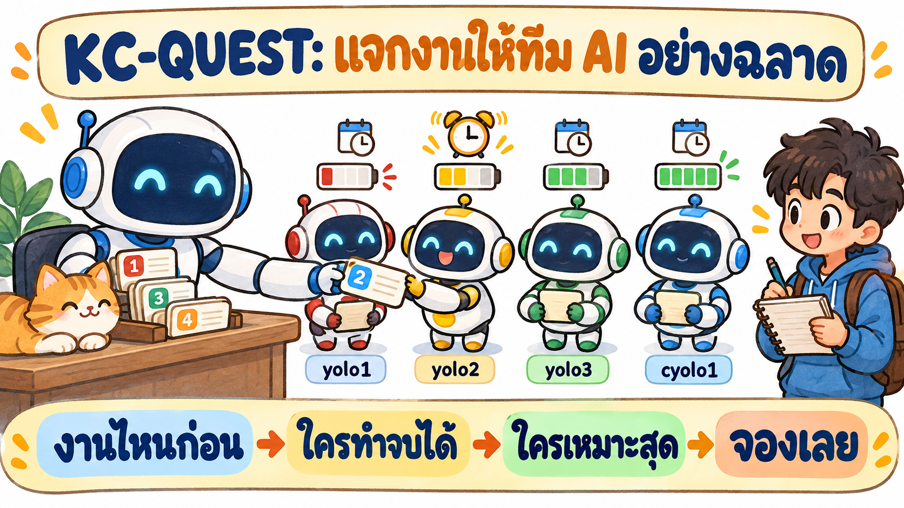

LAB ที่แล้ว (DAG Planner) เราให้ AI แตกโจทย์เป็นกราฟงาน แล้ว `planner.py` ก็ **แจกงานให้บัญชี** ออกมาเป็นไทม์ไลน์ให้เลย
LAB นี้จะ **เปิดฝาดูข้างใน** ว่าการแจกงานนั้นคิดอย่างไร ตั้งแต่ **แบบจำลองคณิตศาสตร์** → **หลักคิดในการออกแบบ** → **สมการทุกตัว** → **แทนค่าด้วยตัวเลขจริงทีละขั้น** จนคำนวณตามเองได้

| หัวข้อ | ได้อะไร |
|---|---|
| 1 · ทวนของเดิม | DAG · rank · โควตา 2 ถังของบัญชี AI |
| 2 · ปัญหานี้คือ optimization | เขียนเป็นสมการเต็มรูป · ทำไมหาคำตอบที่ดีที่สุดตรง ๆ ไม่ได้ |
| 3 · หลักคิดในการออกแบบ | 6 หลักที่เปลี่ยนสมการยาก ๆ ให้เป็นอัลกอริทึมเร็ว ๆ |
| 4 · KC-QUEST ทีละขั้น | ① จัดลำดับ ② กรอง ③ ให้คะแนน ④ เลือก + จอง ⑤ คาดการณ์ + ย้าย ⑥ เรียนรู้ ✦ ส่งไม้ |
| 5 · ดีแค่ไหน | ขอบล่างของเวลา · ทฤษฎีของ Graham · ผลจำลอง 1,400 รอบ |
| 6 · ลองเอง + แบบฝึกหัด | เปลี่ยนน้ำหนัก · เปลี่ยนสถานการณ์ · คำนวณมือพร้อมเฉลย |

> 📦 **ทุกอย่างอยู่ในโฟลเดอร์นี้**: เครื่องมือ (`tools/`) · ข้อมูลตัวอย่าง (`examples/`) · ภาพ (`image/`) ไม่ต้องเปิดโฟลเดอร์อื่น
> 🆓 **ไม่ใช้โทเคน ไม่ต้องมี container**: ทุกคำสั่งเป็น Python ล้วน ใช้สถานการณ์โควตาตัวอย่างที่เตรียมไว้ ตัวเลขจึงตรงกับในหน้านี้ทุกตัว
> ⏱ ประมาณ 60–90 นาที (อ่าน + ลองคำสั่ง + แบบฝึกหัด)

---

## 0 · เตรียมเครื่อง

เปิด terminal (หรือ Claude Code) ที่โฟลเดอร์นี้ (`03_KC_QUEST`) แล้วรัน:

```bash
python tools/planner.py doctor
```

ต้องเห็น ✅ ที่ Python, orch.py และ "ตัวแปลงภาพเป็น png" (ถ้าข้อสุดท้ายไม่ผ่าน ใช้ได้เหมือนกัน แค่ภาพจะเป็น `.svg`)

| เครื่องมือใน `tools/` | ทำอะไร |
|---|---|
| `orch.py` | **ตัวอัลกอริทึม KC-QUEST จริง** (ไฟล์เดียวกับที่ใช้แจกงานให้บัญชี AI จริงตอนสร้างเว็บทั้งเว็บ) |
| `planner.py` | จำลองเวลา: ปล่อยงานตามลำดับ dependency แล้วเรียก KC-QUEST ทุกครั้งที่มีงานพร้อม · วาด DAG / Gantt |
| `kcquest.py` | **โหมดสอน**: แสดงทุกตัวเลขที่ KC-QUEST คิดในแต่ละรอบ (บทเรียนนี้ใช้ตัวนี้เป็นหลัก) |
| `figures.py` | วาดการ์ดสมการ `image/eq-*.png` |
| `sim.py` · `test_kcquest.py` | ตัวจำลองเทียบกับวิธีอื่น 7 สถานการณ์ · unit test 16 ข้อ |

---

## 1 · ทวนของเดิม: งาน · DAG · บัญชี AI

**งาน** ทั้งหมดในบทเรียนนี้คือแผน "เว็บขายอาหารแมว + แชทบอท" 14 งาน (`examples/catfood/tasks.json`) ชุดเดียวกับ LAB ที่แล้ว

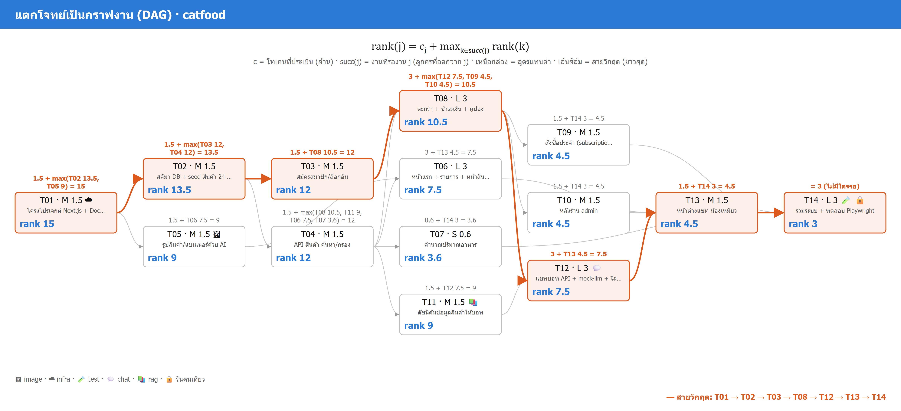

- ลูกศร `A → B` = B ต้องรอ A เสร็จก่อน · ขนาดงาน S / M / L = ประเมินไว้ 0.6 / 1.5 / 3 ล้านโทเคน (เรียกว่า $c_j$)
- **rank** = ความยาวจากงานนี้ถึงงานสุดท้าย คิดย้อนจากปลาย: $\mathrm{rank}(j) = c_j + \max_{k \in \mathrm{succ}(j)} \mathrm{rank}(k)$ (succ = งานที่รอ $j$)
- **สายวิกฤต** = เส้นที่ rank ยาวที่สุด (T01 → T02 → T03 → T08 → T12 → T13 → T14 = 15 ล้านโทเคน)

**บัญชี AI** แต่ละบัญชี (yolo = Claude Code · cyolo = Codex) มีโควตา **2 ถัง** เหมือนแบต 2 ก้อน:

| ถัง | ใช้หมดแล้ว | รีเซ็ต |
|---|---|---|
| 🔋 **5 ชม.** ($H^5$) | ต้องรอให้ครบ 5 ชม. นับจากเริ่มใช้ | ทุก 5 ชม. |
| 🔋 **สัปดาห์** ($H^w$) | ต้องรอถึงวันรีเซ็ต | ทุก 7 วัน · **ที่เหลือตอนรีเซ็ตจะหายไปฟรี ๆ** |

และรับงานพร้อมกันได้จำกัด (**slot**: yolo ≤ 4 · cyolo ≤ 3 · ลดลงเมื่อโควตาเหลือน้อย)

### สถานการณ์ของบทเรียน (`examples/quota_lesson.json`)

| บัญชี | ถัง 5 ชม. เหลือ | ถังสัปดาห์เหลือ | สัปดาห์จะรีเซ็ตใน | ลักษณะ |
|---|---|---|---|---|
| **yolo1** | **6%** | 80% | 130 ชม. | 🪫 ถัง 5 ชม. ใกล้หมด รับงานใหญ่ไม่ไหว |
| **yolo2** | 90% | 45% | **20 ชม.** | ⏰ ใกล้รีเซ็ต: ไม่ใช้ = 45% หายฟรีพรุ่งนี้ |
| **yolo3** | 100% | **7%** | 100 ชม. | 🥛 ถังสัปดาห์เหลือก้นแก้ว |
| **cyolo1** | 100% | 95% | 150 ชม. | 🔋 เต็มทุกถัง · ช้ากว่า yolo 30% · ทำงานรูปได้ |

สถานการณ์นี้ตั้งใจให้ "แต่ละบัญชีมีจุดเด่นจุดด้อยต่างกัน" จะได้เห็นทุกส่วนของอัลกอริทึมทำงาน

---

## 2 · ปัญหานี้คือปัญหา optimization

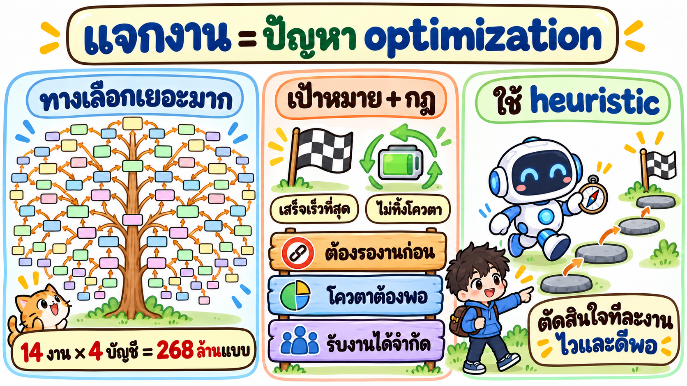

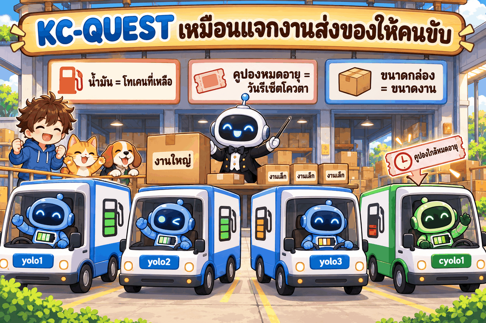

| ในชีวิตจริง (แจกงานส่งของ) | ในปัญหาของเรา |
|---|---|
| น้ำมันที่เหลือในถัง | โควตาที่เหลือ $H^5,\ H^w$ |
| คูปองน้ำมันใกล้หมดอายุ → รีบใช้ก่อน | โควตาสัปดาห์ใกล้รีเซ็ต $T$ |
| ขนาดกล่อง / ระยะทาง | ขนาดงาน $c_j$ |
| น้ำมันต้องพอถึงปลายทาง | งานต้องทำจบได้ $c_j \le C_a$ |
| ระหว่างทางน้ำมันใกล้หมด → ส่งของต่อให้คันอื่น | ย้ายงาน ทำต่อจาก commit |

ปัญหาแบบนี้ทุกปัญหามี 3 ส่วนเสมอ: **ตัวแปรที่เราเลือกได้** · **เป้าหมาย** · **กฎที่ห้ามผิด**

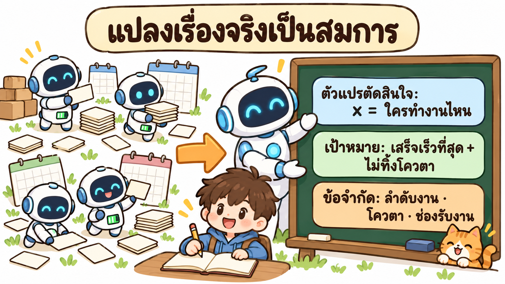

เขียนเป็นสมการเต็มรูปได้แบบนี้:

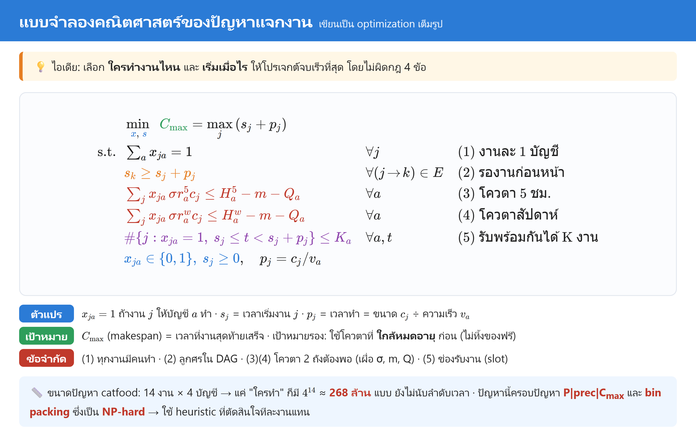

$$
\begin{aligned}
\min_{x,\,s}\ \ & C_{\max} = \max_j (s_j + p_j) \\
\text{s.t.}\ \ & \textstyle\sum_a x_{ja} = 1 && \forall j && \text{(1) งานละ 1 บัญชี}\\
& s_k \ge s_j + p_j && \forall (j \to k) && \text{(2) รองานก่อนหน้า}\\
& \textstyle\sum_j x_{ja}\,\sigma r^5_a c_j \le H^5_a - m - Q_a && \forall a && \text{(3) ถัง 5 ชม.}\\
& \textstyle\sum_j x_{ja}\,\sigma r^w_a c_j \le H^w_a - m - Q_a && \forall a && \text{(4) ถังสัปดาห์}\\
& \#\{\text{งานที่รันบน } a \text{ ณ เวลา } t\} \le K_a && \forall a, t && \text{(5) slot}
\end{aligned}
$$

| สัญลักษณ์ | อ่านว่า | ในบทเรียน |
|---|---|---|
| $x_{ja} \in \{0,1\}$ | งาน $j$ ให้บัญชี $a$ ทำไหม | **ตัวแปรที่อัลกอริทึมต้องเลือก** |
| $s_j$ | เวลาเริ่มงาน $j$ | ตัวแปรที่ต้องเลือกเหมือนกัน |
| $p_j = c_j / v_a$ | เวลาทำงาน = ขนาด ÷ ความเร็วของบัญชี | yolo 7.2 · cyolo 4.8 ล้านโทเคน/ชม. |
| $C_{\max}$ | **makespan** = เวลาที่งานสุดท้ายเสร็จ | **เป้าหมายหลัก** ยิ่งน้อยยิ่งดี |
| $r^5_a,\ r^w_a$ | ใช้ 1 ล้านโทเคนแล้วโควตาหายกี่ % | 2.0 และ 0.25 |
| $\sigma,\ m,\ Q$ | ตัวเผื่อ · ระยะเบรก · ส่วนที่กันไว้ให้ตัวคุมวง | 1.3 · ≥ 2% · 20% |

**เป้าหมายรอง**: ใช้โควตาของบัญชีที่ **ใกล้รีเซ็ต** ก่อน (เพราะถ้าไม่ใช้ก็หายฟรี) และ **ไม่ชนเพดานกลางงาน** (งานค้าง เสียเวลา)

### ทำไมหาคำตอบที่ดีที่สุดตรง ๆ ไม่ได้

- แค่เลือก "ใครทำงานไหน" ก็มี $4^{14} \approx$ **268 ล้านแบบ** ยังไม่นับว่าเริ่มเมื่อไร ถ้าโปรเจกต์มี 25 งาน 10 บัญชีจะเป็น $10^{25}$ แบบ
- ปัญหานี้ **ครอบ** ปัญหาคลาสสิก 2 ข้อที่พิสูจน์แล้วว่าเป็น **NP-hard** (ไม่มีวิธีที่เร็วและได้คำตอบดีที่สุดเสมอ):
  - **P|prec|C<sub>max</sub>**: จัดงานที่มีลำดับให้เครื่องหลายเครื่อง ให้เสร็จเร็วที่สุด → ข้อ (1)(2)(5)
  - **Bin packing**: ใส่ของลงถังให้พอดี → ข้อ (3)(4)
- และ **ข้อมูลไม่แน่นอน**: ขนาดงานจริงอาจต่างจากที่ประเมิน ±30% · อัตรา $r$ ต้องเรียนรู้ระหว่างทาง · คำตอบที่ "ดีที่สุดบนกระดาษ" จึงอาจไม่ดีที่สุดจริงอยู่ดี

> สรุป: ใช้ **heuristic** = กฎคิดง่าย ๆ ที่ **เร็วมาก** (ไม่ถึง 1 วินาที ไม่ใช้โทเคน) และได้คำตอบ **ดีพอ** แล้ว **คอยแก้ระหว่างทาง**

---

## 3 · หลักคิด 6 ข้อในการออกแบบ KC-QUEST

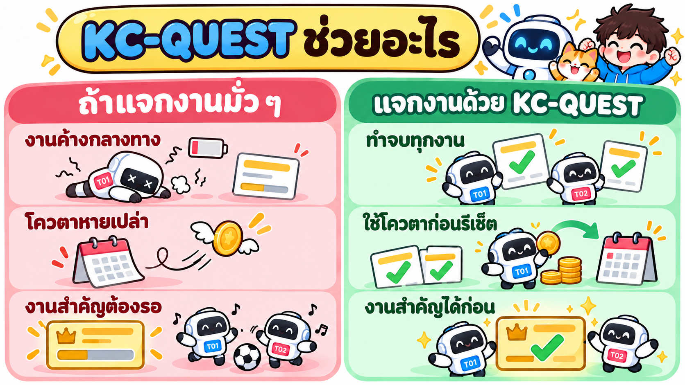

ทุกขั้นของ KC-QUEST มาจากการตอบคำถาม "จะเปลี่ยนสมการข้างบนให้เป็นกฎง่าย ๆ ได้อย่างไร" ได้หลัก 6 ข้อ:

| # | หลักคิด | แปลว่า | ตอบส่วนไหนของสมการ | ขั้น |
|---|---|---|---|---|
| 1 | **ตัดสินใจทีละงาน (greedy / list scheduling)** | ไม่ลองทุกแบบ ทุกครั้งที่มีงานพร้อมก็แจกเลย | ตัวแปร $x, s$ | ทั้งหมด |
| 2 | **เรียงลำดับให้ดี** | งานที่ทำให้ช้าที่สุดได้เลือกก่อน | เป้าหมาย $C_{\max}$ | ① |
| 3 | **กฎเหล็กใช้กรองทิ้ง ความชอบใช้ให้คะแนน** | ข้อจำกัดห้ามผิดเลย จึงไม่เอาไปปนกับคะแนน | ข้อ (3)(4)(5) | ② |
| 4 | **รวมหลายเป้าหมายเป็นเลขเดียว** | ถ่วงน้ำหนักแล้วบวก (weighted sum) | $C_{\max}$ + เป้าหมายรอง | ③ |
| 5 | **จองทันที** | งานถัดไปในรอบเดียวกันเห็นโควตาที่เหลือจริง | ข้อ (3)(4)(5) | ④ |
| 6 | **เผื่อ แล้วแก้ระหว่างทาง** | คิดเผื่อไว้ก่อน (σ, m) แล้วคอยดูของจริง ย้าย/เรียนรู้ | ข้อมูลไม่แน่นอน | ②⑤⑥✦ |

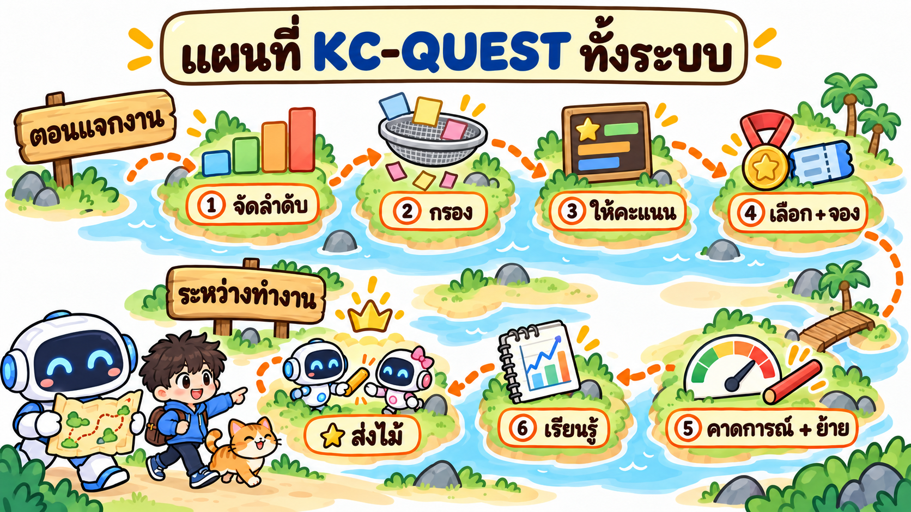

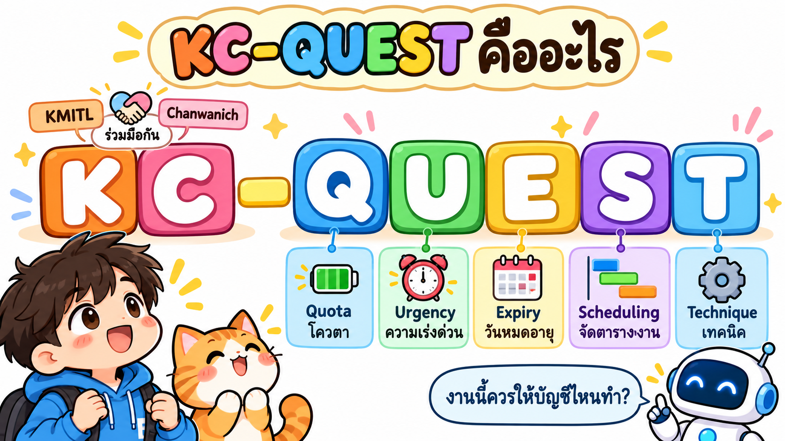

**KC-QUEST** = **K**MITL–**C**hanwanich **Q**uota-**U**rgency **E**xpiry-aware **S**cheduling **T**echnique (เทคนิคจัดตารางงานที่คำนึงถึงโควตา ความเร่งด่วน และวันหมดอายุ)

### วงรอบใหญ่: แจกทีละรอบ ทุกครั้งที่มีงานเสร็จ (หลักคิดข้อ 1)

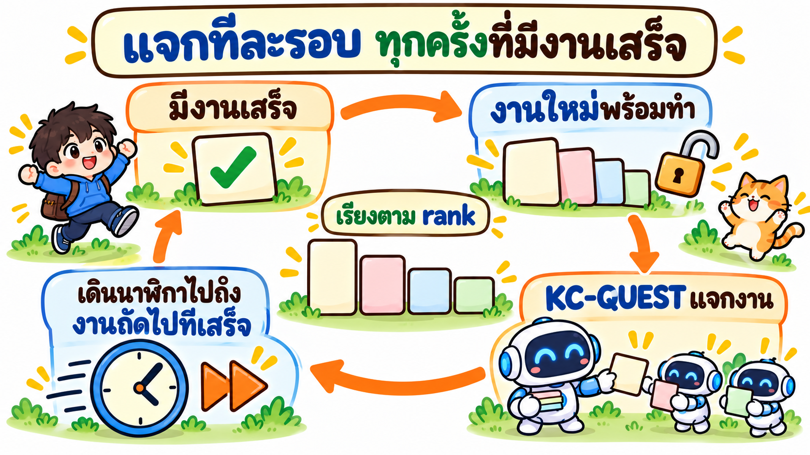

```text
ทุกครั้งที่มีงานเสร็จ (หรือเพิ่งเริ่ม):
    ready ← งานที่งานก่อนหน้าเสร็จครบแล้ว และยังไม่ได้เริ่ม
    สำหรับแต่ละงาน j ใน ready เรียงตาม ①:
        A_j ← บัญชีที่ผ่าน ② (ทำงานนี้จบได้ + มี slot ว่าง)
        ถ้า A_j ว่าง → ส่งต่อตามแผน (relay) หรือรอรอบหน้า
        a* ← บัญชีใน A_j ที่ได้คะแนน ③ สูงสุด
        ④ ให้ a* ทำ j แล้วจองโควตา: H ← H − σ·r·c_j , used ← used + 1
    ระหว่างทำงาน: ⑤ คาดการณ์/ย้าย · ⑥ เรียนรู้ · ✦ ส่งไม้
```

ดูรอบแจกงานทั้งหมดของสถานการณ์ในบทเรียน:

```bash
python tools/kcquest.py rounds
```

| รอบ | นาทีที่ | งานที่พร้อม | ได้งาน |
|---|---|---|---|
| 1 | 0 | T01 | T01→yolo2 |
| 2 | 12 | T02, T05 | T05→cyolo1 · T02→yolo2 |
| 3 | 25 | T03, T04 | T03→yolo2 · T04→yolo2 |
| 4 | 38 | T06, T07, T08, T11 | T08→yolo2 · T11→yolo2 · T06→yolo2 · T07→yolo3 |
| 5 | 62 | T09, T10, T12 | T12→yolo2 · T09→yolo2 · T10→yolo3 |
| 6 | 87 | T13 | T13→yolo2 |
| 7 | 100 | T14 | T14→yolo2 |

**สรุป:** `yolo2` 11 งาน · `yolo3` 2 งาน · `cyolo1` 1 งาน · `yolo1` 0 งาน · เวลารวม ≈ **125 นาที**

ทำไม yolo2 ได้งานเกือบหมด? yolo1 ได้ศูนย์? ทำไม T07 หลุดไป yolo3? หัวข้อถัดไปจะตอบทีละขั้น โดยเจาะ **รอบที่ 4** (มีงานพร้อม 4 งาน) เป็นหลัก

```bash
python tools/kcquest.py explain --round 4 --png
```

---

## 4 · KC-QUEST ทีละขั้น

### 🧠 ภาพรวมก่อนลงรายละเอียด: กราฟการคำนวณ

นักวิทยาศาสตร์ออกแบบสมการแบบนี้: เขียน **ตัวแปรทุกตัวเป็นโหนด** แล้วลากลูกศรว่า **ตัวไหนคำนวณจากตัวไหน** จะเห็นทันทีว่าข้อมูลไหลจากอินพุตไปเป็นคำตอบอย่างไร และถ้าอินพุตตัวหนึ่งเปลี่ยน จะกระทบอะไรบ้าง


วิธีอ่าน: ไล่ **คอลัมน์ซ้ายไปขวา** = ลำดับการคำนวณ · ทุกกล่องมี **สูตร** (บรรทัดกลาง) และ **ค่าจริง** (บรรทัดล่าง) · สีกรอบบอกขั้น (ส้ม ① · น้ำเงิน ② · เขียว ③ · ม่วง ④) · **เส้นประม่วง** คือจุดที่ทำให้มันเป็นอัลกอริทึม ไม่ใช่สูตรเดียวจบ: ค่าที่จองแล้ววนกลับไปเป็นอินพุตของงานถัดไป

สังเกตจากกราฟ:
- **ขนาดงาน $c_j$** ไหลไปเกือบทุกที่ (rank · q · กรอง) → ประเมินขนาดผิด กระทบทั้งระบบ จึงต้องมี σ และขั้น ⑥ เรียนรู้
- **$T$ (วันหมดอายุ)** ไปที่ U ตัวเดียว แต่ U มีน้ำหนักมากสุด → เปลี่ยน $T$ ผู้ชนะเปลี่ยนได้ (แบบฝึกหัดข้อ 5)
- **ผ่านกรอง?** ไม่ได้เข้าไปในคะแนน แต่เป็น **ประตู** ก่อนถึง argmax (กฎเหล็ก ≠ ความชอบ)

### ① จัดลำดับ: งานไหนได้เลือกก่อน

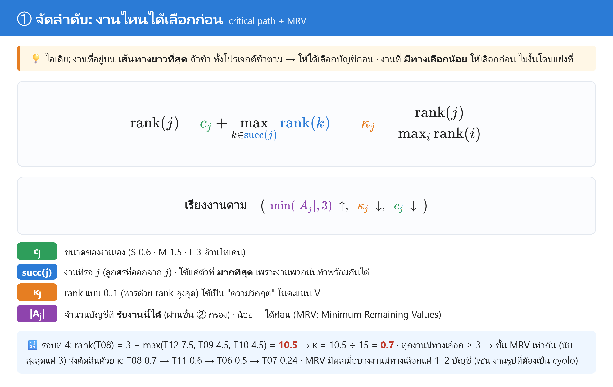

**ไอเดีย 1 · critical path**: สมมุติสร้างบ้าน ฐานราก 5 วัน → โครงสร้าง 10 วัน → หลังคา 3 วัน = 18 วัน ส่วนเดินไฟ 9 วันทำคู่ขนานได้ ถ้าฐานรากช้า 1 วัน บ้านเสร็จช้า 1 วัน แต่ถ้าเดินไฟช้า 1 วัน ไม่มีผลเลย → งานบนสายยาวสุด (rank สูง) จึงต้องได้ **เลือกบัญชีก่อน** · วิธีนี้คือแนวเดียวกับ **HEFT** (upward rank) ที่ใช้จัดงานบนคลัสเตอร์

**ไอเดีย 2 · MRV (Minimum Remaining Values)**: มาจากการแก้ปริศนาแบบซูโดกุ ช่องที่ใส่เลขได้น้อยที่สุดให้ทำก่อน เพราะถ้าปล่อยไว้ อาจโดนช่องอื่นแย่งจนไม่เหลืออะไรให้ใส่

$$
\text{เรียงตาม}\quad \big(\ \min(|A_j|,3)\ \uparrow,\ \ \kappa_j\ \downarrow,\ \ c_j\ \downarrow\ \big),\qquad \kappa_j = \frac{\mathrm{rank}(j)}{\max_i \mathrm{rank}(i)}
$$

- $|A_j|$ = จำนวนบัญชีที่ผ่านขั้น ② สำหรับงานนี้ (นับสูงสุด 3 ตัว เพราะทางเลือก 3 กับ 10 ก็ "เหลือเฟือ" พอกัน)
- เสมอกัน → κ มากก่อน → ยังเสมอ → งานใหญ่ก่อน (งานใหญ่หาที่ลงยากกว่า)

**🔢 รอบที่ 2** (`--round 2`): งานพร้อม T02 (rank 13.5 · κ 0.9) และ T05 (rank 9 · κ 0.6 · งานรูป ต้องเป็น cyolo)

| ลำดับ | งาน | κ | บัญชีที่รับได้ |
|---|---|---|---|
| **1** | **T05** | 0.6 | **1** (cyolo1) |
| 2 | T02 | 0.9 | 3 (yolo2, yolo3, cyolo1) |

T05 ได้ก่อนทั้งที่ κ ต่ำกว่า เพราะมีทางเลือกเดียว (MRV) ถ้าให้ T02 เลือกก่อนแล้ว T02 ไปลงที่ cyolo1 จน slot เต็ม T05 จะไม่มีที่ลงเลย

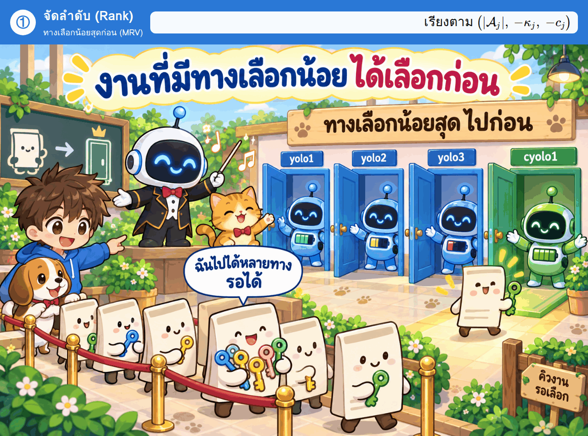

**🔢 รอบที่ 4**: ทุกงานมีทางเลือก ≥ 3 → ชั้น MRV เท่ากัน จึงเรียงด้วย κ: **T08** (0.7) → **T11** (0.6) → **T06** (0.5) → **T07** (0.24)

---

### ② กรอง: บัญชีนี้ทำงานนี้จนจบได้ไหม

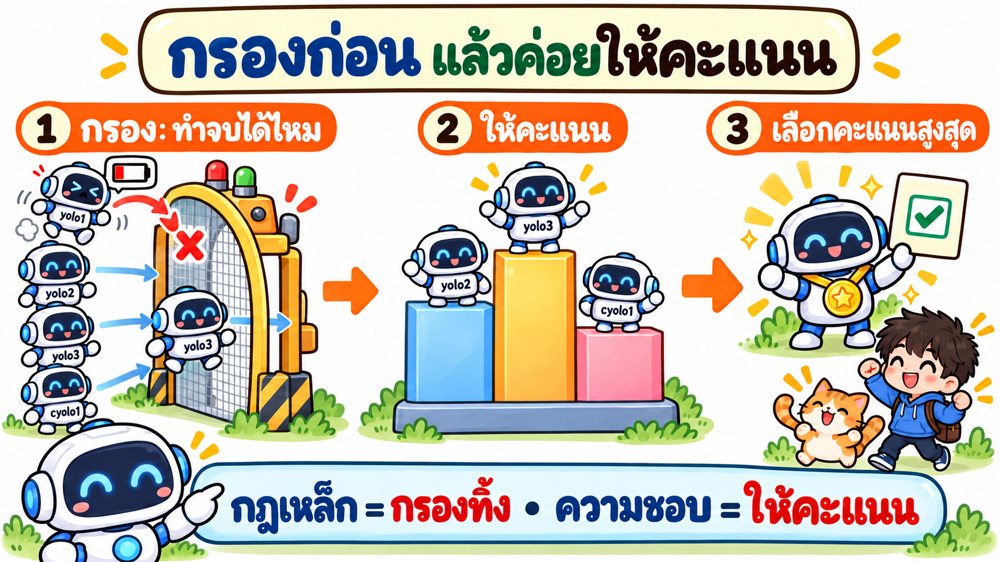

**ไอเดีย**: เหมือนเช็กน้ำมันก่อนออกรถ "น้ำมันพอถึงปลายทางไหม" ถ้าไม่พอ ไม่ว่ารถคันนั้นจะดีแค่ไหนก็ห้ามไป เพราะการชนเพดานกลางงาน = งานค้าง ต้องย้าย เสียเวลา → ข้อนี้คือ **กฎเหล็ก** ใช้ **ตัดทิ้ง** ไม่ใช่ "หักคะแนน" (ถ้าหักคะแนน บัญชีที่คะแนนส่วนอื่นสูงมากอาจชนะทั้งที่ทำไม่จบ)

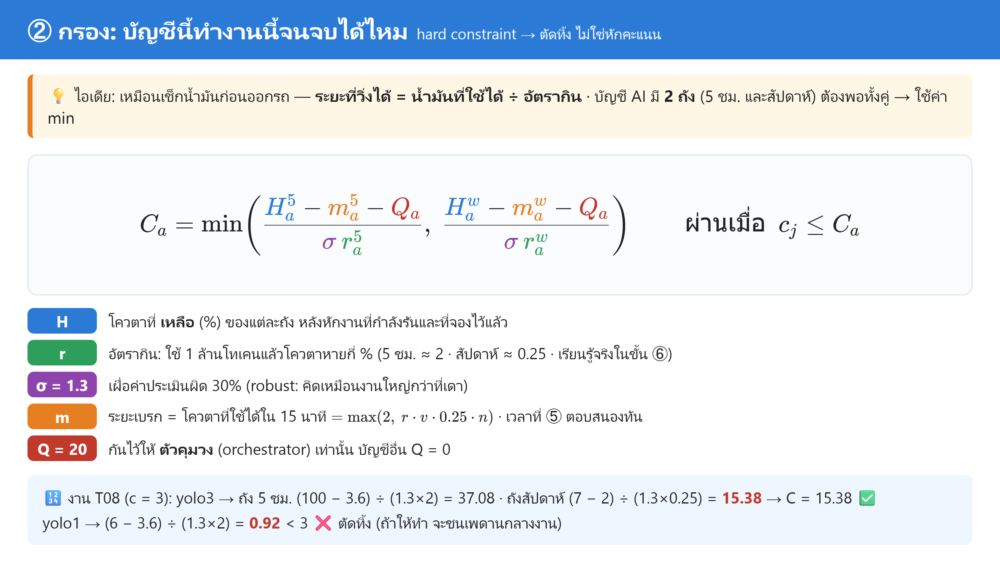

$$
C_a = \min\!\left(\frac{H^5_a - m^5_a - Q_a}{\sigma\, r^5_a},\ \frac{H^w_a - m^w_a - Q_a}{\sigma\, r^w_a}\right) \qquad \text{ผ่านเมื่อ}\ \ c_j \le C_a \ \text{และ slot ว่าง}
$$

อ่านทีละส่วน:

| ส่วน | ความหมาย | ทำไมต้องมี |
|---|---|---|
| $H - m - Q$ | โควตาที่ "ใช้ได้จริง" (%) | ไม่ใช้จนหยดสุดท้าย |
| $\div\, r$ | แปลง % เป็นล้านโทเคน | ได้หน่วยเดียวกับขนาดงาน $c_j$ |
| $\div\, \sigma$ (1.3) | คิดเหมือนงานใหญ่กว่าที่เดา 30% | ค่าประเมินผิดได้ (robust optimization) |
| $m = \max(2,\ r \cdot v \cdot 0.25 \cdot n)$ | **ระยะเบรก** = โควตาที่ใช้ไปใน 15 นาที ($n$ = จำนวนงานบนบัญชี) | ขั้น ⑤ ตรวจทุก ~15 นาที ต้องมีที่เหลือพอให้ย้ายงานทัน |
| $Q$ | 20% เฉพาะ **ตัวคุมวง** (บัญชีที่สั่งงานคนอื่น) | ตัวคุมวงหมดแรง = ทั้งทีมหยุด |
| $\min(\cdot,\cdot)$ | ต้องพอ **ทั้ง 2 ถัง** | ถังไหนหมดก่อน ก็ทำต่อไม่ได้ |

**🔢 รอบที่ 4 · งาน T08** ($c$ = 3 ล้านโทเคน):

| บัญชี | ถัง 5 ชม. | ถังสัปดาห์ | $C_a$ | ผล |
|---|---|---|---|---|
| yolo1 | (6 − 3.6) ÷ (1.3×2) = 0.92 | (80 − 2) ÷ (1.3×0.25) = 240 | **0.92** | ❌ 3 > 0.92 |
| yolo2 | (74.4 − 3.6) ÷ (1.3×2) = 27.23 | (43.04 − 2) ÷ (1.3×0.25) = 126.28 | **27.23** | ✅ |
| yolo3 | (100 − 3.6) ÷ (1.3×2) = 37.08 | (7 − 2) ÷ (1.3×0.25) = **15.38** | **15.38** | ✅ (ถังสัปดาห์เป็นตัวจำกัด) |
| cyolo1 🎩 | (96.1 − 2.4 − 20) ÷ (1.3×2) = 28.35 | (94.51 − 2 − 20) ÷ (1.3×0.25) = 223.11 | **28.35** | ✅ |

- **yolo1 ถูกตัดทุกงานขนาด M และ L** ทั้งรอบ (รับได้แค่ 0.92 ล้านโทเคน) → นี่คือเหตุที่ yolo1 ไม่ได้งานเลย มันผ่านแค่งาน S (T07 0.6) ซึ่งแพ้คะแนน
- **yolo3** ถังสัปดาห์เหลือแค่ 7% แต่ $r^w$ เล็ก (0.25) จึงยังรับได้ 15 ล้านโทเคน
- **cyolo1 🎩** เป็นตัวคุมวง (บัญชีที่เหลือมากสุด) จึงโดนหัก $Q$ = 20 และเว้น 1 slot ไว้คุมงาน · ระยะเบรกเล็กกว่า (2.4) เพราะ cyolo ช้ากว่า

> 💡 **รู้เวลารีเซ็ต 5 ชม.**: ถ้าถัง 5 ชม. จะรีเซ็ต **ก่อน** งานเสร็จ ส่วนหลังรีเซ็ตได้โควตาใหม่มาเพิ่ม → $C_a$ ของถัง 5 ชม. = (โทเคนที่ทำทันก่อนรีเซ็ต) + (100 − m) ÷ (σ r) อัลกอริทึมจึงไม่ทิ้งบัญชีที่ "เกือบเต็มแต่อีกเดี๋ยวก็รีเซ็ต"

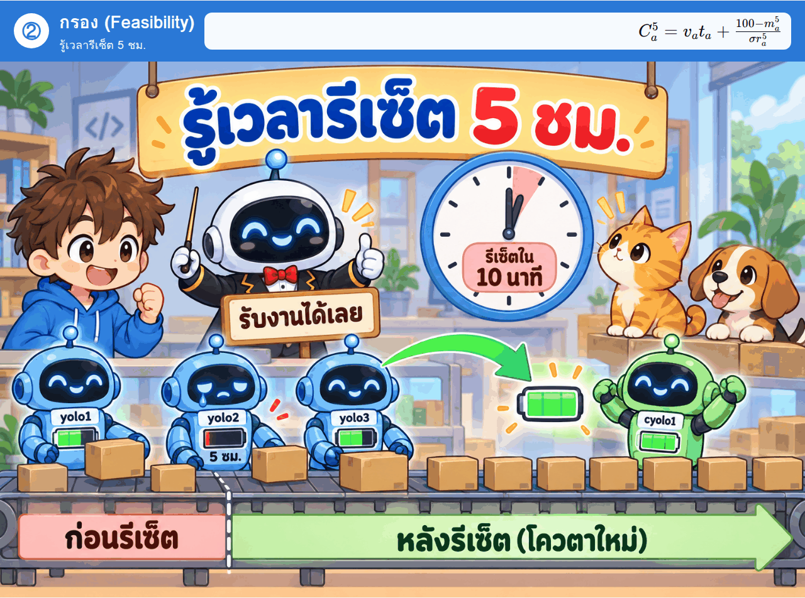

---

### ③ ให้คะแนน: ใครเหมาะที่สุด

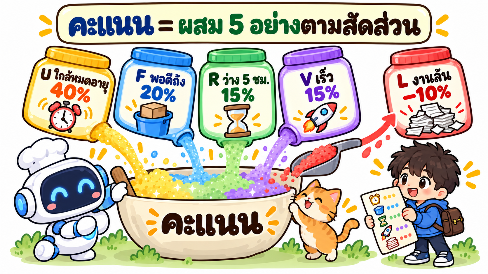

**ไอเดีย**: เป้าหมายหลายข้อขัดกัน (เร็ว vs ไม่ทิ้งโควตา vs ไม่กองงานที่เดียว) → แปลงแต่ละข้อเป็น **ตัวแปร 0..1** แล้ว **ถ่วงน้ำหนักรวมเป็นเลขเดียว** (เทคนิค *scalarization* หรือ *weighted sum* ใน multi-criteria decision making · เหมือนให้คะแนนคอนโด: ราคา 40% ทำเล 30% ขนาด 30%)

$$
S_a = 100 \times \big(0.40\,U_a + 0.20\,F_{ja} + 0.15\,R_{ja} + 0.15\,V_{ja} - 0.10\,L_a\big)
$$


#### U · ใกล้หมดอายุ (40%): ทำไมต้องเป็น T₀ ÷ (T₀ + T)

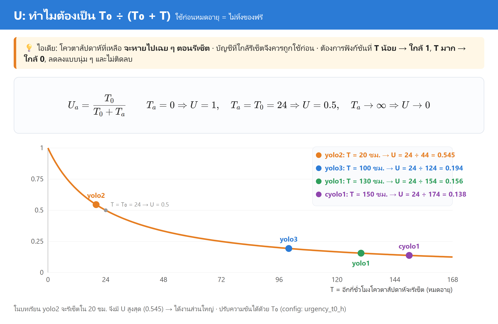

- โควตาสัปดาห์ที่ **เหลือตอนรีเซ็ตจะหายฟรี** → บัญชีที่จะรีเซ็ตเร็ว ควรถูกใช้ก่อน ("ใช้คูปองที่ใกล้หมดอายุก่อน")
- ต้องการฟังก์ชันที่ $T$ น้อย → ใกล้ 1, $T$ มาก → ใกล้ 0, ลดลงนุ่ม ๆ ไม่ติดลบ และไม่ต้องรู้ค่าสูงสุดของ $T$ → $\frac{T_0}{T_0+T}$ ตรงทุกข้อ · $T_0$ = 24 ชม. คือจุดที่ U = 0.5 ("เหลือ 1 วัน = ด่วนครึ่งหนึ่ง")
- น้ำหนัก **มากที่สุด (0.40)** เพราะเป็นข้อที่ทำให้ KC-QUEST ต่างจากวิธีทั่วไป: วิธีอื่นไม่รู้วันหมดอายุเลย
- 🔢 yolo2 จะรีเซ็ตใน 20 ชม. → U = 24 ÷ 44 = **0.545** สูงกว่าบัญชีอื่น 3–4 เท่า → **นี่คือเหตุที่ yolo2 ได้งาน 11 จาก 14 งาน**

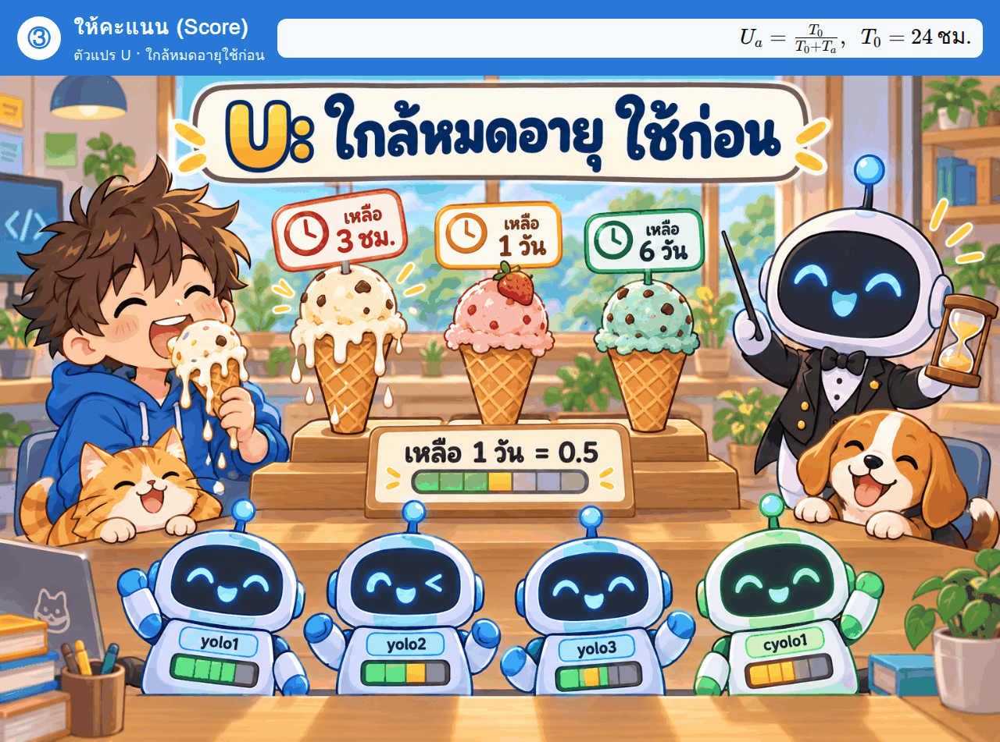

#### F · พอดีถัง (20%): best-fit จาก bin packing

$F = \min\!\big(1,\ \sigma r^w_a c_j / H^w_a\big)$ = งานนี้กินถังสัปดาห์ที่เหลือไปกี่ส่วน

- จากปัญหา **bin packing**: วิธี *best-fit* (ใส่ของลงถังที่ "เหลือที่พอดีที่สุด") ทำได้ดีกว่าใส่ถังที่ว่างที่สุด เพราะ **เก็บถังใหญ่ไว้ให้งานใหญ่ที่จะมาทีหลัง**
- 🔢 T08 ลง yolo3 (ถังสัปดาห์เหลือ 7%) → F = 0.98 ÷ 7 = **0.139** · ลง yolo2 (เหลือ 43%) → 0.023 · yolo3 จึงได้คะแนน F มากกว่า 6 เท่า

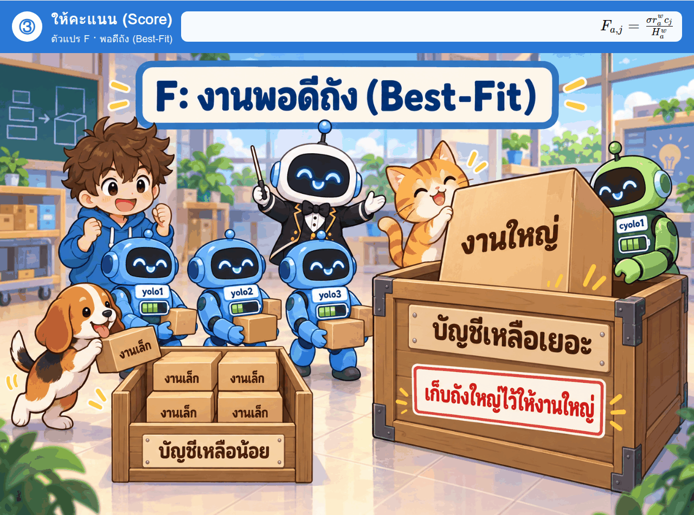

#### R · ว่าง 5 ชม. (15%) · V · เร็ว × วิกฤต (15%) · L · งานล้น (−10%)

| ตัวแปร | สูตร | ไอเดีย |
|---|---|---|
| **R** | $\max(0,\ H^5_a - \sigma r^5_a c_j)/100$ | หลังรับงานแล้ว ถัง 5 ชม. ยังเหลือเยอะ = ไม่ชนเพดานรายชั่วโมง · F ดูถังสัปดาห์ R ดูถัง 5 ชม. (คนละถังกัน) |
| **V** | $v_{\text{kind}} \cdot \kappa_j$ (yolo 1.0 · cyolo 0.7) | งานบนสายวิกฤต (κ สูง) ควรไปบัญชีที่ **เร็ว** เพราะความเร็วของงานนี้ = ความเร็วของทั้งโปรเจกต์ (เป้าหมาย $C_{\max}$) |
| **L** | $\text{used}_a / \text{slots}_a$ · **น้ำหนักติดลบ** | บัญชีที่ทำอยู่หลายงานแล้วโดนหักคะแนน → กระจายงาน ไม่กองที่เดียว (load balancing) |

> 💡 **ทำไมต้องทำให้อยู่ช่วง 0..1 ก่อนรวม (normalize)**: ถ้าเอา "ชั่วโมง" (0–168) บวกกับ "สัดส่วน" (0–1) ตรง ๆ ตัวที่หน่วยใหญ่จะกลบตัวอื่นหมด น้ำหนักจะไม่มีความหมาย

> 💡 **น้ำหนักมาจากไหน**: ตั้งตามความสำคัญของเป้าหมาย (ไม่ทิ้งโควตา > เก็บถังใหญ่ > ไม่ชนเพดาน ≈ เร็ว > กระจายงาน) แล้วปรับจนตัวจำลอง (`sim.py`) ให้ผลดีในหลายสถานการณ์ · เปลี่ยนได้ใน config (ดูหัวข้อ 6)

---

### ④ เลือก + จอง

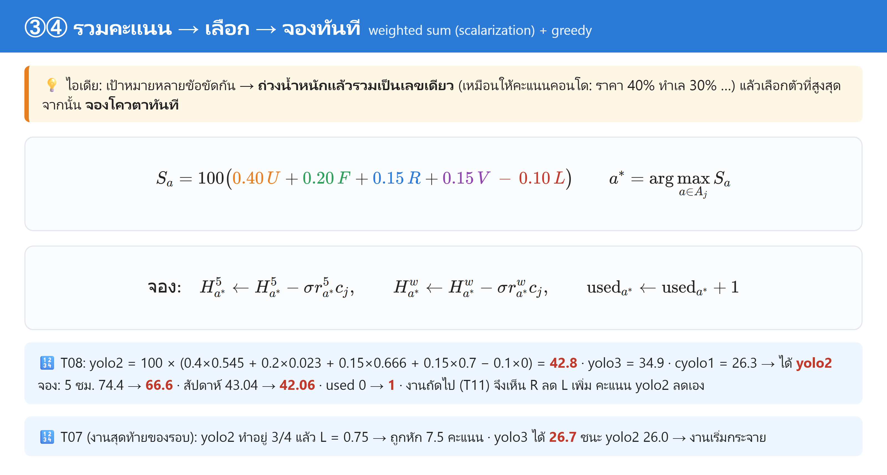

$$
a^* = \arg\max_{a \in A_j} S_a \qquad\text{แล้วจองทันที:}\quad H^5_{a^*} \mathrel{-}= \sigma r^5 c_j,\quad H^w_{a^*} \mathrel{-}= \sigma r^w c_j,\quad \text{used}_{a^*} \mathrel{+}= 1
$$

**ไอเดียของการจอง**: ในรอบเดียวมีหลายงานเลือกต่อกัน ถ้าไม่จอง ทุกงานจะเห็นว่า yolo2 "ยังว่างเต็มที่" แล้วแห่ไปลงจนเกินตัว · การจองทำให้งานถัดไปเห็น **โควตาที่เหลือจริง** (R ลด · L เพิ่ม · คะแนนลดเอง) งานจึงค่อย ๆ กระจายออกไปโดยอัตโนมัติ

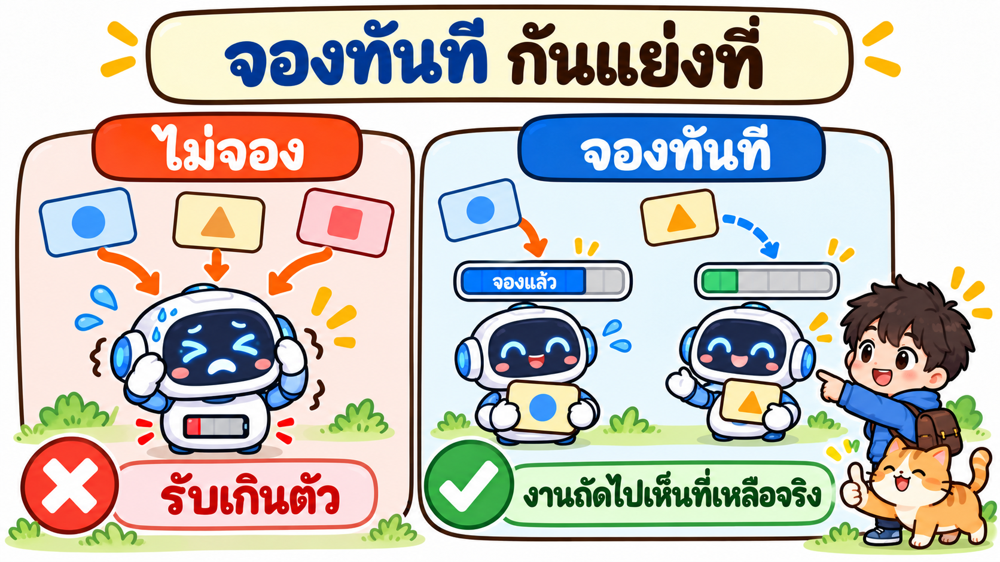

**🔢 รอบที่ 4 ทั้งรอบ** (ภาพจาก `kcquest.py explain --round 4 --png` · ความยาวแต่ละสี = น้ำหนัก × ค่าตัวแปร × 100):


| ลำดับ | งาน | ผู้ชนะ | คะแนน 1 · 2 | เกิดอะไรขึ้น |
|---|---|---|---|---|
| 1 | T08 (L) | **yolo2** | 42.8 · yolo3 34.9 | U ของ yolo2 (0.545) นำห่าง |
| 2 | T11 (M) | **yolo2** | 37.9 · yolo3 32.6 | จอง T08 แล้ว: R ลด 0.666 → 0.627 · L = 1/4 · คะแนนลดลง 5 |
| 3 | T06 (L) | **yolo2** | 33.0 · yolo3 31.9 | L = 2/4 · ห่างแค่ 1.1 |
| 4 | T07 (S) | **yolo3** | 26.7 · yolo2 26.0 | yolo2 ทำอยู่ 3/4 → L = 0.75 ถูกหัก 7.5 → **yolo3 แซง** |

ค่าที่จองของ yolo2 ทีละงาน (5 ชม.): 74.4 → **66.6** (T08) → **62.7** (T11) → **54.9** (T06)

ไล่การคำนวณทั้งรอบเป็นตาราง เห็นว่า **สถานะที่เปลี่ยน → คะแนนที่เปลี่ยน → ผู้ชนะที่เปลี่ยน**:

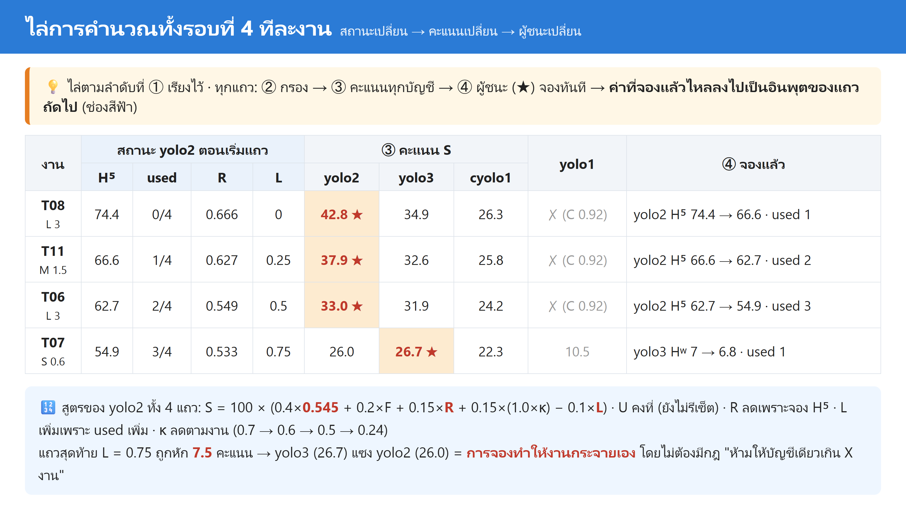

แทนค่าเต็มของ yolo2 · T08:

$$
S = 100 \times (0.4\times0.545 + 0.2\times0.023 + 0.15\times0.666 + 0.15\times0.7 - 0.1\times 0) = 100 \times 0.428 = \mathbf{42.8}
$$

### ส่งต่อตามแผน (relay): ไม่มีใครทำจบคนเดียวได้

ถ้างานใหญ่จนไม่มีบัญชีไหนผ่านขั้น ② แต่ **ทุกบัญชีรวมกันพอ** → เริ่มที่บัญชีที่ทำได้มากที่สุด (อย่างน้อย 30% ของงาน · คะแนนคูณสัดส่วนที่ทำได้) แล้วให้ขั้น ⑤ ย้ายงานต่อเมื่อใกล้เพดาน · ถ้าทั้งทีมว่างหมด ก็ห้ามค้าง ใช้โควตาส่วนเผื่อได้

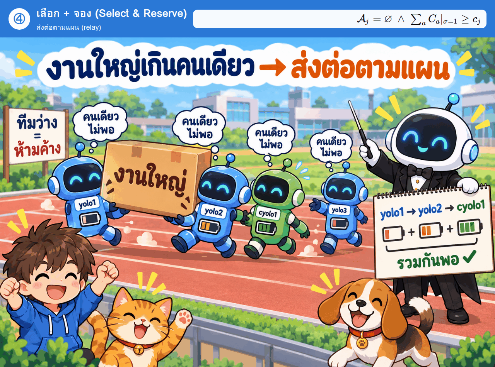

---

### ⑤ คาดการณ์ + ย้าย · ⑥ เรียนรู้ · ✦ ส่งไม้ (ระหว่างทำงาน)

![⑤⑥✦ ระหว่างทำงาน: ⑤ P = u + Σ rem × r > 100 − m → ย้ายงาน · ⑥ r ← 0.5r + 0.5 Δ%/Δโทเคน และ k ← 0.6k + 0.4 ใช้จริง/ประเมิน (EMA) · ✦ H_orch < 15% → ตัวคุมวงใหม่ = argmax(H + 5·[yolo])](image/eq-runtime.png)

ขั้น ①–④ ตัดสินใจจาก **ค่าประเมิน** ซึ่งผิดได้ · ขั้นเหล่านี้คือ **วงจรป้อนกลับ (feedback)** ที่ดูของจริงแล้วแก้ เหมือนขับรถแล้วคอยดูเกจน้ำมัน

| ขั้น | สมการ | ไอเดีย |
|---|---|---|
| ⑤ คาดการณ์ + ย้าย | $P_a = u_a + \sum_j \mathrm{rem}_j \cdot r_a > 100 - m \Rightarrow$ ย้าย | ใช้ไปแล้ว + ที่งานยังต้องใช้ จะเกินเพดานไหม · ถ้าเกิน: commit งานค้าง + เขียน HANDOFF แล้วเลือกบัญชีใหม่ด้วย ②③④ ให้ **ทำต่อ** ไม่เริ่มใหม่ |
| ⑥ เรียนรู้ | $r \leftarrow 0.5\,r + 0.5\,\frac{\Delta\%}{\Delta\text{โทเคน}}$ · $k \leftarrow 0.6\,k + 0.4\,\frac{\text{ใช้จริง}}{\text{ประเมิน}}$ | EMA: เชื่อค่าใหม่ส่วนหนึ่ง เก็บค่าเดิมส่วนหนึ่ง → ปรับเร็วแต่ไม่แกว่ง · รอบหน้าขั้น ② ใช้ $r$ และขนาด $c = \hat c \cdot k$ ที่แม่นขึ้น |
| ✦ ส่งไม้ | $H_{\text{orch}} < 15\% \Rightarrow \arg\max_a (H_a + 5\cdot\mathbb 1[\text{yolo}])$ | ตัวคุมวงใกล้หมด → ส่งต่อให้บัญชีที่เหลือมากสุด สถานะทั้งหมดอยู่ในไฟล์ จึงเปลี่ยนคนคุมกลางทางได้ |

> 💡 **ทำไมไม่ย้ายไปมา**: ตอนแจก (②) ใช้เส้น "หาร σ = 1.3" ซึ่งเข้มกว่าเส้นย้ายงาน (⑤ ใช้ 100 − m ไม่หาร σ) เสมอ งานที่เพิ่งแจกจึงอยู่ใต้เส้นย้ายแน่นอน (unit test ข้อ 13 ตรวจข้อนี้)

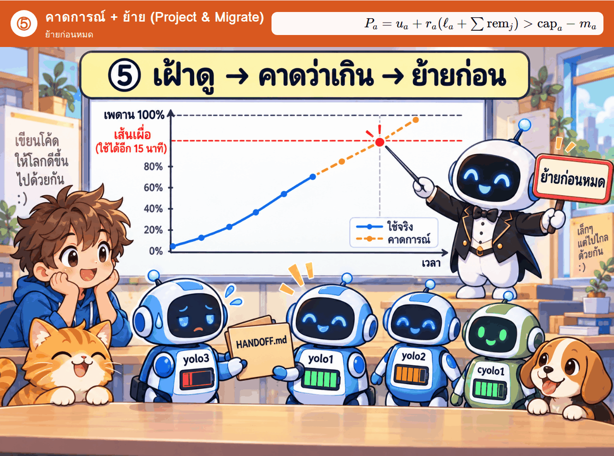

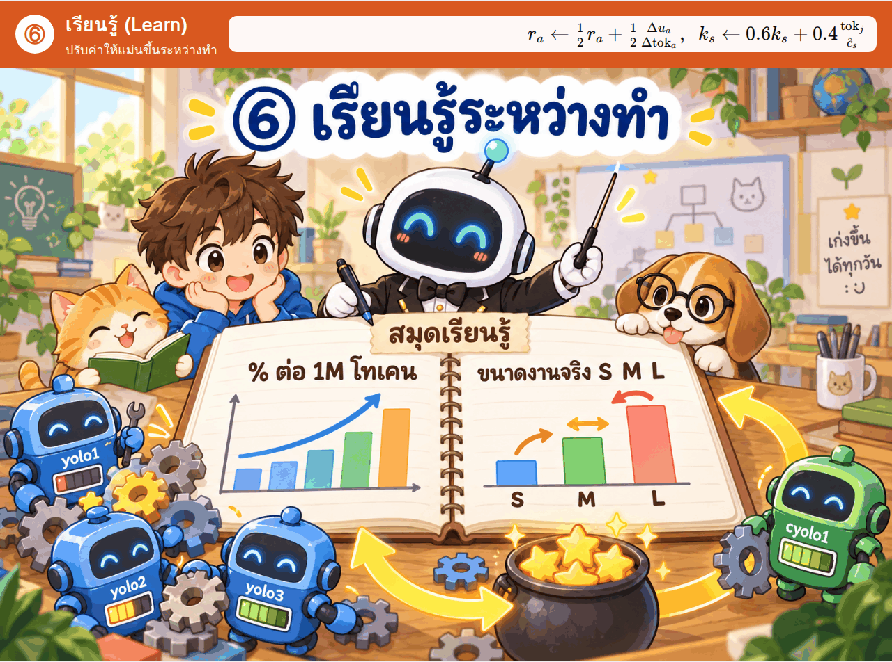

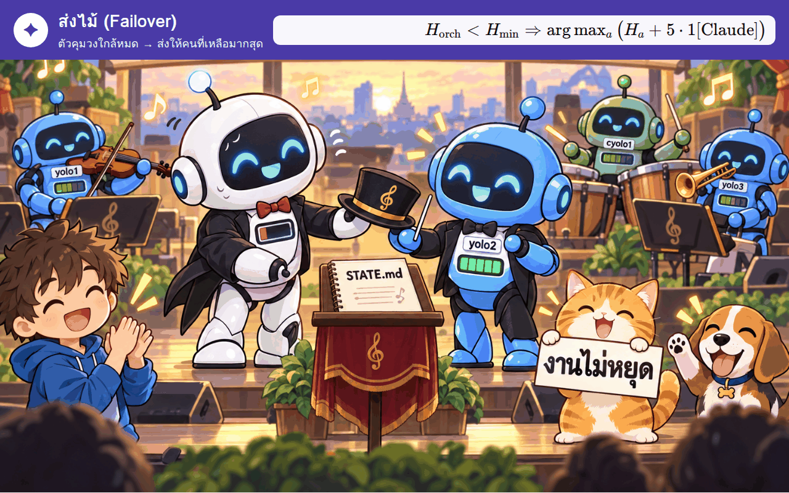

---

## 5 · ดีแค่ไหน

### ขอบล่างของเวลา: เทียบกับคำตอบที่ดีที่สุดได้โดยไม่ต้องหามัน

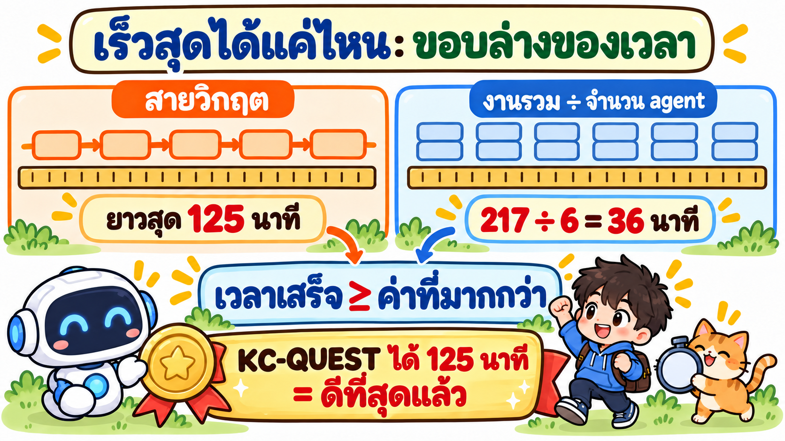

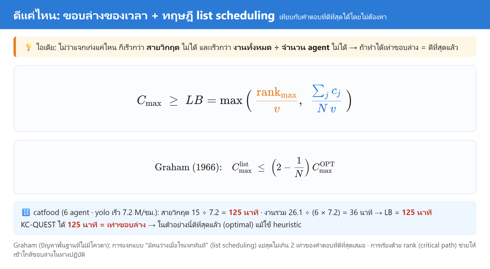

$$
C_{\max} \;\ge\; LB = \max\!\Big(\frac{\text{rank}_{\max}}{v},\ \frac{\sum_j c_j}{N\,v}\Big)
$$

- ไม่ว่าแจกเก่งแค่ไหน ก็เร็วกว่า **สายวิกฤต** ไม่ได้ (งานบนสายต้องต่อกัน) และเร็วกว่า **งานรวม ÷ จำนวน agent** ไม่ได้
- catfood: max(125, 36) = **125 นาที** และ KC-QUEST ทำได้ **125 นาที = เท่าขอบล่าง → ดีที่สุดแล้ว (optimal)** ในตัวอย่างนี้ ทั้งที่ใช้เวลาคิดไม่ถึง 1 วินาที
- **Graham (1966)**: สำหรับปัญหาพื้นฐาน (ไม่มีโควตา) การแจกแบบ "มีคนว่างเมื่อไรแจกทันที" แย่สุดไม่เกิน $(2 - 1/N)$ เท่าของคำตอบที่ดีที่สุด → greedy ไม่ได้แย่อย่างที่คิด และการเรียงด้วย rank ทำให้เข้าใกล้ขอบล่างในทางปฏิบัติ

### ผลจำลอง: เทียบกับวิธีอื่น 7 สถานการณ์ × 200 รอบ

`tools/sim.py` จำลองโปรเจกต์ 16 งาน โดยให้ **ขนาดงานจริงคลาดจากที่ประเมิน** (สุ่ม lognormal) และ **อัตราจริงต่างจากที่อัลกอริทึมเชื่อ ±30%** · งานที่ชนเพดานกลางทางเสียเวลา 5 นาที + ทำใหม่ 15% · เทียบกับ:

- **most-headroom**: ให้บัญชีที่เหลือมากสุด (วิธีที่คนส่วนใหญ่คิดเป็นอย่างแรก)
- **round-robin**: วนให้ทีละบัญชี
- **random**: สุ่ม

| สถานการณ์ | KC-QUEST | most-headroom | round-robin | random |
|---|---|---|---|---|
| A สบาย (โควตาเหลือเยอะ) | **101.6** | 124.8 | 122.8 | 115.5 |
| B มีบัญชีใกล้หมดอายุ | **101.4** | 144.5 | 122.8 | 115.5 |
| C โควตาตึง | 125.8 | 134.7 | 123.4 | **119.1** |
| D ถัง 5 ชม. ใกล้เต็ม | **113.4** | 144.8 | 123.5 | 119.3 |
| E โปรเจกต์ใหญ่ 3 เท่า | **302.9** | 368.7 | 363.1 | 342.3 |
| F 5 ชม. เกือบเต็มแต่ใกล้รีเซ็ต | **108.7** | 119.5 | 122.9 | 116.1 |
| G งานใหญ่กว่าทุกบัญชี | **329.2** | 335.2 | 363.1 | 348.6 |

<sub>หน่วย: นาทีเฉลี่ยจนจบโปรเจกต์ · ผลเต็ม (ชนเพดาน · ย้ายงาน · การใช้โควตาที่จะหมดอายุ) ใน `tools/sim_result.md`</sub>

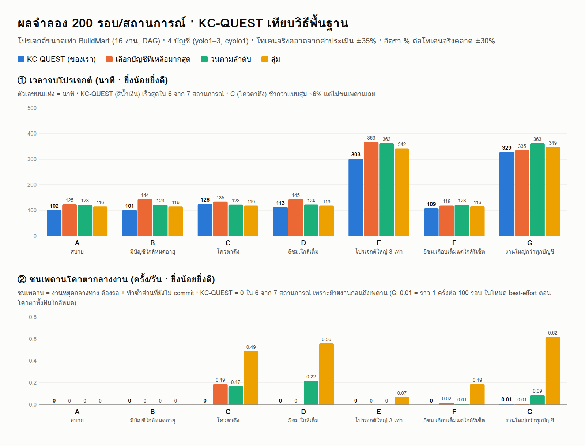

- KC-QUEST **เร็วที่สุด 6 จาก 7 สถานการณ์** และ **แทบไม่ชนเพดานกลางงานเลย** (สูงสุด 0.01 ครั้งต่อโปรเจกต์)
- สถานการณ์ B: KC-QUEST ใช้โควตาจาก **บัญชีใกล้หมดอายุ 78%** ของที่ใช้ทั้งหมด (most-headroom ใช้ 0%) = ไม่ทิ้งของฟรี
- **ข้อจำกัดที่ต้องรู้**: สถานการณ์ C (โควตาตึงทุกบัญชี) ช้ากว่าการสุ่ม ~6% เพราะเผื่อ (σ, m) แบบระวังจนบางงานต้องรอ แต่แลกกับไม่มีงานค้างกลางทาง · KC-QUEST เป็น heuristic **ไม่รับประกันว่าดีที่สุดทุกกรณี**

```bash
python tools/sim.py --seeds 200      # รันใหม่เอง (ใช้เวลาประมาณ 1–3 นาที)
python tools/test_kcquest.py         # unit test 16 ข้อ ตรวจคุณสมบัติของ KC-QUEST
```

---

## 6 · ลองเอง

### 💬 พรอมต์ให้ Claude Code (copy ทั้งกรอบ)

```text
อยู่ในโฟลเดอร์ 03_KC_QUEST · ใช้ python tools/kcquest.py (ดูวิธีใช้ด้วย --help)
1. รันคำสั่ง rounds แล้วเลือกรอบที่น่าสนใจที่สุด 1 รอบ (ที่ไม่ใช่รอบ 4) มา explain แบบ --png
2. อธิบายเป็นภาษาไทยสั้น ๆ ว่ารอบนั้น ① เรียงงานอย่างไร ② บัญชีไหนถูกตัด เพราะถังไหน ③ ตัวแปรไหนทำให้ผู้ชนะชนะ ④ หลังจองแล้วคะแนนของบัญชีนั้นเปลี่ยนอย่างไร
3. ลิงก์ภาพ out/kcquest/round-<N>.png แบบ relative
```

### 🧪 ทดลองเปลี่ยนน้ำหนัก

```bash
python tools/kcquest.py rounds --weights urgency=0 --out out/w_u0
python tools/kcquest.py rounds --weights load=-0.4 --out out/w_l4
```

| น้ำหนัก | yolo2 (⏰ ใกล้รีเซ็ต) | yolo3 (🥛 ถังสัปดาห์ก้นแก้ว) | cyolo1 | เวลารวม |
|---|---|---|---|---|
| ปกติ (U 0.4) | **11 งาน** | 2 | 1 | 125 นาที |
| ปิด U (`urgency=0`) | 5 | **7** | 2 | 125 นาที |
| L แรงขึ้น (`load=-0.4`) | 9 | 3 | 2 | 125 นาที |

- **ปิด U**: เวลารวมเท่าเดิม แต่งานย้ายไป yolo3 ซึ่ง **ไม่ได้ใกล้รีเซ็ต** ส่วนโควตา 45% ของ yolo2 ถูกใช้น้อยลงแล้ว **หายฟรีพรุ่งนี้** · ตัวเลข makespan ไม่ได้บอกทุกอย่าง ต้องดูเป้าหมายรองด้วย
- **L แรงขึ้น**: งานกระจายมากขึ้น ไม่กองที่ yolo2 (ดีถ้าไม่อยากให้บัญชีเดียวเป็นคอขวดเมื่อมีปัญหา)

### 🧪 ทดลองเปลี่ยนสถานการณ์

copy `examples/quota_lesson.json` เป็นไฟล์ใหม่ แก้ตัวเลข แล้วรันด้วย `--quota <ไฟล์ใหม่>` เช่น

| ลองแก้ | คาดว่าจะเห็น |
|---|---|
| yolo2 `"week_reset": 200` | U ของ yolo2 ตก → งานไป yolo3 เป็นหลัก |
| yolo1 `"session_used": 10` | yolo1 ผ่านขั้น ② แล้ว เริ่มแย่งงานได้ |
| cyolo1 `"week_used": 90` | cyolo1 ไม่ใช่ตัวคุมวงแล้ว (ตัวคุมวง = เหลือมากสุด) |

### ➕ เพิ่มตัวแปรใหม่เอง

ตัวแปรทั้งหมดอยู่ใน dict `FACTORS` ของ `tools/orch.py` แต่ละตัวเป็นฟังก์ชันคืนค่า 0..1 · น้ำหนักอยู่ใน `DEFAULT_CFG["weights"]` (น้ำหนัก 0 = ปิด · ติดลบ = ค่าปรับ) · เช่นอยากให้ "ชอบบัญชี Claude" ก็ใช้ตัวแปร `bonus` ที่มีอยู่แล้ว (อ่านค่าจาก `accounts.json`) แล้วใส่น้ำหนัก

---

## 7 · แบบฝึกหัด (คำนวณมือ แล้วเปิดเฉลย)

ใช้สถานะบัญชีของ **รอบที่ 4** (ตารางในหัวข้อ ②) · $\sigma$ = 1.3 · $r^5$ = 2 · $r^w$ = 0.25

**ข้อ 1** · rank ของ T04 เท่าไร (T04 = M · งานที่รอ T04 คือ T06 7.5, T07 3.6, T08 10.5, T11 9)

<details><summary>เฉลย</summary>

rank(T04) = 1.5 + max(10.5, 9, 7.5, 3.6) = 1.5 + 10.5 = **12** (ใช้แค่ตัวมากสุด เพราะ 4 งานนั้นทำพร้อมกันได้)
</details>

**ข้อ 2** · $C_a$ ของ cyolo1 สำหรับงาน T08 (cyolo1 เป็นตัวคุมวง · $H^5$ = 96.1 · $H^w$ = 94.51 · $m^5$ = 2.4 · $m^w$ = 2) และถังไหนเป็นตัวจำกัด

<details><summary>เฉลย</summary>

ถัง 5 ชม. = (96.1 − 2.4 − 20) ÷ (1.3 × 2) = 73.7 ÷ 2.6 = **28.35** · ถังสัปดาห์ = (94.51 − 2 − 20) ÷ (1.3 × 0.25) = 72.51 ÷ 0.325 = 223.11 → $C$ = min = **28.35** · **ถัง 5 ชม.** เป็นตัวจำกัด (และอย่าลืมหัก Q = 20 เพราะเป็นตัวคุมวง)
</details>

**ข้อ 3** · คะแนน S ของ yolo3 สำหรับงาน T08 (U = 0.194 · F = 0.139 · R = 0.922 · V = 0.7 · L = 0)

<details><summary>เฉลย</summary>

S = 100 × (0.4×0.194 + 0.2×0.139 + 0.15×0.922 + 0.15×0.7 − 0.1×0) = 100 × (0.0776 + 0.0278 + 0.1383 + 0.105) = **34.9** → แพ้ yolo2 (42.8) เพราะ U ห่างกันมาก แม้ F และ R ของ yolo3 ดีกว่า
</details>

**ข้อ 4** · ทำไม T07 ไปลง yolo3 ทั้งที่ yolo2 ชนะ 3 งานก่อนหน้าในรอบเดียวกัน

<details><summary>เฉลย</summary>

เพราะขั้น ④ **จองทันที** หลังได้ T08, T11, T06 yolo2 ทำอยู่ 3 จาก 4 slot → L = 0.75 ถูกหัก 0.1 × 0.75 × 100 = 7.5 คะแนน และ R ลดเหลือ 0.533 → yolo2 เหลือ 26.0 · yolo3 ได้ 26.7 จึงแซง (และ V ของ T07 ต่ำ เพราะ κ = 0.24 ทำให้ความได้เปรียบเรื่องความเร็วของ yolo2 ไม่มีผล)
</details>

**ข้อ 5** · ถ้า yolo2 จะรีเซ็ตใน 200 ชม. แทน 20 ชม. (ค่าอื่นเท่าเดิม) T08 จะไปบัญชีไหน

<details><summary>เฉลย</summary>

U ของ yolo2 = 24 ÷ 224 = 0.107 → S = 100 × (0.4×0.107 + 0.2×0.023 + 0.15×0.666 + 0.15×0.7) = **25.2** < yolo3 34.9 → **yolo3** ได้ T08 · ลองยืนยันด้วยการแก้ `week_reset` ของ yolo2 ในไฟล์สถานการณ์แล้วรัน `explain --round 4`
</details>

**ข้อ 6 (ออกแบบ)** · ถ้าอยากให้อัลกอริทึม "ประหยัดเงิน" โดยบัญชีแต่ละบัญชีมีค่าใช้จ่ายต่อโทเคนไม่เท่ากัน จะเพิ่มตัวแปรอะไร สูตรเป็นอย่างไร ควรเป็นกฎเหล็ก (②) หรือคะแนน (③)

<details><summary>แนวคำตอบ</summary>

ถ้า "งบห้ามเกิน" = กฎเหล็ก → เพิ่มเงื่อนไขในขั้น ② เช่น ค่าใช้จ่ายของงาน ≤ งบที่เหลือ · ถ้า "อยากให้ถูกไว้ก่อน" = ความชอบ → เพิ่มตัวแปรในขั้น ③ เช่น $\text{cost}_a = 1 - \frac{\text{ราคา}_a}{\text{ราคาสูงสุด}}$ (ทำให้อยู่ 0..1 ถูก = ใกล้ 1) ใส่ใน `FACTORS` แล้วตั้งน้ำหนัก · หลักคิดข้อ 3: ข้อที่ผิดไม่ได้ต้องกรอง ข้อที่แค่อยากได้ให้คะแนน
</details>

---

## ไฟล์ในโฟลเดอร์นี้

| ไฟล์ | คืออะไร |
|---|---|
| `readme.md` | บทเรียนทั้งหมด (ไฟล์นี้) |
| `tools/orch.py` | อัลกอริทึม KC-QUEST จริง: `critical_ranks` (①) · `capacity` (②) · `FACTORS` + `choose_account` (③) · `plan_assignments` + `reserve_on` (④) · `monitor_once` (⑤) · `calibrate` / `learn_size` (⑥) · `orchestrator_pick` (✦) |
| `tools/planner.py` | จำลองเวลา + วาด DAG / Gantt (ใช้ได้เหมือน LAB ที่แล้ว: `dag` · `plan` · `--mode teach`) |
| `tools/kcquest.py` | โหมดสอน: `rounds` · `explain --round N [--png]` · `--weights` · `--quota` |
| `tools/figures.py` | วาดการ์ดสมการ `image/eq-*.png` (แก้ข้อความแล้วรันใหม่ได้) |
| `tools/sim.py` · `tools/sim_result.md` | ตัวจำลองเทียบวิธีอื่น + ผลที่รันไว้ |
| `tools/test_kcquest.py` | unit test 16 ข้อ |
| `examples/catfood/tasks.json` | กราฟงาน 14 งานของบทเรียน |
| `examples/quota_lesson.json` | สถานการณ์โควตาของบทเรียน |
| `image/` | `poster-*` · `concept-*` = ภาพไอเดีย · `eq-*` = การ์ดสมการ · `alg-*` = ภาพประกอบแต่ละขั้น |
| `out/` | ผลที่รันเอง (ไม่เก็บใน git) |

## ติดปัญหา

| อาการ | ทำอย่างไร |
|---|---|
| `ModuleNotFoundError: playwright` หรือได้แค่ .svg | `pip install playwright` (ใช้ Chrome/Edge ในเครื่องได้เลย) หรือเปิดไฟล์ .svg ในเบราว์เซอร์ |
| ตัวเลขไม่ตรงกับหน้านี้ | ต้องไม่ใส่ `--weights` / `--quota` และรันจากโฟลเดอร์ `03_KC_QUEST` · เวลารีเซ็ตคิดจาก "ตอนนี้" ทศนิยมตัวท้ายอาจต่างเล็กน้อย |
| `--round` เกิน | ดูจำนวนรอบด้วย `python tools/kcquest.py rounds` ก่อน |
| อยากเห็นตารางสัญลักษณ์ทั้งหมด | ดูภาคผนวกด้านล่าง |

---

## ภาคผนวก: อ้างอิงแบบ paper

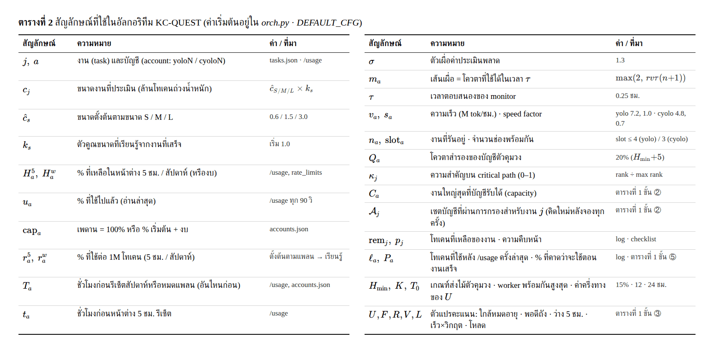

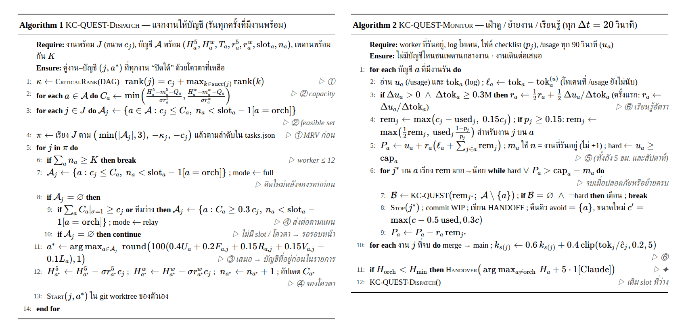

| คุณสมบัติ | ค่า |
|---|---|
| เวลาคิดต่อรอบ | $O(N \cdot \lvert A \rvert)$ — ไม่ถึง 1 วินาที ไม่ใช้โทเคน |
| ทุกงานที่แจก "ทำจบได้" ตามค่าประเมิน | $\sigma r c_j \le H - m - Q$ ทั้ง 2 ถัง |
| ไม่ย้ายไปมา | เส้นแจกงาน (หาร σ) อยู่ใต้เส้นย้ายงานเสมอ |
| ไม่ค้าง | relay เมื่อทีมรวมกันพอ · best-effort เมื่อทั้งทีมว่าง |
| ไม่รับประกัน | คำตอบที่ดีที่สุดทุกกรณี (ปัญหาเป็น NP-hard) |

<sub>KC-QUEST พัฒนาเป็นสื่อการสอนร่วมกันระหว่าง สถาบันเทคโนโลยีพระจอมเกล้าเจ้าคุณทหารลาดกระบัง (KMITL) และ บริษัท จันวณิช (Chanwanich · CWN) · ภาพการ์ตูนสร้างด้วย cyolo (Codex) · การ์ดสมการสร้างด้วย `tools/figures.py` · ตัวเลขทั้งหมดรันจริงด้วย `tools/kcquest.py` · 23 ต.ค. 2026</sub>
