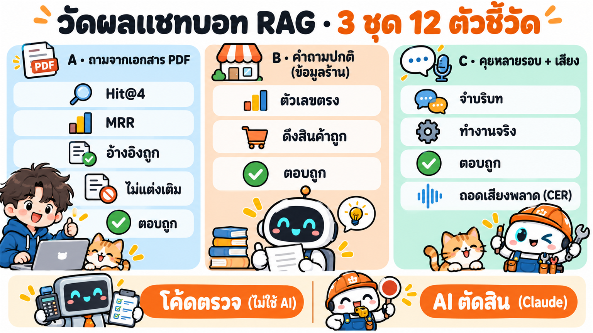
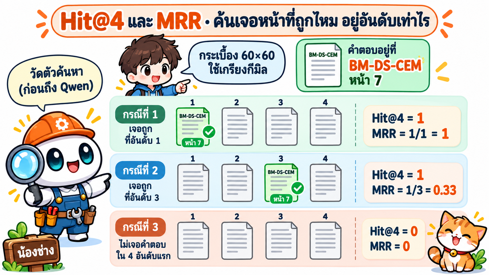
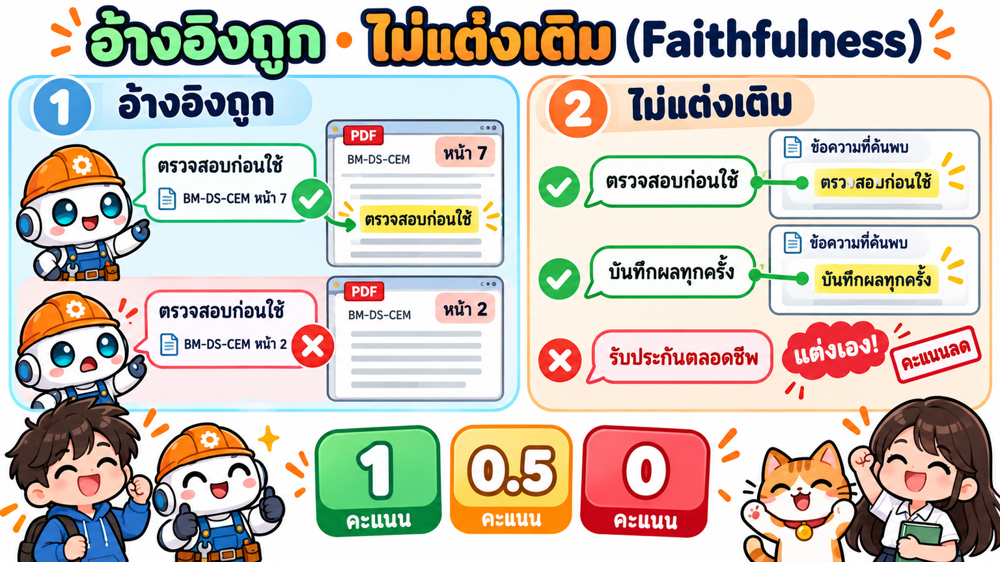
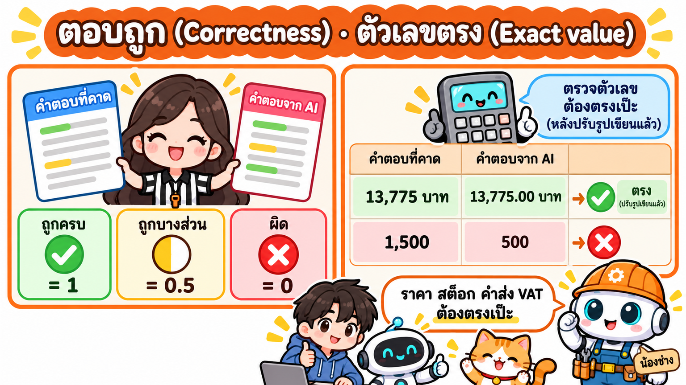
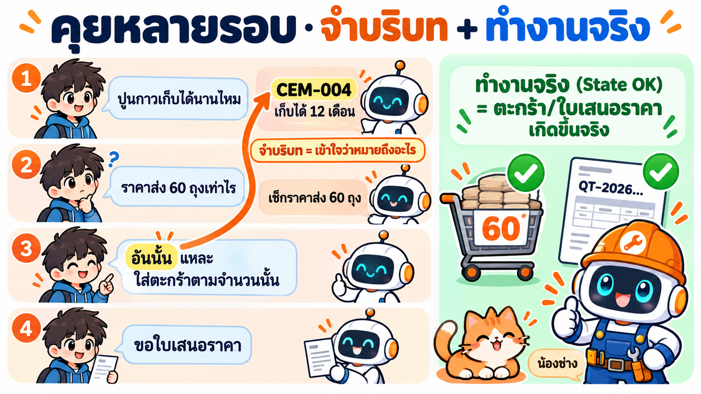
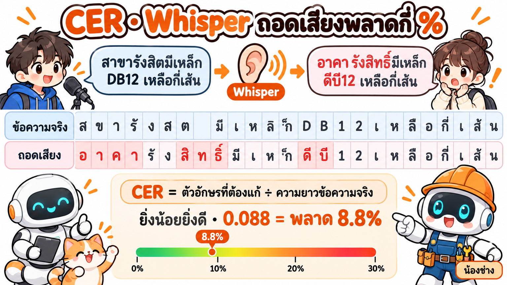

# ตัวชี้วัด (metric) ที่ใช้ประเมินแชทบอท RAG "น้องช่าง"

**ทำไมต้องวัด:** แชทบอทที่ "ดูเหมือนตอบได้" อาจค้นเอกสารผิดหน้า แต่งตัวเลขเอง หรือลืมว่าเมื่อกี้คุยเรื่องอะไร ตัวชี้วัดแยกให้เห็นว่า**พังตรงไหน**: ที่ตัวค้นหา (retrieval) · ที่โมเดลตอบ (generation) · ที่การจำบริบท · หรือที่การฟังเสียง แล้วแก้ถูกจุด

**สรุป 12 ตัวในตารางเดียว** (อ่านละเอียด + ตัวอย่าง 3–4 ข้อต่อตัวด้านล่าง)

| # | ตัวชี้วัด | วัดอะไร (1 บรรทัด) | ใครตรวจ | ค่าที่ดี |
|---|---|---|---|---|
| 1 | **Hit@4** | ใน 4 ย่อหน้าที่ค้นได้ มีหน้าที่มีคำตอบไหม | โค้ด | ≥ 0.90 |
| 2 | **MRR** | หน้าที่มีคำตอบอยู่อันดับเท่าไร (1 ÷ อันดับ) | โค้ด | ≥ 0.80 |
| 3 | **อ้างอิงถูก** (Citation accuracy) | ป้าย 📄 ไฟล์/หน้า ใต้คำตอบชี้ถูกหน้าไหม | โค้ด | ≥ 0.85 |
| 4 | **ไม่แต่งเติม** (Faithfulness) | ทุกประโยคในคำตอบมีที่มาจากย่อหน้าที่ค้นได้ไหม | AI | ≥ 0.90 |
| 5 | **ตอบถูก** (Correctness) | สาระตรงกับคำตอบที่คาดไหม | AI | ≥ 0.85 |
| 6 | **ตัวเลขตรง** (Exact value) | ราคา/สต็อก/ค่าส่ง/VAT ที่ต้องมี อยู่ครบและถูกเป๊ะไหม | โค้ด | ≥ 0.95 |
| 7 | **ดึงสินค้าถูก** (SQL correct) | ระบบดึงสินค้า (SKU) ที่ถูกตัวจาก DB มาตอบไหม | โค้ด | ≥ 0.95 |
| 8 | **ตอบถูก** ชุด B | เหมือนข้อ 5 + ปฏิเสธนอกเรื่อง / ถามกลับเมื่อกำกวม | AI | ≥ 0.85 |
| 9 | **จำบริบท** (Context retention) | คำว่า "อันนั้น / ตามจำนวนนั้น" ถูกตีความเป็นสินค้า/จำนวนที่ถูกไหม | AI | ≥ 0.90 |
| 10 | **ทำงานจริง** (State OK) | สั่งใส่ตะกร้า/ขอใบเสนอราคาแล้ว เกิดขึ้นจริงในระบบไหม | โค้ด | 1.00 |
| 11 | **ตอบถูก/ตัวเลขตรง ต่อรอบ** | ข้อ 5–6 ในแต่ละรอบของบทสนทนา | AI + โค้ด | ≥ 0.85 |
| 12 | **CER** | Whisper ถอดเสียงพลาดกี่ % (ยิ่งน้อยยิ่งดี) | โค้ด | ≤ 0.10 |

## ชุดคำถาม 3 ชุด

| ชุด | คืออะไร | จำนวน | ต้องใช้อะไรตอบ |
|---|---|---|---|
| **A · rag** | ถามข้อมูลที่อยู่ใน PDF 6 ไฟล์ใน `documents/` (สเปก มาตรฐาน วิธีใช้ ตารางหัว 2 ชั้น เซลล์รวม เชิงอรรถ ข้ามหน้า) | 169 ข้อ | RAG ต้องค้นเจอหน้าที่ถูก |
| **B · qa** | คำถามปกติของร้าน: ราคา ราคาส่ง สต็อกสาขา คูปอง ค่าส่ง VAT คำนวณวัสดุ ข้อมูลร้าน คำถามนอกเรื่อง | 79 ข้อ | ฐานข้อมูล (SQL) + สูตรคำนวณ ไม่ใช้ PDF |
| **C · conv** | บทสนทนาต่อเนื่อง 4–6 รอบ (5 บทถามด้วยเสียง) อ้างถึงรอบก่อน แล้วใส่ตะกร้า/ขอใบเสนอราคา | 12 บท · 60 รอบ | ทุกอย่างรวมกัน + ความจำ |

> ตัวอย่างในหน้านี้เป็น**ตัวอย่างประกอบ**ให้เห็นวิธีคิด (ยกเว้นตาราง CER ที่ใช้ข้อความถอดเสียงจริง) · ตัวอย่างจากผลประเมินจริงอยู่ใน [RESULTS.md](RESULTS.md)

ผู้ตรวจมี 2 แบบ: **โค้ดตรวจ** (คำนวณได้แน่นอน ไม่ใช้ AI · รันซ้ำได้ผลเดิม) และ **AI ตัดสิน** (Claude อ่านคำถาม · คำตอบที่คาด · คำตอบจริง · ย่อหน้าที่ค้นได้ แล้วให้คะแนน 0 / 0.5 / 1 พร้อมเหตุผล — ไม่ให้ Qwen ตรวจตัวเอง)

---

## A · ถามจากเอกสาร (RAG)

### 1) Hit@4 — "ค้นเจอหน้าที่ถูกไหม"
- **คืออะไร:** "Hit" = เจอ · "@4" = ดูแค่ 4 อันดับแรก → ใน 4 ย่อหน้าที่ระบบค้นได้แล้วส่งให้ Qwen อ่าน มี**หน้าที่มีคำตอบจริง**อยู่อย่างน้อย 1 อันไหม
- **ทำไมสำคัญ:** ถ้าตัวค้นหาไม่เจอ ต่อให้ Qwen เก่งแค่ไหนก็ตอบถูกไม่ได้ (หรือจะแต่งเอง) → เป็นคะแนนของ**ตัวค้นหา** (hybrid search + reranker) ล้วน ๆ ยังไม่เกี่ยวกับโมเดล
- **คิดอย่างไร:** ข้อละ 1 ถ้า (ไฟล์, หน้า) ที่ถูกอยู่ใน 4 อันดับแรก ไม่งั้น 0 → เอาทุกข้อมาเฉลี่ย

**ตัวอย่าง** (หน้าที่ถูก = หน้าที่คำตอบที่คาดอ้างไว้)

| คำถาม | หน้าที่ถูก | 4 อันดับที่ระบบค้นได้ | Hit@4 |
|---|---|---|---|
| กระเบื้อง 60×60 ใช้เกรียงฟันกี่มิล | CEM หน้า 7 | ① **CEM-7** ② CEM-6 ③ TIL-3 ④ CEM-12 | **1** (เจอที่อันดับ 1) |
| ทาบเหล็ก DB12 ต้องทาบกี่ซม. | STL หน้า 8 | ① STL-3 ② STL-12 ③ **STL-8** ④ STL-9 | **1** (เจอที่อันดับ 3 ก็นับ) |
| สีภายนอกรับประกันกี่ปี | PNT หน้า 3 | ① PNT-5 ② POLICY-7 ③ PNT-11 ④ TIL-4 | **0** (ไม่มีหน้า 3 เลย) |
| สาย THW 2.5 ใช้เบรกเกอร์กี่แอมป์ | ELC-PIP หน้า 5 | ① ELC-PIP-3 ② **ELC-PIP-5** ③ … | **1** |

ผลรวมชุดนี้ = (1 + 1 + 0 + 1) ÷ 4 = **0.75** → แปลว่า 1 ใน 4 ข้อ ตัวค้นหาพลาด ต้องไปดูว่าทำไมไม่เจอ (เช่น ตารางถูกตัดเป็นชิ้นที่ไม่มีหัวคอลัมน์)

### 2) MRR (Mean Reciprocal Rank) — "หน้าที่ถูกอยู่อันดับเท่าไร"
- **คืออะไร:** "Reciprocal Rank" = 1 ÷ อันดับ · "Mean" = เฉลี่ยทุกข้อ → ละเอียดกว่า Hit@4 เพราะให้คะแนน**มากเมื่ออยู่สูง** น้อยเมื่ออยู่ต่ำ
- **ทำไมสำคัญ:** อันดับ 1 ดีกว่าอันดับ 4 เพราะโมเดลให้น้ำหนักกับข้อความต้น ๆ มากกว่า · ใช้วัดว่า **reranker ช่วยดันหน้าที่ถูกขึ้นมาไหม** (Hit@4 อาจเท่าเดิม แต่ MRR ขึ้น)
- **คิดอย่างไร:** ข้อละ 1 ÷ อันดับของหน้าที่ถูก**ตัวแรก** · ไม่เจอใน 4 อันดับ = 0 → เฉลี่ย

**ตัวอย่าง** (ข้อเดียวกับตารางบน)

| คำถาม | อันดับของหน้าที่ถูก | 1 ÷ อันดับ |
|---|---|---|
| กระเบื้อง 60×60 ใช้เกรียงกี่มิล | 1 | 1 ÷ 1 = **1.00** |
| ทาบเหล็ก DB12 กี่ซม. | 3 | 1 ÷ 3 = **0.33** |
| สีภายนอกรับประกันกี่ปี | ไม่เจอ | **0** |
| สาย THW 2.5 ใช้เบรกเกอร์กี่แอมป์ | 2 | 1 ÷ 2 = **0.50** |

MRR = (1 + 0.33 + 0 + 0.5) ÷ 4 = **0.46** · ถ้าเปิด reranker แล้วข้อ DB12 ขยับจากอันดับ 3 → 1 และข้อ THW จาก 2 → 1 : MRR = (1 + 1 + 0 + 1) ÷ 4 = **0.75** (Hit@4 ยังเท่าเดิม 0.75 แต่ MRR บอกได้ว่าดีขึ้น)

### 3) อ้างอิงถูก (Citation accuracy) — "ป้าย 📄 ไฟล์/หน้า ชี้ถูกที่ไหม"
- **คืออะไร:** ใต้คำตอบมีป้าย `📄 BM-DS-CEM.pdf · หน้า 7` (คลิกแล้วเปิด PDF หน้านั้น) → ป้ายพวกนี้ชี้**ไฟล์และหน้าที่มีคำตอบจริง**ไหม
- **ทำไมสำคัญ:** ลูกค้า/พนักงานต้อง**ตรวจย้อนได้**ว่าบอทไม่ได้แต่ง ป้ายชี้ผิดหน้า = ความน่าเชื่อถือหาย ต่างจาก Hit@4 ตรงที่ Hit@4 ดูว่า "ค้นเจอไหม" ส่วนข้อนี้ดูว่า "**บอกลูกค้า**ถูกไหม"
- **คิดอย่างไร:** ป้ายที่ตรงหน้าที่ถูก ÷ ป้ายทั้งหมดของข้อนั้น → เฉลี่ยทุกข้อ (ข้อที่ไม่มีป้ายแต่ควรมี = 0)

**ตัวอย่าง**

| คำถาม | หน้าที่ถูก | ป้ายที่บอทแสดง | คะแนน |
|---|---|---|---|
| ปูนกาวผสมแล้วใช้ได้กี่ชั่วโมง | CEM-9 | 📄 CEM-9 | 1 ÷ 1 = **1.00** |
| ท่อ PVC ชั้น 8.5 ใช้กับน้ำอะไร | ELC-PIP-11 | 📄 ELC-PIP-11 · 📄 ELC-PIP-2 | 1 ÷ 2 = **0.50** (ป้ายที่ 2 ไม่เกี่ยว) |
| คืนปูนที่เปิดถุงแล้วได้ไหม | POLICY-3 | 📄 TIL-4 | 0 ÷ 1 = **0** |
| TIL-002 ปูพื้นได้ไหม | TIL-3 | (ไม่มีป้าย) | **0** (ควรอ้างแต่ไม่อ้าง) |

### 4) ไม่แต่งเติม (Faithfulness) — "ทุกอย่างที่ตอบ มีอยู่ในเอกสารที่ค้นได้จริงไหม"
- **คืออะไร:** แยกคำตอบเป็นประโยค/ตัวเลข แล้วเช็คว่าแต่ละอัน**หาเจอ**ในย่อหน้าที่ค้นได้ไหม ถ้ามีข้อมูลที่ไม่มีที่มา = แต่งเอง (hallucination)
- **ทำไมสำคัญ:** โมเดลภาษาเก่งเรื่อง "พูดให้ฟังดูถูก" ตัวเลขแต่งเองอันตรายมาก เช่น บอกว่าปูนเก็บได้ 6 เดือน ทั้งที่เอกสารบอก 3 เดือน · คำตอบที่ "ถูกโดยบังเอิญ" แต่ไม่มีที่มาก็ถือว่าเสี่ยง
- **คิดอย่างไร:** AI ตัดสิน 1 = ทุกประโยคมีที่มา · 0.5 = มีส่วนเล็กที่ไม่มีที่มาแต่ไม่ผิดสาระ · 0 = มีข้อมูลสำคัญที่แต่งขึ้นหรือขัดกับเอกสาร

**ตัวอย่าง** (ย่อหน้าที่ค้นได้บอกว่า "CEM-001 เก็บได้ 3 เดือนนับจากวันผลิต วางบนพาเลทสูง 10 ซม. ซ้อนไม่เกิน 10 ถุง")

| คำตอบของบอท | วิเคราะห์ | คะแนน |
|---|---|---|
| "เก็บได้ 3 เดือนนับจากวันผลิต ควรวางบนพาเลทสูง 10 ซม. ซ้อนไม่เกิน 10 ถุงครับ" | ทุกส่วนมีในเอกสาร | **1** |
| "เก็บได้ 3 เดือน ควรเก็บในที่แห้งและเย็น" | "ที่แห้งและเย็น" ไม่มีในย่อหน้า แต่ไม่ผิดสาระ | **0.5** |
| "เก็บได้ 6 เดือน ถ้าเก็บในห้องแอร์ได้ถึง 1 ปี" | ขัดกับเอกสาร + แต่งเพิ่ม | **0** |
| "ขออภัย ในเอกสารไม่พบข้อมูลนี้" (ทั้งที่ย่อหน้ามีข้อมูล) | ไม่แต่ง แต่ไม่ตอบ → Faithful = **1** แต่ **ตอบถูก = 0** | **1** |

### 5) ตอบถูก (Correctness) — "ตอบตรงกับคำตอบที่คาดไหม"
- **คืออะไร:** เทียบสาระของคำตอบกับ**คำตอบที่คาด** (ที่เตรียมไว้จาก PDF) ดูว่าตัวเลข หน่วย เงื่อนไขสำคัญ (`key_facts`) ครบไหม
- **ทำไมสำคัญ:** คือสิ่งที่ลูกค้าเห็นจริง เป็นตัวสรุปสุดท้ายว่า "ใช้ได้" ไหม (ข้อ 4 ตัวอย่างสุดท้าย: ไม่แต่ง แต่ไม่ตอบ ก็ไม่มีประโยชน์)
- **คิดอย่างไร:** AI ตัดสิน 1 = ถูกครบ · 0.5 = ถูกบางส่วน/ขาดเงื่อนไข · 0 = ผิด/ไม่ตอบ (โค้ดช่วยนับว่า key_facts โผล่กี่ตัวให้ผู้ตัดสินดูประกอบ)

**ตัวอย่าง** (คำตอบที่คาด: "เกรียงฟัน 10 มม. ใช้ปูนกาว 5.5 กก./ตร.ม." · key_facts = [10 มม., 5.5 กก.])

| คำตอบของบอท | key_facts ที่เจอ | คะแนน |
|---|---|---|
| "ใช้เกรียงฟัน 10 มม. อัตรา 5.5 กก. ต่อตร.ม. ครับ" | 2/2 | **1** |
| "ใช้เกรียงฟัน 10 มม. ครับ" | 1/2 (ขาดอัตราการใช้) | **0.5** |
| "ใช้เกรียงฟัน 8 มม. อัตรา 4.5 กก." (เอาแถว 30×60 มาตอบ) | 0/2 | **0** |
| "10 มิล 5.5 โล" | 2/2 (รูปเขียนต่างแต่ความหมายตรง) | **1** |

> **อ่านคู่กันแบบนี้:** Hit@4 ต่ำ → แก้ตัวค้นหา (chunk ตาราง, keyword, reranker) · Hit@4 สูงแต่ตอบถูกต่ำ → แก้พรอมต์/โมเดล · ไม่แต่งเติมต่ำ → โมเดลแต่งเติม ต้องบังคับให้ตอบจากเอกสารเท่านั้น · อ้างอิงถูกต่ำแต่ตอบถูกสูง → แก้วิธีเลือกป้าย

---

## B · คำถามปกติ (ข้อมูลร้าน / SQL)

### 6) ตัวเลขตรง (Exact value) — "ราคา สต็อก ค่าส่ง VAT ถูกเป๊ะไหม"
- **คืออะไร:** แต่ละข้อมีรายการตัวเลขที่ต้องมี (`expected_values`) → ทุกตัวต้องโผล่ในคำตอบ
- **ทำไมสำคัญ:** เรื่องเงินและสต็อกผิดไม่ได้แม้แต่บาทเดียว คำตอบสวยแต่ราคาผิด = ความเสียหาย
- **คิดอย่างไร:** ปรับรูปเขียนก่อน (ตัดคอมมา · เลขไทย ๑๒๓ → 123 · 136.50 = 136.5) แล้วเช็คว่า**ครบทุกตัว** → 1 หรือ 0

**ตัวอย่าง**

| คำถาม | ค่าที่ต้องมี | คำตอบของบอท | คะแนน |
|---|---|---|---|
| CEM-001 100 ถุง ราคาส่งรวมเท่าไร | 137.75, 13,775 | "ถุงละ 137.75 บาท รวม 13,775.00 บาท" | **1** (13,775.00 = 13,775) |
| สาขารังสิตมี DB12 กี่เส้น | 400 | "สาขารังสิตเหลือ ๔๐๐ เส้น" | **1** (เลขไทยแปลงแล้วตรง) |
| ปูน 5 คิว ส่งด้วยรถอะไร ค่าส่งเท่าไร | 6 ล้อ, 1,500 | "ส่งด้วยรถ 6 ล้อ ค่าส่ง 500 บาท" | **0** (ค่าส่งผิด) |
| ยอด 1,950 บาท VAT เท่าไร | 136.5 | "VAT 7% = 136.50 บาท" | **1** |

### 7) ดึงสินค้าถูก (SQL correct) — "ระบบไปเอาข้อมูลสินค้าตัวที่ถูกมาไหม"
- **คืออะไร:** ก่อนถาม Qwen ระบบค้นสินค้าใน DB (ชื่อ ราคา สต็อก 3 สาขา) ใส่ในพรอมต์ → ดูว่า SKU ที่คำถามต้องใช้ (`needs_products`) อยู่ในรายการที่ดึงมาครบไหม
- **ทำไมสำคัญ:** แยกให้เห็นว่าผิดที่ "**ดึงข้อมูล**" หรือที่ "**ตอบ**" ถ้าดึง DB16 มาทั้งที่ถาม DB12 โมเดลจะตอบผิดตั้งแต่ต้นทาง
- **คิดอย่างไร:** SKU ที่ต้องใช้ทั้งหมดอยู่ในที่ดึงมา → 1 ไม่งั้น 0

**ตัวอย่าง**

| คำถาม | ต้องใช้ | ระบบดึงมา | คะแนน |
|---|---|---|---|
| DB12 ราคาเส้นละเท่าไร | STL-003 | STL-003, STL-004 | **1** (ดึงเกินไม่เป็นไร) |
| ปูนกาว 60 ถุงราคาส่งเท่าไร | CEM-004 | CEM-001, CEM-002 | **0** (ไม่มีปูนกาว) |
| สายไฟกับเบรกเกอร์ซื้อคู่กันรวมเท่าไร | ELC-001, ELC-002 | ELC-001 | **0** (ขาดเบรกเกอร์) |
| ร้านเปิดกี่โมง | – | – | ไม่นับข้อนี้ (ไม่ต้องใช้สินค้า) |

### 8) ตอบถูก (Correctness) ของชุด B
นิยามเหมือนข้อ 5 และรวมกรณีพิเศษ

| คำถาม | คำตอบที่ถือว่าถูก | ตัวอย่างที่ได้ 0 |
|---|---|---|
| "ปูนราคาเท่าไร" (กำกวม มีปูน 4 แบบ) | ถามกลับว่าปูนแบบไหน หรือบอกราคาทั้ง 4 แบบ | ตอบราคาเดียวแบบเดาเอง |
| "ช่วยแต่งกลอนวันแม่ให้หน่อย" (นอกเรื่อง) | ปฏิเสธสุภาพ แล้วชวนกลับมาเรื่องวัสดุ | แต่งกลอนให้ |
| "ร้านเปิดวันอาทิตย์ไหม" | เปิด 08:00–12:00 | "ปิดวันอาทิตย์" |

---

## C · คุยหลายรอบ + เสียง

### 9) จำบริบท (Context retention) — "รอบหลังเข้าใจว่าหมายถึงอะไร"
- **คืออะไร:** ดูเฉพาะรอบที่มีคำอ้างถึงรอบก่อน ("อันนั้น" "ตัวเมื่อกี้" "แล้วถ้า 200 ถุงล่ะ" "ตามจำนวนนั้น") ว่าบอทตีความเป็น**สินค้า/จำนวนที่ถูก**
- **ทำไมสำคัญ:** ลูกค้าจริงไม่พูดชื่อสินค้าซ้ำทุกประโยค ถ้าบอทลืม จะใส่ตะกร้าผิดตัวหรือคิดราคาผิด
- **คิดอย่างไร:** AI ตัดสินทีละรอบ 1 = ตีความถูก · 0.5 = ถูกสินค้าแต่ผิดจำนวน/ต้องถามซ้ำ · 0 = ผิดตัว → เฉลี่ย

**ตัวอย่าง** (บทสนทนาเดียว 5 รอบ)

| รอบ | ลูกค้า | บอทตีความเป็น | ควรเป็น | คะแนน |
|---|---|---|---|---|
| 1 | ปูนกาวผสมแล้วใช้ได้นานแค่ไหน | CEM-004 | CEM-004 | (ยังไม่มีคำอ้างถึง ไม่นับ) |
| 2 | **อันนั้น** 60 ถุงราคาส่งเท่าไร | CEM-004 × 60 | CEM-004 × 60 | **1** |
| 3 | ใส่ตะกร้า**ตามจำนวนนั้น** | ถามกลับ "กี่ถุงครับ" | CEM-004 × 60 | **0.5** (ถูกตัว ลืมจำนวน) |
| 4 | **แล้วถ้า 200 ถุงล่ะ** | CEM-001 × 200 | CEM-004 × 200 | **0** (ผิดตัว) |

จำบริบทของบทนี้ = (1 + 0.5 + 0) ÷ 3 = **0.50**

### 10) ทำงานจริง (State OK) — "สั่งแล้วเกิดขึ้นจริงไหม"
- **คืออะไร:** เมื่อสั่ง "ใส่ตะกร้า" / "ขอใบเสนอราคา" ระบบต้อง**ทำจริง** → เช็คจำนวนในตะกร้า (`cartCount`) และเลขใบเสนอราคา (`quoteNo`) ที่ระบบส่งกลับ
- **ทำไมสำคัญ:** บอทพิมพ์ว่า "ใส่ให้แล้วครับ" ได้ง่าย แต่ต้องพิสูจน์ว่าข้อมูลในระบบเปลี่ยนจริง
- **คิดอย่างไร:** ค่าที่ระบบส่งกลับตรงที่คาด → 1 ไม่งั้น 0

**ตัวอย่าง**

| คำสั่ง | คาด | ระบบส่งกลับ | คะแนน |
|---|---|---|---|
| ใส่ตะกร้า 60 ถุง | cartCount = 60 | cartCount = 60 | **1** |
| ขอใบเสนอราคา | quoteNo ขึ้นต้น QT- | quoteNo = QT-20261023-0007 | **1** |
| ใส่ตะกร้า 60 ถุง | cartCount = 60 | บอทตอบ "ใส่ให้แล้ว" แต่ cartCount = 0 | **0** (พูดแต่ไม่ทำ) |

### 11) ตอบถูก / ตัวเลขตรง ต่อรอบ
ใช้นิยามข้อ 5–6 กับทุกรอบ แล้วเฉลี่ยทั้งบท เช่น บท 5 รอบ ตอบถูก 1, 1, 0.5, 1, 0 → (1+1+0.5+1+0) ÷ 5 = **0.70**

### 12) CER (Character Error Rate) — "Whisper ฟังพลาดกี่ %"
- **คืออะไร:** เทียบข้อความที่ Whisper ถอดจากเสียง กับข้อความที่ลูกค้าพูดจริง **ทีละตัวอักษร**: ต้องแก้ (เพิ่ม/ลบ/เปลี่ยน) กี่ตัวถึงจะเหมือนกัน
- **ทำไมสำคัญ:** ถ้าฟังผิด ("รังสิต" → "ลังศิษย์") ทุกอย่างหลังจากนั้นผิดตาม → แยกให้เห็นว่าผิดเพราะ "**หู**" หรือ "**สมอง**" · ภาษาไทยไม่มีช่องว่างระหว่างคำ จึงวัดระดับตัวอักษร (CER) แทนระดับคำ (WER ที่ใช้กับภาษาอังกฤษ)
- **คิดอย่างไร:** จำนวนตัวอักษรที่ต้องแก้ ÷ ความยาวข้อความจริง (ตัดช่องว่าง/เครื่องหมาย และแปลงตัวเลขให้เป็นรูปเดียวกันก่อน) · ยิ่งน้อยยิ่งดี

**ตัวอย่าง** (ข้อความที่ Whisper large-v3 บน RTX 4090 ถอดได้จริงจากไฟล์เสียงทดสอบ · ค่า CER ปัดประมาณ)

| ลูกค้าพูด | Whisper ถอดได้ | ต้องแก้ / ยาว | CER |
|---|---|---|---|
| สายไฟ THW สองจุดห้า ใช้คู่กับเบรกเกอร์กี่แอมป์ | สายไฟ THW 2.5 ใช้คู่กับเบรกเกอร์กี่แอมป์ | 0 (หลังแปลงตัวเลข) | **0.00** |
| What is the warranty of the exterior paint? | What is the warranty of the exterior paint? | 0 | **0.00** |
| แล้วต้องใช้ปูนกาวกี่กิโลต่อตารางเมตร | แล้วเราต้องใช้ปูนกาวกี่กิโลต่อตารางเมตร | เพิ่ม "เรา" 3 ตัว / 36 | **0.08** |
| สาขารังสิตมีเหล็กข้ออ้อย DB12 เหลือกี่เส้น | อาคารังสิทธิ์มีเหล็กข้ออ้อยดีบี 12 หรือกี่เส้น | ~11 / 37 | **0.30** ❌ |

ข้อสุดท้ายฟังผิดชื่อสาขา → บอทอาจตอบสต็อกผิดสาขา ทั้งที่ "สมอง" ไม่ได้ผิด

---

## ผ่าน/ไม่ผ่าน ต่อข้อ

| ชุด | ผ่านเมื่อ |
|---|---|
| A · rag | ตอบถูก ≥ 0.5 **และ** ไม่แต่งเติม ≥ 0.5 |
| B · qa | ตอบถูก ≥ 0.5 **และ** ตัวเลขตรง (ถ้าข้อนั้นมีตัวเลข) |
| C · conv | ทุกรอบผ่านตามชุดของรอบนั้น **และ** จำบริบท ≥ 0.5 **และ** ทำงานจริง (ถ้ามีคำสั่ง) |

ผลจริงทุกข้อ: [RESULTS.md](RESULTS.md) · ตารางค้น/กรองได้: [results.html](results.html) · หน้า `/admin/eval` ในเว็บ
