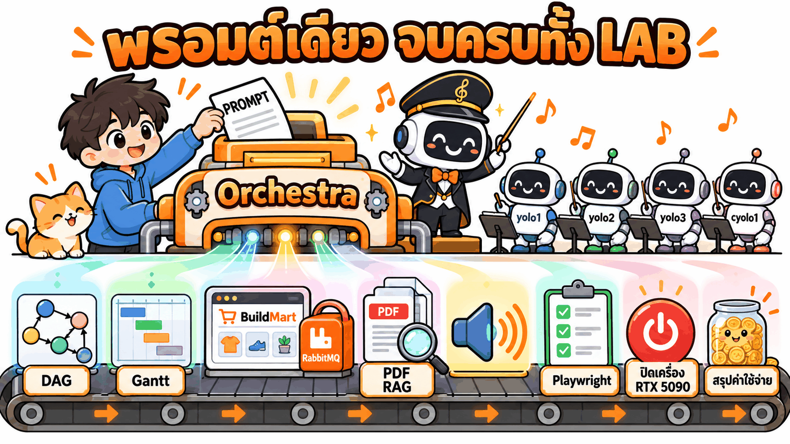
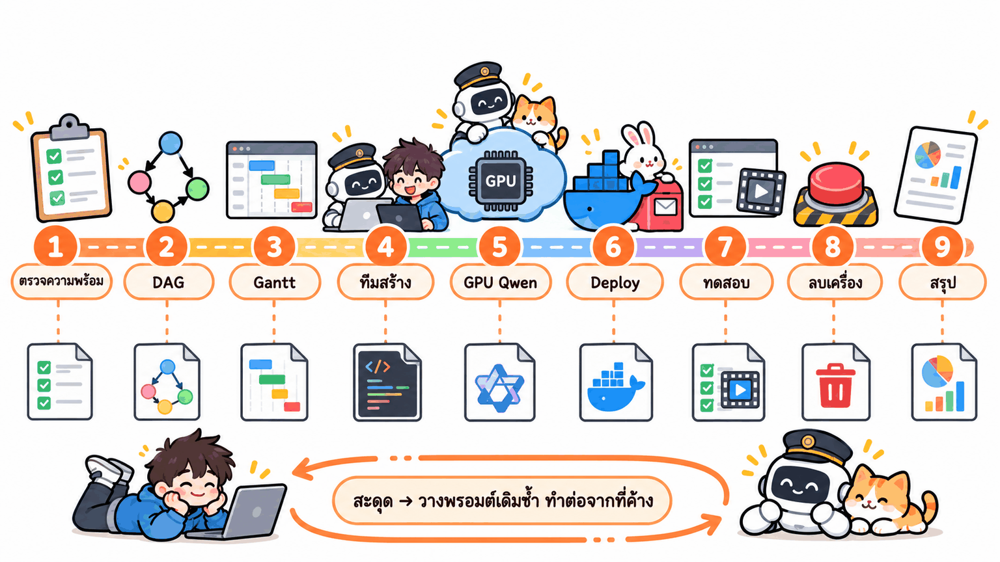
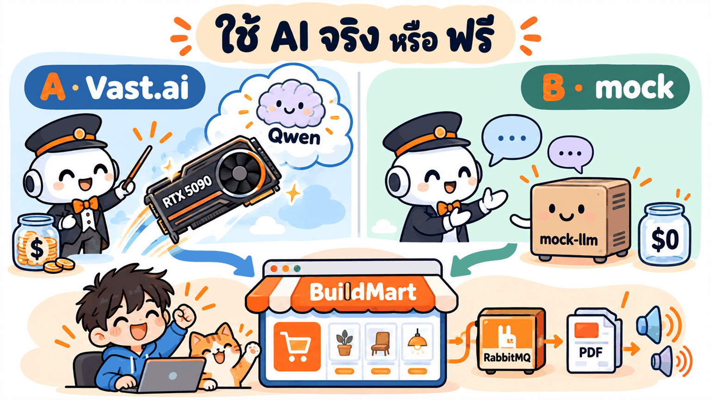

# ⚡ Fast Track · BuildMart v3 ทั้ง LAB ในพรอมต์เดียว

งานเดียวกับ [LAB 04.2 หลัก](../readme.md) ทุกขั้น แต่วางพรอมต์ **ครั้งเดียว** แล้ว AI ทำต่อกันเองจนจบ: ตรวจความพร้อม → แตก requirement เป็น DAG → แจกงาน + ไทม์ไลน์ (KC-QUEST) → ทีม AI สร้างระบบจริง (เว็บ 3D + RabbitMQ + Hybrid RAG + reranker + ฟัง/พูด) → เปิด **GPU 3 ใบ**บน Vast.ai จาก GitHub → deploy → เพลย์ลิสต์ทดสอบ → **ประเมิน RAG + load test** → **ลบเครื่อง GPU + สรุปค่าใช้จ่าย** → สรุป (ราว 4–5 ชม.)



## 🧭 พรอมต์ทำอะไรบ้าง

AI ทำทีละขั้นต่อกัน แต่ละขั้นเขียนผลลงไฟล์ แล้ว**อ่านไฟล์นั้นก่อนทำขั้นถัดไป** · สะดุดกลางทาง → วางพรอมต์เดิมซ้ำได้ AI จะดูไฟล์แล้วทำต่อจากขั้นที่ค้าง


*ภาพแนวคิดจากรอบ v2 — รอบ v3 เพิ่มขั้น GPU ใบที่ 2–3 · ประเมิน RAG · load test (ตารางด้านล่าง)*

| ขั้น | ทำอะไร | เทียบ LAB หลัก | ไฟล์ที่ได้ | 🅰️ | 🅱️ |
|---|---|---|---|---|---|
| 1 | ตรวจ repo · skill · บัญชี ≥ 2 · docker · Vast | ขั้นที่ 0 | ตารางความพร้อม | ✅ | ✅ |
| 2 | `planner.py dag` แตก `BUILDMART.md` เป็น DAG | พรอมต์ ① | `out/buildmart/dag.png` | ✅ | ✅ |
| 3 | `planner.py plan` แจกงานด้วย KC-QUEST + ไทม์ไลน์ | พรอมต์ ② | `out/buildmart/gantt.png` · `PLAN.md` | ✅ | ✅ |
| 4 | ทีม AI สร้างจริงตามแผน (`orch.py` · ย้ายงาน/ส่งไม้อัตโนมัติ) | พรอมต์ ③ | `my_buildmart/app/` · `BOARD.md` | ✅ | ✅ |
| 5 | เช่า RTX 5090 (Qwen) + RTX 4090 × 2 (Whisper · VoxCPM2 + reranker) · อ่าน GitHub เอง | พรอมต์ ④ ⑤ | `.env.vast` · `.env.aibox` | ✅ | – |
| 6 | deploy ทั้งระบบ (`docker compose`) | พรอมต์ ⑥ | เว็บ :3400 | AI | mock |
| 7 | เพลย์ลิสต์ Playwright 62 เคส + GIF + MP4 มีเสียง | พรอมต์ ⑦ | `TEST_REPORT.md` | mock + AI | mock |
| 8 | ประเมิน RAG มี/ไม่มี reranker | พรอมต์ ⑧ | `/admin/eval` · `RESULTS.md` | ✅ | – |
| 9 | load test 1 → 32 คน + กราฟ GPU | พรอมต์ ⑨ | `/admin/load` · `gpu-usage.png` | ✅ | – |
| 10 | ลบเครื่อง GPU ทั้ง 3 ใบ + คิดค่าใช้จ่าย | พรอมต์ ⑩ | — | ✅ | – |
| 11 | สรุปทั้งหมด | — | `my_buildmart/FAST_TRACK.md` | ✅ | ✅ |

## 🏷️ หัวใจที่พรอมต์บังคับไว้

- **ความจำอยู่ในไฟล์ ไม่อยู่ในแชต** — ตัวคุมวงโทเคนใกล้หมดแล้วส่งไม้ให้บัญชีอื่น คนใหม่รู้แค่สิ่งที่อยู่ในไฟล์ พรอมต์จึงให้คัดลอกขั้นหลังงานสร้างไว้บนสุดของ `NOTES.md` ตั้งแต่แรก ใครเป็นตัวคุมวงคนสุดท้ายก็ปิดงานได้ครบ
- **เงินจริงต้องปิดเสมอ** — ทุกทางจบ (สำเร็จ ล้ม เปลี่ยนแผน) ต้องไม่มีเครื่อง `bm-qwen-5090` `bm-stt-4090` `bm-voice-4090` เหลือ · เพดานรวม ~$2.20/ชม. · เช่า GPU **หลังทีมสร้างเสร็จ**เท่านั้น (ไม่จ่ายระหว่างรอ) · เครื่องเปิดเกิน 3 ชม. ให้ลบแล้วไปต่อแบบ mock
- **ห้ามแก้เกณฑ์ให้ผ่าน** — เคสไหนไม่ผ่านให้แก้โค้ด ไม่ใช่แก้ค่าที่คาดหวังใน `BUILDMART.md` หรือใน test
- **ห้ามเปิด `_solution/`** — ทีมต้องสร้างเองจาก requirement

## 🔀 เลือกพรอมต์ 1 จาก 2 แบบ



| | 🅰️ AI จริง (Vast.ai 3 GPU) | 🅱️ ฟรี (mock) |
|---|---|---|
| แชทบอทตอบด้วย | Qwen3.8-27B บน RTX 5090 | `mock-llm` (ตอบจาก context แบบ deterministic) |
| ฟัง · พูด · rerank | Whisper · VoxCPM2 · bge-reranker บน RTX 4090 × 2 | mock (จับคู่ไฟล์เสียงทดสอบ · เล่นเสียง VoxCPM2 ที่อัดไว้ · ลำดับเดิม) |
| เว็บ 3D · RabbitMQ · Hybrid RAG · คุยหลายรอบ | ✅ | ✅ |
| ประเมิน RAG + load test | ✅ ตัวเลขจริง | – (ไม่มีความหมายกับ mock) |
| ค่าใช้จ่าย | ≈ $2.06/ชม. × เวลาเปิด GPU (~2–3 ชม. ≈ $4–6 · ลบเครื่องให้อัตโนมัติ) | $0 |
| ต้องมีเพิ่ม | [LAB 04.1](../../01_VastAi_Skill/readme.md): `VAST_API_KEY` + SSH key ใน `.env` · เครดิต Vast | — |

> 💡 สอนในห้อง: ให้ทุกคนรัน 🅱️ แล้วผู้สอนรัน 🅰️ บนจอ — เว็บและการแจกงานเหมือนกัน ต่างกันแค่ใครตอบแชท/ฟัง/พูด

## 🚀 วิธีใช้

1. เตรียม: [LAB 03](../../../03_MultiAccount_Container/README.md) (container + ล็อกอิน **อย่างน้อย 2 บัญชี**) · [LAB 04](../../00_Setup_Skill/readme.md) (skill `yolo` `cyolo` `vastai`) · [LAB 04.1](../../01_VastAi_Skill/readme.md) (container เห็น repo ที่ `/workspace` + `.env`)
2. เปิด JupyterLab `http://localhost:8886/lab` → **File → New → Terminal** (อยู่ที่ `/workspace`)
3. 🖥️ เปิด AI บัญชีที่โควตาเหลือมากสุด เช่น `yolo1` (เลือกผิด AI จะส่งไม้ให้บัญชีที่เหมาะกว่าเอง)
4. 💬 คัดลอกพรอมต์ 🅰️ หรือ 🅱️ ไปวาง แล้วรอ (ตั้งเครื่องไม่ให้หลับ)
5. 👀 ดูความคืบหน้าสด: เปิด `00_setup/04_Skill_Setup/04_Multi_Agent_Orchestra/my_buildmart/BOARD.md` (คลิกขวา → Open With → Markdown Preview)
6. จบแล้วอ่าน `my_buildmart/FAST_TRACK.md` · แบบ 🅰️ เปิด [cloud.vast.ai → Instances](https://cloud.vast.ai/instances/) เช็คด้วยตาว่า**ว่าง**

> 🔁 อยากเริ่มใหม่ทั้งหมด: ปิดเว็บ/ลบเครื่อง Vast ก่อน แล้ว 🖥️ `mv /root/runs/buildmart /root/runs/buildmart.old` ไม่อย่างนั้น AI จะเห็นว่าทำเสร็จแล้วและไปต่อจากขั้นที่ค้าง

## ✅ จบแล้วตรวจอะไร

1. **`my_buildmart/FAST_TRACK.md`** — ดูช่อง ⚠️ และ "เรื่องที่ตัดสินแทนผู้เรียน" ก่อน
2. **แบบ 🅰️: หน้า Instances ของ Vast.ai ต้องว่าง** (ไม่มีเครื่อง `bm-*` เหลือ)
3. **`my_buildmart/app/TEST_REPORT.md`** ผ่านกี่เคสต่อกลุ่ม (W C R Q T M V D E L) · GIF `test-gifs/` · MP4 มีเสียง `test-videos/T01.mp4` `V01.mp4`
4. **แบบ 🅰️: `/admin/eval` และ `/admin/load`** — rerank ช่วยกี่จุด · รับผู้ใช้พร้อมกันได้กี่คนต่อโหมด
5. **`my_buildmart/orchestra/REPORT.md`** งานไหนไปบัญชีไหน เทียบกับไทม์ไลน์ใน `out/buildmart/gantt.png`
6. อยากเปิดเว็บดูเองบน Windows → ทำ[พรอมต์ ⑥ ใน LAB หลัก](../readme.md) (deploy ด้วย Docker Desktop)

ตัวเลขจากการทำจริงใน LAB หลัก (23 ต.ค. 2026) ใช้เป็นจุดเทียบ:

| ขั้น | LAB หลักได้ |
|---|---|
| 2–3 | 27 งาน · สายวิกฤต T01→T06→T08→T09→T10→T18→T19→T21→T27 · แผน 168 นาที (เร็วขึ้น ~2.4 เท่า) |
| 4 | <!-- P3_RESULT: __/27 งาน · __ นาที · worker พร้อมกันสูงสุด __ · mock __/62 --> |
| 5 | RTX 5090 $1.06/ชม. ~87 tok/s · VRAM 23.9 GB · RTX 4090 × 2 $0.498/ชม. ต่อใบ · VRAM 4.7 GB (Whisper) / 11.4 GB (VoxCPM2 + reranker) |
| 7 | เฉลย mock **62/62** · AI จริง **62/62** (รอบแรก 59/62 → แก้ chat-worker แล้วผ่านครบ) |
| 8 | rag ผ่าน 95.9% (rerank off 88.8%) · Hit@4 95.4% (off 80.8%) · qa 91.1% · conv 66.7% · CER 0.058 |
| 9 | แชท 4 คน · ฟัง 32 คน (prefetch 8) · พูด 2 คน · เสียง→เสียง 4 คน (p50 3.1–3.8 วิ) |
| 10 | <!-- COST_RESULT: ลบแล้ว 0 เครื่อง · ค่าใช้จ่ายรวม $__ --> |

<!-- FT_RESULT: fast_track v3 (ทั้ง 🅰️ และ 🅱️) ยังไม่ได้รันจริงแบบพรอมต์เดียว — เติมผลจริง (เวลารวม · FAST_TRACK.md · ค่าใช้จ่าย) เมื่อรันแล้ว -->

## 🆘 ถ้าสะดุด

| อาการ | ทำอะไร |
|---|---|
| แชตหลุด หรือ AI หยุดกลางทาง | เปิด `yolo1` ใหม่ วางพรอมต์เดิมซ้ำ AI ทำต่อจากขั้นที่ค้าง (ถ้ามีตัวคุมวงอื่นทำงานอยู่ มันจะรายงานสถานะแล้วจบเอง ไม่คุมซ้อน) |
| AI บอกว่า "ส่งไม้ให้ … แล้ว" และจบแชต | ปกติ ตัวคุมวงคนใหม่ทำต่อเบื้องหลัง ดู `my_buildmart/BOARD.md` แล้วรอ `FAST_TRACK.md` |
| หยุดที่ขั้น 1 ว่า "ล็อกอินไม่ถึง 2 บัญชี" | ล็อกอินเพิ่มตาม LAB 03 แล้ววางพรอมต์ซ้ำ |
| เช่า Vast ไม่ได้ (ไม่มีเครื่องตามเพดาน) | AI เปลี่ยนเป็นทดสอบ mock ให้เอง (หรือใช้ Qwen ใบเดียว ฟัง/พูดเป็น mock) และจดไว้ใน ⚠️ |
| แชทตอบ "ระบบ AI ขัดข้อง" กลาง load test | Qwen engine ล่ม — พรอมต์สั่งให้มี watchdog สตาร์ตใหม่เองแล้ว · ดู[บทเรียนใน LAB หลัก](../readme.md#ส่วน-d--เปิด-ai-บน-vastai-3-ใบ--ให้-ai-อ่าน-github-แล้วติดตั้งเอง-เสียเงินจริง) |
| ไม่แน่ใจว่าเครื่อง Vast ถูกลบแล้ว | 💬 `ใช้ skill vastai ลบเครื่องป้าย bm-qwen-5090 bm-stt-4090 bm-voice-4090 แล้วยืนยันว่าไม่มีเครื่องเหลือ` |
| ทีมสร้างไม่ผ่านจริง ๆ | ใช้เฉลย [`_solution/buildmart`](../_solution/buildmart/README.md) — `docker compose` คำสั่งเดียว build ทั้งระบบ |

อาการอื่นดู[ตารางแก้ปัญหาใน LAB หลัก](../readme.md#แก้ปัญหา)

---

## 🅰️ พรอมต์แบบใช้ AI จริง (Vast.ai 3 GPU)

```text
ผมมี requirement เว็บร้านวัสดุก่อสร้างใน BUILDMART.md (เว็บ 3D + มาสคอต + RabbitMQ + Hybrid RAG + reranker จาก PDF ใน documents/ + ถามด้วยเสียง Whisper + ตอบด้วยเสียง VoxCPM2 + ประเมิน RAG + load test + GPU 3 ใบบน Vast.ai) อยากให้ทีม AI หลายบัญชีที่ผมล็อกอินไว้ (yolo และ cyolo) วางแผน สร้าง deploy ทดสอบ และวัดผลจนเสร็จ
ไฟล์เริ่มต้นอยู่ในโฟลเดอร์ 04_Multi_Agent_Orchestra (ถ้าไม่อยู่ที่โฟลเดอร์ปัจจุบันให้หาใน /workspace) ห้ามเปิดโฟลเดอร์ _solution:
- BUILDMART.md = requirement เกณฑ์ทดสอบ การประเมิน และ load test · documents/ = PDF ของ RAG · test-fixtures/voice/ = เสียงทดสอบ V01–V10
- tools/planner.py = แตกงานเป็น DAG + แจกงานด้วย KC-QUEST + วาดไทม์ไลน์ (ดูวิธีใช้ด้วย --help)
- ORCHESTRA_RECIPE.md = วิธีคุมทีมสร้างจริงตามแผน (ใช้ tools/orch.py)
ใช้ skill yolo, cyolo และ vastai ทำต่อกันให้จบโดยไม่ต้องรอผม ตามขั้นที่ 1–11 ด้านล่าง ถ้าพรอมต์นี้ขัดกับสูตร ให้ถือพรอมต์นี้

กติกาที่ต้องถือตลอด
- ห้ามแสดงค่าในไฟล์ .env หรือ key/รหัสผ่านใด ๆ บนจอ หรือเขียนลงไฟล์ที่ส่งกลับมา บอกได้แค่ชื่อตัวแปรและว่ามีหรือไม่มี และห้ามล็อกอินบัญชีแทนผม
- ตัวคุมวงไม่เขียนโค้ดเอง ให้ทีมทำผ่านเครื่องมือในสูตรเท่านั้น
- จำทุกอย่างในไฟล์ ไม่ใช่ในแชต: เขียนบันทึกของตัวคุมวง (NOTES.md ตามสูตร) ตั้งแต่ต้น บนสุดให้มีกติกาในพรอมต์นี้และขั้นที่ 5–11 ทั้งหมด พร้อมประโยค "ใครเป็นตัวคุมวงตอนงานสร้างเสร็จครบ ต้องทำขั้น 5–11 ต่อจนจบ"
- ก่อนเริ่มแต่ละขั้นให้อ่านไฟล์สถานะจากดิสก์ใหม่ · งานใช้เวลานานได้ ให้วนรอตามสูตรไปเรื่อย ๆ ห้ามหยุดไปก่อนแล้วบอกว่าจะกลับมาดู · มีความคืบหน้าให้บอกผมสั้น ๆ 1–2 บรรทัด · สรุปเป็นภาษาไทย ใช้ตาราง
- เรื่องเงิน: เช่า GPU ได้ 3 เครื่องเท่านั้น ป้าย bm-qwen-5090 (RTX 5090 เพดาน $1.20/ชม.) · bm-stt-4090 และ bm-voice-4090 (RTX 4090 เพดาน $0.55/ชม. ต่อเครื่อง) · เช่าหลังงานสร้าง (ขั้น 4) เสร็จเท่านั้น · ไม่ว่าจบแบบไหน ต้องไม่มีเครื่องที่เช่าในรอบนี้เหลือ · ถ้าเครื่องเปิดเกิน 3 ชั่วโมงให้ลบทันทีแล้วทำขั้นที่เหลือแบบ mock · ห้ามแตะเครื่องอื่นที่ไม่ได้เช่าในรอบนี้
- ตรงไหนที่ปกติต้องถามผม ไม่ต้องรอ ให้ตัดสินเองแล้วจดในบันทึกหัวข้อ "ตัดสินแทนผม": บัญชีที่ยังไม่ล็อกอินให้ข้าม · เช่า GPU ไม่ได้ภายใน 15 นาที หรือเปิด AI ไม่สำเร็จ → ลบเครื่องที่อาจค้าง แล้วใช้ mock แทนเฉพาะส่วนนั้น · งานที่ล้มจนหมดรอบลอง → แบ่งงานใหม่ 1 ครั้ง ยังล้มให้ข้าม · เรื่องอื่นเลือกทางที่ปลอดภัยและไม่เสียเงินกว่า
- หยุดแล้วบอกผมว่าต้องทำอะไร เฉพาะเมื่อ: ล็อกอินไม่ถึง 2 บัญชี · หาไฟล์ไม่เจอ · docker ใช้ไม่ได้ · พอร์ต 3400 ถูกโปรแกรมอื่นใช้อยู่

ตอนเริ่ม ให้ดูก่อนว่าเคยทำค้างไว้ไหม (เปิดไฟล์จริง ไม่เดา): ยังไม่มีอะไร → ขั้น 1 · มี out/buildmart/tasks.json แล้ว → ข้ามขั้น 2–3 · มีงานสร้างค้างและตัวคุมวงบัญชีอื่นเพิ่งทำงาน (ภายใน 10 นาที) → สรุปความคืบหน้าแล้วจบ ห้ามคุมซ้อน · งานสร้างครบแล้ว → ไปขั้นที่ยังไม่มีไฟล์ผลลัพธ์ · มี FAST_TRACK.md แล้ว → ทำขั้น 10 ซ้ำเพื่อยืนยันว่าไม่มีเครื่องค้าง แล้วแสดงสรุป

ขั้นที่ 1 เช็กความพร้อม: ตาราง รายการ | ✅/❌ | หมายเหตุ — ไฟล์ครบ (รวม documents/ 6 ไฟล์ และ test-fixtures/voice/) · skill yolo cyolo vastai · บัญชีที่ล็อกอิน · docker ใช้ได้ · พอร์ต 3400 ว่าง · Chromium ของ Playwright · ค่าสำหรับ Vast.ai ใน .env และสั่ง vastai ได้
ขั้นที่ 2 แตก BUILDMART.md เป็น DAG 18–28 งาน (S/M/L · area · owns · งาน VAST 3 งาน only:yolo no_handoff · งานรูป only:cyolo · งานสุดท้าย exclusive) บันทึก out/buildmart/tasks.json แล้ว python tools/planner.py dag --plan buildmart --png --mode teach
ขั้นที่ 3 python tools/planner.py plan --plan buildmart --png --max-agents 12 (โควตาจริงจากบัญชี) อธิบายสายวิกฤต และเหตุผลที่ KC-QUEST เลือกบัญชี 2–3 ตัวอย่าง
ขั้นที่ 4 สร้างจริงตาม ORCHESTRA_RECIPE.md ด้วย PLAN=out/buildmart BACKEND=mock MAX_AGENTS=12 จนทุกงานเสร็จและ export ไป my_buildmart/ (ระหว่างนี้ยังไม่เช่า GPU)
ขั้นที่ 5 ใช้ skill vastai เปิด GPU 2 กลุ่มขนานกัน อ่านวิธีติดตั้งจาก GitHub เองทั้งหมด:
  5a bm-qwen-5090: RTX 5090 (เน็ต ≥ 1000 Mbps · disk ≥ 90 GB · CUDA ≥ 13.4 · พอร์ต 8080) อ่าน https://github.com/Neroued/ninfer build NInfer โหลด Qwen3.8-27B nvfp4 ของ neroued เปิด ninfer-serve แบบ OpenAI-compatible ปิด thinking รับพร้อมกัน 4 คน ตั้ง API key + watchdog ที่สตาร์ต server ใหม่เมื่อ /health ล้ม 3 ครั้งติด แล้วเขียน LLM_BASE_URL / LLM_MODEL / LLM_API_KEY ลง .env.vast ในโฟลเดอร์แอป
  5b bm-stt-4090 + bm-voice-4090: RTX 4090 × 2 (PyTorch + CUDA 12.8 · พอร์ต 8090) ใช้โค้ด ai-box ของทีม (ถ้ายังไม่มี ให้เขียนเองจาก GitHub ของ faster-whisper · OpenBMB/VoxCPM · BAAI/bge-reranker-v2-m3 ตาม API ใน BUILDMART ข้อ 4.6) · MODELS=stt กับ MODELS=tts,rerank · key เดียวกัน · ทดสอบ V01–V10 ได้ CER · แล้วเขียน STT_URL / TTS_URL / RERANK_URL / AIBOX_API_KEY ลง .env.aibox ในโฟลเดอร์แอป
ขั้นที่ 6 deploy ทั้งระบบโหมด AI จริง (docker compose up -d --build ในโฟลเดอร์แอป ไม่ใส่ profile mock) รอทุก service healthy ตรวจว่าแชทใช้ Qwen จริง ฟังใช้ Whisper พูดใช้ VoxCPM2 rerank เปิด และเอกสาร RAG ingest ครบ 6 ไฟล์
ขั้นที่ 7 รันเพลย์ลิสต์ Playwright ทุกเคสในข้อ 7 ของ BUILDMART ทั้งโหมด mock และโหมด AI (ตรวจยืดหยุ่น ข้อที่ไม่ผ่านรันซ้ำ 1 ครั้ง) ทำ GIF ทุกเคส MP4 ที่มีเสียงสำหรับเคส T และ V และ TEST_REPORT.md ที่มีตาราง "โหมด | ผ่าน / ทั้งหมด" ไว้บนสุด · ข้อที่ไม่ผ่านให้เพิ่มงานแก้โค้ด ทำได้ 2 รอบ ยังไม่ผ่านจด ⚠️ แล้วไปต่อ
ขั้นที่ 8 ประเมิน RAG ตาม BUILDMART ข้อ 8: ถามชุดคำถามทั้งหมดผ่านระบบจริง รอบ rerank on และรอบ rerank off (เฉพาะ rag + conv) · ตัดสิน faithfulness / correctness / context_retention เอง (ใช้ sub-agent ช่วยได้ ห้ามให้ Qwen ตรวจตัวเอง) · ส่งผลเข้า /admin/eval
ขั้นที่ 9 load test ตาม BUILDMART ข้อ 9: โหมด chat stt tts rerank voice ด้วยผู้ใช้ 1,2,4,8,16,32 ขั้นละ 60 วินาที · เก็บ nvidia-smi ของ 3 เครื่องทุก 5 วินาทีแล้ววาดกราฟ my_buildmart/gpu-usage.png · ลองปรับ prefetch ของคิวที่เป็นคอขวด 1 รอบ · ส่งผลเข้า /admin/load
ขั้นที่ 10 ลบเครื่อง GPU ทั้ง 3 เครื่องที่เช่าในรอบนี้ (destroy) ยืนยันว่าไม่เหลือ คิดค่าใช้จ่ายแยกเครื่อง (ชั่วโมง × ราคา + ค่าดาวน์โหลด) แล้วเปิดเว็บไว้ในโหมด mock (ไม่เสียเงิน)
ขั้นที่ 11 เขียน my_buildmart/FAST_TRACK.md: ตาราง ขั้น | ไฟล์ที่ได้ | ตัวเลขสำคัญ | ⚠️ ต้องดู · งานแต่ละงานใครทำ กี่รอบ ใช้โทเคนเท่าไร เทียบแผน Gantt · การย้ายงานหรือส่งต่อตัวคุมวง · ผลทดสอบแต่ละกลุ่ม mock / AI · ผลประเมิน rerank on/off · ผู้ใช้พร้อมกันสูงสุดต่อโหมด · เครื่อง GPU (ราคา เวลาเปิด ค่าใช้จ่าย ลบแล้ว) · โควตาที่แต่ละบัญชีใช้ไป · เรื่องที่ตัดสินแทนผม แล้วแสดงสรุปเดียวกันในแชต ปิดท้ายด้วย "เปิดหน้า Instances ของ Vast.ai เช็กด้วยตาว่าว่าง"
```

---

## 🅱️ พรอมต์แบบฟรี (mock · ไม่เช่า GPU)

```text
ผมมี requirement เว็บร้านวัสดุก่อสร้างใน BUILDMART.md (เว็บ 3D + มาสคอต + RabbitMQ + Hybrid RAG + reranker จาก PDF ใน documents/ + ถาม/ตอบด้วยเสียง) อยากให้ทีม AI หลายบัญชีที่ผมล็อกอินไว้ (yolo และ cyolo) วางแผน สร้าง และทดสอบจนเสร็จ โดยใช้โหมด mock ทั้งหมด (mock-llm แทน LLM ฟัง พูด และ rerank · ไม่เช่า GPU)
ไฟล์เริ่มต้นอยู่ในโฟลเดอร์ 04_Multi_Agent_Orchestra (ถ้าไม่อยู่ที่โฟลเดอร์ปัจจุบันให้หาใน /workspace) ห้ามเปิดโฟลเดอร์ _solution:
- BUILDMART.md = requirement และเกณฑ์ทดสอบ (ข้ามส่วน Vast.ai · ประเมิน RAG และ load test ให้ทำแค่สคริปต์กับ dashboard ไม่ต้องรันจริง) · documents/ = PDF ของ RAG · test-fixtures/voice/ = เสียงทดสอบ V01–V10
- tools/planner.py = แตกงานเป็น DAG + แจกงานด้วย KC-QUEST + วาดไทม์ไลน์ (ดูวิธีใช้ด้วย --help)
- ORCHESTRA_RECIPE.md = วิธีคุมทีมสร้างจริงตามแผน (ใช้ tools/orch.py)
ใช้ skill yolo และ cyolo ทำต่อกันให้จบโดยไม่ต้องรอผม ตามขั้นที่ 1–7 ด้านล่าง ถ้าพรอมต์นี้ขัดกับสูตร ให้ถือพรอมต์นี้

กติกาที่ต้องถือตลอด
- ห้ามแสดงค่าในไฟล์ .env หรือ key/รหัสผ่านใด ๆ บนจอ หรือเขียนลงไฟล์ที่ส่งกลับมา บอกได้แค่ชื่อตัวแปรและว่ามีหรือไม่มี และห้ามล็อกอินบัญชีแทนผม
- ตัวคุมวงไม่เขียนโค้ดเอง ให้ทีมทำผ่านเครื่องมือในสูตรเท่านั้น
- จำทุกอย่างในไฟล์ ไม่ใช่ในแชต: เขียนบันทึกของตัวคุมวง (NOTES.md ตามสูตร) ตั้งแต่ต้น บนสุดให้มีกติกาในพรอมต์นี้และขั้นที่ 5–7 ทั้งหมด พร้อมประโยค "ใครเป็นตัวคุมวงตอนงานสร้างเสร็จครบ ต้องทำขั้น 5–7 ต่อจนจบ"
- ก่อนเริ่มแต่ละขั้นให้อ่านไฟล์สถานะจากดิสก์ใหม่ · งานใช้เวลานานได้ ให้วนรอตามสูตรไปเรื่อย ๆ ห้ามหยุดไปก่อนแล้วบอกว่าจะกลับมาดู · มีความคืบหน้าให้บอกผมสั้น ๆ 1–2 บรรทัด · สรุปเป็นภาษาไทย ใช้ตาราง
- ตรงไหนที่ปกติต้องถามผม ไม่ต้องรอ ให้ตัดสินเองแล้วจดในบันทึกหัวข้อ "ตัดสินแทนผม": บัญชีที่ยังไม่ล็อกอินให้ข้าม · งานที่ล้มจนหมดรอบลอง → แบ่งงานใหม่ 1 ครั้ง ยังล้มให้ข้าม · เรื่องอื่นเลือกทางที่ปลอดภัยกว่า
- หยุดแล้วบอกผมว่าต้องทำอะไร เฉพาะเมื่อ: ล็อกอินไม่ถึง 2 บัญชี · หาไฟล์ไม่เจอ · docker ใช้ไม่ได้ · พอร์ต 3400 ถูกโปรแกรมอื่นใช้อยู่

ตอนเริ่ม ให้ดูก่อนว่าเคยทำค้างไว้ไหม (เปิดไฟล์จริง ไม่เดา): ยังไม่มีอะไร → ขั้น 1 · มี out/buildmart/tasks.json แล้ว → ข้ามขั้น 2–3 · มีงานสร้างค้างและตัวคุมวงบัญชีอื่นเพิ่งทำงาน (ภายใน 10 นาที) → สรุปความคืบหน้าแล้วจบ ห้ามคุมซ้อน · งานสร้างครบแล้ว → ไปขั้นที่ยังไม่มีไฟล์ผลลัพธ์ · มี FAST_TRACK.md แล้ว → แสดงสรุปจากไฟล์นั้น

ขั้นที่ 1 เช็กความพร้อม: ตาราง รายการ | ✅/❌ | หมายเหตุ — ไฟล์ครบ (รวม documents/ 6 ไฟล์ และ test-fixtures/voice/) · skill yolo cyolo · บัญชีที่ล็อกอิน · docker ใช้ได้ · พอร์ต 3400 ว่าง · Chromium ของ Playwright
ขั้นที่ 2 แตก BUILDMART.md เป็น DAG 18–28 งาน (S/M/L · area · owns · งานรูป only:cyolo · งานสุดท้าย exclusive · ไม่มีงาน VAST) บันทึก out/buildmart/tasks.json แล้ว python tools/planner.py dag --plan buildmart --png --mode teach
ขั้นที่ 3 python tools/planner.py plan --plan buildmart --png --max-agents 12 (โควตาจริงจากบัญชี) อธิบายสายวิกฤต และเหตุผลที่ KC-QUEST เลือกบัญชี 2–3 ตัวอย่าง
ขั้นที่ 4 สร้างจริงตาม ORCHESTRA_RECIPE.md ด้วย PLAN=out/buildmart BACKEND=mock MAX_AGENTS=12 จนทุกงานเสร็จและ export ไป my_buildmart/
ขั้นที่ 5 deploy ทั้งระบบโหมด mock (docker compose --profile mock up -d --build ในโฟลเดอร์แอป) รอทุก service healthy และเอกสาร RAG ingest ครบ 6 ไฟล์
ขั้นที่ 6 รันเพลย์ลิสต์ Playwright ทุกเคสในข้อ 7 ของ BUILDMART โหมด mock ทำ GIF ทุกเคส MP4 ที่มีเสียงสำหรับเคส T และ V และ TEST_REPORT.md ที่มีตาราง "โหมด | ผ่าน / ทั้งหมด" ไว้บนสุด · ข้อที่ไม่ผ่านให้เพิ่มงานแก้โค้ด ทำได้ 2 รอบ ยังไม่ผ่านจด ⚠️ แล้วไปต่อ ห้ามแก้ผลที่คาดหวังให้ผ่าน
ขั้นที่ 7 เขียน my_buildmart/FAST_TRACK.md: ตาราง ขั้น | ไฟล์ที่ได้ | ตัวเลขสำคัญ | ⚠️ ต้องดู · งานแต่ละงานใครทำ กี่รอบ ใช้โทเคนเท่าไร เทียบแผน Gantt · การย้ายงานหรือส่งต่อตัวคุมวง · ผลทดสอบแต่ละกลุ่ม · โควตาที่แต่ละบัญชีใช้ไป · เรื่องที่ตัดสินแทนผม แล้วแสดงสรุปเดียวกันในแชต (เปิดเว็บไว้ในโหมด mock)
```
