# LAB 04.2 · Multi-Agent Orchestra — ทีม AI หลายบัญชีช่วยกันสร้างเว็บร้านวัสดุก่อสร้าง


*ภาพแนวคิด (Imagegen ด้วย cyolo)*

LAB นี้ให้ **AI หลายบัญชีทำงานเป็นทีม**: ตัวคุมวง (**orchestrator**) อ่านโจทย์ → แตกเป็นงานย่อย → แจกงานให้บัญชี `yolo1–3` (Claude) และ `cyolo1` (Codex) ทำ**พร้อมกันสูงสุด 12 ตัว** → ถ้าบัญชีไหนโทเคนใกล้หมด **ย้ายงานไปบัญชีอื่นให้เอง** → ถ้าตัวคุมวงเองใกล้หมด **ส่งไม้ให้บัญชีที่เหลือมากสุดคุมต่อ**
โจทย์คือเว็บร้านวัสดุก่อสร้าง **"บ้านช่าง BuildMart"** (Next.js + PostgreSQL) ที่มีแชทบอท AI (Qwen บน **Vast.ai RTX 5090**) และทดสอบทุกฟีเจอร์ด้วย **Playwright**

**เราไม่เขียนโค้ดเอง** — วางพรอมต์เดียว AI เรียก skill ที่ติดตั้งไว้แล้ว (`yolo` · `cyolo` · `vastai`) ทำให้ทั้งหมด

**ต้องมีก่อน:**
- [LAB 03](../../03_MultiAccount_Container/README.md) — container `multi-account-devtool` · ล็อกอินอย่างน้อย **2 บัญชี** (ยิ่งมากยิ่งเร็ว · LAB นี้ทดสอบด้วย `yolo1` `yolo2` `yolo3` `cyolo1`)
- [LAB 04](../00_Setup_Skill/readme.md) — skill `yolo` `cyolo` `vastai` อยู่ใน `shared`
- [LAB 04.1](../01_VastAi_Skill/readme.md) — `.env` มี `VAST_API_KEY` + SSH key และ container เห็น repo ที่ `/workspace`

**เวลา:** ~10 นาทีอ่าน + **AI ทำงานเอง ~40 นาที** (ดูความคืบหน้าได้ตลอด) · **ค่าใช้จ่ายจริง:** RTX 5090 ≈ **$0.55** ถ้าลบเครื่องทันทีหลังทดสอบ (ทดสอบจริง $1.198/ชม. · รอบนี้จ่าย ~$1.8 เพราะเปิดค้างไว้ถ่ายภาพเพิ่มอีก ~1 ชม.) · โควตา subscription รวมทั้งทีม ~3% ของโควตาสัปดาห์ (yolo1 +1% · yolo3 +1% · cyolo1 +1%)

> ⚠️ **เสียเงินจริง** (RTX 5090) — ทดลองเสร็จต้องทำ **ขั้นที่ 9 ปิดเครื่อง** ทุกครั้ง

> ⚡ **อยากวางพรอมต์ครั้งเดียวจบทั้ง LAB** (ตรวจความพร้อม → … → ปิดเครื่อง Vast ให้เอง → สรุป) ไปที่ [fast_track/](fast_track/README.md) · มีแบบฟรี (mock) ด้วย

สัญลักษณ์: 🖥️ = พิมพ์ใน shell · 💬 = วางในช่องแชทของ AI (กรอบ `text` ให้คัดลอกทั้งกรอบ)

---

## แนวคิด · ก๊อปวางพรอมต์เดียว ทีมทำให้ทั้งหมด


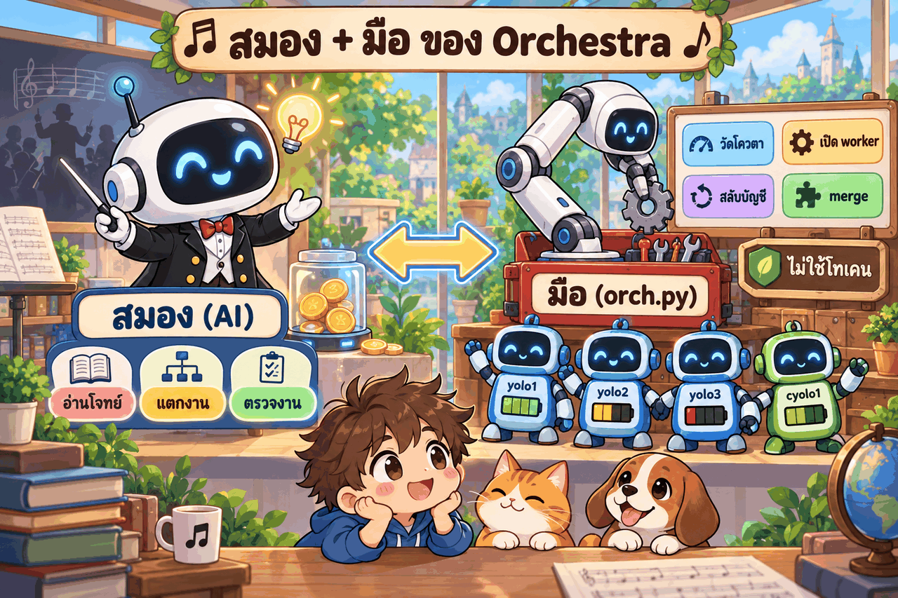

| ส่วน | คือใคร | ทำอะไร | ใช้โทเคน? |
|---|---|---|---|
| 🧠 **สมอง** | AI บัญชีที่โทเคนเหลือมากที่สุด ทำตาม [ORCHESTRA_RECIPE.md](ORCHESTRA_RECIPE.md) | อ่านโจทย์ · แตกงาน · เขียนคำสั่งให้แต่ละงาน · ตรวจผล · ตัดสินใจเมื่อมีปัญหา | ใช้ |
| 🦾 **มือ** | สคริปต์ [tools/orch.py](tools/orch.py) (AI เป็นคนเรียก) | วัดโควตาทุกบัญชี · **เลือกบัญชีด้วยอัลกอริทึม KC-QUEST** · เปิด worker · ดูโทเคนสด · ย้ายงาน · merge | **ไม่ใช้** |
| 👷 **worker** | `yoloN -p` / `cyoloN exec` ทีละงาน (สูงสุด 12 ตัวพร้อมกัน) | เขียนโค้ดเฉพาะงานของตัวเองใน git worktree แยก · commit ทุกข้อย่อย | ใช้ |

ไฟล์ในโฟลเดอร์นี้:

| ไฟล์ | คืออะไร |
|---|---|
| [BUILDMART.md](BUILDMART.md) | **โจทย์** — ข้อมูลร้าน สินค้า 36 รายการ ฟีเจอร์ เกณฑ์ทดสอบ 28 เคส (แก้เพิ่ม/ลดได้) |
| [ALGORITHM.md](ALGORITHM.md) | อธิบายอัลกอริทึม KC-QUEST: ภาพ · ตาราง pipeline แบบ paper · สมการทีละขั้น · ตัวอย่างตัวเลขจริง |
| [ORCHESTRA_RECIPE.md](ORCHESTRA_RECIPE.md) | "สูตร" ที่ตัวคุมวงอ่านแล้วทำตาม |
| [NINFER_RECIPE.md](NINFER_RECIPE.md) | สูตรเช่า RTX 5090 + เปิด Qwen (ฉบับ LAB นี้) |
| [tools/orch.py](tools/orch.py) | "มือ" ของตัวคุมวง + อัลกอริทึม KC-QUEST |
| [tools/test_kcquest.py](tools/test_kcquest.py) · [tools/sim.py](tools/sim.py) | unit test 16 ข้อ · ตัวจำลองเทียบอัลกอริทึม |
| `my_buildmart/` | ผลงานที่ AI สร้าง (export กลับมาตอนจบ · ไม่เก็บใน git) + `BOARD.md` ดูความคืบหน้าสด |

---

## ขั้นที่ 0 · เปิด Terminal ใน container (~1 นาที)

เปิด JupyterLab → `http://localhost:8886/lab` → **File → New → Terminal** (อยู่ที่ `/workspace` = root ของ repo)

🖥️ เช็คว่า repo อยู่ที่ `/workspace` และ skill ครบ:

```bash
ls 00_setup/04_Skill_Setup/02_Multi_Agent_Orchestra && ls /root/ai-accounts/.Claude/shared/skills
```

ต้องเห็น `BUILDMART.md  ORCHESTRA_RECIPE.md ...` และ skill `cyolo  vastai  yolo`

## ขั้นที่ 1 · สำรวจบัญชี — ใครเหลือโควตาเท่าไร ใกล้หมดอายุเมื่อไร (~1 นาที)


🖥️ เปิด AI บัญชีไหนก็ได้ (เช่น `yolo1`) → 💬 วาง:

```text
ใช้ skill yolo และ cyolo รัน python3 00_setup/04_Skill_Setup/02_Multi_Agent_Orchestra/tools/orch.py --run /root/runs/buildmart quota แล้วอธิบายตารางเป็นภาษาไทยสั้น ๆ
```

`orch.py quota` ถามโควตาทุกบัญชี **ฟรี ไม่เสียโทเคน** (`yoloN auth status` + `/usage` · ฝั่ง Codex อ่าน `rate_limits` จาก session ล่าสุด) แล้วคิดคะแนน:

ผลจริง (ตาราง `quota` ใน `REPORT.md` หลังเฟส 1 · 15 ต.ค. 2026 23:52):

| บัญชี | แพลน | ใช้ไป 5 ชม. | ใช้ไปสัปดาห์ | เพดาน | เหลือ (headroom) | หมดอายุ/รีเซ็ต | เร่งด่วน U | คะแนน | slot |
|---|---|---|---|---|---|---|---|---|---|
| yolo1 | max | 6% | 2% | 100% | **94%** | 22/10 06:00 (150.1 ชม.) | 0.138 | 45.9 | 4 |
| yolo2 | team | 6% | 4% | 100% | **94%** | 19/10 13:00 (85.1 ชม.) | 0.22 | 50.8 | 4 |
| yolo3 | team | 13% | 4% | **7%** (งบ 3%) | **3%** | 20/10 12:59 (109.1 ชม.) | 0.18 | 12.0 | 1 |
| cyolo1 | pro | – | 1% | 100% | **99%** | 22/10 14:21 (158.5 ชม.) | 0.132 | 47.5 | 3 |
| yolo4–5 · cyolo2–5 | – | ยังไม่ล็อกอิน | | | | | | | 0 |

อ่านตาราง: **yolo2 รีเซ็ตเร็วสุด (19/10) → U สูงสุด = ควรใช้ก่อน** · ตอนเริ่ม yolo1 เหลือมากสุด (99%) → เป็นตัวคุมวง · yolo3 ตั้งงบไว้ 3% จึงรับได้แค่งานเล็ก · cyolo1 (Codex) ไม่มีหน้าต่าง 5 ชม. มีแต่รายสัปดาห์

- **เหลือ (headroom)** = min(ที่เหลือใน 5 ชม., ที่เหลือในสัปดาห์หรืองบ) · **เร่งด่วน U** = ยิ่งใกล้รีเซ็ต/หมดแพลนยิ่งสูง (ใช้ก่อน) · **slot** = รับงานพร้อมกันได้กี่ตัว
- อยากกำหนด **วันหมดแพลน** หรือ **งบต่อบัญชี** → ใส่ในพรอมต์ขั้นที่ 2 เช่น `EXPIRES=yolo2=2026-10-20` `BUDGET=yolo3=3` (ให้ yolo3 ใช้แค่ 3% ของสัปดาห์ — LAB นี้ใช้เพื่อ**ให้เห็นการย้ายงาน**)

## ขั้นที่ 2 · วางพรอมต์เดียว ให้ทีมทำทั้งหมด (~40 นาที · AI ทำเอง)

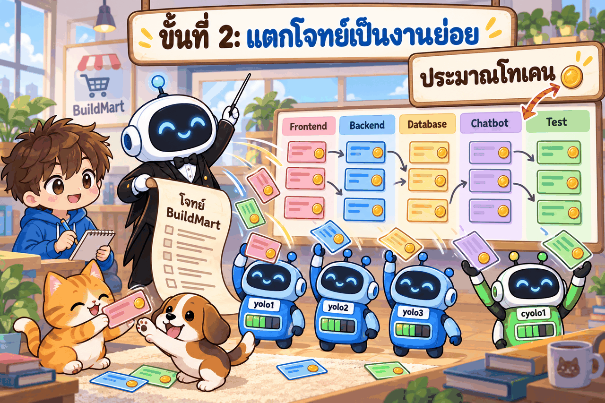

🖥️ `yolo1` (บัญชีที่เหลือมากสุด — ถ้าเปิดบัญชีอื่น AI จะส่งไม้ให้บัญชีที่เหลือมากสุดเอง) → 💬 วาง:

```text
ใช้ skill yolo, cyolo และ vastai ทำตาม 00_setup/04_Skill_Setup/02_Multi_Agent_Orchestra/ORCHESTRA_RECIPE.md
PROBLEM=BUILDMART.md MAX_AGENTS=12 BACKEND=vast BUDGET=yolo3=3
```

ตัวคุมวงทำ 4 อย่างตามลำดับ (ขั้นที่ 3–8 ด้านล่างคือสิ่งที่เกิดขึ้น — **ไม่ต้องพิมพ์อะไรเพิ่ม**):
1. สำรวจบัญชี + ยืนยันว่าตัวเองเป็นบัญชีที่ควรคุมวง
2. อ่าน `BUILDMART.md` แตกเป็นงานย่อย + สัญญากลาง (`_shared.md`) ที่ทุกงานยึด
3. วนรอบ `dispatch` → `wait` จนทุกงานเสร็จ (KC-QUEST เลือกบัญชี · ย้ายงานอัตโนมัติ)
4. สรุป `REPORT.md` + export ผลกลับมาที่ `my_buildmart/`

👀 **ดูความคืบหน้าสด:** JupyterLab → เปิด `00_setup/04_Skill_Setup/02_Multi_Agent_Orchestra/my_buildmart/BOARD.md` (คลิกขวา → Open With → Markdown Preview แล้วกด reload เป็นระยะ)

## ขั้นที่ 3 · แตกโจทย์เป็นงานย่อย

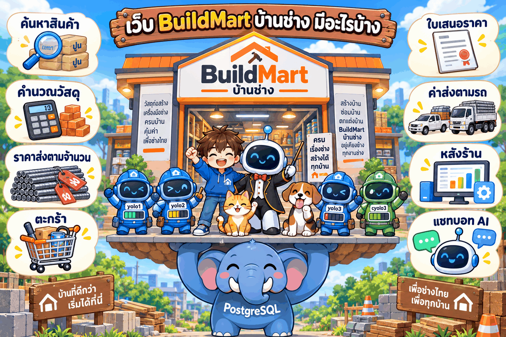

ตัวคุมวง (yolo1 · opus/high) ใช้เวลา **11 นาที** อ่านโจทย์ + skill ทั้ง 3 ตัว แล้วเขียน:
- **สัญญากลาง** `_shared.md` 319 บรรทัด: โครงไฟล์ + เจ้าของแต่ละไฟล์ · ตาราง DB · API + JSON · `data-testid` ทุกตัว · ล็อกเวอร์ชัน Playwright ให้ตรงกับ Chromium ที่มีใน container (ตัวคุมวงเช็คเองว่าเวอร์ชันไหนตรง)
- **งาน 18 งาน** (+ เฟส 2 อีก 3 งาน) แต่ละงานมีเป้าหมาย · ไฟล์ที่เป็นเจ้าของ · checklist · เกณฑ์ผ่านที่ worker ตรวจเองได้

| งาน | เนื้องาน | ขนาด | ต้องรอ |
|---|---|---|---|
| T01 | โครงโปรเจกต์ + compose + DB schema/seed + lib กลาง + layout | L | – |
| VAST | เช่า RTX 5090 + เปิด Qwen (ห้ามย้ายกลางทาง) | M | – |
| IMG1 | รูปหมวดสินค้า 11 รูป + แบนเนอร์ (งานรูป · ไม่นับใน 12) | S | – |
| T02–T09 | หน้าแรก/สินค้า · หน้าสินค้า · เครื่องคำนวณ · ตะกร้า · checkout · ใบเสนอราคา · ติดตาม · หลังร้าน | S–L | T01 (T08 รอ T06) |
| T10–T12 | แชทบอท backend · mock-llm · หน้าต่างแชท | M–L | T01 |
| T13 · T14 | Playwright เว็บ W01–W14 · แชท C01–C14 | M | งานหน้าเว็บ / งานแชท |
| T15 | **exclusive**: compose ทั้งระบบ + ทดสอบ mock และ ai + GIF + `TEST_REPORT.md` | L | T13 T14 VAST IMG1 |

## ขั้นที่ 4 · จับคู่งานกับบัญชี แล้วทำงานขนาน

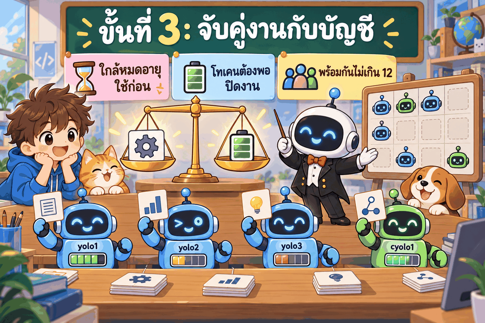


- แต่ละงานได้ **git worktree + branch `task/<id>` ของตัวเอง** · Postgres กลางแยกฐานข้อมูลต่องาน · port ของตัวเอง → ทำขนานได้ไม่ชนกัน
- worker commit ทุกข้อย่อย + เขียน checklist ความคืบหน้า → `orch.py` อ่านไปคาดการณ์โทเคนที่เหลือ
- งานเสร็จ → `merge` เข้า `main` อัตโนมัติ · ถ้า conflict → คืนงานให้ worker `git merge main` แก้เอง


*ภาพจริงจาก `events.jsonl` ของรันนี้ (render ด้วย Chromium ใน container)*

**KC-QUEST ตัดสินใจจริงอย่างไร** (เหตุผลถูกเขียนลง `BOARD.md` ทุกครั้ง):

| งาน | ได้บัญชี | เหตุผลจริงจาก log |
|---|---|---|
| T01 (critical path ยาวสุด) | yolo1 | `speed=1.0` — งานวิกฤตที่สุดไปบัญชี yolo ที่เร็ว |
| VAST | yolo2 | `urgency=0.219` สูงสุด — yolo2 รีเซ็ตเร็วสุด ใช้ก่อน |
| IMG1 | cyolo1 | งานรูปทำได้แค่ cyolo (ทางเลือกเดียว) |
| T08 · T13 | yolo3 | งานเล็กที่ "ปิดได้" ในงบ 3% ที่เหลือ — งานใหญ่ไม่ส่งไป yolo3 เลย |

ผลเฟส 1: **17/17 งานเสร็จใน 37 นาที** · worker พร้อมกันสูงสุด **10 ตัว** (4 บัญชีมี slot รวม 10–11 · ถ้าล็อกอินครบจะได้ 12) · **merge conflict 0 · ชนเพดานกลางงาน 0 · ทำไม่จบ 0**

**เรียนรู้ระหว่างทำ (⑥) จริง:** งาน L ใช้โทเคนจริงแค่ ~0.4M (ประเมินไว้ 3M) → ระบบปรับตัวคูณขนาดงาน L × 0.2, S × 0.34 ทันที · อัตรา 5 ชม. ที่วัดได้: yolo1 (max) 2.4% ต่อ 1M โทเคน · yolo2 (team) 4.5% → แพลน team เปลืองโควตาเร็วกว่า max ~2 เท่า (ตรงกับที่ KC-QUEST ให้น้ำหนัก)

> ระหว่างรันพบว่ากฎ "headroom < 5% → ไม่ให้ slot" หยาบเกินไป (yolo3 ที่เหลือ 3% ไม่ได้งานเลย) จึงเปลี่ยนเป็น "ไม่ให้ slot เฉพาะเมื่อเหลือไม่ถึงเส้นเผื่อขั้นต่ำ" ให้ capacity เป็นตัวตัดสิน → yolo3 ได้งานเล็กที่ปิดได้จริง 2 งาน

## ขั้นที่ 5 · โทเคนใกล้หมด → ย้ายงานไปบัญชีอื่น

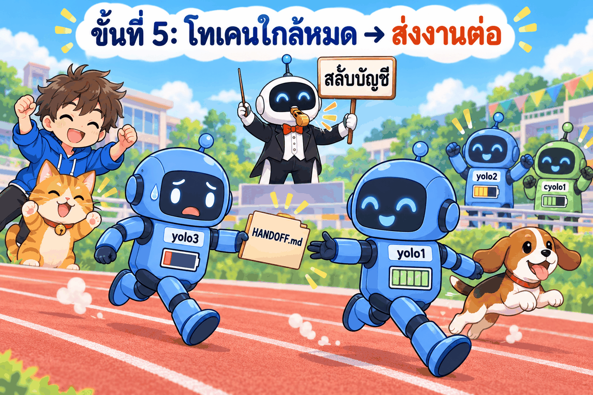

**ทดสอบจริงกับโค้ดจริง (เฟส 2):** เพิ่มฟีเจอร์ `T16` รายการโปรด และ `T17` เปรียบเทียบสินค้า → KC-QUEST ส่งทั้งคู่ให้ **yolo2** (รีเซ็ตเร็วสุด) → ทำไปได้ 2–3 commit แล้ว **เจ้าของบัญชี yolo2 ขอคืนโควตา** (ตั้ง `budget_pct` = 0 กลางทาง) → `orch.py wait` ย้ายงานเองทันที:

```text
00:57:44 HANDOFF T16 · yolo2 → yolo1 · yolo2 ใช้ถึงเพดานแล้ว (5ชม. 7% · สัปดาห์ 4%/4%) → รับต่อได้ดีสุด: yolo1 (KC-QUEST 34.6)
00:57:47 HANDOFF T17 · yolo2 → yolo1 · (เหตุผลเดียวกัน)
00:59:31 DONE    T16 yolo1 (รอบที่ 2) · tests/web 16/16 ผ่าน
00:59:31 DONE    T17 yolo1 (รอบที่ 2) · W16 ผ่าน
```

**ทำต่อจากที่ค้าง ไม่เริ่มใหม่** — `git log` ของ branch `task/T16`:

```text
158ce2a T16: done — typecheck/build ผ่าน, tests/web 16/16 (W15 ผ่าน)   ← yolo1
772cec1 T16: WIP ก่อนสลับบัญชี                                      ← orch.py commit ให้ตอนหยุด
806a256 T16: ปุ่มหัวใจ + nav-wishlist + หน้า /wishlist                ← yolo2
050d4aa T16: DB wishlist + lib + API                               ← yolo2
```

worker ใหม่ได้ "บันทึกส่งต่อ" ต่อท้าย prompt (เหตุผล · บัญชีเดิม · commit ของงานนี้) แล้วทำเฉพาะส่วนที่เหลือ

> เฟส 1 **ไม่มีการย้ายงานเลย** เพราะ KC-QUEST แจกงานให้ "ปิดได้" ตั้งแต่แรก (yolo3 งบ 3% ได้แต่งานเล็ก) — การย้ายเกิดเฉพาะเมื่อสถานการณ์เปลี่ยนกลางทาง ซึ่งคือหน้าที่ของ ⑤

## ขั้นที่ 6 · ตัวคุมวงใกล้หมด → ส่งไม้ให้บัญชีที่เหลือมากสุด


ต่อจากเฟส 2: ลดงบ yolo1 (ตัวคุมวง) เหลือ ~10% → `ORCH_LOW` → ส่งไม้:

```text
00:59:59 ORCH_LOW    ตัวคุมวง yolo1 เหลือ 10%  (< 15%)
01:00:10 ORCH_SWITCH ส่งไม้ตัวคุมวง yolo1 → cyolo1   (yolo2 = 0% · yolo3 = 2% · cyolo1 = 99% → เหลือมากสุด)
01:01:40 DONE T18 · ALL_DONE
```

ตัวคุมวงคนใหม่เป็น **Codex (cyolo1)** — ข้าม CLI ได้ เพราะสถานะทั้งหมดอยู่ในไฟล์ มันทำเองทั้งหมด: อ่าน `BOARD.md` + `NOTES.md` → เข้า loop `dispatch`/`wait` → ตรวจผล T18 เอง (Playwright 30/30) → รัน W15/W16 ซ้ำบน main (2/2) → export 212 ไฟล์กลับเข้า repo พร้อมตรวจ hash ว่าตรงต้นฉบับ

## ขั้นที่ 7 · AI ของแชทบอทบน Vast.ai RTX 5090


ตัวคุมวงแจกงาน `VAST` ให้บัญชี yolo (ห้ามย้ายกลางทาง) ทำตาม [NINFER_RECIPE.md](NINFER_RECIPE.md): เช่า **RTX 5090 · เน็ต ≥ 2000 Mbps · Qwen3.8-27B-NVFP4** ผ่าน skill `vastai` แล้วเขียนค่าเชื่อมต่อลง `/root/runs/buildmart/.env.vast` — ทำ**ขนานกับ**การสร้างเว็บ (ระหว่างนั้นเว็บพัฒนาด้วย `MODE=mock`)

ผลจริง (งาน `VAST` · yolo2 · 15 ต.ค. 2026):

| รายการ | ค่า |
|---|---|
| เครื่อง | RTX 5090 32 GB · สิงคโปร์ · reliability 0.995 |
| ราคา | **$1.198/ชม.** (≤ เพดาน $1.20) |
| เน็ต | 5,658 Mbps → โหลดโมเดล 22.1 GiB ใน **62 วินาที** |
| เวลา | เช่าจน running 183 วิ · build NInfer 217 วิ (โหลดโมเดลขนานกัน) · server พร้อม 11 วิ |
| โมเดล | Qwen3.8-27B-NVFP4 · ตอบไทย **~94–107 token/วินาที** · VRAM 24.4 / 32.6 GB |
| ความปลอดภัย | ไม่มี key → 401 · `.env.vast` สิทธิ์ 600 · ไม่แสดง key บนจอ |

## ขั้นที่ 8 · ทดสอบทั้งระบบด้วย Playwright

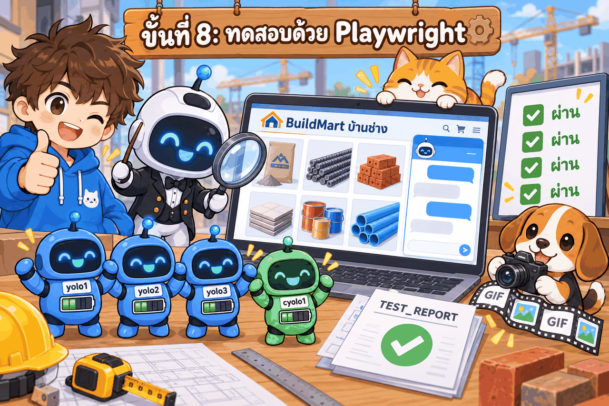

| รอบ | โหมด | ผ่าน | หมายเหตุ |
|---|---|---|---|
| เฟส 1 | mock | **28/28** ✅ | W01–W14 + C01–C14 (C06+C07 รวมเป็น 1 test) + smoke |
| เฟส 1 | **ai (Qwen บน 5090)** | **28/28** ✅ | คำตอบจริงของบอทอยู่ใน `TEST_REPORT.md` · ตอบ 0.7–5 วินาทีต่อคำถาม |
| เฟส 2 | mock | **30/30** ✅ | + W15 รายการโปรด · W16 เปรียบเทียบสินค้า |

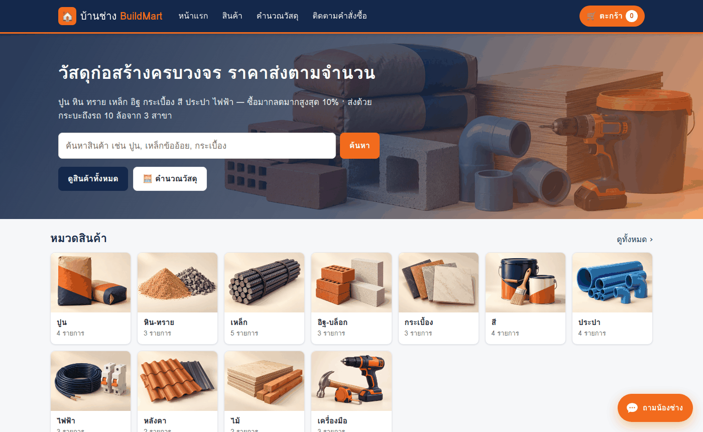
*ภาพจริง: หน้าแรก (รูปหมวดสินค้าทั้งหมดสร้างโดยงาน IMG1 ของ cyolo1)*

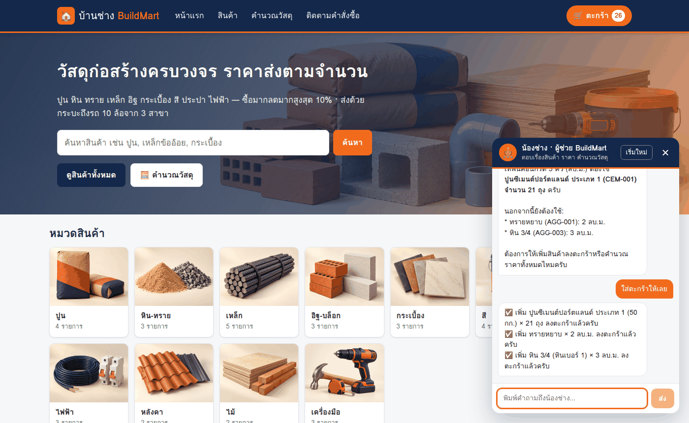
*ภาพจริง: Qwen บน RTX 5090 คำนวณผ่าน `[CALC]` (21 ถุง) แล้ว `[ADD_TO_CART]` 3 รายการ — ตัวเลขบนตะกร้าเปลี่ยนเป็น 26 ทันที*

| เครื่องคำนวณวัสดุ | หน้าสินค้า (ราคาส่ง 3 ขั้น + สต็อก 3 สาขา) | ตะกร้า (ราคาส่ง · รถ · VAT) |
|---|---|---|
| 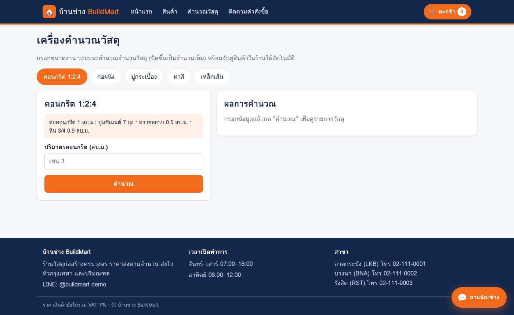 | 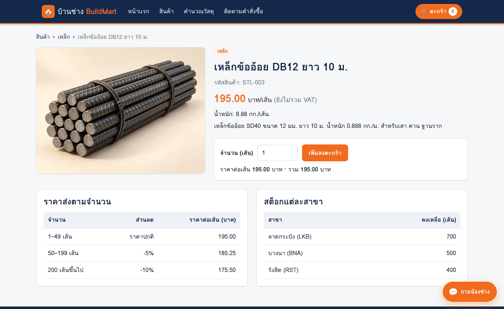 | 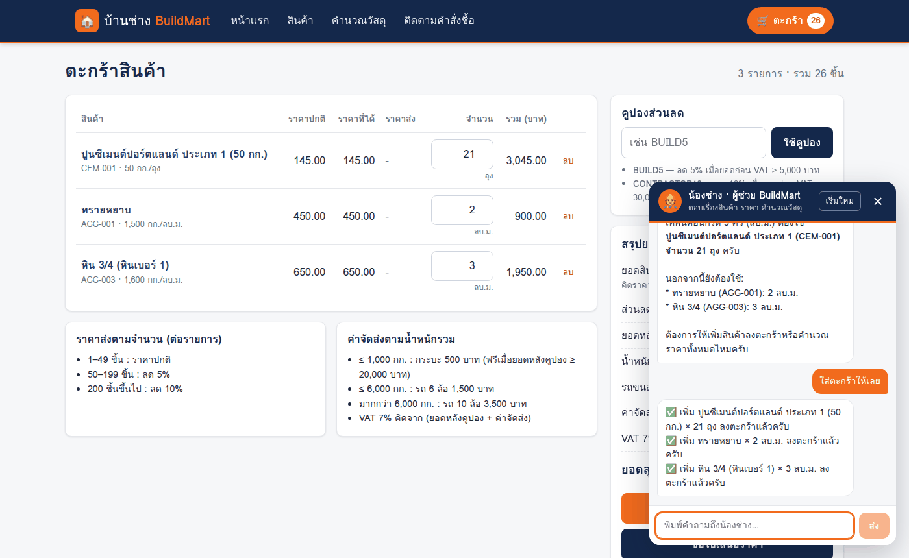 |

**GIF จากการทดสอบจริง** (Playwright บันทึกวิดีโอทุกเคส → GIF รวม 58 ไฟล์ · เลือกมาให้ดู 8 เคส):

| เคส | ผ่านเมื่อ | GIF |
|---|---|---|
| C06+C07 (ai) | คอนกรีต 3 คิว → 21 ถุง แล้วใส่ตะกร้าให้ | 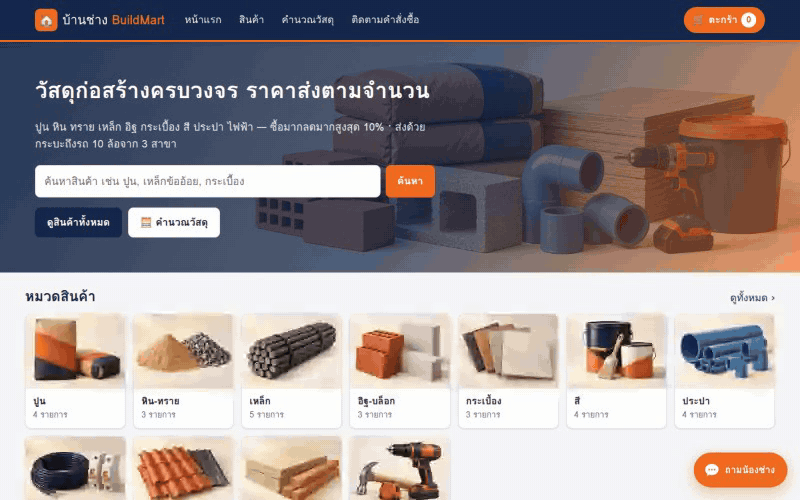 |
| C11 (ai) | ถามสินค้าที่ไม่มี (กระเบื้องยาง) → บอกว่าไม่มี ไม่แต่ง | 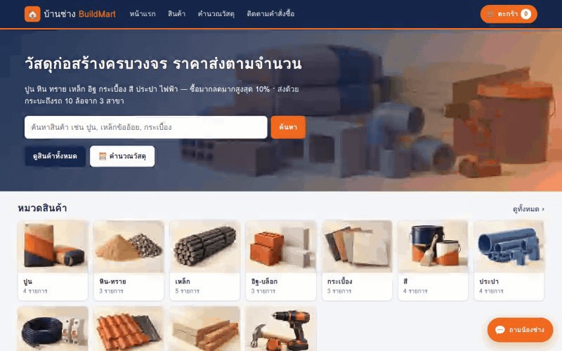 |
| C13 (ai) | ทาสี 120 ตร.ม. → 8 แกลลอน → ถามต่อ "ราคารวม" → 7,120 | 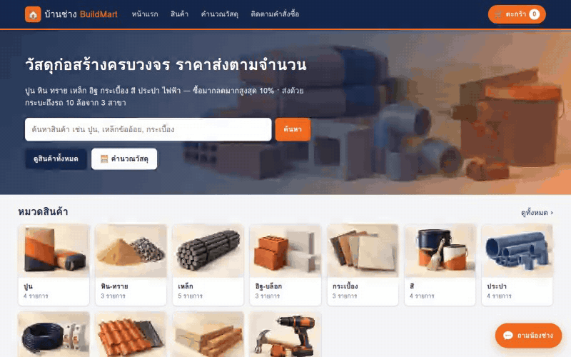 |
| W05 | คำนวณคอนกรีต 3 ลบ.ม. → 21/2/3 → เพิ่มลงตะกร้า | 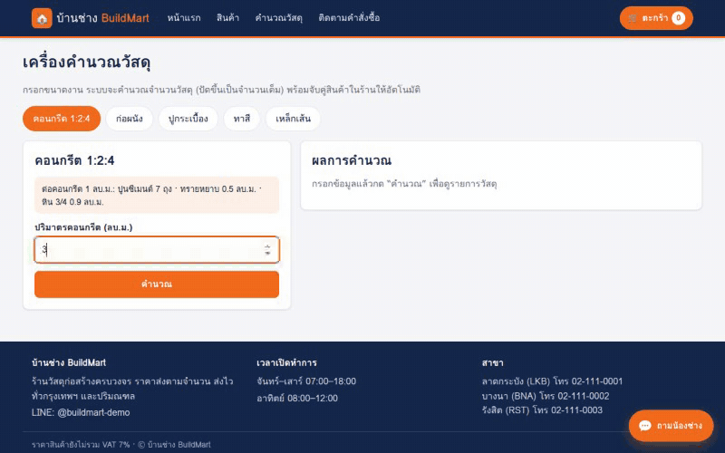 |
| W09 | CEM-001 × 100 + คูปอง BUILD5 → ยอดสุทธิ 15,607.29 | 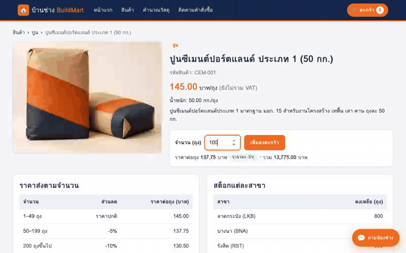 |
| W14 | หลังร้านเปลี่ยนสถานะ → `/track` แสดง "กำลังจัดส่ง" | 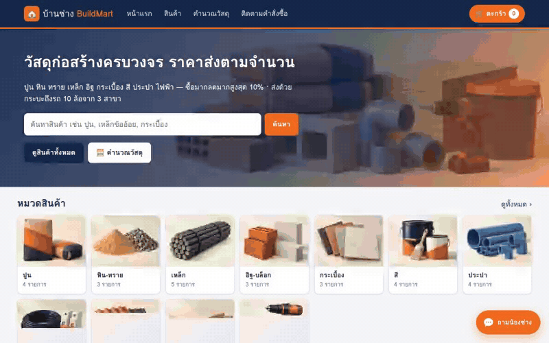 |
| W15 (เฟส 2) | รายการโปรด: เพิ่ม/ลบ/ใส่ตะกร้า | 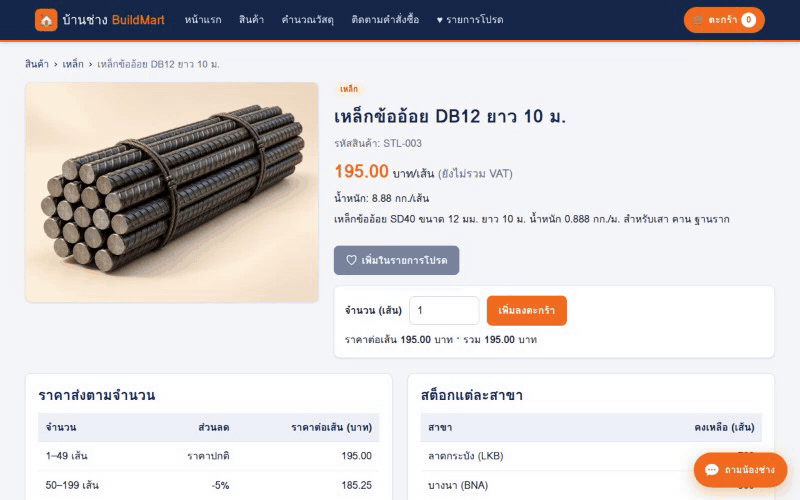 |
| W16 (เฟส 2) | เปรียบเทียบ 3 สินค้า ไฮไลต์ราคาต่ำสุด | 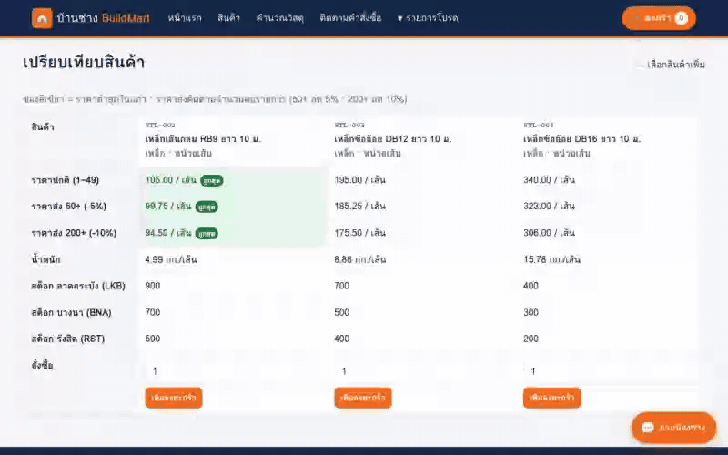 |

ผลทุกเคส + คำตอบจริงของบอท: `my_buildmart/app/TEST_REPORT.md` · GIF ทั้งหมด: `my_buildmart/app/test-gifs/`

## ขั้นที่ 9 · ปิดเครื่อง Vast.ai และปิดเว็บ (ห้ามข้าม!)


🖥️ `yolo1` → 💬 วาง:

```text
ใช้ skill vastai ลบเครื่องป้าย bm-ninfer-5090 แล้วยืนยันว่าไม่มีเครื่องเหลือ พร้อมสรุปค่าใช้จ่าย
จากนั้นปิดเว็บ: docker compose down ใน /root/runs/buildmart/app และ python3 00_setup/04_Skill_Setup/02_Multi_Agent_Orchestra/tools/orch.py --run /root/runs/buildmart infra down
```

แล้วเปิดหน้าเว็บ [cloud.vast.ai → Instances](https://cloud.vast.ai/instances/) เช็คด้วยตาว่า **ว่าง**

**ผลจริง:** ลบ instance `56123130` แล้ว → `vastai show instances` = **0 เครื่อง** ✅ · ค่าใช้จ่าย 5090 รอบนี้ ~$1.8 (เปิด ~1.45 ชม. × $1.198 + ค่าดาวน์โหลด) — ถ้าลบทันทีหลังทดสอบเสร็จจะเหลือ ~$0.55

---

## อัลกอริทึม KC-QUEST · เลือกบัญชีให้งานอย่างไร


**KC-QUEST = KMITL–Chanwanich Quota-Urgency Expiry-aware Scheduling Technique** (เทคนิคจัดตารางงานที่คำนึงถึงโควตา ความเร่งด่วน และวันหมดอายุ · สื่อการสอนร่วม KMITL × บริษัท จันวณิช · ชื่อเดิม EUBF) — ทุกครั้งที่มีงานพร้อมทำ "มือ" (`orch.py`) ตัดสินว่างานไหนให้บัญชีไหน โดยดู **วันหมดอายุ · โทเคนที่เหลือ · ขนาดงาน · หน้าต่าง 5 ชม. · ความสำคัญของงาน · โหลด** — คำนวณล้วน ไม่ใช้โทเคน และเขียนเหตุผลลง `BOARD.md` ทุกครั้ง

> 📘 **อธิบายเต็มแบบสไลด์ (ภาพละ 1 ไอเดีย) อยู่ที่ [ALGORITHM.md](ALGORITHM.md)** — 26 สไลด์: อ่านสัญลักษณ์ → ไทม์ไลน์ → ข้อมูลตั้งต้น → ทีละขั้น (ทฤษฎี → คำนวณด้วยตัวเลขจริงจากรอบแจกงาน 23:37:26 ที่ replay ด้วยโค้ดจริงได้ตรงกับ log 9/9 งาน)


| ขั้น | คำถาม | สมการหลัก | ที่มาของไอเดีย |
|---|---|---|---|
| ① จัดลำดับ (Rank) | งานไหนได้เลือกก่อน | $\mathrm{rank}(j)=c_j+\max_{k\in\mathrm{succ}(j)}\mathrm{rank}(k)$ | Critical Path · MRV |
| ② กรอง (Feasibility) | บัญชีไหนทำจบได้ | $c_j\le C_a=\min\big(\frac{H^5-m^5-Q}{\sigma r^5},\frac{H^w-m^w-Q}{\sigma r^w}\big)$ | Bin packing · factor of safety |
| ③ ให้คะแนน (Score) | บัญชีไหนเหมาะสุด | $S=0.40U+0.20F+0.15R+0.15V-0.10L$ | Weighted sum · EDF · Best-Fit |
| ④ เลือก + จอง (Select & Reserve) | เลือกแล้วทำอะไร | $a^*=\arg\max S$ · $H\leftarrow H-\sigma r c_j$ | Greedy · ระบบจอง |
| ⑤ คาดการณ์ + ย้าย (Project & Migrate) | จะเกินเพดานไหม | $P=u+r(\ell+\sum\mathrm{rem})>\text{cap}-m$ → ย้าย | Earned value · checkpoint |
| ⑥ เรียนรู้ (Learn) | ค่าที่เดาผิดแค่ไหน | $r\leftarrow\frac12r+\frac12\frac{\Delta u}{\Delta\text{tok}}$ · $k\leftarrow0.6k+0.4\frac{\text{tok}}{\hat c}$ | EMA |
| ✦ ส่งไม้ (Failover) | ตัวคุมวงใกล้หมด | $H_{\text{orch}}\lt 15\%$ → $\arg\max_a(H_a+5\cdot\mathbb{1}[\text{Claude}])$ | Leader election |

**ปรับเอง:** แก้ `weights` ใน `/root/runs/buildmart/config.json` — ใส่ `0` = ปิดตัวแปร · เพิ่มตัวแปรใหม่ = เพิ่มฟังก์ชัน 1 บรรทัดใน `FACTORS` ของ `orch.py` แล้วใส่น้ำหนัก (ตัวอย่างใน `test_kcquest.py` ข้อ 10)

### ทดสอบแล้วใช้ได้จริง

**1) unit test 16 ข้อ** (ใช้ฟังก์ชันจริงจาก `orch.py`) — ผ่านทั้งหมด

🖥️ Terminal ใน container:

```bash
python3 /workspace/00_setup/04_Skill_Setup/02_Multi_Agent_Orchestra/tools/test_kcquest.py
```

| # | ทดสอบ | # | ทดสอบ |
|---|---|---|---|
| 1 | งานใหญ่เกินโควตาที่เหลือ → ไม่รับ | 9 | งานวิกฤตไปบัญชีที่เร็วกว่า |
| 2 | โควตาเท่ากัน → ใกล้หมดอายุใช้ก่อน | 10 | ปิดตัวแปร (น้ำหนัก 0) / เพิ่มตัวแปรใหม่ได้ |
| 3 | งานใหญ่ → บัญชีใหญ่ · งานเล็ก → บัญชีเล็กใกล้หมดอายุ | 11 | โบนัสจาก accounts.json |
| 4 | 5 ชม. ใกล้เต็ม → ไม่รับงานที่ล้น | 12 | ไม่มีใครปิดได้ → ไม่แจก (ให้แบ่งงาน) |
| 5 | บัญชีตัวคุมวงต้องเหลือสำรอง | 13 | เส้นวางแผนอยู่ใต้เส้นย้ายงานเสมอ (ไม่ย้ายไปมา) |
| 6 | จองโควตาทีละงาน ไม่จองเกิน | 14 | รู้เวลารีเซ็ต 5 ชม. |
| 7 | slot เต็ม / โหลดสูง → ไปบัญชีอื่น | 15 | ส่งต่อตามแผน + ทีมว่างห้ามค้าง |
| 8 | critical path rank ถูกต้อง | 16 | ทางเลือกน้อยสุดได้เลือกก่อน (MRV) |

**2) จำลอง 200 รอบ × 7 สถานการณ์** ([tools/sim.py](tools/sim.py) ใช้โค้ด KC-QUEST ตัวเดียวกับ `orch.py`) เทียบกับวิธีพื้นฐาน 3 แบบ — โทเคนจริงคลาดจากที่ประเมิน ±35% และอัตรา %/โทเคนจริงคลาด ±30% (อัลกอริทึมไม่รู้ค่าจริง ต้องเรียนรู้เอง)

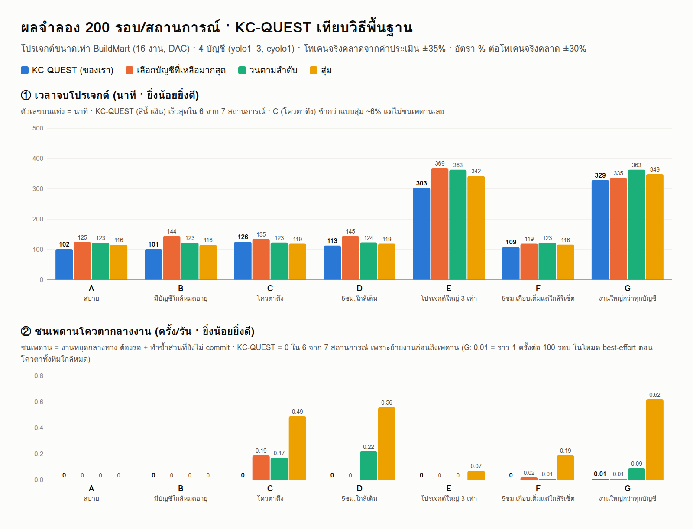

| สถานการณ์ | KC-QUEST (นาที) | ดีสุดของวิธีอื่น (นาที) | KC-QUEST ชนเพดาน/รัน | วิธีอื่นชนเพดาน/รัน (สูงสุด) | KC-QUEST-basic รุ่นแรก (นาที) | หมายเหตุ |
|---|---|---|---|---|---|---|
| A · สบาย (โควตาเหลือเยอะทุกบัญชี) | **102** | 116 (random) | **0.0** | 0.0 | 102 |  |
| B · มีบัญชีใกล้หมดอายุ | **101** | 116 (random) | **0.0** | 0.0 | 101 | ใช้โควตาจากบัญชีใกล้หมดอายุ 78.43% (วิธีอื่นสูงสุด 26.18%) |
| C · โควตาตึง (ต้องเลือกให้พอดี) | **126** | 119 (random) | **0.0** | 0.49 | 126 | ใช้โควตาจากบัญชีใกล้หมดอายุ 72.21% (วิธีอื่นสูงสุด 53.32%) |
| D · 5ชม.ใกล้เต็ม | **113** | 119 (random) | **0.0** | 0.56 | 113 |  |
| E · โปรเจกต์ใหญ่ 3 เท่า | **303** | 342 (random) | **0.0** | 0.07 | 303 |  |
| F · 5ชม.เกือบเต็มแต่ใกล้รีเซ็ต | **109** | 116 (random) | **0.0** | 0.19 | 110 |  |
| G · งานใหญ่กว่าทุกบัญชี (ต้องส่งต่อ) | **329** | 335 (most-headroom) | **0.01** | 0.62 | 501 | รุ่นแรกทำไม่จบ 4.5% ของรอบ |

> สรุปตรง ๆ: KC-QUEST **เร็วสุดใน 6/7 สถานการณ์** (เร็วกว่าวิธีที่ดีที่สุดรองลงมา 2–13%) และ**แทบไม่ชนเพดานกลางงานเลย** · สถานการณ์ C (โควตาตึง) ช้ากว่าแบบสุ่ม ~6% เพราะเลือก "ปลอดภัยไว้ก่อน" แต่ไม่ชนเพดานเลย · **ตอนพัฒนา** ตัวจำลองเจอจุดอ่อนจริง 3 ข้อ แล้วแก้จนผ่าน: เส้นเผื่อตายตัว 10% ทำให้ย้ายงานไปมา (C ใช้ 509 นาที → 126) · รอทั้งที่ทีมรวมกันพอ (G รุ่นแรก `KC-QUEST-basic` 500 นาที + 4.5% ของรอบทำไม่จบ → 329 นาที ทำจบทุกรอบ) · ไม่รู้เวลารีเซ็ต 5 ชม. (F 110 → 109 นาที เร็วสุด)

**3) ใช้จริงกับ BuildMart** — ดูผลในขั้นที่ 3–6 ด้านบน

---

## ปรับ LAB เอง (แก้แค่พรอมต์)

| อยากได้ | ใส่ในพรอมต์ขั้นที่ 2 |
|---|---|
| โจทย์อื่น | แก้ `BUILDMART.md` หรือ `PROBLEM=<ไฟล์โจทย์ของเรา>.md` |
| จำกัดจำนวน agent | `MAX_AGENTS=6` |
| ไม่เช่า GPU (ฟรี) | `BACKEND=mock` |
| กันโควตาบัญชีไว้ใช้งานอื่น | `BUDGET=yolo2=10,yolo3=5` (% ของโควตาสัปดาห์) |
| บอกวันหมดแพลน (ให้ใช้ก่อน) | `EXPIRES=yolo3=2026-10-20` |
| ใช้บัญชีมากขึ้น | ล็อกอิน `yolo4` `yolo5` `cyolo2…` ตาม LAB 03 → `orch.py` เจอเองอัตโนมัติ |
| ปรับน้ำหนักอัลกอริทึม | บอก AI ให้แก้ `weights` ใน `/root/runs/buildmart/config.json` เช่น `"urgency": 0.6` |

## ความปลอดภัย (อ่านให้จบ)

- worker ทุกตัวรันแบบ **ข้ามการขออนุญาต** (`--dangerously-skip-permissions` / bypass sandbox) ใน container — ห้ามรัน LAB นี้บนเครื่องจริงนอก container
- `.env` · `.env.vast` · `auth.json` · `.credentials.json` **ห้ามเปิดใน JupyterLab** และห้ามให้ AI พิมพ์ค่า — `my_buildmart/` ถูก ignore และตัวคุมวงตรวจแล้วว่าไม่มี key ติดไป
- เว็บ BuildMart เป็นเว็บทดลอง: รหัสหลังร้าน `admin1234` ใช้แค่ในเครื่อง · ให้ compose ผูกพอร์ตกับ `127.0.0.1` เท่านั้น
- ค่า RTX 5090 คิดตามเวลา **จนกว่าจะลบเครื่อง** — ทำขั้นที่ 9 ทุกครั้ง

## เช็คลิสต์

| ✓ | ขั้น | ผลที่ต้องเห็น |
|---|---|---|
| ☐ | 1 สำรวจบัญชี | ตารางโควตา + บัญชีที่ควรเป็นตัวคุมวง |
| ☐ | 2 วางพรอมต์ | ตัวคุมวงแจกงาน · `my_buildmart/BOARD.md` อัปเดตเรื่อย ๆ |
| ☐ | 3–6 | `BOARD.md` ขึ้น ✅ ครบทุกงาน · ถ้ามีย้ายงาน/ส่งไม้จะเห็นใน event ล่าสุด |
| ☐ | 7 | งาน `VAST` เสร็จ · Qwen ตอบไทยได้ |
| ☐ | 8 | `TEST_REPORT.md` ผ่านครบทั้ง mock และ ai · เปิด http://localhost:3400 ได้ |
| ☐ | 9 | Vast.ai Instances **ว่าง** |

## แก้ปัญหา

| อาการ | สาเหตุ / วิธีแก้ |
|---|---|
| ตารางโควตาขึ้น "ยังไม่ล็อกอิน" ทุกบัญชี | ยังไม่ได้ล็อกอิน (LAB 03) หรือ container ใหม่ไม่ได้ต่อ volume `ai-accounts` |
| บัญชีหนึ่งไม่ได้งานเลย | ดู `slot` และ `เหลือ` ในตาราง — งบ (`BUDGET`) น้อยเกินไป หรือเหลือไม่ถึงเส้นเผื่อ |
| งาน `FAILED` | ตัวคุมวงจะอ่าน log แล้วแบ่งงาน/แก้ prompt ให้เอง · ดู `/root/runs/buildmart/logs/<งาน>.a<รอบ>.*.jsonl` |
| Playwright หา browser ไม่เจอ | ต้องใช้ `@playwright/test` เวอร์ชันที่ตรงกับ `/ms-playwright` (ตัวคุมวงล็อกไว้ใน `_shared.md`) ห้าม `npx playwright install` |
| เว็บเปิดไม่ได้จาก container | compose รันบน Docker ของเครื่อง host → จาก container ใช้ `http://host.docker.internal:3400` |
| skill vastai ssh ไม่ได้ | ค่า `VAST_SSH_KEY_FILE` ใน `.env` ต้อง**ไม่มี comment ต่อท้ายบรรทัด** (เจอจริงในรอบทดสอบ) |
| อยากเริ่มใหม่ทั้งหมด | 💬 `ลบ /root/runs/buildmart แล้วทำขั้นที่ 2 ใหม่` (ปิดเว็บ/Vast ก่อน) |

## ข้อควรรู้

- ทดสอบจริง 15–16 ต.ค. 2026: Claude Code (yolo1–3 · opus) + Codex CLI (cyolo1 · gpt-6-astra) · container `tuchsanai/multi-account-devtool:2569_1`
- "โทเคน (M)" ในรายงาน = **โทเคนถ่วงน้ำหนัก** (cache read × 0.1 · output × 5) ใช้เทียบขนาดงาน ไม่ใช่ยอดเงิน
- `/usage` บอกเป็น % ที่ใช้ไป ไม่ใช่โทเคนคงเหลือ → KC-QUEST จึงเรียนรู้ "% ต่อโทเคน" ของแต่ละบัญชีเองระหว่างทำ
- ราคาและเครื่อง Vast เปลี่ยนตามตลาด GPU · ขั้นตอนเหมือนเดิม
