# LAB 04.2 · Multi-Agent Orchestra — ทีม AI สร้างร้าน "บ้านช่าง BuildMart" ทั้งระบบ

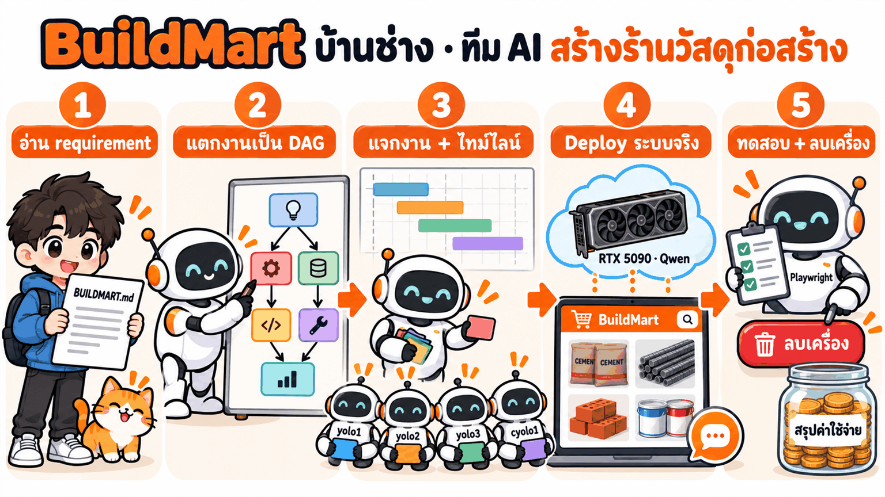
*ภาพแนวคิด (Imagegen ด้วย cyolo)*

LAB นี้รวมของจาก 2 LAB ก่อนหน้าเป็นงานเดียว: **วางแผนแบบ [LAB 04.3 DAG Planner](../02_DAG_Planner/readme.md)** → **ให้ทีม AI หลายบัญชีสร้างจริง** → **เปิด AI บน GPU แบบ [LAB 04.1 Vast.ai](../01_VastAi_Skill/readme.md)** → deploy → ทดสอบ → ลบเครื่อง
โจทย์คือเว็บร้านวัสดุก่อสร้าง **"บ้านช่าง BuildMart"** (requirement อยู่ใน [BUILDMART.md](BUILDMART.md)) ที่มี:

| ส่วน | ใช้ทำอะไร |
|---|---|
| 🛒 หน้าร้าน (Next.js) | สินค้า 36 รายการ · เครื่องคำนวณวัสดุ · ตะกร้าราคาส่ง · ใบเสนอราคา · ติดตามคำสั่งซื้อ · หลังร้าน |
| 📨 **RabbitMQ** | คิวกลางระหว่างเว็บกับ worker — พักงานไม่ให้ GPU ล้น · ข้อความไม่หายตอน worker ล่ม |
| 📄 **Hybrid RAG** | แชทบอทตอบจาก PDF เอกสารสินค้า 6 ไฟล์ (ไฟล์ละ 9 หน้า มีตารางซับซ้อน) พร้อมป้ายอ้างอิงไฟล์/หน้า |
| 🔊 **อ่านออกเสียง** | กด 🔊 ฟังคำตอบ · ไทย PyThaiTTS · อังกฤษ **Kokoro** (พิมพ์อย่างเดียว ไม่มีไมค์) |
| 🧠 **Qwen บน Vast.ai** | สมองของแชทบอท: Qwen3.8-27B บน RTX 5090 ที่ **AI อ่าน GitHub แล้วติดตั้งเอง** |

**เราไม่เขียนโค้ดเอง** — ทุกขั้นคือ **ก๊อปพรอมต์ไปวาง** (เหมือน LAB 04.3) · ทำไม่ได้ตรงไหน มี**เฉลยที่รันได้ทันที**ใน [`_solution/`](#ส่วน-h--ทำไม่ได้-ใช้เฉลย-docker-compose-คำสั่งเดียว)

| # | พรอมต์ | วางที่ | ได้อะไร | เวลาจริง |
|---|---|---|---|---|
| ⓪ | ตรวจเครื่อง | Claude Code (Windows) | บัญชี + โควตา | 20 วิ |
| ① | requirement → DAG | Claude Code (Windows) | `dag.png` 21 งาน + สายวิกฤต | 1.5 นาที |
| ② | KC-QUEST แจกงาน | Claude Code (Windows) | `gantt.png` แผน 97 นาที | 45 วิ |
| ③ | ทีม AI สร้างจริง | `yolo1` ใน container | `my_buildmart/app` · ผ่าน 41/41 | **74 นาที** |
| ④ | เปิด Qwen บน Vast จาก GitHub | `yolo1` ใน container | `.env.vast` | 8 นาที |
| ⑤ | deploy ทั้งระบบ | Claude Code (Windows) | เว็บ :3400 + RabbitMQ :15672 | ~3 นาที |
| ⑥ | เพลย์ลิสต์ทดสอบ | Claude Code (Windows) | 42/42 · GIF + MP4 มีเสียง | 11 นาที |
| ⑦ | ลบเครื่อง + ค่าใช้จ่าย | `yolo1` ใน container | Instances = 0 | 1 นาที |

> ⚡ **อยากวางพรอมต์ครั้งเดียวจบ** → [fast_track/](fast_track/README.md) (มีแบบฟรี mock ด้วย)

**ต้องมีก่อน:**
- [LAB 03](../../03_MultiAccount_Container/README.md) — container `multi-account-devtool` · ล็อกอินอย่างน้อย **2 บัญชี** (LAB นี้ทดสอบด้วย `yolo1` `yolo2` `yolo3` `cyolo1`)
- [LAB 04](../00_Setup_Skill/readme.md) — skill `yolo` `cyolo` `vastai` อยู่ใน `shared`
- [LAB 04.1](../01_VastAi_Skill/readme.md) — `.env` มี `VAST_API_KEY` + SSH key · container เห็น repo ที่ `/workspace`
- Docker Desktop บน Windows (deploy ขั้น ⑤ และเฉลย)

**เวลา:** อ่าน ~15 นาที + AI ทำงานเอง ~100 นาที · **ค่าใช้จ่ายจริง: $0.467** (RTX 5090 เปิด ~24 นาที · ทดสอบ 23 ต.ค. 2026) · โควตา subscription แต่ละบัญชีใช้ไป ~4–13% ของสัปดาห์

> ⚠️ **เสียเงินจริง** (RTX 5090) — ทดลองเสร็จต้องทำ**พรอมต์ ⑦ ลบเครื่อง**ทุกครั้ง

สัญลักษณ์: 🖥️ = พิมพ์ใน shell · 💬 = วางในช่องแชทของ AI (กรอบ `text` ให้คัดลอกทั้งกรอบ) · 📤 = ผลจริงที่ได้

---

## ส่วน A · เข้าใจระบบก่อนลงมือ (อ่าน ~10 นาที)

### A1 · ระบบมีอะไรบ้าง


*ภาพแนวคิด (Imagegen ด้วย cyolo): สีฟ้า = หน้าเว็บ · ส้ม = คิว · เขียว = worker · ม่วง = ข้อมูล · ชมพู = AI บนคลาวด์*

| ชั้น | service | อยู่ที่ | ทำอะไร |
|---|---|---|---|
| 🖥️ หน้าเว็บ | `web` (Next.js) | เครื่องเรา :3400 | หน้าร้าน · ตะกร้า · ใบเสนอราคา · หลังร้าน · หน้าต่างแชท — **ไม่เรียก AI ตรง** ส่งงานเข้าคิวแทน |
| 📨 คิว | `rabbitmq` | เครื่องเรา :15672 (UI) | ไปรษณีย์กลาง รับ-ส่งงานระหว่าง web กับ worker |
| ⚙️ worker | `chat-worker` | เครื่องเรา | แชทบอท "น้องช่าง": ค้นสินค้า + ค้นเอกสาร → ถาม Qwen → ตอบกลับ |
| | `rag-worker` | เครื่องเรา | อ่าน PDF → ตัดเป็นย่อหน้า → ทำเวกเตอร์ → เก็บลงฐานข้อมูล |
| | `tts-worker` + `kokoro` | เครื่องเรา | แปลงคำตอบเป็นเสียงพูด (ไทย: PyThaiTTS · อังกฤษ: Kokoro) |
| | `notify-worker` | เครื่องเรา | ฟังเหตุการณ์ "มีคำสั่งซื้อ" → แจ้งเตือนหลังร้าน / สต็อกต่ำ |
| 🗄️ ข้อมูล | `db` (PostgreSQL + pgvector) · `embedder` | เครื่องเรา | สินค้า ตะกร้า คำสั่งซื้อ + เวกเตอร์ของเอกสาร |
| 🧠 AI | Qwen บน **NInfer** | **Vast.ai RTX 5090** | สมองของแชทบอท (API แบบ OpenAI + key) |

### A2 · ทำไมต้องมี RabbitMQ


*ภาพแนวคิด (Imagegen ด้วย cyolo)*

GPU 1 ใบรับงานพร้อมกันได้จำกัด ถ้าเว็บยิงตรง ลูกค้าคนที่ 5 จะค้าง/error · RabbitMQ ทำหน้าที่เป็น**ไปรษณีย์**:

| ข้อดี | ในระบบนี้ | เคสทดสอบที่พิสูจน์ |
|---|---|---|
| 📥 **พักงาน** | ลูกค้าถามพร้อมกันกี่คนก็ได้ งานเรียงคิว worker หยิบทีละ 4 (`prefetch=4` = เท่าที่ GPU รับไหว) | Q01 ถามพร้อมกัน 8 หน้าต่าง |
| 🛡️ **ไม่หาย** | worker ล่ม ข้อความรอในคิว กลับมาก็ทำต่อ (ack หลังทำเสร็จเท่านั้น) | Q02 ปิด chat-worker แล้วเปิดใหม่ |
| 🧩 **แยกส่วน** | เพิ่มผู้ฟังเหตุการณ์ได้โดยไม่แก้เว็บ (exchange แบบ fanout) | Q03 สั่งซื้อ → แจ้งเตือนหลังร้าน |
| 🏋️ **งานหนักทำเบื้องหลัง** | อ่าน PDF ทำเวกเตอร์ และสร้างเสียง ไม่ถ่วงหน้าเว็บ | R07 อัปโหลด PDF · T01–T03 |

คิวในระบบ (ออกแบบไว้ใน [BUILDMART.md](BUILDMART.md) ข้อ 4.2):

| คิว / exchange | แบบ | จาก → ถึง | ใช้ทำอะไร |
|---|---|---|---|
| `chat.request` → `chat.reply` | **RPC** (ส่งงาน + รอคำตอบด้วย `correlation_id`) | web → chat-worker → web | ถาม-ตอบแชท (ส่งคำตอบกลับทีละคำ) |
| `rag.ingest` | **work queue** | หลังร้าน → rag-worker | อัปโหลด PDF ใหม่ → ทำ RAG |
| `tts.request` | **RPC** | web → tts-worker | ขอไฟล์เสียงของคำตอบ |
| `order.events` | **fanout (pub/sub)** | web → ทุกคิวที่ผูกไว้ | "มีคำสั่งซื้อใหม่" → notify-worker |
| `chat.dlq` | **dead-letter** | ข้อความที่ล้มเกิน 2 ครั้ง | เก็บไว้ตรวจ ไม่ให้วนไม่จบ |


*ภาพแนวคิด (Imagegen ด้วย cyolo): เส้นทางของคำถาม 1 ข้อ ตั้งแต่พิมพ์จนขึ้นจอ*

### A3 · ทำไมต้องมี RAG · และทำไมต้องเป็น **Hybrid** RAG


*ภาพแนวคิด (Imagegen ด้วย cyolo): ภาพรวมทั้งหมดในภาพเดียว — รายละเอียดทีละส่วนอยู่ด้านล่าง*

ข้อมูลร้านมี 2 แบบ ใช้คนละวิธี:

| ข้อมูล | ตัวอย่าง | เก็บที่ | บอทได้ข้อมูลอย่างไร |
|---|---|---|---|
| **มีโครงสร้าง** (ตัวเลขเป๊ะ) | ราคา สต็อก ค่าส่ง คูปอง | ตารางใน PostgreSQL | SQL ค้นแล้วใส่ในพรอมต์ |
| **เอกสาร** (ข้อความยาว) | สเปก มอก. วิธีเก็บ การรับประกัน นโยบายคืนของ | PDF 6 ไฟล์ | **RAG**: ค้นเฉพาะย่อหน้าที่เกี่ยว แล้วแนบพร้อมแหล่งอ้างอิง |

ใส่ PDF ทั้งหมดในพรอมต์ไม่ได้ (ยาวเกิน · ช้า · แพง · โมเดลหลง) → RAG แบ่งเป็น 2 ช่วง:


*ภาพแนวคิด (Imagegen ด้วย cyolo) · ช่วง A ทำโดย `rag-worker` ตอนเริ่มระบบ และทุกครั้งที่หลังร้านอัปโหลด PDF ใหม่*


*ภาพแนวคิด (Imagegen ด้วย cyolo) · ช่วง B ทำโดย `chat-worker` ทุกคำถาม*

**การค้นมี 2 วิธี และแต่ละวิธีพลาดคนละแบบ:**

|  |  |
|---|---|
| **ค้นตามความหมาย (vector)** — ✅ คำต่างแต่ความหมายเดียวกัน ("เก็บได้นาน" ≈ "อายุการเก็บรักษา") · ⚠️ รหัส/ตัวเลขที่หน้าตาคล้ายกัน (`DB12` vs `DB16`) เวกเตอร์ใกล้กันมาก | **ค้นตามคำ (keyword)** — ✅ รหัสสินค้า มาตรฐาน ตัวเลข ตรงตัวแม่น (`DB12` `มอก.24` `THW`) · ⚠️ ใช้คำต่างกันนิดเดียวก็หาไม่เจอ |


*ภาพแนวคิด (Imagegen ด้วย cyolo)*

**Hybrid RAG** = ค้นทั้ง 2 วิธีพร้อมกัน แล้วรวมอันดับด้วย **RRF (Reciprocal Rank Fusion)**:

$$\mathrm{RRF}(d) = \sum_{m \in \{\text{vector},\,\text{keyword}\}} \frac{1}{60 + \mathrm{rank}_m(d)}$$

- ใช้แค่**อันดับ** ไม่ใช้คะแนนดิบ → ไม่ต้องปรับสเกลคะแนนของ 2 วิธีให้เท่ากัน (cosine 0–1 กับคะแนน keyword คนละหน่วย)
- ย่อหน้าที่ติดอันดับดีใน**ทั้งสอง**รายการชนะ · ค่า 60 ช่วยไม่ให้อันดับ 1 ของวิธีเดียวชนะขาดเกินไป
- สำหรับสาย AI: เวกเตอร์มาจาก `intfloat/multilingual-e5-small` (384 มิติ รองรับไทย · ใส่ `query:` / `passage:` นำหน้าตามที่โมเดลเทรนมา) · เก็บใน pgvector ใช้ดัชนี HNSW + ระยะ cosine · คีย์เวิร์ดใช้ตัวแบ่งคำแบบง่าย (รหัส/ตัวเลข/คำไทย) ใน PostgreSQL
- สำหรับสาย dev: ทั้งหมดเป็น SQL ในฐานข้อมูลเดียว ไม่ต้องมี vector DB แยก · บอท**ต้องอ้างอิง** `📄 ไฟล์ · หน้า` ทุกครั้งที่ใช้เอกสาร → ตรวจย้อนได้ว่าไม่ได้แต่ง

### A4 · อ่านออกเสียง (ไม่บังคับ)


*ภาพแนวคิด (Imagegen ด้วย cyolo)*

- **พิมพ์อย่างเดียว ฟังเสียงตอบ** (ไม่มีไมค์) · กด 🔊 ใต้คำตอบ หรือเปิดสวิตช์ "อ่านออกเสียงอัตโนมัติ"
- **Kokoro** (โมเดลเสียง 82M รันบน CPU) ใช้กับคำตอบภาษาอังกฤษ · Kokoro ยังไม่รองรับภาษาไทย → คำตอบภาษาไทยใช้ **PyThaiTTS** · ทั้งคู่รันบน CPU ในเครื่องเรา ไม่ต้องใช้ GPU
- เปิดด้วย `--profile tts` ไม่เปิด = ปุ่ม 🔊 ซ่อนเอง ระบบที่เหลือทำงานปกติ

---

## ส่วน B · วางแผนจาก requirement (~5 นาที · Claude Code บน Windows)

> 🖥️ เปิด **Claude Code ที่โฟลเดอร์นี้** (`04_Multi_Agent_Orchestra`) แล้ววางพรอมต์ทีละกรอบ — เหมือน [LAB 04.3 DAG Planner](../02_DAG_Planner/readme.md) แต่โจทย์คือ BuildMart ทั้งระบบ
> AI = **สมอง** (อ่าน requirement แตกงาน) · `tools/planner.py` = **มือ** (คิด rank · จำลองเวลา · วาดภาพ ไม่ใช้โทเคน) · `tools/orch.py` = อัลกอริทึม **KC-QUEST** เลือกบัญชีให้งาน

### ขั้นที่ 0 · ตรวจเครื่อง + ดูบัญชี

💬 วาง:

```text
รัน python tools/planner.py doctor แล้วสรุปเป็นภาษาไทยสั้น ๆ ว่าเครื่องพร้อมไหม ถ้ามี ❌ หรือ ⚠️ ให้บอกวิธีแก้ทีละข้อ
```

📤 **ผลจริง** (23 ต.ค. 2026):

```text
เครื่องพร้อมใช้ ✅ ไม่มีข้อไหนขึ้น ❌ หรือ ⚠️
✅ Python 3.13.5 · ✅ orch.py (KC-QUEST) · ✅ timezone · ✅ ตัวแปลงภาพเป็น png
✅ container multi-account-devtool รันอยู่ → อ่านโควตาจริงได้
👥 บัญชีที่ล็อกอิน: yolo1 97% · yolo2 100% · yolo3 100% · cyolo1 100%
```

### ขั้นที่ 1 · พรอมต์ ① — อ่าน BUILDMART.md แล้วแตกเป็น DAG

💬 วาง (แก้ได้แค่บรรทัด `ชื่อแผน`):

```text
โจทย์: อ่าน requirement ทั้งหมดจาก BUILDMART.md (เว็บร้านวัสดุก่อสร้าง + RabbitMQ + Hybrid RAG จาก PDF + อ่านออกเสียง + Qwen บน Vast.ai)
ชื่อแผน: buildmart

ช่วยแตกโจทย์นี้เป็นกราฟงาน (DAG) ยังไม่ต้องเขียนโค้ด ทำแค่แผน
1. แตกเป็นงานย่อย 14–22 งาน แต่ละงานมี id (T01, T02, …) · ชื่อสั้น ๆ · ขนาด S/M/L (ประเมินโทเคน 0.6 / 1.5 / 3 ล้าน · ถ้าใหญ่กว่า L ต้องแบ่ง) · area (backend, frontend, chat, rag, mq, voice, infra, test, image) · owns (ไฟล์/โฟลเดอร์ที่งานนี้เป็นเจ้าของ ไม่ทับกัน)
2. ใส่ depends_on เฉพาะงานที่ต้องเสร็จก่อนจริง ๆ: งานแรกคือโครงโปรเจกต์ + docker compose + DB + RabbitMQ · มีงาน VAST เช่า RTX 5090 + ติดตั้ง NInfer + Qwen จาก GitHub (ใส่ "only": "yolo", "no_handoff": true ไม่ต้องรองานไหน) · งานรูปให้ cyolo ทำ (ใส่ "only": "cyolo") · งานสุดท้ายคือรวมระบบ + ทดสอบ Playwright ทุกเคส ซึ่งรันคนเดียว (ใส่ "exclusive": true)
3. คิด rank ย้อนจากงานสุดท้าย: rank(งาน) = ขนาดของงานนั้น + rank ที่มากที่สุดของงานที่รอมันอยู่
4. สายวิกฤต = เส้นจากงานแรกถึงงานสุดท้ายที่ rank รวมยาวที่สุด
5. บันทึกเป็น out/<ชื่อแผน>/tasks.json แล้ววาดภาพด้วย tools/planner.py คำสั่ง dag แบบ --png โหมดสอน --mode teach (ถ้ายังไม่รู้วิธีใช้ ให้รัน python tools/planner.py --help ก่อน)

ตอบเป็นภาษาไทยสั้น ๆ: ลิงก์ภาพ out/<ชื่อแผน>/dag.png และ rank-example.png (ลิงก์แบบ relative) · ตาราง งาน | ชื่อ | ขนาด | ต้องรอ | rank · สายวิกฤตพร้อมเหตุผล 1 บรรทัด · ตารางคิด rank ย้อนจากงานสุดท้ายไปตามสายวิกฤต 4–5 แถว
```

📤 **ผลจริง:** ได้ **21 งาน** · กราฟไม่มีวงวน


| งาน | ชื่อ | ขนาด | ต้องรอ | rank |
|---|---|---|---|---|
| **T01** | โครงโปรเจกต์ + compose + DB + RabbitMQ | M | – | **11.7** |
| T02 | VAST RTX 5090 + NInfer + Qwen (`only: yolo`) | M | – | 4.5 |
| **T03** | lib ราคาส่ง/คูปอง/ค่าส่ง/VAT + สูตรคำนวณ | S | T01 | **10.2** |
| T04 | หน้าแรก + รายการสินค้า + หน้าสินค้า | M | T01 | 4.5 |
| T05 | /calculator 5 แท็บ | M | T03 | 4.5 |
| **T06** | ตะกร้า + checkout | L | T03 | **9.6** |
| **T07** | ใบเสนอราคา + คำสั่งซื้อ + /track | M | T06, T09 | **6.6** |
| **T08** | หลังร้าน /admin | M | T07 | **5.1** |
| T09 | lib RabbitMQ + notify-worker 📨 | M | T01 | 9.6 |
| T10 | สร้าง PDF 6 ไฟล์ 📚 | M | – | 9.6 |
| T11 | embedder + rag-worker 📚 | M | T09, T10 | 8.1 |
| T12 | Hybrid retrieval (vector + keyword + RRF) 📚 | S | T11 | 6.6 |
| T13 | mock-llm 💬 | S | T01 | 6.6 |
| T14 | chat-worker น้องช่าง 💬 | L | T03, T12, T13 | 6 |
| T15 | chat API (SSE) + หน้าต่างแชท 💬 | M | T09 | 5.1 |
| **T16** | /admin/docs + กล่องแจ้งเตือน | S | T08, T11 | **3.6** |
| T17 | tts-worker + Kokoro 🎙 | M | T09 | 5.1 |
| T18 | ปุ่ม 🔊 + อ่านอัตโนมัติ 🎙 | S | T15, T17 | 3.6 |
| T19 | รูปโลโก้/สินค้า (`only: cyolo`) 🖼 | M | – | 4.5 |
| T20 | เขียน Playwright tests + สคริปต์ GIF/MP4 🧪 | M | T01 | 4.5 |
| **T21** | รวมระบบ + รันทุกเคส + TEST_REPORT 🔒 | L | T02 T04 T05 T14 T15 T16 T18 T19 T20 | **3** |

**สายวิกฤต:** T01 → T03 → T06 → T07 → T08 → T16 → T21 (11.7 ล้านโทเคน) — ฝั่งร้านค้าต่อกันยาวที่สุด (lib ราคา → ตะกร้า L → คำสั่งซื้อ → หลังร้าน → หน้าเอกสาร) ยาวกว่าสาย RAG + แชท (T01 → T09 → T11 → T12 → T14 → T21 = 11.1) อยู่นิดเดียว

<details><summary>คิด rank ย้อนจากงานสุดท้ายตามสายวิกฤต (กดเพื่อดู)</summary>


| ลำดับ | งาน | สูตร | rank |
|---|---|---|---|
| 1 | T21 | 3 (ไม่มีงานไหนรอ) | 3 |
| 2 | T16 | 0.6 + T21 3 | 3.6 |
| 3 | T08 | 1.5 + T16 3.6 | 5.1 |
| 4 | T07 | 1.5 + T08 5.1 | 6.6 |
| 5 | T06 | 3 + T07 6.6 | 9.6 |
| 6 | T03 | 0.6 + max(T06 9.6, T14 6, T05 4.5) | 10.2 |
| 7 | T01 | 1.5 + max(T03 10.2, T09 9.6, T13 6.6, …) | 11.7 |

</details>

### ขั้นที่ 2 · พรอมต์ ② — แจกงานให้บัญชี (KC-QUEST) + ไทม์ไลน์

💬 วาง (แก้ 3 บรรทัดแรกได้):

```text
ชื่อแผน: buildmart
จำนวน agent สูงสุด: 12
บัญชี: yolo1 yolo2 yolo3 cyolo1

ใช้ out/<ชื่อแผน>/tasks.json แจกงานให้บัญชีแล้ววาดไทม์ไลน์ ด้วย tools/planner.py คำสั่ง plan แบบ --png และส่งรายชื่อบัญชีด้วย --accounts (ถ้ายังไม่รู้วิธีใช้ ให้รัน python tools/planner.py --help ก่อน)
กติกาการแจกงาน (KC-QUEST):
- งานที่ rank สูง (อยู่บนสายวิกฤต) ได้เลือกบัญชีก่อน
- บัญชีที่โควตาใกล้รีเซ็ตได้ใช้ก่อน เพราะถ้าไม่ใช้ โควตาจะหายไปเปล่า ๆ
- ให้งานกับบัญชีที่มีโควตาพอทำจนจบเท่านั้น (ไม่ใส่ % หลังชื่อบัญชี = ใช้โควตาจริงจาก container)
- บัญชีหนึ่งรับได้หลายงานพร้อมกัน (yolo ≤ 4 · cyolo ≤ 3) · cyolo เขียนโค้ดได้ด้วย ไม่ได้ทำแค่รูป
- ทำพร้อมกันได้ไม่เกินจำนวน agent สูงสุด · งานที่รันคนเดียวต้องรอให้งานอื่นเสร็จก่อน

ตอบเป็นภาษาไทยสั้น ๆ: ลิงก์ภาพ out/<ชื่อแผน>/gantt.png และ dag.png (ลิงก์แบบ relative) · ตาราง งาน | บัญชี | เริ่ม–จบ (นาที) · 3 ตัวเลข (ทำพร้อมกันสูงสุด / เวลารวม / เร็วกว่าทำทีละงานกี่เท่า) · เหตุผลที่บัญชีได้งาน 2–3 ตัวอย่าง
```

📤 **ผลจริง:** แจกครบ 21 งาน (โควตาจริงจาก container: yolo1 97% · yolo2/yolo3/cyolo1 100%)

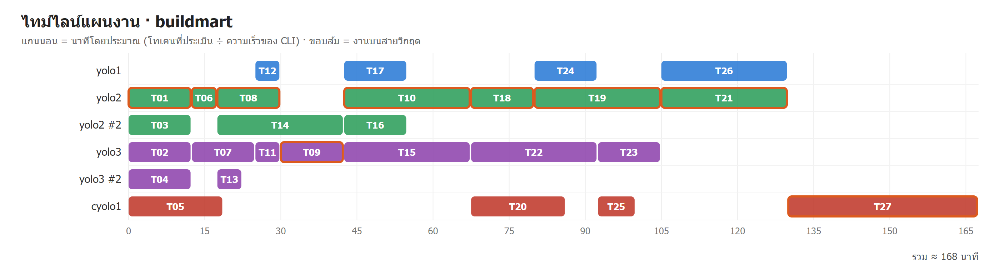

| ตัวเลข | ค่า |
|---|---|
| ทำพร้อมกันสูงสุด | **5** (เพดาน 12 — กราฟแตกกิ่งได้แค่นี้) |
| เวลารวม (ประมาณ) | **97 นาที** |
| ถ้าทำทีละงาน | ~262 นาที → เร็วขึ้น **~2.7 เท่า** |

เหตุผลที่ KC-QUEST เลือก (จาก `out/buildmart/PLAN.md`):
- **T01 → yolo2:** rank สูงสุด (11.7) ได้เลือกก่อน · yolo2 รีเซ็ตเร็วสุด (อีก ~74 ชม.) ความเร่งด่วน U = 0.245 → 39.3 คะแนน ชนะ yolo3 (37.4) → งานบนสายวิกฤตทั้งเส้นไปอยู่ที่ yolo2 เพื่อใช้โควตาให้หมดก่อนรีเซ็ต
- **T10 → yolo3:** เริ่มนาทีที่ 0 พร้อม T01 ตอนนั้น yolo2 มีงานอยู่แล้ว (load สูงขึ้น) · yolo3 รีเซ็ตเร็วอันดับ 2 → 34.7 ชนะ 33.5
- **T19 · T17 → cyolo1:** cyolo1 รีเซ็ตช้าสุด (147 ชม.) → ได้งานที่ไม่อยู่บนสายวิกฤต (รูป + tts-worker)

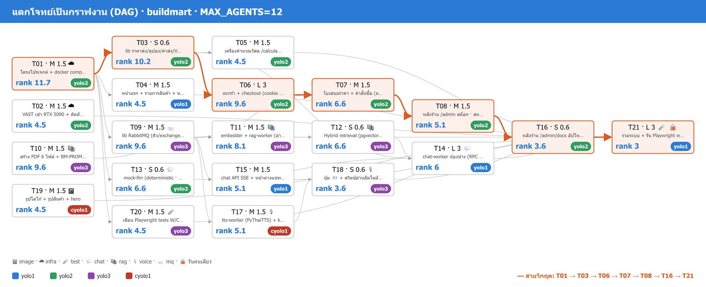
---

## ส่วน C · ทีม AI สร้างระบบจริงตามแผน (~75 นาที · AI ทำเอง)


*ภาพแนวคิด (Imagegen ด้วย cyolo)*

แผนจากส่วน B ยังเป็นแค่ "กระดาษ" — ขั้นนี้ให้**ตัวคุมวง (orchestrator)** เอา `out/buildmart/tasks.json` ไปสั่งทีมทำจริง:

| ส่วน | คือใคร | ทำอะไร | ใช้โทเคน? |
|---|---|---|---|
| 🧠 **สมอง** | AI บัญชีที่โควตาเหลือมากสุด ทำตาม [ORCHESTRA_RECIPE.md](ORCHESTRA_RECIPE.md) | เติมแผนให้ครบ (ไฟล์ที่แต่ละงานเป็นเจ้าของ · สัญญากลาง `_shared.md`) · ตรวจผล · ตัดสินใจเมื่อมีปัญหา | ใช้ |
| 🦾 **มือ** | [tools/orch.py](tools/orch.py) | วัดโควตา · **KC-QUEST** เลือกบัญชี · เปิด worker · ดูโทเคนสด · ย้ายงาน · merge | **ไม่ใช้** |
| 👷 **worker** | `yoloN -p` / `cyoloN exec` (สูงสุด 12 ตัวพร้อมกัน) | เขียนโค้ดเฉพาะงานตัวเองใน git worktree แยก · commit ทุกข้อย่อย | ใช้ |
| 🧪 **dev infra กลาง** | `orch.py infra up` | Postgres+pgvector · RabbitMQ · embedder ให้ทุก worker ทดสอบคิว/RAG ได้โดยไม่ต้องรันทั้งระบบ | ไม่ใช้ |

### ขั้นที่ 3 · พรอมต์ ③ — สั่งทีมสร้างตามแผน (โหมด mock ไม่เสียเงิน)

🖥️ JupyterLab (`http://localhost:8886/lab`) → **File → New → Terminal** (อยู่ที่ `/workspace`) → พิมพ์ `yolo1` → 💬 วาง:

```text
ใช้ skill yolo และ cyolo ทำตาม 00_setup/04_Skill_Setup/04_Multi_Agent_Orchestra/ORCHESTRA_RECIPE.md
PROBLEM=BUILDMART.md PLAN=out/buildmart MAX_AGENTS=12 BACKEND=mock
```

👀 ดูความคืบหน้าสด: JupyterLab → `00_setup/04_Skill_Setup/04_Multi_Agent_Orchestra/my_buildmart/BOARD.md` (คลิกขวา → Open With → Markdown Preview)

📤 **ผลจริง** (23 ต.ค. 2026): **ครบ 21/21 งาน · Playwright ผ่าน 41/41 (mock) · 74 นาที** (วางแผน 11 + สร้างจริง 63) — แผน Gantt ประเมินไว้ 97 นาที

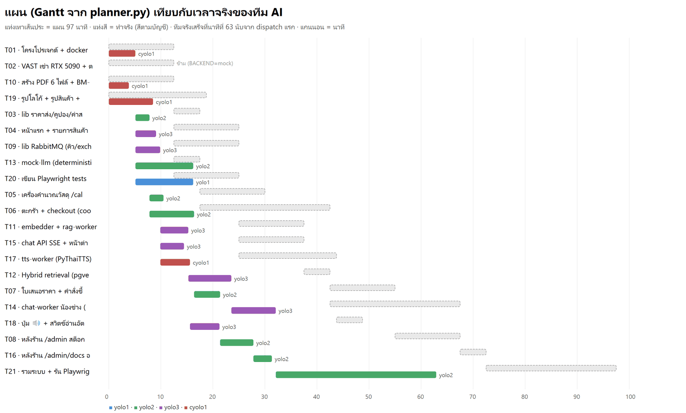
*ภาพจริงจาก `my_buildmart/orchestra/events.jsonl` เทียบกับ `out/buildmart/plan.json`*

| ตัวเลข | ผลจริง |
|---|---|
| งานเสร็จรอบแรก | 21/21 (T02 VAST ข้ามเพราะ `BACKEND=mock` — เปิด AI เป็นพรอมต์ ④ แยก) |
| worker พร้อมกันสูงสุด | 7 จากเพดาน 12 |
| ย้ายงานกลางทาง / โควตาหมดกลางงาน / merge conflict | 0 / 0 / 0 |
| โทเคนที่ใช้จริง | ~0.1–0.6M ต่องาน (ประเมินไว้ 0.6–3M) — KC-QUEST เรียนรู้ตัวคูณขนาดงานใหม่ระหว่างรัน |
| ผลทดสอบในโหมด mock | W 14/14 · C 14/14 · R 7/7 · Q 3/3 · T 3/3 = **41/41** + GIF/MP4 ทุกเคส |

**ทีมแก้ปัญหาเองระหว่างรวมระบบ (งาน T21):** healthcheck ของ web เรียก `localhost` แล้วไปเจอ IPv6 → เปลี่ยนเป็น `127.0.0.1` · Q02 ล้มรอบแรกเพราะสถิติคิวในหน้า RabbitMQ อัปเดตทุก 5 วิ → ตั้งเป็น 1 วิ (ไม่ลดเกณฑ์ทดสอบ)

> 🐞 **บั๊กจริงที่เจอในรอบนี้ (และแก้แล้ว):** ตอนเริ่ม KC-QUEST อ่านเวลารีเซ็ตโควตาของ cyolo1 จาก session เก่า (22/10 ซึ่งผ่านไปแล้ว) → คิดว่า "จะรีเซ็ตใน 1 ชม." → ความเร่งด่วน U = 0.96 → T01 และ T10 ไปอยู่ที่ cyolo1 แทน yolo2/yolo3 ตามแผน · แก้ใน `orch.py` แล้ว: รอบที่ผ่านไปแล้วให้เลื่อนเป็นรอบถัดไปและนับว่าใช้ไป 0% · นี่คือเหตุผลที่แผน (Gantt) กับของจริงต่างกันได้ — **แผนคือการเดาจากข้อมูล ณ ตอนนั้น**

ผลลัพธ์ทั้งหมดอยู่ที่ `my_buildmart/` (ไม่เก็บใน git): `app/` โค้ด + `TEST_REPORT.md` + `test-gifs/` + `test-videos/` · `BOARD.md` · `orchestra/REPORT.md` (งาน × บัญชี × โทเคน)

<details><summary>KC-QUEST คืออะไร (สรุปสั้น · กดเพื่อดู)</summary>


**KC-QUEST = KMITL–Chanwanich Quota-Urgency Expiry-aware Scheduling Technique** — ตอบคำถามเดียว: "งานนี้ควรให้บัญชีไหนทำ" · ใช้ทั้งใน `planner.py` (วางแผน) และ `orch.py` (สั่งงานจริง) เป็นโค้ดชุดเดียวกัน

| ขั้น | คำถาม | หลักการ |
|---|---|---|
| ① จัดลำดับ | งานไหนได้เลือกก่อน | rank สูง (สายวิกฤต) ก่อน · งานที่มีบัญชีให้เลือกน้อยก่อน |
| ② กรอง | บัญชีไหนทำจบได้ | โควตาที่เหลือ (5 ชม. + สัปดาห์) ต้องพอกับขนาดงาน × เผื่อ |
| ③ ให้คะแนน | บัญชีไหนเหมาะสุด | $S=0.40U+0.20F+0.15R+0.15V-0.10L$ (ใกล้รีเซ็ต · พอดีงาน · ที่ว่าง 5 ชม. · ความเร็ว · โหลด) |
| ④ เลือก + จอง | แล้วยังไงต่อ | ให้คะแนนสูงสุด แล้วจองโควตาทันที |
| ⑤ ⑥ ✦ | ระหว่างทำ | คาดการณ์ว่าจะเกินเพดานไหม → ย้ายงาน · เรียนรู้ % ต่อโทเคน · ตัวคุมวงใกล้หมด → ส่งไม้ |

อธิบายเต็มทีละสมการพร้อมตัวเลขจริง: [ALGORITHM.md](ALGORITHM.md) · unit test 16 ข้อ: `python3 tools/test_kcquest.py` · จำลองเทียบวิธีอื่น: [tools/sim.py](tools/sim.py)

</details>

## ส่วน D · เปิด AI (Qwen) บน Vast.ai — ให้ AI อ่าน GitHub แล้วติดตั้งเอง (~10 นาที · เสียเงินจริง)


*ภาพแนวคิด (Imagegen ด้วย cyolo)*

LAB 04.1 มี "สูตร" (`NINFER_RECIPE.md`) บอก AI ทีละคำสั่ง · LAB นี้**ไม่มีสูตร** — ให้ AI ไปอ่าน [README ของ NInfer](https://github.com/Neroued/ninfer) เองเหมือนวิศวกรที่ได้ repo ใหม่มา แล้วตัดสินใจเองว่าต้องติดตั้งอะไร เลือก image ไหน ตั้ง flag อะไร

### ขั้นที่ 4 · พรอมต์ ④ — เช่า RTX 5090 + ติดตั้ง NInfer + Qwen จากศูนย์

🖥️ JupyterLab Terminal ที่ `/workspace` → `yolo1` → 💬 วาง:

```text
ใช้ skill vastai เปิด AI ให้แชทบอท BuildMart แบบเริ่มจากศูนย์ (ไม่มีสคริปต์สำเร็จรูป):
1. เช่า RTX 5090 1 เครื่อง ป้าย bm-qwen-5090 เพดาน $1.20/ชม. เน็ตดาวน์โหลด ≥ 2000 Mbps · disk ≥ 90 GB · image CUDA 13.1 ขึ้นไป · เปิดพอร์ต 8080 (ถ้ามีเครื่องป้ายนี้ running อยู่แล้วให้ใช้ต่อ)
2. อ่านวิธีติดตั้งจาก GitHub https://github.com/Neroued/ninfer เอง (README + docs/serving.md) แล้ว build NInfer บนเครื่องนั้น
3. หาไฟล์โมเดล Qwen3.8-27B แบบ nvfp4 สำหรับ NInfer จาก Hugging Face ของ neroued แล้วดาวน์โหลด (ทำพร้อมกับ build ได้)
4. เปิด ninfer-serve แบบ OpenAI-compatible ที่พอร์ต 8080 ปิด thinking · max-context 16384 · รับพร้อมกัน 4 · ตั้ง API key สุ่มเอง (ห้ามพิมพ์ key บนจอ)
5. ทดสอบถามภาษาไทย 1 ข้อจากนอกเครื่อง แล้วเขียน 3 บรรทัด LLM_BASE_URL / LLM_MODEL / LLM_API_KEY (ไม่มีเครื่องหมายคำพูด ไม่มี comment) ลงไฟล์ 00_setup/04_Skill_Setup/04_Multi_Agent_Orchestra/.env.vast
6. ทำให้จบในรอบเดียว (รอด้วย sleep + เช็คเป็นช่วง ห้ามจบไปก่อน) · ห้ามลบเครื่อง (จะใช้ต่อ) · สรุปตารางภาษาไทย: เครื่อง (GPU · $/ชม. · เน็ต · ประเทศ) · เวลาเช่า/build/โหลดโมเดล/เปิด server · VRAM จริง · ความเร็วตอบ (token/วินาที) · สิ่งที่ต้องแก้ระหว่างทาง
```

📤 **ผลจริง** (23 ต.ค. 2026 · ~8 นาทีตั้งแต่เช่าจนใช้ได้):

| หัวข้อ | ผล |
|---|---|
| เครื่อง | RTX 5090 32 GB · **$0.958/ชม.** (GPU $0.933 + disk $0.025) · Pennsylvania สหรัฐฯ · เน็ต 2,286 Mbps |
| image | `nvidia/cuda:13.4.1-devel-ubuntu24.04` (AI เลือกเองเพราะ README รับรอง CUDA 13.4) |
| เวลา | เช่าจน running 102 วิ · build NInfer 154 วิ · โหลดโมเดล 23.7 GB 91 วิ (ทำพร้อมกับ build) · เปิด server 7 วิ |
| โมเดล | `neroued/Qwen3.8-27B-nvfp4-NInfer` → `qwen3_8_27b_nvfp4.ninfer` (ตรวจ SHA256 ผ่าน) |
| VRAM จริง | 24.1 / 32.6 GB |
| ความเร็ว | ถามทีละข้อ **~123 token/วินาที** · เริ่มตอบใน ~0.65 วิ · ยิงพร้อมกัน 4 รวม ~258 token/วินาที |
| ความปลอดภัย | API key สุ่มบนเครื่อง ไม่แสดงบนจอ · ไม่ใส่ key → 401 · `.env.vast` สิทธิ์ 600 |

**สิ่งที่ AI ต้องแก้เองระหว่างทาง** (นี่คือเหตุผลที่ให้อ่าน GitHub เอง — เรียนรู้แบบงานจริง):
1. ลิงก์ไฟล์บน branch `main` ได้ 404 → ตรวจพบว่า repo ใช้ branch `master`
2. README รับรอง CUDA 13.4 → เลือก image 13.4.1 และกรองเฉพาะเครื่องที่ driver รองรับ
3. `--kv-capacity` ค่าเริ่มต้น = `--max-context` (16k) ซึ่งทั้ง 4 คนต้องแบ่งกัน → ตั้งเป็น 65,536 (4 × 16k)
4. `--lm-head-draft` (ตาม README) ทำให้ภาษาไทยช้าลง (MTP รับ draft แค่ 6–9% · ~80 tok/s) → ถอดออกแล้วรับได้ 28–37% · **~123 tok/s**

flag ที่ใช้จริง: `--max-context 16384 --kv-capacity 65536 --max-concurrency 4 --kv-dtype fp8 --spec mtp --draft-tokens 3 --no-thinking --api-key …` (บันทึกไว้ใน [`_solution/vast_qwen/README.md`](_solution/vast_qwen/README.md) เผื่อทำไม่ได้)

> 💡 ทำไม `--max-concurrency 4`: GPU 1 ใบรับพร้อมกันได้จำกัด → ตรงกับ `prefetch=4` ของ chat-worker ใน RabbitMQ · ลูกค้าคนที่ 5 รอในคิว ไม่ error (เคส Q01)
---

## ส่วน E · deploy ทั้งระบบบนเครื่องเรา (~3 นาที · Claude Code บน Windows)

### ขั้นที่ 5 · พรอมต์ ⑤ — deploy (โหมด AI จริง + อ่านออกเสียง)

💬 Claude Code ที่โฟลเดอร์นี้ (`04_Multi_Agent_Orchestra`) วาง:

```text
deploy ระบบ BuildMart ทั้งระบบบนเครื่องนี้ด้วย Docker Desktop (โหมด AI จริง + อ่านออกเสียง):
1. โฟลเดอร์แอป = my_buildmart/app (ถ้าไม่มีหรือ build ไม่ผ่าน ให้ใช้ _solution/buildmart แทนและบอกฉัน)
2. copy ไฟล์ .env.vast (อยู่ในโฟลเดอร์นี้) ไปไว้ในโฟลเดอร์แอป · ห้ามแสดงค่าในไฟล์
3. docker compose -p buildmart --profile tts up -d --build ในโฟลเดอร์แอป แล้วรอจนทุก service healthy
4. ตรวจ: chat-worker ต่อ Qwen จริง (ไม่ใช่ mock) · เอกสาร PDF ingest ครบ (ready) · ถาม "ปูนเก็บได้นานแค่ไหน" ผ่าน /api/chat ได้คำตอบพร้อมป้ายอ้างอิง
5. สรุปตาราง service | สถานะ | หน้าที่ · URL หน้าเว็บ · RabbitMQ UI · หลังร้าน
```

📤 **ผลจริง** (deploy เฉลย `_solution/buildmart` · `.env.vast` จากพรอมต์ ④): ทั้ง 10 service healthy · `chat-worker` log ขึ้น `mode=ai llm=http://<ip>:<port>/v1 model=qwen3.8-27b` · rag-worker ingest PDF 6 ไฟล์ = 288 chunk (ready)

| service | สถานะ | หน้าที่ |
|---|---|---|
| web | ✅ healthy | หน้าร้าน + API · http://localhost:3400 · หลังร้าน `/admin` (รหัส dev `admin1234`) |
| rabbitmq | ✅ healthy | คิวกลาง · UI http://localhost:15672 (`guest/guest` ใช้ในเครื่องเท่านั้น) |
| chat-worker | ✅ healthy | แชทบอท → **Qwen บน RTX 5090** |
| rag-worker · embedder | ✅ healthy | PDF → chunk → เวกเตอร์ 384 มิติ (multilingual-e5-small บน CPU) |
| tts-worker · kokoro | ✅ healthy | เสียงไทย (PyThaiTTS) · อังกฤษ (Kokoro) |
| notify-worker | ✅ healthy | ฟัง `order.events` → แจ้งเตือนหลังร้าน |
| db | ✅ healthy | PostgreSQL 16 + pgvector |

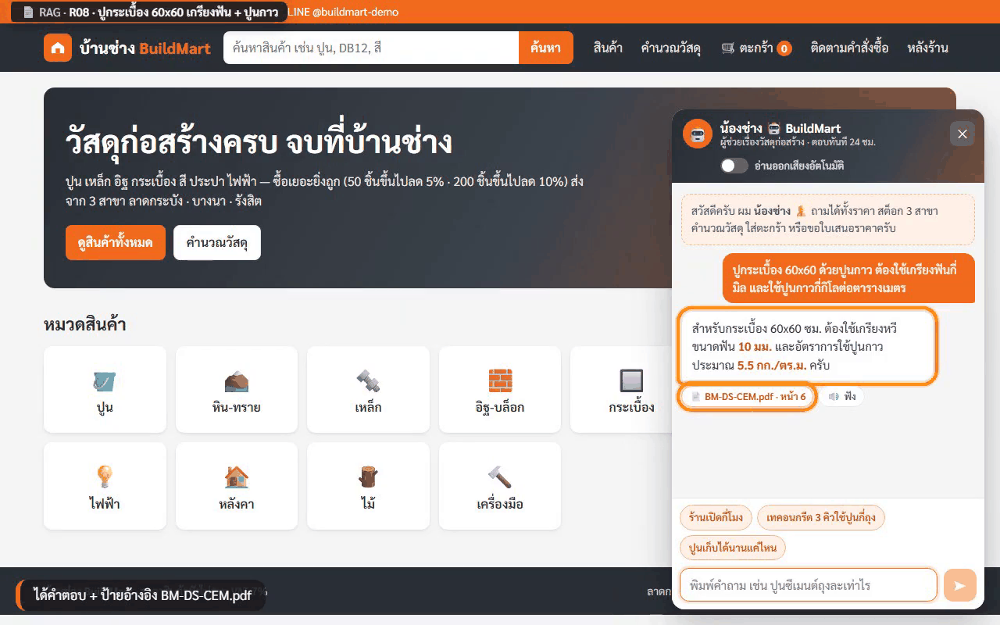
*ภาพจริง (เคส R08 · Qwen บน RTX 5090): คำตอบมาจาก**ตารางหัว 2 ชั้น**ในหน้า 6 ของ PDF · ป้าย 📄 คลิกแล้วเปิด PDF หน้านั้น · ปุ่ม 🔊 ฟัง = อ่านออกเสียง*

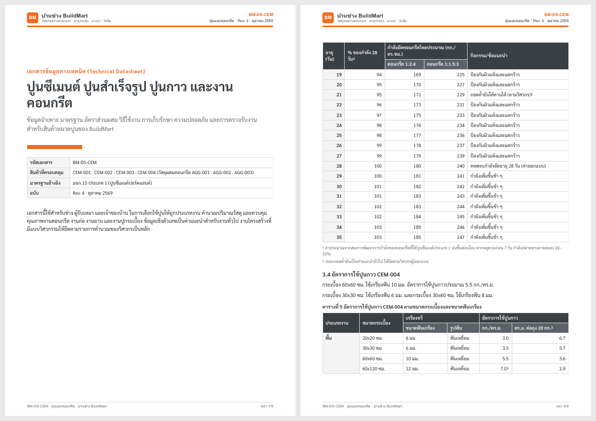
*ภาพจริง: PDF ที่ทีมสร้าง (ไฟล์ละ 9 หน้า · สารบัญ · ตารางหลายชั้น · เซลล์รวม · เชิงอรรถ) — RAG ต้องอ่านตารางพวกนี้ให้ถูก*

|  |  |  |
|---|---|---|
| Q01: 8 หน้าต่างถามพร้อมกัน → GPU รับทีละ 4 ที่เหลือรอคิว → **ได้ครบ 8** | RabbitMQ UI: คิว `chat.request` (durable · dead-letter → `chat.dlq`) | Q02: ปิด chat-worker → "รอคิว…" → เปิดกลับ → ได้คำตอบ (ข้อความไม่หาย) |

---

## ส่วน F · เพลย์ลิสต์ทดสอบทั้งระบบ (Playwright)


*ภาพแนวคิด (Imagegen ด้วย cyolo)*

"เพลย์ลิสต์" = รายการ use case 42 เคสเรียงตามลำดับ ([`playlist.json`](_solution/buildmart/e2e/playlist.json)) ที่ Playwright เปิดเบราว์เซอร์เล่นเหมือนลูกค้าจริง · พิมพ์ทีละตัว · **ค้างภาพ 3–5 วินาทีหลังทุกผลลัพธ์**ให้คนดูทัน · มีป้ายบอกเคสมุมจอ · อัดวิดีโอทุกเคส → GIF (ไม่มีเสียง) + MP4 (**เคส T มีเสียงพูดจริง** รวมไฟล์เสียงที่ระบบสร้างเข้ากับวิดีโอด้วย ffmpeg ตรงจังหวะที่กดเล่น)

### ขั้นที่ 6 · พรอมต์ ⑥ — รันเพลย์ลิสต์

💬 วางใน Claude Code เดิม:

```text
รันเพลย์ลิสต์ทดสอบของระบบที่ deploy อยู่ ในโหมด AI จริงและเปิดกลุ่มเสียง
(ถ้าเป็น _solution/buildmart: cd e2e → npm ci → BM_MODE=ai BM_TTS=1 npm run playlist → npm run media → npm run report · ถ้าเป็น my_buildmart/app ดูวิธีรันใน README ของมัน)
สรุปเป็นภาษาไทย: ตาราง กลุ่ม | ผ่าน/ทั้งหมด · เคสที่ไม่ผ่านพร้อมคำตอบจริงและสาเหตุ · ลิงก์ TEST_REPORT.md · วิดีโอที่มีเสียง
```

📤 **ผลจริง** (23 ต.ค. 2026 · เฉลย `_solution/buildmart`):

| โหมด | 🛒 หน้าร้าน | 💬 แชทบอท | 📄 RAG | 📨 RabbitMQ | 🔊 เสียง | รวม |
|---|---|---|---|---|---|---|
| mock + tts | 14/14 | 14/14 | 8/8 | 3/3 | 3/3 | **42/42 ✅** |
| **AI จริง (Qwen บน RTX 5090)** + tts | 14/14 | 14/14 | 8/8 | 3/3 | 3/3 | **42/42 ✅** (11.4 นาที) |

วิดีโอยาวเฉลี่ย 17 วินาที · เคสที่มีเสียง: [T01 ไทย 🔊](_solution/buildmart/e2e/test-videos/T01.mp4) (เสียง 9.3 วิ) · [T02 Kokoro อังกฤษ 🔊](_solution/buildmart/e2e/test-videos/T02.mp4) (5.6 วิ) · [T03 อ่านอัตโนมัติ 🔊](_solution/buildmart/e2e/test-videos/T03.mp4) (26.4 วิ) — กดลิงก์แล้วเปิด/ดาวน์โหลดเพื่อฟังเสียง (GIF ไม่มีเสียง) · MP4 ของทุกเคสสร้างเองได้ด้วย `npm run media` (repo เก็บเฉพาะ 3 ไฟล์ที่มีเสียง) · รายงานเต็ม [TEST_REPORT.md](_solution/buildmart/e2e/TEST_REPORT.md)

**ทุกเคส** (คำตอบจริงของ Qwen · LLM เรียบเรียงใหม่ทุกครั้ง ถ้อยคำของคุณจะไม่ตรงทุกคำ แต่ต้องมีตัวเลข/คำสำคัญที่ถูก):

| เคส | ทดสอบ | mock | AI จริง | คำตอบจริง / ค่าที่ตรวจ (โหมด AI) | วิดีโอ |
|---|---|---|---|---|---|
| **W01** | ค้นหา "ปูน" | ✅ | ✅ | CEM-001, CEM-002, CEM-003, CEM-004, PNT-003 | [GIF](_solution/buildmart/e2e/test-gifs/W01.gif) |
| **W02** | กรองหมวดเหล็ก + เรียงราคาสูง→ต่ำ | ✅ | ✅ | STL-004 > STL-003 > STL-002 > STL-005 > STL-001 | [GIF](_solution/buildmart/e2e/test-gifs/W02.gif) |
| **W03** | หน้าสินค้า STL-003 ราคาส่ง 3 ขั้น | ✅ | ✅ | tiers: 195.00, 185.25, 175.50 · stock: LKB: 700 เส้น, BNA: 500 เส้น, RST: 400 เส้น | [GIF](_solution/buildmart/e2e/test-gifs/W03.gif) |
| **W04** | หน้าสินค้า CEM-002 สาขารังสิตหมด | ✅ | ✅ | stock-RST = หมด | [GIF](_solution/buildmart/e2e/test-gifs/W04.gif) |
| **W05** | คำนวณคอนกรีต 3 ลบ.ม. | ✅ | ✅ | { "CEM-001": 21, "AGG-001": 2, "AGG-003": 3 } ตะกร้า: AGG-001, AGG-003, CEM-001 | [GIF](_solution/buildmart/e2e/test-gifs/W05.gif) |
| **W06** | คำนวณกระเบื้อง 50 ตร.ม. | ✅ | ✅ | TIL-001: 39 · CEM-004: 13 · TIL-003: 10 | [GIF](_solution/buildmart/e2e/test-gifs/W06.gif) |
| **W07** | คำนวณสีภายนอก 120 ตร.ม. 2 เที่ยว | ✅ | ✅ | PNT-001: 8 · PNT-003: 3 | [GIF](_solution/buildmart/e2e/test-gifs/W07.gif) |
| **W08** | ตะกร้า STL-003 × 60 ได้ราคาส่ง | ✅ | ✅ | ราคาต่อเส้น = 185.25 | [GIF](_solution/buildmart/e2e/test-gifs/W08.gif) |
| **W09** | ตะกร้า CEM-001 × 100 + คูปอง BUILD5 | ✅ | ✅ | unit: 137.75 · subtotal: 13,775.00 · discount: 688.75 · weight: 5,000 กก. · vehicle: รถ 6 ล้อ · shipping: 1,500.00 · vat: 1,021.04 · total: 15,607.29 | [GIF](_solution/buildmart/e2e/test-gifs/W09.gif) |
| **W10** | ตะกร้าหนักเกิน 6 ตัน (AGG-003 × 4) | ✅ | ✅ | weight: 6,400 กก. · vehicle: รถ 10 ล้อ · shipping: 3,500.00 | [GIF](_solution/buildmart/e2e/test-gifs/W10.gif) |
| **W11** | ขอใบเสนอราคาจากตะกร้า | ✅ | ✅ | quoteNo: QT-20261023-0019 · quoteTotal: 4,167.65 · cartTotal: 4,167.65 · quoteRows: CEM-001, TIL-001 · cartRows: CEM-001, TIL-001 | [GIF](_solution/buildmart/e2e/test-gifs/W11.gif) |
| **W12** | สั่งซื้อแล้วติดตามคำสั่งซื้อ | ✅ | ✅ | orderNo: BM-20261023-0015 · stockLKB: before: 194, after: 192 · track: รับคำสั่งซื้อ | [GIF](_solution/buildmart/e2e/test-gifs/W12.gif) |
| **W13** | สั่งเกินสต็อก BRK-003 สาขารังสิต | ✅ | ✅ | stockError: ⚠ สินค้าที่สาขารังสิตมีไม่พอ — สั่งซื้อไม่ได้ กรุณาเลือกสาขาอื่นหรือลดจำนวน BRK-003 บล็อกประสาน (ก้อน): ต้องการ 10 ก้อน · คงเหลือ 0 ก้อน ·… | [GIF](_solution/buildmart/e2e/test-gifs/W13.gif) |
| **W14** | หลังร้านเปลี่ยนสถานะเป็นกำลังจัดส่ง | ✅ | ✅ | orderNo: BM-20261023-0016 · track: กำลังจัดส่ง | [GIF](_solution/buildmart/e2e/test-gifs/W14.gif) |
| **C01** | ร้านเปิดกี่โมงครับ | ✅ | ✅ | ร้านบ้านช่าง BuildMart เปิดทำการดังนี้ครับ จันทร์–เสาร์: 07:00–18:00 น. อาทิตย์: 08:00–12:00 น. | [GIF](_solution/buildmart/e2e/test-gifs/C01.gif) |
| **C02** | วันอาทิตย์เปิดไหม | ✅ | ✅ | เปิดครับ แต่เปิดเฉพาะช่วงเช้า 08:00–12:00 น. เท่านั้น (ไม่มีการจัดส่งสินค้าในวันอาทิตย์) | [GIF](_solution/buildmart/e2e/test-gifs/C02.gif) |
| **C03** | ปูนซีเมนต์ถุงละเท่าไร | ✅ | ✅ | ปูนซีเมนต์ปอร์ตแลนด์ ประเภท 1 (CEM-001) ราคาถุงละ 145 บาท ครับ | [GIF](_solution/buildmart/e2e/test-gifs/C03.gif) |
| **C04** | เหล็ก DB12 มีกี่สาขาที่มีของ | ✅ | ✅ | เหล็ก DB12 (STL-003) มีสต็อกครบทั้ง 3 สาขา ครับ LKB ลาดกระบัง: 700 เส้น BNA บางนา: 500 เส้น RST รังสิต: 400 เส้น | [GIF](_solution/buildmart/e2e/test-gifs/C04.gif) |
| **C05** | เหล็ก DB12 60 เส้น ราคาเท่าไร | ✅ | ✅ | 60 เส้นเข้าเกณฑ์ราคาส่ง (50–199 ชิ้น) ลด 5% ครับ ราคาต่อเส้น: 185.25 บาท ยอดรวม: 11,115 บาท (ยังไม่รวม VAT) | [GIF](_solution/buildmart/e2e/test-gifs/C05.gif) |
| **C06** | เทพื้นคอนกรีต 3 คิว ใช้ปูนกี่ถุง | ✅ | ✅ | CEM-001 ปูนซีเมนต์ปอร์ตแลนด์ ประเภท 1 (50 กก.) : 21 ถุง AGG-001 ทรายหยาบ : 2 ลบ.ม. AGG-003 หิน 3/4 (หินเบอร์ 1) : 3 ลบ.ม. พิมพ์ "ใส่ตะกร้าให้เลย" ได้ค… | [GIF](_solution/buildmart/e2e/test-gifs/C06.gif) |
| **C07** | ใส่ตะกร้าให้เลย (ต่อจาก C06) | ✅ | ✅ | ยืนยันรายการใส่ตะกร้าให้ครับ: CEM-001 : 21 ถุง AGG-001 : 2 ลบ.ม. AGG-003 : 3 ลบ.ม. | [GIF](_solution/buildmart/e2e/test-gifs/C07.gif) |
| **C08** | ขอใบเสนอราคาหน่อย | ✅ | ✅ | ออกใบเสนอราคาให้เรียบร้อยแล้วครับ เลขที่: QT-20261023-0020 ยอดรวม: 2,086.50 บาท (ยังไม่รวม VAT) ดูรายละเอียดได้ที่: /quote/QT-20261023-0020 ใบเสนอราคา… | [GIF](_solution/buildmart/e2e/test-gifs/C08.gif) |
| **C09** | ส่งของ 5 ตันใช้รถอะไร ค่าส่งเท่าไร | ✅ | ✅ | ส่งของน้ำหนัก 5 ตัน (5,000 กก.) ใช้ รถ 6 ล้อ ครับ ค่าส่งอยู่ที่ 1,500 บาท ครับ | [GIF](_solution/buildmart/e2e/test-gifs/C09.gif) |
| **C10** | มีโค้ดส่วนลดไหม | ✅ | ✅ | มีครับ! ตอนนี้เรามีคูปองส่วนลด 2 แบบให้เลือกใช้ (ใช้ได้ทีละ 1 ใบ) ครับ BUILD5: ลด 5% เมื่อยอดซื้อก่อน VAT ตั้งแต่ 5,000 บาทขึ้นไป CONTRACTOR10: ลด 10%… | [GIF](_solution/buildmart/e2e/test-gifs/C10.gif) |
| **C11** | มีกระเบื้องยางขายไหม | ✅ | ✅ | ขออภัยครับ ร้านบ้านช่าง BuildMart ไม่มีกระเบื้องยางขายในขณะนี้ เรามีสินค้ากระเบื้องที่ใกล้เคียงดังนี้ครับ: TIL-001 กระเบื้องพื้น 60x60 ลายหินอ่อน (389… | [GIF](_solution/buildmart/e2e/test-gifs/C11.gif) |
| **C12** | ช่วยเขียนโค้ด Python ให้หน่อย | ✅ | ✅ | ขออภัยครับ น้องช่างช่วยเขียนโค้ดไม่ได้ แต่ยินดีช่วยเรื่องวัสดุก่อสร้าง ราคา สต็อก หรือคำนวณปริมาณวัสดุให้ครับ | [GIF](_solution/buildmart/e2e/test-gifs/C12.gif) |
| **C13** | ทาสีภายนอก 120 ตร.ม. แล้วราคารวม | ✅ | ✅ | PNT-001 สีน้ำอะคริลิก ภายนอก : 8 แกลลอน × 890 = 7,120 บาท PNT-003 สีรองพื้นปูนใหม่ : 3 แกลลอน × 650 = 1,950 บาท ยอดรวมสินค้า (ยังไม่รวม VAT และค่าส่ง)… | [GIF](_solution/buildmart/e2e/test-gifs/C13.gif) |
| **C14** | สาขาบางนาเบอร์อะไร | ✅ | ✅ | เบอร์โทรสาขาบางนา (BNA) คือ 02-111-0002 ครับ | [GIF](_solution/buildmart/e2e/test-gifs/C14.gif) |
| **R01** | ปูนเก็บได้นานแค่ไหน | ✅ | ✅ | ปูนซีเมนต์เก็บได้ 3 เดือน นับจากวันผลิตครับ | [GIF](_solution/buildmart/e2e/test-gifs/R01.gif) |
| **R02** | สีทาภายนอกรับประกันกี่ปี | ✅ | ✅ | สีทาภายนอก PNT-001 รับประกัน 8 ปี เมื่อทาครบระบบรองพื้น 1 เที่ยวและสีทับหน้า 2 เที่ยวครับ | [GIF](_solution/buildmart/e2e/test-gifs/R02.gif) |
| **R03** | TIL-001 ปูพื้นนอกบ้านได้ไหม | ✅ | ✅ | ได้ครับ กระเบื้อง TIL-001 สามารถปูพื้นภายนอกได้ เนื่องจากมีค่าดูดซึมน้ำน้อยกว่า 0.5% และกันลื่นระดับ R10 | [GIF](_solution/buildmart/e2e/test-gifs/R03.gif) |
| **R04** | ปูนเปิดถุงแล้วคืนได้ไหม | ✅ | ✅ | คืนไม่ได้ครับ ปูนที่เปิดถุงแล้วคืนไม่ได้ทุกกรณี แม้จะยังอยู่ในระยะ 7 วันก็ตาม | [GIF](_solution/buildmart/e2e/test-gifs/R04.gif) |
| **R05** | ทาบเหล็ก DB12 ต้องยาวเท่าไร | ✅ | ✅ | ระยะทาบเหล็ก DB12 ต้องยาวอย่างน้อย 48 ซม. ครับ | [GIF](_solution/buildmart/e2e/test-gifs/R05.gif) |
| **R06** | สาย THW 2.5 กับเบรกเกอร์ (Hybrid) | ✅ | ✅ | สาย THW 2.5 ตร.มม. ใช้คู่กับเบรกเกอร์ขนาด 16–20 A ครับ ส่วนเบรกเกอร์ลูกย่อย 16A (SKU: ELC-002) ราคา 145 บาท/ตัว ครับ | [GIF](_solution/buildmart/e2e/test-gifs/R06.gif) |
| **R08** | ปูกระเบื้อง 60x60 เกรียงฟัน + ปูนกาว | ✅ | ✅ | สำหรับกระเบื้อง 60x60 ซม. ต้องใช้เกรียงหวีขนาดฟัน 10 มม. และอัตราการใช้ปูนกาวประมาณ 5.5 กก./ตร.ม. ครับ | [GIF](_solution/buildmart/e2e/test-gifs/R08.gif) |
| **R07** | อัปโหลด BM-PROMO-NOV.pdf แล้วถามโปร | ✅ | ✅ | เดือนพฤศจิกายนมีโปรโมชั่นพิเศษดังนี้ครับ ซื้อปูน CEM-001 ครบ 100 ถุง ในใบเสร็จเดียว แถมลวดผูกเหล็ก STL-005 จำนวน 2 ม้วน ใช้ได้ตั้งแต่วันที่ 1–30 พฤศจิ… | [GIF](_solution/buildmart/e2e/test-gifs/R07.gif) |
| **Q01** | แชท 8 หน้าต่างพร้อมกัน | ✅ | ✅ | 1. ร้านเปิดกี่โมงครับ → ร้านเปิดทำการ จันทร์–เสาร์ เวลา 07:00–18:00 น. และวันอาทิตย์ เวลา 08:00–12:00 น. ครับ 2. ปูนซีเมนต์ถุงละเท่าไร → ปูนซีเมนต์ปอร… | [GIF](_solution/buildmart/e2e/test-gifs/Q01.gif) |
| **Q02** | หยุด chat-worker แล้วข้อความไม่หาย | ✅ | ✅ | ปูนซีเมนต์ปอร์ตแลนด์ ประเภท 1 (CEM-001) ราคา 145 บาท/ถุง ครับ | [GIF](_solution/buildmart/e2e/test-gifs/Q02.gif) |
| **Q03** | สั่งซื้อจนสต็อกต่ำ → แจ้งเตือนหลังร้าน | ✅ | ✅ | pick: sku: TOL-002, branch: RST, qty: 1, stock: 2, reorder: 5 · orderNo: BM-20261023-0017 · stockAfter: 1 · order: 🧾 คำสั่งซื้อใหม่ BM-20261023-0017 ·… | [GIF](_solution/buildmart/e2e/test-gifs/Q03.gif) |
| **T01** | ร้านเปิดกี่โมง → กดฟัง (ไทย) | ✅ | ✅ | ร้านบ้านช่าง BuildMart เปิดทำการดังนี้ครับ จันทร์–เสาร์: 07:00–18:00 น. อาทิตย์: 08:00–12:00 น. | [GIF](_solution/buildmart/e2e/test-gifs/T01.gif) · [MP4 🔊](_solution/buildmart/e2e/test-videos/T01.mp4) |
| **T02** | Portland cement → กดฟัง (Kokoro) | ✅ | ✅ | Portland cement (CEM-001) is 145 baht per 50 kg bag. | [GIF](_solution/buildmart/e2e/test-gifs/T02.gif) · [MP4 🔊](_solution/buildmart/e2e/test-videos/T02.mp4) |
| **T03** | อ่านออกเสียงอัตโนมัติ | ✅ | ✅ | มีครับ! ปัจจุบันมีคูปองส่วนลด 2 แบบให้เลือกใช้ (ใช้ได้ทีละ 1 ใบ) ครับ BUILD5: ลด 5% เมื่อยอดซื้อก่อน VAT ตั้งแต่ 5,000 บาทขึ้นไป CONTRACTOR10: ลด 10% … | [GIF](_solution/buildmart/e2e/test-gifs/T03.gif) · [MP4 🔊](_solution/buildmart/e2e/test-videos/T03.mp4) |

**วิดีโอทุกเคส** (GIF เล่นอัตโนมัติ · ไม่มีเสียง — เคส 🔊 กดลิงก์ MP4 เพื่อฟัง):


#### 🛒 หน้าร้าน · 14 เคส

<table>
<tr>
<td width="50%" valign="top"><b>W01</b> · ค้นหา "ปูน"<br></td>
<td width="50%" valign="top"><b>W02</b> · กรองหมวดเหล็ก + เรียงราคาสูง→ต่ำ<br></td>
</tr>
<tr>
<td width="50%" valign="top"><b>W03</b> · หน้าสินค้า STL-003 ราคาส่ง 3 ขั้น<br></td>
<td width="50%" valign="top"><b>W04</b> · หน้าสินค้า CEM-002 สาขารังสิตหมด<br></td>
</tr>
<tr>
<td width="50%" valign="top"><b>W05</b> · คำนวณคอนกรีต 3 ลบ.ม.<br></td>
<td width="50%" valign="top"><b>W06</b> · คำนวณกระเบื้อง 50 ตร.ม.<br>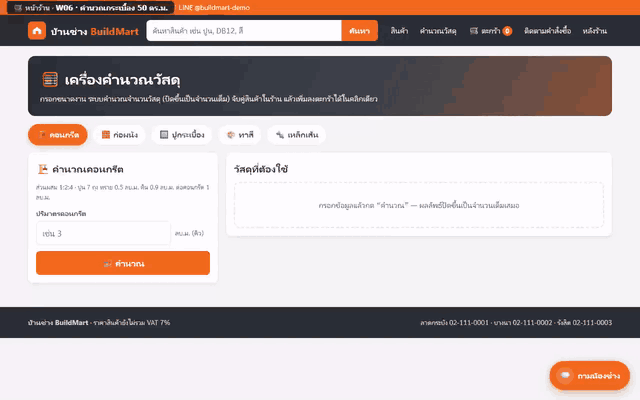</td>
</tr>
<tr>
<td width="50%" valign="top"><b>W07</b> · คำนวณสีภายนอก 120 ตร.ม. 2 เที่ยว<br></td>
<td width="50%" valign="top"><b>W08</b> · ตะกร้า STL-003 × 60 ได้ราคาส่ง<br></td>
</tr>
<tr>
<td width="50%" valign="top"><b>W09</b> · ตะกร้า CEM-001 × 100 + คูปอง BUILD5<br></td>
<td width="50%" valign="top"><b>W10</b> · ตะกร้าหนักเกิน 6 ตัน (AGG-003 × 4)<br></td>
</tr>
<tr>
<td width="50%" valign="top"><b>W11</b> · ขอใบเสนอราคาจากตะกร้า<br></td>
<td width="50%" valign="top"><b>W12</b> · สั่งซื้อแล้วติดตามคำสั่งซื้อ<br></td>
</tr>
<tr>
<td width="50%" valign="top"><b>W13</b> · สั่งเกินสต็อก BRK-003 สาขารังสิต<br></td>
<td width="50%" valign="top"><b>W14</b> · หลังร้านเปลี่ยนสถานะเป็นกำลังจัดส่ง<br></td>
</tr>
</table>


#### 💬 แชทบอท (Qwen ตอบจริง) · 14 เคส

<table>
<tr>
<td width="50%" valign="top"><b>C01</b> · ร้านเปิดกี่โมงครับ<br>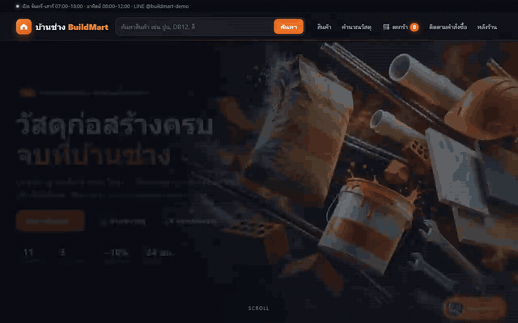</td>
<td width="50%" valign="top"><b>C02</b> · วันอาทิตย์เปิดไหม<br></td>
</tr>
<tr>
<td width="50%" valign="top"><b>C03</b> · ปูนซีเมนต์ถุงละเท่าไร<br>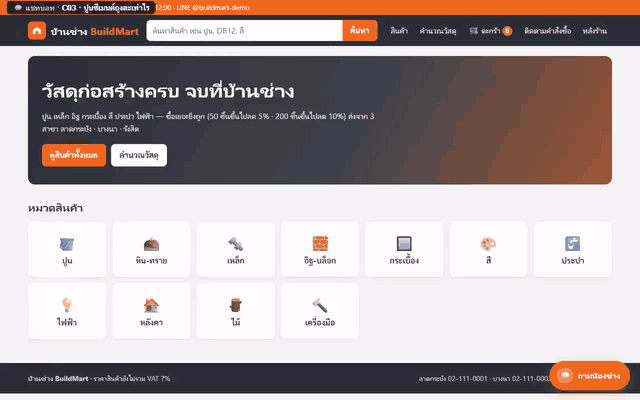</td>
<td width="50%" valign="top"><b>C04</b> · เหล็ก DB12 มีกี่สาขาที่มีของ<br></td>
</tr>
<tr>
<td width="50%" valign="top"><b>C05</b> · เหล็ก DB12 60 เส้น ราคาเท่าไร<br></td>
<td width="50%" valign="top"><b>C06</b> · เทพื้นคอนกรีต 3 คิว ใช้ปูนกี่ถุง<br>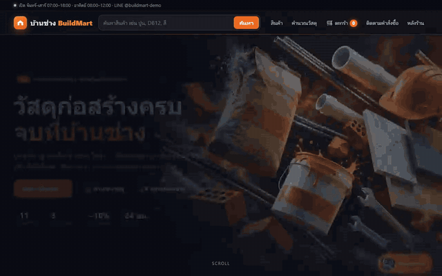</td>
</tr>
<tr>
<td width="50%" valign="top"><b>C07</b> · ใส่ตะกร้าให้เลย (ต่อจาก C06)<br></td>
<td width="50%" valign="top"><b>C08</b> · ขอใบเสนอราคาหน่อย<br>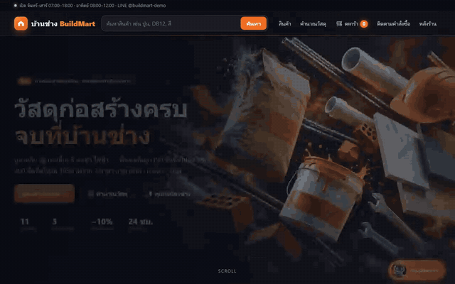</td>
</tr>
<tr>
<td width="50%" valign="top"><b>C09</b> · ส่งของ 5 ตันใช้รถอะไร ค่าส่งเท่าไร<br>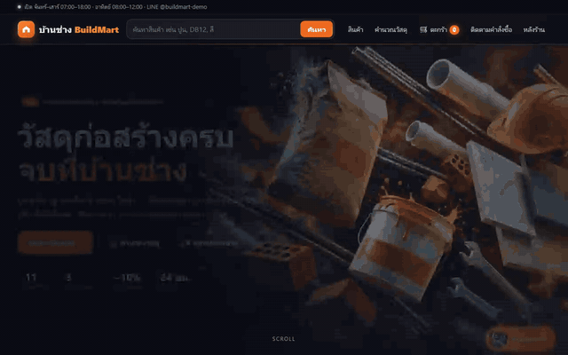</td>
<td width="50%" valign="top"><b>C10</b> · มีโค้ดส่วนลดไหม<br></td>
</tr>
<tr>
<td width="50%" valign="top"><b>C11</b> · มีกระเบื้องยางขายไหม<br>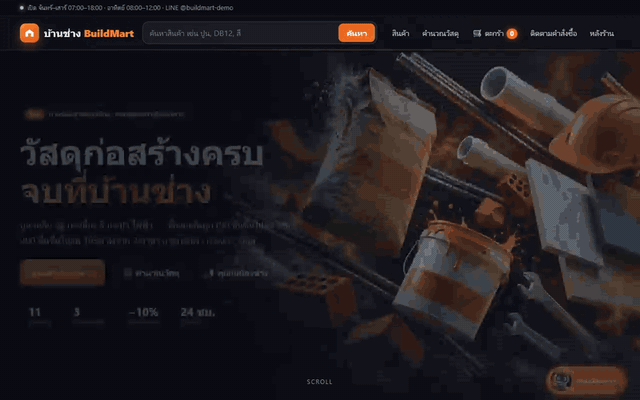</td>
<td width="50%" valign="top"><b>C12</b> · ช่วยเขียนโค้ด Python ให้หน่อย<br></td>
</tr>
<tr>
<td width="50%" valign="top"><b>C13</b> · ทาสีภายนอก 120 ตร.ม. แล้วราคารวม<br></td>
<td width="50%" valign="top"><b>C14</b> · สาขาบางนาเบอร์อะไร<br></td>
</tr>
</table>


#### 📄 Hybrid RAG จาก PDF · 8 เคส

<table>
<tr>
<td width="50%" valign="top"><b>R01</b> · ปูนเก็บได้นานแค่ไหน<br>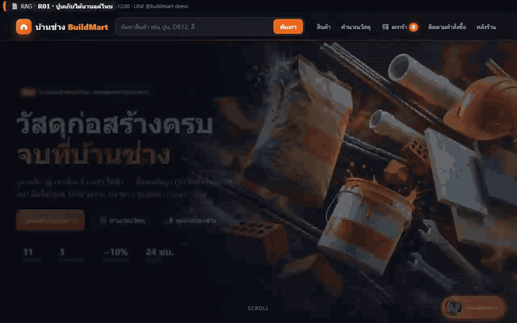</td>
<td width="50%" valign="top"><b>R02</b> · สีทาภายนอกรับประกันกี่ปี<br>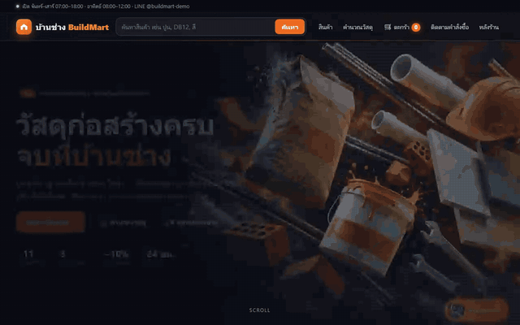</td>
</tr>
<tr>
<td width="50%" valign="top"><b>R03</b> · TIL-001 ปูพื้นนอกบ้านได้ไหม<br></td>
<td width="50%" valign="top"><b>R04</b> · ปูนเปิดถุงแล้วคืนได้ไหม<br></td>
</tr>
<tr>
<td width="50%" valign="top"><b>R05</b> · ทาบเหล็ก DB12 ต้องยาวเท่าไร<br></td>
<td width="50%" valign="top"><b>R06</b> · สาย THW 2.5 กับเบรกเกอร์ (Hybrid)<br></td>
</tr>
<tr>
<td width="50%" valign="top"><b>R08</b> · ปูกระเบื้อง 60x60 เกรียงฟัน + ปูนกาว<br></td>
<td width="50%" valign="top"><b>R07</b> · อัปโหลด BM-PROMO-NOV.pdf แล้วถามโปร<br></td>
</tr>
</table>


#### 📨 RabbitMQ · 3 เคส

<table>
<tr>
<td width="50%" valign="top"><b>Q01</b> · แชท 8 หน้าต่างพร้อมกัน<br></td>
<td width="50%" valign="top"><b>Q02</b> · หยุด chat-worker แล้วข้อความไม่หาย<br></td>
</tr>
<tr>
<td width="50%" valign="top"><b>Q03</b> · สั่งซื้อจนสต็อกต่ำ → แจ้งเตือนหลังร้าน<br></td>
<td width="50%"></td>
</tr>
</table>


#### 🔊 อ่านออกเสียง · 3 เคส

<table>
<tr>
<td width="50%" valign="top"><b>T01</b> · ร้านเปิดกี่โมง → กดฟัง (ไทย) · <a href="_solution/buildmart/e2e/test-videos/T01.mp4">🎬 MP4 มีเสียง</a><br></td>
<td width="50%" valign="top"><b>T02</b> · Portland cement → กดฟัง (Kokoro) · <a href="_solution/buildmart/e2e/test-videos/T02.mp4">🎬 MP4 มีเสียง</a><br></td>
</tr>
<tr>
<td width="50%" valign="top"><b>T03</b> · อ่านออกเสียงอัตโนมัติ · <a href="_solution/buildmart/e2e/test-videos/T03.mp4">🎬 MP4 มีเสียง</a><br></td>
<td width="50%"></td>
</tr>
</table>


**ระบบที่ทีมสร้างเอง (`my_buildmart`) ต่อ Qwen จริงได้ไหม?** ลองต่อ `.env.vast` เดียวกันแล้วรันกลุ่มแชท + RAG ของทีม: **ผ่าน 20/21** · ล้มเคสเดียวคือ C13 "ทาสีภายนอก 120 ตร.ม. → ราคารวม" — Qwen คิดราคารวม**รวมสีรองพื้นด้วย** (8 × 890 + 3 × 650 = **9,070** บาท) ขณะที่เกณฑ์ต้องการ 7,120 (สีอย่างเดียว) · ตัวเลข 7,120 อยู่ในคำตอบแรกแล้ว → นี่คือตัวอย่างที่ดีว่า **LLM ตีความคำถามกว้างกว่าที่ requirement เขียน** ทางแก้คือเขียน requirement/system prompt ให้ชัด ไม่ใช่ลดเกณฑ์

---

## ส่วน G · ลบเครื่อง GPU + สรุปค่าใช้จ่าย (ห้ามข้าม!)


*ภาพแนวคิด (Imagegen ด้วย cyolo)*

### ขั้นที่ 7 · พรอมต์ ⑦ — ลบเครื่อง

🖥️ `yolo1` → 💬 วาง:

```text
ใช้ skill vastai ลบเครื่องป้าย bm-qwen-5090 แล้วยืนยันว่าไม่มีเครื่องเหลือในบัญชี พร้อมสรุปค่าใช้จ่ายเป็นตารางภาษาไทย (เวลาที่เปิด · ราคา/ชม. · ค่า GPU · ค่า disk · ค่าดาวน์โหลด · รวม) ห้ามแสดงยอดเครดิตคงเหลือ
```

💬 แล้วใน Claude Code บน Windows:

```text
ปิดระบบ BuildMart ที่ deploy ไว้: docker compose -p buildmart --profile tts --profile mock down ในโฟลเดอร์แอป (เก็บ volume ไว้ ไม่ใส่ -v) แล้วลบไฟล์ .env.vast ทั้งในโฟลเดอร์นี้และโฟลเดอร์แอป เพราะ key ใช้ไม่ได้แล้ว
```

📤 **ผลจริง:** `destroyed:[57325734]` · ตรวจซ้ำแล้ว **0 เครื่อง** · ค่าใช้จ่ายจริงจากใบแจ้งหนี้:

| เครื่อง | เวลาที่เปิด | ราคา/ชม. | ค่า GPU | ค่า disk | ค่าดาวน์โหลด (โมเดล 24.2 GB) | **รวม** |
|---|---|---|---|---|---|---|
| bm-qwen-5090 (RTX 5090) | ~24 นาที (12:15–12:40) | $0.958 | $0.360 | $0.010 | $0.095 | **$0.467** |

ใน 24 นาทีนี้ได้: ติดตั้ง NInfer + Qwen จาก GitHub (8 นาที) · เพลย์ลิสต์โหมด AI 42 เคส (11 นาที) · ทดสอบระบบของทีมอีก 21 เคส (4 นาที) · ยอดจาก Vast อาจขยับเล็กน้อยใน ~10 นาทีหลังลบ

แล้วเปิด [cloud.vast.ai → Instances](https://cloud.vast.ai/instances/) เช็คด้วยตาว่า**ว่าง** · **stop ≠ destroy** (stop ยังเสียค่า disk)

---

## ส่วน H · ทำไม่ได้? ใช้เฉลย (docker compose คำสั่งเดียว)

เฉลยที่ผู้สอนให้ทีม AI สร้างตาม `BUILDMART.md` แล้วทดสอบผ่าน 42/42 ทั้ง mock และ AI จริง:

| เฉลย | อยู่ที่ | ใช้เมื่อ |
|---|---|---|
| ระบบ BuildMart ทั้งระบบ | [`_solution/buildmart/`](_solution/buildmart/README.md) | ทีมสร้างไม่ผ่าน / อยากลองระบบที่ถูกต้องเลย |
| เปิด Qwen บน Vast.ai | [`_solution/vast_qwen/README.md`](_solution/vast_qwen/README.md) | พรอมต์ ④ ไม่สำเร็จ (คำสั่ง + flag ที่ใช้ได้จริง) |
| เพลย์ลิสต์ทดสอบ | [`_solution/buildmart/e2e/`](_solution/buildmart/e2e/README.md) | อยากรันทดสอบเอง |

🖥️ PowerShell / Git Bash ที่ `_solution/buildmart` (build ครั้งแรก ~5–10 นาที · ดาวน์โหลดโมเดล embedding + เสียง):

```bash
docker compose -p buildmart --profile mock --profile tts up -d --build
```

- ฟรี ไม่ต้องใช้ GPU (แชทบอทใช้ `mock-llm` ที่ตอบจาก context จริงของ RAG) · เปิด http://localhost:3400 · RabbitMQ UI http://localhost:15672
- **AI จริง:** วาง `.env.vast` (จากพรอมต์ ④) ใน `_solution/buildmart/` แล้ว `docker compose -p buildmart --profile tts up -d --build`
- รีเซ็ตข้อมูล: `docker compose -p buildmart down -v` (เฉพาะของ buildmart) แล้ว up ใหม่ · โครงสร้างโค้ดและสัญญากลางของทีม: [CONTRACT.md](_solution/buildmart/CONTRACT.md)

> 💡 เฉลยถูกสร้างแบบ multi-agent เหมือนกัน: agent 11 ตัว (A โครงระบบ · B1–B3 หน้าร้าน/ตะกร้า/หลังร้าน · C1–C3 แชท/chat-worker/mock-llm · D PDF+RAG · E เสียง · G/G2 เพลย์ลิสต์) ทำงานขนานตาม `CONTRACT.md` ฉบับเดียว

---

## ปรับ LAB เอง (แก้แค่พรอมต์ / requirement)

| อยากได้ | แก้ตรงไหน |
|---|---|
| โจทย์อื่น / ร้านอื่น | แก้ `BUILDMART.md` (ข้อมูลร้าน สินค้า PDF เกณฑ์ทดสอบ) แล้วเริ่มพรอมต์ ① ใหม่ |
| จำกัดจำนวน agent | พรอมต์ ② ③ `MAX_AGENTS=6` |
| ไม่เช่า GPU (ฟรี) | ข้ามพรอมต์ ④ · deploy ด้วย `--profile mock` |
| กันโควตาบัญชีไว้ใช้งานอื่น | พรอมต์ ③ เติม `BUDGET=yolo2=10,yolo3=5` |
| บอกวันหมดแพลน (ให้ใช้ก่อน) | พรอมต์ ③ เติม `EXPIRES=yolo3=2026-10-30` |
| โมเดลอื่นของ NInfer | พรอมต์ ④ เปลี่ยน `Qwen3.8-27B แบบ nvfp4` เป็นรุ่นอื่นใน [neroued](https://huggingface.co/neroued) (เช่น Qwen3.6-35B-A3B ตอบเร็วสุด) |

## ความปลอดภัย (อ่านให้จบ)

- worker ทุกตัวรันแบบ**ข้ามการขออนุญาต** (`--dangerously-skip-permissions` / bypass sandbox) ใน container — ห้ามรัน LAB นี้บนเครื่องจริงนอก container
- `.env` · `.env.vast` · `auth.json` · `.credentials.json` **ห้ามเปิดใน JupyterLab** และห้ามให้ AI พิมพ์ค่า · `.env.vast` และ `my_buildmart/` ถูก ignore แล้ว
- ⚠️ **กับดักที่เจอจริงรอบนี้:** `.env` ที่มี `# comment` ต่อท้ายบรรทัดค่า (`VAST_SSH_KEY_FILE=... # ...`) → `docker --env-file` เก็บ comment เป็นส่วนของค่า → skill หา SSH key ไม่เจอ · comment ต้องอยู่บรรทัดของมันเองเท่านั้น
- เว็บ BuildMart เป็นเว็บทดลอง: รหัสหลังร้าน `admin1234` · RabbitMQ `guest/guest` ใช้แค่ในเครื่อง (ผูก `127.0.0.1`)
- ค่า RTX 5090 คิดตามเวลา**จนกว่าจะลบเครื่อง** — ทำพรอมต์ ⑦ ทุกครั้ง

## เช็คลิสต์

| ✓ | ขั้น | ผลที่ต้องเห็น |
|---|---|---|
| ☐ | ⓪ doctor | ✅ ทุกข้อ · รายชื่อบัญชีที่ล็อกอิน |
| ☐ | ① DAG | `out/buildmart/dag.png` · สายวิกฤต |
| ☐ | ② Gantt | `out/buildmart/gantt.png` · 3 ตัวเลข |
| ☐ | ③ ทีมสร้าง | `my_buildmart/BOARD.md` ✅ ครบ · `my_buildmart/app/TEST_REPORT.md` ผ่าน (mock) |
| ☐ | ④ Vast + Qwen | `.env.vast` 3 บรรทัด · ทดสอบภาษาไทยผ่าน |
| ☐ | ⑤ deploy | http://localhost:3400 แชทตอบด้วย Qwen + ป้ายอ้างอิง · RabbitMQ UI เห็นคิว |
| ☐ | ⑥ เพลย์ลิสต์ | TEST_REPORT โหมด ai · MP4 เคส T มีเสียง |
| ☐ | ⑦ ลบเครื่อง | Vast.ai Instances **ว่าง** · สรุปค่าใช้จ่าย |

## แก้ปัญหา

| อาการ | สาเหตุ / วิธีแก้ |
|---|---|
| doctor ขึ้นว่าไม่มี container | ยังไม่ได้เปิด `multi-account-devtool` (LAB 03) — planner ยังใช้ได้ แต่ถือว่าทุกบัญชีเหลือเต็ม |
| ตารางโควตาขึ้น "ยังไม่ล็อกอิน" ทุกบัญชี | container ใหม่ไม่ได้ต่อ volume `ai-accounts` หรือยังไม่ได้ล็อกอิน |
| งาน `FAILED` | ตัวคุมวงอ่าน log แล้วแบ่งงาน/แก้ prompt ให้เอง · ดู `/root/runs/buildmart/logs/<งาน>.a<รอบ>.*.jsonl` |
| Playwright หา browser ไม่เจอ (ใน container) | ต้องใช้ `@playwright/test` เวอร์ชันที่ตรงกับ `/ms-playwright` (ตัวคุมวงล็อกไว้ใน `_shared.md`) ห้าม `npx playwright install` |
| skill vastai ssh ไม่ได้ / หา key ไม่เจอ | `.env` มี comment ต่อท้ายบรรทัด หรือเปิด Terminal ไม่ใช่ที่ `/workspace` |
| ไม่มีเครื่อง ≤ $1.20 | รอ/ลองใหม่ หรือข้ามไปใช้ mock (ระบบทำงานครบ ยกเว้นคำตอบมาจาก mock-llm) |
| แชทบอทขึ้น "ขออภัย ระบบ AI ขัดข้อง" | เครื่อง 5090 ถูกลบไปแล้ว หรือ `.env.vast` ไม่ตรง → ใช้ `--profile mock` หรือเปิดเครื่องใหม่ (พรอมต์ ④) |
| ปุ่ม 🔊 ไม่ขึ้น | ไม่ได้เปิด `--profile tts` (ปุ่มซ่อนเองเมื่อไม่มี tts-worker) |
| อยากเริ่มใหม่ทั้งหมด | ปิดเว็บ/ลบเครื่องก่อน แล้ว 🖥️ `mv /root/runs/buildmart /root/runs/buildmart.old` และลบ `out/buildmart` |

## ไฟล์ในโฟลเดอร์นี้

| ไฟล์ | คืออะไร |
|---|---|
| `readme.md` | ทุกอย่างของ LAB (ไฟล์นี้) |
| [BUILDMART.md](BUILDMART.md) | **requirement**: ข้อมูลร้าน · สินค้า 36 รายการ · สถาปัตยกรรม (RabbitMQ · Hybrid RAG · TTS · Vast) · PDF 6 ไฟล์ · เกณฑ์ทดสอบ 42 เคส |
| [ORCHESTRA_RECIPE.md](ORCHESTRA_RECIPE.md) | "สูตร" ที่ตัวคุมวงอ่านแล้วทำตาม (เริ่มจากแผน DAG) |
| [ALGORITHM.md](ALGORITHM.md) | อัลกอริทึม KC-QUEST แบบสไลด์ ทีละสมการ |
| [tools/planner.py](tools/planner.py) | แตก DAG · คิด rank · จำลองเวลา · วาด DAG/Gantt (ตัวเดียวกับ LAB 04.3) |
| [tools/orch.py](tools/orch.py) | "มือ" ของตัวคุมวง + KC-QUEST · `test_kcquest.py` unit test · `sim.py` ตัวจำลอง |
| [fast_track/](fast_track/README.md) | พรอมต์เดียวจบทั้ง LAB (AI จริง / ฟรี) |
| [_solution/](_solution/buildmart/README.md) | เฉลยระบบเต็ม + เพลย์ลิสต์ + วิธีเปิด Qwen บน Vast |
| `image/` | `v2-*` ภาพแนวคิด · `real-*` ภาพจริงจากการทดสอบ |
| `out/` · `my_buildmart/` | ผลของนักศึกษา (แผน · โค้ดที่ทีมสร้าง) — ไม่เก็บใน git |

<sub>ทดสอบจริง 23 ต.ค. 2026 · Claude Code (opus) + Codex CLI · container `tuchsanai/multi-account-devtool:2569_1` · บัญชี yolo1–3 + cyolo1 · Vast.ai RTX 5090 · ภาพแนวคิดสร้างด้วย cyolo</sub>
