# LAB 04.2 · Multi-Agent Orchestra — ทีม AI สร้างร้าน "บ้านช่าง BuildMart" v3 (ฟังได้ · พูดได้ · ตอบจากเอกสาร)


*ภาพแนวคิด (Imagegen ด้วย cyolo)*

<!-- SHOWCASE: วิดีโอสาธิตระบบจริง (ถามด้วยเสียง → น้องช่างตอบด้วยเสียง) จะใส่ตรงนี้ -->

LAB นี้รวมของจาก 2 LAB ก่อนหน้าเป็นงานเดียว: **วางแผนแบบ [LAB 04.3 DAG Planner](../02_DAG_Planner/readme.md)** → **ให้ทีม AI หลายบัญชีสร้างจริง** → **เปิด AI บน GPU แบบ [LAB 04.1 Vast.ai](../01_VastAi_Skill/readme.md)** (รอบนี้ **3 ใบ**) → deploy → ทดสอบ → **วัดผล** → ลบเครื่อง
โจทย์คือเว็บร้านวัสดุก่อสร้าง **"บ้านช่าง BuildMart"** (requirement อยู่ใน [BUILDMART.md](BUILDMART.md)) ที่มี:

| ส่วน | ใช้ทำอะไร | ใหม่ใน v3 |
|---|---|---|
| 🛒 หน้าร้าน (Next.js + **Three.js**) | สินค้า 36 รายการ · เครื่องคำนวณวัสดุ · ตะกร้าราคาส่ง · ใบเสนอราคา · ติดตามคำสั่งซื้อ · หลังร้าน | ฉาก 3D หน้าแรก + มาสคอต 3D **"น้องช่าง"** ขยับปากตามเสียง |
| 📨 **RabbitMQ** | คิวกลางระหว่างเว็บกับ worker — พักงาน · ไม่หาย · **1 คิวต่อ 1 GPU** กระจายโหลด | คิว `stt.request` · prefetch ตั้งได้ต่อคิว |
| 📄 **Hybrid RAG + reranker** | ตอบจาก PDF 6 ไฟล์ใน [`documents/`](documents/) (ไฟล์ละ 20–22 หน้า ตารางซับซ้อน) พร้อมป้ายอ้างอิงไฟล์/หน้า | reranker จัดอันดับ 20 → 4 ย่อหน้า |
| 👂 **ฟังเสียง** | กดไมค์ถาม → **Whisper** ถอดความ | ใหม่ |
| 🗣️ **พูด** | **VoxCPM2** อ่านคำตอบด้วยเสียงน้องช่าง (ไทย + อังกฤษ) | แทน Kokoro/PyThaiTTS |
| 💬 คุยหลายรอบ | จำ 10 ข้อความล่าสุด เข้าใจ "อันนั้น / ตัวเมื่อกี้" | ใหม่ |
| 🧠 **GPU 3 ใบบน Vast.ai** | RTX 5090 = Qwen · RTX 4090 = Whisper · RTX 4090 = VoxCPM2 + reranker — **AI อ่าน GitHub แล้วติดตั้งเอง** | จาก 1 เป็น 3 ใบ |
| 📊 **ประเมิน RAG + load test** | 260 คำถาม 12 ตัวชี้วัด · รับผู้ใช้พร้อมกันได้กี่คน → หน้า `/admin/eval` `/admin/load` | ใหม่ |

**เราไม่เขียนโค้ดเอง** — ทุกขั้นคือ **ก๊อปพรอมต์ไปวาง** (เหมือน LAB 04.3) · ทำไม่ได้ตรงไหน มี**เฉลยที่รันได้ทันที**ใน [`_solution/`](#ส่วน-h--ทำไม่ได้-ใช้เฉลย-docker-compose-คำสั่งเดียว)

| # | พรอมต์ | วางที่ | ได้อะไร | เวลาจริง |
|---|---|---|---|---|
| ⓪ | ตรวจเครื่อง | Claude Code (Windows) | บัญชี + โควตา | 20 วิ |
| ① | requirement → DAG | Claude Code (Windows) | `dag.png` 27 งาน + สายวิกฤต | 78 วิ |
| ② | KC-QUEST แจกงาน | Claude Code (Windows) | `gantt.png` แผน 168 นาที | 43 วิ |
| ③ | ทีม AI สร้างจริง (mock) | `yolo1` ใน container | `my_buildmart/app` | <!-- P3_RESULT: เวลาจริง --> |
| ④ | GPU-1: Qwen บน RTX 5090 จาก GitHub | `yolo1` ใน container | `.env.vast` | ~8 นาที |
| ⑤ | GPU-2/3: Whisper + VoxCPM2 + reranker บน RTX 4090 × 2 | `yolo1` ใน container | `.env.aibox` | ~15 นาที (ประมาณ) |
| ⑥ | deploy ทั้งระบบ (AI จริง) | Claude Code (Windows) | เว็บ :3400 + RabbitMQ :15672 | ~5 นาที |
| ⑦ | เพลย์ลิสต์ทดสอบ 62 เคส | Claude Code (Windows) | GIF + MP4 มีเสียง | <!-- PLAYLIST_AI_RESULT: เวลา --> |
| ⑧ | ประเมิน RAG (มี/ไม่มี reranker) | Claude Code (Windows) | `/admin/eval` · `RESULTS.md` | ~10 นาที + ตัดสิน |
| ⑨ | load test 1 → 32 คน | Claude Code (Windows) | `/admin/load` · กราฟ GPU | ~1.5 ชม. (ทุกโหมด) |
| ⑩ | ลบเครื่อง 3 ใบ + ค่าใช้จ่าย | `yolo1` ใน container | Instances = 0 | 1–2 นาที |

> ⚡ **อยากวางพรอมต์ครั้งเดียวจบ** → [fast_track/](fast_track/README.md) (มีแบบฟรี mock ด้วย)

**ต้องมีก่อน:**
- [LAB 03](../../03_MultiAccount_Container/README.md) — container `multi-account-devtool` · ล็อกอินอย่างน้อย **2 บัญชี** (LAB นี้ทดสอบด้วย `yolo1` `yolo2` `yolo3` `cyolo1`)
- [LAB 04](../00_Setup_Skill/readme.md) — skill `yolo` `cyolo` `vastai` อยู่ใน `shared`
- [LAB 04.1](../01_VastAi_Skill/readme.md) — `.env` มี `VAST_API_KEY` + SSH key · container เห็น repo ที่ `/workspace`
- Docker Desktop บน Windows (deploy ขั้น ⑥ และเฉลย)

**เวลา:** อ่าน ~20 นาที + AI ทำงานเอง ~3–4 ชม. · **ค่า GPU 3 ใบ ≈ $2.06/ชม.** (RTX 5090 $1.06 + RTX 4090 $0.498 × 2) · จ่ายตามเวลาที่เปิด**จนกว่าจะลบเครื่อง**

> ⚠️ **เสียเงินจริง** — เปิด GPU ทีละพรอมต์ ④ ⑤ แล้ว**ใช้ต่อเนื่อง**ถึงขั้น ⑨ · ทดลองเสร็จต้องทำ**พรอมต์ ⑩ ลบเครื่อง**ทุกครั้ง · ไม่อยากเสียเงิน → ข้าม ④ ⑤ แล้วใช้โหมด mock (ฟรี)

สัญลักษณ์: 🖥️ = พิมพ์ใน shell · 💬 = วางในช่องแชทของ AI (กรอบ `text` ให้คัดลอกทั้งกรอบ) · 📤 = ผลจริงที่ได้

---

## ส่วน A · เข้าใจระบบก่อนลงมือ (อ่าน ~15 นาที)

### A1 · ระบบมีอะไรบ้าง

| ชั้น | service | อยู่ที่ | ทำอะไร |
|---|---|---|---|
| 🖥️ หน้าเว็บ | `web` (Next.js + Three.js) | เครื่องเรา :3400 | หน้าร้าน 3D · ตะกร้า · ใบเสนอราคา · หลังร้าน · แชท + ไมค์ — **ไม่เรียก AI ตรง** ส่งงานเข้าคิวแทน |
| 📨 คิว | `rabbitmq` | เครื่องเรา :15672 (UI) | ไปรษณีย์กลาง · 1 คิวต่อ 1 ชนิดงาน/1 GPU |
| ⚙️ worker | `stt-worker` | เครื่องเรา | เสียง → ข้อความ (ส่งต่อ **GPU-2 Whisper**) |
| | `chat-worker` | เครื่องเรา | น้องช่าง: SQL สินค้า + Hybrid RAG + rerank (**GPU-3**) → ถาม **GPU-1 Qwen** · จำ 10 ข้อความ |
| | `tts-worker` | เครื่องเรา | ข้อความ → เสียง (ส่งต่อ **GPU-3 VoxCPM2**) |
| | `rag-worker` · `notify-worker` | เครื่องเรา | PDF → chunk → เวกเตอร์ · แจ้งเตือนคำสั่งซื้อ/สต็อกต่ำ |
| 🗄️ ข้อมูล | `db` (PostgreSQL + pgvector) · `embedder` | เครื่องเรา | สินค้า ตะกร้า คำสั่งซื้อ ผลประเมิน + เวกเตอร์ของเอกสาร |
| 🆓 mock | `mock-llm` (`--profile mock`) | เครื่องเรา | แทน GPU ทั้ง 3 ใบตอนทดลองฟรี (ตอบจาก context จริง · เล่นเสียง VoxCPM2 ที่อัดไว้) |
| 🧠 AI | GPU-1 · GPU-2 · GPU-3 | **Vast.ai** | ดู A2 |

| โหมด | LLM | ฟัง (STT) | พูด (TTS) | rerank | ใช้ตอน |
|---|---|---|---|---|---|
| `mock` (ฟรี) | mock-llm | mock (จับคู่ไฟล์เสียงทดสอบ) | เสียง VoxCPM2 ที่อัดไว้ | ลำดับเดิม | ทีม AI สร้าง/ทดสอบ · fast_track ฟรี |
| `ai` | GPU-1 Qwen | GPU-2 Whisper | GPU-3 VoxCPM2 | GPU-3 bge-reranker | deploy · เพลย์ลิสต์ · ประเมิน · load test |

ไฟล์ตั้งค่าโหมด AI มี 2 ไฟล์: `.env.vast` (3 บรรทัด `LLM_*`) + `.env.aibox` (4 บรรทัด `STT_URL` `TTS_URL` `RERANK_URL` `AIBOX_API_KEY`) · ไม่มีไฟล์ = mock

### A2 · ทำไมต้องใช้ GPU 3 ใบ


*ภาพแนวคิด (Imagegen ด้วย cyolo)*

| เครื่อง | GPU | รันอะไร | VRAM จริง | ทำไม |
|---|---|---|---|---|
| 🧠 GPU-1 "สมอง" | RTX 5090 32 GB | Qwen3.8-27B nvfp4 บน NInfer **ตัวเดียว** | **23.9 GB** | nvfp4 ใช้ได้เฉพาะการ์ด Blackwell · KV cache ต้องพอ 4 คน · LLM คือคอขวดหลัก |
| 👂 GPU-2 "หู" | RTX 4090 24 GB | ai-box `MODELS=stt` → faster-whisper large-v3 | **4.7 GB** | เสียงเข้าพร้อมกันหลายคน ไม่ต้องแย่ง compute กับ TTS |
| 🗣️ GPU-3 "ปาก + จัดอันดับ" | RTX 4090 24 GB | ai-box `MODELS=tts,rerank` → VoxCPM2 + bge-reranker-v2-m3 | **11.4 GB** | TTS หนักสุดฝั่งเสียง · reranker เล็กและเร็ว แชร์ใบเดียวได้ |

**ทำไมไม่รวม:** ทุกอย่างบน 5090 → 24 + ~12 GB > 32 GB ล้น · Whisper + VoxCPM2 บน 4090 ใบเดียว VRAM พอ แต่ตอนคนพูดพร้อมกัน STT กับ TTS แย่ง compute → เสียงตอบช้า · Qwen บน 4090 ไม่ได้ (nvfp4 ของ NInfer ไม่รองรับการ์ดรุ่น Ada)
`ai-box` เป็น**โค้ดชุดเดียว** ใช้ทั้ง 2 เครื่อง ต่างกันแค่ env `MODELS`

### A3 · ทำไมต้องมี RabbitMQ (และ prefetch คืออะไร)


*ภาพแนวคิด (Imagegen ด้วย cyolo)*

GPU 1 ใบรับงานพร้อมกันได้จำกัด ถ้าเว็บยิงตรง ลูกค้าคนที่ 5 จะค้าง/error · RabbitMQ ทำหน้าที่เป็น**ไปรษณีย์**:

| ข้อดี | ในระบบนี้ | เคสทดสอบที่พิสูจน์ |
|---|---|---|
| 📥 **พักงาน** | worker หยิบงานจากคิวทีละ `prefetch` ชิ้น (= เท่าที่ GPU รับไหว) ที่เกินรอในคิว ไม่ error | Q01 ถามพร้อมกัน 8 หน้าต่าง |
| 🛡️ **ไม่หาย** | worker ล่ม ข้อความรอในคิว กลับมาก็ทำต่อ (ack หลังทำเสร็จเท่านั้น) | Q02 ปิด chat-worker แล้วเปิดใหม่ |
| 🧩 **แยกส่วน** | เพิ่มผู้ฟังเหตุการณ์ได้โดยไม่แก้เว็บ (fanout) | Q03 สั่งซื้อ → แจ้งเตือนหลังร้าน |
| ⚖️ **กระจายโหลด** | 1 คิวต่อ 1 GPU · `--scale chat-worker=2` แล้ว RabbitMQ แจกงานแบบ round-robin | load test ขั้น ⑨ |

| คิว / exchange | แบบ | จาก → ถึง | prefetch (ค่าที่ได้จาก load test) |
|---|---|---|---|
| `stt.request` | **RPC** | web → stt-worker → GPU-2 | **8** (`STT_PREFETCH`) |
| `chat.request` → `chat.reply` | **RPC** (`correlation_id` · สตรีมทีละคำ) | web → chat-worker → GPU-1 | **4** (`CHAT_PREFETCH` = `--max-concurrency 4` ของ NInfer) |
| `tts.request` | **RPC** | web → tts-worker → GPU-3 | **2** (`TTS_PREFETCH` · VoxCPM2 ทำทีละงาน) |
| `rag.ingest` | **work queue** | หลังร้าน → rag-worker | – |
| `order.events` | **fanout** | web → notify-worker | – |
| `chat.dlq` | **dead-letter** | ข้อความที่ล้มเกิน 2 ครั้ง | – |

> 💡 **prefetch** = "worker 1 ตัวถือจดหมายที่ยังไม่ตอบได้กี่ฉบับ" · ตั้งต่ำไป GPU ว่าง · ตั้งสูงไป งานไปกองที่ GPU แทนที่จะรอในคิว (วัดได้ว่าคิวยาวแค่ไหน ใครรอ) · ค่าที่ถูกต้องหาได้จาก**การวัดจริง** (ขั้น ⑨): STT ปรับ 4 → 8 ได้งานเพิ่ม **44%** · TTS ปรับ 2 → 4 **ไม่ได้อะไรเลย** เพราะ VoxCPM2 ทำทีละงาน

### A4 · ทำไมต้องมี RAG · ทำไมต้อง **Hybrid** · และ reranker ช่วยอะไร

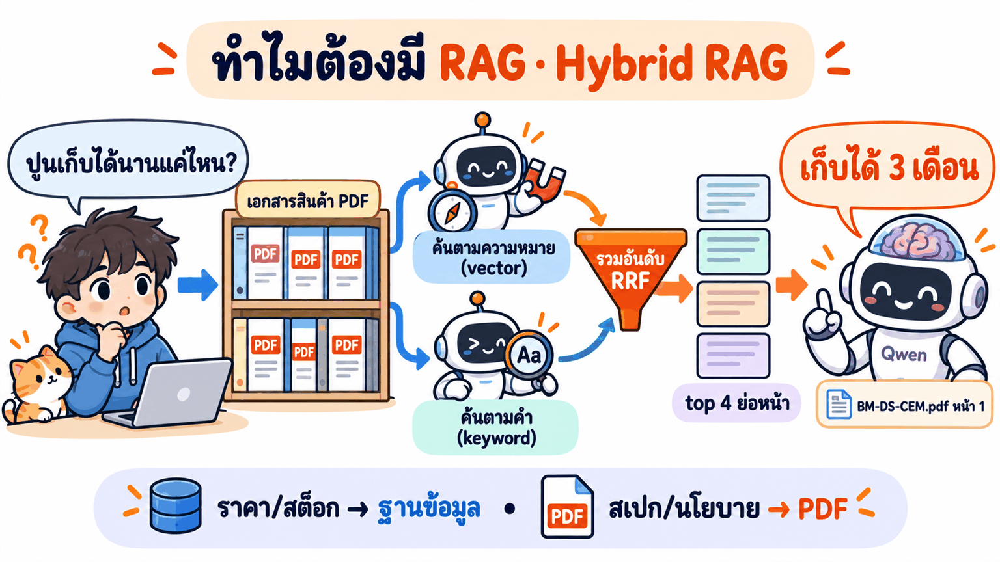
*ภาพแนวคิด (Imagegen ด้วย cyolo)*

ข้อมูลร้านมี 2 แบบ ใช้คนละวิธี:

| ข้อมูล | ตัวอย่าง | เก็บที่ | บอทได้ข้อมูลอย่างไร |
|---|---|---|---|
| **มีโครงสร้าง** (ตัวเลขเป๊ะ) | ราคา สต็อก ค่าส่ง คูปอง | ตารางใน PostgreSQL | SQL ค้นแล้วใส่ในพรอมต์ (PDF **ไม่มี**ราคา/สต็อก) |
| **เอกสาร** (ข้อความยาว) | สเปก มอก. วิธีใช้ การรับประกัน นโยบายคืนของ | PDF 6 ไฟล์ ~127 หน้า | **RAG**: ค้นเฉพาะย่อหน้าที่เกี่ยว แล้วแนบพร้อมแหล่งอ้างอิง |

ใส่ PDF ทั้งหมดในพรอมต์ไม่ได้ (ยาวเกิน · ช้า · แพง · โมเดลหลง) → RAG แบ่งเป็น 2 ช่วง:

| 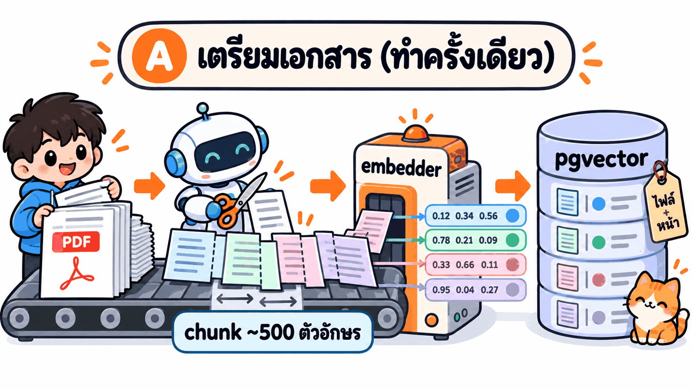 | 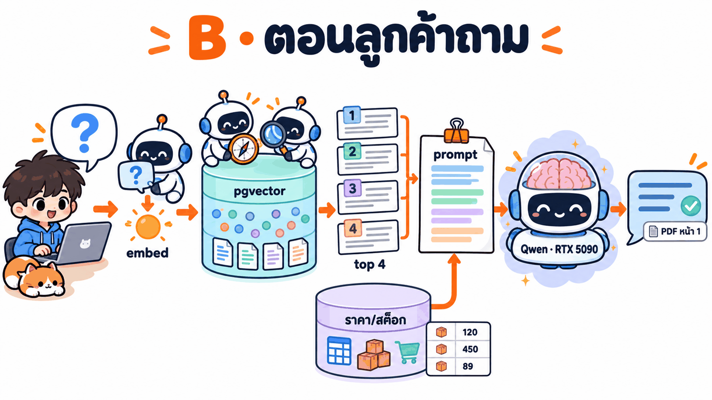 |
|---|---|
| **ช่วง A เตรียมเอกสาร** (ครั้งเดียว · `rag-worker`) — รอบนี้ 6 ไฟล์ได้ **930 chunk** | **ช่วง B ตอนลูกค้าถาม** (ทุกคำถาม · `chat-worker`) |

**การค้นมี 2 วิธี และแต่ละวิธีพลาดคนละแบบ:**

| 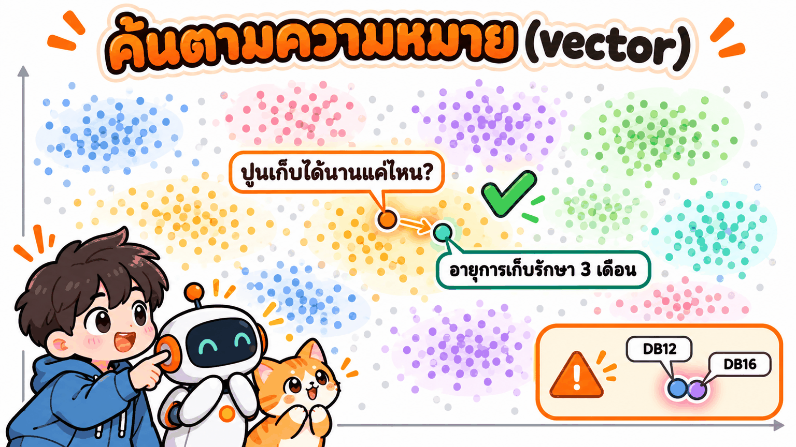 | 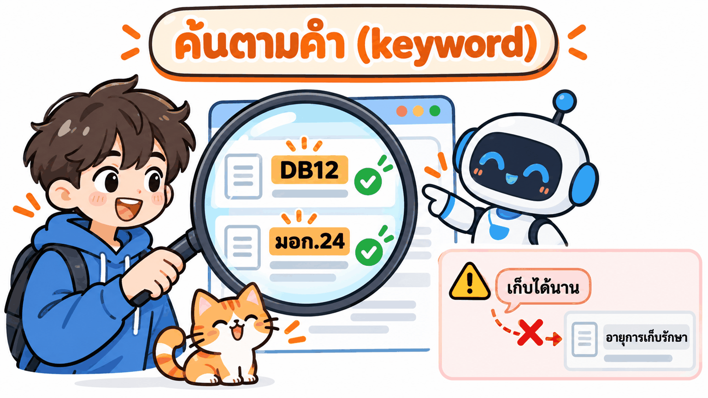 |
|---|---|
| **vector** — ✅ คำต่างแต่ความหมายเดียวกัน · ⚠️ รหัสที่หน้าตาคล้ายกัน (`DB12` vs `DB16`) | **keyword** — ✅ รหัส มาตรฐาน ตัวเลข ตรงตัวแม่น · ⚠️ ใช้คำต่างกันนิดเดียวก็หาไม่เจอ |

**Hybrid RAG** = ค้นทั้ง 2 วิธีพร้อมกัน แล้วรวมอันดับด้วย **RRF (Reciprocal Rank Fusion)**:

$$\mathrm{RRF}(d) = \sum_{m \in \{\text{vector},\,\text{keyword}\}} \frac{1}{60 + \mathrm{rank}_m(d)}$$

- ใช้แค่**อันดับ** ไม่ใช้คะแนนดิบ → ไม่ต้องปรับสเกลคะแนนของ 2 วิธีให้เท่ากัน · ย่อหน้าที่ติดอันดับดีใน**ทั้งสอง**รายการชนะ
- เวกเตอร์: `intfloat/multilingual-e5-small` (384 มิติ · CPU) · เก็บใน pgvector (HNSW + cosine) · ทั้งหมดเป็น SQL ในฐานข้อมูลเดียว

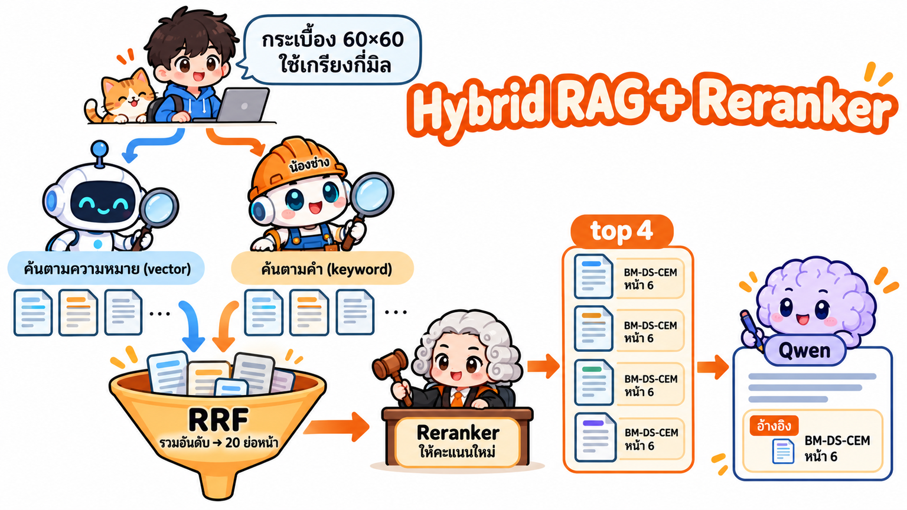
*ภาพแนวคิด (Imagegen ด้วย cyolo)*

**ใหม่ใน v3 — reranker:** RRF ดึงมา **20** ย่อหน้า แล้ว `bge-reranker-v2-m3` (GPU-3) อ่าน**คำถามคู่กับย่อหน้าทีละคู่** ให้คะแนนใหม่ เหลือ **4** ย่อหน้าที่ดีที่สุดส่งให้ Qwen · ตัวค้นแบบเวกเตอร์ "ย่อ" คำถามเป็นจุดเดียวก่อนเทียบ ส่วน reranker อ่านทั้งคู่พร้อมกัน จึงแม่นกว่าแต่ช้ากว่า → ใช้กับแค่ 20 ย่อหน้า (0.22 วิ)

📤 **ผลจริงจากการประเมิน (ขั้น ⑧, 169 คำถามจาก PDF):** หน้าที่ถูกอยู่ใน 4 ย่อหน้า **80.8% → 95.4%** · ตอบถูก **84.0% → 91.7%** เมื่อเปิด reranker

### A5 · ถามด้วยเสียง → ตอบด้วยเสียง

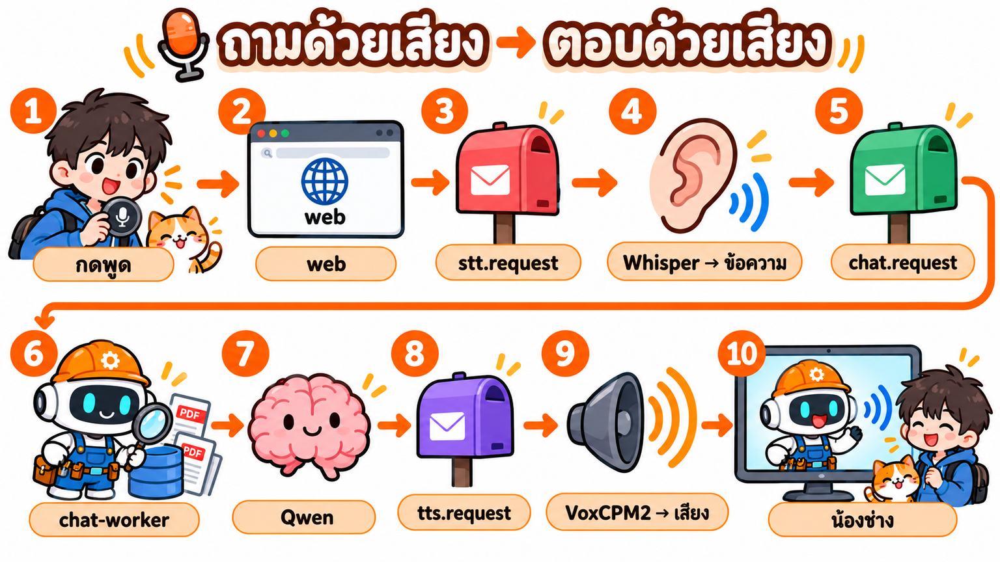
*ภาพแนวคิด (Imagegen ด้วย cyolo)*

| ขั้น | โมเดล | ผลจริง (Vast.ai RTX 4090) |
|---|---|---|
| 👂 ฟัง | **faster-whisper large-v3** (fp16) — เลือกเพราะ CER ไทยดีกว่า turbo 5.5 จุด | ถอดคลิป 5 วิ ใช้ **~0.5–0.7 วิ** · ไฟล์ทดสอบ V01–V10 ผิดเฉลี่ย **CER 0.058** (5.8% ของตัวอักษร) |
| 🗣️ พูด | **VoxCPM2** โคลนเสียงน้องช่าง (ไทย + อังกฤษ) | ประโยคไทย 1 ประโยค **~2.9 วิ** |
| ⏱️ ครบวง | หยุดพูด → ได้ยินคำตอบ | p50 **3.1–3.8 วิ** ที่ผู้ใช้ 1–4 คน (คำตอบซ้ำได้เสียงจาก cache) · บทสนทนาเสียง 4 รอบที่ต้องสร้างเสียงใหม่ทุกรอบ: **5.7 / 9.4 / 6.4 / 6.8 วิ** |

> 🐞 **บทเรียนจริง:** Whisper ตั้ง `compression_ratio_threshold=2.4` ไว้สำหรับภาษาละติน — ข้อความไทย (UTF-8 3 ไบต์/ตัว) เกินค่านี้เองตามธรรมชาติ Whisper เลยคิดว่า "พูดวนซ้ำ" แล้วถอดใหม่ → ช้า 2 เท่า · AI แก้เป็น 3.3 สำหรับไทย · และ Whisper เขียน "สองจุดห้า" เป็น "2.5" → ต้องแปลงตัวเลขก่อนวัด CER (ไม่งั้นคะแนนผิดเกินจริง)

### A6 · เว็บ 3D + มาสคอต "น้องช่าง"


*ภาพแนวคิด (Imagegen ด้วย cyolo)*

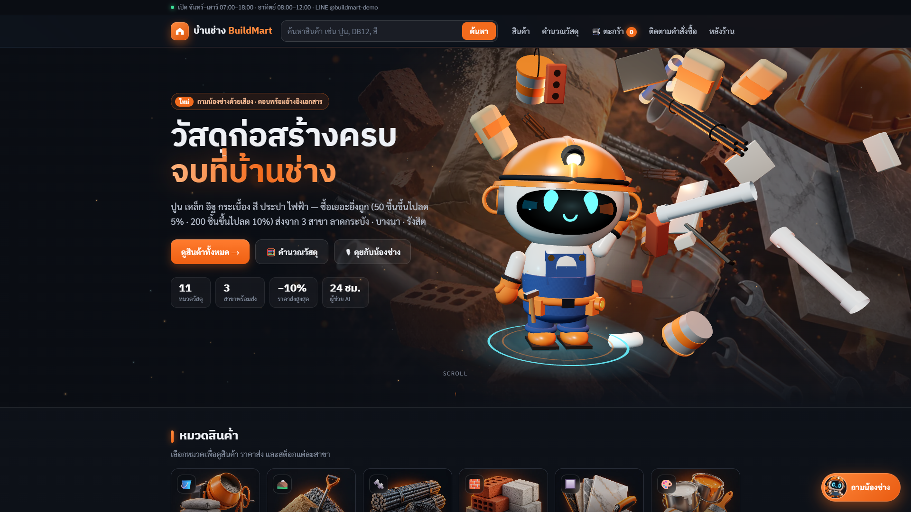
*ภาพจริง: หน้าแรก (Three.js) · ไม่มี WebGL → แสดงรูปนิ่งแทนเอง (เคส D03)*

| 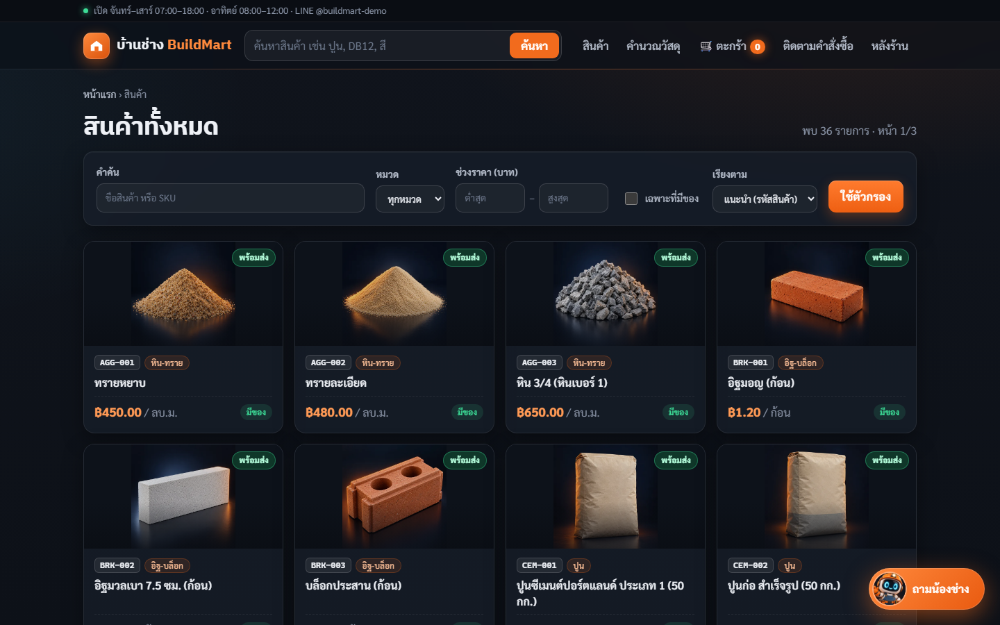 | 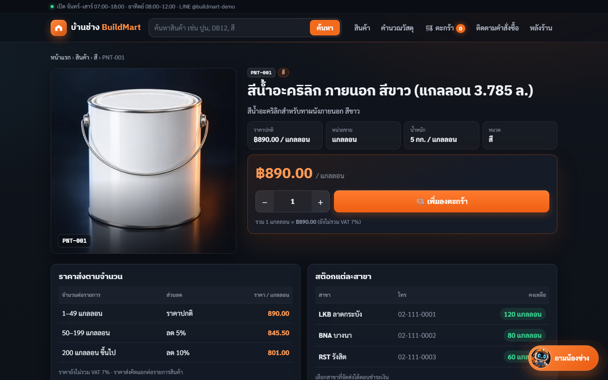 |
|---|---|
| รายการสินค้า (รูปสร้างด้วย cyolo) | หน้าสินค้า: ราคาส่ง 3 ขั้น + สต็อก 3 สาขา |
| 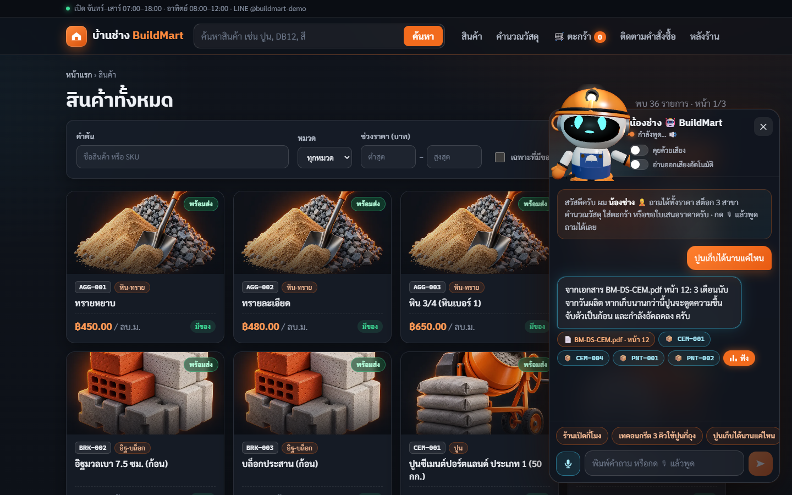 | 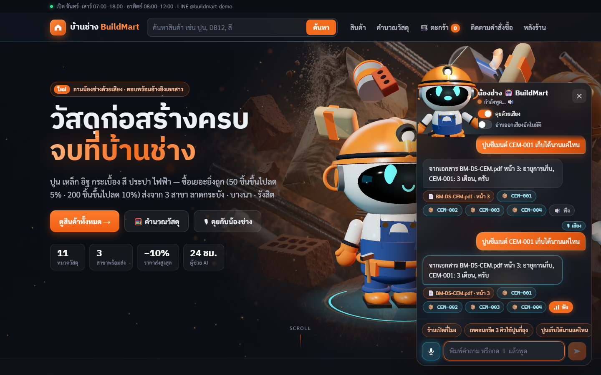 |
| แชท: มาสคอต "กำลังพูด" · ป้าย 📄 ไฟล์ · หน้า · ปุ่ม 🔊 ฟัง | โหมด "คุยด้วยเสียง": ถามด้วยไมค์ → ตอบ → เล่นเสียงเอง (ป้าย 🎙) |

### A7 · เอกสาร PDF + ไฟล์เสียงทดสอบ (ให้มาแล้ว ไม่ต้องสร้างเอง)

[`documents/`](documents/) = แหล่งข้อมูลของ RAG · ห้ามแก้ · **ไม่มีราคา/สต็อก** (อยู่ใน DB เท่านั้น) · มีตารางที่อ่านยาก: หัว 2–3 ชั้น · เซลล์รวม · ตารางยาวข้ามหน้า · เชิงอรรถ

| ไฟล์ | หน้า | เรื่อง | chunk (ingest จริง) |
|---|---|---|---|
| [BM-DS-CEM.pdf](documents/BM-DS-CEM.pdf) | 22 | ปูนและคอนกรีต: มอก. กำลังอัด การเก็บ การบ่ม อัตราปูนกาว (หัว 2 ชั้น) | 173 |
| [BM-DS-STL.pdf](documents/BM-DS-STL.pdf) | 20 | เหล็กเสริม: SD40/SR24 มอก. ระยะทาบ 40 เท่า | 152 |
| [BM-DS-PNT.pdf](documents/BM-DS-PNT.pdf) | 22 | สี: รับประกัน เวลาทาเที่ยวสอง รองพื้นผนังปูนใหม่ | 156 |
| [BM-DS-TIL.pdf](documents/BM-DS-TIL.pdf) | 21 | กระเบื้อง: ดูดซึมน้ำ กันลื่น ผนัง/พื้น ยาแนว | 134 |
| [BM-DS-ELC-PIP.pdf](documents/BM-DS-ELC-PIP.pdf) | 22 | ไฟฟ้าและประปา: สาย THW กับเบรกเกอร์ ท่อ PVC | 176 |
| [BM-POLICY.pdf](documents/BM-POLICY.pdf) | 20 | นโยบายร้าน: คืนสินค้า 7 วัน แต้มสมาชิก ใบเสนอราคา | 139 |

[`test-fixtures/voice/`](test-fixtures/voice/) = เสียงลูกค้า 10 ไฟล์ (V01–V10 · สร้างด้วย voice design ของ VoxCPM2) ใช้ทดสอบ Whisper · ไมค์ปลอมในเพลย์ลิสต์ · บทสนทนาเสียงในการประเมิน — ข้อความอยู่ใน [`questions.json`](test-fixtures/voice/questions.json) เช่น V01 "ปูนซีเมนต์ CEM-001 เก็บได้นานแค่ไหน" · V07 "สายไฟ THW สองจุดห้า ใช้คู่กับเบรกเกอร์กี่แอมป์" · V08 (อังกฤษ) "What is the warranty of the exterior paint?"

---

## ส่วน B · วางแผนจาก requirement (~3 นาที · Claude Code บน Windows)

> 🖥️ เปิด **Claude Code ที่โฟลเดอร์นี้** (`04_Multi_Agent_Orchestra`) แล้ววางพรอมต์ทีละกรอบ — เหมือน [LAB 04.3 DAG Planner](../02_DAG_Planner/readme.md) แต่โจทย์คือ BuildMart v3 ทั้งระบบ
> AI = **สมอง** (อ่าน requirement แตกงาน) · `tools/planner.py` = **มือ** (คิด rank · จำลองเวลา · วาดภาพ ไม่ใช้โทเคน) · `tools/orch.py` = อัลกอริทึม **KC-QUEST** เลือกบัญชีให้งาน

### ขั้นที่ 0 · ตรวจเครื่อง + ดูบัญชี

💬 วาง:

```text
รัน python tools/planner.py doctor แล้วสรุปเป็นภาษาไทยสั้น ๆ ว่าเครื่องพร้อมไหม ถ้ามี ❌ หรือ ⚠️ ให้บอกวิธีแก้ทีละข้อ
```

📤 **ผลจริง** (23 ต.ค. 2026):

```text
สรุป: เครื่องพร้อมใช้ ✅ ทุกรายการผ่าน ไม่มี ❌ หรือ ⚠️
✅ Python 3.13.5 · ✅ orch.py (KC-QUEST) · ✅ timezone · ✅ ตัวแปลงภาพเป็น png
✅ container multi-account-devtool รันอยู่ → อ่านโควตาจริงได้
👥 บัญชีที่ล็อกอิน: yolo1 86% · yolo2 98% · yolo3 99% · cyolo1 96%
```

### ขั้นที่ 1 · พรอมต์ ① — อ่าน BUILDMART.md แล้วแตกเป็น DAG

💬 วาง (แก้ได้แค่บรรทัด `ชื่อแผน`):

```text
โจทย์: อ่าน requirement ทั้งหมดจาก BUILDMART.md (เว็บร้านวัสดุก่อสร้าง 3D + มาสคอตน้องช่าง + RabbitMQ + Hybrid RAG + reranker จาก PDF ใน documents/ + ถามด้วยเสียง Whisper + ตอบด้วยเสียง VoxCPM2 + ประเมิน RAG + load test + GPU 3 ใบบน Vast.ai)
ชื่อแผน: buildmart

ช่วยแตกโจทย์นี้เป็นกราฟงาน (DAG) ยังไม่ต้องเขียนโค้ด ทำแค่แผน
1. แตกเป็นงานย่อย 18–28 งาน แต่ละงานมี id (T01, T02, …) · ชื่อสั้น ๆ · ขนาด S/M/L (ประเมินโทเคน 0.6 / 1.5 / 3 ล้าน · ถ้าใหญ่กว่า L ต้องแบ่ง) · area (backend, frontend, 3d, chat, rag, mq, voice, eval, load, infra, test, image) · owns (ไฟล์/โฟลเดอร์ที่งานนี้เป็นเจ้าของ ไม่ทับกัน)
2. ใส่ depends_on เฉพาะงานที่ต้องเสร็จก่อนจริง ๆ: งานแรกคือโครงโปรเจกต์ + docker compose + DB + RabbitMQ · มีงาน VAST 3 งานที่ไม่ต้องรองานไหน (ใส่ "only": "yolo", "no_handoff": true): GPU-1 RTX 5090 Qwen · GPU-2 RTX 4090 Whisper · GPU-3 RTX 4090 VoxCPM2 + reranker · งานรูปให้ cyolo ทำ (ใส่ "only": "cyolo") · งานสุดท้ายคือรวมระบบ + ทดสอบ Playwright ทุกเคส ซึ่งรันคนเดียว (ใส่ "exclusive": true)
3. คิด rank ย้อนจากงานสุดท้าย: rank(งาน) = ขนาดของงานนั้น + rank ที่มากที่สุดของงานที่รอมันอยู่
4. สายวิกฤต = เส้นจากงานแรกถึงงานสุดท้ายที่ rank รวมยาวที่สุด
5. บันทึกเป็น out/<ชื่อแผน>/tasks.json แล้ววาดภาพด้วย tools/planner.py คำสั่ง dag แบบ --png โหมดสอน --mode teach (ถ้ายังไม่รู้วิธีใช้ ให้รัน python tools/planner.py --help ก่อน)

ตอบเป็นภาษาไทยสั้น ๆ: ลิงก์ภาพ out/<ชื่อแผน>/dag.png และ rank-example.png (ลิงก์แบบ relative) · ตาราง งาน | ชื่อ | ขนาด | ต้องรอ | rank · สายวิกฤตพร้อมเหตุผล 1 บรรทัด · ตารางคิด rank ย้อนจากงานสุดท้ายไปตามสายวิกฤต 4–5 แถว
```

📤 **ผลจริง** (78 วิ): ได้ **27 งาน** · กราฟไม่มีวงวน


| งาน | ชื่อ | ขนาด | ต้องรอ | rank |
|---|---|---|---|---|
| **T01** | โครงโปรเจกต์ + compose + DB + RabbitMQ | M | – | **18.6** |
| T02 · T03 · T04 | VAST GPU-1 Qwen · GPU-2 Whisper · GPU-3 VoxCPM2 + rerank (`only: yolo`) | M | – | 4.5 |
| T05 | รูปทั้งเว็บ (`only: cyolo`) | M | – | 7.5 |
| **T06** | ไลบรารีคิว + topology (1 คิวต่อ GPU) | S | T01 | **17.1** |
| T07 | mock-llm + mock ai-box | M | T01 | 15 |
| **T08** | embedder + rag-worker อ่าน PDF | M | T06 | **16.5** |
| **T09** | Hybrid search + rerank 20→4 | M | T08 | **15** |
| **T10** | chat-worker (LLM · จำ 10 ข้อความ · tag · cite) | L | T06, T07, T09 | **13.5** |
| T11 · T12 | stt-worker · tts-worker | S | T06, T07 | 11.1 |
| T13 | notify-worker + order.events | S | T06 | 3.6 |
| T14 | web API ร้าน | L | T01, T06 | 13.5 |
| T15 · T16 · T17 | หน้าสินค้า + คำนวณ · ตะกร้า/ใบเสนอราคา · หลังร้าน | L/M/M | T14 (+T08) | 7.5 |
| **T18** | API แชท SSE + /api/voice + /api/tts | M | T14, T10, T11, T12 | **10.5** |
| **T19** | หน้าต่างแชท + 🔊 + ไมค์ + โหมดคุยด้วยเสียง | L | T18 | **9** |
| T20 | ฉาก 3D หน้าแรก + fallback | M | T15, T05 | 4.5 |
| **T21** | มาสคอต 3D น้องช่าง + ขยับปาก | L | T19, T05 | **6** |
| T22 · T23 | ชุดประเมิน RAG · dashboard /admin/eval | L · M | T10 · T22, T17 | 7.5 · 4.5 |
| T24 · T25 | load test 1→32 คน · dashboard /admin/load | M · S | T18 · T24, T17 | 5.1 · 3.6 |
| T26 | Playwright spec + ไฟล์เสียงทดสอบ | L | T16, T17, T19 | 6 |
| **T27** | รวมระบบ + ทดสอบทุกเคส 🔒 | L | T02 T03 T04 T13 T20 T21 T23 T25 T26 | **3** |

**สายวิกฤต:** T01 → T06 → T08 → T09 → T10 → T18 → T19 → T21 → T27 (18.6 ล้านโทเคน) — แชทต้องรอ RAG ทั้งสาย (อ่าน PDF → hybrid → rerank) แล้วยังต่อด้วยหน้าแชทและมาสคอตที่ขยับปากตามเสียง · ต่างจาก v2 ที่สายวิกฤตอยู่ฝั่งร้านค้า (ตะกร้า → คำสั่งซื้อ)

<details><summary>คิด rank ย้อนจากงานสุดท้ายตามสายวิกฤต (กดเพื่อดู)</summary>

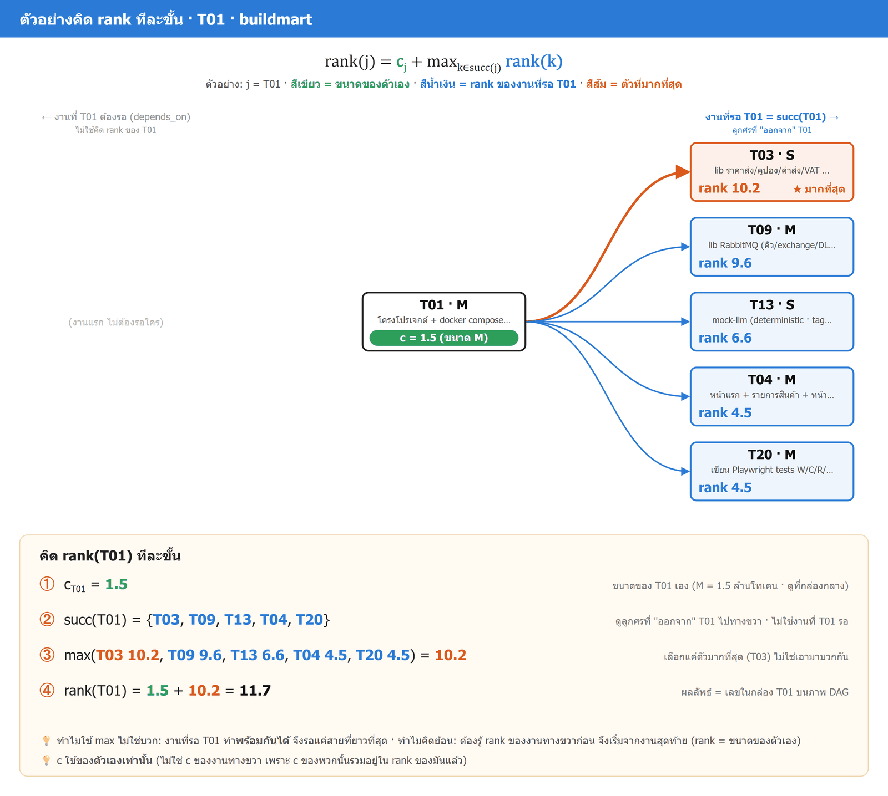

| ลำดับ | งาน | สูตร | rank |
|---|---|---|---|
| 1 | T27 | 3 (ไม่มีงานไหนรอ) | 3 |
| 2 | T21 | 3 + T27 3 | 6 |
| 3 | T19 | 3 + max(T21 6, T26 6) | 9 |
| 4 | T18 | 1.5 + max(T19 9, T24 5.1) | 10.5 |
| 5 | T10 | 3 + max(T18 10.5, T22 7.5) | 13.5 |

</details>

### ขั้นที่ 2 · พรอมต์ ② — แจกงานให้บัญชี (KC-QUEST) + ไทม์ไลน์

💬 วาง (แก้ 3 บรรทัดแรกได้):

```text
ชื่อแผน: buildmart
จำนวน agent สูงสุด: 12
บัญชี: yolo1 yolo2 yolo3 cyolo1

ใช้ out/<ชื่อแผน>/tasks.json แจกงานให้บัญชีแล้ววาดไทม์ไลน์ ด้วย tools/planner.py คำสั่ง plan แบบ --png และส่งรายชื่อบัญชีด้วย --accounts (ถ้ายังไม่รู้วิธีใช้ ให้รัน python tools/planner.py --help ก่อน)
กติกาการแจกงาน (KC-QUEST):
- งานที่ rank สูง (อยู่บนสายวิกฤต) ได้เลือกบัญชีก่อน
- บัญชีที่โควตาใกล้รีเซ็ตได้ใช้ก่อน เพราะถ้าไม่ใช้ โควตาจะหายไปเปล่า ๆ
- ให้งานกับบัญชีที่มีโควตาพอทำจนจบเท่านั้น (ไม่ใส่ % หลังชื่อบัญชี = ใช้โควตาจริงจาก container)
- บัญชีหนึ่งรับได้หลายงานพร้อมกัน (yolo ≤ 4 · cyolo ≤ 3) · cyolo เขียนโค้ดได้ด้วย ไม่ได้ทำแค่รูป
- ทำพร้อมกันได้ไม่เกินจำนวน agent สูงสุด · งานที่รันคนเดียวต้องรอให้งานอื่นเสร็จก่อน

ตอบเป็นภาษาไทยสั้น ๆ: ลิงก์ภาพ out/<ชื่อแผน>/gantt.png และ dag.png (ลิงก์แบบ relative) · ตาราง งาน | บัญชี | เริ่ม–จบ (นาที) · 3 ตัวเลข (ทำพร้อมกันสูงสุด / เวลารวม / เร็วกว่าทำทีละงานกี่เท่า) · เหตุผลที่บัญชีได้งาน 2–3 ตัวอย่าง
```

📤 **ผลจริง** (43 วิ): แจกครบ 27 งาน (โควตาจริงจาก container: yolo1 83% · yolo2 98% รีเซ็ต 26/10 · yolo3 99% รีเซ็ต 27/10 · cyolo1 96% รีเซ็ต 30/10)


| ตัวเลข | ค่า |
|---|---|
| ทำพร้อมกันสูงสุด | **4** (เพดาน 12 — งานส่วนใหญ่ต้องรองานก่อนหน้า กราฟแตกกิ่งได้แค่นี้) |
| เวลารวม (ประมาณ) | **168 นาที** |
| ถ้าทำทีละงาน | ~400 นาที → เร็วขึ้น **~2.4 เท่า** |

เหตุผลที่ KC-QUEST เลือก (จาก `out/buildmart/PLAN.md`):
- **T01 → yolo2:** rank สูงสุด (18.6) ได้เลือกก่อน · yolo2 รีเซ็ตเร็วสุด ความเร่งด่วน U = 0.266 → 40.2 คะแนน ชนะ yolo3 (37.9) → สายวิกฤตเกือบทั้งเส้นไปอยู่ที่ yolo2 เพื่อใช้โควตาให้หมดก่อนรีเซ็ต
- **T09 → yolo3:** นาทีที่ 30 yolo2 ยังทำ T14 อยู่ (load สูง) · yolo3 ว่างและรีเซ็ตเร็วอันดับ 2 → 32.8 ชนะ 31.6
- **T27 → cyolo1:** งานรันคนเดียว เริ่มนาทีที่ 130 · cyolo1 โควตาเหลือ 96% และเขียนโค้ดได้ → 19.7 ชนะ yolo1 19.3

---

## ส่วน C · ทีม AI สร้างระบบจริงตามแผน (AI ทำเอง · โหมด mock ไม่เสียเงิน)

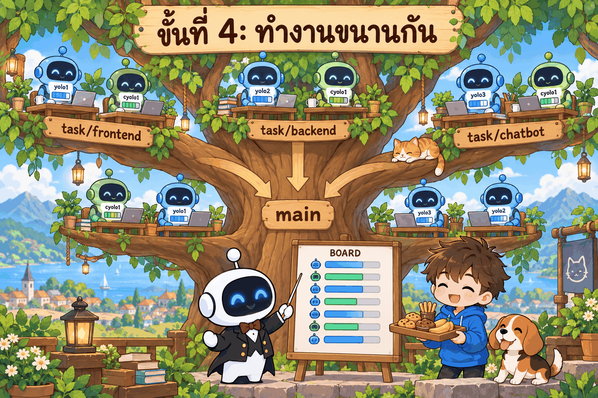
*ภาพแนวคิด (Imagegen ด้วย cyolo)*

แผนจากส่วน B ยังเป็นแค่ "กระดาษ" — ขั้นนี้ให้**ตัวคุมวง (orchestrator)** เอา `out/buildmart/tasks.json` ไปสั่งทีมทำจริง:

| ส่วน | คือใคร | ทำอะไร | ใช้โทเคน? |
|---|---|---|---|
| 🧠 **สมอง** | AI บัญชีที่โควตาเหลือมากสุด ทำตาม [ORCHESTRA_RECIPE.md](ORCHESTRA_RECIPE.md) | เติมแผนให้ครบ (ไฟล์ที่แต่ละงานเป็นเจ้าของ · สัญญากลาง `_shared.md`) · ตรวจผล · ตัดสินใจเมื่อมีปัญหา | ใช้ |
| 🦾 **มือ** | [tools/orch.py](tools/orch.py) | วัดโควตา · **KC-QUEST** เลือกบัญชี · เปิด worker · ดูโทเคนสด · ย้ายงาน · merge | **ไม่ใช้** |
| 👷 **worker** | `yoloN -p` / `cyoloN exec` (สูงสุด 12 ตัวพร้อมกัน) | เขียนโค้ดเฉพาะงานตัวเองใน git worktree แยก · commit ทุกข้อย่อย | ใช้ |
| 🧪 **dev infra กลาง** | `orch.py infra up` | Postgres+pgvector · RabbitMQ · embedder ให้ทุก worker ทดสอบคิว/RAG ได้โดยไม่ต้องรันทั้งระบบ | ไม่ใช้ |

### ขั้นที่ 3 · พรอมต์ ③ — สั่งทีมสร้างตามแผน (โหมด mock ไม่เสียเงิน)

🖥️ JupyterLab (`http://localhost:8886/lab`) → **File → New → Terminal** (อยู่ที่ `/workspace`) → พิมพ์ `yolo1` → 💬 วาง:

```text
ใช้ skill yolo และ cyolo ทำตาม 00_setup/04_Skill_Setup/04_Multi_Agent_Orchestra/ORCHESTRA_RECIPE.md
PROBLEM=BUILDMART.md PLAN=out/buildmart MAX_AGENTS=12 BACKEND=mock
```

👀 ดูความคืบหน้าสด: JupyterLab → `00_setup/04_Skill_Setup/04_Multi_Agent_Orchestra/my_buildmart/BOARD.md` (คลิกขวา → Open With → Markdown Preview)

> งาน VAST (T02–T04) ถูกข้ามในโหมด `BACKEND=mock` — เปิด GPU จริงเป็นพรอมต์ ④ ⑤ แยก เพื่อไม่ให้เสียเงินระหว่างที่ทีมยังสร้างอยู่

📤 **ผลจริง** (23 ต.ค. 2026):

<!-- P3_RESULT: กำลังรันจริงอยู่ — เติมเมื่อจบ:
- ครบ __/27 งาน · Playwright (mock) ผ่าน __/62 · เวลารวม __ นาที (วางแผน __ + สร้างจริง __) เทียบแผน Gantt 168 นาที
- ภาพแผนเทียบเวลาจริง → image/real-plan-vs-actual.png (สร้างใหม่จาก my_buildmart/orchestra/events.jsonl เทียบ out/buildmart/plan.json)
- ตาราง: worker พร้อมกันสูงสุด · ย้ายงาน/โควตาหมด/merge conflict · โทเคนจริงต่องาน · ผลทดสอบต่อกลุ่ม W C R Q T M V D E L
- ปัญหาที่ทีมแก้เองระหว่างรวมระบบ (T27) + บั๊กที่เจอ
-->

ผลลัพธ์ทั้งหมดอยู่ที่ `my_buildmart/` (ไม่เก็บใน git): `app/` โค้ด + `TEST_REPORT.md` + `test-gifs/` + `test-videos/` · `BOARD.md` · `orchestra/REPORT.md` (งาน × บัญชี × โทเคน)

<details><summary>KC-QUEST คืออะไร (สรุปสั้น · กดเพื่อดู)</summary>


**KC-QUEST = KMITL–Chanwanich Quota-Urgency Expiry-aware Scheduling Technique** — ตอบคำถามเดียว: "งานนี้ควรให้บัญชีไหนทำ" · ใช้ทั้งใน `planner.py` (วางแผน) และ `orch.py` (สั่งงานจริง) เป็นโค้ดชุดเดียวกัน

| ขั้น | คำถาม | หลักการ |
|---|---|---|
| ① จัดลำดับ | งานไหนได้เลือกก่อน | rank สูง (สายวิกฤต) ก่อน · งานที่มีบัญชีให้เลือกน้อยก่อน |
| ② กรอง | บัญชีไหนทำจบได้ | โควตาที่เหลือ (5 ชม. + สัปดาห์) ต้องพอกับขนาดงาน × เผื่อ |
| ③ ให้คะแนน | บัญชีไหนเหมาะสุด | $S=0.40U+0.20F+0.15R+0.15V-0.10L$ (ใกล้รีเซ็ต · พอดีงาน · ที่ว่าง 5 ชม. · ความเร็ว · โหลด) |
| ④ เลือก + จอง | แล้วยังไงต่อ | ให้คะแนนสูงสุด แล้วจองโควตาทันที |
| ⑤ ⑥ ✦ | ระหว่างทำ | คาดการณ์ว่าจะเกินเพดานไหม → ย้ายงาน · เรียนรู้ % ต่อโทเคน · ตัวคุมวงใกล้หมด → ส่งไม้ |

อธิบายเต็มทีละสมการพร้อมตัวเลขจริง: [ALGORITHM.md](ALGORITHM.md) · unit test: `python3 tools/test_kcquest.py` · จำลองเทียบวิธีอื่น: [tools/sim.py](tools/sim.py)

</details>

---

## ส่วน D · เปิด AI บน Vast.ai 3 ใบ — ให้ AI อ่าน GitHub แล้วติดตั้งเอง (เสียเงินจริง)


*ภาพแนวคิด (Imagegen ด้วย cyolo)*

LAB 04.1 มี "สูตร" บอก AI ทีละคำสั่ง · LAB นี้**ไม่มีสูตร** — ให้ AI ไปอ่าน README ของแต่ละโปรเจกต์บน GitHub เองเหมือนวิศวกรที่ได้ repo ใหม่มา แล้วตัดสินใจเองว่าต้องติดตั้งอะไร เลือก image ไหน ตั้ง flag อะไร · พรอมต์ ④ และ ⑤ **วางพร้อมกันได้** (เปิด 2 Terminal คนละบัญชี) เพราะไม่ยุ่งเครื่องกัน


*ภาพจริง: หน้า Instances ของ Vast.ai ระหว่างขั้น ⑧ ประเมิน RAG — ① รุ่น GPU ② ป้าย ③ VRAM ที่ใช้จริง ④ 5090 ทำงาน 100% 81°C ⑤ ราคาต่อชั่วโมง*

### ขั้นที่ 4 · พรอมต์ ④ — GPU-1: เช่า RTX 5090 + ติดตั้ง NInfer + Qwen จากศูนย์

🖥️ JupyterLab Terminal ที่ `/workspace` → `yolo1` → 💬 วาง:

```text
ใช้ skill vastai เปิด "สมอง" ให้แชทบอท BuildMart แบบเริ่มจากศูนย์ (ไม่มีสคริปต์สำเร็จรูป):
1. เช่า RTX 5090 1 เครื่อง ป้าย bm-qwen-5090 เพดาน $1.20/ชม. เน็ตดาวน์โหลด ≥ 1000 Mbps · disk ≥ 90 GB · reliability ≥ 0.98 · ไม่เอาเครื่องในจีน · driver รองรับ CUDA ≥ 13.4 · เปิดพอร์ต 8080 · อย่ากรองเข้มจนไม่เหลือ offer · ค้าง loading > 10 นาทีให้ลบแล้วเช่าใหม่ (ถ้ามีเครื่องป้ายนี้ running อยู่แล้วให้ใช้ต่อ · ห้ามแตะเครื่องป้ายอื่น)
2. อ่านวิธีติดตั้งจาก GitHub https://github.com/Neroued/ninfer เอง (README + docs/serving.md) แล้ว build NInfer บนเครื่องนั้น
3. หาไฟล์โมเดล Qwen3.8-27B แบบ nvfp4 สำหรับ NInfer จาก Hugging Face ของ neroued แล้วดาวน์โหลด (ทำพร้อมกับ build ได้)
4. เปิด ninfer-serve แบบ OpenAI-compatible ที่พอร์ต 8080 ปิด thinking · max-context 16384 · รับพร้อมกัน 4 คน (KV cache ต้องพอทั้ง 4 คน) · ตั้ง API key สุ่มเอง (ห้ามพิมพ์ key บนจอ) · ตั้ง watchdog ที่เช็ก /health ทุก 10 วิ ถ้าล้ม 3 ครั้งติดให้สตาร์ต server ใหม่เอง
5. ทดสอบถามภาษาไทยจากนอกเครื่อง · วัดความเร็ว 1 คน และ 4 คนพร้อมกัน แล้วเขียน 3 บรรทัด LLM_BASE_URL / LLM_MODEL / LLM_API_KEY (ไม่มีเครื่องหมายคำพูด ไม่มี comment) ลงไฟล์ 00_setup/04_Skill_Setup/04_Multi_Agent_Orchestra/.env.vast
6. ทำให้จบในรอบเดียว (รอด้วย sleep + เช็คเป็นช่วง ห้ามจบไปก่อน) · ห้ามลบเครื่อง (จะใช้ต่อถึงขั้น ⑨) · สรุปตารางภาษาไทย: เครื่อง (GPU · $/ชม. · เน็ต · ประเทศ) · เวลาเช่า/build/โหลดโมเดล/เปิด server · VRAM จริง · ความเร็วตอบ (token/วินาที) · สิ่งที่ต้องแก้ระหว่างทาง
```

📤 **ผลจริง** (23 ต.ค. 2026 · ~8 นาทีตั้งแต่เช่าจนใช้ได้):

| หัวข้อ | ผล |
|---|---|
| เครื่อง | RTX 5090 32 GB · **$1.06/ชม.** · สเปน · image `nvidia/cuda:13.4.1-devel-ubuntu24.04` |
| โมเดล | `neroued/Qwen3.8-27B-nvfp4-NInfer` (23.7 GB) · build NInfer กับดาวน์โหลดโมเดลทำขนานกัน |
| VRAM จริง | **23.9 / 31.8 GB** |
| ความเร็ว | ถามทีละข้อ **~87 token/วินาที** · ยิงพร้อมกัน 4 รวม **~195 token/วินาที** |
| ความปลอดภัย | API key สุ่มบนเครื่อง ไม่แสดงบนจอ · ไม่ใส่ key → 401 |

**สิ่งที่ AI ต้องแก้เองระหว่างทาง** (จากรอบ v2 และรอบนี้ — นี่คือเหตุผลที่ให้อ่าน GitHub เอง):
1. repo ใช้ branch `master` ไม่ใช่ `main` (ลิงก์ไฟล์ได้ 404)
2. `--kv-capacity` ค่าเริ่มต้น = `--max-context` (16k) ซึ่งทั้ง 4 คนต้องแบ่งกัน → ตั้ง 65,536 (4 × 16k)
3. `--lm-head-draft` (ตาม README) ทำให้ภาษาไทยช้าลง → ถอดออก
4. ความเร็วต่างกันตามเครื่องที่ได้: รอบ v2 (เครื่องสหรัฐฯ) ~123 tok/s · รอบนี้ (สเปน) ~87 tok/s ด้วย flag เดียวกัน

> 🐞 **บทเรียนจริง — server ล่มกลาง load test:** ตอนยิงผู้ใช้จำลอง 32 คน (ขั้น ⑨) NInfer เริ่มตอบ `503 inference engine is unavailable` แล้ว**ไม่กลับมาเองอีกเลย ~35 นาที** · แชทบอทตอบ "ระบบ AI ขัดข้อง" ทุกข้อ (แต่ RabbitMQ ยังเก็บงานไว้ ไม่มีข้อความหาย) · แก้โดยสตาร์ตใหม่ + **watchdog** (สคริปต์เล็ก ๆ เช็ก `/health` ทุก 10 วิ ล้ม 3 ครั้งติด → สตาร์ตใหม่) — หลังจากนั้นยิง 32 คนซ้ำอีก 2 รอบไม่ล่มอีก · ของจริงบน production ต้องมี watchdog/healthcheck เสมอ → จึงเพิ่มข้อ 4 ในพรอมต์ด้านบน · สคริปต์อยู่ใน [`_solution/vast_qwen/README.md`](_solution/vast_qwen/README.md)

flag ที่ใช้จริง: `--max-context 16384 --kv-capacity 65536 --max-concurrency 4 --kv-dtype fp8 --spec mtp --draft-tokens 3 --no-thinking --api-key …` (เฉลยเต็มใน [`_solution/vast_qwen/README.md`](_solution/vast_qwen/README.md))

### ขั้นที่ 5 · พรอมต์ ⑤ — GPU-2 + GPU-3: เช่า RTX 4090 × 2 + Whisper + VoxCPM2 + reranker จากศูนย์

🖥️ JupyterLab Terminal ใหม่ที่ `/workspace` → `yolo2` (หรือบัญชีอื่น) → 💬 วาง:

```text
ใช้ skill vastai เปิด "หู" และ "ปาก" ให้แชทบอท BuildMart บน RTX 4090 2 เครื่อง แบบเริ่มจากศูนย์ (ไม่มีสคริปต์สำเร็จรูป · ห้ามเปิดโฟลเดอร์ _solution):
1. เช่า RTX 4090 2 เครื่อง ป้าย bm-stt-4090 และ bm-voice-4090 เพดาน $0.55/ชม. ต่อเครื่อง · เน็ตดาวน์โหลด ≥ 500 Mbps · disk ≥ 60 GB · reliability ≥ 0.98 · ไม่เอาเครื่องในจีน · image ที่มี PyTorch + CUDA 12.8 (เช่น pytorch/pytorch:2.9.1-cuda12.8-cudnn9-runtime) · เปิดพอร์ต 8090 · อย่ากรองเข้มจนไม่เหลือ offer · ค้าง loading > 10 นาทีให้ลบแล้วเช่าใหม่ (ถ้ามีเครื่องป้ายนี้ running อยู่แล้วให้ใช้ต่อ · ห้ามแตะเครื่องป้ายอื่น)
2. อ่านวิธีใช้จาก GitHub / Hugging Face เอง: faster-whisper https://github.com/SYSTRAN/faster-whisper · VoxCPM2 https://github.com/OpenBMB/VoxCPM · bge-reranker-v2-m3 https://huggingface.co/BAAI/bge-reranker-v2-m3 แล้วเขียน server FastAPI ตัวเดียวชื่อ ai-box ตาม API ใน BUILDMART.md ข้อ 4.6 (/health · /v1/audio/transcriptions · /v1/audio/speech · /v1/rerank · ทุก endpoint ยกเว้น /health ต้องมี Bearer key) เลือกโมเดลด้วย env MODELS: เครื่อง bm-stt-4090 = stt · เครื่อง bm-voice-4090 = tts,rerank · โหลดโมเดลตอนสตาร์ต
3. Whisper: เทียบ large-v3 กับ large-v3-turbo ด้วยเสียงไทย 00_setup/04_Skill_Setup/04_Multi_Agent_Orchestra/test-fixtures/voice/V01–V10 (ข้อความอยู่ใน questions.json) แล้วเลือกตัวที่ CER ต่ำกว่า · ให้ถอดคำขอที่มาพร้อมกันเป็น batch เดียว · เสียงน้องช่าง: ใช้ voice design ของ VoxCPM2 เป็นเสียงผู้ชายหนุ่มร่าเริง แล้วโคลนให้เป็นเสียงเดิมทุกครั้ง
4. สุ่ม AIBOX_API_KEY 1 ค่าใช้ทั้ง 2 เครื่อง (ห้ามพิมพ์บนจอ) · รัน server แบบ background ที่พอร์ต 8090 ทั้ง 2 เครื่องขนานกัน รอจน /health ok
5. ทดสอบจากนอกเครื่อง: ถอดเสียง V01–V10 (CER) · พูดไทย 1 + อังกฤษ 1 ประโยค · rerank คำถาม + 20 ย่อหน้า · ยิงพร้อมกัน STT 1/2/4/8/16 คลิป และ TTS 1/2/4 หาจำนวนพร้อมกันสูงสุดที่ STT p95 ≤ 2 วิ และ TTS p95 ≤ 4 วิ · VRAM จริงต่อเครื่อง
6. เขียน 4 บรรทัด STT_URL / TTS_URL / RERANK_URL / AIBOX_API_KEY (ไม่มีเครื่องหมายคำพูด ไม่มี comment) ลงไฟล์ 00_setup/04_Skill_Setup/04_Multi_Agent_Orchestra/.env.aibox และเก็บโค้ด ai-box ไว้ที่ 00_setup/04_Skill_Setup/04_Multi_Agent_Orchestra/my_buildmart/vast_aibox/
7. ทำให้จบในรอบเดียว (รอด้วย sleep + เช็คเป็นช่วง ห้ามจบไปก่อน) · ห้ามลบเครื่อง · สรุปตารางภาษาไทย: เครื่อง (GPU · $/ชม. · ประเทศ) · เวลาเช่า/ติดตั้ง/โหลดโมเดล · VRAM · ความเร็ว · รับพร้อมกันได้กี่งาน · สิ่งที่ต้องแก้ระหว่างทาง
```

> 🆘 ทำไม่สำเร็จ → 💬 `ใช้ skill vastai ทำตาม 00_setup/04_Skill_Setup/04_Multi_Agent_Orchestra/_solution/vast_aibox/README.md` (เฉลยโค้ด ai-box ที่รันได้จริง)

📤 **ผลจริง** (23 ต.ค. 2026 · ใช้โค้ด ai-box ชุดเดียวกับเฉลย):

| หัวข้อ | 👂 bm-stt-4090 | 🗣️ bm-voice-4090 |
|---|---|---|
| เครื่อง | RTX 4090 24 GB · **$0.498/ชม.** · แคลิฟอร์เนีย สหรัฐฯ | RTX 4090 24 GB · **$0.498/ชม.** · แคลิฟอร์เนีย สหรัฐฯ |
| image | `pytorch/pytorch:2.9.1-cuda12.8-cudnn9-runtime` | เดียวกัน |
| โมเดล | faster-whisper **large-v3** fp16 | **VoxCPM2** (เสียงน้องช่าง) + **bge-reranker-v2-m3** |
| VRAM จริง | **4.7 / 24 GB** | **11.4 / 24 GB** |
| ความเร็ว | คลิปเสียง 5 วิ ถอดใน **~0.5–0.7 วิ** · CER ไฟล์ทดสอบ **0.058** | ประโยคไทย **~2.9 วิ** · rerank 20 ย่อหน้า p95 **0.22 วิ** |
| รับพร้อมกัน (ไหว) | 32 คลิป (หลังปรับ prefetch 8 · ดูขั้น ⑨) | TTS 2 งาน · rerank 16+ |

**สิ่งที่ต้องแก้ระหว่างทาง** (เจอจริงตอนสร้าง ai-box):
1. Whisper ภาษาไทยช้า 2 เท่าและผลสุ่ม → `compression_ratio_threshold` ต้อง 3.3 สำหรับไทย (ดู A5)
2. ยิง STT พร้อมกัน 2 คลิป p95 = 7.6 วิ → ทำ **micro-batch** (คำขอที่มาภายใน 25 ms รวมเป็น batch ≤ 8) เหลือ ~1.3 วิ ที่ 4 คลิป
3. VoxCPM2 ไม่ compile = RTF ~1.0 (พูด 5 วิ ใช้ 5 วิ) → `torch.compile` เหลือ RTF ~0.22 แต่ CUDA graphs ผูกกับ thread → โหลดและสร้างเสียงต้องอยู่ thread เดียวกัน
4. อย่ากรองเครื่องเข้มเกิน (direct port / duration / ค่าดาวน์โหลด) — รอบแรกไม่เหลือ offer ทั้งที่ตลาดมี 4090 ≤ $0.50 หลายเครื่อง

---

## ส่วน E · deploy ทั้งระบบบนเครื่องเรา (~5 นาที · Claude Code บน Windows)

### ขั้นที่ 6 · พรอมต์ ⑥ — deploy โหมด AI จริง (3 GPU)

💬 Claude Code ที่โฟลเดอร์นี้ (`04_Multi_Agent_Orchestra`) วาง:

```text
deploy ระบบ BuildMart ทั้งระบบบนเครื่องนี้ด้วย Docker Desktop (โหมด AI จริง · GPU 3 ใบบน Vast.ai):
1. โฟลเดอร์แอป = my_buildmart/app (ถ้าไม่มีหรือ build ไม่ผ่าน ให้ใช้ _solution/buildmart แทนและบอกฉัน)
2. copy ไฟล์ .env.vast และ .env.aibox (อยู่ในโฟลเดอร์นี้) ไปไว้ในโฟลเดอร์แอป · ห้ามแสดงค่าในไฟล์
3. docker compose -p buildmart up -d --build ในโฟลเดอร์แอป (ไม่ใส่ --profile mock) แล้วรอจนทุก service healthy
4. ตรวจ: chat-worker ต่อ Qwen จริง + rerank=on · stt-worker ใช้ whisper · tts-worker ใช้ voxcpm2 (ไม่ใช่ mock) · เอกสาร PDF 6 ไฟล์ ingest ครบ (ready) · ถาม "ปูนเก็บได้นานแค่ไหน" ผ่าน /api/chat ได้คำตอบพร้อมป้ายอ้างอิง · ส่งไฟล์ test-fixtures/voice/V01.wav ผ่าน /api/voice ได้ข้อความถูก
5. สรุปตาราง service | สถานะ | หน้าที่ · URL หน้าเว็บ · RabbitMQ UI · หลังร้าน
```

📤 **ผลจริง** (เฉลย `_solution/buildmart` · `.env.vast` + `.env.aibox` จากพรอมต์ ④ ⑤):
- log จริง: chat-worker `mode=ai model=qwen3.8-27b rerank=on` · stt-worker engine `whisper` · tts-worker engine `voxcpm2`
- PDF ingest ครบ 6 ไฟล์ = **930 chunk** (CEM 22 หน้า/173 · ELC-PIP 22/176 · PNT 22/156 · STL 20/152 · TIL 21/134 · POLICY 20/139)
- ถามเสียง V01–V10 ผ่าน `/api/voice`: ถอดเฉลี่ย **0.6 วิ/คลิป**
- บทสนทนาพิมพ์ 5 รอบเรื่อง DB12 ตอบถูกทุกรอบ (195 บาท → ทาบ ≥ 48 ซม. → รังสิต 400 เส้น → 200 เส้น @175.50 = 35,100 → ตะกร้า + รถ 6 ล้อ 1,500) · คำแรกขึ้นใน 1.1–2.1 วิ

| service | สถานะ | หน้าที่ |
|---|---|---|
| web | ✅ healthy | หน้าร้าน + API · http://localhost:3400 · หลังร้าน `/admin` (รหัส dev `admin1234`) · `/admin/eval` · `/admin/load` |
| rabbitmq | ✅ healthy | คิวกลาง · UI http://localhost:15672 (`guest/guest` ใช้ในเครื่องเท่านั้น) |
| chat-worker | ✅ healthy | แชทบอท → **Qwen (GPU-1)** + rerank (GPU-3) |
| stt-worker · tts-worker | ✅ healthy | ฟัง → **Whisper (GPU-2)** · พูด → **VoxCPM2 (GPU-3)** |
| rag-worker · embedder | ✅ healthy | PDF → chunk → เวกเตอร์ 384 มิติ (CPU) |
| notify-worker | ✅ healthy | ฟัง `order.events` → แจ้งเตือนหลังร้าน |
| db | ✅ healthy | PostgreSQL 16 + pgvector |

| 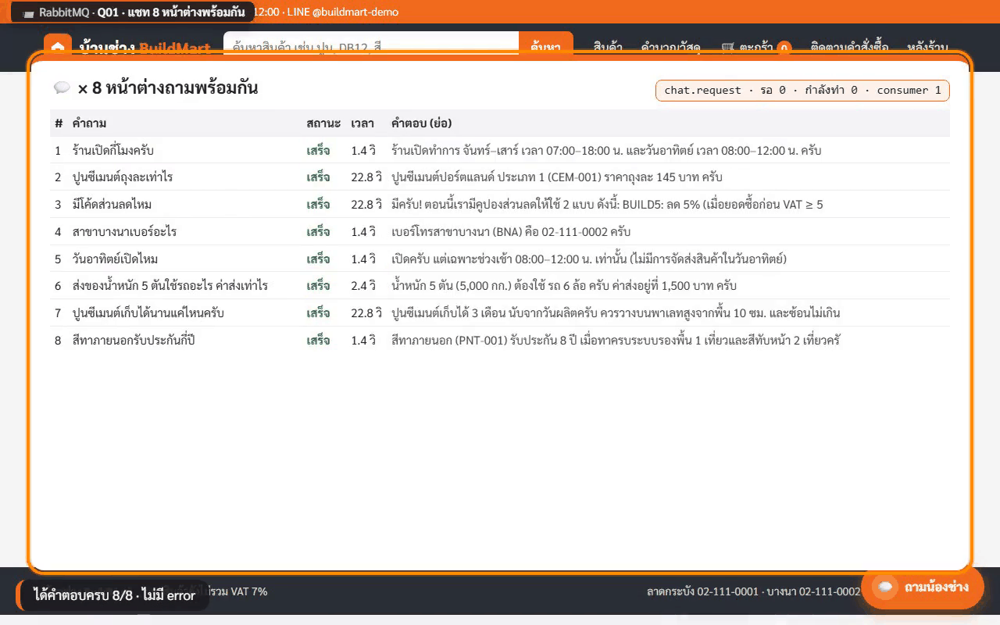 | 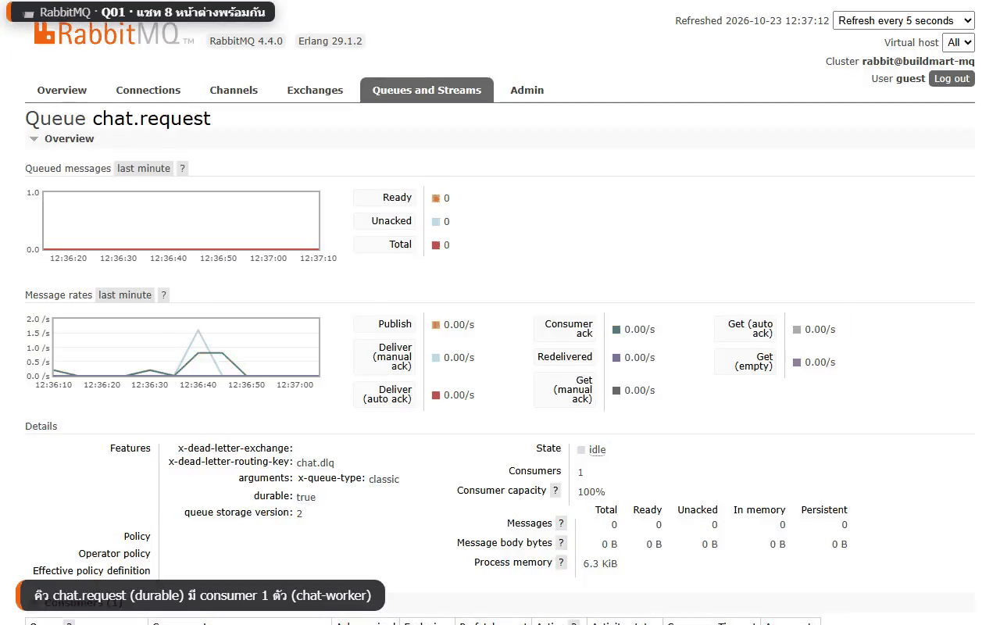 | 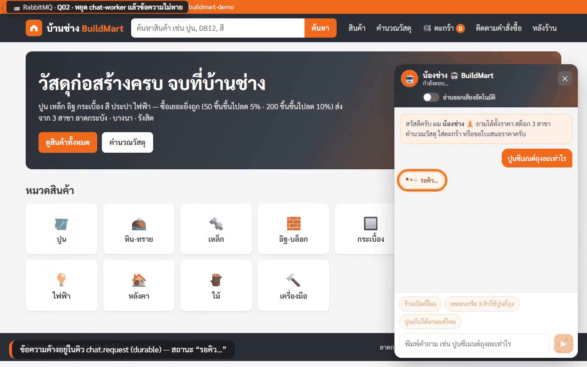 |
|---|---|---|
| Q01: 8 หน้าต่างถามพร้อมกัน → GPU รับทีละ 4 ที่เหลือรอคิว → **ได้ครบ 8** | RabbitMQ UI: คิว `chat.request` (durable · dead-letter → `chat.dlq`) | Q02: ปิด chat-worker → "รอคิว…" → เปิดกลับ → ได้คำตอบ (ข้อความไม่หาย) |

*ภาพจริงจากรอบ v2 — กลไกคิวเดียวกันใน v3*

---

## ส่วน F · ทดสอบ + วัดผล (เพลย์ลิสต์ · ประเมิน RAG · load test)

### F1 · ขั้นที่ 7 · พรอมต์ ⑦ — เพลย์ลิสต์ทดสอบ 62 เคส (Playwright)


*ภาพแนวคิด (Imagegen ด้วย cyolo)*

"เพลย์ลิสต์" = use case 62 เคสเรียงตามลำดับ ([`playlist.json`](_solution/buildmart/e2e/playlist.json)) ที่ Playwright เล่นเหมือนลูกค้าจริง · พิมพ์ทีละตัว · **ค้างภาพ 3–5 วินาที**หลังทุกผลลัพธ์ · อัดวิดีโอทุกเคส → GIF + MP4 (**เคส T/V มีเสียงจริง**: เสียงคำถามจากไมค์ปลอม + เสียงตอบจาก VoxCPM2)

| กลุ่ม | เคส | ทดสอบอะไร |
|---|---|---|
| 🛒 W | 14 | หน้าร้าน ค้นหา ตะกร้า ราคาส่ง คูปอง ค่าส่ง ใบเสนอราคา หลังร้าน |
| 💬 C · 📄 R | 14 · 8 | แชทบอท (SQL + เครื่องคำนวณ + ปฏิเสธนอกเรื่อง) · ตอบจาก PDF พร้อมป้ายอ้างอิง |
| 📨 Q · 🔊 T | 3 · 3 | RabbitMQ (พร้อมกัน 8 · worker ล่ม · fanout) · อ่านออกเสียง |
| 🧵 M · 🎙 V | 6 · 6 | **ใหม่** คุยพิมพ์ 5 รอบ (อันนั้น/ตัวเมื่อกี้) · ถามด้วยเสียง (V02/V03 คุยเสียง 4 รอบ) |
| 🧊 D · 🧪 E · ⚡ L | 3 · 3 · 2 | **ใหม่** ฉาก 3D + มาสคอตขยับปาก + ไม่มี WebGL · dashboard ประเมิน · dashboard load test |

💬 วางใน Claude Code เดิม:

```text
รันเพลย์ลิสต์ทดสอบของระบบที่ deploy อยู่ ในโหมด AI จริง (Qwen + Whisper + VoxCPM2)
(ถ้าเป็น _solution/buildmart: cd e2e → npm ci → BM_MODE=ai npm run playlist → npm run media → npm run report · ถ้าเป็น my_buildmart/app ดูวิธีรันใน README ของมัน)
สรุปเป็นภาษาไทย: ตาราง กลุ่ม | ผ่าน/ทั้งหมด · เคสที่ไม่ผ่านพร้อมคำตอบจริงและสาเหตุ · ลิงก์ TEST_REPORT.md · วิดีโอที่มีเสียง (เคส T และ V)
```

📤 **ผลจริง:**

<!-- PLAYLIST_AI_RESULT: กำลังรันจริงอยู่ — เติมเมื่อจบ:
- ตาราง โหมด | W | C | R | Q | T | M | V | D | E | L | รวม (mock + ai) จาก _solution/buildmart/e2e/TEST_REPORT.md
- เวลารวมโหมด ai · เคสที่ไม่ผ่านพร้อมคำตอบจริงและสาเหตุ
- ลิงก์ MP4 มีเสียง: T01 T02 T03 V01–V06 D02
-->

ตัวอย่าง GIF ของกลุ่มใหม่ (เล่นวนเอง · กดเพื่อดูภาพใหญ่ · ทุกเคสอยู่ใน [TEST_REPORT.md](_solution/buildmart/e2e/TEST_REPORT.md)):

| 🧊 D01 ฉาก 3D + มาสคอต | 🎙 V01 ถามด้วยเสียง | 🧵 M04 คุย 5 รอบ |
|---|---|---|
| <a href="_solution/buildmart/e2e/test-gifs/D01.gif"></a> | <a href="_solution/buildmart/e2e/test-gifs/V01.gif"></a><br>[🎬 MP4 มีเสียง](_solution/buildmart/e2e/test-videos/V01.mp4) | <a href="_solution/buildmart/e2e/test-gifs/M04.gif">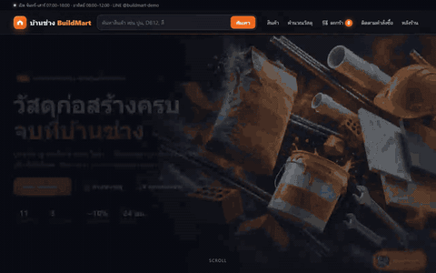</a> |
| 🧊 **D02 มาสคอตขยับปาก** | 🧪 **E02 เทียบ rerank on/off** | ⚡ **L01 dashboard load** |
| <a href="_solution/buildmart/e2e/test-gifs/D02.gif"></a><br>[🎬 MP4 มีเสียง](_solution/buildmart/e2e/test-videos/D02.mp4) | <a href="_solution/buildmart/e2e/test-gifs/E02.gif"></a> | <a href="_solution/buildmart/e2e/test-gifs/L01.gif">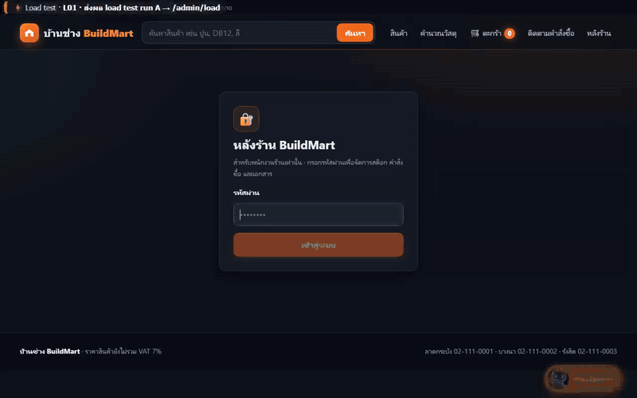</a> |

### F2 · ขั้นที่ 8 · พรอมต์ ⑧ — ประเมิน RAG: บอทตอบถูกแค่ไหน (มี/ไม่มี reranker)


*ภาพแนวคิด (Imagegen ด้วย cyolo)*

เพลย์ลิสต์ตอบได้ว่า "ระบบทำงาน" · แต่**บอทตอบถูกแค่ไหน** ต้องวัดด้วยข้อสอบหลายร้อยข้อ — ขั้นตอน: **ออกข้อสอบจากเอกสาร → ถามบอทจริงทุกข้อ → โค้ดตรวจสิ่งที่ตรวจได้ → Claude ตัดสินสิ่งที่ต้องใช้วิจารณญาณ → รวมคะแนน → dashboard**

💬 วางใน Claude Code เดิม:

```text
ประเมินคุณภาพแชทบอท BuildMart ที่ deploy อยู่ (โหมด AI จริง) ตาม BUILDMART.md ข้อ 8 แล้วเทียบ มี/ไม่มี reranker
(ถ้าแอปคือ _solution/buildmart ใช้สคริปต์และชุดคำถามใน _solution/buildmart/eval/ ตาม README ในนั้นได้เลย · ถ้าเป็น my_buildmart/app ใช้ของทีม)
1. ชุดคำถาม: ถ้ายังไม่มี ให้ออกข้อสอบจาก PDF ใน documents/ ทีละไฟล์ (อ่านหน้าจริง): rag 150–170 ข้อ (ระบุไฟล์+หน้าที่มีคำตอบ + key_facts · ผสมตาราง หัว 2 ชั้น เชิงอรรถ ข้ามหน้า และข้อที่เอกสารไม่มีคำตอบ) · qa 70–80 ข้อจากฐานข้อมูลร้าน (ราคา ราคาส่ง สต็อก คูปอง ค่าส่ง VAT · คำนวณค่าที่ถูกด้วยสูตรใน shared/ + SQL) · conv 10–12 บท บทละ 4–6 รอบ (บางบทถามด้วยเสียงจาก test-fixtures/voice/)
2. รอบที่ 1 rerank on: ถามทุกข้อผ่าน /api/chat และ /api/voice จริง (session ใหม่ต่อข้อ) · รอบที่ 2 rerank off: ตั้ง RERANK=off ให้ chat-worker แล้วรันเฉพาะ rag + conv · จบแล้วตั้งกลับเป็น on
3. ตัดสิน faithfulness / correctness / context_retention ตาม rubric ใน eval/README.md (คะแนน 0 / 0.5 / 1 + เหตุผลภาษาไทยเมื่อไม่เต็ม) แบ่งให้ sub-agent ช่วยตัดสินขนานกันได้ · ห้ามให้ Qwen ตรวจตัวเอง
4. รวมคะแนนแล้ว POST เข้า /api/admin/eval ทั้ง 2 รอบ · ทำรายงาน RESULTS.md + results.html + SAMPLES.md
5. สรุปภาษาไทย: ตาราง set | ตัวชี้วัด | rerank on | off | ผลต่าง · คะแนนแยกตามเอกสาร · 3–5 รูปแบบที่บอทตอบผิดบ่อยพร้อมตัวอย่าง
```

📤 **ผลจริง** (23 ต.ค. 2026 · 260 ข้อ · rerank on 5.6 นาที + off 4.3 นาที · 0 error · Claude sub-agent 8 ตัวตัดสิน):


*ภาพจริง: [results.html](_solution/buildmart/eval/results.html) (ไฟล์เดียว เปิดในเบราว์เซอร์ได้เลย · ค้น/กรองได้ครบ 260 ข้อ · สลับ rerank on/off)*

**ตัวชี้วัด 12 ตัว** (อ่านละเอียด + ตัวอย่างใน [METRICS.md](_solution/buildmart/eval/METRICS.md)):


| # | ตัวชี้วัด | วัดอะไร | ใครตรวจ | ค่าที่ดี |
|---|---|---|---|---|
| 1 | **Hit@4** | ใน 4 ย่อหน้าที่ค้นได้ มีหน้าที่มีคำตอบไหม (คะแนนของ**ตัวค้น**ล้วน ๆ) | โค้ด | ≥ 0.90 |
| 2 | **MRR** | หน้าที่มีคำตอบอยู่อันดับเท่าไร (1 ÷ อันดับ) | โค้ด | ≥ 0.80 |
| 3 | **อ้างอิงถูก** | ป้าย 📄 ไฟล์/หน้า ใต้คำตอบชี้ถูกหน้าไหม | โค้ด | ≥ 0.85 |
| 4 | **ไม่แต่งเติม** (Faithfulness) | ทุกประโยคในคำตอบมีที่มาจากย่อหน้าที่ค้นได้ไหม | AI | ≥ 0.90 |
| 5 | **ตอบถูก** (Correctness) | สาระตรงกับคำตอบที่คาดไหม | AI | ≥ 0.85 |
| 6 | **ตัวเลขตรง** | ราคา/สต็อก/ค่าส่ง/VAT ถูกเป๊ะไหม | โค้ด | ≥ 0.95 |
| 7 | **ดึงสินค้าถูก** | ระบบดึง SKU ที่ถูกตัวจาก DB ไหม | โค้ด | ≥ 0.95 |
| 8 | **ตอบถูก ชุด B** | เหมือนข้อ 5 + ปฏิเสธนอกเรื่อง / ถามกลับเมื่อกำกวม | AI | ≥ 0.85 |
| 9 | **จำบริบท** | "อันนั้น / ตามจำนวนนั้น" ตีความถูกสินค้า/จำนวนไหม | AI | ≥ 0.90 |
| 10 | **ทำงานจริง** (State OK) | สั่งใส่ตะกร้า/ขอใบเสนอราคาแล้ว เกิดขึ้นจริงไหม | โค้ด | 1.00 |
| 11 | **ตอบถูก/ตัวเลขตรง ต่อรอบ** | ข้อ 5–6 ในแต่ละรอบของบทสนทนา | AI + โค้ด | ≥ 0.85 |
| 12 | **CER** | Whisper ถอดเสียงพลาดกี่ % (ยิ่งน้อยยิ่งดี) | โค้ด | ≤ 0.10 |

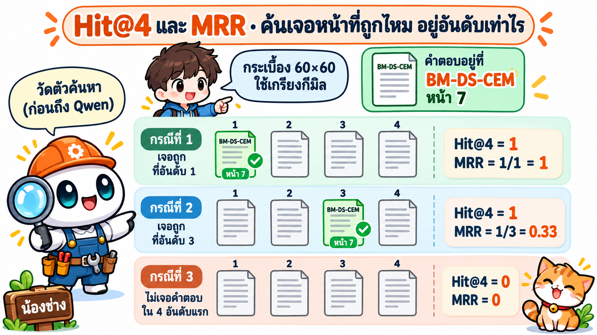

**ผลจริง rerank on vs off** (เกณฑ์ผ่านต่อข้อ: rag = ตอบถูก ≥ 0.5 และไม่แต่งเติม ≥ 0.5 · qa = ตอบถูก ≥ 0.5 และตัวเลขตรง · conv = ทุกรอบผ่าน + จำบริบท + ทำงานจริง):

| ชุด | ตัวชี้วัด | rerank **on** | rerank off | ผลต่าง |
|---|---|---:|---:|---:|
| A · rag (169 ข้อ) | **ผ่าน** | **95.9%** | 88.8% | +7.1 จุด |
| | Hit@4 | **95.4%** | 80.8% | **+14.6** |
| | MRR | **0.858** | 0.668 | +0.190 |
| | อ้างอิงถูก | **86.1%** | 70.2% | +15.9 |
| | ไม่แต่งเติม | **97.3%** | 91.1% | +6.2 |
| | ตอบถูก | **91.7%** | 84.0% | +7.7 |
| B · qa (79 ข้อ) | **ผ่าน** | **91.1%** | (ไม่ได้รัน — ไม่ใช้ PDF) | – |
| | ตัวเลขตรง · ดึงสินค้าถูก · ตอบถูก | 91.2% · 100% · 91.8% | – | – |
| C · conv (12 บท 60 รอบ) | **ผ่าน** | 66.7% | 66.7% | 0 |
| | ตอบถูก · จำบริบท | 92.5% · **100%** | 90.8% · 96.9% | +1.7 · +3.1 |
| | ทำงานจริง | 80.0% | 100% | −20 (1 รอบ ดูข้อ 4 ด้านล่าง) |
| | CER (Whisper) | **0.058** | 0.058 | – |

ตอบถูกแยกเอกสาร (rerank on): POLICY 96.4% · STL 94.8% · ELC-PIP 94.6% · CEM 89.3% · TIL 89.3% · PNT 85.7% (แย่สุด แต่ reranker ช่วยมากสุด: 67.9% → 85.7%) · เวลาตอบ p50/p95: rag 2.7/5.0 วิ · คำแรกขึ้น ~1.6–1.9 วิ

**บอทพลาดตรงไหน** (อ่านแล้วรู้ว่าต้องแก้ส่วนไหน):
1. **ค้นเจอแล้วแต่บอกว่า "ไม่มีในเอกสาร"** (14 ข้อ) — เช่น R-PNT-19 ค่าความเงาอยู่ในหน้าที่ค้นได้ แต่ Qwen ไม่อ่านตาราง → แก้ที่ **พรอมต์/โมเดล** ไม่ใช่ตัวค้น
2. **ค้นไม่เจอ** (7 ข้อ Hit@4 = 0) — บอทปฏิเสธอย่างซื่อสัตย์ ไม่แต่ง → แก้ที่ **chunk/ตัวค้น**
3. **ตอบเกินที่ถาม** — Q-06 "ปูนกาวรวม VAT เท่าไร" บอทบวกค่าส่ง 500 ให้ด้วย (ตอบ 732.95 แทน 197.95) · Q-40 คิดค่าส่ง 500 ทั้งที่ยอดเกิน 20,000 ต้องส่งฟรี
4. **พูดว่าทำแต่ไม่ได้ทำ** — CV-01 รอบ 5 Whisper ได้ยิน "ขอ**ไป**เสนอราคา" บอทตอบ "กำลังสร้างใบเสนอราคา" แต่ไม่ได้เรียกคำสั่งจริง (ไม่มีเลข QT) → นี่คือเหตุผลที่ต้องมีตัวชี้วัด "ทำงานจริง" แยกจาก "ตอบถูก"

**ตัวอย่างจริง 35 ข้อ** (ผสมทุกประเภท · ✅ ผ่านเต็ม · ⚠️ ผ่านแต่ไม่เต็ม · ❌ ไม่ผ่าน) — ทั้ง 260 ข้อดูได้ใน [RESULTS.md](_solution/buildmart/eval/RESULTS.md) และ [results.html](_solution/buildmart/eval/results.html)

<details><summary>ตาราง 35 ข้อ (กดเพื่อดู)</summary>

| id | set · ประเภท | คำถาม | คำตอบที่คาด | คำตอบจาก AI (Qwen + RAG) | หน้าที่ค้นได้ / **ที่ถูก** | ผล | เหตุผล |
|---|---|---|---|---|---|:-:|---|
| Q-06 | qa · price | ปูนกาวปูกระเบื้อง 1 ถุง รวม VAT แล้วเท่าไร | CEM-004 ราคา 185 บาท + VAT 7% = 197.95 บาท (ยังไม่รวมค่าส่ง) | ยอดสุทธิรวม VAT แล้วคือ **732.95 บาท** ครับ (ประกอบด้วย: สินค้า 185.00 + ค่าส่ง 500.00 + VAT 47.95) | DB: CEM-004, TIL-001, TIL-003 | ❌ | ให้ราคา 185 ถูกแต่ไม่ให้ 197.95 — ตอบ 732.95 ที่บวกค่าส่ง 500 ซึ่งไม่ได้ถาม · ไม่พบค่า 197.95 ในคำตอบ |
| Q-15 | qa · wholesale | RB6 ซื้อ 199 เส้นกับ 200 เส้น ราคารวมต่างกันเท่าไร | 199 เส้น (ลด 5% = 45.60) = 9,074.40 บาท · 200 เส้น (ลด 10% = 43.20) = 8,640.00 บาท → 200 เส้นถูกกว่า 434.40 บ… | ราคารวมต่างกัน **181.44 บาท** ครับ - 199 เส้น (ราคาส่ง 5%): **9,074.40 บาท** - 200 เส้น (ราคาส่ง 10%): **8,640.00 บาท** | DB: STL-001 | ❌ | ยอด 199/200 เส้นถูก แต่ผลต่างตอบ 181.44 แทน 434.40 · ไม่พบค่า 434.4 ในคำตอบ |
| Q-30 | qa · coupon | ซื้อกระเบื้องพื้น TIL-001 20 กล่อง ใช้โค้ด BUILD5 ลดได้กี่บาท | ยอด 7,780.00 บาท (≥ 5,000) → BUILD5 ลด 5% = 389.00 บาท เหลือ 7,391.00 บาท (ก่อนค่าส่ง/VAT) | ใช้คูปอง BUILD5 ลดได้ **389.00 บาท** ครับ (ยอดสุทธิหลังหักส่วนลดและรวมค่าส่ง/VAT แล้วคือ 8,443.37 บาท) | DB: TIL-001, TIL-002, TIL-003 | ❌ | ส่วนลด 389 ถูก แต่ไม่ให้ยอดหลังลด 7,391 (ให้ยอดรวมค่าส่ง/VAT แทน) · ไม่พบค่า 7391 ในคำตอบ |
| Q-40 | qa · shipping | เหล็ก DB12 110 เส้น ค่าส่งเท่าไร | น้ำหนักรวม 976.8 กก. → กระบะ ค่าส่ง 0 บาท · ยอด 20,377.50 ≥ 20,000 → ส่งฟรี | สำหรับเหล็ก DB12 จำนวน 110 เส้น มีน้ำหนักรวมประมาณ **976.8 กก.** (ไม่เกิน 1 ตัน) - ค่าส่ง: **500 บาท** (ใช้รถกระบะ) - *หมายเหตุ:* หากยอดซื้อหลังหักส่วนลดแต่ก่อน VAT เกิน… | DB: STL-003, STL-001, STL-002 | ❌ | ตอบค่าส่ง 500 แทนส่งฟรี (ยอด 20,377.50 ≥ 20,000) |
| Q-57 | qa · calc | ต้องใช้เหล็ก DB16 ยาวรวม 85 เมตร ต้องซื้อกี่เส้น หนักเท่าไร | เหล็กข้ออ้อย DB16 ยาว 10 ม. (STL-004) 9 เส้น · น้ำหนัก 134.13 กก. | - STL-004 เหล็กข้ออ้อย DB16 ยาว 10 ม. : 9 เส้น พิมพ์ "ใส่ตะกร้าให้เลย" ได้ครับ | DB: STL-004, STL-001, STL-005 | ❌ | ให้ 9 เส้นถูก แต่ไม่บอกน้ำหนัก 134.13 กก. · ไม่พบค่า 134.13 ในคำตอบ |
| R-CEM-24 | rag · procedure | What order should I load materials into a one-bag concrete mixer, and how long should it keep mixing? | Put in half of the stone and about half of the water first, then the cement, sand, the remaining stone and th… | I don't have specific information on the loading order or mixing duration for a one-bag concrete mixer in our reference documents. For accurate technical guidance, pleas… | CEM p14, CEM p18, CEM p10, CEM p3 / **CEM p9** | ❌ | ค้นไม่เจอหน้า 9 แล้วตอบว่าไม่มีข้อมูล ทั้งที่เอกสารมีลำดับใส่วัสดุ (หินครึ่งหนึ่ง+น้ำครึ่งหนึ่งก่อน) และผสม ≥3 นาที · ไ… |
| R-CEM-26 | rag · negative | ปูนฉาบเหลือหลายถุง เอามาปูกระเบื้องแทนปูนกาวได้ไหม | ไม่ได้ ปูนฉาบ CEM-003 ไม่มีโพลิเมอร์ช่วยยึดเกาะ ห้ามใช้ปูกระเบื้องทุกชนิด | ใช้ปูนฉาบ (CEM-003) ปูกระเบื้องแทนปูนกาวได้ครับ แต่มีข้อจำกัดคือ - **ไม่แนะนำ** สำหรับงานพอร์ซเลนที่ดูดซึมน้ำต่ำ (< 0.5%) - ต้องใช้ความหนาชั้นยึดมากกว่าปูนกาว (ปูนกาวใช้… | CEM p11, CEM p14, CEM p9, CEM p8 / **CEM p8** | ❌ | ตอบว่าใช้ปูนฉาบปูกระเบื้องได้ ขัดกับเอกสารที่ระบุว่าปูนฉาบไม่มีโพลิเมอร์ ห้ามใช้ปูกระเบื้องทุกชนิด |
| R-PNT-19 | rag · spec_by_sku | สีทาภายใน PNT-002 เป็นสีด้านแค่ไหน ค่าความเงาเท่าไร ทาแล้วฟิล์มแห้งหนาเท่าไรต่อรอบ | PNT-002 มีความเงาที่ 60° ไม่เกิน 5 GU (ฟิล์มด้าน) และความหนาฟิล์มแห้งต่อเที่ยว 40–45 ไมครอน | PNT-002 เป็นสีฟิล์ม **ด้าน** ครับ ส่วนค่าความเงา (Gloss) และความหนาฟิล์มแห้งที่ระบุตัวเลขชัดเจนในเอกสารอ้างอิงยังไม่มีข้อมูลครับ แนะนำให้โทรสอบถามสาขาโดยตรงเพื่อความแม่น… | PNT p3, PNT p15, PNT p3, PNT p5 / **PNT p5** | ❌ | บอกว่าไม่มีข้อมูลค่าความเงา/ความหนาฟิล์ม ทั้งที่หน้า 5 ที่ค้นได้ระบุความเงา ≤5 GU และ 40–45 ไมครอน ตอบได้แค่ว่าฟิล์มด้า… |
| R-CEM-21 | rag · compare | ปูนกาว CEM-004 กับปูนทรายผสมเอง 1:3 แบบปูซาลาเปา ต่างกันยังไง เรื่องแรงยึดกับเวลาที่เดินบนพื้นได้ | CEM-004 มีแรงยึดเกาะดึงที่ 28 วัน ≥ 0.5 N/มม.² (เฉลี่ย 0.8) และเดินได้หลัง 24 ชม. ส่วนปูนทราย 1:3 ได้ประมาณ 0… | ปูนกาว CEM-004 มีแรงยึดเกาะสูงกว่ามาก (เฉลี่ย 0.8 N/มม.² เทียบกับปูนทราย 1:3 ที่ประมาณ 0.2–0.3 N/มม.²) และเดินบนพื้นได้เร็วกว่า โดยปูนกาวเดินได้หลังปู 24 ชม. ในขณะที่ปูน… | CEM p8, CEM p8, CEM p8, CEM p7 / **CEM p8** | ✅ | – |
| R-CEM-22 | rag · compare | For 1:2:4 concrete, what is the compressive strength on a 15×30 cm cylinder versus a 15 cm cube, in MPa? | For 1:2:4 the cylinder strength is 180 kg/cm² (17.7 MPa) while the approximate 15 cm cube strength is 225 kg/… | For a 1:2:4 concrete mix, the compressive strength is **17.7 MPa** for a 15×30 cm cylinder and **22.1 MPa** for a 15 cm cube. | CEM p22, CEM p22, STL p17, STL p17 / **CEM p22** | ✅ | – |
| R-CEM-15 | rag · cross_page | คอนกรีต 1:2:4 ตอนอายุ 7 วันควรได้กำลังอัดประมาณเท่าไร แล้วพอครบ 28 วันได้เท่าไหร่ | คอนกรีต 1:2:4 ที่อายุ 7 วันได้ประมาณ 126 กก./ตร.ซม. (70%) และที่ 28 วันได้ 180 กก./ตร.ซม. (100% ค่าออกแบบ) | คอนกรีต 1:2:4 ตอนอายุ 7 วัน ควรได้กำลังอัดประมาณ **126 กก./ตร.ซม.** ครับ ส่วนเมื่อครบ 28 วัน กำลังอัดจะอยู่ที่ประมาณ **180 กก./ตร.ซม.** (คิดจาก 126 เป็น 70% ของค่า 28 วั… | CEM p6, CEM p19, CEM p7, CEM p6 / **CEM p6, CEM p7** | ✅ | – |
| R-CEM-16 | rag · cross_page | เคสพื้นโรงรถที่เทตอนบ่ายโมงแล้วช่างเติมน้ำเพิ่ม สุดท้ายเจาะแกนคอนกรีตได้ผลเฉลี่ยเท่าไร ผ่านไหม แล้ววิศวกรให้ใ… | เจาะแกน 3 จุดได้ 131, 124 และ 132 กก./ตร.ซม. เฉลี่ย 129 ต่ำกว่าเกณฑ์ 85% (153) จึงไม่ผ่าน วิศวกรอนุญาตให้ใช้จ… | จากกรณีศึกษาพื้นโรงรถที่เทตอนบ่ายโมงและเติมน้ำเพิ่ม ผลเจาะแกนคอนกรีตได้ค่าเฉลี่ย **129 กก./ตร.ซม.** ซึ่งต่ำกว่าเกณฑ์ 85% (153) และจุดหนึ่งต่ำกว่าเกณฑ์ 75% (135) จึงถือว่… | CEM p15, CEM p19, CEM p19, CEM p18 / **CEM p18, CEM p19** | ✅ | – |
| R-CEM-12 | rag · footnote | ปูนกาว CEM-004 มี มอก. ไหมคะ หรือทดสอบตามมาตรฐานอะไร | CEM-004 ไม่ใช่มาตรฐาน มอก. ใช้มาตรฐานผู้ผลิต โดยทดสอบแรงยึดเกาะตามวิธีของ EN 12004 ระดับ C1T (ปูนกาวซีเมนต์ทั… | ปูนกาว CEM-004 ไม่ได้มาตรฐาน มอก. แต่เป็น "มาตรฐานผู้ผลิต" โดยผ่านการทดสอบแรงยึดเกาะระดับ C1T ตามวิธีของ EN 12004 | CEM p4, CEM p1, CEM p14, CEM p3 / **CEM p4** | ✅ | – |
| R-CEM-13 | rag · footnote | ถ้าบ่มพื้นแค่ 3-4 วันแล้วเลิกบ่ม จะเสียกำลังมากไหม | หากหยุดบ่มก่อน 7 วัน กำลังปลายทางของคอนกรีตอาจลดลง 20–30% จึงต้องบ่มชื้นอย่างน้อย 7 วัน | เสียกำลังมากครับ หากหยุดบ่มก่อนครบ 7 วัน กำลังปลายทางของคอนกรีตอาจลดลง **20–30%** แนะนำให้บ่มชื้นต่อเนื่องอย่างน้อย **7 วัน** เพื่อรักษาคุณภาพโครงสร้างตามมาตรฐานครับ | CEM p6, CEM p6, CEM p6, CEM p7 / **CEM p7** | ✅ | อ้างอิง BM-DS-CEM.pdf หน้า 6 ไม่ตรง |
| R-ELC-26 | rag · negative | เบรกเกอร์ 16A ตัดบ่อยมาก เปลี่ยนเป็น 32A ไปเลยได้ไหม สายเดิมเป็น 2.5 | ไม่ได้ สาย 2.5 ตร.มม. ต้องใช้เบรกเกอร์ไม่เกิน 20 A ห้ามเปลี่ยนเป็นเบรกเกอร์ใหญ่กว่าพิกัดสาย ให้แยกวงจรหรือเปล… | ไม่ได้ครับ หากสายเดิมเป็น 2.5 ตร.มม. ต้องใช้เบรกเกอร์ไม่เกิน 20 A การเปลี่ยนเป็น 32 A จะทำให้สายร้อนและอาจเกิดอันตรายได้ แนะนำให้แยกวงจรหรือเปลี่ยนสายไฟให้ใหญ่ขึ้นแทนครับ | ELC-PIP p14, ELC-PIP p7, ELC-PIP p14, ELC-PIP p9 / **ELC-PIP p14** | ✅ | – |
| R-ELC-27 | rag · negative | ทดสอบท่อน้ำดีด้วยลมอัดแทนน้ำได้มั้ย สะดวกกว่า | ไม่ได้ ห้ามทดสอบด้วยลมอัด เพราะท่อ PVC ที่แตกขณะมีลมอัดจะแตกกระจายเป็นเศษคม ต้องอัดน้ำที่ 1.5 เท่าของแรงดันใช… | ไม่ได้ครับ ห้ามทดสอบด้วยลมอัดเด็ดขาด เพราะท่อ PVC ที่แตกขณะมีลมอัดจะแตกกระจายเป็นเศษคมและอันตรายมาก แนะนำให้ทดสอบด้วยน้ำตามมาตรฐานแทนครับ | ELC-PIP p12, ELC-PIP p12, ELC-PIP p17, ELC-PIP p13 / **ELC-PIP p12** | ✅ | – |
| R-CEM-25 | rag · procedure | อยากเช็กว่าทรายที่มาส่งมีดินปนเยอะไหม ทดสอบเองที่หน้างานต้องทำยังไง | ใส่ทรายประมาณ 1/3 ของขวดแก้วใสขนาด 1 ลิตร เติมน้ำสะอาดผสมเกลือ 1 ช้อนชาจนถึง 2/3 ขวด เขย่าแรง 1 นาที ตั้งทิ้ง… | ทดสอบดินตะกอนในทรายแบบภาคสนามทำได้โดยใส่ทรายตัวอย่างประมาณ 1/3 ของขวดแก้วใสขนาด 1 ลิตร เติมน้ำสะอาดผสมเกลือ 1 ช้อนชาจนถึงระดับ 2/3 ของขวด ปิดฝาเขย่าแรงๆ 1 นาที แล้วตั้งท… | CEM p20, CEM p20, CEM p20, CEM p20 / **CEM p20** | ✅ | – |
| R-ELC-24 | rag · procedure | ต่อท่อ PVC ด้วยกาวต้องทำยังไงทีละขั้นครับ | ตัดท่อให้ตั้งฉากและลบคม เช็ดปลายท่อและปากข้อต่อให้สะอาดแห้งแล้วลองสวม ทากาว PIP-004 บาง ๆ ทั้งผิวท่อและด้านใน… | ขั้นตอนการต่อท่อ PVC ด้วยกาวมีดังนี้ครับ: - ตัดท่อให้ตั้งฉาก ลบคมด้านในและนอก - เช็ดปลายท่อและปากข้อต่อให้สะอาดแห้ง ทดลองสวมตรวจระยะ - ทากาว PIP-004 บางๆ ให้ทั่วผิวปลายท… | ELC-PIP p12, ELC-PIP p12, ELC-PIP p11, ELC-PIP p17 / **ELC-PIP p12** | ✅ | – |
| R-CEM-18 | rag · spec_by_sku | ที่ไซต์มีถุงปูนแถบสีน้ำเงินวางอยู่ ถุงนี้คือปูนอะไร | ถุงแถบสีน้ำเงินคือ CEM-003 ปูนฉาบสำเร็จรูป 50 กก. (ถุงกระดาษ 2 ชั้น + ฟิล์ม PE) | ถุงปูนที่มีแถบสีน้ำเงินคือ **CEM-003 ปูนฉาบ สำเร็จรูป (50 กก.)** ครับ | CEM p4, CEM p4, CEM p16, CEM p4 / **CEM p4** | ✅ | – |
| R-CEM-19 | rag · spec_by_sku | หินเบอร์ 1 ที่ร้านขาย เม็ดขนาดกี่มิล | หินเบอร์ 1 คือ AGG-003 หิน 3/4 ขนาดเม็ด 9.5–19 มม. | หินเบอร์ 1 (AGG-003) มีขนาดเม็ดในช่วง **9.5–19 มม.** ครับ | CEM p4, POLICY p4, CEM p3, TIL p8 / **CEM p4** | ✅ | – |
| R-CEM-09 | rag · table_merged | จะปูกระเบื้องผนังแผ่น 40x80 ต้องใช้เกรียงหวีฟันกี่มิล แล้วกินปูนกาวกี่โลต่อตารางเมตร | กระเบื้องผนัง 40x80 ซม. ใช้เกรียงฟันเหลี่ยม 10 มม. อัตราปูนกาว 5.5 กก./ตร.ม. หรือประมาณ 3.6 ตร.ม. ต่อถุง 20 ก… | สำหรับกระเบื้องผนังขนาด 40x80 ซม. ต้องใช้เกรียงหวีฟัน **10 มม.** และอัตราการใช้ปูนกาวประมาณ **5.5 กก./ตร.ม.** ครับ | CEM p7, CEM p7, CEM p7, CEM p7 / **CEM p7** | ✅ | – |
| R-CEM-10 | rag · table_merged | ปูกระเบื้องผนังด้วยปูนกาวแล้วแผ่นมันไหลย้อยลงมา เกิดจากอะไรครับ แก้ยังไง | สาเหตุคือปูนกาวเหลวเกิน ใช้น้ำเกิน 5.5 ลิตรต่อถุง แก้โดยลดน้ำตามตารางอัตราน้ำ ปูจากล่างขึ้นบนและใช้ไม้ค้ำแถวแ… | อาการกระเบื้องผนังไถลลง เกิดจากปูนกาวเหลวเกินไป (ใช้น้ำเกิน 5.5 ลิตรต่อถุง) ครับ วิธีแก้ไข: - ลดปริมาณน้ำให้ถูกต้องตามตารางที่ 5 - ปูงานจากล่างขึ้นบน - ใช้ไม้ค้ำยันแถวแร… | CEM p14, TIL p12, CEM p14, CEM p21 / **CEM p14** | ✅ | – |
| R-CEM-06 | rag · table_multiheader | ถ้าผสมคอนกรีตเองสูตร 1 : 1.5 : 3 สำหรับงานโครงสร้าง ต่อ 1 คิวต้องใช้ปูนกี่ถุง ทรายกับหินกี่คิว น้ำกี่ลิตร | คอนกรีต 1:1.5:3 ต่อ 1 ลบ.ม. ใช้ CEM-001 8.5 ถุง ทรายหยาบ AGG-001 0.45 ลบ.ม. หิน AGG-003 0.85 ลบ.ม. และน้ำ 210… | สำหรับคอนกรีตสูตร 1:1.5:3 (งานโครงสร้าง) ต่อ 1 คิว (1 ลบ.ม.) ต้องใช้วัสดุดังนี้ครับ - ปูนซีเมนต์ปอร์ตแลนด์ (CEM-001): **8.5 ถุง** - ทรายหยาบ (AGG-001): **0.45 ลบ.ม.** - … | CEM p5, CEM p5, CEM p18, CEM p10 / **CEM p5** | ✅ | – |
| R-CEM-07 | rag · table_multiheader | จะเทพื้นชั้นสองที่วางบนคาน ช่วงหน้าร้อนแดดเปรี้ยงลมแรง ต้องบ่มอย่างน้อยกี่วัน แล้วบ่มวิธีไหนดี | พื้นวางบนคานในสภาพแดดจัด/ลมแรงต้องบ่มขั้นต่ำ 14 วัน (อากาศปกติ 7 วัน) วิธีบ่มที่แนะนำคือขังน้ำบนพื้นสูง 2–3 ซ… | สำหรับงาน "พื้นวางบนคาน" ในช่วงหน้าร้อนแดดเปรี้ยงลมแรง (เข้าเกณฑ์อากาศจัด/ลมแรง) ต้องบ่มชื้นอย่างน้อย **14 วัน** ครับ วิธีบ่มที่แนะนำคือ **ขังน้ำบนพื้นสูง 2–3 ซม.** เพื่… | CEM p9, CEM p9, CEM p9, CEM p9 / **CEM p9** | ✅ | – |
| R-CEM-04 | rag · table_simple | ทรายหยาบที่ร้านขายเป็นคิว คิวนึงหนักประมาณกี่โลคะ จะได้กะรถถูก | ทรายหยาบ AGG-001 มีน้ำหนักกองหลวมประมาณ 1,500 กก./ลบ.ม. | ทรายหยาบ 1 คิว (1 ลบ.ม.) มีน้ำหนักประมาณ **1,500 กก.** ครับ (อ้างอิงจากสูตรคำนวณน้ำหนักวัสดุในเอกสาร: น้ำหนัก = ปริมาตร × 1,500) | CEM p10, CEM p10, CEM p10, CEM p10 / **CEM p4** | ✅ | ไม่พบ หน้า 4 ของ BM-DS-CEM ใน top 4 · อ้างอิง BM-DS-CEM.pdf หน้า 10 ไม่ตรง |
| R-CEM-05 | rag · table_simple | ปูน CEM-001 ตามเกณฑ์ มอก. ต้องเริ่มก่อตัวไม่เร็วกว่ากี่นาที แล้วก่อตัวสุดท้ายต้องไม่เกินกี่นาที | ตามเกณฑ์ มอก.15 ประเภท 1 ของ CEM-001 ระยะก่อตัวเริ่มต้น ≥ 45 นาที และก่อตัวสุดท้าย ≤ 375 นาที | ตามเกณฑ์ มอก.15 ประเภท 1 สำหรับปูน CEM-001: - ก่อตัวเริ่มต้น: ไม่เร็วกว่า **45 นาที** - ก่อตัวสุดท้าย: ไม่เกิน **375 นาที** | CEM p8, CEM p3, CEM p5, CEM p13 / **CEM p8** | ✅ | – |
| R-CEM-01 | rag · text | ปูนฉาบสำเร็จรูปของร้าน ปกติควรฉาบหนากี่เซนครับ | ปูนฉาบสำเร็จรูป CEM-003 แนะนำความหนาฉาบ 1–1.5 ซม. | แนะนำความหนาฉาบที่ **1–1.5 ซม.** ครับ - ถ้าหนาเกิน 1.5 ซม. ต้องแบ่งฉาบ 2 ชั้น (รออย่างน้อย 24 ชม.) - หากหนาเกิน 2.5 ซม. ควรแก้ที่งานก่อหรือใช้ตาข่ายเสริม | CEM p3, CEM p14, CEM p21, CEM p21 / **CEM p3** | ✅ | – |
| R-CEM-02 | rag · text | จะเทฐานรากแผ่ใหญ่ๆ หนาๆ ได้ยินว่าร้าวเพราะความร้อนในเนื้อปูนได้ ปูนมันร้อนสุดช่วงไหน แล้วต้องหนาแค่ไหนถึงต้อง… | ปฏิกิริยาไฮเดรชันปล่อยความร้อนมากที่สุดในช่วง 12–24 ชั่วโมงแรก ชิ้นส่วนที่หนาเกิน 60 ซม. อุณหภูมิภายในอาจสูงก… | ปูนซีเมนต์จะปล่อยความร้อนจากปฏิกิริยาไฮเดรชันมากที่สุดในช่วง **12–24 ชั่วโมงแรก** ครับ สำหรับความหนาที่ต้องระวังคือ ชิ้นส่วนที่หนาเกิน **60 ซม.** (เช่น ฐานรากแผ่ขนาดใหญ่… | CEM p5, CEM p20, CEM p10, CEM p20 / **CEM p5** | ✅ | – |
| Q-75 | qa · ambiguous | ปูนถุงละเท่าไหร่ | ถามกลับว่าปูนชนิดไหน (ซีเมนต์ CEM-001 145 · ปูนก่อ CEM-002 120 · ปูนฉาบ CEM-003 125 · ปูนกาว CEM-004 185) — ย… | ร้านมีปูนหลายชนิดครับ ราคาต่อถุง (50 กก.) ดังนี้: - **CEM-001** ปูนซีเมนต์ปอร์ตแลนด์ ประเภท 1: **145 บาท** - **CEM-002** ปูนก่อ สำเร็จรูป: **120 บาท** - **CEM-003** ปูนฉ… | DB: CEM-001, CEM-002, CEM-003 | ✅ | – |
| Q-51 | qa · calc | เทคอนกรีต 2.5 คิว ต้องใช้ปูน ทราย หิน อย่างละเท่าไร | ส่วนผสม 1:2:4 · ปูนซีเมนต์ปอร์ตแลนด์ ประเภท 1 (50 กก.) (CEM-001) 18 ถุง · ทรายหยาบ (AGG-001) 2 ลบ.ม. · หิน 3/… | - CEM-001 ปูนซีเมนต์ปอร์ตแลนด์ ประเภท 1 (50 กก.) : 18 ถุง - AGG-001 ทรายหยาบ : 2 ลบ.ม. - AGG-003 หิน 3/4 (หินเบอร์ 1) : 3 ลบ.ม. พิมพ์ "ใส่ตะกร้าให้เลย" ได้ครับ | DB: AGG-001, AGG-003, CEM-001 | ✅ | – |
| Q-43 | qa · cart_total | ปูนซีเมนต์ 10 ถุง รวมค่าส่งและ VAT ต้องจ่ายเท่าไร | CEM-001 10×145.00=1,450.00 → ยอด 1,450.00 · 500 กก. กระบะ ค่าส่ง 500 · VAT 136.50 → สุทธิ 2,086.50 บาท | ยอดสุทธิที่ต้องจ่ายคือ **2,086.50 บาท** ครับ - สินค้า: 1,450.00 บาท - ค่าส่ง (กระบะ): 500.00 บาท - VAT 7%: 136.50 บาท | DB: CEM-001, CEM-004, AGG-001 | ✅ | – |
| Q-65 | qa · catalog | หมวดประปามีสินค้าอะไรขายบ้าง | หมวดประปา 4 รายการ: PIP-001 ท่อ PVC 1/2 นิ้ว ชั้น 13.5 ยาว 4 ม. · PIP-002 ท่อ PVC 4 นิ้ว ชั้น 8.5 ยาว 4 ม. · … | หมวดประปามีสินค้า 4 รายการครับ - PIP-001 ท่อ PVC 1/2 นิ้ว ชั้น 13.5 ยาว 4 ม. - PIP-002 ท่อ PVC 4 นิ้ว ชั้น 8.5 ยาว 4 ม. - PIP-003 ข้องอ PVC 1/2 นิ้ว 90° - PIP-004 กาวทาท… | DB: PIP-001, PIP-002, PIP-003 | ✅ | – |
| Q-29 | qa · coupon | โค้ด BUILD5 ลดกี่เปอร์เซ็นต์ ต้องซื้อขั้นต่ำเท่าไร | BUILD5 ลด 5% เมื่อยอดก่อน VAT ≥ 5,000 บาท | โค้ด BUILD5 ลด 5% ครับ โดยต้องมียอดซื้อสินค้าก่อน VAT ขั้นต่ำ 5,000 บาทครับ | DB: – | ✅ | – |
| Q-70 | qa · offtopic | ช่วยแต่งกลอนบอกรักแฟนให้หน่อย | ปฏิเสธสุภาพ (ไม่ตอบเนื้อหานอกเรื่อง ไม่แต่ง) และชวนกลับมาถามเรื่องวัสดุก่อสร้าง/สินค้าของร้าน | ขออภัยครับ น้องช่างช่วยแต่งกลอนไม่ได้ เนื่องจากเป็นพนักงานร้านวัสดุก่อสร้างบ้านช่าง BuildMart ครับ แต่ถ้าต้องการซื้อสีทาผนังหรือวัสดุตกแต่งบ้านให้แฟน สามารถสอบถามข้อมูลส… | DB: PNT-001, PNT-002, PNT-003 | ✅ | – |
| Q-01 | qa · price | อิฐมอญขายก้อนละกี่บาทครับ | อิฐมอญ (BRK-001) ก้อนละ 1.20 บาท (ยังไม่รวม VAT) | อิฐมอญ (BRK-001) ขายราคา **1.20 บาท/ก้อน** ครับ | DB: BRK-001, BRK-002, BRK-003 | ✅ | – |

บทสนทนาหลายรอบ: ผ่าน 8/12 บท (เต็มทุกรอบ 7) · จำบริบท 100.0% · ดูทีละรอบใน `eval/RESULTS.md`

</details>

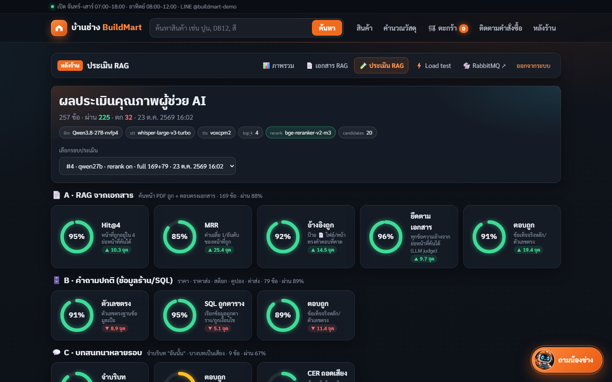
*ภาพจริง: หน้า `/admin/eval` ในเว็บ (เลือก run · เทียบ 2 run · กรองเฉพาะข้อผิด) — ภาพนี้จับระหว่างรอบทดลองก่อนตัดสินครบ ตัวเลขสุดท้ายดูตารางด้านบน (run `ai-rerank-on-v2` / `ai-rerank-off-v2`)*

### F3 · ขั้นที่ 9 · พรอมต์ ⑨ — load test: รับผู้ใช้พร้อมกันได้กี่คน

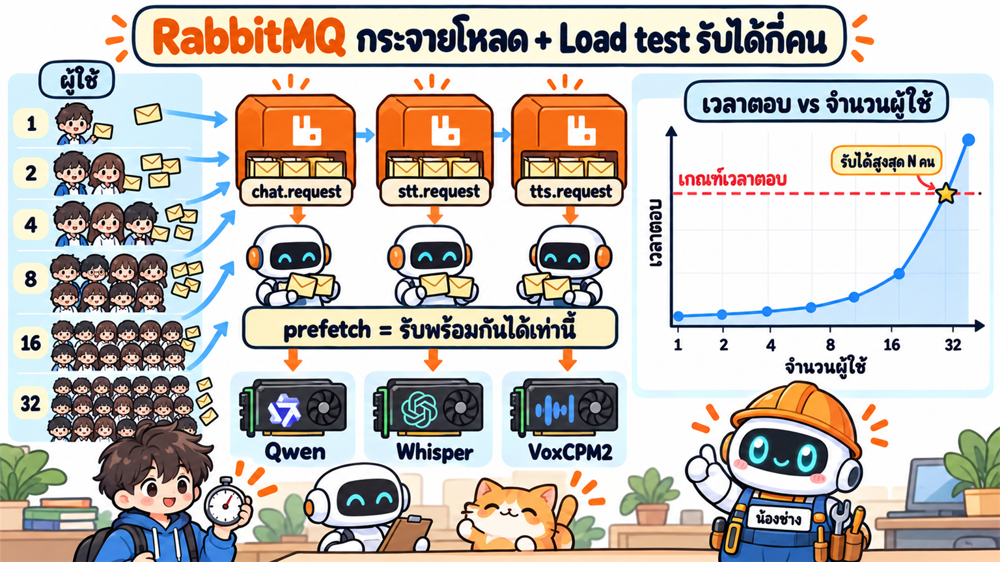
*ภาพแนวคิด (Imagegen ด้วย cyolo)*

ยิงผู้ใช้จำลองพร้อมกัน **1 → 2 → 4 → 8 → 16 → 32 คน** ผ่าน**ทางเดียวกับผู้ใช้จริง** (web → RabbitMQ → worker → GPU) ขั้นละ ~1 นาที แล้วดูว่าถึงกี่คนยัง "ไหว" (เกณฑ์ใน [`loadtest/config.json`](_solution/buildmart/loadtest/config.json): แชท p95 ≤ 20 วิ + คำแรก p95 ≤ 6 วิ · STT p95 ≤ 5 วิ · TTS p95 ≤ 10 วิ · error ≤ 2%)

💬 วางใน Claude Code เดิม:

```text
ทำ load test ระบบ BuildMart ที่ deploy อยู่ (โหมด AI จริง) ตาม BUILDMART.md ข้อ 9 ว่ารับผู้ใช้พร้อมกันได้กี่คน
(ถ้าแอปคือ _solution/buildmart ใช้ node loadtest/run_load.mjs · ถ้าเป็น my_buildmart/app ใช้ของทีม)
1. ระหว่างทดสอบ ให้เก็บ nvidia-smi ของ GPU ทั้ง 3 เครื่องบน Vast ทุก 5 วินาที (GPU % · VRAM · วัตต์) ผ่าน skill vastai แล้ววาดกราฟ 3 เส้นเป็น png ใส่เส้นประตอนจบแต่ละรอบ
2. รันทีละโหมด: chat · stt · tts · rerank · voice (เสียง→เสียง) ด้วยผู้ใช้ 1,2,4,8,16,32 ขั้นละ 60 วินาที · บันทึกความยาวคิว RabbitMQ ทุกขั้น
3. หาค่าที่ดีขึ้น: ลอง STT_PREFETCH 8 · CHAT_PREFETCH 8 · --scale chat-worker=2 · TTS_PREFETCH 4 แล้วรันโหมดนั้นซ้ำ เก็บค่าที่ดีที่สุดไว้
4. ถ้า Qwen ตอบ 503 ค้าง ให้หยุดรอบนั้น สตาร์ต server ใหม่บน Vast (มี watchdog แล้ว) แล้วรันใหม่ · คำตอบ "ระบบขัดข้อง" ต้องนับเป็น error
5. ส่งผลทุกรอบเข้า /api/admin/load แล้วสรุปภาษาไทย: ตาราง โหมด | ผู้ใช้สูงสุดที่ไหว | p50/p95 | ปริมาณงาน (token/s · คลิป/s · เสียง/s) · คอขวดอยู่ที่ GPU ไหน · prefetch ที่แนะนำ · ลิงก์ภาพกราฟ GPU
```

📤 **ผลจริง** (23 ต.ค. 2026 · 17:00–18:30 · ผลทุกรอบใน [`loadtest/results/ai-*.json`](_solution/buildmart/loadtest/results/)):

| โหมด (ตั้งค่า) | ผู้ใช้สูงสุดที่ไหว | p50 / p95 ที่จุดนั้น | ปริมาณงาน · หมายเหตุ |
|---|---|---|---|
| 💬 **แชท** (prefetch 4 · 1 worker) | **4 คน** | 4.7 / 7.1 วิ (คำแรก p95 5.8 วิ) | ต่อคน: **147 tok/s** ตอนอยู่คนเดียว → **37** ที่ 4 คน → 28 ที่ 8 คน · รวมทั้งเครื่อง ~40–60 tok/s · 8 คนขึ้นไปคำแรกช้าเกิน 6 วิ (รอคิว) |
| 💬 แชท prefetch 8 หรือ `--scale chat-worker=2` | 4 คน | 4.5 / 6.4 วิ | ได้เพิ่มแค่ ~15% ที่ 16+ คน (51–63 tok/s) — **NInfer รับได้ 4 ช่องเป็นเพดานจริง** อยากได้มากกว่านี้ต้องเพิ่ม GPU |
| 👂 **ฟัง** (STT prefetch 4) | 16 คน | 2.9 / 4.1 วิ | ~5.5 คลิป/วิ |
| 👂 **ฟัง** (STT prefetch **8**) | **32 คน** | 4.0 / 4.1 วิ | **7.9 คลิป/วิ** (+44%) · ที่ 16 คน p95 ลดจาก 4.1 → 2.4 วิ |
| 🗣️ **พูด** (TTS prefetch 2) | **2 คน** | 5.1 / 5.8 วิ | 0.38 งาน/วิ (เสียง 3.4 วิ ต่อ 1 วิ) · prefetch 4 **ไม่ช่วย** เพราะ VoxCPM2 ทำทีละงาน |
| 🎯 **rerank** | 16 คน (ทุกขั้นผ่าน) | 0.22 / 0.23 วิ | **1,407 ย่อหน้า/วิ** — ไม่ใช่คอขวด |
| 🎙️ **เสียง→เสียง** (chat 8 · stt 8 · tts 2 + retry) | **4 คน** | 3.8 / 16.6 วิ · error 0 | p50 ที่ 1–4 คน **3.1–3.8 วิ** · 8 คนขึ้นไปคิว TTS ยาว (p95 40 วิ) |


*ภาพจริง: GPU ทั้ง 3 ใบระหว่าง load test · เส้นประ = จบแต่ละรอบ · เห็นชัดว่าแต่ละรอบใช้ GPU ใบไหน — นี่คือข้อดีของการแยก GPU ตามงาน*

**อ่านผลยังไง — ทำไม prefetch สำคัญ:**
- **คอขวดไม่เท่ากันทุกใบ:** แชท 4 คน (Qwen) · ฟัง 32 คน (Whisper) · พูด 2 คน (VoxCPM2) · rerank เหลือเฟือ → ระบบรวม "เสียง→เสียง" ไหว **4 คน** เท่ากับใบที่อ่อนสุดในเส้นทาง
- **prefetch ที่ใช่ = ตรงกับที่ GPU ทำพร้อมกันได้จริง:** Whisper ทำ batch ได้ → ให้งานไปรอที่ GPU 8 งาน (prefetch 8) จะถูกรวม batch เดียว ได้งานเพิ่ม 44% · VoxCPM2 ทำทีละงาน → prefetch 4 แค่ย้ายแถวจาก RabbitMQ ไปรอใน GPU (มองไม่เห็นคิว · timeout ง่ายขึ้น) ไม่ได้เร็วขึ้น
- **คิวไม่ทำให้เร็วขึ้น แต่ทำให้ไม่พัง:** ที่ 32 คน ทุกคนยังได้คำตอบ (ช้าลง) แทนที่จะ error · และตอน Qwen ล่ม งานยังรออยู่ในคิว
- **อยากรับมากกว่านี้:** เพิ่ม GPU ของงานที่เป็นคอขวด (Qwen ใบที่ 2 · VoxCPM2 ใบที่ 2) แล้ว `--scale` worker ชี้ไปใบใหม่ — RabbitMQ แจกงานให้เองแบบ round-robin

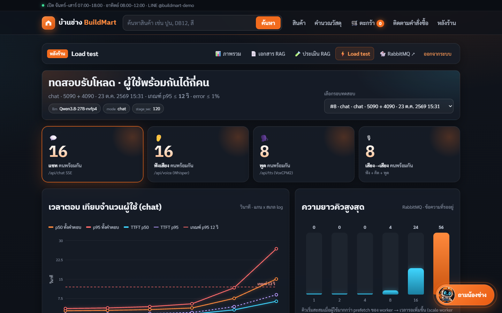
*ภาพจริง: หน้า `/admin/load` (เลือก run · กราฟเวลาตอบ vs ผู้ใช้ · ความยาวคิว) — ภาพนี้จับจากรอบทดลองแรกที่ยังใช้เกณฑ์เดิม ตัวเลขสุดท้ายดูตารางด้านบน*

---

## ส่วน G · ลบเครื่อง GPU ทั้ง 3 ใบ + สรุปค่าใช้จ่าย (ทำตอนเรียนจบเท่านั้น · ห้ามข้าม!)


*ภาพแนวคิด (Imagegen ด้วย cyolo)*

> ⏱️ เครื่องทั้ง 3 ใบใช้**ต่อเนื่อง**ตั้งแต่ ④ ⑤ จนถึง ⑨ — **ลบเมื่อทำทุกขั้นเสร็จแล้วเท่านั้น** (ลบก่อน = ต้องเช่า + ติดตั้งใหม่ ~15 นาที) · แต่**ห้ามเปิดทิ้งข้ามวัน**: เปิดไว้เฉย ๆ ก็คิดเงิน ~$2.06/ชม. (~$49/วัน)

### ขั้นที่ 10 · พรอมต์ ⑩ — ลบเครื่อง

🖥️ `yolo1` → 💬 วาง:

```text
ใช้ skill vastai ลบเครื่องป้าย bm-qwen-5090 · bm-stt-4090 · bm-voice-4090 (destroy ไม่ใช่ stop) แล้วยืนยันว่าไม่มีเครื่องเหลือในบัญชี พร้อมสรุปค่าใช้จ่ายเป็นตารางภาษาไทยแยกเครื่อง (GPU · เวลาที่เปิด · ราคา/ชม. · ค่า GPU · ค่า disk · ค่าดาวน์โหลด · รวม) และยอดรวมทั้ง 3 เครื่อง ห้ามแสดงยอดเครดิตคงเหลือ
```

💬 แล้วใน Claude Code บน Windows:

```text
ปิดระบบ BuildMart ที่ deploy ไว้: docker compose -p buildmart down ในโฟลเดอร์แอป (เก็บ volume ไว้ ไม่ใส่ -v) แล้วลบไฟล์ .env.vast และ .env.aibox ทั้งในโฟลเดอร์นี้และโฟลเดอร์แอป เพราะ key ใช้ไม่ได้แล้ว · อยากเปิดเว็บต่อแบบฟรีให้ up ใหม่ด้วย --profile mock
```

📤 **ค่าใช้จ่าย** (ราคาจริงจากหน้า Instances · ภาพ ⑤ ด้านบน):

| เครื่อง | GPU | ที่ตั้ง | ราคา/ชม. | ใช้ทำอะไร |
|---|---|---|---|---|
| bm-qwen-5090 | RTX 5090 32 GB | สเปน | **$1.059** | Qwen (คิด/ตอบ) |
| bm-stt-4090 | RTX 4090 24 GB | แคลิฟอร์เนีย สหรัฐฯ | **$0.498** | Whisper (ฟัง) |
| bm-voice-4090 | RTX 4090 24 GB | แคลิฟอร์เนีย สหรัฐฯ | **$0.498** | VoxCPM2 + reranker (พูด + จัดอันดับ) |
| **รวม 3 ใบ** | | | **$2.055/ชม.** | ≈ $0.034 ต่อนาที |

ตัวอย่างเวลาที่ใช้ GPU จริงในรอบนี้: ประเมิน RAG 2 รอบ ~25 นาที (≈ $0.85) · load test ทุกโหมด ~1.5 ชม. (≈ $3.1)

<!-- COST_RESULT: เติมหลังผู้สอนรันพรอมต์ ⑩ จริง — destroyed:[…] · ตรวจซ้ำ 0 เครื่อง · ตารางเวลาที่เปิด/ค่า GPU/disk/ดาวน์โหลด/รวม ต่อเครื่อง + ยอดรวม -->

แล้วเปิด [cloud.vast.ai → Instances](https://cloud.vast.ai/instances/) เช็คด้วยตาว่า**ว่าง** · **stop ≠ destroy** (stop ยังเสียค่า disk)

---

## ส่วน H · ทำไม่ได้? ใช้เฉลย (docker compose คำสั่งเดียว)

เฉลยที่ผู้สอนให้ทีม AI สร้างตาม `BUILDMART.md` แล้วทดสอบจริงทั้ง mock และ AI 3 GPU:

| เฉลย | อยู่ที่ | ใช้เมื่อ |
|---|---|---|
| ระบบ BuildMart ทั้งระบบ | [`_solution/buildmart/`](_solution/buildmart/README.md) | ทีมสร้างไม่ผ่าน / อยากลองระบบที่ถูกต้องเลย |
| GPU-1 Qwen บน Vast.ai | [`_solution/vast_qwen/README.md`](_solution/vast_qwen/README.md) | พรอมต์ ④ ไม่สำเร็จ (คำสั่ง + flag + watchdog) |
| GPU-2/3 ai-box บน Vast.ai | [`_solution/vast_aibox/README.md`](_solution/vast_aibox/README.md) | พรอมต์ ⑤ ไม่สำเร็จ (โค้ด server + ผลวัด) |
| เพลย์ลิสต์ · ประเมิน · load test | [`e2e/`](_solution/buildmart/e2e/README.md) · [`eval/`](_solution/buildmart/eval/README.md) · [`loadtest/`](_solution/buildmart/loadtest/) | อยากรันทดสอบ/วัดผลเอง |

🖥️ PowerShell / Git Bash ที่ `_solution/buildmart` (build ครั้งแรก ~5–10 นาที):

```bash
docker compose -p buildmart --profile mock up -d --build
```

- **ฟรี** ไม่ต้องใช้ GPU (`mock-llm` แทน GPU ทั้ง 3 ใบ · เสียงตอบเป็นเสียง VoxCPM2 ที่อัดไว้) · เปิด http://localhost:3400 · RabbitMQ UI http://localhost:15672
- **AI จริง:** วาง `.env.vast` (จาก ④) + `.env.aibox` (จาก ⑤) ใน `_solution/buildmart/` แล้ว `docker compose -p buildmart up -d --build`
- รีเซ็ตข้อมูล: `docker compose -p buildmart down -v` แล้ว up ใหม่ · สัญญากลางของทีม: [CONTRACT.md](_solution/buildmart/CONTRACT.md) + [CONTRACT_V3.md](_solution/buildmart/CONTRACT_V3.md)

> 💡 เฉลยถูกสร้างแบบ multi-agent เหมือนกัน: agent หลายตัว (โครงระบบ · หน้าร้าน · 3D · แชท · RAG · เสียง · ai-box · ประเมิน · load test · เพลย์ลิสต์) ทำงานขนานตามสัญญากลางฉบับเดียว

---

## ปรับ LAB เอง (แก้แค่พรอมต์ / requirement)

| อยากได้ | แก้ตรงไหน |
|---|---|
| โจทย์อื่น / ร้านอื่น | แก้ `BUILDMART.md` + เปลี่ยน PDF ใน `documents/` แล้วเริ่มพรอมต์ ① ใหม่ |
| จำกัดจำนวน agent | พรอมต์ ② ③ `MAX_AGENTS=6` |
| ไม่เช่า GPU (ฟรี) | ข้ามพรอมต์ ④ ⑤ · deploy ด้วย `--profile mock` · ข้าม ⑧ ⑨ (หรือรันกับ mock เพื่อดูวิธี) |
| เช่าแค่ 5090 ใบเดียว | ข้าม ⑤ · ไม่มี `.env.aibox` → ฟัง/พูด/rerank ใช้ mock แต่แชทใช้ Qwen จริง |
| กันโควตาบัญชีไว้ใช้งานอื่น | พรอมต์ ③ เติม `BUDGET=yolo2=10,yolo3=5` |
| บอกวันหมดแพลน (ให้ใช้ก่อน) | พรอมต์ ③ เติม `EXPIRES=yolo3=2026-10-30` |
| Whisper เร็วขึ้น (แม่นน้อยลง) | ai-box `WHISPER_MODEL=large-v3-turbo` (เร็ว ~2.9 เท่า · CER ไทยแย่ลง 5.5 จุด) |
| โมเดล LLM อื่นของ NInfer | พรอมต์ ④ เปลี่ยน `Qwen3.8-27B แบบ nvfp4` เป็นรุ่นอื่นใน [neroued](https://huggingface.co/neroued) |

## ความปลอดภัย (อ่านให้จบ)

- worker ทุกตัวรันแบบ**ข้ามการขออนุญาต** (`--dangerously-skip-permissions` / bypass sandbox) ใน container — ห้ามรัน LAB นี้บนเครื่องจริงนอก container
- `.env` · `.env.vast` · `.env.aibox` · `auth.json` · `.credentials.json` **ห้ามเปิดใน JupyterLab** และห้ามให้ AI พิมพ์ค่า · `.env.vast` `.env.aibox` และ `my_buildmart/` ถูก ignore แล้ว
- ai-box ทุก endpoint (ยกเว้น `/health`) ต้องมี key · ไม่มี key → 401 · เสียงลูกค้าถูกส่งไป GPU-2 บนคลาวด์ (ไม่ใช่ข้อมูลจริงในแล็บนี้ แต่ระบบจริงต้องแจ้งผู้ใช้)
- ⚠️ **กับดักที่เจอจริง:** `.env` ที่มี `# comment` ต่อท้ายบรรทัดค่า → `docker --env-file` เก็บ comment เป็นส่วนของค่า → skill หา SSH key ไม่เจอ · comment ต้องอยู่บรรทัดของมันเองเท่านั้น
- เว็บ BuildMart เป็นเว็บทดลอง: รหัสหลังร้าน `admin1234` · RabbitMQ `guest/guest` ใช้แค่ในเครื่อง (ผูก `127.0.0.1`)
- GPU คิดตามเวลา**จนกว่าจะลบเครื่อง** — ทำพรอมต์ ⑩ ทุกครั้งที่เรียนจบ

## เช็คลิสต์

| ✓ | ขั้น | ผลที่ต้องเห็น |
|---|---|---|
| ☐ | ⓪ doctor | ✅ ทุกข้อ · รายชื่อบัญชีที่ล็อกอิน |
| ☐ | ① DAG | `out/buildmart/dag.png` · สายวิกฤต |
| ☐ | ② Gantt | `out/buildmart/gantt.png` · 3 ตัวเลข |
| ☐ | ③ ทีมสร้าง | `my_buildmart/BOARD.md` ✅ ครบ · `my_buildmart/app/TEST_REPORT.md` ผ่าน (mock) |
| ☐ | ④ Qwen 5090 | `.env.vast` 3 บรรทัด · ทดสอบภาษาไทยผ่าน · watchdog รันอยู่ |
| ☐ | ⑤ ai-box 4090 × 2 | `.env.aibox` 4 บรรทัด · ถอดเสียง V01 ถูก · ได้ไฟล์เสียงไทย |
| ☐ | ⑥ deploy | http://localhost:3400 ถามด้วยเสียงแล้วน้องช่างตอบด้วยเสียง + ป้ายอ้างอิง |
| ☐ | ⑦ เพลย์ลิสต์ | TEST_REPORT โหมด ai · MP4 เคส T/V มีเสียง |
| ☐ | ⑧ ประเมิน RAG | `/admin/eval` มี 2 run (rerank on/off) · `RESULTS.md` |
| ☐ | ⑨ load test | `/admin/load` · กราฟ GPU · ตารางผู้ใช้สูงสุดต่อโหมด |
| ☐ | ⑩ ลบเครื่อง | Vast.ai Instances **ว่าง** · สรุปค่าใช้จ่าย 3 เครื่อง |

## แก้ปัญหา

| อาการ | สาเหตุ / วิธีแก้ |
|---|---|
| doctor ขึ้นว่าไม่มี container | ยังไม่ได้เปิด `multi-account-devtool` (LAB 03) — planner ยังใช้ได้ แต่ถือว่าทุกบัญชีเหลือเต็ม |
| ตารางโควตาขึ้น "ยังไม่ล็อกอิน" ทุกบัญชี | container ใหม่ไม่ได้ต่อ volume `ai-accounts` หรือยังไม่ได้ล็อกอิน |
| งาน `FAILED` | ตัวคุมวงอ่าน log แล้วแบ่งงาน/แก้ prompt ให้เอง · ดู `/root/runs/buildmart/logs/<งาน>.a<รอบ>.*.jsonl` |
| Playwright หา browser ไม่เจอ (ใน container) | ต้องใช้ `@playwright/test` เวอร์ชันที่ตรงกับ `/ms-playwright` (ตัวคุมวงล็อกไว้ใน `_shared.md`) ห้าม `npx playwright install` |
| skill vastai ssh ไม่ได้ / หา key ไม่เจอ | `.env` มี comment ต่อท้ายบรรทัด หรือเปิด Terminal ไม่ใช่ที่ `/workspace` |
| ไม่มีเครื่องตามเพดานราคา | อย่ากรองเข้ม (direct port / duration / ค่าดาวน์โหลด) · รอ/ลองใหม่ หรือใช้ mock |
| แชทบอทขึ้น "ขออภัย ระบบ AI ขัดข้อง" | Qwen ตอบ 503 (engine ล่ม) → watchdog สตาร์ตใหม่ภายใน ~1 นาที · ไม่มี watchdog ให้สั่ง AI สตาร์ต ninfer-serve ใหม่ · หรือเครื่องถูกลบไปแล้ว → ใช้ `--profile mock` |
| ปุ่มไมค์ไม่ขึ้น / พูดแล้วไม่ได้ข้อความ | ไม่มี `.env.aibox` หรือ STT_URL ผิด (ดู log stt-worker) · เบราว์เซอร์ต้องอนุญาตไมค์ และเปิดผ่าน `localhost` |
| เสียงตอบช้ามากตอนคนเยอะ | VoxCPM2 ทำทีละงาน (รับ ~2 คน) — ปกติตามผล load test · เพิ่ม GPU ใบที่ 2 สำหรับ TTS |
| ฉาก 3D ไม่ขึ้น | เครื่องไม่มี WebGL → เว็บแสดงรูปนิ่งแทนเอง (ตั้งใจ · เคส D03) |
| อยากเริ่มใหม่ทั้งหมด | ปิดเว็บ/ลบเครื่องก่อน แล้ว 🖥️ `mv /root/runs/buildmart /root/runs/buildmart.old` และลบ `out/buildmart` |

## ไฟล์ในโฟลเดอร์นี้

| ไฟล์ | คืออะไร |
|---|---|
| `readme.md` | ทุกอย่างของ LAB (ไฟล์นี้) |
| [BUILDMART.md](BUILDMART.md) | **requirement**: ข้อมูลร้าน · สินค้า 36 รายการ · สถาปัตยกรรม (RabbitMQ · Hybrid RAG + reranker · เสียง · GPU 3 ใบ) · เกณฑ์ทดสอบ 62 เคส · ประเมิน RAG · load test |
| [documents/](documents/) | PDF 6 ไฟล์ (20–22 หน้า) แหล่งข้อมูลของ RAG |
| [test-fixtures/voice/](test-fixtures/voice/) | เสียงลูกค้า V01–V10 สำหรับทดสอบ |
| [ORCHESTRA_RECIPE.md](ORCHESTRA_RECIPE.md) | "สูตร" ที่ตัวคุมวงอ่านแล้วทำตาม (เริ่มจากแผน DAG) |
| [ALGORITHM.md](ALGORITHM.md) | อัลกอริทึม KC-QUEST แบบสไลด์ ทีละสมการ |
| [tools/planner.py](tools/planner.py) | แตก DAG · คิด rank · จำลองเวลา · วาด DAG/Gantt (ตัวเดียวกับ LAB 04.3) |
| [tools/orch.py](tools/orch.py) | "มือ" ของตัวคุมวง + KC-QUEST · `test_kcquest.py` unit test · `sim.py` ตัวจำลอง |
| [fast_track/](fast_track/README.md) | พรอมต์เดียวจบทั้ง LAB (AI จริง / ฟรี) |
| [_solution/](_solution/buildmart/README.md) | เฉลยระบบเต็ม + ai-box + วิธีเปิด Qwen + เพลย์ลิสต์ + ประเมิน + load test |
| `image/` | `v2-*` `v3-*` `m-*` ภาพแนวคิด · `real-*` ภาพจริงจากการทดสอบ |
| `out/` · `my_buildmart/` | ผลของนักศึกษา (แผน · โค้ดที่ทีมสร้าง) — ไม่เก็บใน git |

<sub>ทดสอบจริง 23 ต.ค. 2026 · Claude Code (opus) + Codex CLI · container `tuchsanai/multi-account-devtool:2569_1` · บัญชี yolo1–3 + cyolo1 · Vast.ai RTX 5090 + RTX 4090 × 2 · ภาพแนวคิดสร้างด้วย cyolo</sub>
