# LAB 04 · ติดตั้ง Skill ส่วนกลาง (vastai · yolo · cyolo) ด้วยการลากวาง

LAB นี้ไม่ต้องพิมพ์คำสั่ง — แค่**ลากโฟลเดอร์ skill จาก Windows ไปวางใน JupyterLab** ของ container `multi-account-devtool` (จาก LAB 03)
วางที่โฟลเดอร์ `shared` ครั้งเดียว ทุกบัญชี `yolo1`–`yolo5` และ `cyolo1`–`cyolo5` ใช้ skill ได้ทันที

**ต้องมีก่อน:** [LAB 03](../03_MultiAccount_Container/README.md) — container `multi-account-devtool` กำลังรัน และล็อกอิน `yolo1` กับ `cyolo1` แล้ว (LAB 03 ขั้นที่ 4)
**เวลา:** ~15 นาที


*ภาพแนวคิด (Imagegen ด้วย cyolo): ภาพรวม 4 ขั้น*

## skill ที่จะติดตั้ง

| skill | ทำอะไร |
|---|---|
| `yolo` | สั่ง Claude Code **บัญชีอื่น** (`yolo1`–`yolo5`) ทำงานแทน เช่น "ให้ yolo2 ช่วยสรุปไฟล์นี้" |
| `cyolo` | สั่ง Codex (`cyolo1`–`cyolo5`) ทำงานแทน เช่น "ให้ gpt ช่วยตรวจโค้ด" |
| `vastai` | เช่า GPU บน Vast.ai (**มีค่าใช้จ่ายจริง** — LAB นี้ติดตั้งไว้เฉย ๆ ยังไม่ใช้) |

## ต้นทางและปลายทาง (สำคัญ จำให้ได้)

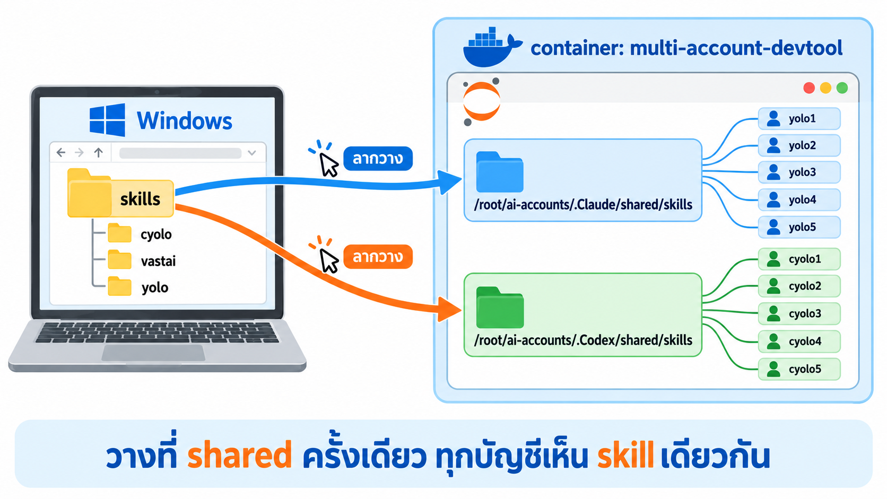
*ภาพแนวคิด (Imagegen ด้วย cyolo): วาง 2 ที่ — ที่หนึ่งของ Claude อีกที่ของ Codex (ลากโฟลเดอร์**ข้างใน** `skills` ทีละโฟลเดอร์)*

| | อยู่ที่ไหน | เปิดอย่างไร |
|---|---|---|
| **ต้นทาง** (Windows) | `Teaching_CWN2026\00_resource\skills\` มีโฟลเดอร์ `cyolo` `vastai` `yolo` | File Explorer |
| **ปลายทางที่ 1** — ให้ `yolo1`–`yolo5` (Claude Code) | `/root/ai-accounts/.Claude/shared/skills` | http://localhost:8886/lab/tree/root/ai-accounts/.Claude/shared/skills |
| **ปลายทางที่ 2** — ให้ `cyolo1`–`cyolo5` (Codex) | `/root/ai-accounts/.Codex/shared/skills` | http://localhost:8886/lab/tree/root/ai-accounts/.Codex/shared/skills |

> ใช้ port อื่นใน LAB 03? เปลี่ยน `8886` ในลิงก์เป็น port ของคุณ · ชื่อที่ขึ้นต้นด้วยจุด (`.Claude`, `.Codex`) คือโฟลเดอร์ซ่อน แต่ JupyterLab ใน image นี้แสดงให้เห็นอยู่แล้ว

## ขั้นที่ 1 · เตรียมโฟลเดอร์ skill บน Windows

1. เปิดหน้า [00_resource/skills บน GitHub](https://github.com/Tuchsanai/Teaching_CWN2026/tree/main/00_resource/skills)
2. ไปที่หน้าแรกของ repo → กดปุ่มเขียว **Code → Download ZIP** → แตกไฟล์ ZIP (หรือใช้โฟลเดอร์ที่ clone ไว้แล้ว)
3. เปิด File Explorer ไปที่ `Teaching_CWN2026\00_resource\skills` ต้องเห็น 3 โฟลเดอร์แบบนี้:

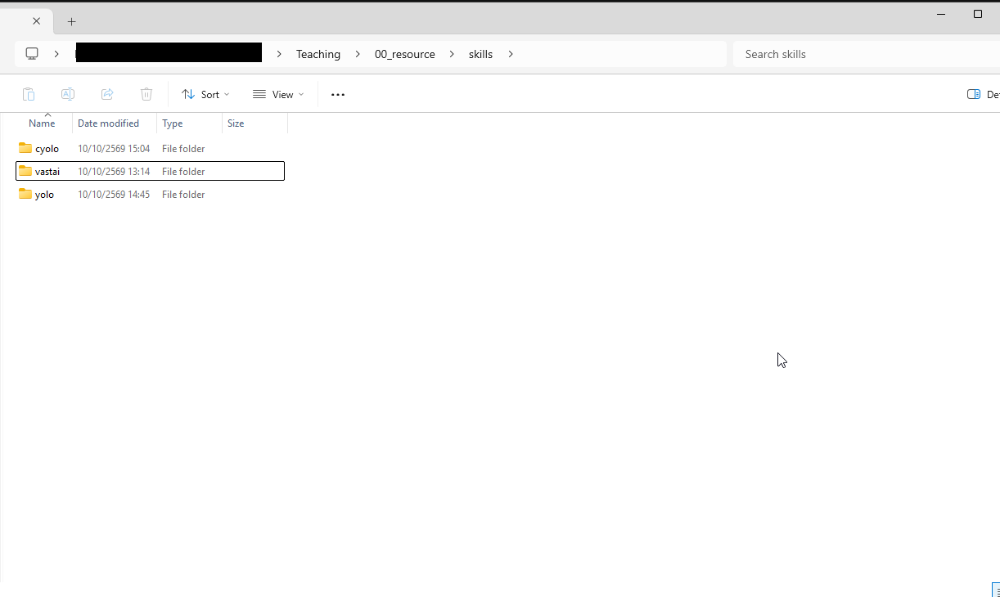
*ภาพจริง: ต้นทาง — แต่ละโฟลเดอร์มีไฟล์ `SKILL.md` อยู่ข้างใน*

## ขั้นที่ 2 · เปิดปลายทางที่ 1 ใน JupyterLab

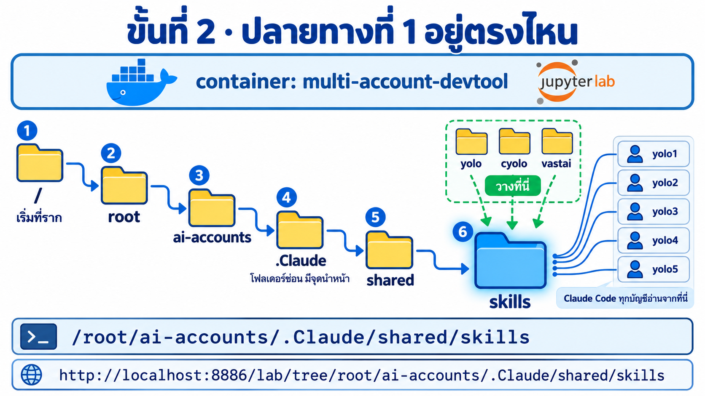
*ภาพแนวคิด (Imagegen ด้วย cyolo): path นี้อยู่**ใน container** ไม่ใช่บน Windows — ไล่ลงไปทีละชั้น 6 ชั้น ปลายทางคือ `skills` ใต้ `.Claude`*

เปิดลิงก์นี้ในเบราว์เซอร์: **http://localhost:8886/lab/tree/root/ai-accounts/.Claude/shared/skills**

หรือคลิกเองในแถบไฟล์ด้านซ้าย: คลิกไอคอน 📁 (กลับไป `/`) → ดับเบิลคลิก `root` → `ai-accounts` → `.Claude` → `shared` → `skills`

ตรวจว่าแถบบนของรายการไฟล์เขียน **`/ … / .Claude / shared / skills /`** และข้างในมีแค่ `shared-check`

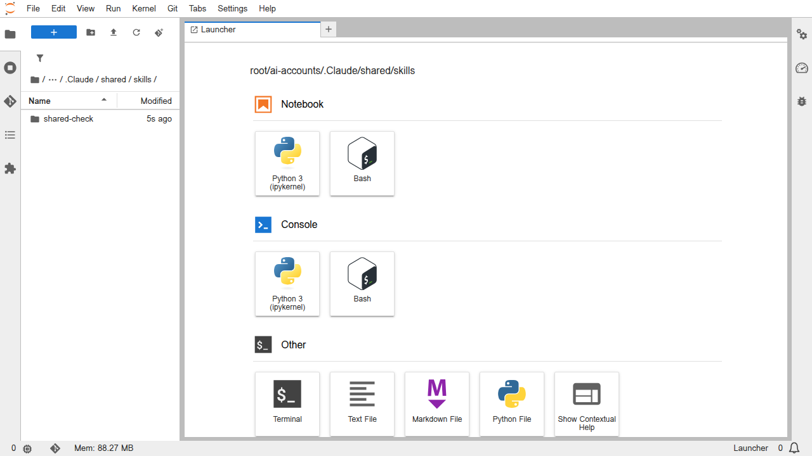
*ภาพจริง: ก่อนติดตั้ง*

## ขั้นที่ 3 · ลากวางทีละโฟลเดอร์

1. จัดหน้าต่าง File Explorer กับเบราว์เซอร์ให้อยู่ข้างกัน
2. ลากโฟลเดอร์ `yolo` จาก File Explorer ไปปล่อยใน**พื้นที่ว่าง**ของแถบไฟล์ JupyterLab (จะขึ้นกรอบเส้นประ)
3. **รอ**จนชื่อ `yolo` ขึ้นในรายการ แล้วค่อยลาก `cyolo` และ `vastai` ทีละอัน

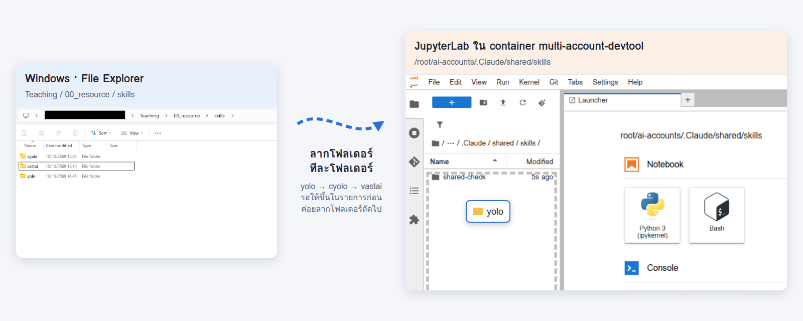
*ภาพประกอบจากภาพจริง 2 ภาพ: ซ้าย = Windows, ขวา = JupyterLab ใน container*

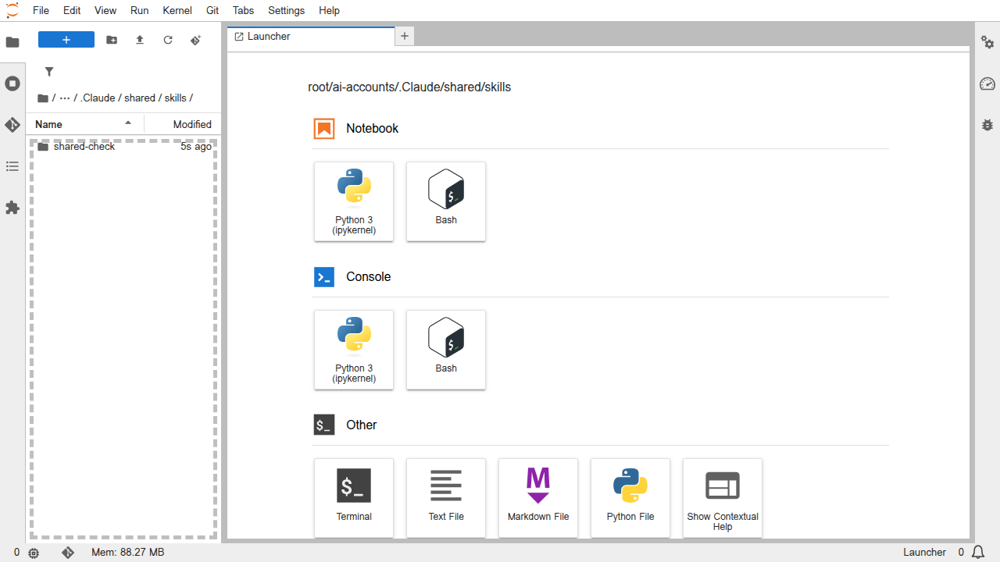
*ภาพจริง: กรอบเส้นประ = ปล่อยเมาส์ตรงนี้ได้*

> ⚠️ **ลากทีละโฟลเดอร์** — ถ้าเลือก 3 โฟลเดอร์แล้วลากพร้อมกัน JupyterLab จะสร้างไม่ครบหรือได้โฟลเดอร์ว่าง (ทดสอบแล้ว)
> ⚠️ **อย่าปล่อยบนชื่อ `shared-check`** — จะกลายเป็นวางเข้าไปข้างในโฟลเดอร์นั้น
> ถ้าเคยวางไว้แล้วและมีหน้าต่างถามให้เขียนทับ ให้กด **Overwrite**

**ผลที่ควรได้:** รายการมี `cyolo` `shared-check` `vastai` `yolo`


*ภาพจริง: ปลายทางที่ 1 ครบแล้ว — ดับเบิลคลิกเข้าไปในแต่ละโฟลเดอร์ต้องเห็นไฟล์ `SKILL.md`*

## ขั้นที่ 4 · ทำซ้ำที่ปลายทางที่ 2 (Codex)

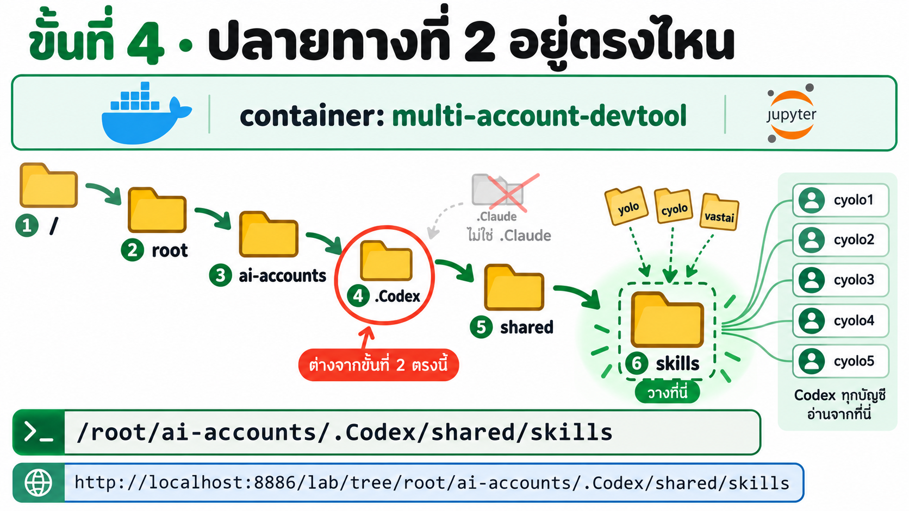
*ภาพแนวคิด (Imagegen ด้วย cyolo): ทางเดินเหมือนขั้นที่ 2 ทุกชั้น **ต่างกันแค่ชั้นที่ 4** — `.Codex` แทน `.Claude`*

เปิด **http://localhost:8886/lab/tree/root/ai-accounts/.Codex/shared/skills** (หรือคลิก `ai-accounts` → `.Codex` → `shared` → `skills`)
แล้วลาก `yolo` `cyolo` `vastai` ทีละโฟลเดอร์เหมือนขั้นที่ 3

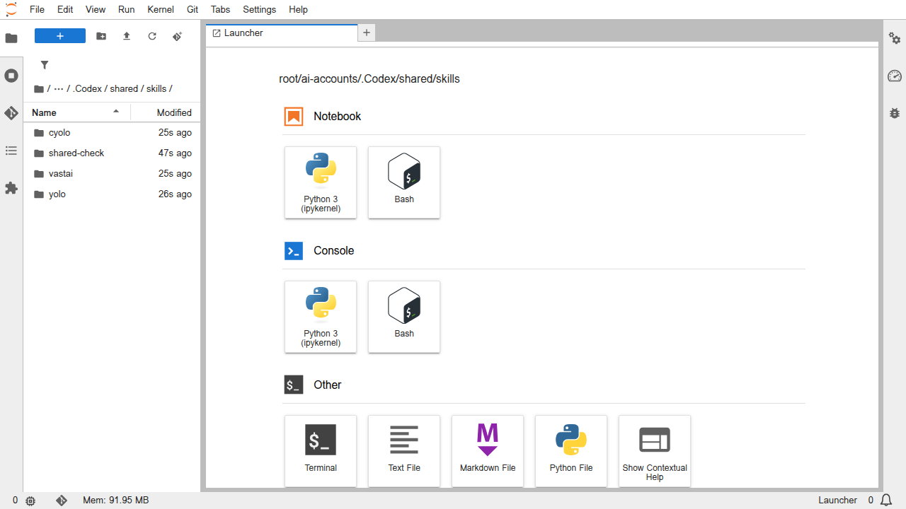
*ภาพจริง: ดูแถบบนต้องเขียน `.Codex / shared / skills` — ระวังวางผิดที่ เพราะหน้าตาเหมือนขั้นที่ 3*

> ทำไมต้องวาง 2 ที่: Claude Code (`yolo`) กับ Codex (`cyolo`) อ่าน skill คนละโฟลเดอร์

## ขั้นที่ 5 · ทดสอบว่าบัญชีโหลด skill แล้ว

**5.0 · เปิด Terminal ที่ `/workspace`** — Terminal ของ JupyterLab จะเปิดในโฟลเดอร์ที่แถบไฟล์ด้านซ้ายกำลังเปิดอยู่
ให้คลิกไอคอน 📁 แล้วดับเบิลคลิก `workspace` ก่อน (แถบบนเขียน `/ workspace /`) → กด **+ → Terminal**

> ถ้าเผลอเปิด Terminal ตอนแถบไฟล์ยังอยู่ที่ `skills` แล้ว `yolo1` ถามว่า **"Is this a project you created or one you trust?"** ให้เลือก **No, exit** แล้วกลับไปทำข้อ 5.0 ใหม่ (อย่าให้ AI ทำงานในโฟลเดอร์ skill)

**5.1 · Claude Code (`yolo1`)** — พิมพ์ `yolo1` กด Enter แล้วพิมพ์ถาม:

```text
คุณมี skill ชื่อ yolo, cyolo, vastai, shared-check ไหม ตอบเป็นตาราง: skill | มี/ไม่มี | ทำอะไร (สั้น ๆ)
```

จากนั้นพิมพ์:

```text
ใช้ skill shared-check
```

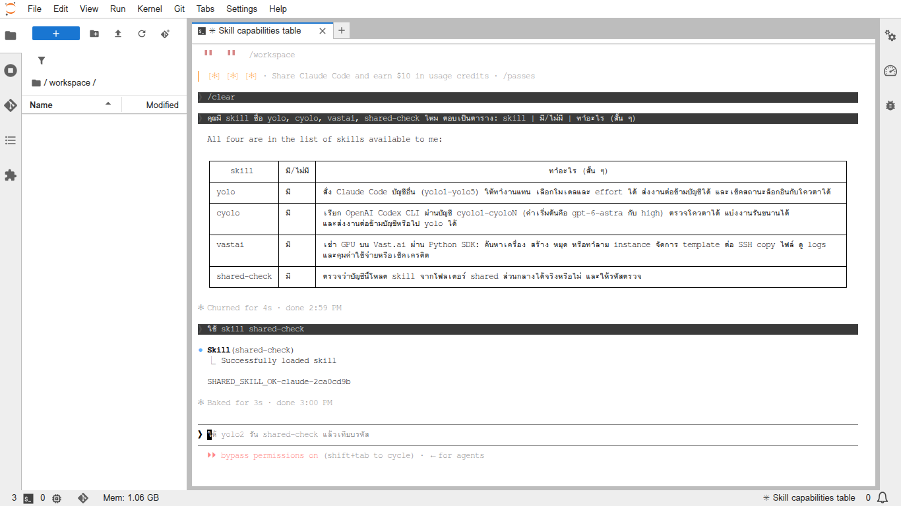
*ภาพจริง (`yolo1` บน container ของ LAB 03): ตารางเป็น "มี" ครบ 4 ตัว และ `Skill(shared-check) · Successfully loaded skill` ได้รหัส `SHARED_SKILL_OK-claude-…`*

ถ้าขึ้นหน้าต่าง **"Try the new fullscreen renderer?"** ให้เลือก **Not now** · เสร็จแล้วพิมพ์ `/exit` เพื่อออก

**5.2 · Codex (`cyolo1`)** — พิมพ์ `cyolo1` กด Enter

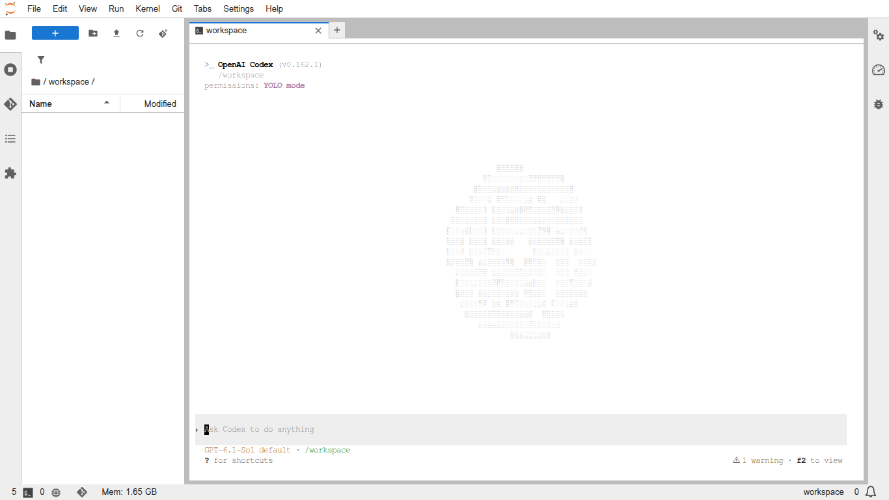
*ภาพจริง: `cyolo1` เปิดที่ `/workspace` พร้อมรับคำสั่ง*

> ถ้าขึ้นหน้าต่าง **Update available** (Codex ใน image เก่ากว่าเวอร์ชันล่าสุด) จะกด **Update now** หรือ **Esc** (ข้าม) ก็ได้ — ภาพในหน้านี้ถ่ายหลังอัปเดตเป็น v0.162.1 แล้ว ถ้าลบ container แล้วสร้างใหม่จาก image จะกลับเป็นเวอร์ชันใน image

แล้วถาม 2 ข้อความเดียวกับ 5.1

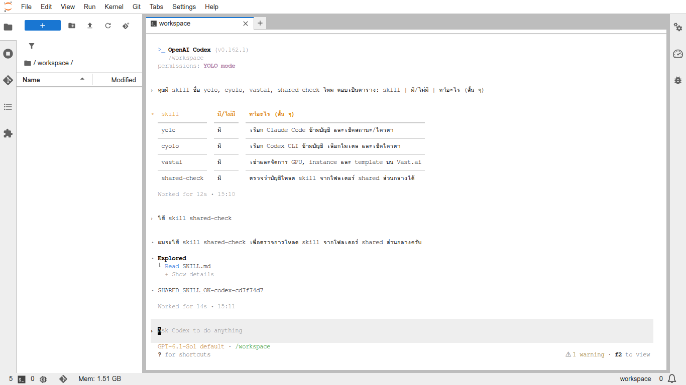
*ภาพจริง (`cyolo1` · Codex v0.162.1): ตาราง "มี" ครบ 4 ตัว และได้รหัส `SHARED_SKILL_OK-codex-…` (รหัสของ Codex ต่างจาก Claude เป็นเรื่องปกติ — คนละไฟล์ shared)* · เสร็จแล้วพิมพ์ `/quit` เพื่อออก

**5.3 · (ไม่บังคับ) ใช้ skill ข้าม CLI** — เปิด `yolo1` อีกครั้งแล้วพิมพ์:

```text
ใช้ skill cyolo ให้บัญชี cyolo1 (effort low) ตอบคำว่า PONG คำเดียว แล้วบอกฉันว่าได้คำตอบอะไร
```

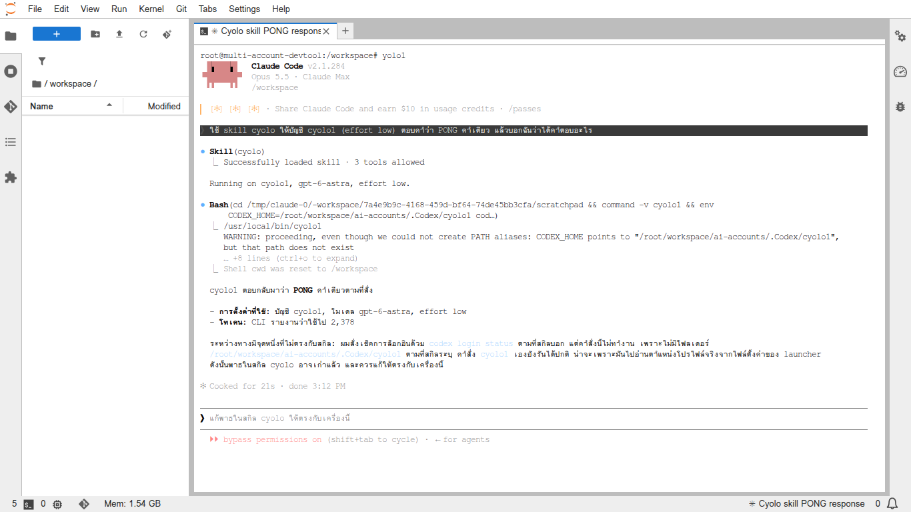
*ภาพจริง: `Skill(cyolo)` โหลดได้ และ `cyolo1` ตอบ **PONG** = Claude สั่งงาน Codex ผ่าน skill ได้จริง*

> ในภาพจะเห็น `WARNING ... /root/workspace/ai-accounts/.Codex/cyolo1 ... does not exist` — skill `cyolo` เขียน path ของเครื่องผู้สอนไว้ (`/root/workspace/ai-accounts`) ซึ่งไม่ตรงกับ container ของ LAB 03 (`/root/ai-accounts`) แต่ AI สลับไปใช้คำสั่ง `cyolo1` เองและทำงานสำเร็จ

| ทดสอบ | ผลที่ควรได้ | ✓ |
|---|---|---|
| `yolo1` ถาม 4 skill | ตาราง "มี" ครบ yolo, cyolo, vastai, shared-check | ☐ |
| `yolo1` ใช้ shared-check | `SHARED_SKILL_OK-claude-…` | ☐ |
| `cyolo1` ถาม 4 skill | ตาราง "มี" ครบ | ☐ |
| `cyolo1` ใช้ shared-check | `SHARED_SKILL_OK-codex-…` | ☐ |
| (ไม่บังคับ) `yolo1` → `cyolo1` | `PONG` | ☐ |

## ไม่เห็น skill? ตรวจตามนี้

1. **ปิดแล้วเปิดบัญชีใหม่** — skill ถูกโหลดตอนเปิดบัญชี ถ้าเปิด `yolo1` ค้างไว้ก่อนลากวาง ให้ `/exit` แล้วเปิดใหม่
2. **วางถูกที่ไหม** — ดูแถบบนของ JupyterLab ต้องเป็น `.Claude / shared / skills` หรือ `.Codex / shared / skills` เท่านั้น
3. **ซ้อนกันหรือเปล่า** — เปิดโฟลเดอร์ `yolo` แล้วต้องเห็น `SKILL.md` ทันที ถ้าเห็นโฟลเดอร์ `yolo` ซ้อนอีกชั้น ให้ลบชั้นนอกแล้วลากใหม่
4. **โฟลเดอร์ว่าง** — ถ้าข้างในไม่มี `SKILL.md` (มักเกิดจากลากหลายอันพร้อมกัน) ให้คลิกขวา → **Delete** แล้วลากใหม่ทีละอัน
5. **Codex เห็นไม่ครบ** — `cyolo1` เชื่อม skill ใหม่ให้เองตอนเปิด ปิดแล้วเปิด `cyolo1` ใหม่อีกครั้ง

## ข้อควรรู้

- หลังลากวางอาจเห็นโฟลเดอร์ `.ipynb_checkpoints` และใน `.Claude/shared/skills` อาจมีโฟลเดอร์ `synced` (Claude Code ดึง skill ของบัญชีมาเอง) — ไม่ใช่ skill ของ LAB นี้ ไม่ต้องลบ
- skill อยู่ใน volume `ai-accounts` → ลบ container แล้วสร้างใหม่ skill ยังอยู่ (เหมือนการล็อกอิน) แต่ถ้าลบ volume skill หายด้วย
- **อัปเดต skill:** ดาวน์โหลดเวอร์ชันใหม่ แล้วลากทับที่เดิมทั้ง 2 ที่ (กด Overwrite)
- `vastai` ใช้ `VAST_API_KEY` ในไฟล์ `.env` ([ตัวอย่าง](../../00_resource/.env_example)) และ**เสียเงินจริง**เมื่อเช่า GPU — ห้ามใส่ key ลงใน `SKILL.md`
- บน GitHub `00_resource/skills` อาจมีโฟลเดอร์อื่นเพิ่ม LAB นี้ลากเฉพาะ `yolo` `cyolo` `vastai`
- ทุกบัญชีเป็นผู้ใช้ `root` คนเดียวกันใน container — skill ใน `shared` ทุกบัญชีอ่านได้ ห้ามใส่รหัสผ่านหรือ token ลงใน skill
