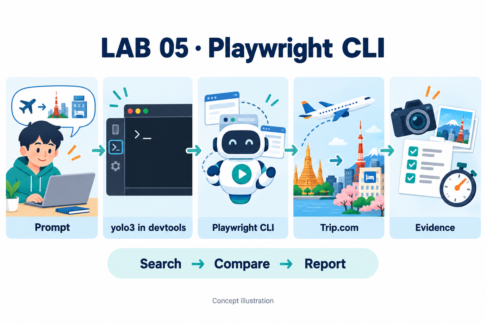
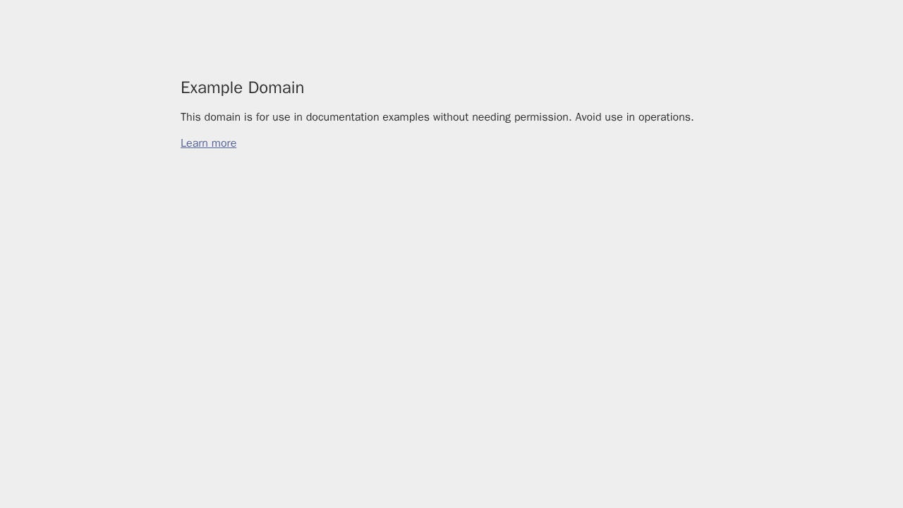
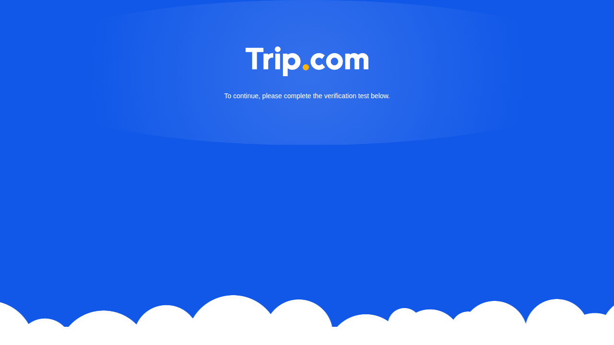
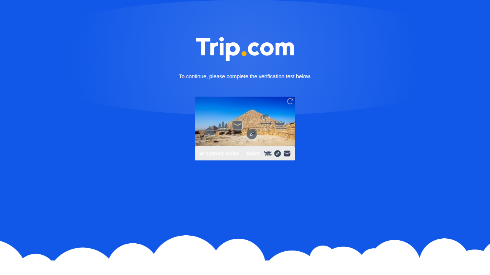

# LAB 05 — ใช้ Playwright CLI ให้ AI ค้นหาเที่ยวบินและโรงแรมบน Trip.com (แบบมีหลักฐาน)

> **เป้าหมาย:** ติดตั้ง **Playwright CLI** แล้วให้ AI (yolo3) ใช้ควบคุม browser เพื่อค้นหาเที่ยวบิน กรุงเทพฯ → ญี่ปุ่น และโรงแรม
> ทุกข้อสรุปต้องมี **หลักฐานจริง** (screenshot + snapshot + log เวลา)



*ภาพแนวคิด (concept illustration) **สร้างด้วย AI** — ผู้สอนสร้างภาพนี้ด้วยเครื่องมือสร้างภาพในตัวของ ChatGPT (ImageGen) ไม่ได้สร้างโดย yolo3
**ภาพนี้ไม่ใช่หลักฐานจากการทดลองจริง** ภาพหลักฐานจริงทั้งหมดอยู่ใต้ [`evidence/`](evidence/) และมีคำบรรยายว่า "หลักฐานจริง"*

---

## สารบัญ

1. [สิ่งที่จะได้เรียนรู้](#s1)
2. [คำศัพท์สำหรับมือใหม่](#s2)
3. [กฎสั้น ๆ ก่อนเริ่ม](#s3)
4. [สมมติฐานของห้องเรียน (แก้ไขได้)](#s4)
5. [ขั้นตอนปฏิบัติ](#s5)
6. [ผลการทดลองจริง (yolo3 ใน devtools, 2026-09-24)](#s6)
7. [เวลาที่วัดได้ และเวลาที่ควรเผื่อในคาบเรียน](#s7)
8. [โครงสร้างไฟล์ผลลัพธ์](#s8)
9. [Checklist ก่อนส่งงาน](#s9)
10. [วิธีแก้ปัญหา (Recovery)](#s10)
11. [Trace และ ref: สิ่งที่มักเข้าใจผิด](#s11)
12. [เอกสารอ้างอิงทางการ](#s12)

---

<a id="s1"></a>
## 1. สิ่งที่จะได้เรียนรู้

| # | ทักษะ | ตัวอย่างใน LAB |
|---|---|---|
| 1 | ติดตั้งและตรวจสอบเครื่องมือจากแหล่งทางการ | `npm view @playwright/cli` → `npm install -g @playwright/cli@latest` |
| 2 | อ่าน `--help` ก่อนใช้คำสั่ง (ไม่เดา option) | `playwright-cli --help screenshot` |
| 3 | สั่ง browser แบบ headless ผ่าน CLI | `open`, `snapshot`, `click`, `fill`, `screenshot`, `close` |
| 4 | ขั้นตอนค้นหาเที่ยวบิน → กำหนดวันเข้าพักจากเที่ยวบินจริง → ค้นหาโรงแรม | `prompt-trip.txt` ขั้น 0–6 |
| 5 | เก็บหลักฐานและจับเวลาอย่างซื่อตรง | `steps.md`, `commands.log`, `timing.md` |

<a id="s2"></a>
## 2. คำศัพท์สำหรับมือใหม่

| คำ | ความหมายแบบง่าย |
|---|---|
| **Playwright CLI** (`playwright-cli`) | โปรแกรมของ Microsoft ที่ใช้สั่ง browser ผ่านคำสั่งทีละบรรทัดใน Terminal |
| **headless** | browser ทำงานอยู่เบื้องหลังโดยไม่เปิดหน้าต่าง เราจะเห็นผลผ่าน screenshot แทน |
| **session** (`-s=trip`) | ชื่อของ browser ที่เปิดค้างไว้ ทำให้หลายคำสั่งใช้ browser ตัวเดียวกันได้ |
| **snapshot** | ข้อความ (YAML) ที่อธิบายว่าในหน้าเว็บมีปุ่ม ช่องกรอก หรือลิงก์อะไรบ้าง พร้อม **ref** เช่น `e12` |
| **ref** | "ป้ายชื่อชั่วคราว" ของ element ในหน้าเว็บ **เปลี่ยนทุกครั้งที่หน้าเว็บเปลี่ยน** |
| **screenshot** | ภาพหน้าจอจริงที่ใช้เป็นหลักฐาน |
| **trace** | บันทึกการทำงานสำหรับดูย้อนหลัง (ไม่ใช่สคริปต์ที่นำไปรันซ้ำได้) |
| **monotonic time** | นาฬิกาที่เดินไปข้างหน้าอย่างเดียว (`/proc/uptime`) ใช้จับเวลาได้แม่นกว่าเวลานาฬิกาปกติ |
| **PASS / FAIL / SKIP / BLOCKED** | ผ่าน / ไม่ผ่าน / ข้ามพร้อมเหตุผล / ถูกเว็บปิดกั้น |

<a id="s3"></a>
## 3. กฎสั้น ๆ ก่อนเริ่ม

1. **หยุดก่อนจองเสมอ** — ดูราคาได้ แต่ห้ามกดจนถึงหน้ากรอกข้อมูลผู้โดยสาร ห้ามล็อกอิน ห้ามกรอกข้อมูลส่วนตัว ห้ามชำระเงิน
2. **เจอ CAPTCHA ห้ามแก้หรือหลบเลี่ยง** — รอแล้วลองใหม่ 1 ครั้ง ถ้ายังติดให้รายงาน **BLOCKED** พร้อมหลักฐาน (ถือว่าเป็นผลที่ถูกต้อง)
3. **ไม่เห็นบนหน้าจอ = unknown** — ห้ามแต่งราคาหรือรีวิวขึ้นมาเอง

<a id="s4"></a>
## 4. สมมติฐานของห้องเรียน (แก้ไขได้)

โจทย์บอกแค่ "จากกรุงเทพฯ ไปญี่ปุ่น ออกเดินทางอีก 3 วัน" ซึ่งยังไม่พอสำหรับการค้นหาจริง
ค่าที่มีป้าย **สมมติฐานของห้องเรียน** ผู้สอนกำหนดขึ้นเพื่อให้ทำ LAB ได้ในคาบ **ไม่ใช่ข้อมูลที่ผู้ใช้กำหนดมา**
(แก้ได้ในกล่อง `พารามิเตอร์` ของ prompt Trip)

| พารามิเตอร์ | ค่าเริ่มต้น | ที่มา |
|---|---|---|
| `ORIGIN` | Bangkok — BKK หรือ DMK | โจทย์ |
| `DESTINATION` | Tokyo — HND หรือ NRT | สมมติฐานของห้องเรียน |
| `DEPART_OFFSET` | `3` → วันไป = วันที่รัน (Asia/Bangkok) + `DEPART_OFFSET` วันตามปฏิทิน | โจทย์ |
| `NIGHTS` | `4` → วันกลับที่ใช้ค้นหา = วันไป + `NIGHTS` วัน | สมมติฐานของห้องเรียน |
| `TRIP_TYPE` | ไป-กลับ, ผู้ใหญ่ 1 คน, Economy | สมมติฐานของห้องเรียน |
| `ROOMS` | 1 ห้อง, ผู้ใหญ่ 1 คน | สมมติฐานของห้องเรียน |
| `HOTEL_TARGET` | ประมาณ 3,000 THB/คืน | สมมติฐานของห้องเรียน (ไม่ใช่งบที่ผู้ใช้บอก) |
| `MAX_ITEMS` | เที่ยวบิน ≤ 3 รายการ, โรงแรม ≤ 3 แห่ง | สมมติฐานของห้องเรียน (จำกัดเวลาในคาบ) |

ตัวอย่างการคำนวณวันที่ (ใช้ตัวแปร ไม่พิมพ์ตัวเลขตรง ๆ แก้ `DEPART_OFFSET` / `NIGHTS` ได้):

**🖥️ Terminal (Bash)** — ไม่บังคับ ใช้ลองคำนวณดูเอง
```bash
DEPART_OFFSET=3
NIGHTS=4
RUN_DATE=$(TZ=Asia/Bangkok date +%F)
DEPART=$(date -d "$RUN_DATE +${DEPART_OFFSET} days" +%F)
RETURN_SEARCH=$(date -d "$DEPART +${NIGHTS} days" +%F)
echo "RUN_DATE=$RUN_DATE DEPART=$DEPART RETURN_SEARCH=$RETURN_SEARCH"
```

ถ้ารันวันที่ 2026-09-24 ด้วยค่าเริ่มต้น จะได้ `DEPART=2026-09-27` และ `RETURN_SEARCH=2026-10-01`

**กฎเรื่องวันที่เข้าพัก:** check-in คือ **วันที่เครื่องลงจอดจริงที่ญี่ปุ่น** (เวลาท้องถิ่น) ส่วน check-out คือ **วันที่เที่ยวบินกลับออกจากญี่ปุ่น**
เช่น ออกจาก BKK วันที่ 27 เวลา 23:50 แล้วถึง HND วันที่ 28 เวลา 07:55 → check-in วันที่ 28 ถ้าวันกลับยังเป็นวันเดิม จำนวนคืนจริง (`ACTUAL_NIGHTS`) จะน้อยกว่า `NIGHTS` หนึ่งคืน และ AI ต้องอธิบายไว้ในรายงาน

<a id="s5"></a>
## 5. ขั้นตอนปฏิบัติ

> 🔑 กล่องที่มีป้าย **🖥️ Terminal (Bash)** ให้พิมพ์ใน Terminal ส่วนกล่องที่มีป้าย **💬 AI chat** ให้วางในหน้าแชตของ yolo3
> **ห้าม** วาง prompt ภาษาไทยลงใน Bash เพราะ Bash จะพยายามรันข้อความนั้นเป็นคำสั่ง

### ขั้นที่ 1 — เปิด Terminal ใน JupyterLab (devtools)

1. เปิด JupyterLab ของ devtools ในเบราว์เซอร์
2. ไปที่เมนู **File → New → Terminal** (หรือกดไอคอน **Terminal** ในหน้า Launcher)
3. จะเห็นแท็บใหม่ที่มี prompt เช่น `root@...:~#`

### ขั้นที่ 2 — สร้างโฟลเดอร์ใหม่สำหรับรอบนี้

**🖥️ Terminal (Bash)**
```bash
RUNS_DIR="/root/workspace/CWN/Teaching/00_setup/05_Playwright_CLI_Trip/runs"
mkdir -p -- "$RUNS_DIR"
LAB_DIR="$(mktemp -d -- "$RUNS_DIR/lab05-$(date +%Y%m%d-%H%M%S)-XXXXXX")" && cd -- "$LAB_DIR" && pwd
```

- `date` ถูกเรียก **ครั้งเดียว** และ `mktemp -d` เติมตัวอักษรสุ่มท้ายชื่อ (`XXXXXX`) จึงได้โฟลเดอร์ใหม่ที่ไม่ชนกับรอบอื่นแน่นอน (`cd` จะทำงานเฉพาะเมื่อ `mktemp` สร้างโฟลเดอร์สำเร็จแล้วเท่านั้น)
- ทุกโฟลเดอร์ของแต่ละรอบอยู่ใต้ `runs/` ของ LAB นี้ ดูย้อนหลังได้ด้วย `ls -d /root/workspace/CWN/Teaching/00_setup/05_Playwright_CLI_Trip/runs/lab05-*`
- ถ้าปิด Terminal แล้วเปิดใหม่ ตัวแปร `LAB_DIR` จะหายไป ให้ `cd` ไปยัง path ที่ `pwd` พิมพ์ไว้

> 📁 **โฟลเดอร์ชื่อเดียวกัน แต่อยู่คนละเครื่อง:** path `/root/workspace/CWN/Teaching/00_setup/05_Playwright_CLI_Trip` มีอยู่สองที่ที่ **แยกจากกัน**
> (1) โฟลเดอร์ต้นฉบับบน **Remote** ที่ผู้สอนใช้เขียนบทเรียน (ฉบับหลัก) และ (2) โฟลเดอร์ชื่อเดียวกันใน **devtools** ที่ yolo3 รันผ่าน JupyterLab
> ทั้งสองเป็นคนละ filesystem และ **ไม่มีการ mount ร่วมกัน** ไฟล์ที่สร้างใน devtools (เช่น `runs/`, `evidence/`) จะไม่ไปปรากฏบน Remote เอง
> ผู้สอนต้อง export/คัดลอกไฟล์ที่ต้องการกลับไปเองอย่างตั้งใจ

### ขั้นที่ 3 — เปิด AI (yolo3)

**🖥️ Terminal (Bash)**
```bash
yolo3
```

เมื่อเข้าหน้าแชตแล้ว ตั้งแต่ขั้นนี้ไป **ทุกอย่างที่วางคือ prompt ให้ AI ไม่ใช่คำสั่ง Bash**

### ขั้นที่ 4 — วาง Prompt ที่ 1: ติดตั้ง

คัดลอกข้อความ **ทั้งหมด** ในกล่องด้านล่าง (หรือเปิดไฟล์ [`prompt-install.txt`](prompt-install.txt) แล้วกด Ctrl+A → Ctrl+C ซึ่งเป็นข้อความเดียวกันทุกตัวอักษร)
แล้ววางในแชต yolo3 ด้วย **Ctrl+Shift+V** (หรือคลิกขวา → Paste) จากนั้นกด Enter

**💬 AI chat — Prompt ที่ 1 (ติดตั้ง)**
```text
คุณคือผู้ช่วยติดตั้งเครื่องมือสำหรับ LAB 05 (Playwright CLI)
ไฟล์ของ LAB (config, หลักฐาน, รายงาน) ให้สร้างเฉพาะในโฟลเดอร์ปัจจุบัน (pwd) เท่านั้น
ทำตามขั้นตอนด้านล่างทีละขั้น ห้ามข้ามขั้น และรายงานผลตามจริงด้วย PASS / FAIL / SKIP พร้อมเหตุผล

สิ่งที่อนุญาตให้เกิดนอกโฟลเดอร์นี้ (มีเพียงสองอย่าง)
- ติดตั้ง package ทางการแบบ global ด้วย `npm install -g @playwright/cli@latest`
- ให้ `playwright-cli install-browser` เก็บ browser ไว้ใน cache ของ Playwright นอกโปรเจกต์ (ปกติคือ ~/.cache/ms-playwright)
ห้ามแก้ไขไฟล์ตั้งค่าอื่นนอกโฟลเดอร์นี้ (เช่น ~/.npmrc, ~/.bashrc) ห้ามติดตั้ง Node.js หรือ npm เอง และห้ามใช้ sudo

กฎการทำงาน
- ใช้เฉพาะคำสั่ง playwright-cli ผ่าน shell ในการควบคุม browser (ห้ามใช้ MCP browser หรือ web fetch)
- ห้ามเดาชื่อ option ให้ใช้เฉพาะ option ที่ปรากฏใน --help จริงของเวอร์ชันที่ติดตั้ง
- ห้ามอ่านไฟล์ .env หรือไฟล์ credentials และห้ามปิดระบบความปลอดภัยของ browser (เช่น --no-sandbox)

ขั้นตอน
1) บันทึกเวลาเริ่ม: UTC จาก `date -u +%Y-%m-%dT%H:%M:%SZ` และ monotonic จาก `cut -d' ' -f1 /proc/uptime`
2) ตรวจเครื่องมือ: `node --version`, `npm --version`, `command -v playwright-cli` (บันทึก exit code ด้วย)
   ถ้าไม่พบ node หรือ npm ให้หยุดทันที: เขียน setup-report.md ว่า Overall FAIL พร้อมเหตุผล
   แล้วบอกฉันให้ติดต่อผู้สอน (ห้ามติดตั้ง Node.js/npm เอง และห้ามทำขั้นต่อไป)
3) ติดตั้งเฉพาะเมื่อยังไม่มี playwright-cli:
   - ตรวจก่อนว่าเป็น package ทางการ: `npm view @playwright/cli name version repository.url`
     (repository ต้องเป็น github.com/microsoft/playwright-cli ถ้าไม่ใช่ให้หยุดและรายงาน FAIL)
   - ติดตั้ง: `npm install -g @playwright/cli@latest`
   - ถ้ามีอยู่แล้ว ให้บันทึกเป็น SKIP (already installed) พร้อมเวอร์ชัน
4) อ่าน help จริง: `playwright-cli --version`, `playwright-cli --help` และ `playwright-cli --help <cmd>`
   สำหรับ open, goto, snapshot, screenshot, find, click, fill, press, tracing-start, tracing-stop, close, list, install-browser
   แล้วสรุปสั้น ๆ ว่าแต่ละคำสั่งรับ argument หรือ option อะไรบ้าง
5) ตรวจ config ของโปรเจกต์ก่อนแก้ไขใด ๆ:
   - ถ้ามีไฟล์ `.playwright/cli.config.json` อยู่แล้ว ให้แสดงเนื้อหาในรายงาน และห้ามเขียนทับหรือแก้ไข
     ถ้า config เดิมทำให้ขั้นถัดไปใช้งานไม่ได้ ให้หยุดและรายงานว่าต้องแก้อะไร แล้วรอให้ฉันตัดสินใจ
   - ถ้ายังไม่มีไฟล์นี้ ให้สร้างได้เฉพาะในกรณีของขั้น 6 เท่านั้น
6) ตรวจ browser: `playwright-cli install-browser --list` (ถ้า help รองรับ)
   ถ้ายังไม่มี browser ให้ติดตั้ง `playwright-cli install-browser chromium`
   ถ้า open แล้ว error ว่าไม่พบ distribution/channel 'chrome' และยังไม่มี `.playwright/cli.config.json`
   ให้สร้างไฟล์นี้ในโฟลเดอร์ปัจจุบันด้วยเนื้อหา
   {"browser":{"browserName":"chromium","launchOptions":{"headless":true}}}
   แล้วลองใหม่ 1 ครั้ง (บันทึกข้อความ error เดิมไว้ในรายงานด้วย)
7) Smoke test แบบ headless (ห้ามใช้ --headed) โดยใช้ session ชื่อ lab05 ของ LAB นี้เท่านั้น:
   mkdir -p evidence/setup
   playwright-cli -s=lab05 open https://example.com
   playwright-cli -s=lab05 snapshot --filename=evidence/setup/lab05-snapshot.yml
   playwright-cli -s=lab05 screenshot --filename=evidence/setup/lab05-example.png
   playwright-cli -s=lab05 close
   playwright-cli list
   ตรวจว่า snapshot มีข้อความ "Example Domain", screenshot เป็นไฟล์ PNG จริง
   และผลของ `playwright-cli list` ไม่มี session lab05 แล้ว
   ปิดเฉพาะ session lab05 ที่ LAB นี้เปิดเอง ห้ามปิดหรือ kill browser/session อื่นที่ไม่ใช่ของ LAB นี้
   (ถ้า list ยังแสดง session อื่นอยู่ ไม่ถือว่าผิด ให้บันทึกไว้เฉย ๆ)
8) บันทึกเวลาจบ (UTC + monotonic) และคำนวณ elapsed เป็นวินาที
9) เขียนไฟล์ setup-report.md ที่มี
   - เวลาเริ่ม/จบ UTC และ elapsed (monotonic)
   - ตารางเวอร์ชัน: Node, npm, @playwright/cli, playwright-core (ถ้าหาได้), Chromium
   - ตารางขั้นตอน: # | ขั้นตอน | คำสั่ง | ผล (PASS/FAIL/SKIP) | หมายเหตุ
   - error ที่เจอทั้งหมด พร้อมข้อความจริงและวิธีแก้ที่ใช้ (เช่น "FAIL → แก้แล้ว (recovered)")
   - รายการไฟล์หลักฐาน และรายการสิ่งที่เปลี่ยนนอกโฟลเดอร์นี้ (global npm package, browser cache)
   - ผลรวม (Overall) ตัดสินจาก "การตรวจขั้นสุดท้ายที่จำเป็น" เท่านั้น ได้แก่
     (ก) `playwright-cli --version` ทำงานได้ (ข) snapshot มี "Example Domain"
     (ค) screenshot เป็น PNG จริง (ง) session lab05 ปิดแล้ว
     ถ้าผ่านครบทั้ง 4 ข้อ ให้เขียน Overall PASS แม้ระหว่างทางจะมี error ที่แก้ได้แล้ว (ต้องบันทึก error นั้นไว้)
     ถ้าข้อใดไม่ผ่าน ให้เขียน Overall FAIL
10) สรุปให้ฉันสั้น ๆ เป็นภาษาไทย: ผลรวม, เวอร์ชัน, เวลาที่ใช้, error ที่แก้ไปแล้ว และสิ่งที่ต้องแก้ต่อ (ถ้ามี)
```

สรุปสิ่งที่ prompt นี้สั่ง:

| # | งาน | ผลที่คาดหวัง |
|---|---|---|
| 1 | ตรวจ `node`, `npm`, `playwright-cli` | ถ้าไม่มี Node/npm → หยุด รายงาน FAIL และให้ติดต่อผู้สอน |
| 2 | ตรวจว่าเป็น package ทางการ แล้วติดตั้งแบบ global **เฉพาะเมื่อยังไม่มี** | repo `microsoft/playwright-cli` |
| 3 | อ่าน `--help` จริง | สรุป option ที่ใช้ได้ |
| 4 | ไม่เขียนทับ `.playwright/cli.config.json` ที่มีอยู่แล้ว | config เดิมของโปรเจกต์ยังอยู่ครบ |
| 5 | ติดตั้ง Chromium ถ้าจำเป็น (เก็บใน cache นอกโปรเจกต์) | `install-browser chromium` |
| 6 | Smoke test แบบ headless ที่ example.com แล้วปิดเฉพาะ session `lab05` | มี screenshot และ snapshot |
| 7 | เขียน `setup-report.md` | error ที่แก้ได้ถูกบันทึกไว้ แต่ Overall = PASS ถ้าการตรวจขั้นสุดท้ายผ่านครบ |

**หลักฐานจริงจากการติดตั้ง** (ภาพ headless ที่ `playwright-cli` บันทึกจริง ไม่ได้ตกแต่ง):



*ภาพที่ 1 — **หลักฐานจริง** [`evidence/setup/lab05-example.png`](evidence/setup/lab05-example.png) (1280×720) จาก `playwright-cli -s=lab05 screenshot` เมื่อ 2026-09-24 ~12:00Z
snapshot คู่กันอยู่ที่ [`evidence/setup/lab05-snapshot.yml`](evidence/setup/lab05-snapshot.yml) รายงานเต็มอยู่ที่ [`setup-report.md`](setup-report.md)*

| ส่วนประกอบ | เวอร์ชันที่ติดตั้งจริง |
|---|---|
| Node.js | v22.23.2 |
| npm | 12.0.2 |
| @playwright/cli | 0.1.21 |
| playwright-core (ที่มากับ CLI) | 1.64.0-alpha-1789764292000 |
| Chromium | 154.0.8037.0 |
| เวลาที่วัดได้ของงานติดตั้ง | **85.53 วินาที** (monotonic) — **PASS** |

> 📌 ปัญหาที่เจอจริงและแก้ได้: `open` ครั้งแรกขึ้น error `Chromium distribution 'chrome' is not found` เพราะ CLI ใช้ Google Chrome เป็นค่าเริ่มต้น
> ตอนนั้นยังไม่มี config ของโปรเจกต์ จึงสร้าง `.playwright/cli.config.json` เพื่อเลือก Chromium ที่ติดตั้งไว้ แล้วลองใหม่ผ่าน → Overall ยังเป็น PASS (ดู[ส่วนที่ 10](#s10))

### ขั้นที่ 5 — ตรวจผลการติดตั้งก่อนไปต่อ

| ตรวจ | ผ่านเมื่อ |
|---|---|
| `setup-report.md` | มีบรรทัด **Overall PASS** และมีรายการ error ที่แก้แล้ว (ถ้ามี) |
| `evidence/setup/lab05-example.png` | เปิดแล้วเห็นหน้า "Example Domain" |
| `playwright-cli list` | **ไม่มี** session `lab05` แล้ว (มี session อื่นของคนอื่นอยู่ได้ ไม่ต้องไปปิด) |

ถ้าผลเป็น FAIL **อย่าเพิ่งไปขั้นที่ 6** ให้ดู[ส่วนที่ 10](#s10) ก่อน

### ขั้นที่ 6 — วาง Prompt ที่ 2: Trip.com

1. (ไม่บังคับ) แก้ค่าในกล่อง **พารามิเตอร์** ก่อนวาง เช่น `DESTINATION`, `DEPART_OFFSET`, `NIGHTS` (ถ้าแก้ `DEPART_OFFSET`/`NIGHTS` ให้แก้ในขั้น 0 ให้ตรงกันด้วย)
2. คัดลอกข้อความ **ทั้งหมด** ในกล่องด้านล่าง (เหมือนไฟล์ [`prompt-trip.txt`](prompt-trip.txt) ทุกตัวอักษร) แล้ววางในแชต yolo3 **ช่องเดิม** จากนั้นกด Enter

**💬 AI chat — Prompt ที่ 2 (Trip.com)**
```text
คุณคือผู้ช่วยทำ LAB 05: เปรียบเทียบเที่ยวบินและโรงแรมบน https://www.trip.com ด้วย Playwright CLI
ทำงานเฉพาะในโฟลเดอร์ปัจจุบัน และใช้เครื่องมือ browser เพียงอย่างเดียวคือคำสั่ง `playwright-cli` ผ่าน shell

==================== พารามิเตอร์ (แก้ไขได้) ====================
ORIGIN          = Bangkok (BKK หรือ DMK ก็ได้)                  [โจทย์]
DESTINATION     = Tokyo (HND หรือ NRT ก็ได้)                    [สมมติฐานของห้องเรียน: โจทย์บอกแค่ "ญี่ปุ่น"]
DEPART_OFFSET   = 3                                              [โจทย์: ออกเดินทางอีก 3 วันตามปฏิทิน นับจากวันที่รัน (Asia/Bangkok)]
NIGHTS          = 4                                              [สมมติฐานของห้องเรียน: โจทย์ไม่ได้บอกจำนวนคืน]
TRIP_TYPE       = ไป-กลับ, ผู้ใหญ่ 1 คน, ชั้นประหยัด (Economy)      [สมมติฐานของห้องเรียน]
ROOMS           = 1 ห้อง, ผู้ใหญ่ 1 คน                            [สมมติฐานของห้องเรียน]
HOTEL_TARGET    = ประมาณ 3000 THB ต่อคืน                         [สมมติฐานของห้องเรียน: ไม่ใช่งบที่ผู้ใช้กำหนด]
CURRENCY        = THB (ถ้าเว็บแสดงสกุลอื่น ให้บันทึกตามที่เห็นจริง ห้ามแปลงค่าเอง)
MAX_ITEMS       = เที่ยวบินไม่เกิน 3 รายการ และโรงแรมไม่เกิน 3 แห่ง   [สมมติฐานของห้องเรียน: จำกัดเวลาในคาบ]
SESSION         = trip                                           [ชื่อ session ของ LAB นี้]
=================================================================

ในรายงานต้องมีหัวข้อ "สมมติฐานของห้องเรียน" และบอกให้ชัดว่าค่าไหนเป็นสมมติฐานของห้องเรียน ไม่ใช่สิ่งที่ผู้ใช้กำหนดมา

---------------- กฎหลัก ----------------
1. หยุดก่อนการจองเสมอ: ห้ามกด Book/Reserve/Select จนเข้าหน้ากรอกข้อมูลผู้โดยสารหรือผู้เข้าพัก
   ห้ามล็อกอิน ห้ามกรอกข้อมูลส่วนตัวหรือบัตร ห้ามชำระเงิน งานนี้จบที่ "การเปรียบเทียบและคำแนะนำ"
2. ถ้าเจอ CAPTCHA, หน้า verification หรือหน้าที่บังคับล็อกอิน: ห้ามแก้ puzzle และห้ามพยายามหลบเลี่ยง
   ให้รอ 5-10 วินาที แล้วเปิด URL เดิมใหม่ได้ 1 ครั้ง ถ้ายังติด ให้เก็บ screenshot + snapshot
   เขียน evidence/trip/blocker.md รายงานผลเป็น BLOCKED และหยุด branch นั้น
3. ใช้ ref จาก snapshot ล่าสุดเท่านั้น (หลัง navigation, click หรือ Enter ต้อง snapshot ใหม่ทุกครั้ง) ห้ามเดา selector
4. ห้ามแต่งราคา เวลาบิน คะแนนรีวิว หรือนโยบายยกเลิก ถ้าไม่เห็นบนหน้าจอให้เขียน "ไม่แสดง/unknown"
   และห้ามแนะนำตัวเลือกที่ไม่มีหลักฐาน (screenshot + snapshot) รองรับ
5. ใช้ headless ตามค่าเริ่มต้น (ห้าม --headed) และห้ามใช้ state-save
6. ปิดเฉพาะ session `trip` ที่ LAB นี้เปิดเอง ห้ามปิดหรือ kill browser/session อื่น

---------------- การบันทึกเวลาและหลักฐาน ----------------
- mkdir -p evidence/trip
- ทุกคำสั่ง playwright-cli ให้บันทึกลง evidence/trip/commands.log หนึ่งบรรทัดต่อคำสั่ง ในรูปแบบ
  <UTC จาก date -u> | mono <start>→<end> | <วินาที> | rc=<exit code> | <คำสั่งเต็ม>
  (monotonic อ่านจาก `cut -d' ' -f1 /proc/uptime` จะเขียน wrapper script เล็ก ๆ ไว้ใน evidence/trip/ ก็ได้)
- บันทึกขอบเขตของแต่ละช่วง (phase) ได้แก่ setup, search, flight, hotels, report ลง evidence/trip/phases.log (UTC + monotonic)
  ช่วงต้องต่อกันพอดีเพื่อไม่นับเวลาซ้ำ ส่วนการรอ (sleep) และ retry ให้นับอยู่ใน phase ที่เกิดขึ้น และระบุไว้ในหมายเหตุ
- ทุกขั้นที่มีความหมาย ให้เก็บ screenshot และ snapshot ที่ตั้งชื่อตามลำดับ เช่น
  evidence/trip/05-flight-results.png และ evidence/trip/05-flight-results.yml
- เขียน evidence/trip/steps.md เป็นตาราง: # | สถานะก่อนทำ | action (คำสั่ง) | ผลที่เห็นจริง | ไฟล์หลักฐาน | elapsed (s)
- Trace (ไม่บังคับ): ถ้า `playwright-cli --help tracing-start` มีอยู่ ให้ใช้ tracing-start/tracing-stop
  แล้วบันทึก path จริงที่ CLI พิมพ์ออกมา (ห้ามเดา path)

---------------- ขั้นตอน ----------------
ขั้น 0: คำนวณวันที่จากพารามิเตอร์ (ห้ามพิมพ์ตัวเลขวันลงไปตรง ๆ ให้ใช้ตัวแปร)
  DEPART_OFFSET=3
  NIGHTS=4
  RUN_DATE=$(TZ=Asia/Bangkok date +%F)
  DEPART=$(date -d "$RUN_DATE +${DEPART_OFFSET} days" +%F)
  RETURN_SEARCH=$(date -d "$DEPART +${NIGHTS} days" +%F)
  echo "RUN_DATE=$RUN_DATE DEPART=$DEPART RETURN_SEARCH=$RETURN_SEARCH"
  ถ้าแก้ DEPART_OFFSET หรือ NIGHTS ในกล่องพารามิเตอร์ ให้ใช้ค่าใหม่ในสองบรรทัดแรกให้ตรงกัน
  บันทึกค่าทั้งสามลงในรายงาน

ขั้น 1 (setup): playwright-cli -s=trip open https://www.trip.com/
  ทำ screenshot และ snapshot แล้วตรวจว่าเป็นหน้าเว็บจริงหรือหน้า verification (ถ้าเป็นหน้า verification ให้ทำตามกฎข้อ 2)

ขั้น 2 (search): ใช้ ref จาก snapshot เพื่อเลือกแท็บ Flights -> Round-trip -> ต้นทาง ORIGIN -> ปลายทาง DESTINATION
  -> วันไป DEPART / วันกลับ RETURN_SEARCH -> 1 Adult, Economy -> Search
  ถ้ามี popup (cookie banner หรือ login prompt) ให้ปิดได้เฉพาะด้วยปุ่มปิดหรือปุ่ม "No thanks" ที่มองเห็น
  หลังผลค้นหาโหลดเสร็จ ให้ทำ snapshot ใหม่ และใช้ `playwright-cli find` หาข้อความราคาหรือชื่อสายการบิน

ขั้น 3 (flight): เลือกเที่ยวบินที่มีให้เลือกจริงไม่เกิน MAX_ITEMS และบันทึกข้อมูลต่อไปนี้ตามที่เห็นจริง
  เวลาที่ดูข้อมูล (UTC) | สายการบิน/เที่ยวบิน | สนามบินไป-ถึง | เวลาออก-ถึงตามเวลาท้องถิ่น พร้อม "วันที่" ถึง
  | จำนวน stop | ระยะเวลาบิน | ราคาและสกุลเงิน | ราคาต่อคนหรือรวม | รวมภาษีแล้วหรือไม่ (ไม่ระบุ = unknown)
  | สัมภาระ (ไม่ระบุ = unknown) | เที่ยวกลับ: วันที่และเวลาออกจากญี่ปุ่น
  ถ้าต้องดูรายละเอียดเพิ่ม ให้เปิดดูได้เฉพาะส่วนรายละเอียด ห้ามเข้าหน้ากรอกข้อมูลผู้โดยสาร

ขั้น 4: คำนวณวันเข้าพักจากเที่ยวบินที่เลือกจริง
  CHECK_IN  = วันที่เครื่องลงจอดที่ญี่ปุ่นตามเวลาท้องถิ่น (อาจเป็นวันถัดจาก DEPART ถ้าเป็นเที่ยวบินกลางคืน)
  CHECK_OUT = วันที่เที่ยวบินกลับออกจากญี่ปุ่นตามเวลาท้องถิ่น
  ACTUAL_NIGHTS = CHECK_OUT - CHECK_IN
  ถ้า ACTUAL_NIGHTS ไม่เท่ากับ NIGHTS ให้อธิบายเหตุผลในรายงาน แล้วใช้ ACTUAL_NIGHTS ต่อไป (ห้ามแอบเปลี่ยนวันที่)

ขั้น 5 (hotels): Hotels -> DESTINATION -> CHECK_IN/CHECK_OUT -> ROOMS -> Search
  ถ้ามีตัวกรองราคาหรือตัวเลือกเรียงลำดับที่มองเห็นได้ ให้ใช้ช่วงราคาใกล้ HOTEL_TARGET
  เลือกโรงแรมไม่เกิน MAX_ITEMS แล้วบันทึก:
  ชื่อ | ย่าน/ทำเล และสถานีหรือระบบขนส่งใกล้เคียงตามที่เว็บแสดง | คะแนนรีวิว และจำนวนรีวิว | ประเภทห้อง | อาหาร
  | นโยบายยกเลิก | ราคาต่อคืน | ราคารวม ACTUAL_NIGHTS คืน | รวมภาษี/ค่าธรรมเนียมแล้วหรือไม่ (ไม่ระบุ = unknown)
  | สกุลเงิน | เวลาที่ดู (UTC)
  ถ้าไม่มีโรงแรมที่ราคาใกล้ HOTEL_TARGET ให้บอกตรง ๆ

ขั้น 6 (report): playwright-cli -s=trip close แล้ว playwright-cli list เพื่อยืนยันว่าไม่มี session trip แล้ว
  (ถ้า list ยังแสดง session อื่นที่ไม่ใช่ของ LAB นี้ ไม่ถือว่าผิด ห้ามไปปิด)
  จากนั้นเขียน evidence/trip/report.md ประกอบด้วย
  - สมมติฐานของห้องเรียน และวันที่ทั้งหมด (RUN_DATE, DEPART, RETURN_SEARCH, CHECK_IN, CHECK_OUT, ACTUAL_NIGHTS)
  - ตารางเปรียบเทียบเที่ยวบินและโรงแรม ทุกช่องต้องอ้างอิงไฟล์หลักฐาน
  - คำแนะนำ 1 เที่ยวบิน + 1 โรงแรม พร้อมเหตุผลจากหลักฐาน (หรือเขียน "ไม่มีคำแนะนำ" ถ้าหลักฐานไม่พอ)
  - หมายเหตุว่าราคาเปลี่ยนแปลงได้ ข้อมูลนี้เป็น snapshot ณ เวลาที่บันทึก และไม่ได้มีการจองใด ๆ
  - ตารางเวลา: phase | UTC start | UTC end | seconds | PASS/FAIL/SKIP/BLOCKED | หมายเหตุ (waits/retries) และแถว total
  - ผลรวม: PASS / PARTIAL / BLOCKED / FAIL

ขั้น 7: สรุปให้ฉันเป็นภาษาไทยไม่เกิน 10 บรรทัด ได้แก่ สถานะแต่ละ branch, คำแนะนำ (ถ้ามี), เวลารวม และ path ของไฟล์หลักฐาน
```

ลำดับงานและหลักฐานที่ควรได้:

| Phase | งาน | หลักฐาน |
|---|---|---|
| setup | คำนวณวันที่จาก `DEPART_OFFSET`/`NIGHTS` แล้ว `open https://www.trip.com/` | `01-*.png/.yml` |
| search | กรอกฟอร์มเที่ยวบินด้วย ref จาก snapshot ล่าสุด | `0x-*.png/.yml` |
| flight | บันทึกเที่ยวบิน ≤ `MAX_ITEMS`: ราคา สกุลเงิน ต่อคนหรือรวม ภาษี สัมภาระ stop สนามบิน ระยะเวลา วันที่ถึง | ตารางใน `report.md` |
| hotels | check-in/out จากเที่ยวบินจริง แล้วบันทึกโรงแรม ≤ `MAX_ITEMS`: ทำเล รีวิว นโยบายยกเลิก อาหาร ราคารวม | ตารางใน `report.md` |
| report | ปิดเฉพาะ session `trip` แล้วเขียน `steps.md`, `timing.md`, `report.md` | `evidence/trip/` |

**หลักฐานจริงจากขั้น setup ของ Trip** — หน้าแรกที่ได้หลัง `open` คือหน้า verification (widget ยังโหลดไม่เสร็จ):



*ภาพที่ 2 — **หลักฐานจริง** [`evidence/trip/01-home.png`](evidence/trip/01-home.png) (12:01:22Z) snapshot: [`01-home.yml`](evidence/trip/01-home.yml)*

### ขั้นที่ 7 — ตรวจผลลัพธ์ด้วยตัวเอง

1. เปิด `evidence/trip/steps.md` แล้วตรวจว่าทุกแถวมีไฟล์หลักฐานที่ **มีอยู่จริง**
2. เปิด screenshot แล้วเทียบราคาในภาพกับตัวเลขใน `report.md` ว่าตรงกัน
3. ตรวจว่ามีหัวข้อ "สมมติฐานของห้องเรียน" และวัน check-in ตรงกับวันที่เครื่องลงจอด
4. ถ้าเจอ CAPTCHA ผลต้องเป็น **BLOCKED** และต้องไม่มีคำแนะนำที่แต่งขึ้นเอง

<a id="s6"></a>
## 6. ผลการทดลองจริง (yolo3 ใน devtools, 2026-09-24)

**ใครรัน และรันอะไร:** yolo3 (AI) เป็นผู้รันคำสั่งทั้งหมดภายในคอนเทนเนอร์ **devtools** ผ่าน JupyterLab โดยใช้ `playwright-cli` แบบ headless

> ⚠️ **ข้อความ prompt ภาษาไทยฉบับสุดท้ายในหน้านี้ยังไม่ได้ถูกรันซ้ำแบบคำต่อคำ**
> หลักฐานในส่วนนี้มาจากงาน setup (11:58:49Z–12:00:14Z) และงานทดลอง Trip (12:01:12Z–12:02:44Z) ที่รันไว้ **ก่อน** เขียน prompt ฉบับสุดท้าย
> ขั้นตอนหลักตรงกัน (ตรวจ/ติดตั้ง CLI, smoke test ด้วย session `lab05`, เปิด Trip ด้วย session `trip`, รอแล้ว retry 1 ครั้ง, BLOCKED)
> แต่มีจุดต่าง เช่น รอบทดลองเปิด `https://www.trip.com/?locale=en-xx&curr=THB` และรันในโฟลเดอร์ของบทเรียนโดยตรง (ยังไม่ได้ใช้ `runs/`)
> ส่วนการแก้ prompt รอบนี้ (ตัวแปรวันที่, การปิดเฉพาะ session ของตัวเอง, การไม่เขียนทับ config) ยังไม่ได้ทดสอบกับเว็บจริง

**ผล: BLOCKED ⛔** — Trip.com ส่งต่อ (redirect) ไปยัง `verify.trip.com/static/tripVerify.html` (หน้า "Trip.com-Verification")
ซึ่งเป็น CAPTCHA แบบ "Select icons in the correct order" yolo3 รอ 8 วินาที แล้วลองใหม่ 1 ครั้งตามกฎ แต่ยังติดหน้าเดิม จึงหยุดโดยไม่แตะ puzzle


*ภาพที่ 3 — **หลักฐานจริง** [`evidence/trip/02-verify-after-wait.png`](evidence/trip/02-verify-after-wait.png): รอ 8 วินาทีหลัง open แล้ว CAPTCHA แสดงขึ้น (12:01:49Z) snapshot: [`02-verify-after-wait.yml`](evidence/trip/02-verify-after-wait.yml)*



*ภาพที่ 4 — **หลักฐานจริง** [`evidence/trip/03-retry-blocked.png`](evidence/trip/03-retry-blocked.png): หลัง `goto https://www.trip.com/` ใหม่ ยังเจอ CAPTCHA (12:02:07Z) snapshot: [`03-retry-blocked.yml`](evidence/trip/03-retry-blocked.yml)*

| Branch | สถานะ | เหตุผล |
|---|---|---|
| Setup (เปิด browser) | ✅ PASS | session `trip` เปิดได้ใน 4.57 วินาที |
| ค้นหาเที่ยวบิน | ⛔ BLOCKED | ไปไม่ถึงฟอร์มค้นหา เพราะติด CAPTCHA |
| เปรียบเทียบเที่ยวบิน | ⛔ BLOCKED | ไม่เห็นราคาใด ๆ (0 รายการ) |
| โรงแรม | ⛔ BLOCKED | ไม่เห็นราคาใด ๆ (0 แห่ง) |
| คำแนะนำ | ❌ ไม่มี | ไม่มีหลักฐานที่มองเห็นได้ **จึงไม่แนะนำ** |
| Trace (ไม่บังคับ) | ✅ PASS | [`evidence/trip/trace/trace-1790251335008.trace`](evidence/trip/trace/trace-1790251335008.trace) |

> 🎓 **บทเรียน:** ผล BLOCKED ที่มีหลักฐานครบ **มีค่ามากกว่า** ตารางราคาที่แต่งขึ้นเอง ผลอาจต่างไปตามเครือข่ายและช่วงเวลา
> ถ้ารอบของนักศึกษาไปถึงหน้าผลค้นหาได้ ให้ทำตาม prompt จนครบ ถ้าไม่ได้ ให้ส่งงานเป็น BLOCKED พร้อมหลักฐาน

รายละเอียด: [`evidence/trip/steps.md`](evidence/trip/steps.md), [`evidence/trip/blocker.md`](evidence/trip/blocker.md), [`evidence/trip/timing.md`](evidence/trip/timing.md), [`evidence/trip/commands.log`](evidence/trip/commands.log)
(ไฟล์หลักฐานเหล่านี้เป็นของเดิมจากรอบทดลอง เก็บไว้ตามที่บันทึก ไม่ได้แก้ไขภายหลัง)

<a id="s7"></a>
## 7. เวลาที่วัดได้ และเวลาที่ควรเผื่อในคาบเรียน

### 7.1 เวลาที่วัดได้จริง (monotonic `/proc/uptime`)

**งาน Trip** — ช่วงเวลาต่อกันพอดีจึงไม่นับซ้ำ:

| Phase | UTC เริ่ม → จบ | วินาที | สถานะ | หมายเหตุ |
|---|---|---|---|---|
| setup | 12:01:12Z → 12:01:22Z | 9.97 | PASS | รวมเวลาสร้าง wrapper `pw.sh` |
| search | 12:01:22Z → 12:02:15Z | 53.29 | BLOCKED | รวม wait 8.01 + 6.00 วินาที, retry 1 ครั้ง, trace และเวลาที่ AI คิดระหว่างคำสั่ง |
| flight | — | 0 | BLOCKED | ไม่ได้เริ่ม |
| hotels | — | 0 | BLOCKED | ไม่ได้เริ่ม |
| report | 12:02:15Z → 12:02:44Z | 28.32 | PASS | close + เขียน steps/blocker |
| **total** | 12:01:12Z → 12:02:44Z | **91.58** | **BLOCKED** | = 9.97 + 53.29 + 0 + 0 + 28.32 |

**รวมสองงาน:**

| งาน | วินาที (monotonic) |
|---|---|
| ติดตั้ง ([`setup-report.md`](setup-report.md)) | 85.53 |
| ทดลอง Trip ([`evidence/trip/timing.md`](evidence/trip/timing.md)) | 91.58 |
| **รวมเวลาทำงานที่วัดได้** | **177.11 วินาที (≈ 2 นาที 57 วินาที)** |

- ตัวเลขรวม **ไม่นับ** ช่วงว่างระหว่างสองงาน (≈ 57.76 วินาที ตั้งแต่ mono 351625.49 ถึง 351683.25), เวลาเขียน README และเวลาสร้างภาพประกอบ
- ⚠️ **177.11 วินาทีนี้ไม่ใช่เวลาที่ค้นหาเที่ยวบิน/โรงแรมสำเร็จ** เพราะงาน Trip ถูก BLOCKED ตั้งแต่ก่อนถึงฟอร์มค้นหา การค้นหาที่สำเร็จจริงจะใช้เวลานานกว่านี้

### 7.2 เวลาที่ควรเผื่อในคาบเรียน (ค่าประมาณ ไม่ใช่เวลาที่วัดได้)

| กิจกรรม | ประมาณ (นาที) |
|---|---|
| แนะนำ LAB, ภาพแนวคิด, กฎสั้น ๆ, สมมติฐาน | 10 |
| เปิด Terminal, สร้างโฟลเดอร์, เปิด yolo3 | 5–10 |
| Prompt ที่ 1 (ติดตั้ง) + ตรวจผล — ขึ้นกับความเร็วดาวน์โหลด npm/Chromium | 10–20 |
| Prompt ที่ 2 (Trip) — BLOCKED จบเร็ว, ถ้าค้นหาได้จริงจะนานกว่า | 5–20 |
| ตรวจหลักฐาน (`steps.md`, screenshot, `report.md`) | 15 |
| สรุปและอภิปราย (ref, trace, BLOCKED) | 10 |
| **รวมโดยประมาณ** | **55–85 นาที (ประมาณ 1–1.5 ชั่วโมง)** |

<a id="s8"></a>
## 8. โครงสร้างไฟล์ผลลัพธ์

ไฟล์ในโฟลเดอร์บทเรียนนี้ (มีอยู่จริง):

```
05_Playwright_CLI_Trip/
├── README.md                 ← เอกสารนี้
├── prompt-install.txt        ← 💬 Prompt ที่ 1 (ตรงกับกล่องในขั้นที่ 4)
├── prompt-trip.txt           ← 💬 Prompt ที่ 2 (ตรงกับกล่องในขั้นที่ 6)
├── setup-report.md           ← ผลการติดตั้ง (PASS, 85.53 s)
├── validation.md             ← ผลการตรวจเอกสารรอบล่าสุด
├── assets/lab05-workflow.png ← ภาพแนวคิดที่สร้างด้วย AI (ไม่ใช่หลักฐาน)
├── .playwright/cli.config.json   ← เลือก chromium + headless
├── .playwright-cli/          ← ไฟล์ที่ CLI สร้างอัตโนมัติ (snapshot/console/traces)
├── runs/                     ← โฟลเดอร์ของแต่ละรอบ (ถูกสร้างเมื่อทำขั้นที่ 2)
└── evidence/
    ├── setup/
    │   ├── lab05-example.png
    │   ├── lab05-snapshot.yml
    │   └── open.log
    └── trip/
        ├── 01-home.png / 01-home.yml
        ├── 02-verify-after-wait.png / .yml
        ├── 03-retry-blocked.png / .yml
        ├── 04-reload-still-blocked.png   (ถ่ายก่อน widget โหลด ภาพเหมือน 01-home.png ทุกไบต์)
        ├── steps.md  blocker.md  timing.md
        ├── commands.log  phases.log  pw.sh
        └── trace/  (trace-*.trace, *.network, resources/, screencast/)
```

ของนักศึกษาแต่ละรอบจะอยู่ใน `runs/lab05-<วันเวลา>-<สุ่ม>/` และถ้าค้นหาได้สำเร็จ ควรมี `evidence/trip/report.md` กับ screenshot ของหน้าผลเที่ยวบินและหน้าผลโรงแรมเพิ่มเติม

<a id="s9"></a>
## 9. Checklist ก่อนส่งงาน

- [ ] สร้างโฟลเดอร์รอบใหม่ใต้ `runs/` แล้ว `cd` เข้าไปก่อนเรียก `yolo3`
- [ ] วาง prompt ใน **AI chat** ไม่ได้วางใน Bash
- [ ] `setup-report.md` มีเวอร์ชันจริง, error ที่แก้แล้ว (ถ้ามี) และ Overall PASS/FAIL ตามการตรวจขั้นสุดท้าย
- [ ] ทุก screenshot ที่อ้างถึงมีไฟล์อยู่จริง และเปิดดูได้
- [ ] `steps.md` มีคอลัมน์ state / action / observed / evidence / elapsed ครบ
- [ ] ตารางเวลามี setup / search / flight / hotels / report / total และไม่นับเวลาซ้ำ
- [ ] ระบุ **สมมติฐานของห้องเรียน** ชัดเจน (Tokyo, `NIGHTS`, 1 ผู้ใหญ่, `HOTEL_TARGET`, `MAX_ITEMS`)
- [ ] วัน check-in ตรงกับวันที่เครื่องลงจอดจริง และอธิบายไว้ถ้าจำนวนคืนเปลี่ยน
- [ ] ทุกราคามีสกุลเงิน บอกว่าต่อคนหรือรวม และรวมภาษีหรือไม่ (ไม่ทราบ = unknown)
- [ ] ไม่มีการจอง ล็อกอิน หรือกรอกข้อมูลส่วนตัว; ถ้าเจอ CAPTCHA ผลเป็น BLOCKED พร้อม screenshot และ `blocker.md`
- [ ] `playwright-cli list` ไม่มี session `trip` (และ `lab05`) ของ LAB นี้แล้ว

<a id="s10"></a>
## 10. วิธีแก้ปัญหา (Recovery)

| อาการ | สาเหตุที่เป็นไปได้ | วิธีแก้ (🖥️ Terminal หรือบอก AI) |
|---|---|---|
| `node: command not found` / `npm: command not found` | เครื่องไม่มี Node.js | หยุด แล้วแจ้งผู้สอน (prompt สั่งไม่ให้ AI ติดตั้ง Node เอง) |
| `playwright-cli: command not found` | ยังไม่ได้ติดตั้ง | วาง Prompt ที่ 1 ใหม่ หรือรัน `npm install -g @playwright/cli@latest` |
| `Chromium distribution 'chrome' is not found` | CLI ใช้ Chrome เป็นค่าเริ่มต้น | ถ้ายังไม่มี config: สร้าง `.playwright/cli.config.json` ด้วย `{"browser":{"browserName":"chromium","launchOptions":{"headless":true}}}` — ถ้ามี config อยู่แล้ว **อย่าเขียนทับ** ให้ตรวจแล้วถามผู้สอน |
| `Executable doesn't exist` | ยังไม่ได้ติดตั้ง browser | `playwright-cli install-browser chromium` |
| click แล้วบอกว่าไม่พบ ref | ref เก่าเพราะหน้าเว็บเปลี่ยนไปแล้ว | สั่ง `snapshot` ใหม่ แล้วใช้ ref ล่าสุด |
| session ของเราค้าง | process ค้างอยู่ | `playwright-cli list` แล้วปิดเฉพาะ session ของเรา เช่น `playwright-cli -s=trip close` ถ้ายังค้างให้แจ้งผู้สอน (อย่าปิด browser/session ของคนอื่น) |
| หน้า `verify.trip.com` / CAPTCHA | เว็บตรวจพบ browser อัตโนมัติ | อย่าแก้หรือหลบเลี่ยง รอแล้วลองใหม่ 1 ครั้ง จากนั้นรายงาน BLOCKED |
| วาง prompt แล้ว Bash ขึ้น error จำนวนมาก | วางผิดที่ (ลงใน Bash) | กด Ctrl+C แล้วรัน `yolo3` ก่อน จากนั้นวางใหม่ในหน้าแชต |
| ราคาใน report ไม่ตรงกับภาพ | AI อ่านผิดหรือแต่งข้อมูล | บอก AI ให้ตรวจกับ snapshot/screenshot แล้วแก้เป็นค่าที่เห็นจริง หรือเขียน unknown |

<a id="s11"></a>
## 11. Trace และ ref: สิ่งที่มักเข้าใจผิด

- **Trace ไม่ใช่ replay ที่นำไปรันซ้ำได้** ไฟล์ `.trace` / `.network` คือบันทึกสำหรับ *ดูย้อนหลัง* (เปิดด้วย Playwright Trace Viewer)
  การเปิด trace ซ้ำไม่ได้ทำให้ได้ผลค้นหาเดิม เพราะราคาและหน้าเว็บเปลี่ยนตลอดเวลา
- **ref เป็นค่าชั่วคราว** ในการทดลองจริง ย่อหน้าเดียวกันมี ref เป็น `e7` ก่อน และเปลี่ยนเป็น `f2e7` หลัง `goto`
  ดังนั้นห้ามจด ref ไว้ใช้รอบหน้า และต้อง `snapshot` ใหม่ทุกครั้งหลังหน้าเว็บเปลี่ยน
- **snapshot กับ screenshot ใช้คู่กัน** snapshot ช่วยให้ AI รู้ว่าจะคลิกอะไร ส่วน screenshot ช่วยให้คนตรวจได้ว่า AI เห็นอะไรจริง

<a id="s12"></a>
## 12. เอกสารอ้างอิงทางการ

| แหล่ง | ลิงก์ |
|---|---|
| Microsoft Playwright CLI (GitHub, README ทางการ) | <https://github.com/microsoft/playwright-cli> |
| npm package `@playwright/cli` | <https://www.npmjs.com/package/@playwright/cli> |
| Playwright (เว็บไซต์หลัก) | <https://playwright.dev> |
| Trace Viewer | <https://playwright.dev/docs/trace-viewer> |
| Help ในเครื่อง (ตรงกับเวอร์ชันที่ติดตั้งมากที่สุด) | `playwright-cli --help` และ `playwright-cli --help <command>` |
