# LAB 006-0 · ติดตั้ง Playwright บน Windows ด้วยพรอมต์ (Copy & Paste)

บทนี้ **ไม่ต้องพิมพ์คำสั่งเอง** แค่คัดลอกพรอมต์ไปวางใน Claude Code แล้วให้ AI ตรวจ ติดตั้ง และทดสอบให้
หน้าที่ของเราคือ **อ่านผล และกดยืนยัน**

## Playwright คืออะไร?


## ทำไมต้องใช้ Playwright?


## ติดตั้งบน Windows ต้องลงอะไรบ้าง?

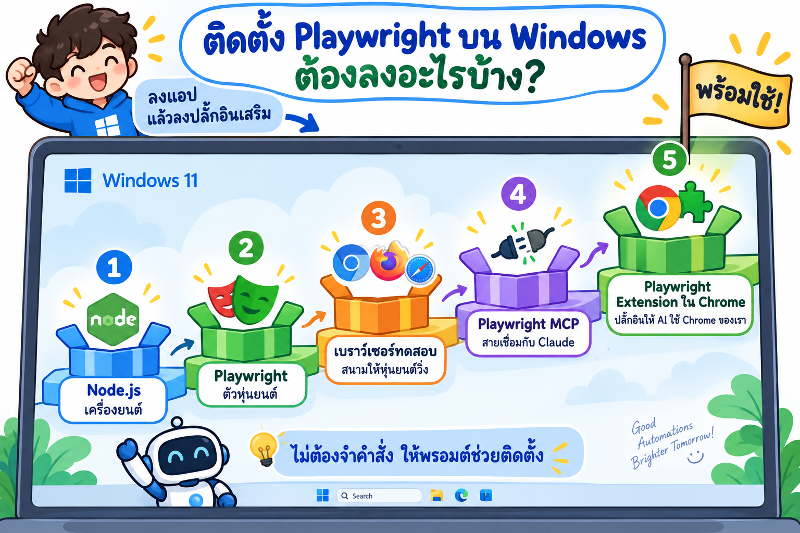

## เรียนบทนี้ยังไง?


**ต้องมี:** เครื่อง Windows 10/11 ที่ติดตั้ง Claude Code แล้ว · เปิด `claude` ในโฟลเดอร์ของบทนี้

**เลือกเรียนได้ 2 แบบ:** วาง **LAB 1** พรอมต์เดียวจบทั้งบท หรือทำ **ทีละขั้น** ตั้งแต่ LAB 2 → LAB 8
แต่ละ LAB มี 💬 พรอมต์ให้คัดลอก · ✅ ผลจริงที่ได้ · 👀 สิ่งที่ควรสังเกต

---

## LAB 1 · พรอมต์รวม: ตรวจและอัปเดตเครื่องมือ

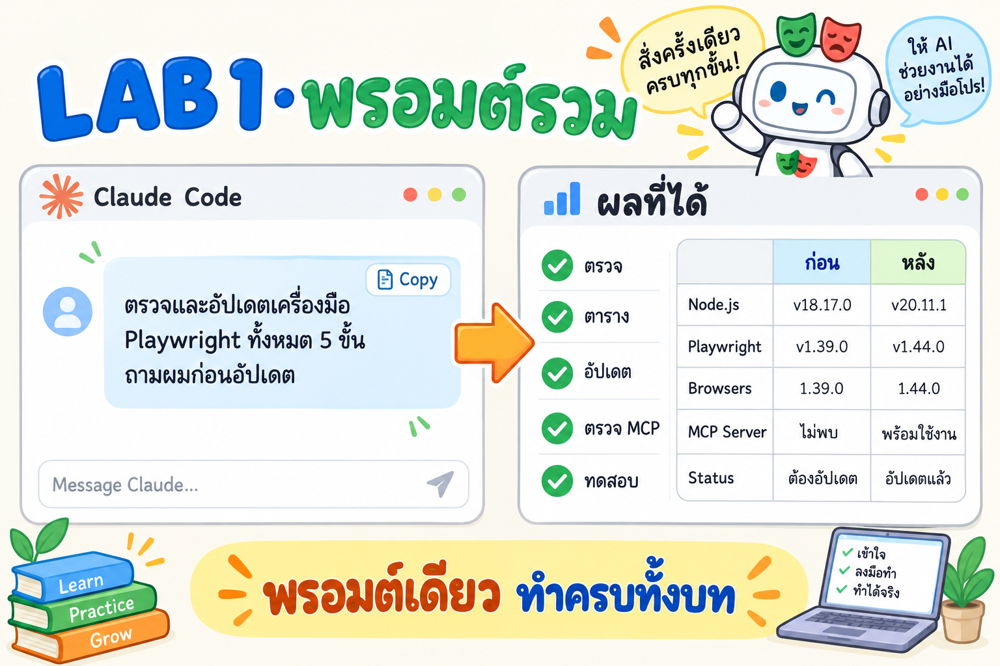

🎯 สั่ง Claude Code ให้ทำงานทั้งบทด้วยพรอมต์เดียว แล้วดูว่า AI ทำอะไรในแต่ละขั้น

💬 **พรอมต์ v2** (ปรับจากการทดสอบจริง 7 ต.ค. 2026 · คัดลอกทั้งกรอบไปวางใน `claude` ที่โฟลเดอร์ของบทนี้)

```text
ช่วยตรวจสอบและอัปเดตเครื่องมือสำหรับใช้ Playwright MCP ทดสอบเว็บ บน Windows ตามขั้นตอนนี้
ทุกค่าที่รายงานต้องมาจากคำสั่งที่รันจริง ห้ามตอบจากความจำ

ขั้นที่ 1: ตรวจเวอร์ชันที่ติดตั้งอยู่ เทียบกับเวอร์ชันล่าสุด (อ่านอย่างเดียว ห้ามติดตั้งหรือแก้อะไร)
ถ้าในโฟลเดอร์นี้มี check-versions.ps1 ให้รัน powershell -ExecutionPolicy Bypass -File .\check-versions.ps1 -Out log\versions-before.md
ถ้าไม่มี ให้ตรวจทีละรายการ

1. Node.js
   * ที่ติดตั้งอยู่: node -v และ winget list --id OpenJS.NodeJS (ดูว่า id เป็น OpenJS.NodeJS.LTS หรือ OpenJS.NodeJS)
   * ล่าสุด: https://nodejs.org/dist/index.json เทียบกับ "สายเดียวกับที่ติดตั้งอยู่"
     (LTS เทียบกับ LTS ล่าสุด, Current เทียบกับ Current ล่าสุด) และแจ้ง LTS ล่าสุดไว้ด้วย
2. npm
   * ที่ติดตั้งอยู่: npm -v
   * ล่าสุด: npm view npm version
3. Playwright MCP (@playwright/mcp)
   * ที่ติดตั้งอยู่: npm ls -g @playwright/mcp และเวอร์ชันใน %LocalAppData%\npm-cache\_npx\*\node_modules\@playwright\mcp\package.json
     (ไม่มีแบบ global ไม่ใช่ปัญหา ถ้า config เรียกผ่าน npx)
   * ล่าสุด: npm view @playwright/mcp version
4. Playwright และเบราว์เซอร์ของ Playwright
   * ที่ติดตั้งอยู่: npx playwright --version และ npx playwright install --list (รันในโฟลเดอร์ที่มี package.json)
   * ล่าสุด: npm view playwright version
5. Google Chrome
   * ที่ติดตั้งอยู่: reg query "HKCU\Software\Google\Chrome\BLBeacon" /v version
   * ล่าสุด: https://versionhistory.googleapis.com/v1/chrome/platforms/win64/channels/stable/versions
   * ตรวจด้วยว่า winget รู้จัก Chrome หรือไม่: winget list --id Google.Chrome
6. Microsoft Edge
   * ที่ติดตั้งอยู่: reg query "HKCU\Software\Microsoft\Edge\BLBeacon" /v version
   * ล่าสุด: winget upgrade --id Microsoft.Edge (ดูว่ามีรุ่นใหม่หรือไม่)
7. Claude Code
   * ที่ติดตั้งอยู่: claude --version
   * ล่าสุด: npm view @anthropic-ai/claude-code version
8. ถ้าในโฟลเดอร์ปัจจุบันมี package.json ให้ตรวจ @playwright/test ด้วย npm outdated

ขั้นที่ 2: สรุปผลเป็นตาราง
คอลัมน์: รายการ | เวอร์ชันที่ติดตั้ง | เวอร์ชันล่าสุด | สถานะ (ล่าสุดแล้ว / ต้องอัปเดต / ยังไม่ได้ติดตั้ง) | หมายเหตุ
แสดงตารางให้ดูก่อน บอกว่ารายการไหนอัปเดตได้เอง รายการไหนต้องให้ผมทำ แล้วถามยืนยันก่อนเริ่มอัปเดต

ขั้นที่ 3: อัปเดตเฉพาะรายการที่ผมยืนยัน และไม่ใช่เวอร์ชันล่าสุด
* Node.js: winget upgrade --id <id ที่ติดตั้งอยู่จริงจากขั้นที่ 1> (ห้ามใช้ id อีกสาย เพราะจะได้ Node ติดตั้งซ้อน 2 ตัว)
  ถ้า winget ตอบ "No available upgrade found" ให้หยุด แล้วบอกให้ผมติดตั้ง MSI จาก nodejs.org เอง
* npm: npm install -g npm@latest
* @playwright/mcp: ถ้าเรียกผ่าน npx ให้ล้าง %LocalAppData%\npm-cache\_npx (ต้องปิด Claude Code ก่อน ให้บอกผม)
  ถ้าติดตั้ง global ให้ npm install -g @playwright/mcp@latest
* @playwright/test ในโปรเจกต์: npm install -D @playwright/test@latest แล้วรัน npx playwright install
* เบราว์เซอร์ของ Playwright: npx playwright install
  ถ้าขึ้น "Download failure" หรือ "timed out after 30000ms" ให้วินิจฉัยก่อนด้วย
  curl.exe -4 และ curl.exe -6 ไปที่ https://cdn.playwright.dev ถ้า IPv4 ได้แต่ IPv6 timeout
  ให้รันใหม่โดยตั้ง NODE_OPTIONS=--require=<path>\ipv4-only.cjs (มีใน lab/) แล้วลบ NODE_OPTIONS ออกหลังใช้
* Chrome: winget upgrade --id Google.Chrome
  ถ้า winget ไม่รู้จัก Chrome ให้แจ้งผมให้เปิด chrome://settings/help เอง
* Edge: winget upgrade --id Microsoft.Edge
* Claude Code: claude update
ถ้าคำสั่งใดต้องใช้สิทธิ์ Administrator หรือรันไม่ผ่าน ให้หยุดแล้วบอกคำสั่งที่ผมต้องรันเอง ห้ามข้าม และห้ามแก้ไฟล์ config ระบบเอง

ขั้นที่ 4: ตรวจปลั๊กอินและการตั้งค่าที่เกี่ยวข้อง
* รัน claude mcp list แล้วดูว่า playwright ขึ้น Connected หรือไม่
  (Connected แปลว่า server เริ่มได้เท่านั้น ยังไม่ได้แปลว่าเปิดเบราว์เซอร์ได้ ต้องทดสอบในขั้นที่ 5)
* หา config ของ playwright ให้ครบทุกที่: ~/.claude.json (user scope), .mcp.json ในโปรเจกต์ และ claude_desktop_config.json
  ตรวจว่า args ใช้ @playwright/mcp@latest และ --browser ตรงกับเบราว์เซอร์ที่ติดตั้งไว้
* ถ้าใช้โหมด --extension ให้ตรวจว่า Chrome extension "Playwright Extension"
  (id mmlmfjhmonkocbjadbfplnigmagldckm) ติดตั้งจริงในโปรไฟล์ Default โดยดูโฟลเดอร์
  %LocalAppData%\Google\Chrome\User Data\Default\Extensions\mmlmfjhmonkocbjadbfplnigmagldckm
  และอ่านเวอร์ชันจาก manifest.json (อย่าเชื่อแค่ว่า "กดติดตั้งแล้ว")
* ถ้าผมบอกว่ารีสตาร์ท Chrome แล้ว ให้ตรวจเวลาเริ่มของ process หลักของ chrome.exe (ตัวที่ไม่มี --type=)
  ว่าเริ่มหลังรีสตาร์ทจริง ถ้ายังเป็นตัวเดิม ให้บอกผม
* ดูว่ามี MCP หรือปลั๊กอินอื่นที่ใช้งานเบราว์เซอร์ซ้ำซ้อนกันอยู่หรือไม่ ถ้ามีให้แจ้ง

ขั้นที่ 5: ทดสอบหลังอัปเดต
* รันขั้นที่ 1 ซ้ำ (บันทึกเป็น log\versions-after.md) แล้วแสดงตารางเทียบ ก่อน/หลัง อัปเดต
* ใช้ Playwright MCP เปิด https://www.google.co.th ใน "แท็บใหม่" (browser_tabs new) ค้นหาคำว่า Playwright MCP
  แล้วจับภาพหน้าผลการค้นหา เพื่อยืนยันว่าใช้งานได้ ถ้าเจอ CAPTCHA ให้หยุดแล้วบอกผม ห้ามพยายามผ่าน
  ถ้าใช้โหมด --extension ห้ามใช้หรืออ่านแท็บเดิมที่ผมเปิดไว้ (อาจเป็นอีเมลหรือบัญชีส่วนตัว)
  และก่อนเก็บภาพลงโปรเจกต์ ให้เบลอข้อมูลส่วนตัว เช่น รูปโปรไฟล์ / ชื่อบัญชี
  ถ้า MCP ใน Claude ใช้ไม่ได้ ให้รัน node lab\mcp-smoke-test.mjs เพื่อแยกว่าเสียที่ server หรือที่ config/extension
  ถ้ามี console error ให้ดูว่ามาจาก chrome-extension:// (ส่วนขยายอื่น) หรือจากหน้าเว็บจริง
* สรุปว่ารายการไหนอัปเดตสำเร็จ รายการไหนล้มเหลว (แนบ error จริงมาด้วย)
  และสิ่งที่ผมต้องทำเอง เช่น รีสตาร์ท Claude หรือรีสตาร์ทเบราว์เซอร์
```

📖 **v1 → v2 เปลี่ยนอะไร และทำไม** (ทุกข้อมาจากสิ่งที่เจอจริงในบทนี้)

| จุดที่แก้ | v1 | v2 | เจอที่ไหน |
|---|---|---|---|
| Node.js | เทียบกับ LTS เสมอ · `winget upgrade --id OpenJS.NodeJS.LTS` | ดู id ที่ติดตั้งจริงก่อน เทียบกับสายเดียวกัน · ถ้า winget ไม่มีรุ่นใหม่ให้หยุด | เครื่องใช้สาย Current (`OpenJS.NodeJS`) · [log/update-node.txt](log/update-node.txt) |
| ดาวน์โหลดเบราว์เซอร์ | ไม่ได้พูดถึงกรณีล้ม | ขั้นวินิจฉัย `curl -4/-6` + ทางแก้ `ipv4-only.cjs` | [LAB 3](#lab-3--ติดตั้ง-playwright) |
| Chrome | `winget upgrade --id Google.Chrome` | ตรวจก่อนว่า winget รู้จัก Chrome ไหม | `No installed package found` |
| Claude Code | ไม่มีแหล่ง "ล่าสุด" | `npm view @anthropic-ai/claude-code version` | – |
| `claude mcp list` | Connected = ใช้ได้ | Connected ≠ ใช้ได้ ต้องทดสอบจริง | [LAB 6](#lab-6--ตรวจ-playwright-mcp) |
| config | `.mcp.json` หรือ `claude_desktop_config.json` | เพิ่ม `~/.claude.json` (user scope) ซึ่งเป็นที่อยู่จริง | [LAB 6](#lab-6--ตรวจ-playwright-mcp) |
| ส่วนขยาย | "Playwright MCP Bridge" ดูที่ `chrome://extensions` | "Playwright Extension" + id + ตรวจโฟลเดอร์บนดิสก์ | AI เปิด `chrome://` จาก command line ไม่ได้ · [LAB 5](#lab-5--ติดตั้งปลั๊กอิน-playwright-ใน-chrome) |
| รีสตาร์ท Chrome | เชื่อคำบอก | ตรวจเวลาเริ่มของ process หลัก | ปิดหน้าต่างแล้ว Chrome ยังรันเบื้องหลัง |
| ทดสอบ MCP | เปิด example.com ในแท็บที่ MCP ถืออยู่ | เปิด google.co.th ใน **แท็บใหม่** + ค้นหา + หยุดถ้าเจอ CAPTCHA + เบลอข้อมูลส่วนตัว + smoke test แยกปัญหา + แยก console error ของส่วนขยาย | [LAB 6](#lab-6--ตรวจ-playwright-mcp), [LAB 7](#lab-7--ให้-ai-ใช้เว็บจริง-ค้นหาใน-google) |

<details>
<summary>พรอมต์ v1 (ต้นฉบับ ก่อนทดสอบจริง) สำหรับเปรียบเทียบ</summary>

```text
ช่วยตรวจสอบและอัปเดตเครื่องมือสำหรับใช้ Playwright MCP ทดสอบเว็บ บน Windows ตามขั้นตอนนี้
ขั้นที่ 1: ตรวจเวอร์ชันที่ติดตั้งอยู่ เทียบกับเวอร์ชันล่าสุด
รันคำสั่งเพื่อดูเวอร์ชันปัจจุบันและเวอร์ชันล่าสุดของแต่ละรายการ

1. Node.js
   * ที่ติดตั้งอยู่: node -v
   * ล่าสุด: ดูรุ่น LTS ล่าสุดจาก https://nodejs.org/dist/index.json
2. npm
   * ที่ติดตั้งอยู่: npm -v
   * ล่าสุด: npm view npm version
3. Playwright MCP (@playwright/mcp)
   * ที่ติดตั้งอยู่: npm ls -g @playwright/mcp และดูเวอร์ชันใน npx cache ด้วย
   * ล่าสุด: npm view @playwright/mcp version
4. Playwright และเบราว์เซอร์ของ Playwright
   * ที่ติดตั้งอยู่: npx playwright --version และ npx playwright install --list
   * ล่าสุด: npm view playwright version
5. Google Chrome
   * ที่ติดตั้งอยู่: reg query "HKCU\Software\Google\Chrome\BLBeacon" /v version
   * ล่าสุด: https://versionhistory.googleapis.com/v1/chrome/platforms/win64/channels/stable/versions
6. Microsoft Edge
   * ที่ติดตั้งอยู่: reg query "HKCU\Software\Microsoft\Edge\BLBeacon" /v version
   * ล่าสุด: winget upgrade --id Microsoft.Edge (ดูว่ามีรุ่นใหม่หรือไม่)
7. Claude Code
   * ที่ติดตั้งอยู่: claude --version
8. ถ้าในโฟลเดอร์ปัจจุบันมี package.json ให้ตรวจ @playwright/test ด้วย npm outdated

ขั้นที่ 2: สรุปผลเป็นตาราง
คอลัมน์: รายการ | เวอร์ชันที่ติดตั้ง | เวอร์ชันล่าสุด | สถานะ (ล่าสุดแล้ว / ต้องอัปเดต / ยังไม่ได้ติดตั้ง)
แสดงตารางให้ดูก่อน และถามยืนยันก่อนเริ่มอัปเดต
ขั้นที่ 3: อัปเดตเฉพาะรายการที่ไม่ใช่เวอร์ชันล่าสุด

* Node.js: winget upgrade --id OpenJS.NodeJS.LTS
* npm: npm install -g npm@latest
* @playwright/mcp: npm install -g @playwright/mcp@latest
ถ้าเรียกใช้ผ่าน npx ให้ล้าง cache ที่ %LocalAppData%\npm-cache\_npx
เพื่อให้ npx ดึง @latest มาใหม่
* เบราว์เซอร์ของ Playwright: npx playwright install
* @playwright/test ในโปรเจกต์: npm install -D @playwright/test@latest
แล้วรัน npx playwright install
* Chrome: winget upgrade --id Google.Chrome
ถ้าไม่ได้ ให้แจ้งผมให้เปิด chrome://settings/help
* Edge: winget upgrade --id Microsoft.Edge
* Claude Code: claude update
ถ้าคำสั่งใดต้องใช้สิทธิ์ Administrator หรือรันไม่ผ่าน ให้หยุดแล้วบอกคำสั่งที่ผมต้องรันเอง ห้ามข้าม

ขั้นที่ 4: ตรวจปลั๊กอินและการตั้งค่าที่เกี่ยวข้อง

* รัน claude mcp list แล้วดูว่า playwright ขึ้นสถานะ connected หรือไม่
* เปิดไฟล์ config ของ MCP (.mcp.json หรือ claude_desktop_config.json) แล้วตรวจว่า
args ใช้ @playwright/mcp@latest และค่า --browser ตรงกับเบราว์เซอร์ที่ติดตั้งไว้
* ถ้าใช้โหมด --extension ให้ตรวจว่ามี Chrome extension "Playwright MCP Bridge"
และเป็นเวอร์ชันล่าสุดหรือไม่ (ดูได้ที่ chrome://extensions)
* ดูว่ามี MCP หรือปลั๊กอินอื่นที่ใช้งานเบราว์เซอร์ซ้ำซ้อนกันอยู่หรือไม่ ถ้ามีให้แจ้ง

ขั้นที่ 5: ทดสอบหลังอัปเดต

* รันขั้นที่ 1 ซ้ำ แล้วแสดงตารางเทียบ ก่อน/หลัง อัปเดต
* ใช้ Playwright MCP เปิด https://example.com แล้วจับภาพหน้าจอ เพื่อยืนยันว่าใช้งานได้
* สรุปว่ารายการไหนอัปเดตสำเร็จ รายการไหนล้มเหลว (แนบ error มาด้วย)
และสิ่งที่ผมต้องทำเอง เช่น รีสตาร์ท Claude หรือรีสตาร์ทเบราว์เซอร์
```

</details>

📖 **โครงของพรอมต์ที่ดี** (ใช้ซ้ำกับงานอื่นได้)

| ส่วนของพรอมต์ | ทำไมต้องมี |
|---|---|
| ระบุ **คำสั่งที่ใช้ตรวจ** ทุกรายการ | AI ไม่ต้องเดา ผลตรวจซ้ำได้ |
| บอก **แหล่ง "ล่าสุด"** (URL / `npm view`) | กันไม่ให้ AI ตอบจากความจำที่เก่า |
| **ตารางก่อน แล้วถามยืนยัน** | คนตัดสินใจก่อนแก้ระบบ |
| "อัปเดตเฉพาะรายการที่ไม่ใช่ล่าสุด" | ลดความเสี่ยง ไม่แตะของที่ดีอยู่แล้ว |
| "ต้องใช้ Admin หรือรันไม่ผ่าน → หยุดแล้วบอกคำสั่ง ห้ามข้าม" | กัน AI วนลองวิธีแปลก ๆ หรือรายงานว่าสำเร็จทั้งที่ไม่สำเร็จ |
| ขั้นทดสอบ + ตาราง **ก่อน/หลัง** | มีหลักฐานว่าทำได้จริง |


---

## LAB 2 · ตรวจเวอร์ชัน


💬 **พรอมต์**

```text
ตรวจเวอร์ชันเครื่องมือสำหรับ Playwright บนเครื่องนี้ (อ่านอย่างเดียว ห้ามติดตั้งหรือแก้อะไร)
รัน powershell -ExecutionPolicy Bypass -File .\check-versions.ps1 -Out log\versions-before.md
แล้วสรุปเป็นตาราง: รายการ | ที่ติดตั้ง | ล่าสุด | สถานะ
อธิบายสั้น ๆ ด้วยภาษาง่าย ๆ ว่ารายการไหนต้องอัปเดต และทำไม
```

✅ **ผลจริง** ([log/versions-before.md](log/versions-before.md))

| รายการ | ที่ติดตั้ง | ล่าสุด | สถานะ |
|---|---|---|---|
| Node.js | v26.7.0 | v26.10.0 | ต้องอัปเดต |
| npm | 12.2.0 | 12.2.0 | ล่าสุดแล้ว |
| Playwright MCP | 0.0.83 | 0.0.83 | ล่าสุดแล้ว |
| Playwright Test (lab) | – | 1.63.0 | ยังไม่ได้ติดตั้ง |
| เบราว์เซอร์ของ Playwright | Chromium | – | ยังไม่มี Firefox / WebKit |
| Google Chrome | 154.0.8037.98 | 155.0.8059.40 | ต้องอัปเดต |
| Microsoft Edge | 154.0.4258.62 | 154.0.4258.62 | ล่าสุดแล้ว |
| Claude Code | 2.1.292 | 2.1.292 | ล่าสุดแล้ว |

👀 **สังเกต**
- LAB นี้ **ดูอย่างเดียว** ยังไม่มีอะไรถูกติดตั้ง
- Node.js มี 2 สาย (LTS กับ Current) Claude ต้องเทียบกับสายที่เราใช้อยู่ ไม่ใช่สายไหนก็ได้

---

## LAB 3 · ติดตั้ง Playwright

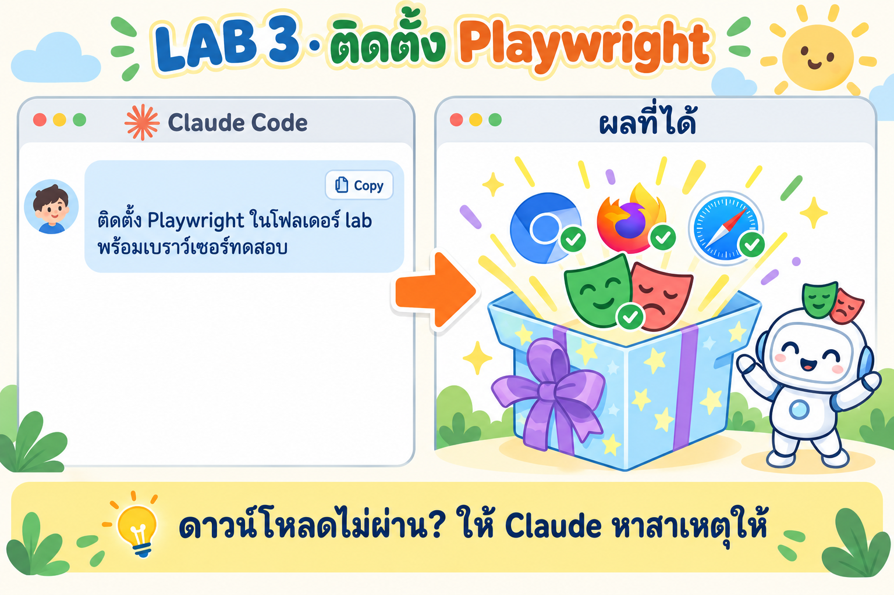

💬 **พรอมต์**

```text
ในโฟลเดอร์ lab ติดตั้ง Playwright Test ให้หน่อย
1. ติดตั้ง @playwright/test เวอร์ชันล่าสุด
2. ติดตั้งเบราว์เซอร์ทดสอบด้วย npx playwright install
ถ้าดาวน์โหลดเบราว์เซอร์ไม่ผ่าน ให้หาสาเหตุก่อน (ลอง curl.exe -4 และ curl.exe -6 ไปที่ https://cdn.playwright.dev)
ถ้า IPv6 ใช้ไม่ได้ ให้ใช้ lab\ipv4-only.cjs ผ่าน NODE_OPTIONS แล้วลองใหม่
แล้วเปิดโฟลเดอร์ที่เก็บเบราว์เซอร์ทดสอบให้ผมดูใน File Explorer
```

✅ **ผลจริง** เบราว์เซอร์ทดสอบ 3 ตัว (วงสีแดง) อยู่ในโฟลเดอร์ `ms-playwright` ของเครื่อง

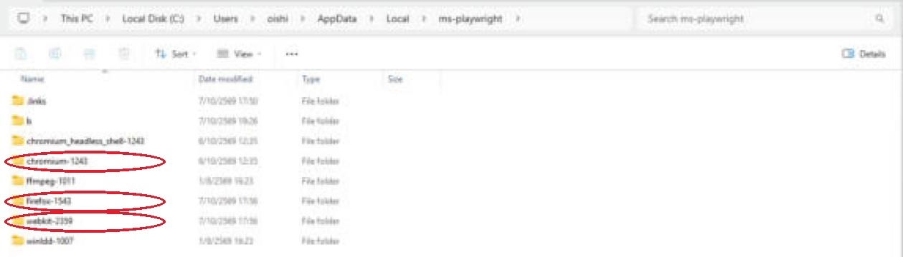

👀 **สังเกต**
- ครั้งแรก Firefox / WebKit **ดาวน์โหลดไม่ผ่าน** Claude ตรวจแล้วพบว่าเน็ตทาง IPv6 ของเครื่องนี้ใช้ไม่ได้ จึงบังคับใช้ IPv4 แล้วโหลดเสร็จใน 20 วินาที ([log](log/ipv6-download-failure.txt))
- เบราว์เซอร์ทดสอบเก็บไว้ที่เดียว ทุกโปรเจกต์ในเครื่องใช้ร่วมกันได้

---

## LAB 4 · เขียนและรัน test

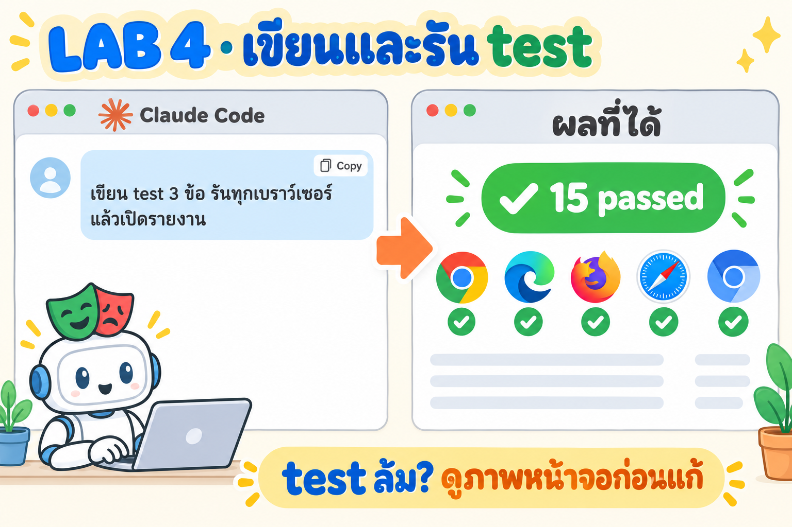

💬 **พรอมต์**

```text
ในโฟลเดอร์ lab ช่วยเขียน test ไว้ใน tests/example.spec.ts 3 ข้อ บนเว็บ https://playwright.dev
1. เปิดหน้าแรก แล้วตรวจว่ามีปุ่ม Get started
2. กดปุ่ม Search พิมพ์คำว่า locator แล้วเปิดผลลัพธ์ "Locators" ตรวจว่าเจอหัวข้อ Locators
3. จับภาพหน้าแรกเก็บไว้ในโฟลเดอร์ screenshots
ให้รันบน 5 เบราว์เซอร์: chromium, firefox, webkit, Google Chrome, Microsoft Edge
แล้วเปิดรายงาน HTML ให้ดู ถ้ามี test ล้ม ให้ดูภาพหน้าจอตอนล้มก่อน แล้วบอกผมว่าควรแก้อะไร
```

🤖 **Playwright ทำอะไรใน test ข้อ 2** (วงสีแดง = จุดที่ Playwright กด / ตรวจ)

| ① เปิดเว็บ แล้วกด **Search** | ② พิมพ์ `locator` แล้วกดผลลัพธ์ **Locators** | ③ ตรวจว่าเจอหัวข้อ **Locators** |
|---|---|---|
| 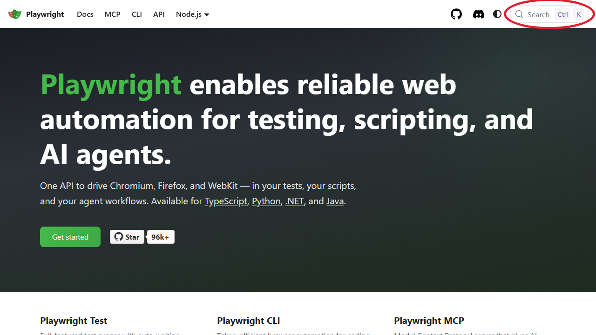 | 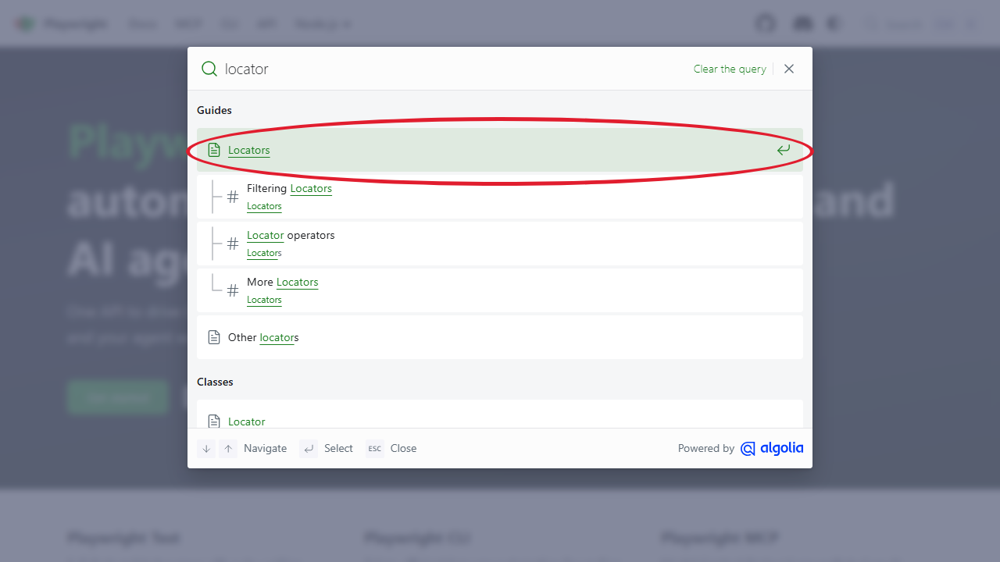 | 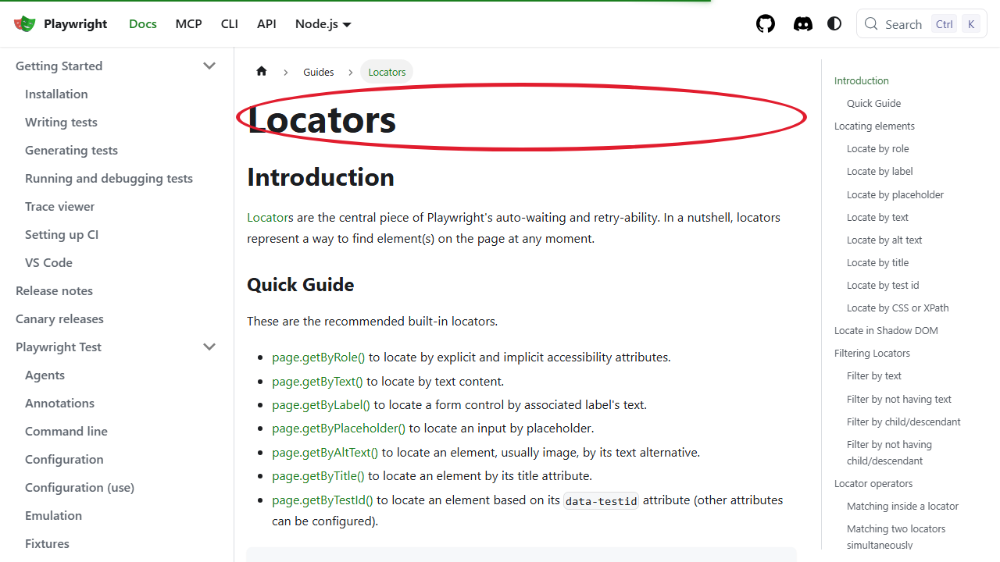 |

✅ **ผลจริง: 15 passed** (3 test × 5 เบราว์เซอร์ · ไฟล์ test: [lab/tests/example.spec.ts](lab/tests/example.spec.ts))

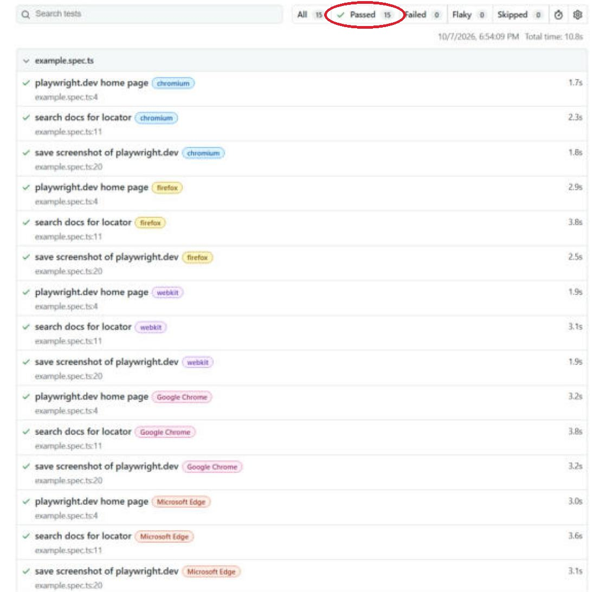

👀 **สังเกต**
- Playwright กด พิมพ์ และตรวจผล **เหมือนคนทำ** แต่ทำพร้อมกัน 5 เบราว์เซอร์ใน 11 วินาที
- ใช้ playwright.dev ไม่ใช้ Google เพราะการเขียน test ไปค้น Google ซ้ำ ๆ จะโดน CAPTCHA และผิดเงื่อนไขการใช้งาน

---

## LAB 5 · ติดตั้งปลั๊กอิน Playwright ใน Chrome

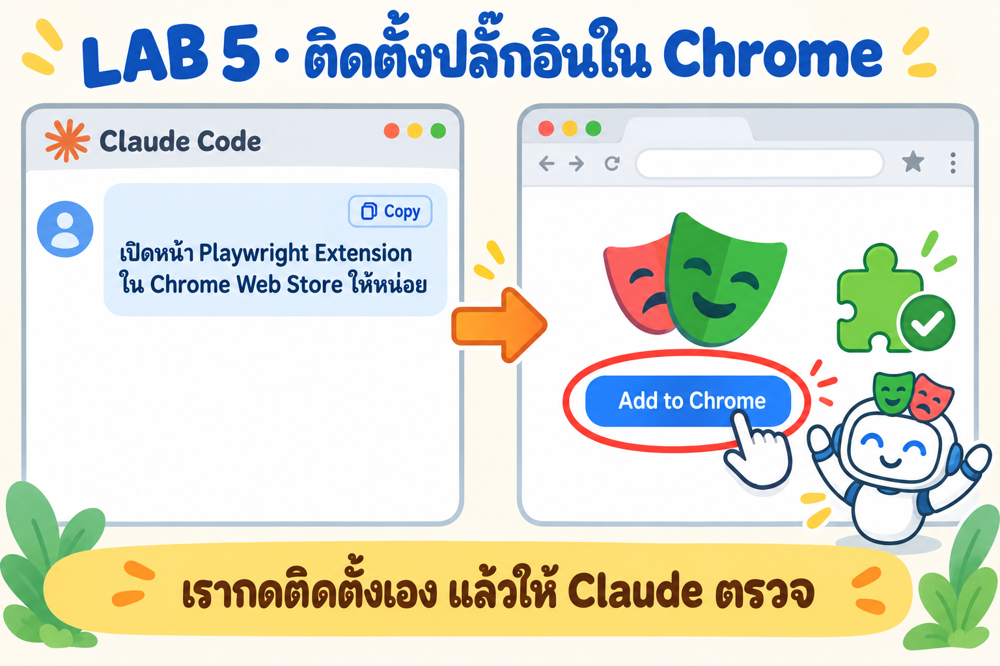

🎯 ปลั๊กอินนี้ทำให้ Claude **ใช้ Chrome ตัวจริงของเรา** ได้ ขั้นนี้ **เรากดติดตั้งเอง** ด้วยมือ แล้วค่อยให้ Claude ตรวจ

💬 **พรอมต์**

```text
เปิดหน้า Playwright Extension ใน Chrome Web Store ให้หน่อย
https://chromewebstore.google.com/detail/playwright-extension/mmlmfjhmonkocbjadbfplnigmagldckm
```

**① กดปุ่ม "เพิ่มใน Chrome"** (Add to Chrome)

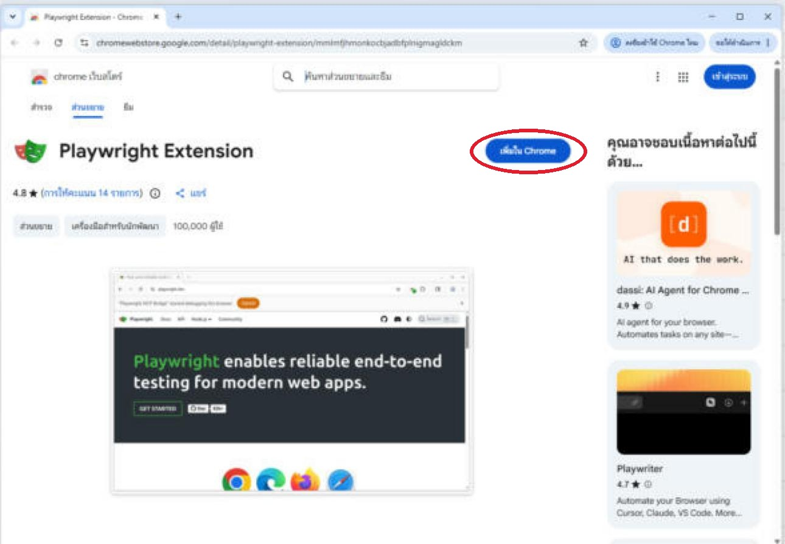

**② หน้าต่างยืนยันจะเด้งขึ้นมุมบน กด "เพิ่มส่วนขยาย"** (Add extension)

**③ ปุ่มเปลี่ยนเป็น "นำออกจาก Chrome"** (Remove from Chrome) = ติดตั้งสำเร็จแล้ว

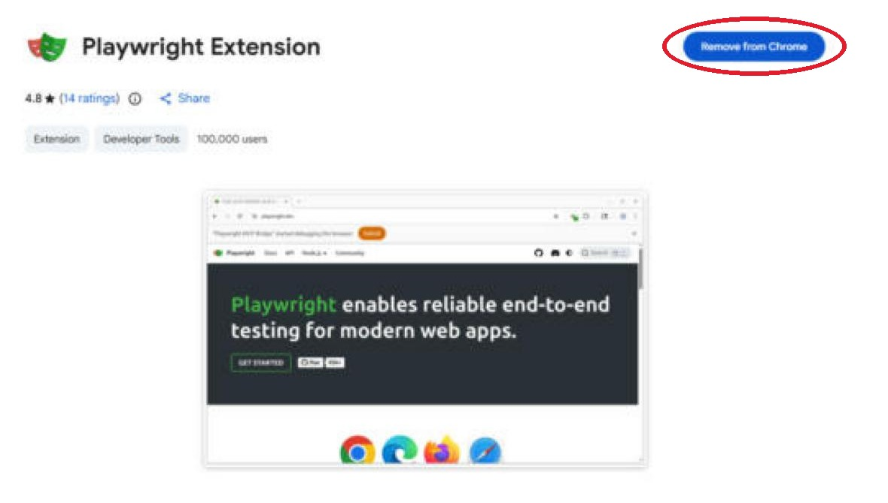

**④ ให้ Claude ตรวจซ้ำ**

```text
ผมติดตั้ง Playwright Extension แล้ว ช่วยตรวจว่าติดตั้งจริงใน Chrome โปรไฟล์ Default หรือยัง
(ดูโฟลเดอร์ Extensions\mmlmfjhmonkocbjadbfplnigmagldckm บนดิสก์) และบอกเวอร์ชัน
```

✅ **ผลจริง:** `installed: Playwright Extension v0.4.0`

⚠️ **ระวัง 2 เรื่อง** (เจอจริงตอนทำบทนี้)
- ต้องติดตั้งใน **Chrome ตัวจริง** ไม่ใช่แผงเบราว์เซอร์ในแอป Claude (หน้าตาเหมือน Chrome แต่เป็นคนละตัว)
- ถ้าต้องรีสตาร์ท Chrome ให้ **ปิดให้หมดจริง ๆ** (กดขวาไอคอน Chrome มุมขวาล่าง → ออก) แค่กด ✕ ปิดหน้าต่าง Chrome ยังทำงานอยู่เบื้องหลัง

---

## LAB 6 · ตรวจ Playwright MCP

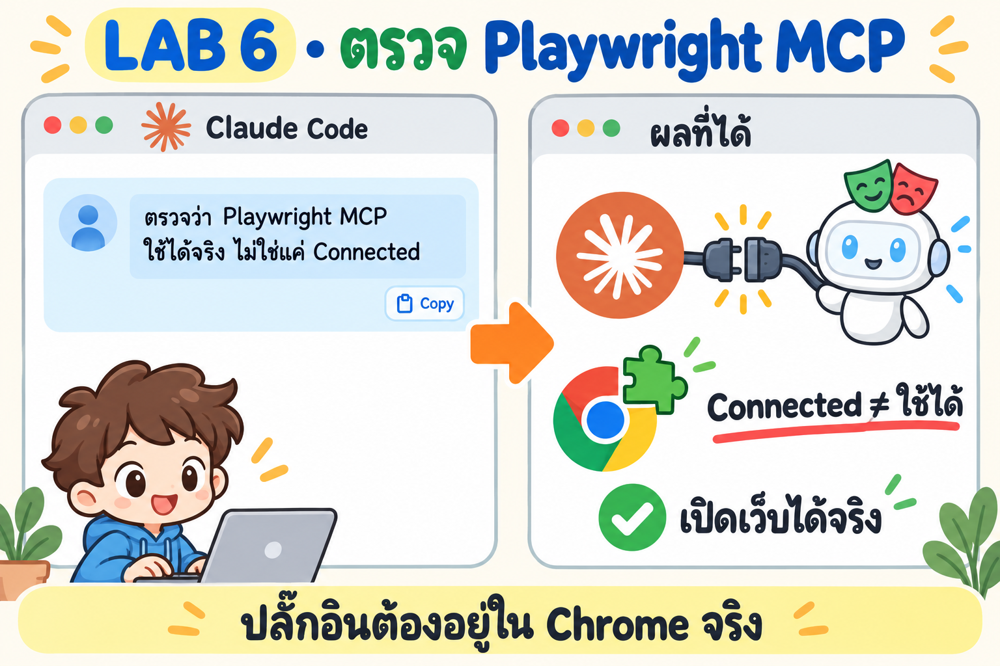

💬 **พรอมต์**

```text
ตรวจว่า Playwright MCP ใน Claude Code ใช้งานได้จริง
1. รัน claude mcp list และดูว่า playwright ใช้โหมดไหน
2. ใช้ Playwright MCP เปิด https://playwright.dev ในแท็บใหม่ แล้วจับภาพหน้าจอ
3. ถ้าใช้ไม่ได้ ให้รัน node lab\mcp-smoke-test.mjs เพื่อดูว่าเสียที่ตัว MCP หรือที่ปลั๊กอิน
บอกผมว่าต้องทำอะไรเองบ้าง
```

✅ **ผลจริง** Claude เปิด playwright.dev ใน Chrome ของเราได้

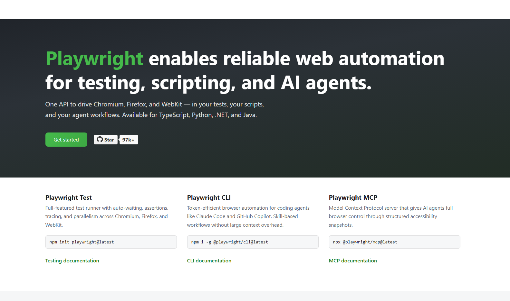

👀 **สังเกต**
- ตอนยังไม่ได้ทำ LAB 5 `claude mcp list` ก็ขึ้น **Connected** แต่เปิดเว็บไม่ได้ (ไม่มีปลั๊กอิน) → **Connected ≠ ใช้ได้** ต้องลองเปิดเว็บจริงทุกครั้ง
- `mcp-smoke-test.mjs` ทดสอบตัว MCP แยกจากปลั๊กอิน ได้ `RESULT: PASS` ช่วยบอกว่าปัญหาอยู่ที่ปลั๊กอินอย่างเดียว ([log](log/mcp-smoke-test.txt))

---

## LAB 7 · ให้ AI ใช้เว็บจริง: ค้นหาใน Google

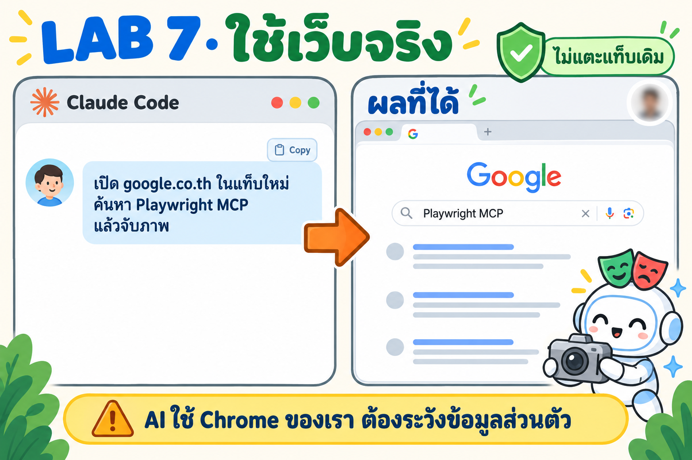

💬 **พรอมต์**

```text
ใช้ Playwright MCP เปิด https://www.google.co.th ในแท็บใหม่ ค้นหาคำว่า "Playwright MCP"
แล้วจับภาพหน้าผลการค้นหา ห้ามใช้หรืออ่านแท็บเดิมที่ผมเปิดไว้
ถ้าเจอ CAPTCHA ให้หยุดแล้วบอกผม และก่อนเก็บภาพให้เบลอรูปโปรไฟล์ / ชื่อบัญชี
```

✅ **ผลจริง**

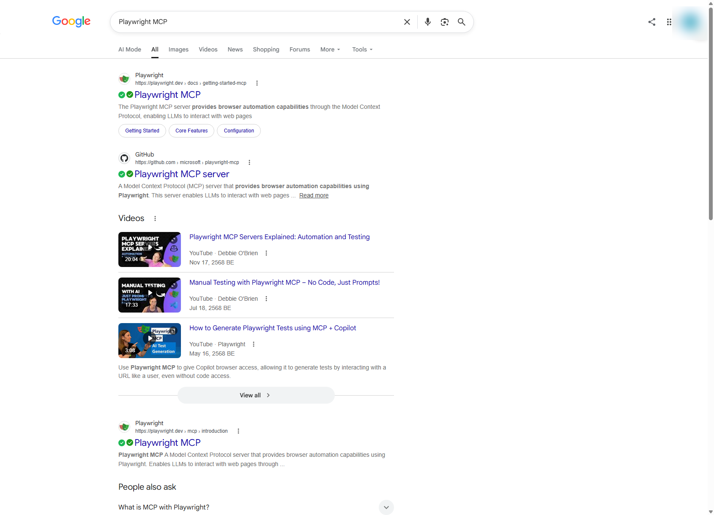

👀 **สังเกต**
- ครั้งแรก Claude ไปโผล่ที่ **แท็บ Gmail** ของเรา (ปลั๊กอินใช้แท็บจริงที่เราแชร์ให้) Claude จึงหยุด ไม่อ่าน ไม่จับภาพ แล้วเปิดแท็บใหม่แทน → พรอมต์ต้องสั่ง **"แท็บใหม่"** เสมอ
- AI เห็นชื่อและอีเมลบัญชี Google ของเราได้ ภาพที่จะแชร์ต้องเบลอก่อน
- ✅✅ หน้าผลค้นหามาจากปลั๊กอินอื่นใน Chrome ของเรา ไม่ใช่ของ Google

---

## LAB 8 · สรุปก่อน/หลัง


💬 **พรอมต์**

```text
ตรวจเวอร์ชันอีกครั้ง บันทึกเป็น log\versions-after.md
แล้วแสดงตารางเทียบ ก่อน/หลัง พร้อมบอกว่าอะไรสำเร็จ อะไรล้มเหลว (แนบ error จริง)
และสิ่งที่ผมต้องทำเอง เช่น รีสตาร์ทโปรแกรม หรือคำสั่งที่ต้องใช้สิทธิ์ Administrator
```

✅ **ผลจริง** ([before](log/versions-before.md) · [after](log/versions-after.md))

| รายการ | ก่อน | หลัง | ผล |
|---|---|---|---|
| Playwright Test (lab) | – | 1.63.0 | ✅ ติดตั้งใหม่ |
| เบราว์เซอร์ Playwright | Chromium | Chromium, Firefox, WebKit | ✅ ติดตั้งเพิ่ม |
| Playwright Extension | ไม่มี | 0.4.0 | ✅ ใช้งานได้ |
| npm · Playwright MCP · Edge · Claude Code | ล่าสุด | ล่าสุด | ✅ ไม่ต้องทำอะไร |
| Node.js | v26.7.0 | v26.7.0 | ❌ winget ยังไม่มีรุ่น 26.10 |
| Google Chrome | 154 | 154 | ⚠️ ต้องอัปเดตเอง |

📝 **สิ่งที่ต้องทำเอง**
1. Chrome: เปิด `chrome://settings/help` **ใน Chrome ตัวจริง** แล้วกด Relaunch
2. Node.js: รอ winget มีรุ่นใหม่ หรือติดตั้งจาก nodejs.org เอง (ต้องใช้สิทธิ์ Administrator)

---

## ถ้าเจอปัญหา: คัดลอกพรอมต์นี้

| อาการ | 💬 พรอมต์ |
|---|---|
| ดาวน์โหลดเบราว์เซอร์ไม่ผ่าน | `npx playwright install ดาวน์โหลดไม่ผ่าน ช่วยหาสาเหตุด้วย curl.exe -4 และ -6 ไปที่ cdn.playwright.dev ถ้า IPv6 ใช้ไม่ได้ให้ใช้ lab\ipv4-only.cjs แล้วลองใหม่` |
| test ล้ม | `test ล้ม ช่วยเปิดภาพหน้าจอตอนล้มใน test-results ดูว่าหน้าเว็บจริงเป็นอย่างไร แล้วบอกผมว่าควรแก้ test หรือแก้เว็บ` |
| Connected แต่เปิดเว็บไม่ได้ | `Playwright MCP ขึ้น Connected แต่เปิดเว็บไม่ได้ ช่วยรัน node lab\mcp-smoke-test.mjs แล้วบอกว่าเสียที่ MCP หรือที่ปลั๊กอิน` |
| ติดตั้งปลั๊กอินแล้วยังหาไม่เจอ | `ผมติดตั้ง Playwright Extension และรีสตาร์ท Chrome แล้ว ช่วยตรวจโฟลเดอร์ปลั๊กอินบนดิสก์ และเวลาเริ่มของ Chrome ว่ารีสตาร์ทจริงหรือยัง` |
| อัปเดต Chrome แล้วเลขไม่เปลี่ยน | `ผมอัปเดต Chrome แล้ว ช่วยตรวจเวอร์ชันจาก registry และไฟล์ chrome.exe และดูว่า Google Updater ตรวจอัปเดตล่าสุดเมื่อไร` |

### ไฟล์ในบทนี้

```text
02_playwright-local-windows/
├─ README.md
├─ check-versions.ps1          # ตรวจเวอร์ชัน (อ่านอย่างเดียว) → ตาราง
├─ img/                        # intro-* / lab*-prompt (cyolo imagegen) · ภาพหน้าจอจริงที่วงสีแดงไว้
├─ log/                        # ตาราง before/after, error จริง, brief ของภาพ
└─ lab/
   ├─ install-demo.ps1         # ติดตั้ง + รัน test (มี -IPv4)
   ├─ ipv4-only.cjs            # แก้ปัญหา IPv6
   ├─ playwright.config.ts     # 5 เบราว์เซอร์
   ├─ tests/example.spec.ts    # 3 test บน playwright.dev
   ├─ capture-steps.mjs        # ทำภาพทีละขั้นพร้อมวงสีแดง (img/lab4-step-*.png)
   └─ mcp-smoke-test.mjs       # ทดสอบ Playwright MCP โดยไม่ผ่าน Claude
```
