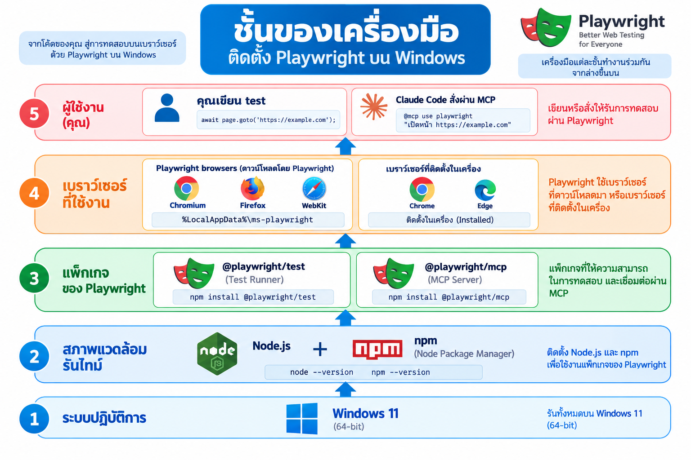
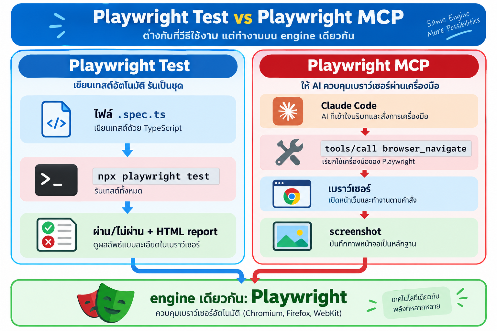
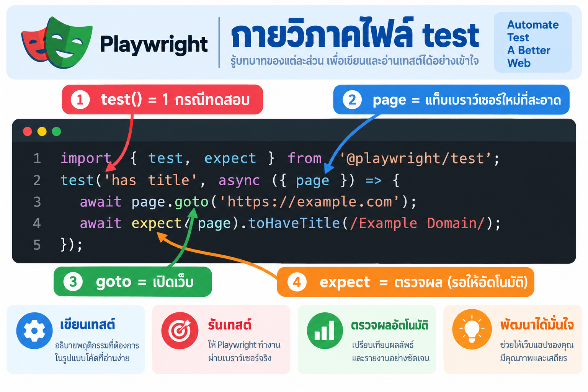
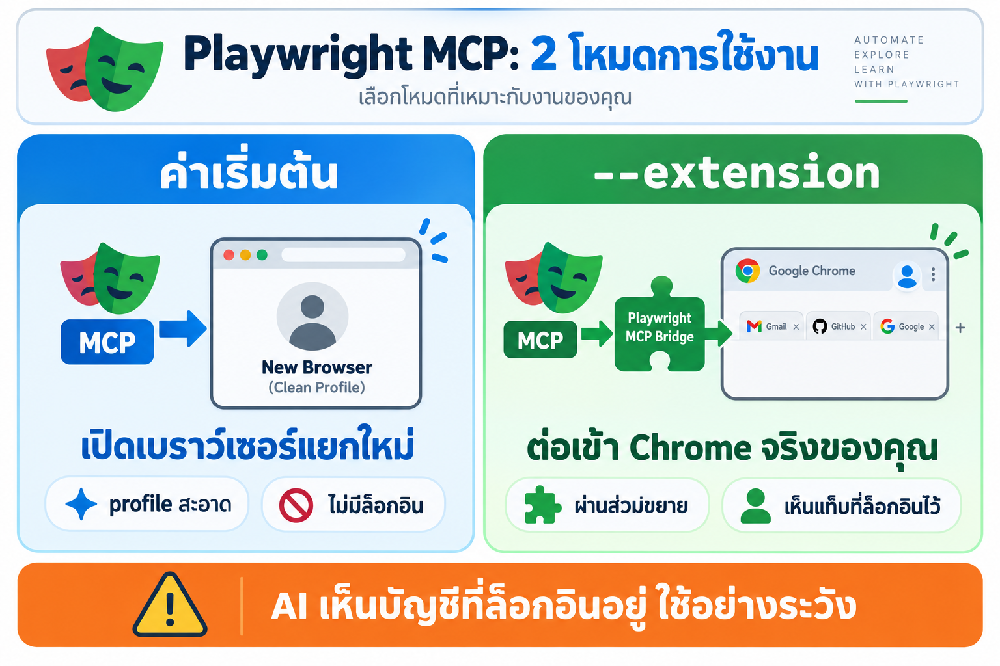
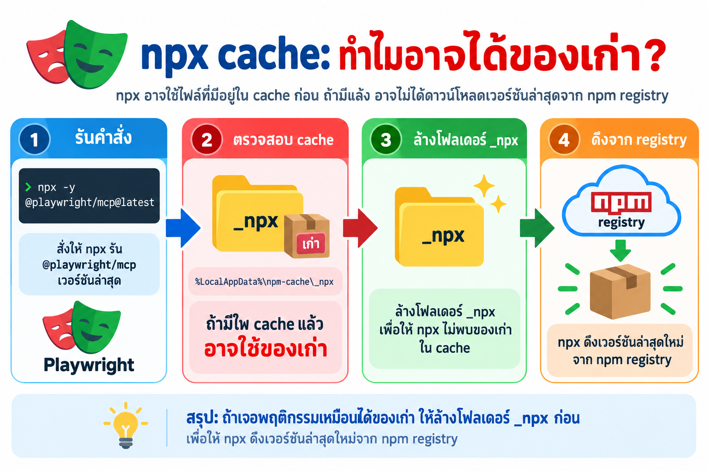
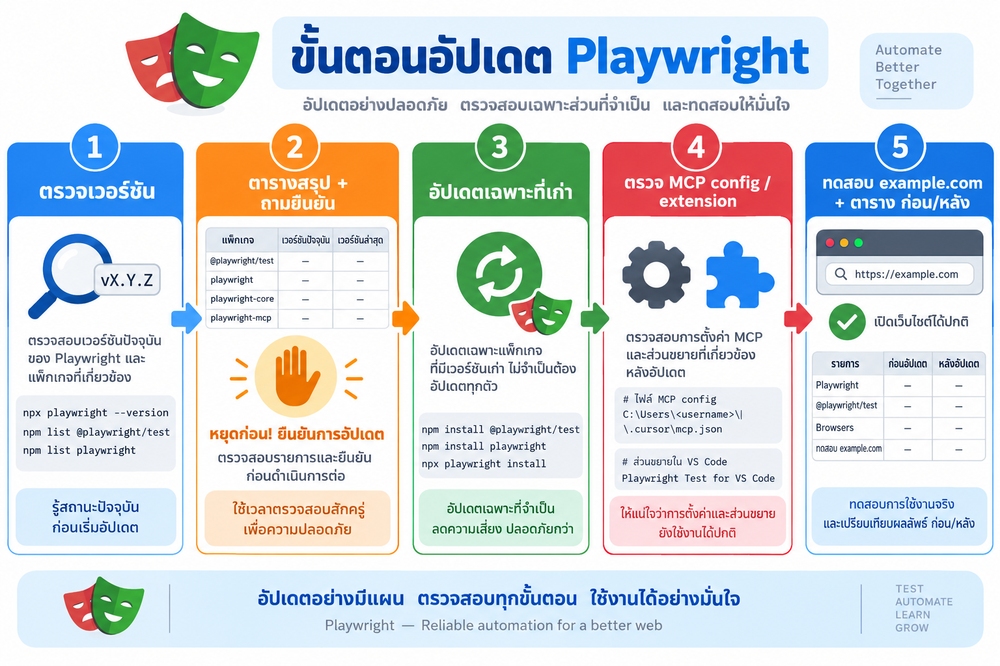
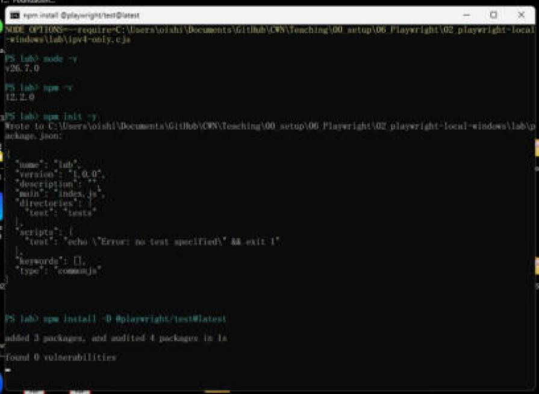
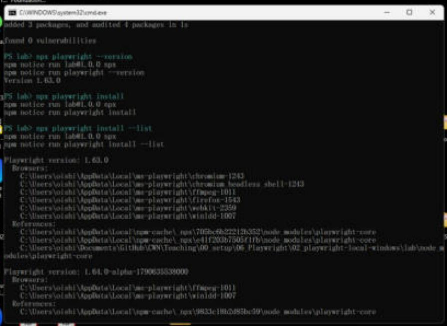
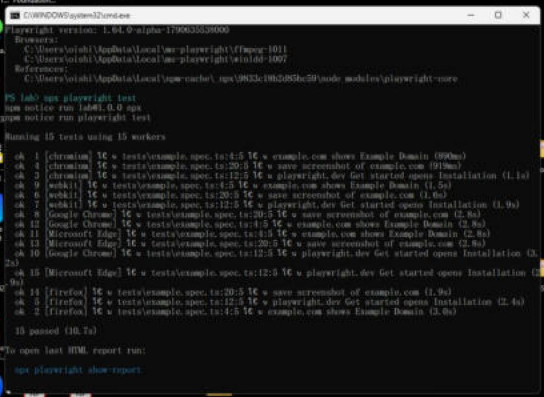
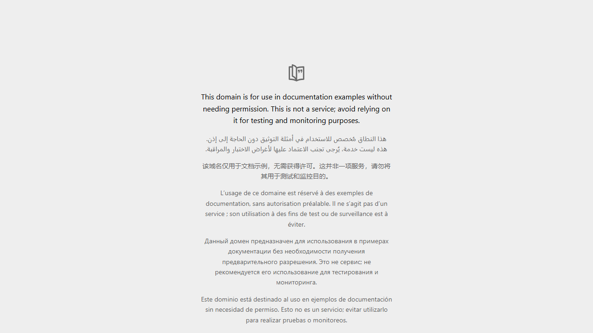

# LAB 006-0 · ติดตั้ง Playwright บนเครื่อง Windows (local) พร้อมทดสอบ

บทนี้ติดตั้งและตรวจเครื่องมือ Playwright **บนเครื่อง Windows ของเราเอง** (ไม่ใช่ใน container) ให้พร้อมใช้ 2 แบบ
1. **Playwright Test** เขียน test เป็นโค้ดแล้วรันด้วย `npx playwright test` บนเบราว์เซอร์ 5 ตัว
2. **Playwright MCP** ให้ Claude Code สั่งเบราว์เซอร์ได้เอง

ทุกขั้นตอนขับเคลื่อนด้วย **พรอมต์เดียว** (ดู [LAB 1](#lab-1--พรอมต์หลัก-ตรวจและอัปเดตเครื่องมือ)) ที่สั่ง Claude Code ให้ตรวจเวอร์ชัน → สรุปเป็นตาราง → ถามก่อนอัปเดต → ตรวจ MCP → ทดสอบ

**ต้องมีก่อน:** Windows 10/11 · [Node.js](https://nodejs.org) (มี `npm` มาด้วย) · Google Chrome หรือ Microsoft Edge · Claude Code (`claude --version`)
**ต่อด้วย:** [LAB 006 · Playwright CLI](../00_playwright-cli/README.md) และ [LAB 006-2 · Playwright MCP](../01_playwright-mcp/README.md)
**เวลา:** ทฤษฎี ~15 นาที · LAB ~45 นาที
**ทดสอบจริง:** 7 ต.ค. 2026 บน Windows 11 · Node v26.7.0 · npm 12.2.0 · `@playwright/test` 1.63.0 · `@playwright/mcp` 0.0.83 · Claude Code 2.1.292
ภาพหน้าจอจริงทุกภาพจับด้วย **computer use** (Claude จับภาพหน้าต่าง PowerShell / Chrome บนเครื่องจริง) ส่วนภาพแนวคิดสร้างด้วย `cyolo` (Codex imagegen) จาก [log/imagegen-brief.md](log/imagegen-brief.md)

### แผนที่บทเรียน

| ส่วน | ได้เรียนอะไร | ไฟล์ที่เกี่ยวข้อง |
|---|---|---|
| [A · ทฤษฎี](#ส่วน-a--ทฤษฎี) | ชั้นของเครื่องมือ, Test vs MCP, กายวิภาคไฟล์ test, โหมด `--extension`, npx cache | – |
| [LAB 1](#lab-1--พรอมต์หลัก-ตรวจและอัปเดตเครื่องมือ) พรอมต์หลัก | พรอมต์ 5 ขั้นสำหรับ Claude Code | – |
| [LAB 2](#lab-2--ตรวจเวอร์ชัน-ขั้นที่-1--2) ตรวจเวอร์ชัน | ขั้นที่ 1–2 ด้วยสคริปต์อ่านอย่างเดียว | [`check-versions.ps1`](check-versions.ps1), [`log/versions-before.md`](log/versions-before.md) |
| [LAB 3](#lab-3--ติดตั้ง-playwright-test-ในโปรเจกต์) ติดตั้ง | `npm install -D @playwright/test` + `npx playwright install` | [`lab/install-demo.ps1`](lab/install-demo.ps1), [`lab/ipv4-only.cjs`](lab/ipv4-only.cjs) |
| [LAB 4](#lab-4--เขียนและรัน-test) เขียน + รัน test | 3 test × 5 เบราว์เซอร์, HTML report, test ที่ล้มจริง | [`lab/tests/example.spec.ts`](lab/tests/example.spec.ts), [`lab/playwright.config.ts`](lab/playwright.config.ts) |
| [LAB 5](#lab-5--ตรวจ-playwright-mcp-ขั้นที่-4--5) ตรวจ MCP | `claude mcp list`, config, extension, smoke test, ค้นหาบน google.co.th | [`lab/mcp-smoke-test.mjs`](lab/mcp-smoke-test.mjs) |
| [LAB 6](#lab-6--สรุปก่อนหลัง-และสิ่งที่ต้องทำเอง) สรุป | ตารางก่อน/หลัง, อะไรสำเร็จ/ล้มเหลว, สิ่งที่ต้องทำเอง | [`log/versions-after.md`](log/versions-after.md) |
| [C · ข้อควรรู้](#ส่วน-c--ข้อควรรู้) | ปัญหาที่เจอจริง 3 เรื่อง, คำสั่งที่ใช้บ่อย | [`log/`](log/) |

**สัญลักษณ์:** 🎯 เป้าหมาย · 💬 พรอมต์ · 📖 คำอธิบาย · 📸 ภาพจริงจาก computer use · ✅ ผลที่ควรได้

---

## ส่วน A · ทฤษฎี

### A1 · ชั้นของเครื่องมือ


*ภาพแนวคิด (cyolo / Codex imagegen)*

| ชั้น | คืออะไร | ตรวจด้วย | อยู่ที่ไหน |
|---|---|---|---|
| Node.js + npm | runtime ที่ Playwright ทำงานอยู่ | `node -v`, `npm -v` | `C:\Program Files\nodejs` |
| `@playwright/test` | test runner + Playwright library (ติดตั้ง **ต่อโปรเจกต์**) | `npx playwright --version` | `<project>\node_modules` |
| `@playwright/mcp` | MCP server ที่ Claude Code เรียกใช้ (ปกติเรียกผ่าน `npx` ไม่ต้องติดตั้ง global) | `npm view @playwright/mcp version` | `%LocalAppData%\npm-cache\_npx\<hash>` |
| เบราว์เซอร์ของ Playwright | Chromium / Firefox / WebKit รุ่นที่ **ตรงกับ** เวอร์ชัน Playwright | `npx playwright install --list` | `%LocalAppData%\ms-playwright` |
| เบราว์เซอร์ในเครื่อง | Chrome / Edge ตัวจริงที่เราใช้ทุกวัน (ใช้ผ่าน `channel: 'chrome'` / `'msedge'`) | `reg query ...\BLBeacon /v version` | `C:\Program Files\...` |

> **จำง่าย:** แพ็กเกจกับเบราว์เซอร์ของ Playwright ต้องเวอร์ชัน "คู่กัน" อัปเดต `@playwright/test` เมื่อไร ต้องรัน `npx playwright install` ตามทุกครั้ง

### A2 · Playwright Test กับ Playwright MCP ต่างกันอย่างไร


*ภาพแนวคิด (cyolo / Codex imagegen)*

| | Playwright Test | Playwright MCP |
|---|---|---|
| ใครตัดสินใจว่าจะกดอะไร | **โค้ด** ที่เราเขียน (`page.click(...)`) | **LLM** (Claude) เลือก tool เอง |
| ผลลัพธ์ | ผ่าน / ไม่ผ่าน + HTML report + trace | ข้อความ snapshot + screenshot ในแชท |
| เหมาะกับ | regression test, CI, งานที่ต้องได้ผลเหมือนเดิมทุกครั้ง | สำรวจเว็บ, ช่วยเขียน test, งานที่มีคนเฝ้า |
| ติดตั้ง | `npm install -D @playwright/test` ในโปรเจกต์ | ลงทะเบียนใน Claude Code: `claude mcp add playwright -- npx -y @playwright/mcp@latest` |

### A3 · กายวิภาคไฟล์ test


*ภาพแนวคิด (cyolo / Codex imagegen) โค้ดจริงอยู่ใน [lab/tests/example.spec.ts](lab/tests/example.spec.ts)*

- `test('ชื่อ', async ({ page }) => {...})` = 1 กรณีทดสอบ · `page` คือแท็บใหม่ใน **browser context สะอาด** (ไม่มี cookie / ล็อกอิน) สร้างใหม่ทุก test
- `await page.goto(url)` เปิดเว็บ · `page.getByRole(...)`, `page.getByText(...)` คือ **locator** หา element แบบที่คนมองเห็น
- `await expect(...).toHaveTitle(...)` / `.toBeVisible()` คือ **web-first assertion** ที่ **รอ** ให้เงื่อนไขจริงได้เอง (ค่าเริ่มต้น 5 วินาที) ไม่ต้องใส่ `sleep`
- `playwright.config.ts` กำหนด **projects** = รัน test ชุดเดียวกันบนหลายเบราว์เซอร์ บทนี้ใช้ 5 ตัว: `chromium`, `firefox`, `webkit` (ของ Playwright) + `Google Chrome`, `Microsoft Edge` (ของเครื่อง)

### A4 · Playwright MCP มี 2 โหมด


*ภาพแนวคิด (cyolo / Codex imagegen) ชื่อส่วนขยายจริงใน Chrome Web Store คือ **"Playwright Extension"** (เดิมชื่อ Playwright MCP Bridge)*

| โหมด | args | ข้อดี | ต้องระวัง |
|---|---|---|---|
| ค่าเริ่มต้น | `@playwright/mcp@latest --browser chrome` | แยกจากเบราว์เซอร์ที่เราใช้, ไม่เห็นบัญชีเรา | ต้องล็อกอินเองถ้าเว็บต้องการ |
| `--isolated` | เพิ่ม `--isolated` | profile อยู่ในหน่วยความจำ ปิดแล้วหายหมด | – |
| `--extension` | `@playwright/mcp@latest --extension` | ใช้แท็บที่ล็อกอินไว้แล้วได้เลย | **ต้องติดตั้งส่วนขยายใน Chrome ก่อน** · AI เห็นทุกบัญชีที่ล็อกอิน |

### A5 · ทำไม `npx ...@latest` อาจไม่ใช่ล่าสุด


*ภาพแนวคิด (cyolo / Codex imagegen)*

`npx` เก็บแพ็กเกจที่เคยดึงไว้ใน `%LocalAppData%\npm-cache\_npx\<hash>` ถ้าเวอร์ชันใน cache ยังตรงกับ `@latest` ก็ใช้ต่อ แต่บางครั้งค้างของเก่า (เช่นตอน Claude Code เปิดค้างไว้) วิธีบังคับให้ดึงใหม่คือปิด Claude Code แล้วล้างโฟลเดอร์ `_npx`

```powershell
Remove-Item -Recurse -Force "$env:LocalAppData\npm-cache\_npx"
```

### A6 · ลำดับงาน 5 ขั้น


*ภาพแนวคิด (cyolo / Codex imagegen)*

ขั้นที่ 2 สำคัญที่สุด: **หยุดถามก่อนอัปเดต** เพราะการอัปเดต Node / เบราว์เซอร์กระทบทุกโปรเจกต์ในเครื่อง และบางคำสั่งต้องใช้สิทธิ์ Administrator

---

## LAB 1 · พรอมต์หลัก: ตรวจและอัปเดตเครื่องมือ

🎯 สั่ง Claude Code ให้ทำงานทั้งบทด้วยพรอมต์เดียว แล้วดูว่า AI ทำอะไรในแต่ละขั้น

💬 **พรอมต์ v2** (ปรับจากการทดสอบจริง 7 ต.ค. 2026 · คัดลอกทั้งกรอบไปวางใน `claude` ที่โฟลเดอร์ของบทนี้)

```text
ช่วยตรวจสอบและอัปเดตเครื่องมือสำหรับใช้ Playwright MCP ทดสอบเว็บ บน Windows ตามขั้นตอนนี้
ทุกค่าที่รายงานต้องมาจากคำสั่งที่รันจริง ห้ามตอบจากความจำ

ขั้นที่ 1: ตรวจเวอร์ชันที่ติดตั้งอยู่ เทียบกับเวอร์ชันล่าสุด (อ่านอย่างเดียว ห้ามติดตั้งหรือแก้อะไร)
ถ้าในโฟลเดอร์นี้มี check-versions.ps1 ให้รัน powershell -ExecutionPolicy Bypass -File .\check-versions.ps1 -Out log\versions-before.md
ถ้าไม่มี ให้ตรวจทีละรายการ

1. Node.js
   * ที่ติดตั้งอยู่: node -v และ winget list --id OpenJS.NodeJS (ดูว่า id เป็น OpenJS.NodeJS.LTS หรือ OpenJS.NodeJS)
   * ล่าสุด: https://nodejs.org/dist/index.json เทียบกับ "สายเดียวกับที่ติดตั้งอยู่"
     (LTS เทียบกับ LTS ล่าสุด, Current เทียบกับ Current ล่าสุด) และแจ้ง LTS ล่าสุดไว้ด้วย
2. npm
   * ที่ติดตั้งอยู่: npm -v
   * ล่าสุด: npm view npm version
3. Playwright MCP (@playwright/mcp)
   * ที่ติดตั้งอยู่: npm ls -g @playwright/mcp และเวอร์ชันใน %LocalAppData%\npm-cache\_npx\*\node_modules\@playwright\mcp\package.json
     (ไม่มีแบบ global ไม่ใช่ปัญหา ถ้า config เรียกผ่าน npx)
   * ล่าสุด: npm view @playwright/mcp version
4. Playwright และเบราว์เซอร์ของ Playwright
   * ที่ติดตั้งอยู่: npx playwright --version และ npx playwright install --list (รันในโฟลเดอร์ที่มี package.json)
   * ล่าสุด: npm view playwright version
5. Google Chrome
   * ที่ติดตั้งอยู่: reg query "HKCU\Software\Google\Chrome\BLBeacon" /v version
   * ล่าสุด: https://versionhistory.googleapis.com/v1/chrome/platforms/win64/channels/stable/versions
   * ตรวจด้วยว่า winget รู้จัก Chrome หรือไม่: winget list --id Google.Chrome
6. Microsoft Edge
   * ที่ติดตั้งอยู่: reg query "HKCU\Software\Microsoft\Edge\BLBeacon" /v version
   * ล่าสุด: winget upgrade --id Microsoft.Edge (ดูว่ามีรุ่นใหม่หรือไม่)
7. Claude Code
   * ที่ติดตั้งอยู่: claude --version
   * ล่าสุด: npm view @anthropic-ai/claude-code version
8. ถ้าในโฟลเดอร์ปัจจุบันมี package.json ให้ตรวจ @playwright/test ด้วย npm outdated

ขั้นที่ 2: สรุปผลเป็นตาราง
คอลัมน์: รายการ | เวอร์ชันที่ติดตั้ง | เวอร์ชันล่าสุด | สถานะ (ล่าสุดแล้ว / ต้องอัปเดต / ยังไม่ได้ติดตั้ง) | หมายเหตุ
แสดงตารางให้ดูก่อน บอกว่ารายการไหนอัปเดตได้เอง รายการไหนต้องให้ผมทำ แล้วถามยืนยันก่อนเริ่มอัปเดต

ขั้นที่ 3: อัปเดตเฉพาะรายการที่ผมยืนยัน และไม่ใช่เวอร์ชันล่าสุด
* Node.js: winget upgrade --id <id ที่ติดตั้งอยู่จริงจากขั้นที่ 1> (ห้ามใช้ id อีกสาย เพราะจะได้ Node ติดตั้งซ้อน 2 ตัว)
  ถ้า winget ตอบ "No available upgrade found" ให้หยุด แล้วบอกให้ผมติดตั้ง MSI จาก nodejs.org เอง
* npm: npm install -g npm@latest
* @playwright/mcp: ถ้าเรียกผ่าน npx ให้ล้าง %LocalAppData%\npm-cache\_npx (ต้องปิด Claude Code ก่อน ให้บอกผม)
  ถ้าติดตั้ง global ให้ npm install -g @playwright/mcp@latest
* @playwright/test ในโปรเจกต์: npm install -D @playwright/test@latest แล้วรัน npx playwright install
* เบราว์เซอร์ของ Playwright: npx playwright install
  ถ้าขึ้น "Download failure" หรือ "timed out after 30000ms" ให้วินิจฉัยก่อนด้วย
  curl.exe -4 และ curl.exe -6 ไปที่ https://cdn.playwright.dev ถ้า IPv4 ได้แต่ IPv6 timeout
  ให้รันใหม่โดยตั้ง NODE_OPTIONS=--require=<path>\ipv4-only.cjs (มีใน lab/) แล้วลบ NODE_OPTIONS ออกหลังใช้
* Chrome: winget upgrade --id Google.Chrome
  ถ้า winget ไม่รู้จัก Chrome ให้แจ้งผมให้เปิด chrome://settings/help เอง
* Edge: winget upgrade --id Microsoft.Edge
* Claude Code: claude update
ถ้าคำสั่งใดต้องใช้สิทธิ์ Administrator หรือรันไม่ผ่าน ให้หยุดแล้วบอกคำสั่งที่ผมต้องรันเอง ห้ามข้าม และห้ามแก้ไฟล์ config ระบบเอง

ขั้นที่ 4: ตรวจปลั๊กอินและการตั้งค่าที่เกี่ยวข้อง
* รัน claude mcp list แล้วดูว่า playwright ขึ้น Connected หรือไม่
  (Connected แปลว่า server เริ่มได้เท่านั้น ยังไม่ได้แปลว่าเปิดเบราว์เซอร์ได้ ต้องทดสอบในขั้นที่ 5)
* หา config ของ playwright ให้ครบทุกที่: ~/.claude.json (user scope), .mcp.json ในโปรเจกต์ และ claude_desktop_config.json
  ตรวจว่า args ใช้ @playwright/mcp@latest และ --browser ตรงกับเบราว์เซอร์ที่ติดตั้งไว้
* ถ้าใช้โหมด --extension ให้ตรวจว่า Chrome extension "Playwright Extension"
  (id mmlmfjhmonkocbjadbfplnigmagldckm) ติดตั้งจริงในโปรไฟล์ Default โดยดูโฟลเดอร์
  %LocalAppData%\Google\Chrome\User Data\Default\Extensions\mmlmfjhmonkocbjadbfplnigmagldckm
  และอ่านเวอร์ชันจาก manifest.json (อย่าเชื่อแค่ว่า "กดติดตั้งแล้ว")
* ถ้าผมบอกว่ารีสตาร์ท Chrome แล้ว ให้ตรวจเวลาเริ่มของ process หลักของ chrome.exe (ตัวที่ไม่มี --type=)
  ว่าเริ่มหลังรีสตาร์ทจริง ถ้ายังเป็นตัวเดิม ให้บอกผม
* ดูว่ามี MCP หรือปลั๊กอินอื่นที่ใช้งานเบราว์เซอร์ซ้ำซ้อนกันอยู่หรือไม่ ถ้ามีให้แจ้ง

ขั้นที่ 5: ทดสอบหลังอัปเดต
* รันขั้นที่ 1 ซ้ำ (บันทึกเป็น log\versions-after.md) แล้วแสดงตารางเทียบ ก่อน/หลัง อัปเดต
* ใช้ Playwright MCP เปิด https://www.google.co.th ใน "แท็บใหม่" (browser_tabs new) ค้นหาคำว่า Playwright MCP
  แล้วจับภาพหน้าผลการค้นหา เพื่อยืนยันว่าใช้งานได้ ถ้าเจอ CAPTCHA ให้หยุดแล้วบอกผม ห้ามพยายามผ่าน
  ถ้าใช้โหมด --extension ห้ามใช้หรืออ่านแท็บเดิมที่ผมเปิดไว้ (อาจเป็นอีเมลหรือบัญชีส่วนตัว)
  และก่อนเก็บภาพลงโปรเจกต์ ให้เบลอข้อมูลส่วนตัว เช่น รูปโปรไฟล์ / ชื่อบัญชี
  ถ้า MCP ใน Claude ใช้ไม่ได้ ให้รัน node lab\mcp-smoke-test.mjs เพื่อแยกว่าเสียที่ server หรือที่ config/extension
  ถ้ามี console error ให้ดูว่ามาจาก chrome-extension:// (ส่วนขยายอื่น) หรือจากหน้าเว็บจริง
* สรุปว่ารายการไหนอัปเดตสำเร็จ รายการไหนล้มเหลว (แนบ error จริงมาด้วย)
  และสิ่งที่ผมต้องทำเอง เช่น รีสตาร์ท Claude หรือรีสตาร์ทเบราว์เซอร์
```

📖 **v1 → v2 เปลี่ยนอะไร และทำไม** (ทุกข้อมาจากสิ่งที่เจอจริงในบทนี้)

| จุดที่แก้ | v1 | v2 | เจอที่ไหน |
|---|---|---|---|
| Node.js | เทียบกับ LTS เสมอ · `winget upgrade --id OpenJS.NodeJS.LTS` | ดู id ที่ติดตั้งจริงก่อน เทียบกับสายเดียวกัน · ถ้า winget ไม่มีรุ่นใหม่ให้หยุด | เครื่องใช้สาย Current (`OpenJS.NodeJS`) · [log/update-node.txt](log/update-node.txt) |
| ดาวน์โหลดเบราว์เซอร์ | ไม่ได้พูดถึงกรณีล้ม | ขั้นวินิจฉัย `curl -4/-6` + ทางแก้ `ipv4-only.cjs` | [LAB 3](#lab-3--ติดตั้ง-playwright-test-ในโปรเจกต์) |
| Chrome | `winget upgrade --id Google.Chrome` | ตรวจก่อนว่า winget รู้จัก Chrome ไหม | `No installed package found` |
| Claude Code | ไม่มีแหล่ง "ล่าสุด" | `npm view @anthropic-ai/claude-code version` | – |
| `claude mcp list` | Connected = ใช้ได้ | Connected ≠ ใช้ได้ ต้องทดสอบจริง | [LAB 5.2](#52--connected-ไม่ได้แปลว่าใช้งานได้) |
| config | `.mcp.json` หรือ `claude_desktop_config.json` | เพิ่ม `~/.claude.json` (user scope) ซึ่งเป็นที่อยู่จริง | [LAB 5.1](#51--claude-mcp-list-และ-config) |
| ส่วนขยาย | "Playwright MCP Bridge" ดูที่ `chrome://extensions` | "Playwright Extension" + id + ตรวจโฟลเดอร์บนดิสก์ | AI เปิด `chrome://` จาก command line ไม่ได้ · [LAB 5.4](#54--ติดตั้ง-playwright-extension-แล้วทดสอบผ่าน-claude-code) |
| รีสตาร์ท Chrome | เชื่อคำบอก | ตรวจเวลาเริ่มของ process หลัก | ปิดหน้าต่างแล้ว Chrome ยังรันเบื้องหลัง |
| ทดสอบ MCP | เปิด example.com ในแท็บที่ MCP ถืออยู่ | เปิด google.co.th ใน **แท็บใหม่** + ค้นหา + หยุดถ้าเจอ CAPTCHA + เบลอข้อมูลส่วนตัว + smoke test แยกปัญหา + แยก console error ของส่วนขยาย | [LAB 5.3](#53--smoke-test-แบบไม่พึ่ง-claude), [LAB 5.5](#55--ทดสอบกับเว็บจริง-googlecoth) |

<details>
<summary>พรอมต์ v1 (ต้นฉบับ ก่อนทดสอบจริง) สำหรับเปรียบเทียบ</summary>

```text
ช่วยตรวจสอบและอัปเดตเครื่องมือสำหรับใช้ Playwright MCP ทดสอบเว็บ บน Windows ตามขั้นตอนนี้
ขั้นที่ 1: ตรวจเวอร์ชันที่ติดตั้งอยู่ เทียบกับเวอร์ชันล่าสุด
รันคำสั่งเพื่อดูเวอร์ชันปัจจุบันและเวอร์ชันล่าสุดของแต่ละรายการ

1. Node.js
   * ที่ติดตั้งอยู่: node -v
   * ล่าสุด: ดูรุ่น LTS ล่าสุดจาก https://nodejs.org/dist/index.json
2. npm
   * ที่ติดตั้งอยู่: npm -v
   * ล่าสุด: npm view npm version
3. Playwright MCP (@playwright/mcp)
   * ที่ติดตั้งอยู่: npm ls -g @playwright/mcp และดูเวอร์ชันใน npx cache ด้วย
   * ล่าสุด: npm view @playwright/mcp version
4. Playwright และเบราว์เซอร์ของ Playwright
   * ที่ติดตั้งอยู่: npx playwright --version และ npx playwright install --list
   * ล่าสุด: npm view playwright version
5. Google Chrome
   * ที่ติดตั้งอยู่: reg query "HKCU\Software\Google\Chrome\BLBeacon" /v version
   * ล่าสุด: https://versionhistory.googleapis.com/v1/chrome/platforms/win64/channels/stable/versions
6. Microsoft Edge
   * ที่ติดตั้งอยู่: reg query "HKCU\Software\Microsoft\Edge\BLBeacon" /v version
   * ล่าสุด: winget upgrade --id Microsoft.Edge (ดูว่ามีรุ่นใหม่หรือไม่)
7. Claude Code
   * ที่ติดตั้งอยู่: claude --version
8. ถ้าในโฟลเดอร์ปัจจุบันมี package.json ให้ตรวจ @playwright/test ด้วย npm outdated

ขั้นที่ 2: สรุปผลเป็นตาราง
คอลัมน์: รายการ | เวอร์ชันที่ติดตั้ง | เวอร์ชันล่าสุด | สถานะ (ล่าสุดแล้ว / ต้องอัปเดต / ยังไม่ได้ติดตั้ง)
แสดงตารางให้ดูก่อน และถามยืนยันก่อนเริ่มอัปเดต
ขั้นที่ 3: อัปเดตเฉพาะรายการที่ไม่ใช่เวอร์ชันล่าสุด

* Node.js: winget upgrade --id OpenJS.NodeJS.LTS
* npm: npm install -g npm@latest
* @playwright/mcp: npm install -g @playwright/mcp@latest
ถ้าเรียกใช้ผ่าน npx ให้ล้าง cache ที่ %LocalAppData%\npm-cache\_npx
เพื่อให้ npx ดึง @latest มาใหม่
* เบราว์เซอร์ของ Playwright: npx playwright install
* @playwright/test ในโปรเจกต์: npm install -D @playwright/test@latest
แล้วรัน npx playwright install
* Chrome: winget upgrade --id Google.Chrome
ถ้าไม่ได้ ให้แจ้งผมให้เปิด chrome://settings/help
* Edge: winget upgrade --id Microsoft.Edge
* Claude Code: claude update
ถ้าคำสั่งใดต้องใช้สิทธิ์ Administrator หรือรันไม่ผ่าน ให้หยุดแล้วบอกคำสั่งที่ผมต้องรันเอง ห้ามข้าม

ขั้นที่ 4: ตรวจปลั๊กอินและการตั้งค่าที่เกี่ยวข้อง

* รัน claude mcp list แล้วดูว่า playwright ขึ้นสถานะ connected หรือไม่
* เปิดไฟล์ config ของ MCP (.mcp.json หรือ claude_desktop_config.json) แล้วตรวจว่า
args ใช้ @playwright/mcp@latest และค่า --browser ตรงกับเบราว์เซอร์ที่ติดตั้งไว้
* ถ้าใช้โหมด --extension ให้ตรวจว่ามี Chrome extension "Playwright MCP Bridge"
และเป็นเวอร์ชันล่าสุดหรือไม่ (ดูได้ที่ chrome://extensions)
* ดูว่ามี MCP หรือปลั๊กอินอื่นที่ใช้งานเบราว์เซอร์ซ้ำซ้อนกันอยู่หรือไม่ ถ้ามีให้แจ้ง

ขั้นที่ 5: ทดสอบหลังอัปเดต

* รันขั้นที่ 1 ซ้ำ แล้วแสดงตารางเทียบ ก่อน/หลัง อัปเดต
* ใช้ Playwright MCP เปิด https://example.com แล้วจับภาพหน้าจอ เพื่อยืนยันว่าใช้งานได้
* สรุปว่ารายการไหนอัปเดตสำเร็จ รายการไหนล้มเหลว (แนบ error มาด้วย)
และสิ่งที่ผมต้องทำเอง เช่น รีสตาร์ท Claude หรือรีสตาร์ทเบราว์เซอร์
```

</details>

📖 **โครงของพรอมต์ที่ดี** (ใช้ซ้ำกับงานอื่นได้)

| ส่วนของพรอมต์ | ทำไมต้องมี |
|---|---|
| ระบุ **คำสั่งที่ใช้ตรวจ** ทุกรายการ | AI ไม่ต้องเดา ผลตรวจซ้ำได้ |
| บอก **แหล่ง "ล่าสุด"** (URL / `npm view`) | กันไม่ให้ AI ตอบจากความจำที่เก่า |
| **ตารางก่อน แล้วถามยืนยัน** | คนตัดสินใจก่อนแก้ระบบ |
| "อัปเดตเฉพาะรายการที่ไม่ใช่ล่าสุด" | ลดความเสี่ยง ไม่แตะของที่ดีอยู่แล้ว |
| "ต้องใช้ Admin หรือรันไม่ผ่าน → หยุดแล้วบอกคำสั่ง ห้ามข้าม" | กัน AI วนลองวิธีแปลก ๆ หรือรายงานว่าสำเร็จทั้งที่ไม่สำเร็จ |
| ขั้นทดสอบ + ตาราง **ก่อน/หลัง** | มีหลักฐานว่าทำได้จริง |


---

## LAB 2 · ตรวจเวอร์ชัน (ขั้นที่ 1 + 2)

🎯 รู้สถานะเครื่องก่อนแตะอะไร

ขั้นที่ 1–2 ของพรอมต์ถูกรวมไว้ใน [`check-versions.ps1`](check-versions.ps1) (**อ่านอย่างเดียว** ไม่ติดตั้งอะไร) ใช้รันเองได้โดยไม่ต้องมี AI

```powershell
powershell -ExecutionPolicy Bypass -File .\check-versions.ps1 -Out log\versions-before.md
```

✅ ผลจริงก่อนเริ่ม ([log/versions-before.md](log/versions-before.md))

| รายการ | ที่ติดตั้ง | ล่าสุด | สถานะ | หมายเหตุ |
|---|---|---|---|---|
| Node.js | v26.7.0 | v26.10.0 | ต้องอัปเดต | สาย Current (winget: OpenJS.NodeJS) · LTS ล่าสุด v24.21.0 |
| npm | 12.2.0 | 12.2.0 | ล่าสุดแล้ว | |
| @playwright/mcp (global) | – | 0.0.83 | ยังไม่ได้ติดตั้ง | ไม่ติดตั้ง global ก็ได้ ถ้าเรียกผ่าน npx |
| @playwright/mcp (npx cache) | 0.0.83 | 0.0.83 | ล่าสุดแล้ว | `%LocalAppData%\npm-cache\_npx` |
| @playwright/test (lab) | – | 1.63.0 | ยังไม่ได้ติดตั้ง | |
| เบราว์เซอร์ของ Playwright | chromium-1243, chromium_headless_shell-1243 | (ตาม playwright ในโปรเจกต์) | – | ยังไม่มี firefox / webkit |
| Google Chrome | 154.0.8037.98 | 155.0.8059.40 | ต้องอัปเดต | |
| Microsoft Edge | 154.0.4258.62 | 154.0.4258.62 | ล่าสุดแล้ว | ล่าสุด = จาก winget upgrade |
| Claude Code | 2.1.292 | 2.1.292 | ล่าสุดแล้ว | |

📖 จุดที่ต้องตีความ ไม่ใช่แค่เทียบตัวเลข
- **Node.js** มี 2 สาย: LTS (เลขคู่ เสถียร) กับ Current (ใหม่สุด) ต้องเทียบ **กับสายที่ติดตั้งอยู่** v26.7.0 ใหม่กว่า LTS v24.21.0 แต่เก่ากว่า Current v26.10.0
- **`@playwright/mcp` ไม่มีแบบ global ไม่ใช่ปัญหา** ถ้า Claude Code เรียกผ่าน `npx -y @playwright/mcp@latest` ให้ดูเวอร์ชันใน npx cache แทน
- **Chrome** อัปเดตตัวเองเมื่อรีสตาร์ท เลขใน registry อาจตามหลังจนกว่าจะปิด/เปิด Chrome

---

## LAB 3 · ติดตั้ง Playwright Test ในโปรเจกต์

🎯 ได้โปรเจกต์ [`lab/`](lab/) ที่มี `@playwright/test` และเบราว์เซอร์ครบ 3 engine

คำสั่งทั้งหมดอยู่ใน [`lab/install-demo.ps1`](lab/install-demo.ps1) (แสดงทุกคำสั่งบนจอ หยุดรอระหว่างขั้นได้ด้วย `-PauseSec`)

```powershell
cd lab
npm init -y                               # สร้าง package.json
npm install -D @playwright/test@latest    # ติดตั้ง test runner (devDependency)
npx playwright --version                  # Version 1.63.0
npx playwright install                    # ดาวน์โหลด Chromium / Firefox / WebKit ที่คู่กับเวอร์ชันนี้
npx playwright install --list             # ดูว่าเบราว์เซอร์อยู่ที่ไหน ใครอ้างถึง
```

> 💡 เริ่มโปรเจกต์ใหม่จากศูนย์ใช้ `npm init playwright@latest` ได้เลย (ถามคำถามแล้วสร้าง config + ตัวอย่าง test ให้) บทนี้ทำทีละคำสั่งเพื่อให้เห็นแต่ละขั้น

📸 **ติดตั้ง `@playwright/test`** (computer use จับหน้าต่าง PowerShell จริง)



📸 **`npx playwright install --list`** หลังติดตั้งเบราว์เซอร์



📖 อ่านผล `--list` ให้เป็น
- **Browsers** = โฟลเดอร์ใน `%LocalAppData%\ms-playwright` (ใช้ร่วมกันทุกโปรเจกต์ในเครื่อง ไม่ได้อยู่ใน `node_modules`)
- **References** = ใครบ้างที่ใช้เบราว์เซอร์ชุดนั้น: โปรเจกต์ `lab` ของเรา และ **npx cache ของ `@playwright/mcp`** (มี Playwright 1.64.0-alpha ของตัวเอง) แปลว่า MCP กับ test ของเราใช้ Playwright คนละเวอร์ชันได้

### ⚠️ ปัญหาที่เจอจริง: `npx playwright install` → `Download failure`

ครั้งแรกที่รัน Firefox และ WebKit ดาวน์โหลดไม่ได้ (log เต็ม: [log/ipv6-download-failure.txt](log/ipv6-download-failure.txt))

```text
Error: Request to https://cdn.playwright.dev/.../firefox-win64.zip timed out after 30000ms
Failed to install browsers
Error: Failed to download Firefox 155.0 (playwright firefox v1543), caused by
Error: Download failure, code=1
```

**วินิจฉัยทีละขั้น**

| ทดสอบ | ผล | สรุป |
|---|---|---|
| `curl.exe -4 https://cdn.playwright.dev/...` | 206 ใน 1.2 วินาที | เน็ตปกติ ทาง IPv4 |
| `curl.exe -6 https://cdn.playwright.dev/...` | timeout 15 วินาที | **IPv6 ไปไม่ถึง** |
| `dns.lookup(..., {family: 6})` ใน Node | ได้ `2603:1061:...` | DNS ให้ที่อยู่ IPv6 มา |
| ตัวดาวน์โหลดของ Playwright | เรียง IPv6 ก่อน → ค้าง → timeout | ต้นเหตุ |

ลองแล้ว **ไม่หาย**: `NODE_OPTIONS=--dns-result-order=ipv4first`, `PLAYWRIGHT_DOWNLOAD_CONNECTION_TIMEOUT=600000`, ใช้ Node 24 LTS

**วิธีแก้ที่ได้ผล:** preload สคริปต์ [`lab/ipv4-only.cjs`](lab/ipv4-only.cjs) ที่บังคับ DNS lookup ของ Node ให้ตอบแค่ IPv4

```powershell
$env:NODE_OPTIONS = "--require=$PWD\ipv4-only.cjs"
npx playwright install        # Firefox + WebKit เสร็จใน 19.6 วินาที
Remove-Item Env:NODE_OPTIONS  # ใช้เสร็จแล้วลบออก
```

หรือรัน `.\install-demo.ps1 -IPv4` ซึ่งตั้งค่านี้ให้ เครื่องที่ IPv6 ใช้ได้ปกติ **ไม่ต้องใช้** วิธีนี้

---

## LAB 4 · เขียนและรัน test

🎯 รัน test 3 กรณี บน 5 เบราว์เซอร์ = 15 test ให้ผ่านทั้งหมด

[`lab/tests/example.spec.ts`](lab/tests/example.spec.ts)

```ts
import { test, expect } from '@playwright/test';

// 1) เปิดเว็บ แล้วตรวจ title + ข้อความบนหน้า
test('example.com shows Example Domain', async ({ page }) => {
  await page.goto('https://example.com');
  await expect(page).toHaveTitle(/Example Domain/);
  await expect(page.getByText('This domain is for use in documentation examples')).toBeVisible();
});

// 2) คลิกลิงก์ แล้วตรวจว่าไปหน้าใหม่ถูกต้อง
test('playwright.dev Get started opens Installation', async ({ page }) => {
  await page.goto('https://playwright.dev/');
  await page.getByRole('link', { name: 'Get started' }).click();
  await expect(page).toHaveURL(/.*intro/);
  await expect(page.getByRole('heading', { name: 'Installation' })).toBeVisible();
});

// 3) จับภาพหน้าจอเก็บเป็นหลักฐาน แยกไฟล์ตามเบราว์เซอร์
test('save screenshot of example.com', async ({ page }, testInfo) => {
  await page.goto('https://example.com');
  await page.screenshot({ path: `screenshots/example-${testInfo.project.name.replace(/\s+/g, '-')}.png` });
});
```

```powershell
npx playwright test                         # รันทุก test ทุกเบราว์เซอร์ (headless)
npx playwright test --project=chromium      # เฉพาะเบราว์เซอร์เดียว
npx playwright test --headed                # เปิดหน้าต่างให้เห็น
npx playwright test --ui                    # UI mode ดูทีละขั้น ย้อนเวลาได้
npx playwright show-report                  # เปิด HTML report
```

📸 **ผลรัน: 15 passed (10.7s)**



📸 **HTML report** (`npx playwright show-report`)


✅ วิธีตรวจ
- ทุกบรรทัดขึ้น `ok` และสรุป `15 passed`
- มีไฟล์ `lab/screenshots/example-<เบราว์เซอร์>.png` ครบ 5 ไฟล์
- `Google Chrome` / `Microsoft Edge` ผ่านได้แปลว่า Playwright เรียกเบราว์เซอร์จริงในเครื่องได้ (`channel`)

### 📖 บทเรียนจริง: test ล้มเพราะ "หน้าเว็บเปลี่ยน" ไม่ใช่ Playwright พัง

เวอร์ชันแรกของ test ข้อ 1 ตรวจ `<h1>Example Domain</h1>` แล้ว **ล้ม 5 จาก 15** ([log/test-failure-h1.txt](log/test-failure-h1.txt))

```text
Error: expect(locator).toHaveText(expected) failed
Locator: getByRole('heading', { level: 1 })
Expected: "Example Domain"
Error: element(s) not found
  5 failed
  10 passed (10.5s)
```


*ภาพอัตโนมัติจาก `screenshot: 'only-on-failure'` ใน config*

ตรวจหน้าจริงด้วย `curl https://example.com` พบว่าปัจจุบันมีแค่ `<title>` กับ `<p>` **ไม่มี `<h1>` แล้ว** จึงแก้ test ให้ตรวจข้อความใน `<p>` แทน
→ เมื่อ test ล้ม ให้ดู **screenshot / trace ก่อน** ว่าหน้าเว็บจริงเป็นอย่างไร แล้วค่อยตัดสินว่าแก้ test หรือแก้เว็บ

---

## LAB 5 · ตรวจ Playwright MCP (ขั้นที่ 4 + 5)

🎯 ยืนยันว่า Claude Code ใช้ Playwright MCP ได้จริง ไม่ใช่แค่ "Connected"

### 5.1 · `claude mcp list` และ config

```text
> claude mcp list
playwright: npx -y @playwright/mcp@latest --extension - √ Connected
kokoro-tts: ssh ... - × Failed to connect
```

config อยู่ใน **user scope** `%USERPROFILE%\.claude.json` (ไม่ใช่ `.mcp.json` ของโปรเจกต์ และ `claude_desktop_config.json` ไม่มี playwright)

```json
"mcpServers": {
  "playwright": {
    "type": "stdio",
    "command": "npx",
    "args": ["-y", "@playwright/mcp@latest", "--extension"],
    "env": {}
  }
}
```

| ตรวจ | ผล |
|---|---|
| args ใช้ `@playwright/mcp@latest` | ✅ |
| `--browser` | ไม่ได้ระบุ (โหมด `--extension` ใช้ Chrome ที่มีส่วนขยาย) |
| MCP อื่นที่คุมเบราว์เซอร์ซ้ำ | Claude in Chrome (ส่วนขยาย) และ Claude Browser ในแอป desktop ทำงานคล้ายกัน ระวังสั่งงานผิดตัว |

### 5.2 · "Connected" ไม่ได้แปลว่าใช้งานได้

เมื่อให้ Claude เรียก `browser_navigate` ไปที่ example.com ผ่าน MCP ตัวนี้ ได้ error จริง

```text
Error: Playwright Extension not found in "C:\Users\<user>\AppData\Local\Google\Chrome\User Data".
Install it from https://chromewebstore.google.com/detail/playwright-extension/mmlmfjhmonkocbjadbfplnigmagldckm,
or set the PLAYWRIGHT_MCP_EXECUTABLE_PATH environment variable to use a browser at a custom location.
```

📖 `claude mcp list` แค่ตรวจว่า **server เริ่มและตอบ handshake ได้** แต่โหมด `--extension` ต้องมีส่วนขยาย **Playwright Extension** ใน Chrome ด้วย ซึ่งไม่ได้ติดตั้งไว้
วิธีแก้ (เลือกอย่างใดอย่างหนึ่ง)
1. ติดตั้งส่วนขยายจาก Chrome Web Store (ลิงก์ใน error) แล้ว **รีสตาร์ท Chrome และ Claude Code**
2. ไม่ใช้ `--extension`: `claude mcp remove playwright -s user` แล้ว `claude mcp add playwright -s user -- npx -y @playwright/mcp@latest --browser chrome`

### 5.3 · Smoke test แบบไม่พึ่ง Claude

[`lab/mcp-smoke-test.mjs`](lab/mcp-smoke-test.mjs) spawn `@playwright/mcp` เอง คุย JSON-RPC ผ่าน stdio (`initialize` → `tools/list` → `browser_navigate` → `browser_take_screenshot`) ใช้แยกปัญหาว่า "MCP server เสีย" หรือ "config/ส่วนขยายเสีย"

```powershell
cd lab
node mcp-smoke-test.mjs --browser chrome      # เพิ่ม --headed ถ้าอยากเห็นหน้าต่าง
```

✅ ผลจริง ([log/mcp-smoke-test.txt](log/mcp-smoke-test.txt))

```text
spawn: npx -y @playwright/mcp@latest --browser chrome --isolated --output-dir ...\lab\mcp-output --headless
server: Playwright 1.64.0-alpha-1790635538000
tools: 25 ตัว
- Page URL: https://example.com/
- Page Title: Example Domain
screenshot: ...\lab\mcp-output\mcp-example.png
RESULT: PASS
```


*ภาพจาก `browser_take_screenshot` ของ Playwright MCP*

📖 สรุป: **ตัว MCP server ทำงานได้** (0.0.83, 25 tools, เปิดเว็บและจับภาพได้) ปัญหาอยู่ที่ส่วนขยายที่โหมด `--extension` ต้องใช้เท่านั้น
> ⚠️ `browser_take_screenshot` ที่ใส่ `filename` แบบ relative จะบันทึกที่ **cwd ของ server** ไม่ใช่ `--output-dir` สคริปต์จึงส่ง path เต็มไป

### 5.4 · ติดตั้ง Playwright Extension แล้วทดสอบผ่าน Claude Code

ขั้นตอนนี้ใช้เวลาหลายรอบกว่าจะผ่าน เพราะติดตั้ง **ผิดเบราว์เซอร์** วิธีตรวจที่เชื่อถือได้คือดูโฟลเดอร์บนดิสก์ ไม่ใช่ดูว่า "กดติดตั้งแล้ว"

```powershell
$p = "$env:LocalAppData\Google\Chrome\User Data\Default\Extensions\mmlmfjhmonkocbjadbfplnigmagldckm"
Test-Path $p                                   # ต้องได้ True
Get-ChildItem $p                               # โฟลเดอร์เวอร์ชัน เช่น 0.4.0_0
```

| รอบ | สิ่งที่ทำ | ผลตรวจ | ทำไมยังไม่ผ่าน |
|---|---|---|---|
| 1 | "ติดตั้งแล้ว" | ไม่มีโฟลเดอร์ส่วนขยาย, `Secure Preferences` มี id แต่ค่าเป็น `{}` | ติดตั้งไม่สำเร็จในโปรไฟล์ Default |
| 2 | "รีสตาร์ท Chrome" (ปิดหน้าต่าง) | process หลักของ Chrome เริ่มตั้งแต่ 07:01 ยังอยู่ | ปิดหน้าต่างแล้ว Chrome **ยังรันอยู่เบื้องหลัง** |
| 3 | `chrome://restart` | process หลักยังเป็นตัวเดิม (07:01) | พิมพ์ใน **เบราว์เซอร์อื่น** (เช่นแผงเบราว์เซอร์ในแอป Claude) ไม่ใช่ Chrome จริง |
| 4 | ปิด Chrome ทั้งหมด (`Stop-Process chrome`) แล้วเปิดใหม่ | `Secure Preferences` เขียนใหม่ แต่ id ยังเป็น `{}` | ยืนยันว่าส่วนขยายไม่เคยติดตั้งใน Chrome จริง |
| 5 | ติดตั้งจาก Chrome Web Store **ใน Chrome จริง** โปรไฟล์ Default | `installed: Playwright Extension v0.4.0` | ✅ ผ่าน |

วิธีดูว่า Chrome รีสตาร์ทจริงหรือยัง

```powershell
Get-CimInstance Win32_Process -Filter "Name='chrome.exe'" |
  Where-Object { $_.CommandLine -notmatch '--type=' } |     # เฉพาะ process หลัก
  Select-Object ProcessId, CreationDate                     # เวลาเริ่มต้องเป็นเวลาหลังรีสตาร์ท
```

✅ ผลจริงจาก Claude Code (`browser_navigate` ผ่าน MCP โหมด `--extension`)

```text
### Ran Playwright code
await page.goto('https://example.com');
### Page
- Page URL: https://example.com/
- Page Title: Example Domain
- Console: 1 errors, 0 warnings
```


*ภาพจาก `browser_take_screenshot` ผ่านส่วนขยาย ไอคอน Adobe Acrobat มุมขวาบนคือส่วนขยายของผู้ใช้เอง ยืนยันว่าเป็น Chrome จริง ไม่ใช่เบราว์เซอร์แยก*

📖 **`Console: 1 errors` ไม่ได้มาจาก example.com** แต่มาจากส่วนขยายอื่นในโปรไฟล์ (TrafficLight, `chrome-extension://cfnpidif.../searchAnalyzer.js` → `Search engine null is not supported`)
โหมด `--extension` ใช้โปรไฟล์จริง **ส่วนขยายทุกตัวจึงทำงานบนหน้าเว็บด้วย** ทั้งแทรกไอคอน แทรกสคริปต์ และเขียน console ถ้าต้องการผลที่สะอาดและทำซ้ำได้ ให้ใช้โหมดค่าเริ่มต้นหรือ `--isolated` แทน

### 5.5 · ทดสอบกับเว็บจริง: google.co.th

🎯 example.com เป็นหน้านิ่งที่ไม่มีอะไรให้กด ลองให้ Claude ทำงานแบบผู้ใช้จริง: เปิด Google → พิมพ์คำค้น → Enter → จับภาพผล

💬 **พรอมต์** (วางใน `claude` หลังติดตั้ง Playwright Extension แล้ว)

```text
ใช้ Playwright MCP เปิด https://www.google.co.th ในแท็บใหม่ ค้นหาคำว่า "Playwright MCP"
แล้วจับภาพหน้าผลการค้นหา ห้ามใช้แท็บเดิมที่ผมเปิดไว้ ถ้าเจอ CAPTCHA ให้หยุดแล้วบอกผม
```

✅ ผลจริง (เรียก tool ตามลำดับ)

| # | tool | ผล |
|---|---|---|
| 1 | `browser_navigate` → google.co.th | ⚠️ **Page URL: `https://mail.google.com/mail/u/0/` (Gmail)** แท็บที่ MCP ถืออยู่คือแท็บ Gmail ของผู้ใช้ หยุดทันที ไม่จับภาพ ไม่อ่านหน้า |
| 2 | `browser_tabs {action: "new", url: "https://www.google.co.th"}` | เปิดแท็บใหม่ → ถูก redirect ไป `https://www.google.com/` (Google ทำแบบนี้กับทุกคนแล้ว) |
| 3 | `browser_type {target: "e43", text: "Playwright MCP", submit: true}` | ❌ `Ref e43 not found in the current page snapshot` (ref เก่า: ส่วนขยายต่อใหม่ แท็บถูกรีเซ็ต) |
| 4 | `browser_snapshot` → `browser_tabs new` อีกครั้ง | ได้ ref ใหม่ `combobox "Search" [ref=e42]` |
| 5 | `browser_type {target: "e42", ..., submit: true}` | ✅ `Page Title: Playwright MCP - Google Search` ไม่เจอ CAPTCHA |
| 6 | `browser_take_screenshot` | ✅ บันทึกภาพ แล้วเบลอรูปโปรไฟล์ก่อนเก็บลง `img/` |

โค้ดที่ MCP รันจริงในขั้นที่ 5

```js
await page.getByRole('combobox', { name: 'Search' }).fill('Playwright MCP');
await page.getByRole('combobox', { name: 'Search' }).press('Enter');
```


*ภาพจาก `browser_take_screenshot` โหมด `--extension` (รูปโปรไฟล์มุมขวาบนเบลอแล้ว)*

📖 สิ่งที่เห็นจากเว็บจริง ซึ่ง example.com ไม่มีทางให้เห็น

| สังเกต | ความหมาย |
|---|---|
| navigate ครั้งแรกไปโผล่ที่ **Gmail** | โหมด `--extension` ควบคุม **แท็บจริงที่แชร์ให้ส่วนขยาย** AI เห็นอีเมลได้ทันที ต้องสั่งให้ใช้แท็บใหม่เสมอ |
| snapshot มี `button "Google Account: <ชื่อ> (<อีเมล>)"` | ข้อมูลบัญชีเข้า context ของ LLM ทุกครั้งที่ snapshot ระวังก่อนแชร์ log / ภาพ |
| ✅✅ หน้าชื่อผลค้นหาทุกอัน | ส่วนขยาย TrafficLight แทรก element ลงหน้า → snapshot / ภาพไม่ตรงกับที่ผู้ใช้ทั่วไปเห็น |
| ref `e43` ใช้ไม่ได้ในรอบถัดไป | ref ผูกกับ snapshot ล่าสุดเท่านั้น หน้าเปลี่ยน / ต่อใหม่ = ต้อง snapshot ใหม่ (ทฤษฎีเดียวกับบท [01_playwright-mcp](../01_playwright-mcp/README.md)) |
| google.co.th → google.com | อย่าเขียน test ที่ตรวจ URL ตรงตัวกับเว็บที่เราไม่ได้คุม |

> ⚠️ ใช้ Google เป็นเว็บทดลองได้ แต่ **อย่าเขียน automated test ไปค้นหา Google ซ้ำ ๆ** (ขัดเงื่อนไขการใช้งานและจะโดน CAPTCHA) test ใน [LAB 4](#lab-4--เขียนและรัน-test) จึงยังใช้ example.com และ playwright.dev

---

## LAB 6 · สรุปก่อน/หลัง และสิ่งที่ต้องทำเอง

ตาราง ก่อน/หลัง ([before](log/versions-before.md) · [after](log/versions-after.md))

| รายการ | ก่อน | หลัง | ล่าสุด | ผล |
|---|---|---|---|---|
| Node.js | v26.7.0 | v26.7.0 | v26.10.0 | ❌ winget ยังไม่มีรุ่นใหม่ ([log/update-node.txt](log/update-node.txt)) |
| npm | 12.2.0 | 12.2.0 | 12.2.0 | ✅ ล่าสุดแล้ว |
| @playwright/mcp (npx) | 0.0.83 | 0.0.83 | 0.0.83 | ✅ ล่าสุดแล้ว |
| @playwright/test (lab) | – | **1.63.0** | 1.63.0 | ✅ ติดตั้งใหม่ |
| เบราว์เซอร์ Playwright | chromium | **chromium, firefox-1543, webkit-2359** | – | ✅ ติดตั้งเพิ่ม (ใช้ `-IPv4`) |
| Google Chrome | 154.0.8037.98 | 154.0.8037.98 | 155.0.8059.40 | ⚠️ ต้องอัปเดตเอง |
| Microsoft Edge | 154.0.4258.62 | 154.0.4258.62 | 154.0.4258.62 | ✅ ล่าสุดแล้ว |
| Claude Code | 2.1.292 | 2.1.292 | 2.1.292 | ✅ ล่าสุดแล้ว |
| Playwright Extension | ไม่มี | **0.4.0** | – | ✅ ติดตั้งแล้ว MCP `--extension` เปิด example.com ได้ ([LAB 5.4](#54--ติดตั้ง-playwright-extension-แล้วทดสอบผ่าน-claude-code)) |

**ล้มเหลว + error**

```text
> winget upgrade --id OpenJS.NodeJS -e
No available upgrade found.
No newer package versions are available from the configured sources.

> winget upgrade --id Google.Chrome
No installed package found matching input criteria.
```

**สิ่งที่ต้องทำเอง**
1. **Chrome** เปิด `chrome://settings/help` ให้อัปเดตเป็น 155 แล้วกด Relaunch (Chrome ตัวนี้ไม่ได้ติดตั้งผ่าน winget จึงอัปเดตด้วย winget ไม่ได้)
2. **Node.js 26.10** รอ winget มีรุ่นใหม่ (`winget upgrade --id OpenJS.NodeJS`) หรือดาวน์โหลด MSI จาก nodejs.org แล้วติดตั้งเอง (ต้องใช้สิทธิ์ Administrator)
3. ~~**Playwright Extension**~~ ✅ ติดตั้งแล้ว (v0.4.0) ต้องติดตั้งใน **Chrome จริง โปรไฟล์ Default** และตรวจด้วยโฟลเดอร์บนดิสก์ ดู [LAB 5.4](#54--ติดตั้ง-playwright-extension-แล้วทดสอบผ่าน-claude-code)

---

## ส่วน C · ข้อควรรู้

### ปัญหาที่เจอจริง

| อาการ | สาเหตุ | แก้ |
|---|---|---|
| `npx playwright install` → `Download failure, code=1` / `timed out after 30000ms` | เครือข่ายให้ DNS IPv6 แต่ IPv6 ใช้ไม่ได้ | `NODE_OPTIONS=--require=ipv4-only.cjs` ([LAB 3](#lab-3--ติดตั้ง-playwright-test-ในโปรเจกต์)) |
| test ล้ม `element(s) not found` | หน้าเว็บจริงเปลี่ยน (example.com ไม่มี `<h1>` แล้ว) | ดู screenshot ตอนล้ม แล้วแก้ locator |
| `claude mcp list` ขึ้น Connected แต่ใช้ไม่ได้ | โหมด `--extension` ไม่มีส่วนขยายใน Chrome | ติดตั้งส่วนขยาย หรือเอา `--extension` ออก |
| ติดตั้งส่วนขยาย + รีสตาร์ทแล้ว ยัง `Playwright Extension not found` | ติดตั้ง/รีสตาร์ทใน **เบราว์เซอร์อื่น** หรือ Chrome ยังรันเบื้องหลัง | ตรวจโฟลเดอร์ `Default\Extensions\mmlmfjhmonkocbjadbfplnigmagldckm` และเวลาเริ่มของ process หลัก ([LAB 5.4](#54--ติดตั้ง-playwright-extension-แล้วทดสอบผ่าน-claude-code)) |
| `Console: 1 errors` บนหน้าที่ไม่มี error | ส่วนขยายอื่นในโปรไฟล์จริงแทรกสคริปต์ (โหมด `--extension`) | อ่าน log ว่ามาจาก `chrome-extension://...` หรือไม่ ใช้ `--isolated` ถ้าต้องการหน้าสะอาด |
| เปิด PowerShell ด้วย `Start-Process powershell` แล้วไปเปิดใน Windows Terminal | Windows 11 ตั้ง Terminal เป็นค่าเริ่มต้น | ใช้ `Start-Process conhost.exe -ArgumentList "powershell ..."` ถ้าต้องการหน้าต่างแบบเก่า |
| ภาษาไทยเพี้ยนในหน้าต่าง PowerShell 5.1 | code page ไม่ใช่ UTF-8 | `chcp 65001` และบันทึกสคริปต์ `.ps1` เป็น UTF-8 **with BOM** |
| `winget upgrade --id OpenJS.NodeJS.LTS` บนเครื่องที่ใช้สาย Current | id คนละตัว จะติดตั้ง LTS เพิ่ม | ดู `winget list --id OpenJS.NodeJS` ก่อนว่าใช้ id ไหน |

### คำสั่งที่ใช้บ่อย

| ต้องการ | คำสั่ง |
|---|---|
| ตรวจทุกอย่าง | `powershell -ExecutionPolicy Bypass -File .\check-versions.ps1` |
| อัปเดต Playwright ในโปรเจกต์ | `npm install -D @playwright/test@latest; npx playwright install` |
| ลบเบราว์เซอร์ที่ไม่มีใครใช้แล้ว | `npx playwright uninstall` |
| ติดตั้งเฉพาะ Chromium | `npx playwright install chromium` |
| อัด test จากการคลิกจริง | `npx playwright codegen https://example.com` |
| เพิ่ม Playwright MCP ให้ Claude Code | `claude mcp add playwright -s user -- npx -y @playwright/mcp@latest --browser chrome` |
| ดู MCP ทั้งหมด | `claude mcp list` |
| ล้าง npx cache | `Remove-Item -Recurse -Force "$env:LocalAppData\npm-cache\_npx"` |

### โครงไฟล์ของบทนี้

```text
02_playwright-local-windows/
├─ README.md
├─ check-versions.ps1          # ขั้นที่ 1–2 (อ่านอย่างเดียว) → ตาราง
├─ img/                        # concept-*.png (cyolo imagegen) · cu-*.jpg (computer use) · mcp-/run- (Playwright)
├─ log/                        # versions-before/after, transcript, error จริง, brief ของภาพ
└─ lab/
   ├─ install-demo.ps1         # ติดตั้ง + รัน test (มี -IPv4, -PauseSec)
   ├─ ipv4-only.cjs            # แก้ปัญหา IPv6
   ├─ playwright.config.ts     # 5 projects
   ├─ tests/example.spec.ts    # 3 test
   └─ mcp-smoke-test.mjs       # ทดสอบ Playwright MCP ผ่าน JSON-RPC
```
