# คู่มือเตรียมสภาพแวดล้อมทดลองด้วย Docker และ VS Code

## ก่อนเริ่ม: ทำไมการเรียนครั้งนี้จึงใช้ Linux Container?

การเรียนครั้งนี้มีหลาย LAB ที่ต้องใช้เครื่องมือร่วมกัน และต้องทดลองปรับคำสั่ง ติดตั้งแพ็กเกจ หรือเชื่อมต่อบริการหลายแบบ เราจึงเตรียม **Linux container เป็นพื้นที่ทดลองกลาง** ให้ผู้เรียนเริ่มจากเครื่องมือพื้นฐานชุดเดียวกัน แล้วใช้ Windows และ VS Code ที่คุ้นเคยเข้ามาทำงานในพื้นที่นั้น

### ภาพรวมของการเรียนและการทดลอง

ตลอดการเรียน เราจะได้ทดลองใช้เครื่องมือพัฒนาซอฟต์แวร์ ทำงานร่วมกับ AI ออกแบบกระบวนการทำงาน และเชื่อมต่อเครื่องมือหรือบริการต่าง ๆ โดยเนื้อหาและความซับซ้อนจะค่อย ๆ เพิ่มขึ้นในบทเรียนถัดไป

Linux container จึงเป็นพื้นที่ทดลองพื้นฐานที่ใช้ต่อยอดได้หลายรูปแบบ ช่วยให้ผู้เรียนเริ่มจากชุดเครื่องมือร่วมกัน และเตรียมพร้อมสำหรับ LAB ใหม่ ๆ ที่จะเพิ่มเติมในอนาคต แต่ละบทเรียนอาจมีแพ็กเกจ บัญชี หรือการตั้งค่าเฉพาะที่ต้องเตรียมเพิ่มตามโจทย์

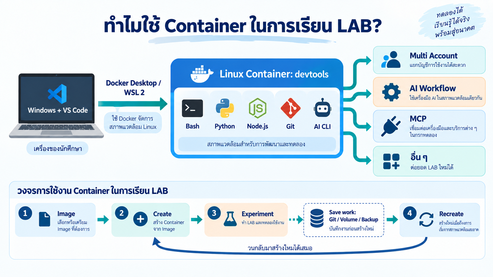

*ภาพแนวคิด: สร้างด้วย Imagegen เพื่ออธิบายการเรียน กลุ่มงานในภาพเป็นเพียงตัวอย่าง ไม่ใช่ขอบเขตทั้งหมดของรายวิชา และไม่ใช่ภาพหน้าจอจริง ส่วน Git / Volume / Backup แสดงวิธีเก็บงานที่ต้องจัดเตรียมเอง ไม่ได้หมายความว่าคำสั่งติดตั้งในคู่มือนี้สำรองให้อัตโนมัติ*

### 1) ใช้ Linux ให้สอดคล้องกับคำสั่งและเครื่องมือของชุดทดลอง

Windows ใช้พัฒนาซอฟต์แวร์ได้ แต่เมื่อ LAB ใช้ Bash, พาธแบบ Linux, สิทธิ์ไฟล์ และสคริปต์ติดตั้งสำหรับ Linux การใช้สภาพแวดล้อมเดียวกับตัวอย่างช่วยลดงานแปลงคำสั่งและการแก้ความต่างระหว่างระบบปฏิบัติการ ผู้เรียนจึงมีเวลาให้กับเนื้อหาและการทดลองมากขึ้น

บน Windows สามารถใช้ Docker Desktop ผ่าน WSL 2 เพื่อรัน Linux containers ได้ โดย WSL 2 มี Linux kernel รองรับอยู่เบื้องหลัง เราจึงยังใช้ Windows เป็นเครื่องหลักและใช้ VS Code เป็นหน้าต่างทำงานได้ ตาม [เอกสาร Docker Desktop บน WSL 2](https://docs.docker.com/desktop/features/wsl/)

สำหรับงาน AI สิ่งที่ต้องเข้ากันได้คือ **เครื่องมือที่นำคำตอบหรือคำสั่งไปทำงานจริง** เช่น shell, runtime, ไลบรารี และบริการ ไม่ใช่ตัวข้อความ prompt เอง เป้าหมายของการเลือก Linux ในวิชานี้คือให้ workflow ใช้กับตัวอย่างได้สอดคล้องกัน ไม่ได้หมายความว่า Windows ใช้ AI ไม่ได้ หรือ Linux ทำให้โมเดลฉลาดขึ้นและได้ประสิทธิภาพสูงสุดทุกงาน

### 2) เริ่มจากเครื่องมือพื้นฐานชุดเดียวกัน

แทนที่จะให้ทุกคนไล่ติดตั้ง Python, Node.js, Git และเครื่องมือระบบบน Windows แยกกัน เราใช้ image ของวิชาเป็นต้นแบบ แล้วสร้าง container สำหรับทำ LAB ช่วยลดความต่างของเครื่องมือและทำให้ผู้สอนอธิบายหรือช่วยตรวจปัญหาได้ง่ายขึ้น แนวทางนี้สอดคล้องกับ [Docker ที่ใช้จัดสภาพแวดล้อมการพัฒนาให้เป็นมาตรฐาน](https://docs.docker.com/get-started/docker-overview/) และ [VS Code Dev Containers](https://code.visualstudio.com/docs/devcontainers/containers)

อย่างไรก็ตาม การติดตั้งเพิ่มภายหลังยังทำให้สภาพแวดล้อมต่างกันได้ หากต้องการทำซ้ำให้ใกล้เคียงเดิม ควรใช้ image รุ่นเดียวกัน บันทึกคำสั่งติดตั้ง และระบุเวอร์ชันแพ็กเกจของแต่ละ LAB

### 3) ทดลองผิดพลาดแล้วเริ่มใหม่ได้เป็นขั้นตอน

การเรียนต้องมีการลองผิดลองถูก หากติดตั้งแพ็กเกจหรือเปลี่ยนการตั้งค่าจนระบบทดลองมีปัญหา เราสามารถ **เก็บงานที่ต้องการ → ลบ container ที่มีปัญหา → สร้างใหม่จาก image → ทำขั้นตอนตั้งค่าเพิ่มเติมอีกครั้ง** ได้ โดยไม่ต้องเริ่มติดตั้งเครื่องมือทุกอย่างบน Windows ใหม่

Image เปรียบเหมือนต้นแบบ ส่วน container คือพื้นที่ทำงานที่สร้างจากต้นแบบนั้น การสร้างใหม่จะกลับไปสู่สถานะของ image ไม่ได้กู้คืนงานและแพ็กเกจที่เพิ่มไว้ใน container เดิมโดยอัตโนมัติ ไฟล์ใน writable layer จะหายเมื่อลบ container ส่วนข้อมูลใน volume หรือ bind mount มีวงจรชีวิตแยกต่างหาก ตาม [เอกสารการจัดเก็บข้อมูลของ Docker](https://docs.docker.com/engine/storage/)

### 4) แยกพื้นที่ทดลองให้จัดการง่ายขึ้น

Container แยกกระบวนการและระบบไฟล์ของงานออกเป็นขอบเขต ช่วยลดการปะปนของแพ็กเกจทดลองกับระบบหลัก ตาม [คำอธิบาย container ของ Docker](https://docs.docker.com/get-started/docker-concepts/the-basics/what-is-a-container/) แต่ไม่ได้รับประกันว่าจะไม่กระทบเครื่องหลักเลย โดยเฉพาะชุดนี้ที่ใช้ `--privileged` เพื่อรองรับ Docker-in-Docker รวมถึงกรณีที่เชื่อมโฟลเดอร์จากเครื่องหลักเข้า container

**เป้าหมายของการเตรียมระบบครั้งนี้:** ให้ทุกคนมีพื้นที่ Linux สำหรับทำ LAB หลายชุด ใช้คำสั่งพื้นฐานร่วมกัน และเริ่มการทดลองใหม่ได้อย่างเป็นระบบ เมื่อเข้าใจเหตุผลแล้ว ขั้นตอนถัดไปคือเตรียม Docker บนเครื่องของเรา

---

## 1. ติดตั้ง Docker Desktop บน Windows

เริ่มจากดาวน์โหลดและติดตั้ง Docker Desktop บนเครื่องของผู้เรียนก่อนสร้าง container หากติดตั้งไว้แล้ว ให้ตรวจสถานะพร้อมใช้งานตามหัวข้อ 1.3

### 1.1 เปิดเว็บไซต์และเลือกไฟล์ดาวน์โหลด

1. เปิด [เว็บไซต์ Docker Desktop](https://www.docker.com/products/docker-desktop/)

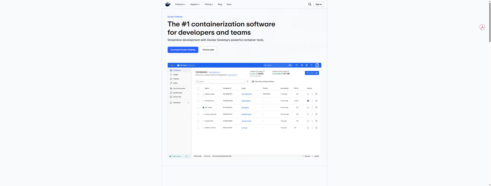

*ภาพหน้าเว็บไซต์จริงก่อนคลิกดาวน์โหลด ภาพโปรแกรมที่ปรากฏบนเว็บเป็นตัวอย่างของ Docker*

2. คลิก **Download Docker Desktop** เพื่อเปิดรายการระบบปฏิบัติการ
3. สำหรับ Windows ที่ใช้ CPU Intel หรือ AMD ทั่วไป เลือก **Download for Windows – AMD64** (รองรับทั้ง Intel และ AMD) ส่วนเครื่อง Windows on Arm ให้เลือก **ARM64**
4. หากไม่ทราบชนิดเครื่อง ให้ดู **Settings → System → About → System type** ก่อนเลือก

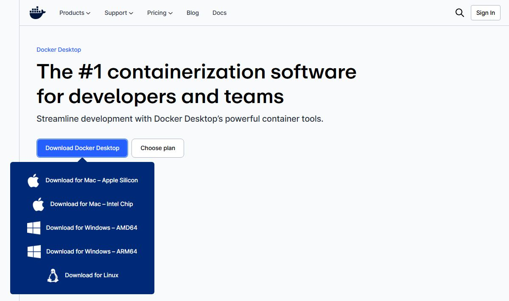

*ภาพจับจากเว็บไซต์ Docker จริงด้วย computer use แสดงตำแหน่งปุ่มและรายการดาวน์โหลด*

### 1.2 ไฟล์ที่ดาวน์โหลดอยู่ที่ไหน?

หลังเลือก Windows เบราว์เซอร์จะดาวน์โหลดไฟล์ **Docker Desktop Installer.exe** รอจนดาวน์โหลดเสร็จ หากมีหน้าต่างถามตำแหน่งจัดเก็บ ให้เลือกโฟลเดอร์ที่หาได้ง่าย เช่น **Downloads**

- เปิด File Explorer แล้วเลือก **Downloads** จากแถบด้านซ้าย โดยทั่วไปไฟล์จะอยู่ที่ `C:\Users\<ชื่อผู้ใช้>\Downloads` เว้นแต่ตั้งค่าเบราว์เซอร์ให้บันทึกไว้ที่อื่น
- อีกวิธีคือเปิดรายการดาวน์โหลดของ Chrome หรือ Edge ด้วย **Ctrl + J** แล้วเลือก **Show in folder / แสดงในโฟลเดอร์** ที่รายการ Docker Desktop Installer
- ถ้าเคยดาวน์โหลดซ้ำ ชื่อไฟล์อาจมีเลขต่อท้าย เช่น `Docker Desktop Installer (1).exe`

### 1.3 ติดตั้ง Docker Desktop

1. ดับเบิลคลิก **Docker Desktop Installer.exe** ที่ดาวน์โหลดไว้ แล้วทำตามขั้นตอนติดตั้ง โดยใช้ค่าเริ่มต้น และเลือก **Use WSL 2 instead of Hyper-V** หากมีตัวเลือกนี้
2. เมื่อติดตั้งเสร็จ กด **Close** และรีสตาร์ตเครื่องหากระบบร้องขอ
3. เปิด **Docker Desktop** อ่านและยอมรับข้อตกลงหากตกลง แล้วรอให้สถานะเป็น **Engine running** โดยใช้โหมด **Linux containers**

หากระบบแจ้งปัญหา WSL หรือข้อกำหนดเครื่อง ให้ดูวิธีแก้ใน [คู่มือติดตั้ง Docker Desktop สำหรับ Windows](https://docs.docker.com/desktop/setup/install/windows-install/)

ภาพถัดไปเป็นตัวอย่างโปรแกรมที่ติดตั้งและเปิดใช้งานสำเร็จแล้ว:


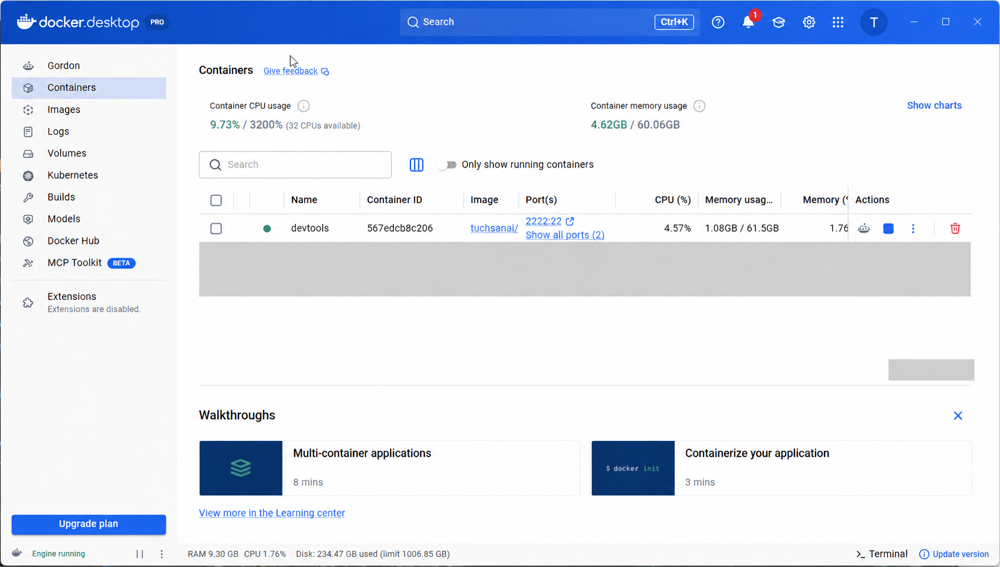

*ภาพที่ 1: สังเกต Engine running ที่มุมล่างซ้าย ภาพนี้ถ่ายหลังสร้าง devtools แล้ว ผู้เริ่มต้นอาจยังเห็นรายการว่าง*

เปิด **PowerShell บน Windows** แล้วตรวจ:

```powershell
docker --version
docker info
```

คำสั่งแรกตรวจ CLI ส่วนคำสั่งที่สองต้องแสดงข้อมูล Server ได้ด้วย หากติดต่อ daemon ไม่ได้ ให้รอ Docker Desktop พร้อมก่อน

## 2. เตรียม VS Code

**เปิดโปรแกรม VS Code**

เปิด **Visual Studio Code** จาก Start menu หรือไอคอนบนเครื่อง หากยังไม่มี ให้ติดตั้งจาก [เว็บไซต์ Visual Studio Code](https://code.visualstudio.com/) ก่อน

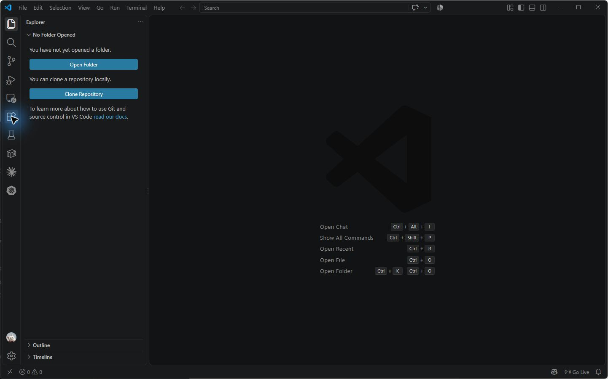

**คลิก Extensions แล้วค้นหา Dev Containers**

คลิกไอคอน **Extensions** รูปสี่เหลี่ยมที่แถบด้านซ้าย หรือกด `Ctrl+Shift+X` แล้วพิมพ์ **Dev Containers** ในช่องค้นหา

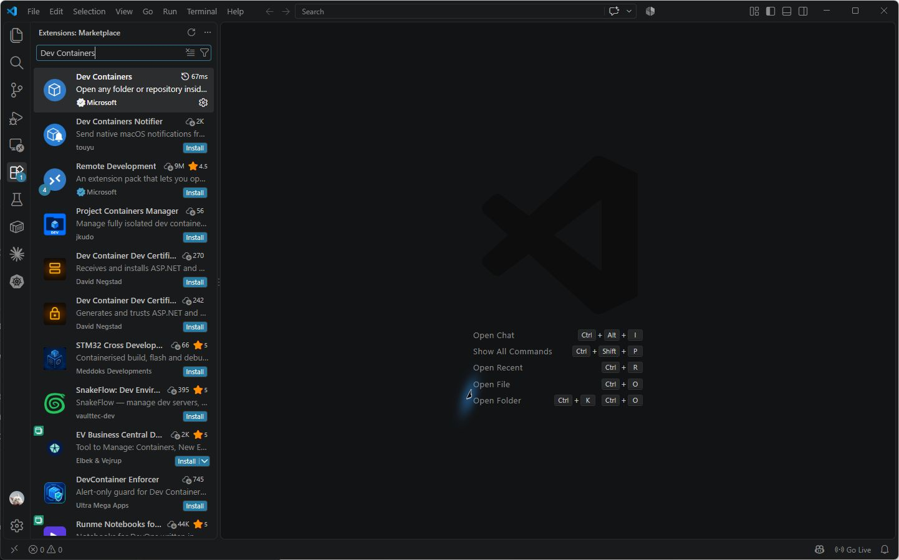

**เลือกของ Microsoft แล้วกด Install**

คลิก **Dev Containers** ของ **Microsoft** เพื่อเปิดรายละเอียด แล้วกด **Install** รอให้ติดตั้งเสร็จ

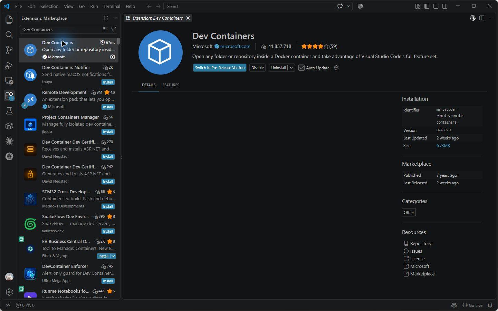

*เครื่องตัวอย่างติดตั้งแล้วจึงแสดง Disable / Uninstall เครื่องที่ยังไม่มีส่วนขยายจะเห็น Install ในบริเวณเดียวกัน*

เตรียม **Container Tools** ของ Microsoft เพื่อแสดงรายการ container และ **Claude Code** ของ Anthropic เพื่อรับพรอมป์ในหัวข้อถัดไป โดยติดตั้งผ่าน Extensions เช่นเดียวกัน แล้วเข้าสู่ระบบ Claude Code ด้วยบัญชีของตนเอง

## 3. สร้าง container ผ่าน Claude Code ใน VS Code

ใช้ image `tuchsanai/devtools:2569_1` ชื่อ `devtools` เริ่มตรวจพอร์ต SSH ที่ `2222` และ Jupyter ที่ `8885` หากชนให้ใช้เลขว่างถัดไป

| บริการ | พอร์ตบนเครื่องผู้เรียน | พอร์ตใน container |
| --- | --- | --- |
| SSH | 2222 หรือเลขว่างถัดไป | 22 |
| Jupyter | 8885 หรือเลขว่างถัดไป | 8888 |

### 3.1 พรอมป์สำหรับสร้าง container

คัดลอกพรอมป์ด้านล่างไปวางใน Claude Code ตามหัวข้อ 3.2 เพื่อให้ดำเนินการกับ Docker บนเครื่องผู้เรียน

> ขั้นตอนตามต้นฉบับจะลบ devtools ตัวเดิม หากมีงานอยู่ ให้สำรองก่อน เพราะไฟล์ใน writable layer จะหายเมื่อลบ container

```text
เตรียม container `devtools`:

1. ถ้ามี container `devtools` อยู่แล้ว ให้ลบด้วย `docker rm -f devtools`
2. ตรวจ port <SSH_PORT>=2222 และ <JUPYTER_PORT>=8885 ถ้าชน ให้ใช้ port ว่างถัดไป
3. รัน:

docker run -dit --name devtools --privileged \
  -p <SSH_PORT>:22 -p <JUPYTER_PORT>:8888 \
  tuchsanai/devtools:2569_1

docker exec -it devtools bash -c \
'curl -fsSL https://claude.ai/install.sh | bash && npm install -g @openai/codex'


4. ตรวจด้วย `claude --version` และ `codex --version` แล้วสรุป port ที่ใช้


```

### 3.2 เปิด Claude Code แล้ววางพรอมป์

ทำขั้นตอนนี้ใน **VS Code บนเครื่องที่เปิด Docker Desktop อยู่** ก่อน Attach เข้า container

1. คลิกไอคอน **Claude Code** รูปดาวแฉกที่แถบด้านซ้าย แล้วเลือก **New session**
2. คัดลอกพรอมป์ทั้งหมดในหัวข้อ **3.1** แล้ววางลงในช่อง **Ask Claude to edit…** ด้านล่างของหน้าต่าง Claude Code
3. กดปุ่มส่ง ให้ Claude Code ดำเนินการตามพรอมป์ หากมีคำขออนุญาตรันคำสั่ง ให้ตรวจคำสั่งแล้วอนุญาตตามขั้นตอน
4. รอให้ Claude Code สร้าง container ติดตั้งเครื่องมือ และสรุปผลพร้อมพอร์ตที่ใช้จริง

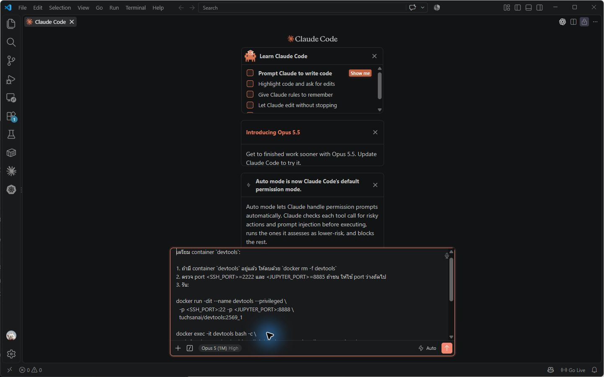

*ภาพจริงหลังวางพรอมป์จาก 3.1 ในช่องด้านล่าง จากนั้นผู้เรียนกดปุ่มส่งรูปลูกศรขึ้น และรอให้ทำงานสำเร็จก่อนตรวจ container ในภาพถัดไป*

การวางข้อความเพียงอย่างเดียวยังไม่เริ่มทำงาน ต้องกดส่งและรอให้คำสั่งสำเร็จ หาก Claude Code รายงานข้อผิดพลาด ให้แก้ตามผลที่แจ้งก่อนทำขั้นตอนถัดไป อ้างอิงการใช้งานจาก [คู่มือ Claude Code ใน VS Code](https://code.claude.com/docs/en/vs-code)

## 4. ตรวจว่า container พร้อมใช้งาน

เมื่อ Claude Code สร้างสำเร็จ ให้เปิดแถบ **Containers** ด้านซ้าย จะเห็น **devtools** ใต้ **Individual Containers** โดยรายการอัปเดตอัตโนมัติ หากยังไม่ปรากฏให้กด **Refresh**

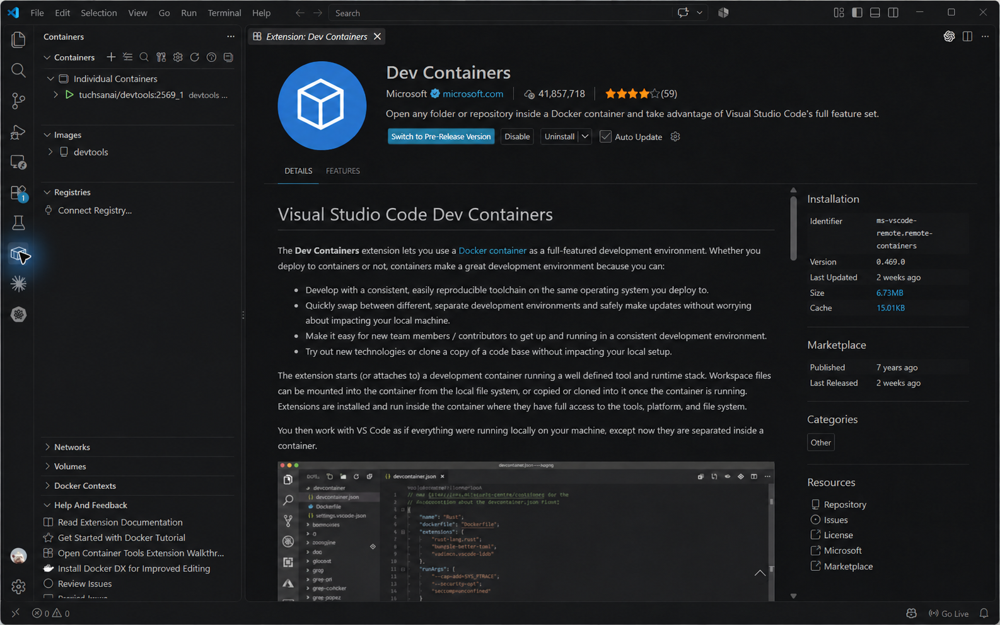

*ผลที่ต้องได้: devtools อยู่ในสถานะทำงาน พร้อมไป Attach VS Code ในหัวข้อ 5 ภาพปรับด้วย Imagegen เพื่อซ่อนรายการอื่นและจัด devtools ไว้ด้านบน*

ตรวจสรุปจาก Claude Code ว่าสร้าง container และตรวจเวอร์ชัน Claude Code/Codex สำเร็จ พร้อมจดพอร์ต SSH และ Jupyter ที่ใช้จริง ขั้นตอนติดตั้งเครื่องมืออยู่ในพรอมป์แล้ว ไม่ต้องรันชุดคำสั่งติดตั้งซ้ำเอง

## 5. เปิด VS Code เข้า container

1. เปิดแถบ **Containers** ด้านซ้าย
2. หา `devtools` ใต้ **Individual Containers**
3. คลิกขวาที่แถว container
4. เลือก **Attach Visual Studio Code**
5. รอหน้าต่างใหม่เชื่อมต่อและเตรียม VS Code Server

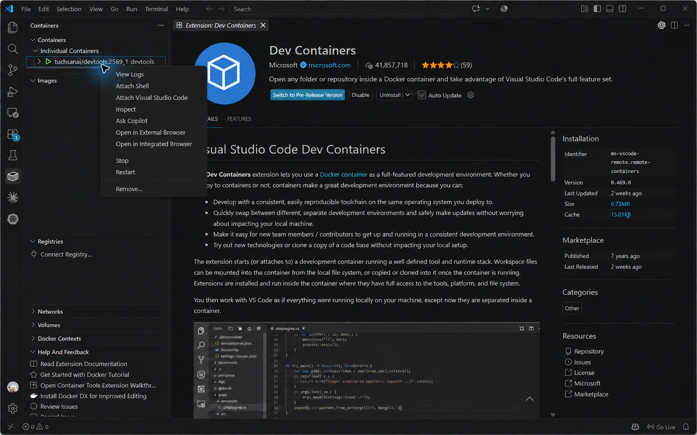

*เลือก Attach Visual Studio Code เพื่อเข้า container ภาพปรับด้วย Imagegen ให้เหลือ devtools ด้านบนและซ่อนรายการใน Images เพื่อให้อ่านขั้นตอนได้ชัดเจน*

อีกวิธีคือกด `Ctrl+Shift+P` แล้วค้นหา:

```text
Dev Containers: Attach to Running Container...
```

เลือก `devtools` จากรายการ วิธีนี้ต้องมี Dev Containers และ Docker พร้อมใช้งาน ตาม [คู่มือ Attach ของ VS Code](https://code.visualstudio.com/docs/devcontainers/attach-container)

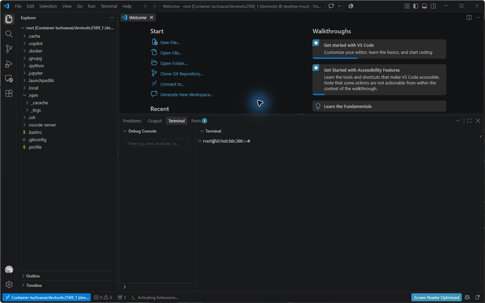

*ภาพที่ 5: ตรวจแถบล่างซ้ายว่าระบุ Container และ image ของวิชาก่อนทำ LAB*

## 6. เปิดโฟลเดอร์ทดลอง /workspace

ในหน้าต่างที่เชื่อม container แล้ว:

1. เลือก **File → Open Folder...** หรือ **Open Folder...** บนหน้า Welcome
2. ใส่ `/workspace`
3. กด **OK** หากครั้งแรกเป็นการเข้าโฟลเดอร์ ให้กด OK อีกครั้งเพื่อเปิด
4. ตรวจ Explorer ว่ารากเป็น `workspace` และแถบล่างซ้ายยังระบุ Container

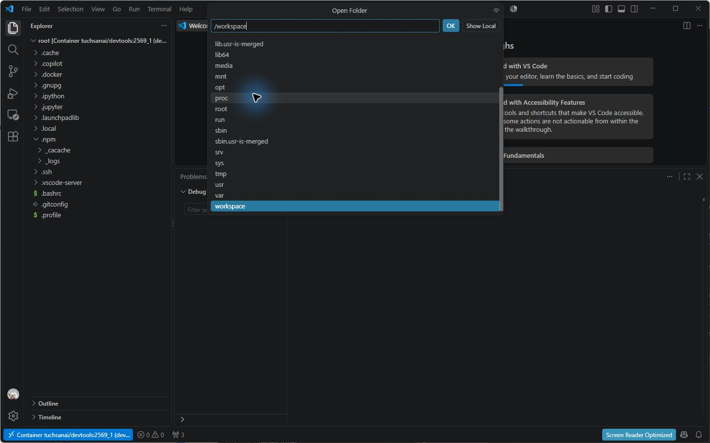

*ภาพที่ 6: ใช้พาธ Linux ภายใน container ไม่ใช่โฟลเดอร์ Windows*

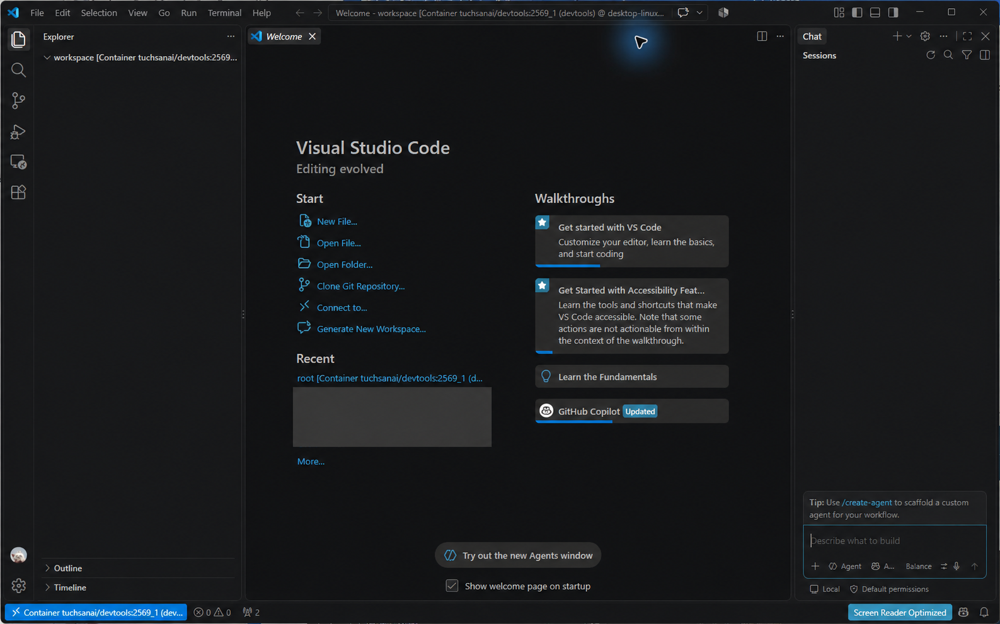

*ภาพที่ 7: พร้อมสร้างไฟล์ทดลองใน workspace โฟลเดอร์ว่างใน container ใหม่เป็นเรื่องปกติ*

เปิด **Terminal → New Terminal** ในหน้าต่างนี้ แล้วตรวจ:

```bash
pwd
python --version
node --version
docker --version
git --version
```

`pwd` ควรได้ `/workspace` และเครื่องมือควรแสดงเวอร์ชัน

## 7. ทางเลือก SSH และ Jupyter

### SSH

รันจาก PowerShell บนเครื่องที่รัน Docker หากใช้พอร์ตเริ่มต้น:

```powershell
ssh root@localhost -p 2222
```

เปลี่ยนเลขพอร์ตตามที่ใช้จริง ตรวจปลายทางก่อนยอมรับ fingerprint ครั้งแรก และใช้รหัสผ่าน container ที่ผู้สอนแจ้ง

### Jupyter

หากใช้พอร์ตเริ่มต้น เปิด [Jupyter บนเครื่องตนเอง](http://localhost:8885) การแมปพอร์ตไม่ได้รับประกันว่า server เริ่มแล้ว หากเปิดไม่ได้ให้ตรวจ:

```powershell
docker logs --tail 80 devtools
docker exec devtools bash -lc 'jupyter server list'
```

ใช้ token/รหัสผ่านที่ผู้สอนกำหนด ไม่ใส่ค่าลับจาก `.env` ลงในคู่มือ หากยังไม่มี server ให้รันใน terminal **ภายใน container** และเปิด terminal ค้างไว้:

```bash
jupyter lab --ip=0.0.0.0 --port=8888 --no-browser --allow-root
```

ใช้ token ที่แสดงใน terminal ของตนเอง

> localhost หมายถึงเครื่องที่เปิด browser/SSH หาก Docker อยู่บนเครื่อง Remote ต้องเชื่อมเครือข่ายหรือทำ port forwarding ให้ถูกต้องก่อน

## 8. กลับมาทำงานครั้งถัดไป

ไม่ต้องสร้างใหม่ทุกครั้ง จาก PowerShell บนเครื่องผู้เรียน:

```powershell
docker start devtools
```

จากนั้น Attach VS Code และเปิด `/workspace` ตามเดิม เมื่อจบงาน:

```powershell
docker stop devtools
```

stop/start เก็บไฟล์ไว้ แต่ `docker rm` ลบ writable layer คำสั่งตาม `1.txt` ยังไม่ได้ mount volume สำหรับ `/workspace` จึงต้องสำรองงานหรือใช้ Git ก่อนลบ container

## 9. ตรวจความพร้อมและแก้ปัญหา

- [ ] Docker Desktop แสดง Engine running และ docker info ติดต่อ Server ได้
- [ ] devtools อยู่ในสถานะ Up
- [ ] จดพอร์ต SSH/Jupyter จริง
- [ ] Claude Code สรุปว่าติดตั้งและตรวจเวอร์ชัน Claude Code/Codex ใน container สำเร็จ
- [ ] VS Code แสดงสถานะ Container
- [ ] เปิด /workspace และตรวจ Python, Node.js, Docker, Git ได้

| อาการ | วิธีตรวจและแก้ |
| --- | --- |
| ไม่รู้จัก docker | ตรวจการติดตั้งแล้วเปิด terminal ใหม่ |
| ติดต่อ daemon ไม่ได้ | เปิด Docker Desktop และรอ Engine running |
| ชื่อ devtools ซ้ำ | สำรองงานก่อนลบ หรือ start ตัวเดิมหากไม่ได้ต้องการสร้างใหม่ |
| พอร์ตชน/ถูกสงวน | เลือกเลขถัดไปและใช้เลขใหม่ใน SSH/Jupyter |
| ไม่มีเมนู Attach | ตรวจ Dev Containers หรือใช้ Command Palette |
| VS Code ไม่พบ container | ตรวจว่า CLI/VS Code ใช้ Docker context เดียวกันด้วย docker context show และ docker ps |
| เห็นไฟล์ Windows หลัง Open Folder | กลับไปหน้าต่างที่สถานะเป็น Container แล้วเปิด /workspace |
| ไม่พบ claude หลังติดตั้ง | เปิด shell ใหม่ หรือตรวจ $HOME/.local/bin/claude และ PATH |

## แหล่งอ้างอิงและผลตรวจภาพ

- `1.txt`: image, ชื่อ container, พอร์ต และคำสั่งติดตั้ง
- `tool.pdf`: ลำดับ Docker → VS Code → Attach Shell/Attach Visual Studio Code
- [Docker Desktop: Windows installation](https://docs.docker.com/desktop/setup/install/windows-install/)
- [VS Code: Attach to a running container](https://code.visualstudio.com/docs/devcontainers/attach-container)
- ภาพขั้นตอนใช้งานจับจากแอปจริงด้วย Computer Use; ภาพที่ 1, 3, 4 และ 7 ใช้ฉบับปิดบังข้อมูลด้วย Imagegen โดยเก็บต้นฉบับไว้

เครื่องตัวอย่างสร้าง devtools สำเร็จ ใช้ SSH `2222:22` และ Jupyter `8885:8888` และ Attach VS Code เข้า `/workspace` ได้จริง ตรวจ CLI ผ่าน Docker exec ได้ Python 3.12.3, Node.js 22.23.2, Docker 29.8.1 และ Git 2.55.0 เลขเหล่านี้เป็นผลเครื่องตัวอย่าง ไม่ใช่ข้อกำหนดว่าทุกเครื่องต้องตรงทุกตัว

ภาพ Claude Code เป็นการสาธิตวางพรอมป์จริงโดยยังไม่กดส่ง ส่วนภาพรายการ devtools แสดง container ที่สร้างและตรวจไว้ก่อนหน้า

**การส่งต่อ:** คัดลอก Markdown พร้อมโฟลเดอร์ `assets` เสมอ เปิด Markdown Preview ด้วย `Ctrl+Shift+V` เพื่อดูภาพ
