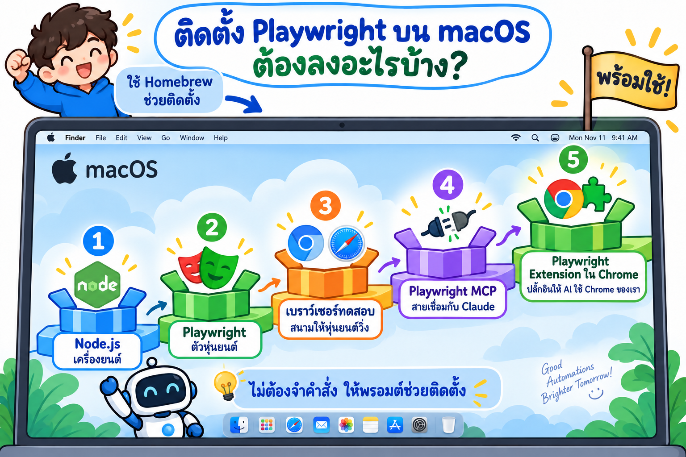
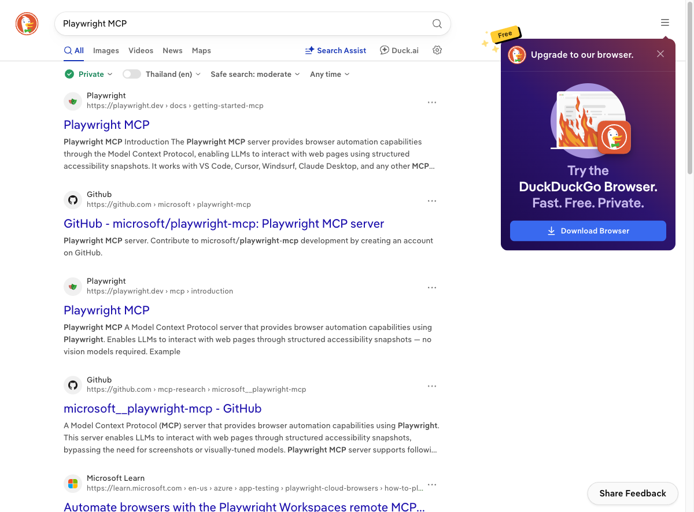
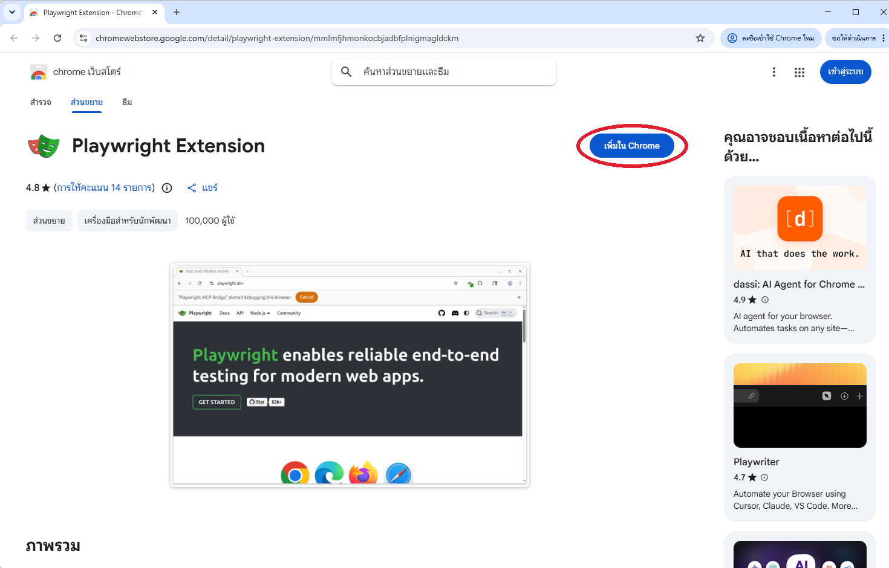
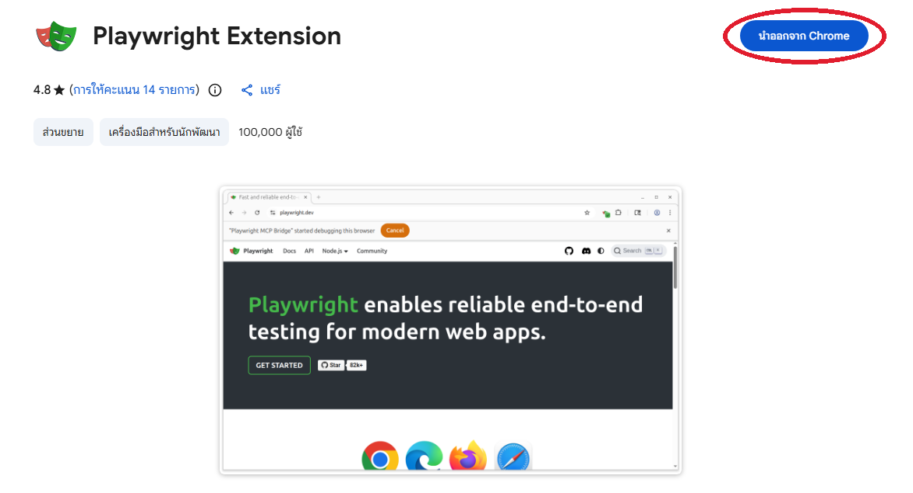
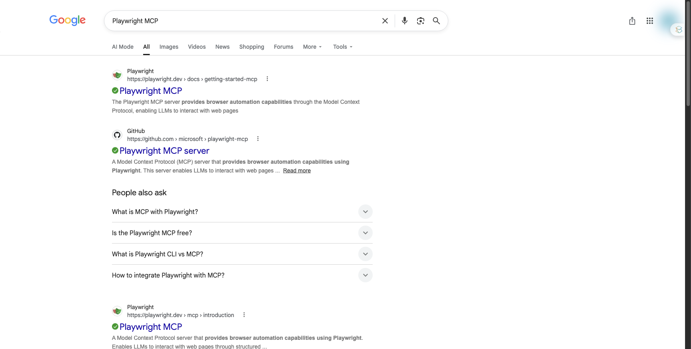

# ติดตั้ง Playwright บน macOS ด้วยพรอมต์ (Copy & Paste)

บทนี้ **ไม่ต้องพิมพ์คำสั่งเอง** แค่คัดลอกพรอมต์ไปวางใน Claude Code แล้วให้ AI ตรวจ ติดตั้ง และทดสอบให้
หน้าที่ของเราคือ **อ่านผล และกดยืนยัน**

ติดตั้งเสร็จแล้ว **ใช้ได้จากทุกโฟลเดอร์** เพราะเบราว์เซอร์ทดสอบเก็บไว้ที่เดียวในเครื่อง และ Playwright MCP ตั้งค่าไว้ระดับผู้ใช้ (user scope)

## Playwright คืออะไร?


## ทำไมต้องใช้ Playwright?


## ติดตั้งบน macOS ต้องลงอะไรบ้าง?



## เรียนบทนี้ยังไง?


**ต้องมี:**
- Mac ที่ติดตั้ง Claude Code แล้ว (ชิป Apple Silicon หรือ Intel ก็ได้)
- [Homebrew](https://brew.sh) ตัวช่วยติดตั้งโปรแกรมบน Mac (ถ้ายังไม่มี ให้ติดตั้งเองก่อน เพราะต้องใส่รหัสผ่านเครื่อง)
- Google Chrome
- เปิด `claude` ในโฟลเดอร์ไหนก็ได้

**เลือกเรียนได้ 2 แบบ:** วาง **LAB 1** พรอมต์เดียวจบทั้งบท หรือทำ **ทีละขั้น** ตั้งแต่ LAB 2 → LAB 6
แต่ละ LAB มี 💬 พรอมต์ให้คัดลอก · ✅ ผลจริงที่ได้ · 👀 สิ่งที่ควรสังเกต

---

## LAB 1 · พรอมต์รวม: ตรวจ ติดตั้ง และทดสอบทั้งบท

🎯 สั่ง Claude Code ให้ทำงานทั้งบทด้วยพรอมต์เดียว แล้วดูว่า AI ทำอะไรในแต่ละขั้น

💬 **คัดลอกพรอมต์นี้** (กดปุ่ม Copy มุมขวาของกรอบ)

```text
ช่วยตรวจสอบและติดตั้งเครื่องมือสำหรับใช้ Playwright และ Playwright MCP ทดสอบเว็บ บน macOS ตามขั้นตอนนี้
ทุกค่าที่รายงานต้องมาจากคำสั่งที่รันจริง ห้ามตอบจากความจำ

ขั้นที่ 1: ตรวจเวอร์ชันที่ติดตั้งอยู่ เทียบกับเวอร์ชันล่าสุด (อ่านอย่างเดียว ห้ามติดตั้งหรือแก้อะไร)
1. Homebrew
   * brew --version (ถ้าไม่มี ให้หยุดแล้วบอกผมไปติดตั้งจาก https://brew.sh เอง)
2. Node.js
   * ที่ติดตั้งอยู่: node -v และ which -a node (ดูว่ามี node หลายตัวไหม มาจาก Homebrew หรือจากไฟล์ .pkg)
   * ล่าสุด: https://nodejs.org/dist/index.json แจ้งทั้ง Current ล่าสุดและ LTS ล่าสุด
   * ตรวจว่าตรงกับที่ Playwright ต้องการไหม: npm view playwright engines
3. npm
   * ที่ติดตั้งอยู่: npm -v / ล่าสุด: npm view npm version
4. Playwright และเบราว์เซอร์ทดสอบ
   * ที่ติดตั้งอยู่: ls ~/Library/Caches/ms-playwright และ npx playwright --version ในโฟลเดอร์ ~/playwright-lab (ถ้ามี)
   * ล่าสุด: npm view playwright version
5. Playwright MCP (@playwright/mcp)
   * ที่ตั้งค่าไว้: claude mcp list
   * ล่าสุด: npm view @playwright/mcp version
6. Google Chrome
   * ที่ติดตั้งอยู่: defaults read "/Applications/Google Chrome.app/Contents/Info" CFBundleShortVersionString
   * ล่าสุด: https://versionhistory.googleapis.com/v1/chrome/platforms/mac_arm64/channels/stable/versions
     (ถ้าเป็น Mac ชิป Intel ให้ใช้ platforms/mac แทน ดูจาก uname -m)
7. Microsoft Edge (ถ้ามี): defaults read "/Applications/Microsoft Edge.app/Contents/Info" CFBundleShortVersionString
8. Claude Code
   * ที่ติดตั้งอยู่: claude --version / ล่าสุด: npm view @anthropic-ai/claude-code version

ขั้นที่ 2: สรุปผลเป็นตาราง
คอลัมน์: รายการ | เวอร์ชันที่ติดตั้ง | เวอร์ชันล่าสุด | สถานะ (ล่าสุดแล้ว / ต้องอัปเดต / ยังไม่ได้ติดตั้ง) | หมายเหตุ
แสดงตารางให้ดูก่อน บอกว่ารายการไหนทำให้ได้ รายการไหนต้องให้ผมทำเอง แล้วถามยืนยันก่อนเริ่ม

ขั้นที่ 3: ติดตั้ง/อัปเดตเฉพาะรายการที่ผมยืนยัน
* Node.js: brew install node (ถ้ามีอยู่แล้วใช้ brew upgrade node)
  ถ้ามี node ตัวเก่าจาก .pkg อยู่ที่ /usr/local/bin ห้ามลบเอง ให้ตรวจว่า which node ชี้ไปที่ /opt/homebrew/bin/node แล้ว
* npm: npm install -g npm@latest
* Claude Code: claude update
* Playwright: สร้างโฟลเดอร์ ~/playwright-lab แล้ว npm init -y และ npm install -D @playwright/test@latest
* เบราว์เซอร์ทดสอบ: npx playwright install chromium webkit
  ถ้าขึ้น "Download failure" หรือ timeout ให้วินิจฉัยด้วย curl -4 และ curl -6 ไปที่ https://cdn.playwright.dev ก่อน
* Playwright MCP: claude mcp add playwright -s user -- npx @playwright/mcp@latest
  (-s user = ใช้ได้ทุกโฟลเดอร์ ถ้ามีชื่อ playwright อยู่แล้วให้ถามผมก่อนแก้)
* Chrome: บอกให้ผมเปิด chrome://settings/help ใน Chrome แล้วกด Relaunch เอง
ถ้าคำสั่งใดต้องใช้รหัสผ่านเครื่อง (sudo) หรือรันไม่ผ่าน ให้หยุดแล้วบอกคำสั่งที่ผมต้องรันเอง ห้ามข้าม

ขั้นที่ 4: ทดสอบ
* ใน ~/playwright-lab เขียนเทสต์สั้น ๆ เปิด https://playwright.dev แล้วตรวจว่า title มีคำว่า Playwright
  รันกับ chromium และ webkit แล้วรายงานผล
* รัน claude mcp list จากโฟลเดอร์อื่น (เช่น ~) เพื่อยืนยันว่า playwright ขึ้น Connected ได้ทุกที่
  (Connected แปลว่า server เริ่มได้เท่านั้น ยังไม่ได้แปลว่าเปิดเบราว์เซอร์ได้)
* ใช้ Playwright MCP เปิด https://duckduckgo.com ค้นหาคำว่า Playwright MCP แล้วจับภาพหน้าผลการค้นหา
  ถ้าเจอ CAPTCHA ให้หยุดแล้วบอกผม ห้ามพยายามผ่าน

ขั้นที่ 5: สรุป
* แสดงตารางเทียบ ก่อน/หลัง
* รายการไหนสำเร็จ รายการไหนล้มเหลว (แนบ error จริง) และสิ่งที่ผมต้องทำเอง เช่น รีสตาร์ท Claude Code หรืออัปเดต Chrome
```

💡 **พรอมต์ที่ดีมี 4 อย่าง** (ใช้ได้กับทุกงาน)

1. 📋 **บอกให้ชัดว่าจะตรวจอะไร** → AI ไม่ต้องเดา
2. ✋ **ให้ถามก่อนลงมือ** → เราเป็นคนตัดสินใจ
3. 🛑 **ทำไม่ได้ ให้หยุดแล้วบอก** → ไม่แอบข้าม ไม่ลองมั่ว
4. ✅ **ขอหลักฐาน** → ตารางก่อน/หลัง และภาพหน้าจอ

---

## LAB 2 · ตรวจเวอร์ชัน

💬 **คัดลอกพรอมต์นี้**

```text
ตรวจเวอร์ชันเครื่องมือสำหรับ Playwright บน Mac เครื่องนี้ (อ่านอย่างเดียว ห้ามติดตั้งหรือแก้อะไร)
ตรวจ Homebrew, Node.js, npm, Playwright, เบราว์เซอร์ทดสอบของ Playwright, Playwright MCP, Google Chrome และ Claude Code
เทียบกับเวอร์ชันล่าสุดจากแหล่งจริง (npm view, nodejs.org, หน้าเวอร์ชันของ Chrome) ห้ามตอบจากความจำ
ตรวจด้วยว่า Node.js ที่มีอยู่ใช้กับ Playwright รุ่นล่าสุดได้ไหม (npm view playwright engines)
แล้วสรุปเป็นตาราง: รายการ | ที่ติดตั้ง | ล่าสุด | สถานะ
อธิบายสั้น ๆ ด้วยภาษาง่าย ๆ ว่ารายการไหนต้องอัปเดต และทำไม
```

✅ **ผลจริง** (Mac ชิป M · macOS 27)

| รายการ | ที่ติดตั้ง | ล่าสุด | สถานะ |
|---|---|---|---|
| Homebrew | 5.1.5 | – | พร้อมใช้ |
| Node.js | v18.15.0 (จากไฟล์ .pkg) | v26.11.1 (Current) / v24.21.0 (LTS) | ต้องอัปเดต (Playwright ต้องการ Node 20 ขึ้นไป) |
| npm | 9.6.2 | 12.2.0 | ต้องอัปเดต |
| Playwright Test | – | 1.64.0 | ยังไม่ได้ติดตั้ง |
| เบราว์เซอร์ทดสอบ | – | – | ยังไม่ได้ติดตั้ง |
| Playwright MCP | – | 0.0.83 | ยังไม่ได้ตั้งค่า |
| Google Chrome | 155.0.8059.39 | 156.0.8078.12 | ต้องอัปเดต |
| Microsoft Edge | – | – | ไม่ได้ติดตั้ง (ไม่จำเป็น) |
| Claude Code | 2.1.220 | 2.1.296 | ต้องอัปเดต |

👀 **สังเกต**
- LAB นี้ **ดูอย่างเดียว** ยังไม่มีอะไรถูกติดตั้ง
- เครื่องนี้มี Node 18 ที่ติดตั้งไว้นานแล้ว **ใช้กับ Playwright รุ่นใหม่ไม่ได้** Claude รู้ได้จากคำสั่ง `npm view playwright engines` ไม่ได้เดา

---

## LAB 3 · ติดตั้ง Node.js และอัปเดตเครื่องมือ

💬 **คัดลอกพรอมต์นี้**

```text
ช่วยอัปเดตเครื่องมือบน Mac ให้พร้อมใช้ Playwright
1. ติดตั้ง Node.js ล่าสุดด้วย brew install node
   ถ้ามี node ตัวเก่าอยู่ ห้ามลบเอง แค่ตรวจว่า which node ชี้ไปที่ตัวใหม่จาก Homebrew
2. อัปเดต npm ด้วย npm install -g npm@latest
3. อัปเดต Claude Code ด้วย claude update
บอกก่อนว่าจะรันคำสั่งอะไร แล้วแสดงเวอร์ชันก่อน/หลัง
ถ้าคำสั่งไหนต้องใช้รหัสผ่านเครื่อง ให้หยุดแล้วบอกให้ผมรันเอง
```

✅ **ผลจริง**

| รายการ | ก่อน | หลัง |
|---|---|---|
| Node.js | v18.15.0 | v26.11.1 |
| npm | 9.6.2 | 12.2.0 |
| Claude Code | 2.1.220 | 2.1.296 |

👀 **สังเกต**
- `which -a node` เจอ **2 ตัว**: `/opt/homebrew/bin/node` (ใหม่) กับ `/usr/local/bin/node` (เก่า) ตัวที่อยู่ก่อนใน PATH คือตัวที่ถูกใช้ ซึ่งเป็นตัวใหม่จาก Homebrew
- Homebrew ติดตั้งโดย **ไม่ต้องใส่รหัสผ่านเครื่อง** ต่างจาก Windows ที่บางครั้งต้องใช้สิทธิ์ Administrator
- ถ้าเปิด Terminal ค้างไว้ก่อนติดตั้ง ให้เปิดหน้าต่างใหม่ เพื่อให้เจอ node ตัวใหม่

---

## LAB 4 · ติดตั้ง Playwright และเบราว์เซอร์ทดสอบ

🤔 **ทำไมต้องติดตั้งเบราว์เซอร์ทดสอบ ในเมื่อเครื่องมี Chrome และ Safari อยู่แล้ว?**


1. **ครบ 2 เครื่องยนต์หลัก** Chromium (Chrome / Edge) และ WebKit (Safari) เว็บที่ใช้ได้บนตัวหนึ่งอาจพังบนอีกตัว
2. **รุ่นตรงกับ Playwright** Playwright แต่ละรุ่นผูกกับเบราว์เซอร์รุ่นที่ทดสอบมาแล้ว ทุกเครื่องในห้องจึงได้ผลเหมือนกัน
3. **แยกจาก Chrome ของเรา** เบราว์เซอร์ทดสอบเปิดแบบสะอาดทุกครั้ง ไม่มีบัญชี คุกกี้ หรือส่วนขยายของเรามาปน
4. **`npm install` ไม่ได้โหลดเบราว์เซอร์มาให้** ต้องรัน `npx playwright install` แยกอีกครั้ง

💬 **คัดลอกพรอมต์นี้**

```text
สร้างโฟลเดอร์ ~/playwright-lab แล้วติดตั้ง Playwright Test ในนั้นให้หน่อย
1. ติดตั้ง @playwright/test เวอร์ชันล่าสุด
2. ติดตั้งเบราว์เซอร์ทดสอบด้วย npx playwright install chromium webkit
3. เขียนเทสต์สั้น ๆ เปิด https://playwright.dev แล้วตรวจว่า title มีคำว่า Playwright
   รันกับ chromium และ webkit แล้วรายงานผล
ถ้าดาวน์โหลดเบราว์เซอร์ไม่ผ่าน ให้หาสาเหตุก่อน (ลอง curl -4 และ curl -6 ไปที่ https://cdn.playwright.dev)
แล้วเปิดโฟลเดอร์ที่เก็บเบราว์เซอร์ทดสอบให้ผมดูใน Finder
```

✅ **ผลจริง**

```text
~/Library/Caches/ms-playwright/
├─ chromium-1248
├─ chromium_headless_shell-1248
├─ ffmpeg-1013
└─ webkit-2370

✓ [chromium] › เปิดหน้า playwright.dev ได้
✓ [webkit]   › เปิดหน้า playwright.dev ได้
2 passed
```

👀 **สังเกต**
- เบราว์เซอร์ทดสอบอยู่ที่ `~/Library/Caches/ms-playwright` **ที่เดียว** ทุกโปรเจกต์ในเครื่องใช้ร่วมกันได้ โปรเจกต์ใหม่แค่ `npm install -D @playwright/test` ก็รันได้เลย
- ตรวจด้วยว่าหน้าเทสต์ผ่านจริงทั้ง 2 เบราว์เซอร์ ไม่ใช่แค่ "ติดตั้งเสร็จ"

---

## LAB 5 · เชื่อม Playwright MCP กับ Claude Code (ใช้ได้ทุกโฟลเดอร์)

🎯 ให้ Claude ใช้เบราว์เซอร์ได้เอง จากโฟลเดอร์ไหนก็ได้

💬 **คัดลอกพรอมต์นี้**

```text
ตั้งค่า Playwright MCP ให้ Claude Code แบบใช้ได้ทุกโฟลเดอร์
1. รัน claude mcp add playwright -s user -- npx @playwright/mcp@latest
   (ถ้ามีชื่อ playwright อยู่แล้ว ให้แสดง config เดิมและถามผมก่อนแก้)
2. ไปที่โฟลเดอร์อื่น เช่น ~ แล้วรัน claude mcp list ดูว่า playwright ขึ้น Connected
3. บอกผมว่าต้องปิดแล้วเปิด Claude Code ใหม่ไหม ก่อนจะใช้เครื่องมือของ Playwright ได้
```

จากนั้น **ปิดแล้วเปิด Claude Code ใหม่** แล้ววางพรอมต์ทดสอบนี้

```text
ใช้ Playwright MCP เปิด https://duckduckgo.com ค้นหาคำว่า "Playwright MCP"
แล้วจับภาพหน้าผลการค้นหา ถ้าเจอ CAPTCHA ให้หยุดแล้วบอกผม
```

✅ **ผลจริง** `playwright: npx @playwright/mcp@latest - ✔ Connected` และได้ภาพนี้



👀 **สังเกต**
- `-s user` เก็บการตั้งค่าไว้ใน `~/.claude.json` จึงใช้ได้ **ทุกโฟลเดอร์** ไม่ต้องตั้งใหม่ทุกโปรเจกต์
- Playwright MCP เปิด Chrome **หน้าต่างแยก** ที่ไม่มีบัญชีของเรา ปลอดภัยต่อข้อมูลส่วนตัว
- ลองกับ Google แล้วเจอ **CAPTCHA** ("unusual traffic") เพราะเบราว์เซอร์ไม่มีคุกกี้หรือบัญชีเลย Claude หยุดตามที่สั่ง ไม่พยายามผ่าน จึงเปลี่ยนมาใช้ DuckDuckGo ถ้าต้องใช้ Google ให้ทำ LAB 6

---

## LAB 6 · (ทางเลือก) ให้ AI ใช้ Chrome ตัวจริงด้วย Playwright Extension

🎯 ปลั๊กอินนี้ทำให้ Claude **ใช้ Chrome ตัวจริงของเรา** (มีบัญชีและคุกกี้) ขั้นนี้ **เรากดติดตั้งเอง** ด้วยมือ

💬 **คัดลอกพรอมต์นี้**

```text
เปิดหน้า Playwright Extension ใน Chrome ให้หน่อย
open -a "Google Chrome" https://chromewebstore.google.com/detail/playwright-extension/mmlmfjhmonkocbjadbfplnigmagldckm
```

**① กดปุ่ม "เพิ่มใน Chrome"** (Add to Chrome)



**② หน้าต่างยืนยันเด้งขึ้น กด "เพิ่มส่วนขยาย"** (Add extension)

**③ ปุ่มเปลี่ยนเป็น "นำออกจาก Chrome"** (Remove from Chrome) = ติดตั้งสำเร็จแล้ว



**④ ให้ Claude เปลี่ยน MCP เป็นโหมด Extension**

```text
ผมติดตั้ง Playwright Extension ใน Chrome แล้ว
ช่วยเปลี่ยน Playwright MCP (user scope) ให้ใช้โหมด --extension กับ Chrome ตัวจริง
โดย claude mcp remove playwright -s user แล้วรัน
claude mcp add playwright -s user -- npx @playwright/mcp@latest --extension --executable-path "/Applications/Google Chrome.app/Contents/MacOS/Google Chrome"
ตรวจด้วย claude mcp list ว่าขึ้น Connected แล้วบอกให้ผมรีสตาร์ท Claude Code
```

💡 **ทำไมต้องใส่ `--executable-path`?** ถ้าไม่ใส่ Playwright MCP จะเข้าไปอ่านโฟลเดอร์โปรไฟล์ของ Chrome เพื่อหาปลั๊กอินก่อน แต่ macOS ไม่อนุญาตให้อ่าน (`EPERM`) จึงขึ้นข้อความ `Playwright Extension not found` ทั้งที่ติดตั้งแล้ว การบอกที่อยู่ของ Chrome ตรง ๆ ทำให้ MCP ข้ามการตรวจนี้ แล้วเชื่อมกับปลั๊กอินได้เลย

**⑤ ทดสอบกับ Google** (หลังรีสตาร์ท Claude Code)

```text
ใช้ Playwright MCP เปิด https://www.google.co.th ในแท็บใหม่ ค้นหาคำว่า "Playwright MCP"
แล้วจับภาพหน้าผลการค้นหา ห้ามใช้หรืออ่านแท็บเดิมที่ผมเปิดไว้
ถ้าเจอ CAPTCHA ให้หยุดแล้วบอกผม และก่อนเก็บภาพให้เบลอรูปโปรไฟล์ / ชื่อบัญชี
```

✅ **ผลจริง** ไม่เจอ CAPTCHA (Chrome ตัวจริงมีบัญชีและคุกกี้) Claude เบลอรูปโปรไฟล์มุมขวาบนก่อนจับภาพ



👀 **สังเกต**
- ครั้งแรกที่เชื่อมต่อ Chrome จะเปิดหน้า **Welcome ของ Playwright Extension** ให้เรากดอนุญาตก่อน
- LAB 5 ค้น Google แล้วเจอ CAPTCHA แต่ LAB 6 ไม่เจอ เพราะใช้ Chrome ที่ล็อกอินอยู่ ข้อดีนี้มาพร้อมความเสี่ยง: AI เห็นบัญชีของเราได้
- `google.co.th` เด้งไป `google.com` เอง ไม่ใช่ความผิดพลาด
- ตอนเปิดแท็บใหม่ Playwright MCP ส่ง **รายชื่อแท็บที่เปิดอยู่ทั้งหมด** ให้ AI เห็นเอง (แม้พรอมต์สั่งห้ามอ่าน) จึงควรปิดแท็บที่มีข้อมูลส่วนตัวก่อนใช้โหมดนี้

⚠️ **ระวัง 3 เรื่องบน Mac**
- **กด ✕ ปิดหน้าต่าง Chrome ไม่ได้ปิดโปรแกรม** บน Mac ต้องกด **⌘Q** (หรือเมนู Chrome → Quit Google Chrome) ถึงจะปิดจริง
- **Claude อ่านโฟลเดอร์ปลั๊กอินของ Chrome ไม่ได้** (ขึ้น `Operation not permitted`) เพราะ macOS ปกป้องข้อมูลของแอป ให้เปิด `chrome://extensions` ดูเอง แทนการให้ Claude ตรวจบนดิสก์
- ปลั๊กอินใช้ **แท็บจริงที่เราแชร์ให้** AI จึงเห็นบัญชีของเราได้ พรอมต์ต้องสั่ง **"แท็บใหม่"** เสมอ และเบลอภาพก่อนแชร์

---

## ถ้าเจอปัญหา: คัดลอกพรอมต์นี้

| อาการ | 💬 พรอมต์ |
|---|---|
| `npm install` ขึ้นเตือน engine / Node เก่า | `ช่วยตรวจ which -a node และ node -v ว่าใช้ Node ตัวไหนอยู่ ตรงกับที่ Playwright ต้องการไหม (npm view playwright engines)` |
| ดาวน์โหลดเบราว์เซอร์ไม่ผ่าน | `npx playwright install ดาวน์โหลดไม่ผ่าน ช่วยหาสาเหตุด้วย curl -4 และ curl -6 ไปที่ cdn.playwright.dev` |
| Connected แต่เปิดเว็บไม่ได้ | `Playwright MCP ขึ้น Connected แต่เปิดเว็บไม่ได้ ช่วยทดสอบ npx @playwright/mcp@latest แยกจาก Claude แล้วบอกว่าเสียที่ MCP หรือที่ config` |
| ค้น Google แล้วเจอ CAPTCHA | `เจอ CAPTCHA ใน Google ไม่ต้องพยายามผ่าน ให้เปลี่ยนไปค้นใน DuckDuckGo แทน` |
| `Playwright Extension not found` ทั้งที่ติดตั้งแล้ว | `Playwright MCP บอกว่าไม่เจอ Playwright Extension ช่วยเพิ่ม --executable-path "/Applications/Google Chrome.app/Contents/MacOS/Google Chrome" ใน config ของ playwright (user scope)` |
| ไม่แน่ใจว่ารีสตาร์ท Chrome แล้วหรือยัง | `ช่วยตรวจเวลาเริ่มของ process หลักของ Google Chrome (ตัวที่ไม่มี --type=) ด้วย ps -axo pid,lstart,command ว่าเริ่มหลังผมรีสตาร์ทจริงไหม` |
| อัปเดต Chrome แล้วเลขไม่เปลี่ยน | `ผมอัปเดต Chrome แล้ว ช่วยตรวจเวอร์ชันด้วย defaults read จาก Info.plist ของ Google Chrome.app และดูว่า Chrome ปิดเปิดใหม่แล้วหรือยัง` |

### ไฟล์ในบทนี้

```text
macos/
├─ README.md     # บทเรียน + พรอมต์ทุก LAB
└─ img/          # ภาพประกอบ
```
