# เขียนแผนการทดสอบเองจากการสำรวจเว็บ (Copy & Paste)

บทนี้ใช้เว็บร้านอาหารสัตว์ **PawPantry** ตัวเดิมจากบท 02 แต่ **ไม่มีแผนการทดสอบและไม่มีสเปกให้** ทีมให้มาแค่ตัวเว็บกับข้อมูลทดสอบหน้าเดียว ([TEST-DATA.md](TEST-DATA.md))
ผู้เรียนต้อง **สำรวจเว็บ → หากฎและความเสี่ยง → เขียน TEST-PLAN.md เอง → แปลงเป็น Playwright แล้วพิสูจน์ว่าแผนจับบั๊กได้** โดยสั่งงานผ่าน Claude Code ไม่ต้องเขียนโค้ดเอง


## 🧭 ภาพรวม: สำรวจเว็บ → เขียนแผนเอง → ทดสอบตามแผน

งานจริงส่วนใหญ่ไม่มีสเปกครบ tester ต้องเรียนรู้ระบบจากการใช้งาน แล้ว **ตัดสินเองว่าอะไรควรทดสอบ และผลแบบไหนถึงนับว่าถูก** บทนี้ฝึกทักษะนั้นทีละขั้น


---

## 🤔 ทำไมต้องมีบทนี้ และต่างจากบท 02 อย่างไร

บท 02 มีคนเขียนแผนไว้ให้แล้ว เราแค่ทดสอบตามแผน บทนี้เราต้อง **เป็นคนเขียนแผนเอง** ซึ่งเป็นส่วนที่ AI ทำแทนไม่ได้ทั้งหมด เพราะต้องตัดสินใจว่าอะไร "ถูก"

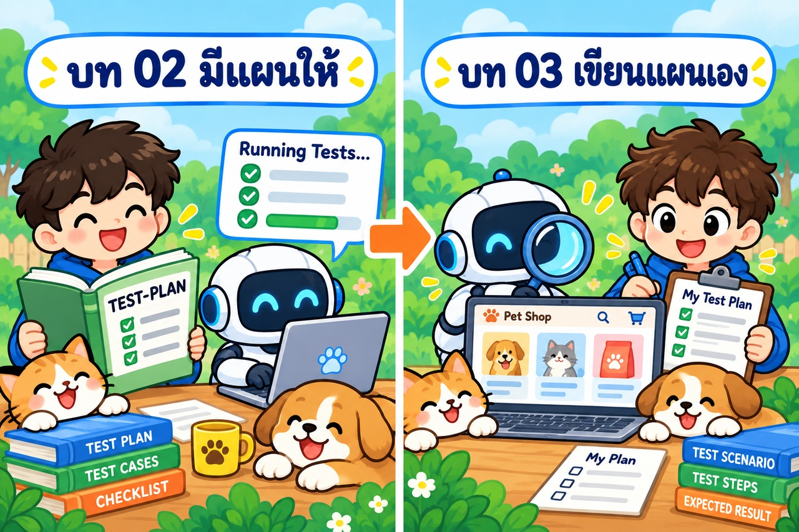

| | บท 02 | บท 03 (บทนี้) |
|---|---|---|
| ตอนเริ่มมี | เว็บ + **SPEC.md** + **TEST-PLAN.md** (40 ข้อ) | เว็บ + **TEST-DATA.md** เท่านั้น |
| งานหลัก | ทดสอบ **ตามแผน** ที่มีคนเขียนให้ | **สร้างแผนเอง** จากการสำรวจ แล้วค่อยทดสอบ |
| ผลที่คาดหวังมาจาก | SPEC.md (เชื่อได้) | 3 แหล่ง ต้องชั่งน้ำหนักเอง ([D] [R] [O]) |
| ทักษะที่ได้ | อ่านแผน · สั่งสร้าง test · อ่านรายงาน | สำรวจ · คิด test case · เขียนแผน · ตรวจแผน |
| บั๊กในโหมดฝังบั๊ก (`BUG_MODE=1`) | บอกล่วงหน้าในแผนหัวข้อ 8 | **ไม่บอก** ต้องลุ้นว่าแผนของเราจับได้ไหม |
| กติกาพิเศษ | — | **ห้ามให้ Claude อ่านโค้ดใน `petshop/`** เรียนรู้จากหน้าเว็บเท่านั้น |

> ทำไมห้ามอ่านโค้ด: tester ส่วนใหญ่ไม่ได้เห็นโค้ด และโค้ดบอกแค่ว่าเว็บ **ทำ** อะไร ไม่ได้บอกว่าเว็บ **ควร** ทำอะไร (ดู `data-testid` หรือป้ายชื่อปุ่มจากหน้าเว็บได้ เพราะเป็นสิ่งที่เห็นจากเบราว์เซอร์)

---

## 📐 เขียน TEST-PLAN.md จากข้อมูลที่มีน้อย ทำยังไง

### 1) สำรวจก่อน แล้วจดเป็น EXPLORATION.md 5 ส่วน

เราไม่เขียนแผนจากความว่างเปล่า แต่จดสิ่งที่เจอระหว่างสำรวจลง `EXPLORATION.md` ก่อน แล้วแต่ละส่วนจะกลายเป็นวัตถุดิบของหัวข้อในแผน

| ส่วน | จดอะไร | ทำใน LAB |
|---|---|---|
| **A แผนผังเว็บ** | หน้า · URL · ไปถึงจากไหน · ต้องเข้าสู่ระบบไหม | 2 |
| **B รายการฟีเจอร์** | ฟีเจอร์ · อยู่หน้าไหน · ลูกค้าทำอะไรได้ · ใส่ข้อมูลอะไรได้ | 2 |
| **C กฎที่พบ** | กฎ · ตัวอย่างที่ลอง · ผลที่เห็น · **ที่มา [D]/[R]/[O]** | 3 |
| **D ความเสี่ยง** | ถ้าพังจะเกิดอะไร · ระดับ P1/P2/P3 · เหตุผล | 3 |
| **E คำถามถึงทีม** | สิ่งที่เว็บทำแต่เราไม่แน่ใจว่าถูก หรือ TEST-DATA ไม่ได้บอก | 3 (เพิ่มใน 5) |

### 2) แต่ละส่วนของการสำรวจ → ไปเป็นหัวข้อไหนของแผน

แผนของเราใช้ **8 หัวข้อเหมือนบท 02** แต่ทุกหัวข้อมีที่มาจากการสำรวจ ไม่ได้คิดลอย ๆ


| หัวข้อในแผน | เขียนจาก | ทำใน LAB |
|---|---|---|
| 1 ภาพรวม (+ แถวใหม่ "แหล่งของผลที่คาดหวัง") | A + TEST-DATA | 4 |
| 2 ขอบเขต ทดสอบ ✅ / ไม่ทดสอบ ❌ | A + B | 4 |
| 3 วิธีคิด test case 6 เทคนิค | ตัวอย่างจริงจาก C | 4 |
| 4 ระดับความสำคัญ P1 P2 P3 | D | 4 |
| 5 Test cases (+ คอลัมน์ใหม่ "ที่มา") | C + TEST-DATA | 5 |
| 6 เกณฑ์ Entry / Exit | LAB 1 (healthy + `/api/health`) | 6 |
| 7 ข้อมูลทดสอบ | TEST-DATA + ค่าที่ตั้งเองใน 5 | 6 |
| 8 คุณภาพของแผน (ทายว่าเว็บอาจพังแบบไหน + จุดกำกวม) | D + E | 6 |

### 3) ปัญหาหัวใจ: ไม่มีสเปก แล้วรู้ได้ยังไงว่าผลไหน "ถูก"? (Test oracle)

ผลที่คาดหวังทุกข้อต้องติดป้าย **ที่มา** 1 ใน 3 แบบ

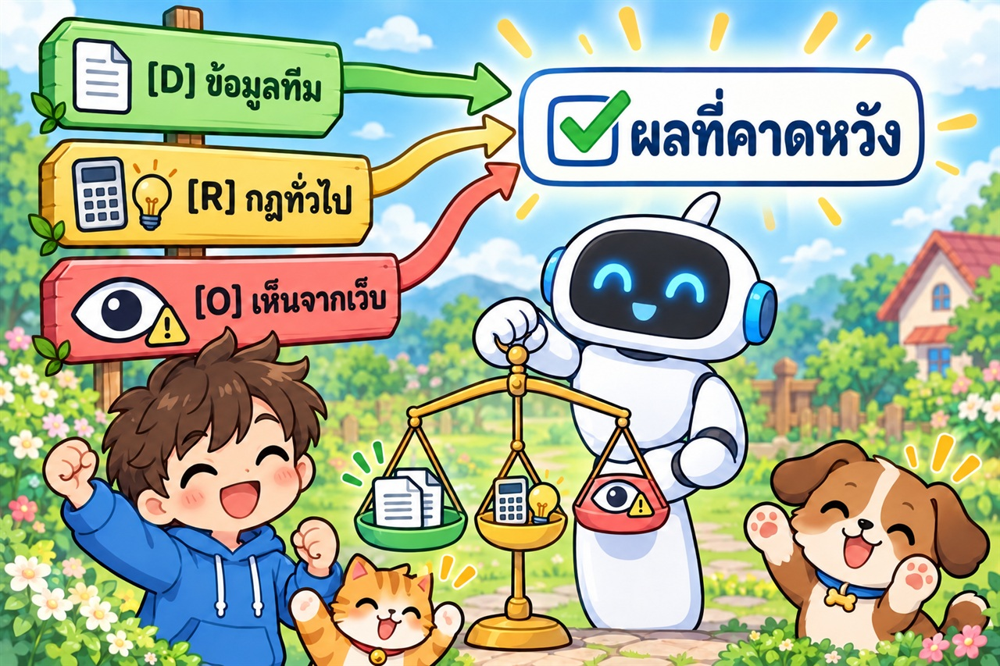


| ป้าย | ที่มา | ตัวอย่างจากเว็บนี้ | เชื่อได้แค่ไหน |
|---|---|---|---|
| **[D] ข้อมูลทีม** | TEST-DATA.md | PAW10 ลด 10% · ค่าส่ง ฿50 ฟรีเมื่อครบ ฿999 | ✅ สูงสุด ทีมยืนยันแล้ว |
| **[R] กฎทั่วไป / สามัญสำนึก** | คณิตศาสตร์ มาตรฐานที่ทุกคนรู้ ประสบการณ์ใช้เว็บขายของ | ฿189 × 2 + ส่ง ฿50 = ฿428 · รหัสไปรษณีย์ไทย 5 หลัก · สินค้าหมดต้องซื้อไม่ได้ | 🟡 ดี แต่ต้องเขียนเหตุผลกำกับ |
| **[O] สังเกตจากเว็บ** | สิ่งที่เห็นบนหน้าจอตอนสำรวจ | ข้อความ error "รหัสไปรษณีย์ต้องเป็นตัวเลข 5 หลัก" · ค้น "แซลมอน" พบ 5 รายการ | 🔴 ต่ำสุด เว็บอาจผิดอยู่แล้ว |

### 4) กับดัก: "อย่าอบบั๊กลงในผลที่คาดหวัง" (baking the bug in)

ถ้าลอกค่าจากหน้าจอไปเป็นผลที่คาดหวังตรง ๆ แล้ววันนั้นเว็บผิดอยู่แล้ว test จะ **ผ่านตลอดไป** แม้ระบบผิด เพราะเราเอาความผิดไปใส่ในแผนเอง


**กฎ 3 ข้อ**
1. **[O] ต้องตรวจด้วย [D] หรือ [R] ก่อน** ตรวจไม่ได้ → เขียนลง "คำถามถึงทีม" แล้วติดป้าย `[O-ยังไม่ยืนยัน]`
2. **ตัวเลขเงินคำนวณเอง** จาก [D] + [R] **ก่อน** เปิดเว็บ แล้วค่อยเทียบ ถ้าไม่ตรง = **อาจเป็นบั๊ก** ไม่ใช่แก้แผนตามเว็บ
3. **ข้อความ error** จดจากหน้าจอได้ แต่ต้องดูว่าสมเหตุสมผล (บอกปัญหาถูกช่อง ภาษาถูก)

> ตัวอย่างจริงในบทนี้: ส่วนลด PAW10 ของสินค้า ฿799 = ฿79.9 เว็บแสดง **−฿79** (ปัดลง) TEST-DATA ไม่ได้บอกเรื่องปัดเศษ → ห้ามลอก ฿79 ไปเป็นผลที่คาดหวังเฉย ๆ ต้องถามทีมก่อน

---

## 🧰 ก่อนเริ่ม ต้องมี

| ✅ | สิ่งที่ต้องมี | ตรวจยังไง |
|---|---|---|
| ☐ | Windows 10/11 + **Claude Code** | เปิด Claude Code ได้ |
| ☐ | **Docker Desktop** เปิดอยู่ (ไอคอนวาฬมุมขวาล่าง) | ไอคอนวาฬไม่หมุน |
| ☐ | ทำ **บท 01** แล้ว (มี Node.js + เบราว์เซอร์ของ Playwright) | ดูบท `01_playwright-install` |
| ☐ | Claude Code ต่อ **Playwright MCP** ไว้แล้ว | พิมพ์ `/mcp` เห็น `playwright` |
| ☐ | (แนะนำ) ทำ **บท 02** แล้ว | LAB 7 ยืม helper และตัวทำ GIF จาก `../02_petshop-test-from-plan/e2e` ได้ (ไม่มีก็ทำได้ ช้ากว่าเล็กน้อย) |
| ☐ | เปิด Claude Code ใน **โฟลเดอร์นี้** | ชื่อโฟลเดอร์ขึ้นที่แถบด้านบน |

ตอนเริ่ม โฟลเดอร์นี้มีแค่ `petshop/` (เว็บ) กับ `TEST-DATA.md` · ไฟล์อื่นผู้เรียนสร้างเองระหว่าง LAB

**แนะนำเปิดเซสชันใหม่ทุก LAB** ไฟล์ `EXPLORATION.md` และ `TEST-PLAN.md` คือ "ความจำ" ที่ส่งต่อระหว่าง LAB
แต่ละ LAB มี 🎯 เป้าหมาย · 💬 พรอมต์ให้คัดลอก · ✅ ผลจริง (ตัวอย่างจากการทำจริง) · 👀 สิ่งที่ควรสังเกต

💡 **พรอมต์ที่ดีมี 4 อย่าง** (เหมือนบท 01–02)
1. 📋 **บอกให้ชัดว่าทำอะไร** และอ้างไฟล์ที่ใช้ (TEST-DATA.md, EXPLORATION.md, TEST-PLAN.md)
2. 🪜 **แบ่งเป็นข้อ** → AI ทำครบทุกข้อตามลำดับ ไม่ข้าม
3. 🛑 **ไม่แน่ใจ ให้หยุดแล้วบอก** → ไม่เดาผลที่คาดหวัง
4. ✅ **ขอผลที่อ่านง่าย** เป็นตาราง

> 🔒 ไฟล์เฉลยทั้งหมดอยู่ใน [`_solution/`](_solution/) ลองทำเองก่อน แล้วค่อยเปิดเทียบ

---

## 🗺️ เส้นทาง 8 LAB

![เส้นทาง 8 LAB จากการสำรวจเว็บสู่แผนการทดสอบ ทุก LAB เปิดเซสชันใหม่แล้ววางพรอมต์ 1 ครั้ง ตอนเริ่มมีแค่ petshop เว็บ และ TEST-DATA.md · ช่วงรู้จักเว็บ LAB 1 เปิดเว็บด้วย Docker ได้ localhost:3000 LAB 2 สำรวจเว็บ ได้ EXPLORATION.md A–B LAB 3 ล่ากฎและความเสี่ยง ได้ EXPLORATION.md C–E · ช่วงเขียนแผน LAB 4 แผนหัวข้อ 1–4 LAB 5 ออกแบบ test cases ได้ TEST-PLAN.md หัวข้อ 5 LAB 6 แผน 6–8 และรีวิว ได้ PLAN-REVIEW.md · ช่วงพิสูจน์แผน LAB 7 แปลงเป็น Playwright ได้ e2e/index.html LAB 8 บั๊กปริศนา ได้ BUG-HUNT.md · ลูกศรใต้การ์ด อ่านไฟล์แล้วทำต่อ · แถบล่าง ทุก LAB มี เป้าหมาย พรอมต์ให้คัดลอก ผลจริง สิ่งที่ควรสังเกต](img/lab-flow-v2.png)

**ทุก LAB = เปิดเซสชันใหม่ + วางพรอมต์ 1 ครั้ง** ไฟล์ที่ LAB ก่อนหน้าสร้างคือ "ความจำ" ที่ LAB ถัดไปอ่านแล้วทำต่อ

| ช่วง | LAB | ทำอะไร | ได้ไฟล์ |
|---|---|---|---|
| 🟢 รู้จักเว็บ | 1 | เปิดเว็บด้วย Docker | (เว็บที่ localhost:3000) |
|  | 2 | สำรวจแบบลูกค้า ทำแผนผังเว็บ + รายการฟีเจอร์ | `EXPLORATION.md` (A–B) · `exploration/*.png` |
|  | 3 | ล่ากฎและความเสี่ยง จัดระดับ P1/P2/P3 | `EXPLORATION.md` (C–E) |
| 🟠 เขียนแผน | 4 | เขียน TEST-PLAN หัวข้อ 1–4 | `TEST-PLAN.md` (1–4) |
|  | 5 | ออกแบบ test case หัวข้อ 5 + ยืนยันกับเว็บจริง | `TEST-PLAN.md` (5) |
|  | 6 | เขียนหัวข้อ 6–8 แล้วรีวิวแผน | `TEST-PLAN.md` (ครบ) · `PLAN-REVIEW.md` |
| 🟣 พิสูจน์แผน | 7 | แปลงแผนเป็น Playwright รัน 3 เบราว์เซอร์ | `e2e/` · `e2e/index.html` |
|  | 8 | เปิดโหมดฝังบั๊ก — แผนเราจับได้ไหม? | `BUG-HUNT.md` |

---

## LAB 1 · เปิดเว็บด้วย Docker

🎯 เปิดระบบที่ต้องทดสอบ และเช็กว่าพร้อม (จะกลายเป็น Entry criteria ในหัวข้อ 6 ของแผน)

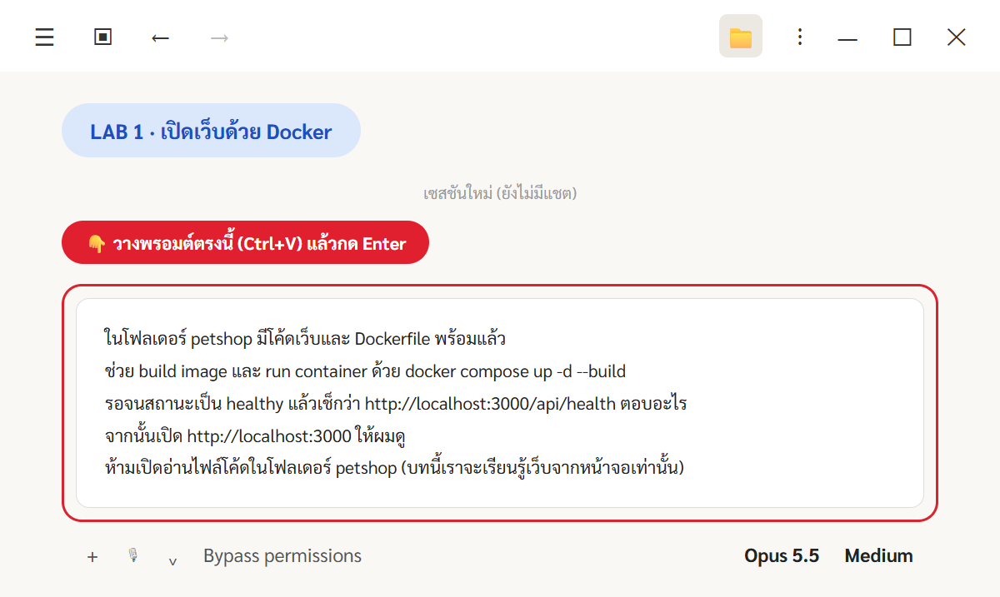

💬 **คัดลอกพรอมต์นี้** (กดปุ่ม Copy มุมขวาของกรอบ)

```text
ในโฟลเดอร์ petshop มีโค้ดเว็บและ Dockerfile พร้อมแล้ว
ช่วย build image และ run container ด้วย docker compose up -d --build
รอจนสถานะเป็น healthy แล้วเช็กว่า http://localhost:3000/api/health ตอบอะไร
จากนั้นเปิด http://localhost:3000 ให้ผมดู
ห้ามเปิดอ่านไฟล์โค้ดในโฟลเดอร์ petshop (บทนี้เราจะเรียนรู้เว็บจากหน้าจอเท่านั้น)
```

✅ **ผลจริง** container `petshop` ขึ้น **healthy** และ `/api/health` ตอบ `{"ok":true}` (ใช้เวลาราว 1 นาทีเพราะเคย build ไว้ · เครื่องที่ build ครั้งแรกใช้ 1–3 นาที)

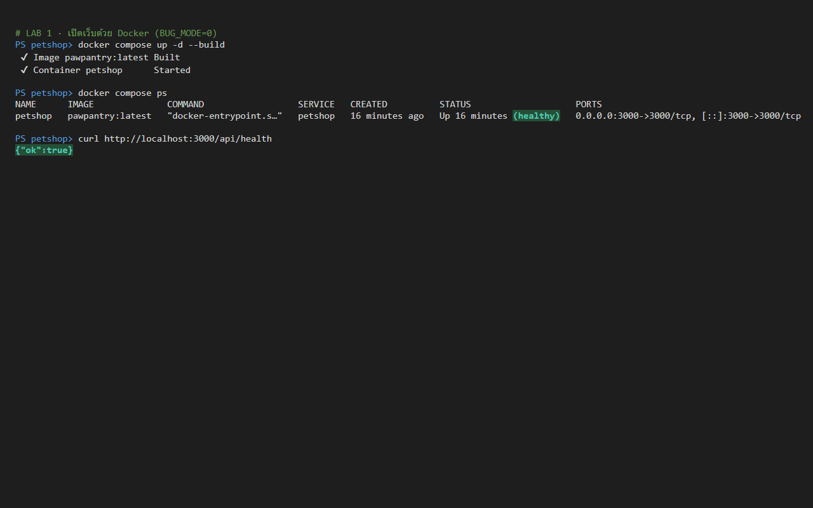

| ขั้น | ผล |
|---|---|
| build + run | ✅ Image `pawpantry:latest` · Container `petshop` Started |
| รอสถานะ | ✅ `Up … (healthy)` พอร์ต 3000 |
| เช็กสุขภาพ | ✅ `{"ok":true}` |
| เปิดเว็บ | ✅ หน้าแรก PawPantry แสดงปกติ |

👀 **สังเกต**
- 📝 จดไว้: **"เว็บพร้อมทดสอบเมื่อ container `petshop` healthy และ `/api/health` ตอบ `{"ok":true}`"** → ใช้เขียน Entry criteria ใน LAB 6
- ถ้าเคยรันบท 02 ไว้ (container ชื่อ `petshop` เหมือนกัน) Docker จะสร้างใหม่ทับให้เอง ไม่ต้องลบ
- ถ้า `docker compose ps` ยังขึ้น `(health: starting)` ให้รอสักครู่ (Docker เช็ก `/api/health` ทุก 10 วินาที)

---

## LAB 2 · สำรวจเว็บแบบลูกค้า → แผนผังเว็บ + รายการฟีเจอร์

🎯 รู้ว่าเว็บมีกี่หน้า แต่ละหน้าทำอะไรได้ **ก่อน** คิดว่าจะทดสอบอะไร

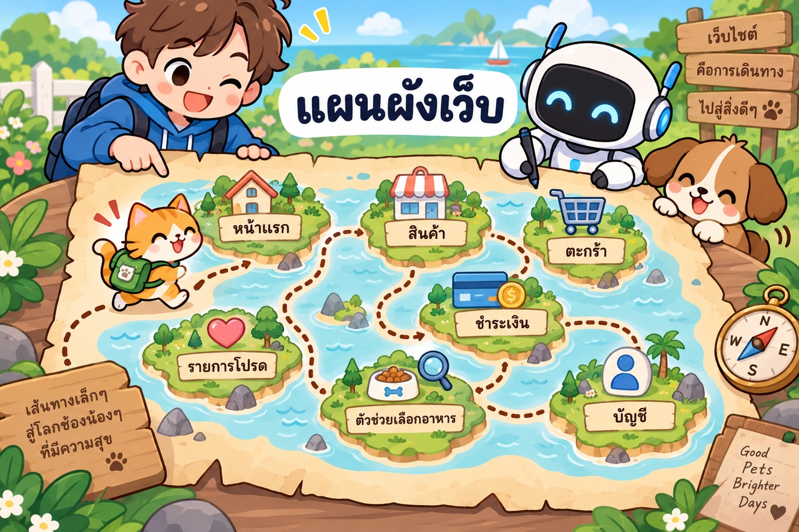

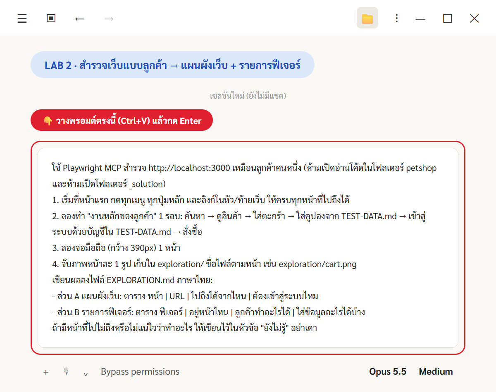

💬 **คัดลอกพรอมต์นี้**

```text
ใช้ Playwright MCP สำรวจ http://localhost:3000 เหมือนลูกค้าคนหนึ่ง (ห้ามเปิดอ่านโค้ดในโฟลเดอร์ petshop และห้ามเปิดโฟลเดอร์ _solution)
1. เริ่มที่หน้าแรก กดทุกเมนู ทุกปุ่มหลัก และลิงก์ในหัว/ท้ายเว็บ ให้ครบทุกหน้าที่ไปถึงได้
2. ลองทำ "งานหลักของลูกค้า" 1 รอบ: ค้นหา → ดูสินค้า → ใส่ตะกร้า → ใส่คูปองจาก TEST-DATA.md → เข้าสู่ระบบด้วยบัญชีใน TEST-DATA.md → สั่งซื้อ
3. ลองจอมือถือ (กว้าง 390px) 1 หน้า
4. จับภาพหน้าละ 1 รูป เก็บใน exploration/ ชื่อไฟล์ตามหน้า เช่น exploration/cart.png
เขียนผลลงไฟล์ EXPLORATION.md ภาษาไทย:
- ส่วน A แผนผังเว็บ: ตาราง หน้า | URL | ไปถึงได้จากไหน | ต้องเข้าสู่ระบบไหม
- ส่วน B รายการฟีเจอร์: ตาราง ฟีเจอร์ | อยู่หน้าไหน | ลูกค้าทำอะไรได้ | ใส่ข้อมูลอะไรได้บ้าง
ถ้ามีหน้าที่ไปไม่ถึงหรือไม่แน่ใจว่าทำอะไร ให้เขียนไว้ในหัวข้อ "ยังไม่รู้" อย่าเดา
```

✅ **ผลจริง (ตัวอย่าง)** ใช้เวลาราว 12 นาที ได้ `EXPLORATION.md` ส่วน A–B และภาพ 19 รูปใน `exploration/`

| สิ่งที่ได้ | จำนวน |
|---|---|
| ส่วน A แผนผังเว็บ | **13 หน้า** + เมนูมือถือ (3 หน้าต้องเข้าสู่ระบบ: ชำระเงิน · คำสั่งซื้อ · บัญชี) |
| ส่วน B รายการฟีเจอร์ | **22 ฟีเจอร์** (F1–F22) |
| สินค้าในร้าน | 28 รายการ (แมว 14 · สุนัข 14) |
| หัวข้อ "ยังไม่รู้" | 7 ข้อ เช่น ฟอร์มรับข่าวสารไม่มีผลตอบกลับ · PromptPay เป็น QR ตัวอย่าง · ไม่มีหน้าลืมรหัสผ่าน |
| งานหลักของลูกค้า 1 รอบ | ✅ ค้น "แซลมอน" → ใส่ตะกร้า → PAW10 → เข้าสู่ระบบ → สั่งซื้อสำเร็จ `PP-100001` |

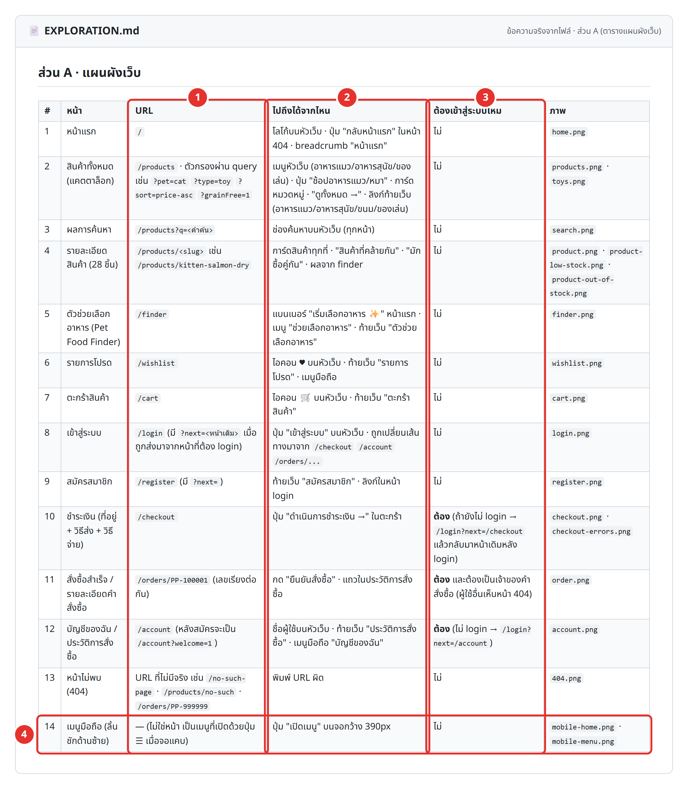

หน้าที่เจอระหว่างสำรวจ (บางหน้าไม่ได้อยู่บนเมนูหลัก ต้องกดหาเอง)

| 🏠 หน้าแรก | ✨ ตัวช่วยเลือกอาหาร `/finder` |
|---|---|
| 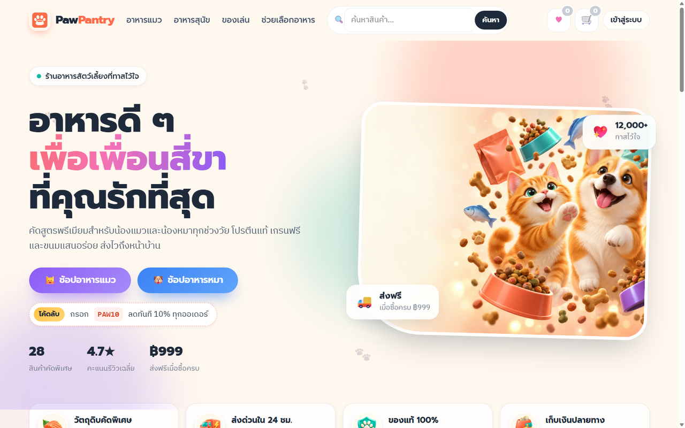 | 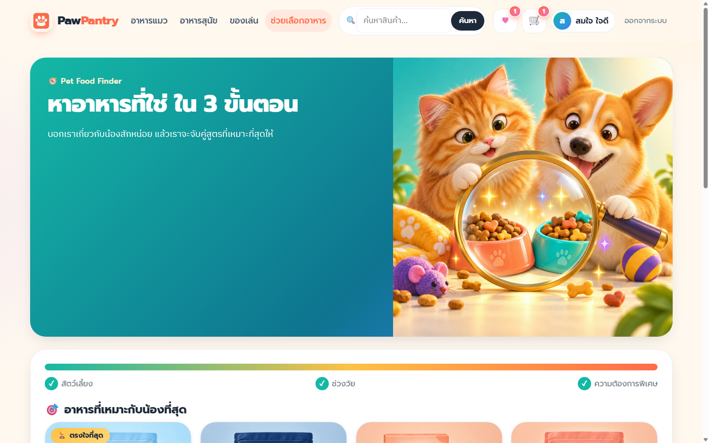 |
| 👤 **บัญชี / ประวัติสั่งซื้อ** (ต้องเข้าสู่ระบบ) | 📱 **เมนูมือถือ 390px** |
| 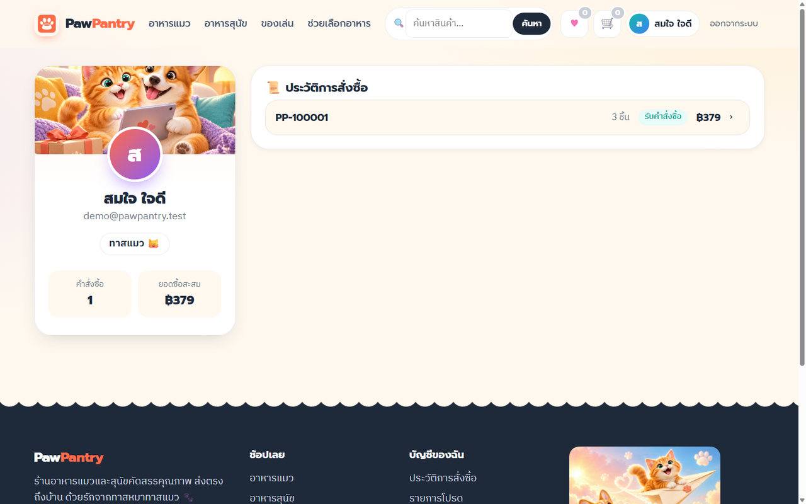 | 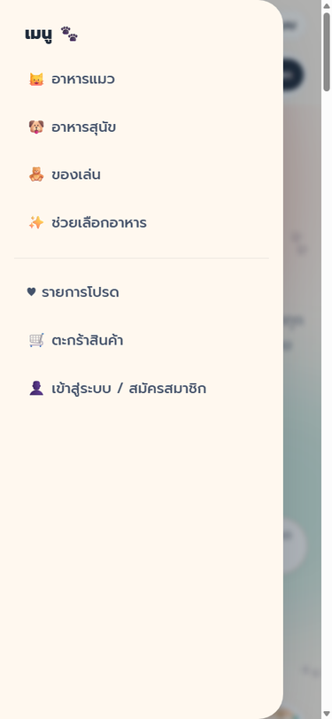 |

ดูไฟล์เต็มที่ [_solution/EXPLORATION.md](_solution/EXPLORATION.md) และภาพทั้งหมดที่ [_solution/exploration/](_solution/exploration/)

👀 **สังเกต**
- ลองเช็กว่าเจอหน้าที่ "ซ่อน" ไหม: ตัวช่วยเลือกอาหาร · รายการโปรด · บัญชี/ประวัติสั่งซื้อ · หน้า 404 · หมวดของเล่น/ของใช้ · กล่อง "มักซื้อคู่กัน" · "แนะนำสำหรับคุณ"
- หัวข้อ **"ยังไม่รู้" ไม่ใช่ความผิด** แต่เป็นข้อมูลที่จะไปอยู่ในขอบเขต (ไม่ทดสอบ) หรือคำถามถึงทีม
- เว็บมี **API** ด้วย (`/api/health`, `/api/test/reset` …) → เป็นคำถามว่าจะทดสอบ API ไหม
- Playwright MCP อาจโชว์ error จาก extension อื่นในเบราว์เซอร์ (เช่น `Search engine null is not supported`) **ไม่ใช่ error ของเว็บ** ดูเฉพาะ error ที่มาจาก `localhost:3000`
- ถ้าให้ MCP กดทีละหน้าอย่างเดียว อาจใช้ 15–25 นาที เพราะหน้าเว็บยาว และมีหน้าสินค้าถึง 28 หน้า (สินค้า 1 รายการ = 1 หน้า)

---

## LAB 3 · ล่ากฎและความเสี่ยง แล้วจัดระดับ P1/P2/P3

🎯 เปลี่ยน "เว็บทำอะไรได้" เป็น **"กฎที่ต้องถูก"** และ **"จุดที่ถ้าพังแล้วเจ็บ"**


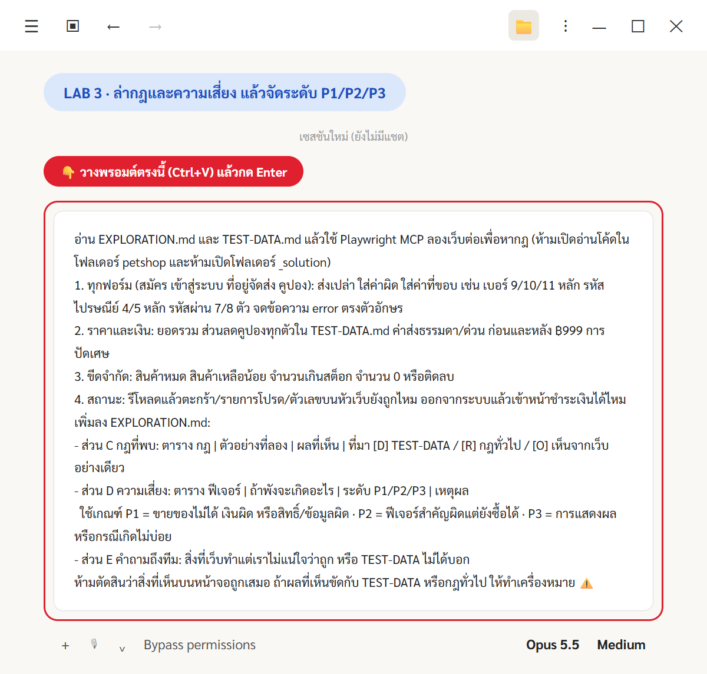

💬 **คัดลอกพรอมต์นี้**

```text
อ่าน EXPLORATION.md และ TEST-DATA.md แล้วใช้ Playwright MCP ลองเว็บต่อเพื่อหากฎ (ห้ามเปิดอ่านโค้ดในโฟลเดอร์ petshop และห้ามเปิดโฟลเดอร์ _solution)
1. ทุกฟอร์ม (สมัคร เข้าสู่ระบบ ที่อยู่จัดส่ง คูปอง): ส่งเปล่า ใส่ค่าผิด ใส่ค่าที่ขอบ เช่น เบอร์ 9/10/11 หลัก รหัสไปรษณีย์ 4/5 หลัก รหัสผ่าน 7/8 ตัว จดข้อความ error ตรงตัวอักษร
2. ราคาและเงิน: ยอดรวม ส่วนลดคูปองทุกตัวใน TEST-DATA.md ค่าส่งธรรมดา/ด่วน ก่อนและหลัง ฿999 การปัดเศษ
3. ขีดจำกัด: สินค้าหมด สินค้าเหลือน้อย จำนวนเกินสต็อก จำนวน 0 หรือติดลบ
4. สถานะ: รีโหลดแล้วตะกร้า/รายการโปรด/ตัวเลขบนหัวเว็บยังถูกไหม ออกจากระบบแล้วเข้าหน้าชำระเงินได้ไหม
เพิ่มลง EXPLORATION.md:
- ส่วน C กฎที่พบ: ตาราง กฎ | ตัวอย่างที่ลอง | ผลที่เห็น | ที่มา [D] TEST-DATA / [R] กฎทั่วไป / [O] เห็นจากเว็บอย่างเดียว
- ส่วน D ความเสี่ยง: ตาราง ฟีเจอร์ | ถ้าพังจะเกิดอะไร | ระดับ P1/P2/P3 | เหตุผล
  ใช้เกณฑ์ P1 = ขายของไม่ได้ เงินผิด หรือสิทธิ์/ข้อมูลผิด · P2 = ฟีเจอร์สำคัญผิดแต่ยังซื้อได้ · P3 = การแสดงผลหรือกรณีเกิดไม่บ่อย
- ส่วน E คำถามถึงทีม: สิ่งที่เว็บทำแต่เราไม่แน่ใจว่าถูก หรือ TEST-DATA ไม่ได้บอก
ห้ามตัดสินว่าสิ่งที่เห็นบนหน้าจอถูกเสมอ ถ้าผลที่เห็นขัดกับ TEST-DATA หรือกฎทั่วไป ให้ทำเครื่องหมาย ⚠️
```

✅ **ผลจริง (ตัวอย่าง)** ใช้เวลาราว 20 นาที

| ส่วน | ได้ |
|---|---|
| C กฎที่พบ | **61 ข้อ** · ป้าย [D] 13 · [R] 32 · [O] 8 · [O-ยังไม่ยืนยัน] 8 · ⚠️ น่าสงสัย 4 ข้อ |
| ข้อความ error ที่จดตรงตัวอักษร | 12 ข้อความ + ข้อความคูปอง/สต็อก |
| D ความเสี่ยง | **22 ข้อ** · P1 10 · P2 8 · P3 4 |
| E คำถามถึงทีม | **14 ข้อ** (เพิ่มเป็น 19 ข้อใน LAB 5) |

ตัวอย่างกฎบางข้อ (ตัวเลขคำนวณเองก่อน แล้วค่อยเทียบกับเว็บ)

| กฎ | ลอง | เว็บแสดง | ที่มา |
|---|---|---|---|
| PAW10 ลด 10% | ฿590 | −฿59 ✅ | [D] |
| ส่วนลดมีเศษ | ฿799 × 10% = 79.9 | −฿79 (ปัดลง) | [O-ยังไม่ยืนยัน] ⚠️ → ถามทีม |
| ส่งฟรีที่ขอบ | ฿998 / ฿999 | ฿50 / ฟรี ✅ | [D] |
| รหัสไปรษณีย์ 4/5/6 หลัก | — | ✗ / ✓ / ✗ | [R] |
| จำนวนเกินสต็อก | สต็อก 3 พิมพ์ 4 | ปรับเป็น 3 เงียบ ๆ | [R] |
| ใส่ซ้ำเกินสต็อก | 2 + 2 | ตะกร้า = 3 แต่ข้อความบอก "เพิ่ม…ลงตะกร้าแล้ว" | [R] ⚠️ |

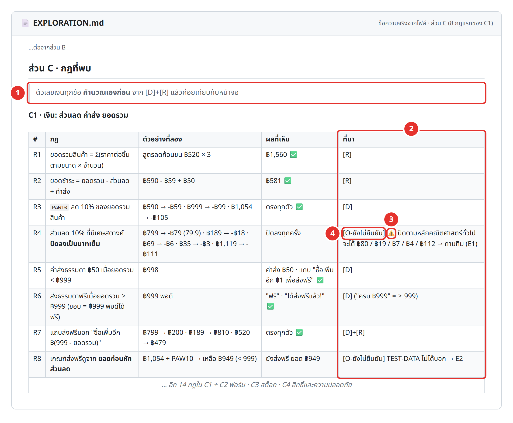

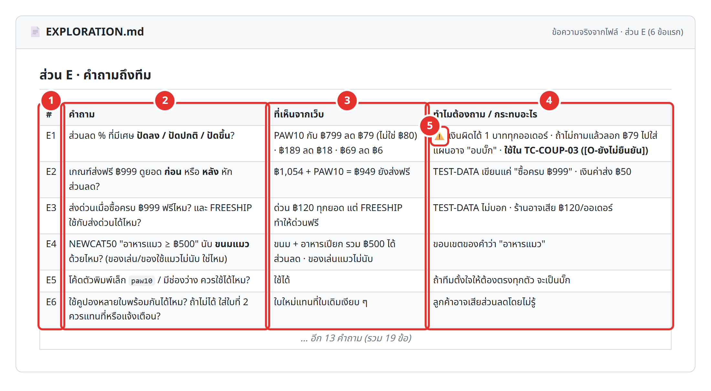

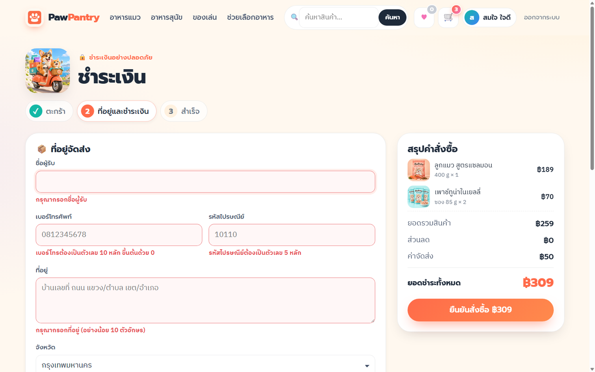

ดูไฟล์เต็มที่ [_solution/EXPLORATION.md](_solution/EXPLORATION.md)

👀 **สังเกต**
- ป้าย **[D]/[R]/[O]** คือจุดเริ่มของเรื่อง oracle — ข้อที่เป็น **[O] ล้วน คือจุดเสี่ยง "อบบั๊ก"** เช่น จำนวนผลค้นหา "แซลมอน" = 5 หรือเกณฑ์ที่อยู่ ≥ 10 ตัวอักษร (รู้จากข้อความบนจอเท่านั้น)
- เว็บปกติทำงานตาม TEST-DATA ทุกข้อ ⚠️ ที่เจอเป็นเรื่องที่ TEST-DATA **ไม่ได้บอก** (ปัดเศษ) หรือเรื่องข้อความ/UX
- ค่าขอบบางตัวหาตัวอย่างยาก เช่น ยอด ฿999 พอดี ต้องหาชุดสินค้าที่รวมกันได้พอดี — Claude หาให้ได้
- ถ้าลองสั่งซื้อจนสินค้าใกล้หมดกลายเป็น "หมด" ให้สั่ง Claude เรียก `POST /api/test/reset` ก่อนสำรวจต่อ (ดูพรอมต์ในตาราง 🔁 รันซ้ำ) · ตะกร้าเก็บในเบราว์เซอร์ (localStorage) reset ไม่ล้างให้

---

## LAB 4 · เขียน TEST-PLAN.md หัวข้อ 1–4

🎯 ตั้งกรอบของแผน: ทดสอบเพื่ออะไร อะไรอยู่/ไม่อยู่ในขอบเขต ใช้เทคนิคอะไร และจัดระดับยังไง

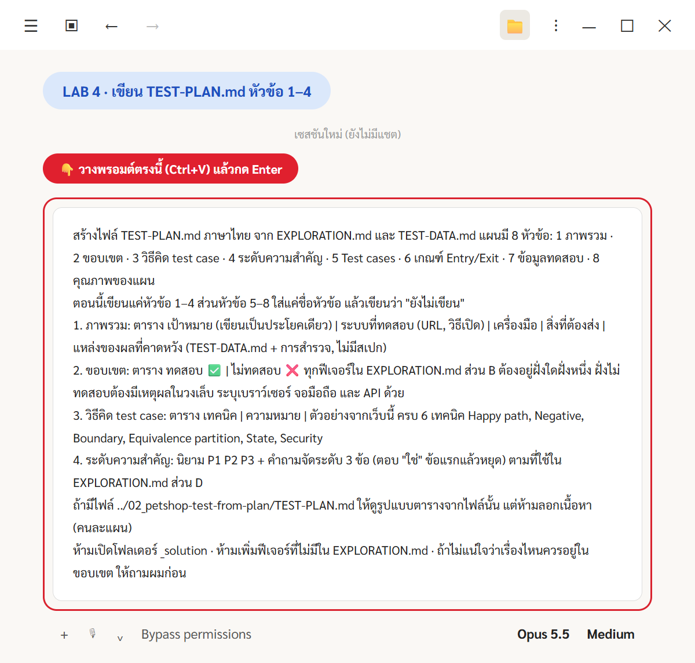

💬 **คัดลอกพรอมต์นี้**

```text
สร้างไฟล์ TEST-PLAN.md ภาษาไทย จาก EXPLORATION.md และ TEST-DATA.md แผนมี 8 หัวข้อ: 1 ภาพรวม · 2 ขอบเขต · 3 วิธีคิด test case · 4 ระดับความสำคัญ · 5 Test cases · 6 เกณฑ์ Entry/Exit · 7 ข้อมูลทดสอบ · 8 คุณภาพของแผน
ตอนนี้เขียนแค่หัวข้อ 1–4 ส่วนหัวข้อ 5–8 ใส่แค่ชื่อหัวข้อ แล้วเขียนว่า "ยังไม่เขียน"
1. ภาพรวม: ตาราง เป้าหมาย (เขียนเป็นประโยคเดียว) | ระบบที่ทดสอบ (URL, วิธีเปิด) | เครื่องมือ | สิ่งที่ต้องส่ง | แหล่งของผลที่คาดหวัง (TEST-DATA.md + การสำรวจ, ไม่มีสเปก)
2. ขอบเขต: ตาราง ทดสอบ ✅ | ไม่ทดสอบ ❌ ทุกฟีเจอร์ใน EXPLORATION.md ส่วน B ต้องอยู่ฝั่งใดฝั่งหนึ่ง ฝั่งไม่ทดสอบต้องมีเหตุผลในวงเล็บ ระบุเบราว์เซอร์ จอมือถือ และ API ด้วย
3. วิธีคิด test case: ตาราง เทคนิค | ความหมาย | ตัวอย่างจากเว็บนี้ ครบ 6 เทคนิค Happy path, Negative, Boundary, Equivalence partition, State, Security
4. ระดับความสำคัญ: นิยาม P1 P2 P3 + คำถามจัดระดับ 3 ข้อ (ตอบ "ใช่" ข้อแรกแล้วหยุด) ตามที่ใช้ใน EXPLORATION.md ส่วน D
ถ้ามีไฟล์ ../02_petshop-test-from-plan/TEST-PLAN.md ให้ดูรูปแบบตารางจากไฟล์นั้น แต่ห้ามลอกเนื้อหา (คนละแผน)
ห้ามเปิดโฟลเดอร์ _solution · ห้ามเพิ่มฟีเจอร์ที่ไม่มีใน EXPLORATION.md · ถ้าไม่แน่ใจว่าเรื่องไหนควรอยู่ในขอบเขต ให้ถามผมก่อน
```

✅ **ผลจริง (ตัวอย่าง)** ใช้เวลาราว 10 นาที ไม่ต้องเปิดเว็บ ได้ `TEST-PLAN.md` หัวข้อ 1–4 (หัวข้อ 5–8 มีแค่หัว)

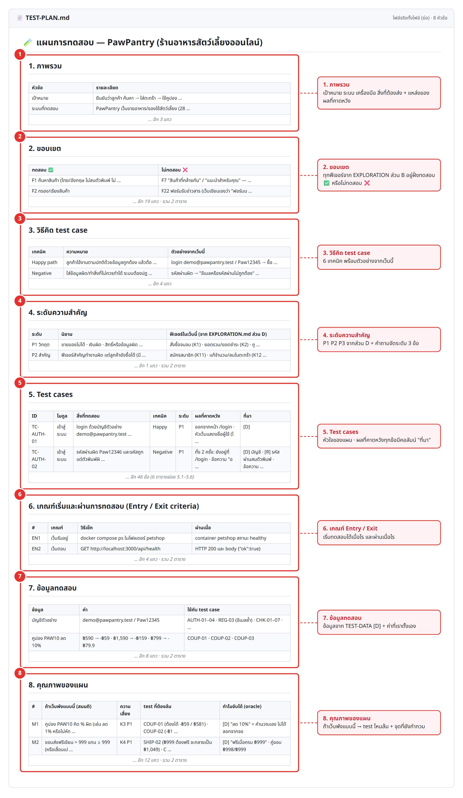

| หัวข้อ | ได้ |
|---|---|
| 1 ภาพรวม | 5 แถว รวมแถวใหม่ **"แหล่งของผลที่คาดหวัง"** ([D] > [R] > [O] · ตัวเลขเงินคำนวณเองก่อนเปิดเว็บ) |
| 2 ขอบเขต | ฟีเจอร์ F1–F22 อยู่ครบ 22/22 · ทดสอบ ✅ 20 ฟีเจอร์ + ความปลอดภัยพื้นฐาน · ไม่ทดสอบ ❌ 11 แถว มีเหตุผลทุกแถว · 3 เบราว์เซอร์ + จอมือถือ 390×844 |
| 3 วิธีคิด test case | ครบ 6 เทคนิค ตัวอย่างจากเว็บจริง เช่น Boundary ส่งฟรี ฿998/฿999 |
| 4 ระดับความสำคัญ | P1/P2/P3 ผูกกับความเสี่ยง 22 ข้อในส่วน D + คำถามจัดระดับ 3 ข้อ |

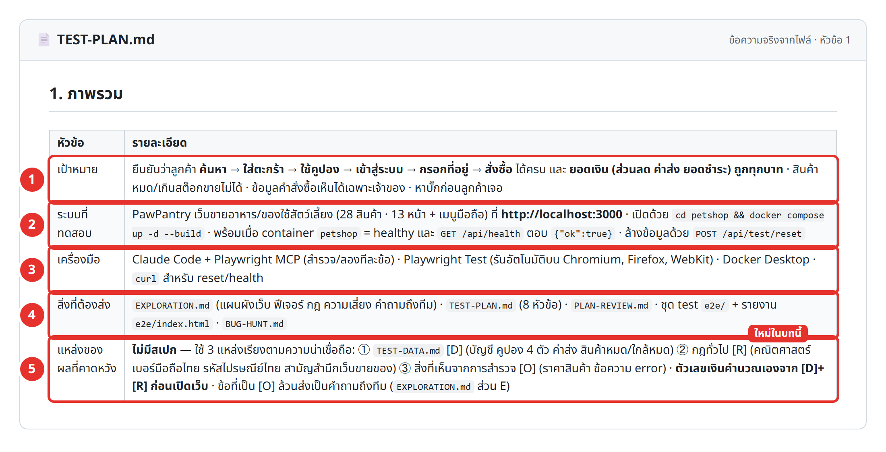


เรื่องที่ Claude ควรหยุดถามคุณ (พรอมต์บอกว่า "ถามผมก่อน") เช่น

| คำถาม | ในตัวอย่างตัดสินใจว่า |
|---|---|
| ทดสอบ API แยกจากหน้าเว็บไหม? | ❌ ไม่ทดสอบโดยตรง ใช้ `/api/test/reset` `/api/health` เป็นเครื่องมือ |
| "แนะนำสำหรับคุณ" ทดสอบไหม? | ❌ ไม่รู้สูตร ไม่มีผลที่คาดหวังที่ตรวจได้ ถ้าลอกจากจอ = อบบั๊ก |
| ตัวช่วยเลือกอาหารตรวจลึกแค่ไหน? | ✅ ตรวจแค่ "ผลตรงเงื่อนไขที่เลือก" ไม่ตรวจ "ตรงใจ %" |

👀 **สังเกต**
- เปิดเทียบกับแผนบท 02 (`../02_petshop-test-from-plan/TEST-PLAN.md`) — โครงเหมือนกัน แต่ **ของเราเขียนจากสิ่งที่เห็นจริง**
- ฝั่ง "ไม่ทดสอบ" ที่ดีมีเหตุผลเสมอ เช่น "ตัดเงิน PromptPay จริง (เว็บจำลอง ไม่มีระบบเงินจริง)"
- **ขอบที่ทดสอบได้จริงขึ้นกับข้อมูลที่มี**: ราคาในร้านรวมให้ได้ "อาหารแมว ฿500 พอดี" ไม่ได้ (NEWCAT50) จึงใช้คู่ ฿499 / ฿534 แทน
- Claude มักเขียนเป้าหมายรวมหลายเรื่องในแถวเดียว จึงเติมคำว่า "เขียนเป็นประโยคเดียว" ไว้ในพรอมต์

---

## LAB 5 · ออกแบบ test case (หัวข้อ 5) และยืนยันกับเว็บจริง

🎯 ได้ test case ครอบคลุมทุกฟีเจอร์ในขอบเขต ทุกข้อมีผลที่คาดหวังที่ **ตรวจได้** และ **รู้ที่มา**

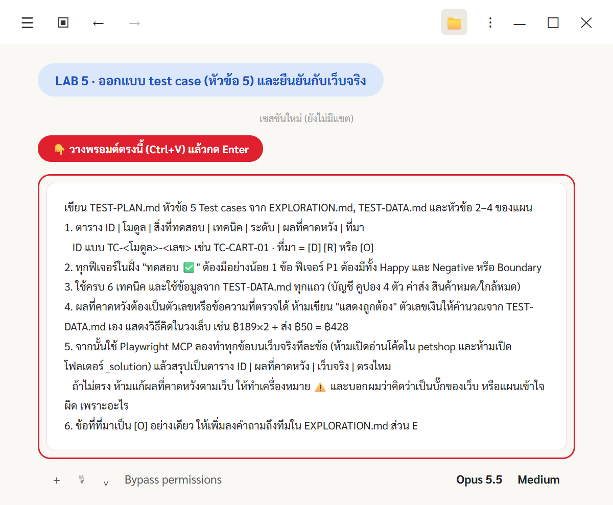

💬 **คัดลอกพรอมต์นี้**

```text
เขียน TEST-PLAN.md หัวข้อ 5 Test cases จาก EXPLORATION.md, TEST-DATA.md และหัวข้อ 2–4 ของแผน
1. ตาราง ID | โมดูล | สิ่งที่ทดสอบ | เทคนิค | ระดับ | ผลที่คาดหวัง | ที่มา
   ID แบบ TC-<โมดูล>-<เลข> เช่น TC-CART-01 · ที่มา = [D] [R] หรือ [O]
2. ทุกฟีเจอร์ในฝั่ง "ทดสอบ ✅" ต้องมีอย่างน้อย 1 ข้อ ฟีเจอร์ P1 ต้องมีทั้ง Happy และ Negative หรือ Boundary
3. ใช้ครบ 6 เทคนิค และใช้ข้อมูลจาก TEST-DATA.md ทุกแถว (บัญชี คูปอง 4 ตัว ค่าส่ง สินค้าหมด/ใกล้หมด)
4. ผลที่คาดหวังต้องเป็นตัวเลขหรือข้อความที่ตรวจได้ ห้ามเขียน "แสดงถูกต้อง" ตัวเลขเงินให้คำนวณจาก TEST-DATA.md เอง แสดงวิธีคิดในวงเล็บ เช่น ฿189×2 + ส่ง ฿50 = ฿428
5. จากนั้นใช้ Playwright MCP ลองทำทุกข้อบนเว็บจริงทีละข้อ (ห้ามเปิดอ่านโค้ดใน petshop และห้ามเปิดโฟลเดอร์ _solution) แล้วสรุปเป็นตาราง ID | ผลที่คาดหวัง | เว็บจริง | ตรงไหม
   ถ้าไม่ตรง ห้ามแก้ผลที่คาดหวังตามเว็บ ให้ทำเครื่องหมาย ⚠️ และบอกผมว่าคิดว่าเป็นบั๊กของเว็บ หรือแผนเข้าใจผิด เพราะอะไร
6. ข้อที่ที่มาเป็น [O] อย่างเดียว ให้เพิ่มลงคำถามถึงทีมใน EXPLORATION.md ส่วน E
```

✅ **ผลจริง (ตัวอย่าง)** ใช้เวลาราว 35 นาที ได้ **47 test case** ใน 6 กลุ่ม แล้วลองกับเว็บจริง **ตรง 45 / 47 ข้อ**

| นับตาม | ผล |
|---|---|
| ระดับ | P1 29 · P2 13 · P3 5 |
| เทคนิค | Happy 13 · Negative 11 · Boundary 11 · Partition 8 · State 8 · Security 4 → ครบ 6 เทคนิค (บางข้อใช้ 2 เทคนิค นับทุกตัว จึงรวมได้เกิน 47) |
| ที่มา | [D] 23 · [R] 21 · [O-ยังไม่ยืนยัน] 3 |
| ข้อมูล TEST-DATA | ใช้ครบทุกแถว |

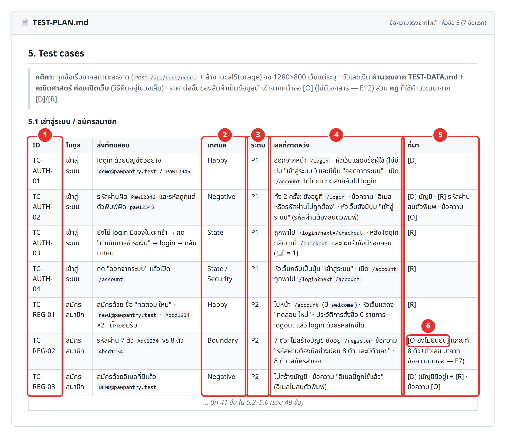

ตัวอย่างตารางยืนยันกับเว็บจริง (บางแถว)

| ID | ผลที่คาดหวัง (คิดก่อนเปิดเว็บ) | เว็บจริง | ตรงไหม |
|---|---|---|---|
| TC-CART-01 | ฿189×2 = ฿378 + ส่ง ฿50 = **฿428** | ยอด ฿378 · ส่ง ฿50 · รวม ฿428 | ✅ |
| TC-SHIP-01 | ฿998 + ส่ง ฿50 = **฿1,048** | รวม ฿1,048 · "ซื้อเพิ่มอีก ฿1 เพื่อส่งฟรี" | ✅ |
| TC-SRCH-01 | ทุกการ์ดมีคำว่า แซลมอน/Salmon ในชื่อ | 5 การ์ด มี "สูตรลดก้อนขน" ที่ชื่อไม่มีคำค้น | ⚠️ ไม่ตรง |
| TC-CART-05 | ตะกร้า 3 ชิ้น + ข้อความบอกว่าเพิ่มได้ไม่ครบ | ตะกร้า 3 ชิ้น ✅ แต่ข้อความบอก "เพิ่ม…ลงตะกร้าแล้ว" | ⚠️ ไม่ตรง |

| ✅ ตัวอย่างข้อที่ตรง: คูปอง PAW10 | ⚠️ ข้อที่ไม่ตรง: เกินสต็อกแต่ข้อความบอกว่าเพิ่มแล้ว |
|---|---|
| 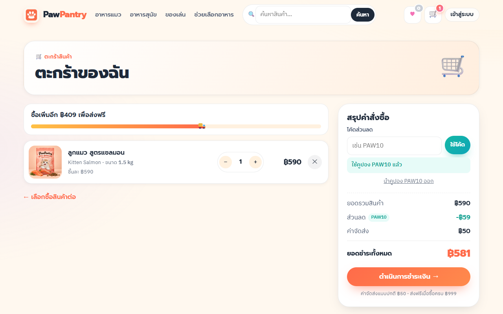 | 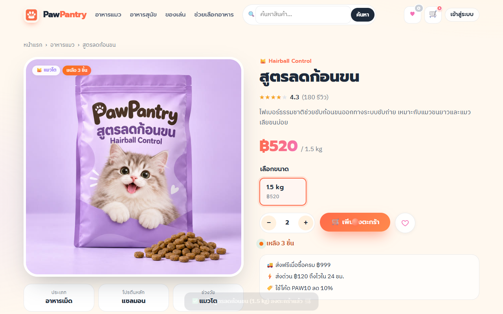 |

**2 ข้อที่ไม่ตรง — ไม่ได้แก้ผลที่คาดหวังตามเว็บ แต่จำแนกและถามทีม**

| ID | คิดว่าเป็น | เพราะอะไร |
|---|---|---|
| TC-SRCH-01 | **แผนเข้าใจผิด (น่าจะ)** | สินค้านี้มีโปรตีนแซลมอน เว็บน่าจะค้นตามส่วนผสมด้วย แต่ยังไม่มีใครยืนยัน → ถามทีม |
| TC-CART-05 | **บั๊กของเว็บ (P3)** | ลูกค้าได้ของไม่ครบแต่ข้อความบอกว่าสำเร็จ [R] · เงินถูก จึงเป็น P3 |

ดูแผนเต็มที่ [_solution/TEST-PLAN.md](_solution/TEST-PLAN.md)

👀 **สังเกต**
- **เขียนผลที่คาดหวังก่อนเปิดเว็บได้จริง** — ทุกยอดเงินที่คำนวณจาก [D]+[R] ตรงกับเว็บ ไม่ต้องลอกจากจอเลย นี่คือวิธีกัน "อบบั๊ก"
- ข้อส่วนลด ฿799 → −฿79 **"ผ่าน" แต่ไม่ได้แปลว่าถูก** เพราะเป็น [O-ยังไม่ยืนยัน] ถ้าทีมตอบว่าต้องปัดปกติ (฿80) ข้อนี้คือบั๊กที่อบอยู่ในแผน
- **ไม่ตรง ≠ เว็บผิดเสมอ** บางครั้งแผนเข้าใจผิด ทางออกคือถามทีม ไม่ใช่แก้ตามเว็บเงียบ ๆ
- MCP คลิกทีละข้อจะช้ามาก (1–2 ชม.) Claude อาจเลือกเขียนสคริปต์ Playwright ชั่วคราวมาลองแทน (ในตัวอย่างรันทั้งชุด 108 วินาที) ได้ผลเหมือนกัน
- ก่อนสรุปว่า "ไม่ตรง" ต้องเช็กว่าไม่ใช่ **วิธีทดสอบผิด** (ในตัวอย่าง สคริปต์ชั่วคราวกดปุ่มผิดตัวในตัวช่วยเลือกอาหาร → แก้สคริปต์ ไม่ได้แก้ผลที่คาดหวัง)
- ถ้า Claude เขียน "แสดงถูกต้อง" หรือ "ทำงานได้" ให้สั่งแก้เป็นตัวเลข/ข้อความ
- ได้ถึง 47 ข้อ เพราะเรื่องคูปองอย่างเดียวมี 10 ข้อ (4 คูปอง × ค่าขอบและกลุ่มของแต่ละตัว) ถ้าอยากได้น้อยกว่านี้ ให้สั่ง Claude รวมข้อที่คล้ายกัน

---

## LAB 6 · เขียนหัวข้อ 6–8 แล้วรีวิวแผน

🎯 ปิดแผนให้ครบ 8 หัวข้อ และ **ตรวจคุณภาพแผน** ก่อนเอาไปใช้จริง

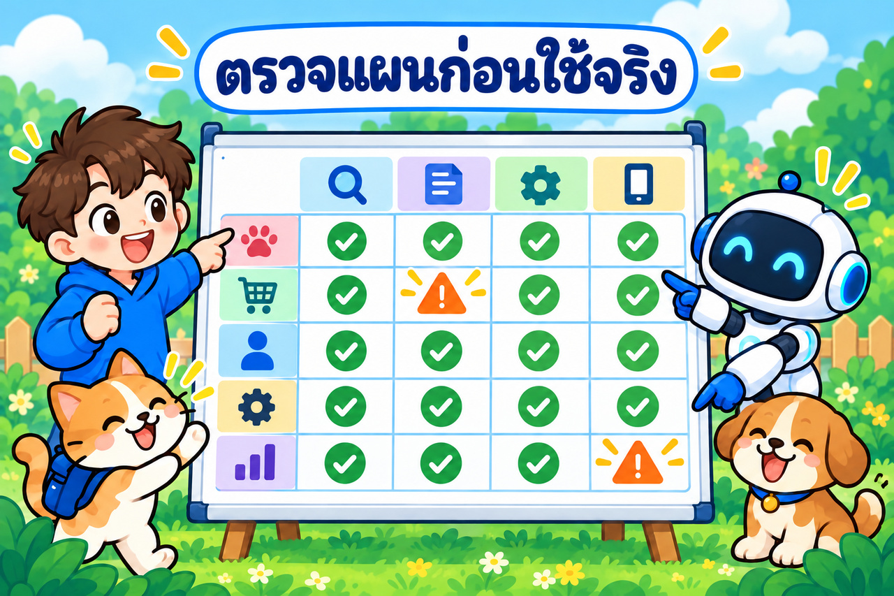

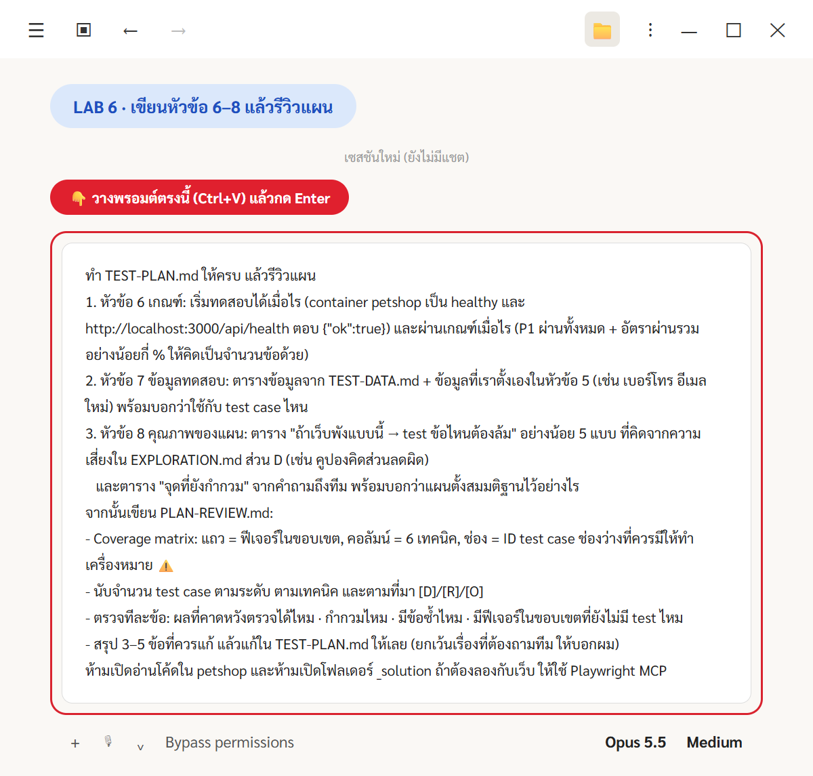

💬 **คัดลอกพรอมต์นี้**

```text
ทำ TEST-PLAN.md ให้ครบ แล้วรีวิวแผน
1. หัวข้อ 6 เกณฑ์: เริ่มทดสอบได้เมื่อไร (container petshop เป็น healthy และ http://localhost:3000/api/health ตอบ {"ok":true}) และผ่านเกณฑ์เมื่อไร (P1 ผ่านทั้งหมด + อัตราผ่านรวมอย่างน้อยกี่ % ให้คิดเป็นจำนวนข้อด้วย)
2. หัวข้อ 7 ข้อมูลทดสอบ: ตารางข้อมูลจาก TEST-DATA.md + ข้อมูลที่เราตั้งเองในหัวข้อ 5 (เช่น เบอร์โทร อีเมลใหม่) พร้อมบอกว่าใช้กับ test case ไหน
3. หัวข้อ 8 คุณภาพของแผน: ตาราง "ถ้าเว็บพังแบบนี้ → test ข้อไหนต้องล้ม" อย่างน้อย 5 แบบ ที่คิดจากความเสี่ยงใน EXPLORATION.md ส่วน D (เช่น คูปองคิดส่วนลดผิด)
   และตาราง "จุดที่ยังกำกวม" จากคำถามถึงทีม พร้อมบอกว่าแผนตั้งสมมติฐานไว้อย่างไร
จากนั้นเขียน PLAN-REVIEW.md:
- Coverage matrix: แถว = ฟีเจอร์ในขอบเขต, คอลัมน์ = 6 เทคนิค, ช่อง = ID test case ช่องว่างที่ควรมีให้ทำเครื่องหมาย ⚠️
- นับจำนวน test case ตามระดับ ตามเทคนิค และตามที่มา [D]/[R]/[O]
- ตรวจทีละข้อ: ผลที่คาดหวังตรวจได้ไหม · กำกวมไหม · มีข้อซ้ำไหม · มีฟีเจอร์ในขอบเขตที่ยังไม่มี test ไหม
- สรุป 3–5 ข้อที่ควรแก้ แล้วแก้ใน TEST-PLAN.md ให้เลย (ยกเว้นเรื่องที่ต้องถามทีม ให้บอกผม)
ห้ามเปิดอ่านโค้ดใน petshop และห้ามเปิดโฟลเดอร์ _solution ถ้าต้องลองกับเว็บ ให้ใช้ Playwright MCP
```

✅ **ผลจริง (ตัวอย่าง)** ใช้เวลาราว 25 นาที ได้ `TEST-PLAN.md` ครบ 8 หัวข้อ + `PLAN-REVIEW.md`

| หัวข้อ | ได้ |
|---|---|
| 6 Entry | `petshop` healthy · `/api/health` ตอบ `{"ok":true}` · reset ได้ · เข้าสู่ระบบด้วยบัญชี demo ได้ · 3 เบราว์เซอร์พร้อม |
| 6 Exit (ตัดสินทีละเบราว์เซอร์) | **P1 ผ่าน 100%** และ **อัตราผ่านรวม ≥ 95%** (≥ 46/48) · ข้อที่ล้มต้องจำแนกว่าเว็บผิด/แผนผิด/test ผิด |
| 7 ข้อมูลทดสอบ | จาก TEST-DATA 10 แถว + ที่ตั้งเอง 17 แถว (ทุกแถวบอก test case ที่ใช้) |
| 8.1 ถ้าเว็บพังแบบนี้ | ทายไว้ **14 แบบ** เช่น ขอบส่งฟรีเขียนเป็น `>` แทน `≥` → TC-SHIP-02 ต้องล้ม |
| 8.2 จุดกำกวม | **14 ข้อ** พร้อมสมมติฐานที่แผนใช้ตอนนี้ |


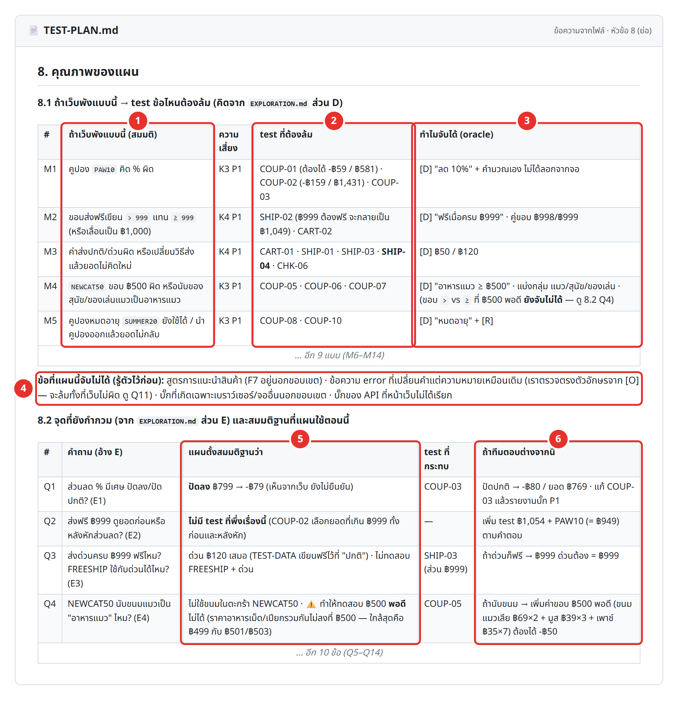

**ผลรีวิว**

| ตัวชี้วัด | ก่อนรีวิว | หลังแก้ |
|---|---|---|
| จำนวน test case | 47 | **48** |
| P1 / P2 / P3 | 29 / 13 / 5 | **30** / 13 / 5 |
| ที่มา [D] / [R] / [O-ยังไม่ยืนยัน] | 23 / 21 / 3 | 24 / 21 / 3 (**6.3%**) |
| ช่อง ⚠️ ใน coverage matrix | 4 | **1** (รอทีมตอบ) |
| ผลที่คาดหวังกว้างจนตรวจไม่ได้ | 3 | **0** |

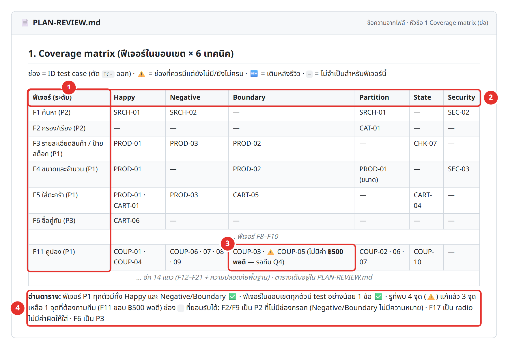

ดูไฟล์เต็มที่ [_solution/TEST-PLAN.md](_solution/TEST-PLAN.md) และ [_solution/PLAN-REVIEW.md](_solution/PLAN-REVIEW.md)

👀 **สังเกต**
- หัวข้อ 8 **ต่างจากบท 02**: บท 02 บอกบั๊กล่วงหน้า บทนี้เรา **ทายเอง** ว่าเว็บอาจพังแบบไหน และ test ข้อไหนต้องจับได้
- Coverage matrix ทำให้เห็น "รู" ทันที เช่น ฟีเจอร์วิธีจัดส่งไม่มี test แบบ State (สลับวิธีส่งแล้วยอดต้องเปลี่ยน) → เพิ่ม TC-SHIP-04
- **test เรื่องสถานะต้องบอกว่าตรวจ "ตอนไหน"** (ทันที หรือหลังรีโหลด) ถ้าเขียนกว้าง ๆ คนแปลงเป็น test อาจเลือกจังหวะที่ทำให้พลาดบั๊ก
- ข้อ [O] ล้วนเยอะเกินไป = แผนเสี่ยงอบบั๊ก ควรหา [D]/[R] มายืนยัน หรือส่งเป็นคำถามถึงทีม
- เกณฑ์ ≥ 95% กับ 48 ข้อ = ล้มได้ไม่เกิน 2 ข้อ — ตอนนี้มี 2 ข้อที่ยังไม่ตรงกับเว็บค้างอยู่ (รอทีมตอบ) แปลว่า LAB 7 จะ **ผ่านแบบพอดีขอบ**
- ข้อที่เพิ่ม/แก้ในรอบรีวิว **ยังไม่ได้ลองกับเว็บจริง** จะได้ยืนยันใน LAB 7
- ให้คะแนนแผนตัวเองด้วย[รูบริกท้ายบท](#-รูบริก-เช็กลิสต์-แผนการทดสอบที่ดี) (ในตัวอย่าง: ก่อนรีวิว 14/18 → หลังรีวิว 17/18 ในข้อที่ประเมินได้ตอนนี้)

---

## LAB 7 · แปลงแผนเป็น Playwright รันบน 3 เบราว์เซอร์

🎯 พิสูจน์ว่าแผน **ใช้งานได้จริง** — ทุกข้อแปลงเป็น test ที่รันได้ และเว็บปกติผ่านเกณฑ์ตามแผนของเรา

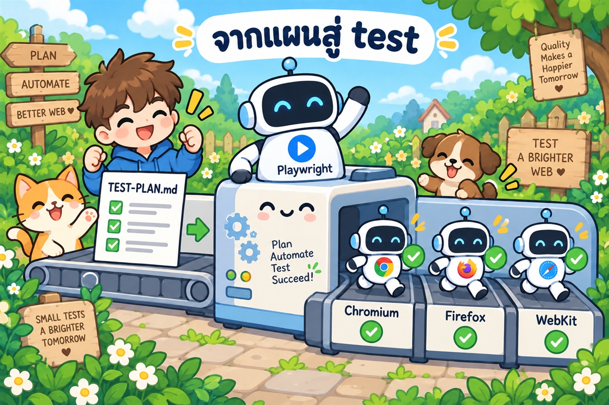

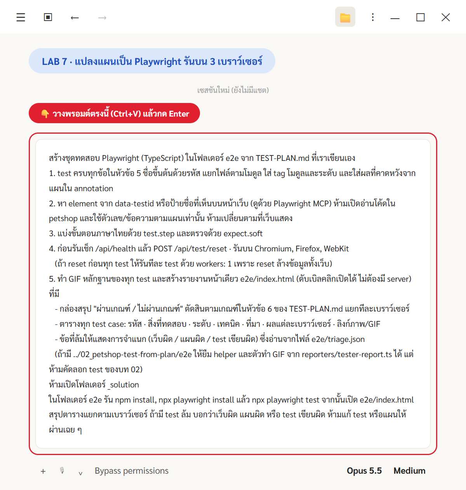

💬 **คัดลอกพรอมต์นี้**

```text
สร้างชุดทดสอบ Playwright (TypeScript) ในโฟลเดอร์ e2e จาก TEST-PLAN.md ที่เราเขียนเอง
1. test ครบทุกข้อในหัวข้อ 5 ชื่อขึ้นต้นด้วยรหัส แยกไฟล์ตามโมดูล ใส่ tag โมดูลและระดับ และใส่ผลที่คาดหวังจากแผนใน annotation
2. หา element จาก data-testid หรือป้ายชื่อที่เห็นบนหน้าเว็บ (ดูด้วย Playwright MCP) ห้ามเปิดอ่านโค้ดใน petshop และใช้ตัวเลข/ข้อความตามแผนเท่านั้น ห้ามเปลี่ยนตามที่เว็บแสดง
3. แบ่งขั้นตอนภาษาไทยด้วย test.step และตรวจด้วย expect.soft
4. ก่อนรันเช็ก /api/health แล้ว POST /api/test/reset · รันบน Chromium, Firefox, WebKit
   (ถ้า reset ก่อนทุก test ให้รันทีละ test ด้วย workers: 1 เพราะ reset ล้างข้อมูลทั้งเว็บ)
5. ทำ GIF หลักฐานของทุก test และสร้างรายงานหน้าเดียว e2e/index.html (ดับเบิลคลิกเปิดได้ ไม่ต้องมี server) ที่มี
   - กล่องสรุป "ผ่านเกณฑ์ / ไม่ผ่านเกณฑ์" ตัดสินตามเกณฑ์ในหัวข้อ 6 ของ TEST-PLAN.md แยกทีละเบราว์เซอร์
   - ตารางทุก test case: รหัส · สิ่งที่ทดสอบ · ระดับ · เทคนิค · ที่มา · ผลแต่ละเบราว์เซอร์ · ลิงก์ภาพ/GIF
   - ข้อที่ล้มให้แสดงการจำแนก (เว็บผิด / แผนผิด / test เขียนผิด) ซึ่งอ่านจากไฟล์ e2e/triage.json
   (ถ้ามี ../02_petshop-test-from-plan/e2e ให้ยืม helper และตัวทำ GIF จาก reporters/tester-report.ts ได้ แต่ห้ามคัดลอก test ของบท 02)
ห้ามเปิดโฟลเดอร์ _solution
ในโฟลเดอร์ e2e รัน npm install, npx playwright install แล้ว npx playwright test จากนั้นเปิด e2e/index.html
สรุปตารางแยกตามเบราว์เซอร์ ถ้ามี test ล้ม บอกว่าเว็บผิด แผนผิด หรือ test เขียนผิด ห้ามแก้ test หรือแผนให้ผ่านเฉย ๆ
```

✅ **ผลจริง (ตัวอย่าง)** ใช้เวลาราว 1 ชม. (สำรวจ selector + เขียน test ~35 นาที · รันเต็มรอบละ ~9 นาที) ได้ test **48 ข้อ ใน 10 ไฟล์** รันรวม 144 รอบ (48 × 3 เบราว์เซอร์) ใน **8.7 นาที** → รายงานตัดสิน **"ผ่านเกณฑ์ · พร้อมปล่อยใช้งาน"**

| เบราว์เซอร์ | P1 ผ่าน (EX1) | ผ่านรวม (EX2 ≥ 46/48) | อัตราผ่าน | ข้อที่ล้ม | ผลตามเกณฑ์ |
|---|---|---|---|---|---|
| Chromium | 30/30 ✅ | 46/48 ✅ | 95.8% | TC-SRCH-01 (P2) · TC-CART-05 (P3) | ✅ ผ่าน |
| Firefox | 30/30 ✅ | 46/48 ✅ | 95.8% | TC-SRCH-01 (P2) · TC-CART-05 (P3) | ✅ ผ่าน |
| WebKit | 30/30 ✅ | 46/48 ✅ | 95.8% | TC-SRCH-01 (P2) · TC-CART-05 (P3) | ✅ ผ่าน |


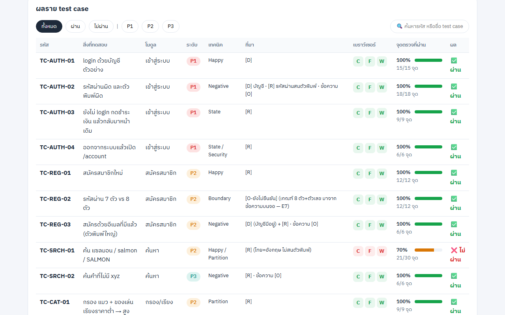

| ข้อที่ล้ม | จำแนก | ทำอะไรต่อ |
|---|---|---|
| TC-SRCH-01 (P2) | **แผนผิด (น่าจะ)** เว็บน่าจะค้นตามส่วนผสมด้วย | รอทีมตอบ ไม่แก้ผลที่คาดหวังจนกว่าจะได้คำตอบ |
| TC-CART-05 (P3) | **เว็บผิด (บั๊ก P3)** ข้อความไม่ตรงกับสิ่งที่เกิดจริง | รายงานทีม · เงินไม่ผิดจึงไม่กระทบ P1 |


ดูชุดทดสอบและรายงานเต็มที่ [_solution/e2e/](_solution/e2e/) (เปิด [_solution/e2e/index.html](_solution/e2e/index.html))

👀 **สังเกต**
- **ทุกข้อแปลงเป็น test ได้** เพราะรีวิวใน LAB 6 ทำให้ผลที่คาดหวังตรวจได้แล้ว — ถ้าข้อไหนแปลงไม่ได้ แปลว่าผลที่คาดหวังกำกวม ให้กลับไปแก้แผน (รีวิวรอบสอง)
- ข้อที่เพิ่มตอนรีวิวใน LAB 6 (ยังไม่เคยลองกับเว็บ) **ผ่านหมดทั้ง 3 เบราว์เซอร์**
- **test เขียนผิดก็เกิดได้**: รอบแรกบน Firefox ล้มเพิ่ม 2 ข้อ (`NS_BINDING_ABORTED`) เพราะกดออกจากระบบแล้วเปิดหน้าใหม่เร็วเกินไป → แก้ที่ test (รอให้หน้าเปลี่ยนเสร็จ) ไม่ได้แก้ผลที่คาดหวัง
- บางข้อต้อง "ตีความ" ให้ตรวจได้ เช่น TC-CART-05 ไม่มีข้อความที่ถูกให้เทียบ จึงตรวจว่าข้อความมีคำที่สื่อว่าโดนจำกัด (สต็อก / ครบ / ได้แค่ …)
- รายงานผ่าน **พอดีขอบ** ตรงกับที่ทายไว้ใน LAB 6 — ถ้าล้มเพิ่มแม้ 1 ข้อจะไม่ผ่าน
- ในตัวอย่างยืม helper และ reporter จากบท 02 มาปรับ ให้ `index.html` ตัดสินตามเกณฑ์หัวข้อ 6 ของแผนเรา และอ่าน `triage.json` แต่ **ไม่ได้คัดลอก test ของบท 02** เพราะเป็นแผนคนละชุด
- ถ้ารันแค่บางข้อ (`-g`) `index.html` จะถูกเขียนทับเป็น "ยังตัดสินไม่ได้" ต้องรันเต็มอีกครั้ง

---

## LAB 8 · บั๊กปริศนาในโหมดฝังบั๊ก — แผนของเราจับได้ไหม? 🐞

🎯 เปิด `BUG_MODE=1` ซึ่งฝังบั๊กไว้ในเว็บโดย **ไม่บอกว่าอยู่ตรงไหน** ดูว่าแผนที่เราเขียนเองจับได้กี่ตัว แล้วเรียนรู้ว่าทำไม "ที่มาของผลที่คาดหวัง" สำคัญ

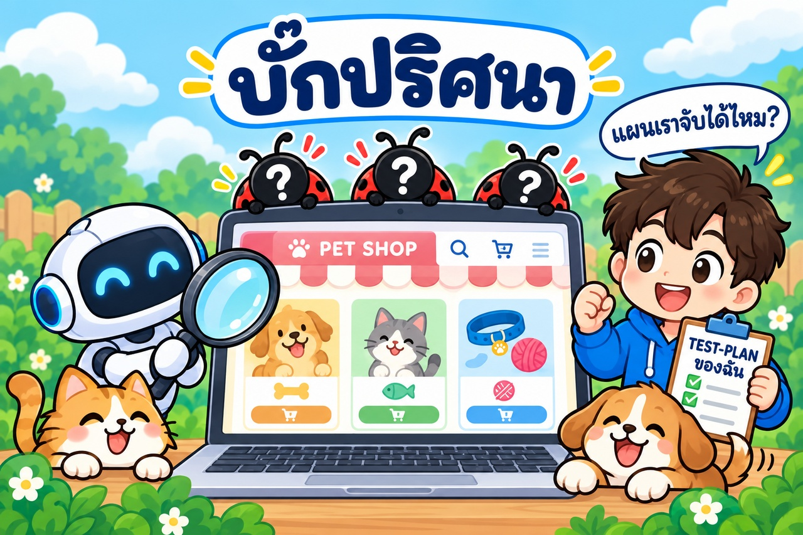

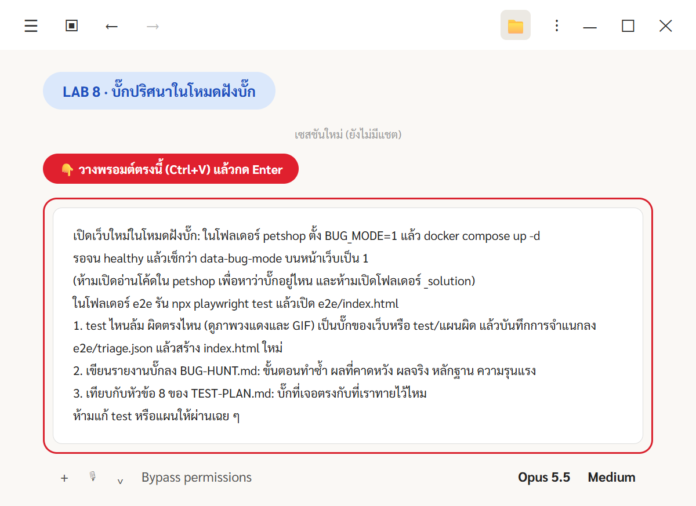

💬 **คัดลอกพรอมต์นี้** (ส่วนที่ 1 · จับบั๊ก)

```text
เปิดเว็บใหม่ในโหมดฝังบั๊ก: ในโฟลเดอร์ petshop ตั้ง BUG_MODE=1 แล้ว docker compose up -d
รอจน healthy แล้วเช็กว่า data-bug-mode บนหน้าเว็บเป็น 1
(ห้ามเปิดอ่านโค้ดใน petshop เพื่อหาว่าบั๊กอยู่ไหน และห้ามเปิดโฟลเดอร์ _solution)
ในโฟลเดอร์ e2e รัน npx playwright test แล้วเปิด e2e/index.html
1. test ไหนล้ม ผิดตรงไหน (ดูภาพวงแดงและ GIF) เป็นบั๊กของเว็บหรือ test/แผนผิด แล้วบันทึกการจำแนกลง e2e/triage.json แล้วสร้าง index.html ใหม่
2. เขียนรายงานบั๊กลง BUG-HUNT.md: ขั้นตอนทำซ้ำ ผลที่คาดหวัง ผลจริง หลักฐาน ความรุนแรง
3. เทียบกับหัวข้อ 8 ของ TEST-PLAN.md: บั๊กที่เจอตรงกับที่เราทายไว้ไหม
ห้ามแก้ test หรือแผนให้ผ่านเฉย ๆ
```

💬 **คัดลอกพรอมต์นี้** (ส่วนที่ 2 · บทเรียนเรื่อง oracle)

```text
ใน BUG-HUNT.md เพิ่มการวิเคราะห์นี้ (เว็บยังเปิด BUG_MODE=1 อยู่ ให้เช็กก่อนว่า data-bug-mode บนหน้าเว็บเป็น 1)
ห้ามเปิดอ่านโค้ดใน petshop และห้ามเปิดโฟลเดอร์ _solution
1. ใช้ Playwright MCP ลองเว็บตอนนี้ซ้ำแบบเดียวกับตอนหากฎใน EXPLORATION.md ส่วน C (ส่งฟอร์มเปล่า ใส่ค่าผิด ค่าขอบ คิดยอดเงิน) เฉพาะส่วนที่มี test ล้มในส่วนที่ 1
2. สมมติว่าเราสำรวจวันนี้แทนวันแรก แล้วลอกผลจากหน้าจอเป็นผลที่คาดหวังทั้งหมด (ที่มา [O]) ตารางนี้: test case | ผลที่คาดหวังในแผนเรา (ที่มา) | ค่าที่จะลอกจากหน้าจอวันนี้ | ยังจับบั๊กได้ไหม
3. สรุป: ข้อที่ที่มาเป็น [D] หรือ [R] ช่วยเราอย่างไร และแผนเราพลาดบั๊กตัวไหน เพราะอะไร ควรเพิ่ม test case อะไร
เสร็จแล้วเปิดเว็บกลับเป็นโหมดปกติ BUG_MODE=0
```

✅ **ผลจริง (ตัวอย่าง)** ใช้เวลาราว 45 นาที (รัน e2e ครบ 3 เบราว์เซอร์ 16.8 นาที + สำรวจซ้ำ + เขียนรายงาน) → รายงานตัดสิน **"ไม่ผ่านเกณฑ์ · ยังไม่พร้อมปล่อยใช้งาน"** และแผนของเรา **จับบั๊กใหม่ได้ครบ 3/3 ตัว**

| เบราว์เซอร์ | P1 ผ่าน (EX1) | ผ่านรวม (EX2) | อัตราผ่าน | ข้อที่ล้ม | ผลตามเกณฑ์ |
|---|---|---|---|---|---|
| Chromium | 26/30 ❌ | 41/48 ❌ | 85.4% | 7 ข้อ | ❌ ไม่ผ่าน |
| Firefox | 26/30 ❌ | 41/48 ❌ | 85.4% | 7 ข้อ (ข้อเดียวกัน) | ❌ ไม่ผ่าน |
| WebKit | 26/30 ❌ | 41/48 ❌ | 85.4% | 7 ข้อ (ข้อเดียวกัน) | ❌ ไม่ผ่าน |

144 รอบ · ผ่าน 123 · ล้ม 21 · จุดตรวจผ่าน 618/660 · ไม่มีข้อที่ล้มเพราะจังหวะหรือเบราว์เซอร์ (ไม่ flaky)


| สรุปส่วนที่ 1 · จับบั๊ก | ผล |
|---|---|
| ข้อที่ล้มต่อเบราว์เซอร์ | 7 ข้อ = **2 ข้อเดิม** ที่ล้มตั้งแต่ LAB 7 + **5 ข้อใหม่** ที่ล้มเพราะโหมดฝังบั๊ก |
| จำแนก 5 ข้อใหม่ | เว็บผิดทั้ง 5 ข้อ → รวมได้เป็น **บั๊ก 3 ตัว** (P1 2 ตัว · P2 1 ตัว) |
| เทียบหัวข้อ 8 ของแผน | ทั้ง 3 ตัวตรงกับแบบที่ **ทายไว้ใน 8.1** ล่วงหน้า |
| คำตัดสิน | จับได้ 3/3 → **"แผนดี"** |

| สรุปส่วนที่ 2 · oracle (เฉพาะ test ที่เจอบั๊ก 5 ข้อ) | จับบั๊กได้ |
|---|---|
| แผนของเรา (ผลที่คาดหวังมาจาก [D] / [R]) | **5/5** ✅ |
| ถ้าสำรวจวันนี้แล้วลอกค่าจากหน้าจอ ([O]) | **0/5** ❌ ทุกข้อจะ "ยืนยันบั๊ก" และผ่านตลอดไป |

รายงานบั๊กตัวอย่างอยู่ที่ [_solution/BUG-HUNT.md](_solution/BUG-HUNT.md) และรายงานเต็มที่ [_solution/e2e/index.html](_solution/e2e/index.html)

🔒 เฉลยบั๊กที่ฝังไว้และการวิเคราะห์ อยู่ใน [_solution/README.md](_solution/README.md) (ลองทำเองก่อนเปิดดู)

👀 **สังเกต**
- ผลเป็นไปได้หลายแบบ **ทุกแบบเป็นบทเรียน**: จับได้ครบ = แผนดี · จับได้บางตัว = ดูว่าข้อที่พลาดขาดเทคนิคอะไร (Boundary? State? ตรวจผิดจังหวะ?)
- test ล้ม = **เจอบั๊กก่อนลูกค้าเจอ** 🎉 ห้ามแก้ test ให้ผ่านเฉย ๆ ต้องดูภาพ/GIF ก่อนว่าผิดที่ไหน
- ข้อความหลักของบท: **ผลที่คาดหวังที่ลอกจากหน้าจอ จะยืนยันบั๊กแทนที่จะจับบั๊ก** ต้องมีแหล่งอิสระ ([D] หรือ [R]) อย่างน้อย 1 แหล่ง
- **อย่าเชื่อ [O] ข้อเดียว** ถ้าสองแหล่งในหน้าเว็บขัดกันเอง (เช่น ข้อความบนจอกับสิ่งที่เว็บทำจริง) ให้ถามทีม
- **1 test ที่มีหลายข้อย่อย ระวังผลข้างเคียง**: ถ้าข้อย่อยหนึ่งทำให้สถานะเปลี่ยน ข้อย่อยถัดไปอาจล้มเพราะเริ่มจากหน้าผิด (หรือรอจนหมดเวลา) → แยกเป็น test ละค่า
- รายงานอ่านผลการจำแนก (`triage.json`) **ตอนจบการรัน** ถ้าจำแนกทีหลัง EX4 อาจขึ้น ❌ "ยังไม่จำแนก" → จำแนกเสร็จแล้วรันซ้ำ (หรือสั่งสร้าง `index.html` ใหม่จากผลเดิม)
- รอบนี้ `e2e/index.html` ถูก **เขียนทับ** ด้วยผลโหมดฝังบั๊ก ถ้าอยากเก็บรายงาน LAB 7 ไว้ ให้คัดลอกเก็บก่อนรัน
- จบแล้วอย่าลืมเปิดเว็บกลับเป็น `BUG_MODE=0`

---

## ✅ รูบริก: เช็กลิสต์ "แผนการทดสอบที่ดี"

ให้คะแนนแผนของตัวเอง 1 คะแนนต่อข้อที่ทำได้ · **ดีมาก ≥ 18/20 · ใช้ได้ 14–17 · ต้องแก้ < 14**
(ข้อ 1–18 ให้คะแนนได้หลัง LAB 6 · ข้อ 19–20 หลัง LAB 7–8 · ถ้าประเมินตอน LAB 6 ให้เทียบ ≥ 16/18 = ดีมาก)

**A. ฐานจากการสำรวจ**
- ☐ 1. EXPLORATION.md มีแผนผังเว็บครบทุกหน้า (รวมหน้า 404 และหน้าที่ต้องเข้าสู่ระบบ)
- ☐ 2. กฎทุกข้อติดป้ายที่มา [D]/[R]/[O]
- ☐ 3. มีคำถามถึงทีม อย่างน้อย 3 ข้อ (สิ่งที่ TEST-DATA ไม่ได้บอก)
- ☐ 4. ไม่ได้อ่านโค้ดใน petshop/ เพื่อหากฎ

**B. กรอบของแผน (หัวข้อ 1–4)**
- ☐ 5. เป้าหมายข้อเดียวชัดเจน และบอกแหล่งของผลที่คาดหวัง
- ☐ 6. ทุกฟีเจอร์ในแผนผังเว็บอยู่ฝั่ง "ทดสอบ" หรือ "ไม่ทดสอบ (มีเหตุผล)"
- ☐ 7. ขอบเขตระบุเบราว์เซอร์ จอมือถือ และ API
- ☐ 8. นิยาม P1/P2/P3 ใช้ผลกระทบเมื่อพัง ไม่ใช่ความยากของ test

**C. Test cases (หัวข้อ 5)**
- ☐ 9. ทุกฟีเจอร์ในขอบเขตมี test อย่างน้อย 1 ข้อ
- ☐ 10. ใช้ครบ 6 เทคนิค และฟีเจอร์ P1 มีทั้ง Happy + Negative/Boundary
- ☐ 11. ผลที่คาดหวังทุกข้อเป็นตัวเลขหรือข้อความที่ตรวจได้ (ไม่มี "แสดงถูกต้อง")
- ☐ 12. ตัวเลขเงินมีวิธีคำนวณจาก TEST-DATA กำกับ ไม่ได้ลอกจากหน้าจอ
- ☐ 13. ค่าขอบใช้คู่ "ต่ำกว่า/ที่ขอบ" เช่น ฿998/฿999, เบอร์ 9/10 หลัก, สต็อก 3/4
- ☐ 14. ใช้ข้อมูลใน TEST-DATA ครบทุกแถว (บัญชี คูปอง 4 ตัว ค่าส่ง สินค้าหมด/ใกล้หมด)
- ☐ 15. ID เป็นระบบ ไม่ซ้ำ และไม่มี test ซ้ำกัน

**D. เกณฑ์และคุณภาพ (หัวข้อ 6–8)**
- ☐ 16. Entry/Exit criteria วัดได้ (healthy + health ok · P1 ผ่าน 100% · อัตราผ่าน X%)
- ☐ 17. หัวข้อ 8 ทาย "ถ้าพังแบบนี้ → test ไหนล้ม" อย่างน้อย 5 แบบ
- ☐ 18. ข้อ [O-ยังไม่ยืนยัน] (ไม่มี [D]/[R] ยืนยัน) มีไม่เกิน ~20% ของ test case และทุกข้ออยู่ในคำถามถึงทีม

**E. พิสูจน์แผน**
- ☐ 19. ทุกข้อแปลงเป็น Playwright ได้ และเว็บปกติผ่านเกณฑ์ตามแผน
- ☐ 20. ในโหมดฝังบั๊ก แผนจับบั๊กได้ ≥ 2 จาก 3 ตัว และ BUG-HUNT.md อธิบายตัวที่พลาดได้ว่าขาดเทคนิค/oracle อะไร

---

## 🔁 รันซ้ำ

| อยากทำ | 💬 พรอมต์ |
|---|---|
| ล้างข้อมูลเว็บก่อนลองใหม่ | `เรียก POST http://localhost:3000/api/test/reset แล้วล้าง localStorage ของ localhost:3000 ในเบราว์เซอร์ที่ใช้สำรวจ` |
| รันชุดทดสอบของเราอีกรอบ | `ในโฟลเดอร์ e2e รัน npx playwright test แล้วเปิด e2e/index.html สรุปผลตามเกณฑ์หัวข้อ 6 ของ TEST-PLAN.md` |
| เทียบแผนของเรากับเฉลย (หลังจบ LAB 8 เท่านั้น) | `เทียบ TEST-PLAN.md ของผมกับ _solution/TEST-PLAN.md บอกฟีเจอร์หรือเทคนิคที่ของผมยังขาด และข้อที่ของผมดีกว่า` |
| เพิ่ม test ที่ขาดหลัง LAB 8 | `เพิ่ม test case ที่ BUG-HUNT.md แนะนำลง TEST-PLAN.md หัวข้อ 5 (มีที่มา [D]/[R]) แล้วเพิ่ม test ใน e2e และรันใหม่` |
| ปิดเว็บ | `ปิดเว็บด้วย docker compose down ในโฟลเดอร์ petshop` |

## ถ้าเจอปัญหา: คัดลอกพรอมต์นี้

| อาการ | 💬 พรอมต์ |
|---|---|
| Docker ไม่ทำงาน | `docker compose up ไม่ผ่าน ช่วยเช็กว่า Docker Desktop เปิดอยู่ไหม และพอร์ต 3000 ถูกใช้อยู่หรือเปล่า บอกผมว่าต้องทำอะไรเอง` |
| Claude จะเปิดอ่านโค้ดใน petshop | `หยุดก่อน บทนี้ห้ามอ่านโค้ดใน petshop ให้เรียนรู้จากหน้าเว็บผ่าน Playwright MCP เท่านั้น` |
| Claude เปิดไฟล์ใน `_solution/` | `หยุดก่อน ห้ามเปิดโฟลเดอร์ _solution เพราะเป็นเฉลย ให้ทำจากไฟล์ของผมเท่านั้น (EXPLORATION.md, TEST-PLAN.md, TEST-DATA.md)` |
| เห็น error แปลก ๆ ตอนสำรวจ | `error นี้มาจากเว็บ localhost:3000 หรือจาก extension ของเบราว์เซอร์ ถ้าไม่ใช่ของเว็บให้ข้ามไป` |
| สินค้าหมดหลังลองสั่งซื้อ / ข้อมูลเพี้ยน | `เรียก POST /api/test/reset แล้วล้าง localStorage ของ localhost:3000 แล้วลองใหม่` |
| Claude เขียนผลที่คาดหวังว่า "แสดงถูกต้อง" | `แก้ผลที่คาดหวังทุกข้อให้เป็นตัวเลขหรือข้อความที่ตรวจได้ ตัวเลขเงินให้คำนวณจาก TEST-DATA.md พร้อมวิธีคิด` |
| test ล้มบางข้อ | `test ข้อนี้ล้ม ช่วยดูภาพวงแดงและ GIF ใน e2e/test-report แล้วบอกว่าเว็บผิด แผนผิด หรือ test เขียนผิด ห้ามแก้ test หรือแผนให้ผ่านเฉย ๆ` |
| ล้มเพราะ `NS_BINDING_ABORTED` บน Firefox | `test ล้มด้วย NS_BINDING_ABORTED ช่วยแก้ test ให้รอการเปลี่ยนหน้าให้เสร็จก่อนเปิดหน้าใหม่ ห้ามแก้ผลที่คาดหวัง` |
| รายงานขึ้น "ยังตัดสินไม่ได้" | `รัน npx playwright test เต็มทุกข้ออีกครั้ง (ไม่ใช้ -g) แล้วเปิด e2e/index.html` |
| ยังเป็นโหมดฝังบั๊กอยู่ | `ช่วยเปิดเว็บกลับเป็นโหมดปกติ BUG_MODE=0 แล้วเช็กว่า data-bug-mode เป็น 0` |

## 📖 คำศัพท์

| คำ | ความหมายง่าย ๆ |
|---|---|
| **Exploratory testing** | ทดสอบไปพร้อมเรียนรู้ระบบ ใช้งานจริงแล้วจดสิ่งที่เจอ |
| **Test plan** | เอกสารบอกว่าจะทดสอบอะไร ผลที่ถูกเป็นยังไง และผ่านเมื่อไร |
| **Test case** | "ลองทำแบบนี้ ต้องได้ผลแบบนี้" 1 ข้อ |
| **Expected / Actual** | ผลที่คาดหวัง / ผลที่เกิดจริง |
| **Test oracle** | แหล่งที่บอกว่าผลแบบไหน "ถูก" (บทนี้ใช้ [D] [R] [O]) |
| **[D] / [R] / [O]** | ข้อมูลทีม / กฎทั่วไป / สังเกตจากเว็บ |
| **อบบั๊ก (baking the bug in)** | ลอกค่าผิดจากหน้าจอไปเป็นผลที่คาดหวัง test เลยผ่านทั้งที่ระบบผิด |
| **P1 P2 P3** | ระดับความสำคัญตามผลกระทบเมื่อพัง สูง กลาง ต่ำ |
| **Happy / Negative / Boundary** | ทางที่ใส่ข้อมูลถูก / ข้อมูลผิด / ค่าที่ขอบ เช่น ฿998 กับ ฿999 |
| **Equivalence partition** | แบ่งข้อมูลเป็นกลุ่ม ทดสอบตัวแทนกลุ่ม |
| **State** | ข้อมูลต้องคงอยู่/อัปเดตถูกหลังเปลี่ยนสถานะ เช่น รีโหลด ออกจากระบบ |
| **Coverage matrix** | ตาราง ฟีเจอร์ × เทคนิค ใช้หารูของแผน |
| **จุดตรวจ** | การเช็กผล 1 ครั้งใน test (1 `expect`) · test 1 ข้อมีได้หลายจุดตรวจ ถ้าจุดตรวจไหนไม่ตรง test ข้อนั้นล้ม |
| **Entry / Exit criteria** | เกณฑ์เริ่มทดสอบได้ / เกณฑ์ผ่านพอจะปล่อยใช้งาน |
| **Black-box** | ทดสอบโดยไม่ดูโค้ดข้างใน |
| **Playwright MCP** | ให้ Claude คุมเบราว์เซอร์จริงเพื่อสำรวจเว็บ |

### ไฟล์ในบทนี้

```text
03_petshop-testplan-from-exploration/
├─ README.md                 # บทเรียน + พรอมต์ทุก LAB
├─ TEST-DATA.md              # ข้อมูลจากทีม (สิ่งเดียวนอกจากเว็บ)
├─ img/                      # ภาพประกอบ
├─ petshop/                  # เว็บ PawPantry (ไม่มี SPEC.md · ห้ามอ่านโค้ดตอนสำรวจ)
│  └─ Dockerfile, docker-compose.yml, app/ components/ lib/ ...
│
│  ── ไฟล์ที่ผู้เรียนสร้างเอง ──
├─ EXPLORATION.md            # LAB 2–3: A แผนผังเว็บ · B ฟีเจอร์ · C กฎ [D/R/O] · D ความเสี่ยง · E คำถามถึงทีม
├─ exploration/*.png         # LAB 2: ภาพหน้าจอที่สำรวจ
├─ TEST-PLAN.md              # LAB 4–6: แผน 8 หัวข้อ (หัวข้อ 5 มีคอลัมน์ "ที่มา")
├─ PLAN-REVIEW.md            # LAB 6: coverage matrix + สถิติ + สิ่งที่แก้
├─ e2e/                      # LAB 7: ชุดทดสอบ Playwright + index.html + test-report/
├─ BUG-HUNT.md               # LAB 8: รายงานบั๊ก + วิเคราะห์ oracle
│
└─ _solution/                # 🔒 เฉลย (ลองทำเองก่อน)
   ├─ README.md              # คู่มือผู้สอน + เฉลยบั๊กที่ฝังไว้
   ├─ EXPLORATION.md, exploration/
   ├─ TEST-PLAN.md, PLAN-REVIEW.md
   ├─ e2e/                   # ชุดทดสอบตัวอย่าง + index.html
   └─ BUG-HUNT.md
```
