# 🔑 เฉลยผู้สอน · บท 03 เขียนแผนทดสอบจากการสำรวจเว็บ

> ⚠️ **โฟลเดอร์นี้สำหรับผู้สอนเท่านั้น** มีเฉลยบั๊กที่ฝังไว้ (BUG_MODE=1) และแผนตัวอย่างฉบับเต็ม
> ถ้าแจกงานให้ผู้เรียน ให้ลบหรือย้าย `_solution/` ออกก่อน (หรืออย่างน้อยห้ามเปิดก่อนจบ LAB 8)

ไฟล์ทั้งหมดในนี้มาจาก **การทำ LAB 1–8 จริงครบหนึ่งรอบ** (10 ต.ค. 2026) โดยให้ Claude สวมบทผู้เรียน ทำตามพรอมต์ใน [README.md](../README.md) ทีละ LAB ไม่ได้เปิดอ่านโค้ดใน `petshop/` และไม่ได้ดูตารางเฉลยก่อน LAB 8 ตัวเลขทุกตัวในหน้านี้มาจาก `_design/LAB*_RESULT.md`

---

## สารบัญ

1. [ไฟล์ในโฟลเดอร์นี้ มาจาก LAB ไหน](#1-ไฟล์ในโฟลเดอร์นี้-มาจาก-lab-ไหน)
2. [ผลจริงทีละ LAB](#2-ผลจริงทีละ-lab)
3. [เฉลยบั๊กที่ฝังไว้ (BUG_MODE=1)](#3-เฉลยบั๊กที่ฝังไว้-bug_mode1)
4. [แผนตัวอย่างจับได้แค่ไหนใน LAB 8](#4-แผนตัวอย่างจับได้แค่ไหนใน-lab-8)
5. [แผนที่ดีควรมีอะไร](#5-แผนที่ดีควรมีอะไร)
6. [คะแนนรูบริกของแผนตัวอย่าง](#6-คะแนนรูบริกของแผนตัวอย่าง)
7. [ปัญหาที่เจอระหว่างทำจริง](#7-ปัญหาที่เจอระหว่างทำจริง)
8. [รัน `_solution/e2e` ซ้ำ](#8-รัน-_solutione2e-ซ้ำ)

---

## 1. ไฟล์ในโฟลเดอร์นี้ มาจาก LAB ไหน

| ไฟล์ / โฟลเดอร์ | ได้จาก LAB | เนื้อหา |
|---|---|---|
| [EXPLORATION.md](EXPLORATION.md) | LAB 2 (ส่วน A–B) · LAB 3 (ส่วน C–E) · LAB 5 เติม E15–E19 | A แผนผังเว็บ 13 หน้า + เมนูมือถือ · B ฟีเจอร์ 22 รายการ · C กฎ 61 ข้อ ติดป้าย [D]/[R]/[O] · D ความเสี่ยง 22 ข้อ (P1 10 · P2 8 · P3 4) · E คำถามถึงทีม 19 ข้อ |
| [exploration/](exploration/) | LAB 2 | ภาพหน้าจอที่สำรวจ 19 ภาพ (`home.png` … `mobile-menu.png`) |
| [TEST-PLAN.md](TEST-PLAN.md) | LAB 4 (หัวข้อ 1–4) · LAB 5 (หัวข้อ 5) · LAB 6 (หัวข้อ 6–8 + แก้ตามรีวิว) | แผน 8 หัวข้อ · test case 48 ข้อ พร้อมคอลัมน์ "ที่มา" |
| [PLAN-REVIEW.md](PLAN-REVIEW.md) | LAB 6 | coverage matrix 21 ฟีเจอร์ × 6 เทคนิค · สถิติก่อน/หลังรีวิว · ตรวจทีละข้อ 48 แถว · สิ่งที่แก้ 5 ข้อ · เรื่องที่ต้องถามทีม 6 ข้อ |
| [e2e/](e2e/) | LAB 7 (สร้าง) · LAB 8 (รันซ้ำโหมดบั๊ก + เติม `triage.json`) | ชุด Playwright 48 test ใน 10 ไฟล์ · reporter · `triage.json` |
| [e2e/index.html](e2e/index.html) | LAB 8 (เขียนทับรายงานของ LAB 7) | รายงานรอบ BUG_MODE=1 "ไม่ผ่านเกณฑ์" — ดูหมายเหตุข้อ 8 เรื่องไฟล์ที่ตัดออก |
| [BUG-HUNT.md](BUG-HUNT.md) | LAB 8 | ส่วนที่ 1 ผลรัน + รายงานบั๊ก 3 ตัว + เทียบหัวข้อ 8 · ส่วนที่ 2 วิเคราะห์ oracle |
| [img/](img/) | LAB 7–8 | ภาพที่ใช้ในหน้านี้ (มีบั๊กบนภาพ จึงไม่ใส่ใน `img/` ของผู้เรียน) |
| `_design/LESSON-PLAN.md` | ก่อนถ่ายทำ | แผนการสอน พรอมต์ทุก LAB รายการภาพ รูบริก และตารางเฉลยบั๊ก |
| `_design/SPEC-reference.md` | ก่อนถ่ายทำ | สเปกอ้างอิงของเว็บ (ผู้เรียนไม่ได้รับ) |
| `_design/LAB1_RESULT.md` … `LAB8_RESULT.md` | ทุก LAB | คำตอบในแชท ตัวเลข ข้อสังเกตของแต่ละ LAB — ที่มาของตัวเลขทุกตัวในหน้านี้ |
| `_design/EXPLORATION-pre-research.md` | ก่อนถ่ายทำ | โน้ตสำรวจเว็บของผู้ออกแบบบทเรียน (ไม่ใช่ผลของผู้เรียน) |
| `_design/IMAGES-W1.md` · `README-draft.md` | ตอนเขียน README | รายการภาพและร่าง README |
| `_design/shots/` | ทุก LAB | ภาพหน้าจอดิบจากการถ่ายทำ (รวม GIF ต้นฉบับของ LAB 8) |

---

## 2. ผลจริงทีละ LAB

| LAB | ใช้เวลา | ผลจริง |
|---|---|---|
| 1 เปิดเว็บ | ≈ 1 นาที (มี cache) | container `petshop` healthy ใน ~6 วินาที · `/api/health` → `{"ok":true}` · `BUG_MODE=0` |
| 2 สำรวจแบบลูกค้า | ≈ 12 นาที | 13 หน้า + เมนูมือถือ · ฟีเจอร์ 22 · ภาพ 19 · งานหลัก 1 รอบสำเร็จ: PP-100001 ยอด ฿581 (590 − 59 + 50) · "ยังไม่รู้" 7 ข้อ |
| 3 ล่ากฎและความเสี่ยง | ≈ 20 นาที | กฎ 61 ข้อ ([D] 13 · [R] 32 · [O] 8 · [O-ยังไม่ยืนยัน] 8 · ⚠️ 4) · ข้อความ error ตรงตัวอักษร 12+ ข้อความ · ความเสี่ยง 22 (P1 10 · P2 8 · P3 4) · คำถามถึงทีม 14 ข้อ · คำถามที่ผู้สอนคาดไว้เกิดครบ |
| 4 TEST-PLAN หัวข้อ 1–4 | ≈ 10 นาที | ภาพรวม 5 แถว · ฟีเจอร์ทดสอบ 20 / ไม่ทดสอบ 11 แถว (มีเหตุผลทุกแถว) · ครบ 6 เทคนิค · P1/P2/P3 ผูกกับ K1–K22 · มี 5 เรื่องที่ควรหยุดถามผู้เรียน (API, การแนะนำ, รับข่าวสาร, finder, มือถือ) |
| 5 test case + ยืนยันกับเว็บ | ≈ 35 นาที | 47 ข้อ (P1 29 · P2 13 · P3 5) · ที่มา [D] 23 · [R] 21 · [O-ยังไม่ยืนยัน] 3 · **ตรงกับเว็บ 45/47** · ไม่ตรง 2: TC-SRCH-01 (แผนเข้าใจผิด น่าจะ) · TC-CART-05 (บั๊ก P3 ข้อความ toast) |
| 6 หัวข้อ 6–8 + รีวิว | ≈ 25 นาที | Exit: P1 100% + รวม ≥ 95% (≥ 46/48) · หัวข้อ 8.1 ทาย 14 แบบ · 8.2 กำกวม 14 ข้อ · รีวิวเจอรู 4 ช่อง แก้เหลือ 1 · **47 → 48 ข้อ** (P1 30) · [O] ล้วน 3/48 = 6.3% |
| 7 แปลงเป็น Playwright | ≈ 1 ชม. | 48 test · 3 เบราว์เซอร์ **46/48 (95.8%) P1 30/30 ทุกเบราว์เซอร์** · 144 รอบ ผ่าน 138 · 8.7 นาที · รายงาน "ผ่านเกณฑ์" (ผ่านพอดีขอบ) · ล้ม 2: SRCH-01 (แผนผิด น่าจะ) · CART-05 (บั๊ก P3) |
| 8 โหมดบั๊ก | ≈ 45 นาที | ทุกเบราว์เซอร์ **41/48 (85.4%) P1 26/30** · 144 รอบ ผ่าน 123 ล้ม 21 · 16.8 นาที · รายงาน "ไม่ผ่านเกณฑ์" · **จับบั๊กใหม่ได้ 3/3** · oracle: แผน [D]/[R] จับ 5/5 ข้อ vs ลอกจากจอ [O] จับ 0/5 |

### หมายเหตุรายละเอียด

- **LAB 4** — พรอมต์บอก "ไม่แน่ใจเรื่องขอบเขตให้ถามก่อน" ในการถ่ายทำ Claude ตัดสินใจเองแล้วจดไว้ (Q1–Q5 ใน LAB4_RESULT) ผู้เรียนจริงควรเห็น Claude หยุดถาม
- **LAB 5** — ผลที่คาดหวังเรื่องเงินคำนวณก่อนเปิดเว็บทุกข้อ (25 ข้อที่มีตัวเลขเงิน) ตรงกับเว็บหมด · สคริปต์ยืนยันพลาดเอง 1 ครั้ง (TC-FIND-01 ใช้ selector ผิด) แก้ที่สคริปต์ ไม่ได้แก้ผลที่คาดหวัง · 47 ข้อเกินเป้า 25–35 (ถ้าอยากได้ ~35 ให้รวม COUP-08/09 · CHK-03/04/05 · CART-03/04)
- **LAB 6** — สิ่งที่แก้ 5 ข้อ: เพิ่ม TC-SHIP-04 + เบอร์ขึ้นต้น 1 ใน CHK-03 · **WISH-01 ระบุให้ตรวจ ♥ ทันทีโดยไม่รีโหลด** · ACC-01 ไม่พึ่ง test อื่น · ผลที่คาดหวังกว้าง 3 ข้อเขียนใหม่ให้ตรวจได้ · แก้ป้ายที่มา
- **LAB 7** — ใช้ helper/reporter จากบท 02 (ไม่ได้คัดลอก spec) · ต้องเปลี่ยน `workers: 1` เพราะ reset ก่อนทุก test ล้างข้อมูลทั้งเซิร์ฟเวอร์ · รอบแรก Firefox ล้มเพิ่ม 2 ข้อ (`NS_BINDING_ABORTED` หลัง logout) จำแนกว่า **test เขียนผิด** แก้ helper `logout()` · 3 ข้อที่ LAB 6 เพิ่ม/แก้แต่ยังไม่ได้ลองกับเว็บ ผ่านหมด
- **LAB 8** — TC-CHK-03 ข้อย่อยแรก (9 หลัก) สร้างคำสั่งซื้อจริงแล้วพาไป `/orders/...` ข้อย่อยที่เหลือหาช่องเบอร์ไม่เจอจนหมดเวลา 120 วินาที → ข้อย่อย 11 หลัก/ขึ้นต้น 1 ยืนยันด้วยการสำรวจแทน · reporter อ่าน `triage.json` ตอนจบการรัน รอบนี้จำแนกหลังรัน จึง re-render `index.html` จาก `data.json` (ไม่ได้รัน test ซ้ำ) ให้ EX4 = 7/7

---

## 3. เฉลยบั๊กที่ฝังไว้ (BUG_MODE=1)

จาก `_design/LESSON-PLAN.md` "เฉลยสำหรับผู้สอน"

| บั๊ก (BUG_MODE=1) | test ที่ควรจับได้ | oracle ที่ช่วยจับ | ถ้าลอกจากหน้าจอจะเห็น |
|---|---|---|---|
| PAW10 ลดแค่ 1% | คูปอง PAW10 พร้อมยอดเป็นตัวเลข | [D] "PAW10 ลด 10%" + [R] คำนวณ ฿799×10% | "ส่วนลด ฿7" → อบบั๊กลงแผน |
| ลบรายการโปรดแล้วตัวเลขหัวเว็บไม่ลด (จนรีโหลด) | ลบรายการโปรดแล้วเช็กตัวเลข **ทันที** ไม่รีโหลด | [R] ตัวเลขต้องเท่ากับจำนวนในรายการ | "ตัวเลขยังเป็น 2" → ดูแปลกแต่บางคนอาจจดตาม |
| เบอร์โทร 9 หลักผ่านการตรวจ | Boundary เบอร์ 9 / 10 / 11 หลัก ในหน้าชำระเงิน | [R] เบอร์มือถือไทย 10 หลัก | "9 หลักสั่งซื้อได้" → อบบั๊ก + ไม่รู้ข้อความ error |

ประเด็นชวนคุย: บั๊กเบอร์ 9 หลักทำให้ **ไม่เห็นข้อความ error เลย** ถ้าสำรวจวันนั้น ผู้เรียนจะไม่รู้ข้อความ error ที่ถูก → ผลที่คาดหวังที่ดีคือ "มีข้อความ error ที่ช่องเบอร์โทร และสั่งซื้อไม่ได้" แล้วติดคำถามถึงทีม

วิธีเปิด/ปิดโหมดบั๊ก ดู [ข้อ 8](#8-รัน-_solutione2e-ซ้ำ)

---

## 4. แผนตัวอย่างจับได้แค่ไหนใน LAB 8

ผลรัน `npx playwright test` ที่ BUG_MODE=1 — ทั้ง 3 เบราว์เซอร์ล้มเหมือนกัน 7 ข้อ ไม่มีข้อที่ flaky

| เบราว์เซอร์ | P1 ผ่าน | ผ่านรวม | ผล |
|---|---|---|---|
| Chromium | 26/30 ❌ | 41/48 (85.4%) | ❌ |
| Firefox | 26/30 ❌ | 41/48 (85.4%) | ❌ |
| WebKit | 26/30 ❌ | 41/48 (85.4%) | ❌ |

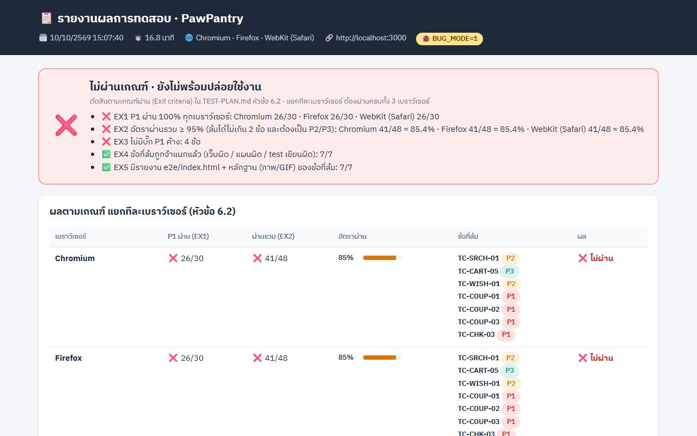

| test ที่ล้ม | ได้จริง vs คาดหวัง | จำแนก | บั๊ก | หัวข้อ 8.1 ทายไว้ |
|---|---|---|---|---|
| TC-COUP-01 / 02 / 03 (P1) | ส่วนลด ฿5 / ฿15 / ฿7 แทน ฿59 / ฿159 / ฿79 → ยอด ฿635 / ฿1,575 / ฿842 | เว็บผิด | **BUG-01 PAW10 ลด ⌊ยอด×1%⌋** (P1) | ✅ M1 "ลด 1% หรือไม่หักเลย" |
| TC-WISH-01 (P2) | ลบแล้วหน้าเหลือ 1 แต่ ♥ = 2 · ย้ายไปตะกร้าแล้ว ♥ = 1 (ควร 0) | เว็บผิด | **BUG-02 ♥ ไม่ลดทันที** ต้องรีโหลด (P2) | ✅ M12 |
| TC-CHK-03 (P1) | เบอร์ 9 หลัก สั่งซื้อได้ → `/orders/PP-100001` | เว็บผิด (+ test ข้อย่อยถัดไปไม่ได้รัน) | **BUG-03 รับเบอร์ 9 หลัก** (P1) | ✅ M7 |
| TC-SRCH-01 (P2) · TC-CART-05 (P3) | เหมือน LAB 7 | แผนผิด (น่าจะ) / บั๊กเดิม P3 | ไม่ใช่บั๊กปริศนา | — |

**คำตัดสิน: จับได้ครบ 3/3 → "แผนดี"** · รายงานตัดสิน "ไม่ผ่านเกณฑ์" ถูกต้อง (EX1/EX2/EX3 ❌) · รายละเอียดเต็มใน [BUG-HUNT.md](BUG-HUNT.md)

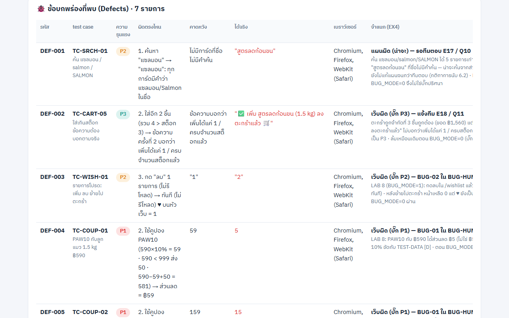

### BUG-01 · PAW10 ลดแค่ ~1%

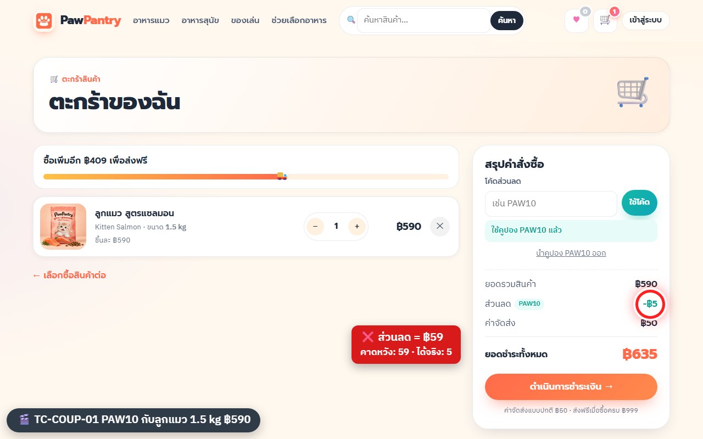

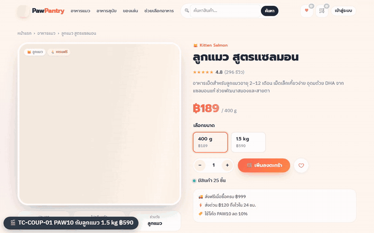

- ฿590→5, ฿1,590→15, ฿799→7 · ข้อความ "ใช้คูปอง PAW10 แล้ว" ยังขึ้นปกติ ดูด้วยตาเร็ว ๆ จะไม่สังเกต
- COUP-03 ที่ป้าย [O-ยังไม่ยืนยัน] (วิธีปัดเศษ) ก็ยังจับได้ เพราะแกนของค่า (10%) เป็น [D] ความไม่แน่นอนมีแค่ ±฿1

### BUG-02 · ตัวเลข ♥ ไม่ลดทันที

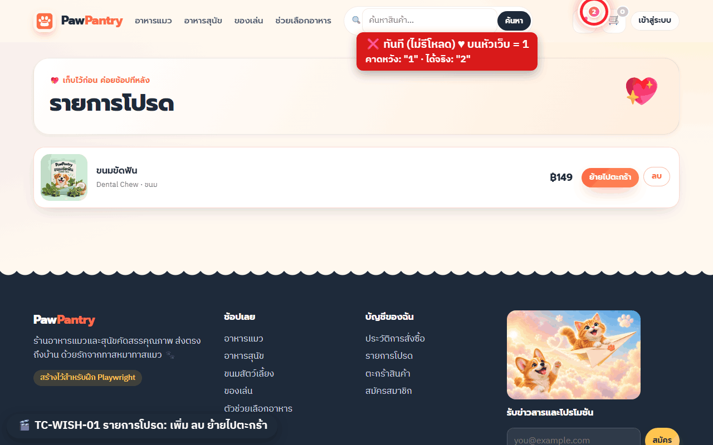

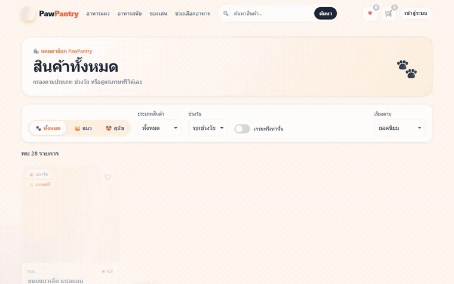

- จับได้ **เพราะรีวิวใน LAB 6** เพิ่มคำว่า "ตรวจทันทีโดยไม่รีโหลด" — ถ้าตรวจหลังรีโหลดอย่างเดียว test จะผ่าน (หลังรีโหลด ♥ ถูก)
- นี่คือข้อที่ผู้เรียนพลาดบ่อยที่สุด (ตรงกับ "มักขาด State ตัวเลขหัวใจ" ใน LESSON-PLAN)

### BUG-03 · รับเบอร์โทร 9 หลัก

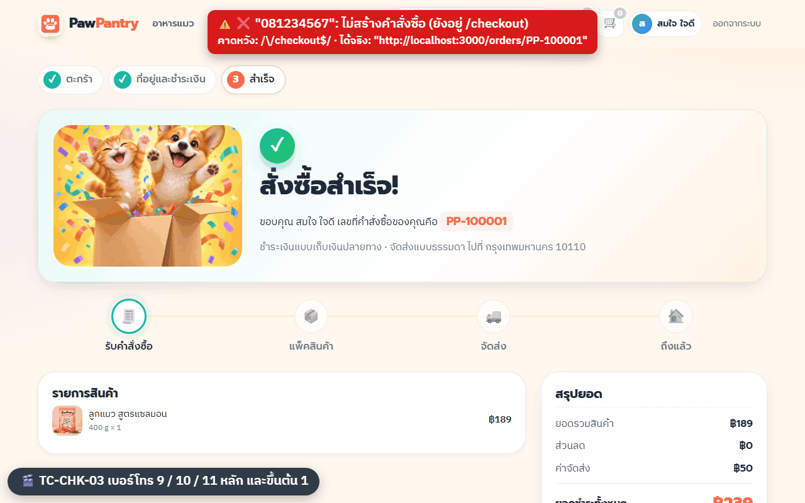

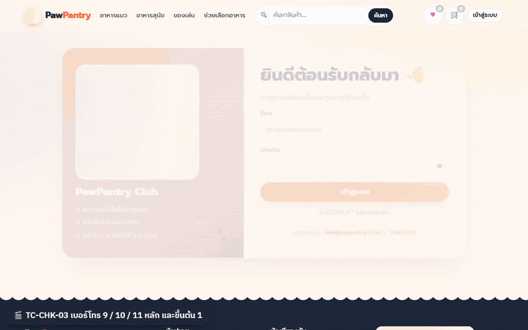

- ข้อความ error ของเว็บยังเขียน "10 หลัก" ทั้งที่รับ 9 หลัก → ใช้สอนว่า [O] ก็ขัดกันเองได้ → สัญญาณให้ถามทีม
- จุดอ่อนของ test: 1 test หลายข้อย่อยที่ข้อย่อยมีผลข้างเคียง (สร้างคำสั่งซื้อ) ควรแยก test ละค่า

### ส่วนที่ 2 · oracle (ถ้าลอกจากจอวันนี้)

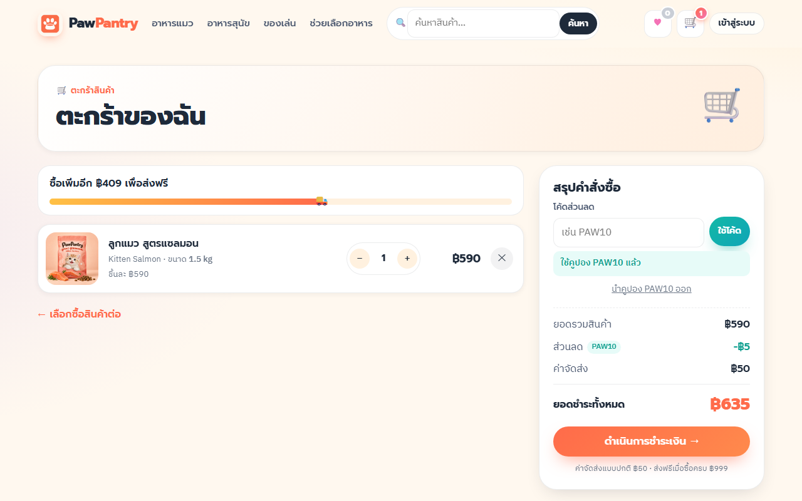

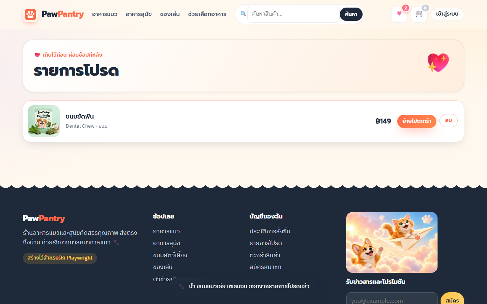

| ข้อที่มีบั๊ก | แผนเรา ([D]/[R]) | ถ้าลอกจากจอวันนี้ [O] |
|---|---|---|
| COUP-01 / 02 / 03 | ✅ จับได้ (PAW10 10% [D]) | ❌ จะเขียน "−฿5/฿635", "−฿15/฿1,575", "−฿7/฿842" |
| WISH-01 | ✅ จับได้ (♥ = จำนวนจริง [R]) | ❌ จะเขียน "♥ ค้าง 2" |
| CHK-03 | ✅ จับได้ (เบอร์มือถือ 10 หลัก [R]) | ❌ จะเขียน "9 หลักสั่งซื้อได้" |
| **รวม** | **5/5** | **0/5** |

จุดเสี่ยงที่ยังเหลือของแผนตัวอย่าง: ข้อที่ที่มาเป็น [O] อย่างเดียว (CHK-05 ที่อยู่ ≥ 10 ตัว, REG-02 รหัสผ่าน 8 ตัว) — ถ้าบั๊กอยู่ตรงนั้นแผนนี้จะพลาด

test ที่ BUG-HUNT แนะนำให้เพิ่ม: TC-COUP-11 (PAW10 ฿1,180 สั่งจนจบ) · แยก CHK-03 เป็น test ละค่า · CHK-08 เบอร์บ้าน 02 · WISH-02 / CART-07 (ตัวเลขหัวเว็บทันที) · COUP-12 NEWCAT50 ฿500 พอดี

---

## 5. แผนที่ดีควรมีอะไร

ใช้ตรวจแผนของผู้เรียน (ห้ามบอกผู้เรียนตรง ๆ ก่อน LAB 8)

### 5.1 test case 3 ข้อที่ต้องมี เพื่อจับบั๊กปริศนา

| ต้องมี | ทำไม | ข้อในแผนตัวอย่าง |
|---|---|---|
| คูปอง PAW10 **พร้อมยอดเป็นตัวเลข** ที่คำนวณจาก [D] | แค่ตรวจว่า "ใช้คูปองได้" จะไม่จับบั๊ก | TC-COUP-01/02/03 |
| ลบรายการโปรดแล้วเช็กตัวเลข ♥ **ทันที ไม่รีโหลด** | หลังรีโหลดตัวเลขถูก | TC-WISH-01 |
| Boundary เบอร์โทร **9 / 10 / 11 หลัก** และผลที่คาดหวัง "สั่งซื้อไม่ได้" | ถ้าลองแค่ 10 หลักจะผ่าน | TC-CHK-03 |

### 5.2 test case อื่นที่แผนดีควรมี (จากแผนตัวอย่าง 48 ข้อ)

| กลุ่ม | ข้อที่ควรมี | ID ในแผนตัวอย่าง |
|---|---|---|
| เข้าสู่ระบบ/สมัคร | login สำเร็จ · รหัสผิด/ตัวพิมพ์ผิด · ไม่ login ถูกพาไป `/login?next=/checkout` · logout แล้วเข้า `/account` ไม่ได้ · สมัครสำเร็จ · รหัสผ่าน 7/8 ตัว · อีเมลซ้ำ | AUTH-01–04 · REG-01–03 |
| ค้นหา/สินค้า | ค้นไทย/อังกฤษ/ตัวพิมพ์ใหญ่ · ค้นไม่เจอ · กรอง+เรียง · ราคาตามขนาด · สต็อกเหลือ 3 (พิมพ์ 4/0/−1) · สินค้าหมดกดไม่ได้ | SRCH-01–02 · CAT-01 · PROD-01–03 |
| ตะกร้า | ยอดเงิน + ค่าส่ง · เพิ่มเกินสต็อก · ลบ · รีโหลดแล้วยังอยู่ · ใส่ซ้ำเกินสต็อกแล้วข้อความต้องบอก · ซื้อคู่กัน | CART-01–06 |
| รายการโปรด/finder | ตัวเลข ♥ ทันที · finder ไม่มีสูตรไก่ | WISH-01 · FIND-01 |
| คูปอง | PAW10 3 ยอด (รวมเศษ ฿799) · FREESHIP · NEWCAT50 ฿499/฿534 · NEWCAT50 กับอาหารสุนัข/ของเล่นแมว · SUMMER20 หมดอายุ · โค้ดไม่มี · นำคูปองออก | COUP-01–10 |
| ค่าส่ง | ฿998 / ฿999 · ส่งด่วน · เปลี่ยนวิธีส่ง | SHIP-01–04 |
| ชำระเงิน | สั่งซื้อจนจบ · ฟอร์มว่าง 4 ช่อง · เบอร์ 9/10/11 + ขึ้นต้น 1 · รหัสไปรษณีย์ 4/5/6 · ที่อยู่ 9/10 · PromptPay + ส่งด่วน · สต็อกลดหลังสั่ง | CHK-01–07 |
| บัญชี | ประวัติ 2 คำสั่งซื้อ ยอดสะสม ฿1,138 | ACC-01 |
| ความปลอดภัย/อื่น ๆ | ผู้ใช้อื่นเปิดคำสั่งซื้อได้ 404 · XSS ในค้นหา/ชื่อ · แก้ตะกร้าใน localStorage · มือถือ 390px · 404 | SEC-01–03 · UI-01–02 |

### 5.3 คำถามดี ๆ ที่ควรเกิดใน LAB 3 (ทุกข้อเกิดในรอบถ่ายทำ)

PAW10 กับ ฿799 ได้ ฿79 หรือ ฿80 · ส่งด่วนเกิน ฿999 ฟรีไหม · NEWCAT50 นับของเล่น/ขนมแมวไหม · ใช้คูปองซ้อนได้ไหม · ตัวพิมพ์เล็ก `paw10` ใช้ได้ไหม

### 5.4 ตัวอย่างตะกร้าที่ขอบพอดี (ผู้เรียนมักหาไม่เจอ)

| ขอบ | ตะกร้า |
|---|---|
| ฿998 | ลูกบอลมีเสียง ฿199 + แมวโต สูตรไก่ 3 kg ฿799 |
| ฿999 | ไม้ตกแมว ฿129 + ชามกินช้า ฿290×3 |
| อาหารแมว ฿499 | เพาช์ทูน่า ฿35×2 + แมวสูงวัย ฿429 |
| อาหารแมว ฿534 | เพาช์ทูน่า ฿35×3 + แมวสูงวัย ฿429 |
| อาหารแมว ฿500 พอดี | **ทำไม่ได้** ด้วยอาหารเม็ด/เปียกล้วน (ได้ ฿499 / ฿501 / ฿503) ต้องใส่ขนมแมว ซึ่งชนคำถาม "NEWCAT50 นับขนมไหม" |

---

## 6. คะแนนรูบริกของแผนตัวอย่าง

จาก `_design/LAB6_RESULT.md` (ผู้สอนตรวจเอง) · E19–E20 เติมจากผล LAB 7–8

| # | เกณฑ์ | คะแนน | หลักฐาน |
|---|---|---|---|
| A1 | แผนผังเว็บครบ (รวม 404 + หน้าที่ต้อง login) | 1 | 13 หน้า + เมนูมือถือ |
| A2 | กฎทุกข้อติดป้าย [D]/[R]/[O] | 1 | 61 กฎ |
| A3 | คำถามถึงทีม ≥ 3 | 1 | 19 ข้อ |
| A4 | ไม่อ่านโค้ด petshop/ | 1 | ทุก LAB บันทึกไว้ |
| **B5** | เป้าหมายข้อเดียว + แหล่งผลที่คาดหวัง | **0** | แหล่งผลที่คาดหวังครบ แต่แถว "เป้าหมาย" รวม 4 เรื่อง (ให้แบบเข้มงวด ถ้าผ่อนให้ 1) |
| B6 | ทุกฟีเจอร์อยู่ฝั่งทดสอบ/ไม่ทดสอบ | 1 | F1–F22 ครบ |
| B7 | ขอบเขตเบราว์เซอร์ มือถือ API | 1 | หัวข้อ 2.2 |
| B8 | P1/P2/P3 ใช้ผลกระทบ | 1 | หัวข้อ 4 |
| C9 | ทุกฟีเจอร์มี test ≥ 1 | 1 | PLAN-REVIEW |
| C10 | ครบ 6 เทคนิค + P1 มี Happy + Neg/Boundary | 1 | PLAN-REVIEW |
| C11 | ผลที่คาดหวังตรวจได้ | 1 | หลังแก้ใน LAB 6 (ก่อนแก้ = 0) |
| C12 | ตัวเลขเงินมีวิธีคำนวณ | 1 | ทุกข้อเงิน |
| C13 | ค่าขอบเป็นคู่ | 1 | ยกเว้น NEWCAT50 ฿500 (บันทึกเป็นคำถามแล้ว) |
| C14 | ใช้ TEST-DATA ครบ | 1 | หัวข้อ 7.1 ครบ 10 แถว |
| C15 | ID เป็นระบบ ไม่ซ้ำ | 1 | 48 ID |
| D16 | Entry/Exit วัดได้ | 1 | P1 100% · รวม ≥ 95% |
| D17 | หัวข้อ 8 ทาย ≥ 5 แบบ | 1 | 14 แบบ |
| D18 | [O] ล้วน ≤ ~20% และอยู่ในคำถาม | 1 | 3/48 = 6.3% |
| E19 | แปลงเป็น Playwright ได้ + เว็บปกติผ่านเกณฑ์ | 1 | LAB 7: 46/48 ทุกเบราว์เซอร์ "ผ่านเกณฑ์" |
| E20 | โหมดบั๊กจับ ≥ 2/3 | 1 | LAB 8: จับ 3/3 |
| | **รวม** | **19/20 = ดีมาก** | ถ้าให้ B5 ผ่าน = 20/20 |

ถ้าให้คะแนน **ก่อน** รีวิวใน LAB 6: C11 = 0 · D16/D17 = 0 → 14/18 ("ใช้ได้") — แสดงว่ารีวิวช่วยยกระดับแผนจริง

---

## 7. ปัญหาที่เจอระหว่างทำจริง

| ปัญหา | เกิดที่ | วิธีรับมือ |
|---|---|---|
| Chrome ตั้ง display scaling 125% ทำให้ Playwright MCP คลิกพิกัดคลาด (checkbox/submit ไม่โดน) | สำรวจผ่าน Chrome จริง | ไม่ใช่บั๊กของเว็บ ตรวจ `devicePixelRatio` · ตั้ง scaling 100% หรือใช้ Playwright headless |
| MCP เขียน snapshot/console ลง `.playwright-mcp/` ในโฟลเดอร์งาน | LAB 2–3 | ใส่ใน `.gitignore` แล้ว (ที่ root ของบท) |
| console มี error จาก extension อื่นใน Chrome (`Search engine null is not supported`) | LAB 2 | ไม่ใช่ error ของเว็บ ให้ดูเฉพาะ error จาก localhost |
| `<html data-bug-mode="0">` มองเห็นได้ใน DOM | LAB 1–2 | เป็นใบ้ว่ามีโหมดบั๊ก ผู้สอนอาจซ่อนก่อน LAB 8 · ใช้เช็กโหมดปัจจุบันได้ |
| กด "ดำเนินการชำระเงิน" ตอนไม่ login แล้ว URL เปลี่ยนช้ากว่าการโหลดหน้า | LAB 2 | สคริปต์ต้องรอ URL `/login?next=/checkout` |
| สั่งซื้อสูตรลดก้อนขน 3 ชิ้น สินค้ากลายเป็น "หมด" | LAB 3 | `POST /api/test/reset` ก่อนสำรวจต่อ |
| `/api/test/reset` ไม่ล้างตะกร้า (อยู่ใน localStorage `pp-cart`) | LAB 3 | `localStorage.clear()` เอง |
| ตะกร้าอาหารแมว ฿500 พอดีทำไม่ได้ด้วยอาหารล้วน | LAB 4–6 | ใช้ ฿499 / ฿534 · ขอบ ฿500 รอทีมตอบเรื่องขนมแมว |
| Claude เรียก `GET /api/products` เพื่อหาชุดราคาขอบ | LAB 4, 6 | อยู่ในกติกา (ข้อมูลที่เว็บเปิดให้) ผู้สอนตัดสินใจได้ว่าจะอนุญาตไหม |
| Exit ≥ 95% ผ่านพอดี 46/48 (SRCH-01, CART-05 ล้มตั้งแต่เว็บปกติ) | LAB 7 | ถ้าข้อ P2/P3 ล้มเพิ่มแม้ 1 ข้อจะไม่ผ่าน — เตือนผู้เรียน |
| รันพร้อมกันหลาย worker แล้วข้อมูลชน | LAB 7 | `workers: 1` เพราะ reset ก่อนทุก test |
| Firefox `NS_BINDING_ABORTED` หลัง logout | LAB 7 | รอการเปลี่ยนหน้าก่อน `goto` (test เขียนผิด ไม่ใช่บั๊ก) |
| รันแค่บางข้อ (`-g`) แล้ว `index.html` ถูกเขียนทับเป็น "ยังตัดสินไม่ได้" | LAB 7 | รันเต็มอีกครั้งก่อนถ่ายภาพรายงาน |
| Git Bash แปลง `/path` เป็น `C:/Program Files/Git/...` | LAB 7 | ส่ง path ไม่มี `/` นำหน้า |
| `index.html` ของ LAB 7 ถูกเขียนทับด้วยรอบ LAB 8 | LAB 8 | ต้องการรายงาน "ผ่านเกณฑ์" ให้รันใหม่ที่ BUG_MODE=0 · ภาพ LAB 7 อยู่ที่ [img/report-summary.png](img/report-summary.png) |
| เขียน `triage.json` หลังรันจบ รายงานยังขึ้น EX4 ❌ | LAB 8 | รันซ้ำหลังเขียน triage (หรือ re-render จาก `data.json`) |
| TC-CHK-03 ใช้เวลา 2 นาทีต่อเบราว์เซอร์ในโหมดบั๊ก (หมดเวลา 120 วินาที) | LAB 8 | ปกติ — ข้อย่อยแรกสร้างคำสั่งซื้อไปแล้ว |
| ตอนเริ่ม LAB 8 container อยู่ใน BUG_MODE=1 อยู่แล้ว | LAB 8 | เช็ก `data-bug-mode` ทุกครั้งก่อนและหลัง LAB 8 · จบแล้วกลับเป็น 0 |

ภาพ LAB 7 (เว็บปกติ) สำหรับเทียบ:

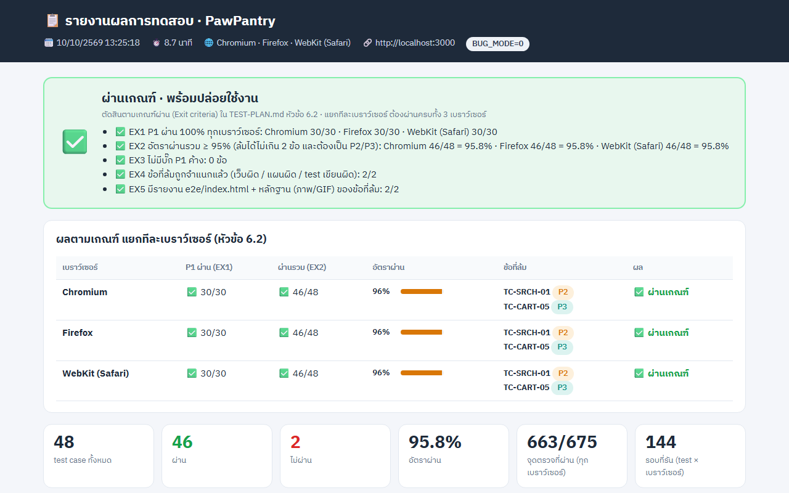

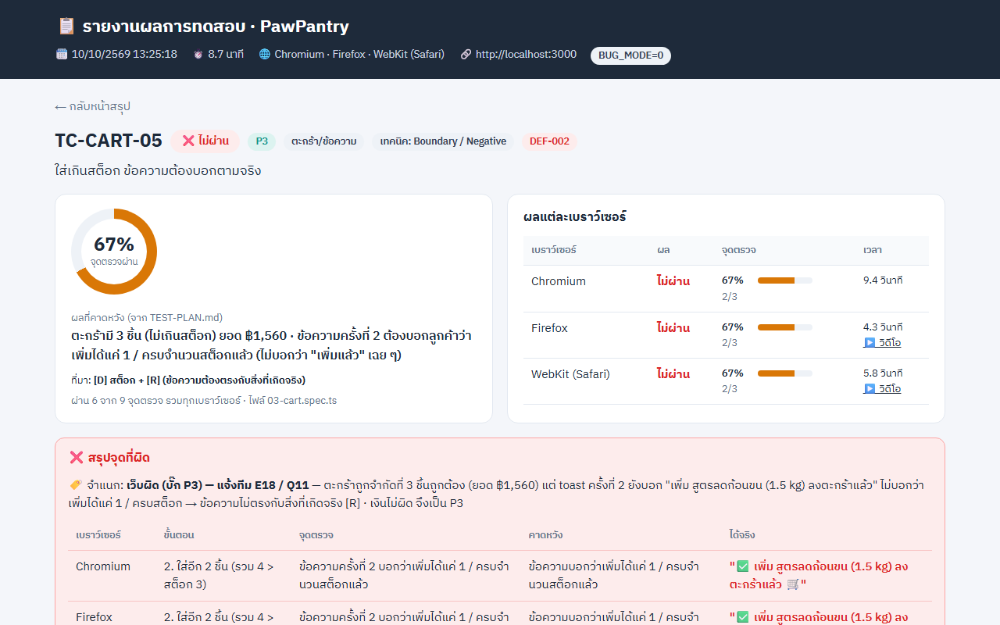

---

## 8. รัน `_solution/e2e` ซ้ำ

### 8.1 เปิดเว็บ

**PowerShell**
```powershell
cd petshop
docker compose up -d --build                       # โหมดปกติ (BUG_MODE=0)

$env:BUG_MODE = "1"; docker compose up -d          # เปิดโหมดบั๊ก (LAB 8)
Remove-Item Env:BUG_MODE; docker compose up -d     # กลับโหมดปกติ
```

**bash**
```bash
cd petshop
docker compose up -d --build        # โหมดปกติ (BUG_MODE=0)

BUG_MODE=1 docker compose up -d     # เปิดโหมดบั๊ก (LAB 8)
BUG_MODE=0 docker compose up -d     # กลับโหมดปกติ
```

เช็กโหมด: `docker exec petshop printenv BUG_MODE` หรือดู `<html data-bug-mode="...">` ในหน้าเว็บ

### 8.2 รัน test

```bash
cd _solution/e2e
npm install
npx playwright install
npx playwright test                       # 3 เบราว์เซอร์ (~9 นาทีที่เว็บปกติ · ~17 นาทีที่โหมดบั๊ก)
npx playwright test --project=chromium    # เร็วกว่า เฉพาะ Chromium
```

- test อ่าน `../TEST-PLAN.md` (คือ `_solution/TEST-PLAN.md`) เพื่อดึงระดับ ผลที่คาดหวัง และที่มา · reporter อ่าน `triage.json` ตอนจบการรัน
- เปิดรายงาน: ดับเบิลคลิก `_solution/e2e/index.html`
- ผลที่ควรได้: เว็บปกติ 46/48 ทุกเบราว์เซอร์ "ผ่านเกณฑ์" · โหมดบั๊ก 41/48 "ไม่ผ่านเกณฑ์"

### 8.3 ⚠️ รายงานที่เก็บไว้ถูกตัดให้เล็ก

`e2e/test-report/` เดิม ~97 MB ตัดเหลือ ~9.6 MB เพื่อเก็บใน git:

| เก็บไว้ | ตัดออก |
|---|---|
| `data.json` · ภาพวงแดงของ test ที่ล้มทั้ง 7 ข้อ ครบทุกเบราว์เซอร์ (45 ภาพ ลดสีให้ไฟล์เล็กลง) | MP4 ทั้งหมด |
| GIF ของ test ที่ล้ม 3 ข้อ: TC-COUP-01 · TC-WISH-01 · TC-CHK-03 (ตัดเหลือ 25 วินาทีแรก) | GIF ของ TC-COUP-02 · COUP-03 · SRCH-01 · CART-05 |
| GIF ของ test ที่ผ่าน 3 ข้อ: TC-AUTH-01 · TC-PROD-01 · TC-COUP-04 | GIF ของ test ที่ผ่านข้ออื่น ๆ |

GIF ที่เก็บไว้ลด fps/จำนวนสีลง เปิด `index.html` ได้ปกติ แต่วิดีโอ/GIF ที่ตัดออกจะขึ้นเป็นช่องว่างหรือภาพเสีย — **รัน `npx playwright test` ใหม่จะได้รายงานเต็มกลับมา**

`.gitignore` ที่ root ของบทกัน `_solution/e2e/node_modules/`, `test-results/`, `playwright-report/` และ `.playwright-mcp/` ไว้แล้ว
