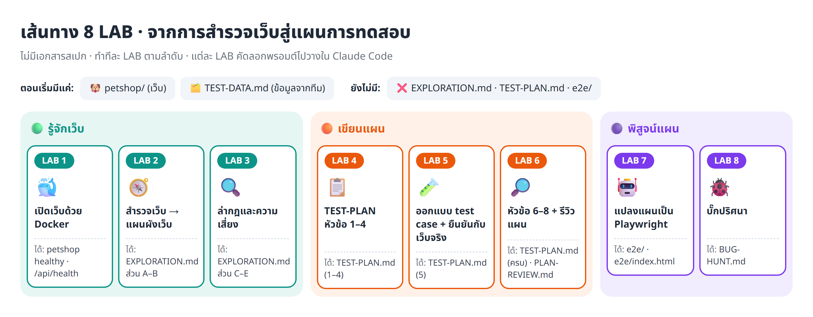

# ⚡ Fast Track · ทำบท 03 ครบ 8 LAB ด้วยประโยคเดียว

README หลัก ([../README.md](../README.md)) ให้ทำทีละ LAB: copy พรอมต์ → paste → รอผล → ทำซ้ำอีก 8 รอบ
ไฟล์นี้รวม **ทุกพรอมต์ไว้ในไฟล์เดียว** ให้ Claude Code อ่านแล้วทำต่อกันเองตั้งแต่เปิดเว็บจนถึงรายงานบั๊ก



---

## 🚀 วิธีใช้ (สำหรับผู้เรียน)

**1. เตรียมให้พร้อม** — Docker Desktop เปิดอยู่ · ทำบท 01 แล้ว · Claude Code ต่อ Playwright MCP ไว้ (`/mcp` เห็น `playwright`)

**2. เปิด Claude Code ที่โฟลเดอร์บท** (`03_petshop-testplan-from-exploration`) แล้วพิมพ์

```text
อ่าน fast_track/README.md แล้วทำตาม
```

**3. รอ** ราว 3–4 ชั่วโมง Claude จะทำ 6 ขั้นต่อกัน แล้วสรุปเป็นตารางให้ตอนจบ

| ขั้น | ตรงกับ LAB | ได้ไฟล์ (ที่โฟลเดอร์บท) |
|---|---|---|
| 1 เปิดเว็บ | 1 | เว็บ `localhost:3000` |
| 2 สำรวจ | 2–3 | `EXPLORATION.md` · `exploration/*.png` |
| 3 เขียนแผน | 4–6 | `TEST-PLAN.md` |
| 4 รีวิวแผน | 6 | `PLAN-REVIEW.md` |
| 5 Playwright | 7 | `e2e/` · `e2e/index.html` |
| 6 ล่าบั๊ก | 8 | `BUG-HUNT.md` |

**อยากเลือกเอง?** พิมพ์ตัวเลือกต่อท้ายประโยค

| อยากทำ | พิมพ์ |
|---|---|
| หยุดให้ดูผลทุกขั้น | `อ่าน fast_track/README.md แล้วทำตาม PAUSE=yes` |
| แค่สำรวจ + เขียนแผน | `อ่าน fast_track/README.md แล้วทำตาม TO=4` |
| ทำต่อจากขั้นที่ค้าง | `อ่าน fast_track/README.md แล้วทำตาม FROM=3` |
| ใช้เบราว์เซอร์เดียวให้เร็วขึ้น | `อ่าน fast_track/README.md แล้วทำตาม BROWSERS=chromium` |

**4. หลังจบ ดู 3 อย่างนี้**
- ข้อที่มี ⚠️ ในตารางสรุป คือเรื่องที่ Claude **ตัดสินแทนคุณ** ต้องอ่านเองว่าเห็นด้วยไหม
- เปิด `e2e/index-normal.html` (เว็บปกติ) เทียบกับ `e2e/index.html` (เว็บฝังบั๊ก)
- ให้คะแนนแผนด้วยรูบริกใน README หลัก แล้วค่อยเปิด `_solution/` เทียบ

> 💡 เรียนครั้งแรก แนะนำทำทีละ LAB ตาม README หลักก่อน เพราะทักษะจริงอยู่ที่การอ่านผลแล้วตัดสินใจเองในแต่ละขั้น

### หัวใจของบทที่ Claude ต้องรักษาไว้


ผลที่คาดหวังทุกข้อต้องมีที่มา **[D] TEST-DATA · [R] กฎทั่วไป · [O] เห็นจากเว็บ** และ **ห้ามลอกค่าจากหน้าจอไปเป็นผลที่คาดหวัง** (อบบั๊ก) — fast track ใช้กติกาเดียวกับ README หลักทุกข้อ

---
---

# 🤖 ส่วนสำหรับ Claude (คำสั่งที่ต้องทำ)

## 1. พารามิเตอร์

| ชื่อ | ค่าเริ่มต้น | ความหมาย |
|---|---|---|
| `FROM` | `1` | เริ่มขั้นไหน (1–6) |
| `TO` | `6` | จบขั้นไหน |
| `PAUSE` | `no` | `yes` = จบแต่ละขั้นแล้วรอผู้เรียนพิมพ์ "ต่อ" |
| `BROWSERS` | `chromium, firefox, webkit` | เบราว์เซอร์ในขั้น 5–6 |
| `RESTORE_NORMAL` | `yes` | จบขั้น 6 แล้วเปิดเว็บกลับเป็น `BUG_MODE=0` |

ก่อนเริ่ม พิมพ์ตารางพารามิเตอร์ที่ใช้จริง 1 ครั้ง

## 2. วิธีรัน

1. ทำขั้น `FROM` ถึง `TO` ในข้อ 5 **ทีละขั้นตามลำดับ** ห้ามข้าม ห้ามทำพร้อมกัน
2. ถ้ามีเครื่องมือ Agent ให้ส่งแต่ละขั้นให้ subagent ใหม่ 1 ตัว (แทน "เปิดเซสชันใหม่ทุก LAB") ด้วยข้อความ
   `อ่าน fast_track/README.md ส่วนสำหรับ Claude ข้อ 3–4 และ fast_track/STATE.md แล้วทำขั้น <เลข> ในข้อ 5 ให้ครบ รวมถึง gate และบันทึก STATE.md · พารามิเตอร์: <ค่าที่ใช้>`
   รอเสร็จก่อนส่งขั้นถัดไป · ถ้าไม่มี Agent ให้ทำเองในเซสชันนี้
3. **ส่งต่อค่าระหว่างขั้นผ่าน `fast_track/STATE.md`**
   - เริ่มรัน `FROM=1` และมีไฟล์เก่า → เปลี่ยนชื่อเป็น `STATE-<ปีเดือนวัน-เวลา>.md` ก่อน
   - `FROM` > 1 → เช็กว่าขั้นก่อนหน้า `DONE` และไฟล์ที่ต้องใช้มีอยู่จริง ไม่มี → บอกผู้เรียนแล้วหยุด
   - เริ่มแต่ละขั้น อ่าน STATE.md · จบแต่ละขั้น เพิ่มบล็อกนี้ท้ายไฟล์ (ห้ามลบของเดิม)
     ```text
     ## ขั้น <เลข> · <ชื่อ>
     status: DONE | BLOCKED
     outputs: <ไฟล์ที่สร้าง/แก้>
     numbers: <ตัวเลขสำคัญ>
     notes: <⚠️ หรือสิ่งที่ขั้นถัดไปต้องรู้>
     ```
4. จบแต่ละขั้น: `DONE` → บอกผู้เรียน 1–2 บรรทัดแล้วไปต่อ · gate ไม่ผ่าน → `BLOCKED` **หยุดทั้งหมด** บอกเหตุผล สิ่งที่ผู้เรียนต้องทำ และประโยคสำหรับรันต่อ (`… FROM=<เลข>`)
5. จบทั้งหมด → สรุปตามข้อ 6

## 3. กติกาทุกขั้น

1. **ห้ามเปิดอ่านโค้ดใน `petshop/`** เรียนรู้เว็บผ่าน Playwright MCP เท่านั้น (สั่ง `docker compose` และดู `data-testid` / ป้ายชื่อจากเบราว์เซอร์ได้)
2. **ห้ามเปิด `_solution/`**
3. **ผลที่คาดหวังต้องติดป้ายที่มา** [D] TEST-DATA.md · [R] กฎทั่วไป (เขียนเหตุผล) · [O] เห็นจากเว็บ — [O] ที่ไม่มี [D]/[R] ยืนยัน ใช้ `[O-ยังไม่ยืนยัน]` และส่งเป็นคำถามถึงทีม
4. **ตัวเลขเงินคำนวณเองก่อนเปิดเว็บ** ห้ามลอกจากหน้าจอ
5. **ไม่ตรงกับเว็บ → ห้ามแก้ผลที่คาดหวัง / test / แผนให้ผ่าน** ทำ ⚠️ แล้วจำแนก: เว็บผิด / แผนผิด / test เขียนผิด
6. **ไม่แน่ใจ → ห้ามเดา** ใช้ข้อ 4 ด้านล่าง หรือเขียนเป็นคำถามถึงทีม
7. ผลลัพธ์ทุกไฟล์เขียนที่ **โฟลเดอร์บท** (ไม่ใช่ใน `fast_track/`) · เขียนภาษาไทย เป็นตาราง
8. error จาก extension ของเบราว์เซอร์ไม่ใช่ error ของเว็บ ดูเฉพาะที่มาจาก `localhost:3000`
9. ข้อมูลเพี้ยน/สินค้าหมด → `POST http://localhost:3000/api/test/reset` แล้วล้าง localStorage ของ `localhost:3000`
10. คลิก MCP ช้าเกินไป เขียนสคริปต์ Playwright ชั่วคราวนอก `e2e/` ได้ แต่ต้องเช็กว่าสคริปต์ไม่ได้ทดสอบผิดวิธีก่อนสรุปว่า "ไม่ตรง"

## 4. การตัดสินใจล่วงหน้า (ใช้แทนการหยุดถามผู้เรียน · เขียนกำกับใน TEST-PLAN.md หัวข้อ 2)

| คำถาม | ตัดสินว่า |
|---|---|
| ทดสอบ API แยกไหม | ❌ ใช้ `/api/health` และ `/api/test/reset` เป็นเครื่องมือเท่านั้น |
| "แนะนำสำหรับคุณ" / "มักซื้อคู่กัน" | ❌ ไม่รู้สูตร ตรวจไม่ได้ (ลอกจากจอ = อบบั๊ก) |
| ตัวช่วยเลือกอาหาร | ✅ ตรวจแค่ "ผลตรงเงื่อนไขที่เลือก" ไม่ตรวจ "ตรงใจ %" |
| ฟอร์มรับข่าวสาร / ตัดเงิน PromptPay จริง | ❌ ไม่มีผลให้ตรวจ / เว็บจำลอง |
| ปัดเศษส่วนลด (฿799 × 10% = ฿79.9) | `[O-ยังไม่ยืนยัน]` + คำถามถึงทีม |
| เรื่องอื่นที่ไม่แน่ใจ | ไม่ทดสอบ (มีเหตุผล) หรือ `[O-ยังไม่ยืนยัน]` + คำถามถึงทีม · ไม่หยุดรอ |

## 5. ขั้นตอน

### ขั้น 1 · เปิดเว็บ (LAB 1)
1. ในโฟลเดอร์ `petshop` รัน `docker compose up -d --build` โดยตั้ง `BUG_MODE=0`
2. รอจน `docker compose ps` ขึ้น `(healthy)` (ไม่เกิน 5 นาที) · เรียก `GET /api/health` · เรียก `POST /api/test/reset`

✅ gate: container `petshop` healthy · `/api/health` ตอบ `{"ok":true}` (ไม่ผ่าน → บอกผู้เรียน เช่น เปิด Docker Desktop / พอร์ต 3000 ถูกใช้)
🧾 STATE: เวลา build · คำตอบ health · notes: "พร้อมทดสอบเมื่อ healthy และ health ตอบ {"ok":true}" (ใช้เขียน Entry)

### ขั้น 2 · สำรวจเว็บ → `EXPLORATION.md` (LAB 2–3)
**ตอน A สำรวจแบบลูกค้า**
1. กดทุกเมนู ปุ่มหลัก ลิงก์หัว/ท้ายเว็บ ให้ครบทุกหน้า (รวมตัวช่วยเลือกอาหาร · รายการโปรด · บัญชี · หน้า 404 · หมวดของเล่น/ของใช้)
2. งานหลัก 1 รอบ: ค้นหา → ดูสินค้า → ใส่ตะกร้า → คูปองจาก TEST-DATA.md → เข้าสู่ระบบด้วยบัญชีใน TEST-DATA.md → สั่งซื้อ
3. ลองจอมือถือ 390px 1 หน้า · จับภาพหน้าละ 1 รูปใน `exploration/` (เช่น `exploration/cart.png`)
4. เขียน **ส่วน A แผนผังเว็บ** (หน้า | URL | ไปถึงจากไหน | ต้องเข้าสู่ระบบไหม) · **ส่วน B ฟีเจอร์** (F1… | ฟีเจอร์ | หน้า | ลูกค้าทำอะไรได้ | ใส่ข้อมูลอะไรได้) · หัวข้อ **"ยังไม่รู้"**

**ตอน B ล่ากฎและความเสี่ยง** (reset + ล้าง localStorage ก่อน)
1. ทุกฟอร์ม (สมัคร · เข้าสู่ระบบ · ที่อยู่ · คูปอง): ส่งเปล่า ค่าผิด ค่าขอบ (เบอร์ 9/10/11 หลัก · รหัสไปรษณีย์ 4/5 หลัก · รหัสผ่าน 7/8 ตัว) · จดข้อความ error ตรงตัวอักษร
2. เงิน: ยอดรวม · คูปองทุกตัว · ค่าส่งธรรมดา/ด่วน ก่อน/หลัง ฿999 · ปัดเศษ — คำนวณเองก่อนแล้วเทียบ
3. ขีดจำกัด: สินค้าหมด · ใกล้หมด · เกินสต็อก · จำนวน 0/ติดลบ
4. สถานะ: รีโหลดแล้วตะกร้า/รายการโปรด/ตัวเลขหัวเว็บยังถูกไหม · ออกจากระบบแล้วเข้าหน้าชำระเงินได้ไหม
5. เขียน **ส่วน C กฎ** (R1… | กฎ | ที่ลอง | ผลที่เห็น | ที่มา) · **ส่วน D ความเสี่ยง** (ฟีเจอร์ | ถ้าพัง | P1/P2/P3 | เหตุผล — P1 ขายไม่ได้/เงินผิด/สิทธิ์ผิด · P2 ฟีเจอร์สำคัญผิดแต่ยังซื้อได้ · P3 แสดงผล/เกิดไม่บ่อย) · **ส่วน E คำถามถึงทีม** (E1… | คำถาม | ที่เห็นจากเว็บ | ทำไมต้องถาม) · ผลที่ขัด TEST-DATA หรือกฎทั่วไป → ⚠️

✅ gate: มีส่วน A–E ครบ · A มีหน้า 404 และหน้าที่ต้องเข้าสู่ระบบ · สั่งซื้อสำเร็จ · กฎทุกข้อมีป้าย · E ≥ 3 ข้อ · มีภาพทุกหน้า
🧾 STATE: จำนวนหน้า/ฟีเจอร์/กฎ (แยกป้าย)/ความเสี่ยง/คำถาม · เลขคำสั่งซื้อ · notes: กฎที่ ⚠️

### ขั้น 3 · เขียนแผน → `TEST-PLAN.md` ครบ 8 หัวข้อ (LAB 4–6)
หัวข้อ: 1 ภาพรวม · 2 ขอบเขต · 3 วิธีคิด test case · 4 ระดับความสำคัญ · 5 Test cases · 6 เกณฑ์ · 7 ข้อมูลทดสอบ · 8 คุณภาพของแผน
(ดูรูปแบบตารางจาก `../02_petshop-test-from-plan/TEST-PLAN.md` ได้ ห้ามลอกเนื้อหา · ห้ามเพิ่มฟีเจอร์ที่ไม่มีใน EXPLORATION.md)

1. **ภาพรวม**: เป้าหมาย (ประโยคเดียว) | ระบบที่ทดสอบ | เครื่องมือ | สิ่งที่ต้องส่ง | แหล่งของผลที่คาดหวัง ([D] > [R] > [O] · ไม่มีสเปก · ตัวเลขเงินคำนวณก่อนเปิดเว็บ)
2. **ขอบเขต**: ทดสอบ ✅ | ไม่ทดสอบ ❌ (มีเหตุผล) — ทุกฟีเจอร์ในส่วน B ต้องอยู่ฝั่งใดฝั่งหนึ่ง · ระบุเบราว์เซอร์ จอมือถือ 390×844 และ API · ใช้ข้อ 4
3. **วิธีคิด**: ครบ 6 เทคนิค Happy · Negative · Boundary · Equivalence partition · State · Security พร้อมตัวอย่างจากเว็บนี้
4. **ระดับ**: นิยาม P1/P2/P3 + คำถามจัดระดับ 3 ข้อ (ตอบ "ใช่" ข้อแรกแล้วหยุด)
5. **Test cases**: ID (`TC-<โมดูล>-<เลข>`) | โมดูล | สิ่งที่ทดสอบ | เทคนิค | ระดับ | ผลที่คาดหวัง | ที่มา
   - ทุกฟีเจอร์ ✅ มี ≥ 1 ข้อ · P1 มีทั้ง Happy และ Negative/Boundary · ใช้ครบ 6 เทคนิค · ใช้ TEST-DATA ทุกแถว
   - ผลที่คาดหวังตรวจได้ (ห้าม "แสดงถูกต้อง") · เงินแสดงวิธีคิด เช่น `฿189×2 + ส่ง ฿50 = ฿428` · ค่าขอบใช้คู่ เช่น ฿998/฿999 · test สถานะบอกว่าตรวจตอนไหน
   - **เขียนผลที่คาดหวังให้ครบก่อน** แล้วลองทุกข้อกับเว็บจริง → ตาราง ID | ผลที่คาดหวัง | เว็บจริง | ตรงไหม · ไม่ตรง → ⚠️ + บอกว่าเว็บผิดหรือแผนเข้าใจผิด เพราะอะไร
   - ข้อที่เป็น [O] อย่างเดียว → เพิ่มลง EXPLORATION.md ส่วน E
6. **เกณฑ์**: Entry (healthy + health ok · reset ได้ · เข้าสู่ระบบ demo ได้ · เบราว์เซอร์พร้อม) · Exit ทีละเบราว์เซอร์ (P1 ผ่าน 100% + ผ่านรวม ≥ X% **เป็นจำนวนข้อ** · ข้อที่ล้มต้องจำแนก · ล้มเพราะรอทีมตอบยังนับเป็นล้ม)
7. **ข้อมูลทดสอบ**: จาก TEST-DATA + ค่าที่ตั้งเอง พร้อม test case ที่ใช้
8. **คุณภาพ**: 8.1 "ถ้าเว็บพังแบบนี้ → test ไหนล้ม → ทำไมจับได้" ≥ 5 แบบ (จากส่วน D) + สิ่งที่แผนจับไม่ได้ · 8.2 จุดกำกวม | สมมติฐาน | ถ้าทีมตอบต่างต้องแก้ข้อไหน

✅ gate: ครบ 8 หัวข้อ · ทุกฟีเจอร์อยู่ในขอบเขต · ทุกข้อมีที่มาและตรวจได้ · ครบ 6 เทคนิค · มีตารางยืนยันกับเว็บ · 8.1 ≥ 5 แบบ
🧾 STATE: จำนวน test case (ระดับ/เทคนิค/ที่มา) · ตรงกับเว็บ X/Y · เกณฑ์ Exit เป็นจำนวนข้อ · notes: ข้อ ⚠️ พร้อมการจำแนก

### ขั้น 4 · รีวิวแผน → `PLAN-REVIEW.md` (LAB 6)
1. Coverage matrix: ฟีเจอร์ในขอบเขต × 6 เทคนิค · ช่อง = ID · ช่องที่ควรมีแต่ว่าง → ⚠️
2. นับตามระดับ / เทคนิค / ที่มา (บอก % `[O-ยังไม่ยืนยัน]` · ควร ≤ ~20%)
3. ตรวจทีละข้อ: ตรวจได้ไหม · กำกวมไหม · ซ้ำไหม · test สถานะบอกจังหวะไหม · มีฟีเจอร์ที่ยังไม่มี test ไหม
4. สรุป 3–5 ข้อที่ควรแก้ แล้ว **แก้ใน TEST-PLAN.md เลย** (อัปเดตจำนวนข้อในเกณฑ์ Exit ด้วย) · เรื่องที่ต้องให้ทีมตอบ → 8.2 + ส่วน E · ข้อที่เพิ่มตอนรีวิวทำเครื่องหมาย "เพิ่มตอนรีวิว"
5. ตารางก่อนรีวิว | หลังแก้ · คะแนนรูบริกข้อ 1–18 จาก README หลัก

✅ gate: PLAN-REVIEW.md ครบ 5 ข้อ · แก้จริง ≥ 3 ข้อ · ไม่มีผลที่คาดหวังที่ตรวจไม่ได้ · เกณฑ์ Exit ตรงกับจำนวน test case
🧾 STATE: จำนวนก่อน → หลัง · % [O] · คะแนนรูบริก · notes: ID ที่เพิ่ม/แก้ · ข้อที่คาดว่าจะล้มในขั้น 5

### ขั้น 5 · แปลงแผนเป็น Playwright → `e2e/` (LAB 7)
1. Playwright (TypeScript) ในโฟลเดอร์ `e2e` ครบทุกข้อในหัวข้อ 5 · ชื่อขึ้นต้นด้วยรหัส · แยกไฟล์ตามโมดูล · tag โมดูล/ระดับ · ผลที่คาดหวังใน annotation
2. หา element จาก `data-testid` หรือป้ายชื่อบนหน้าเว็บ (ดูด้วย MCP) · ใช้ตัวเลข/ข้อความตามแผนเท่านั้น
3. `test.step` ภาษาไทย · ตรวจด้วย `expect.soft`
4. ก่อนรันเช็ก health แล้ว reset · รันตาม `BROWSERS` · ถ้า reset ก่อนทุก test ใช้ `workers: 1`
5. GIF หลักฐานทุก test + รายงานหน้าเดียว `e2e/index.html` (เปิดได้ไม่ต้องมี server): กล่อง "ผ่าน/ไม่ผ่านเกณฑ์" ตามหัวข้อ 6 แยกเบราว์เซอร์ + ป้าย BUG_MODE · ตารางทุก test (รหัส · สิ่งที่ทดสอบ · ระดับ · เทคนิค · ที่มา · ผลแต่ละเบราว์เซอร์ · ภาพ/GIF) · การจำแนกข้อที่ล้มจาก `e2e/triage.json` (อ่านตอนจบการรัน)
   (ยืม helper/ตัวทำ GIF จาก `../02_petshop-test-from-plan/e2e/reporters/tester-report.ts` ได้ ห้ามคัดลอก test บท 02)
6. `npm install` · `npx playwright install` · `npx playwright test`
7. ข้อที่ล้ม: **test เขียนผิด** (เช่น `NS_BINDING_ABORTED` บน Firefox, selector ผิด) → แก้ test แล้วรันใหม่ · **เว็บผิด/แผนผิด** → บันทึกใน `triage.json` ห้ามแก้ให้ผ่าน
8. รันเต็มอีกรอบ (ไม่ใช้ `-g`) แล้วคัดลอก `e2e/index.html` เป็น `e2e/index-normal.html`

✅ gate: จำนวน test = จำนวน test case (แปลงไม่ได้ = ผลที่คาดหวังกำกวม → BLOCKED กลับไปขั้น 3–4) · รันครบทุกเบราว์เซอร์ · ข้อที่ล้มจำแนกครบ · ไม่มี "test เขียนผิด" ค้าง (ผลเกณฑ์ผ่านหรือไม่ผ่านก็ไปต่อได้ รายงานตามจริง)
🧾 STATE: ตารางต่อเบราว์เซอร์ (P1 ผ่าน · ผ่านรวม · % · ข้อที่ล้ม · ผลตามเกณฑ์) · เวลารัน · notes: ข้อที่ล้มในโหมดปกติ (baseline ขั้น 6)

### ขั้น 6 · ล่าบั๊กโหมดฝังบั๊ก → `BUG-HUNT.md` (LAB 8)
ห้ามอ่านโค้ด `petshop` เพื่อหาบั๊ก · ห้ามแก้ test หรือแผนให้ผ่าน

**ตอน A จับบั๊ก**
1. ในโฟลเดอร์ `petshop` ตั้ง `BUG_MODE=1` แล้ว `docker compose up -d` · รอ healthy · เช็กว่า `data-bug-mode` บนหน้าเว็บเป็น `1` (ไม่ใช่ → BLOCKED)
2. ใน `e2e` รัน `npx playwright test` เต็มทุกข้อ
3. แยกข้อที่ล้ม: **ข้อเดิม** (baseline ขั้น 5) / **ข้อใหม่** · ดูภาพวงแดงและ GIF · จำแนกข้อใหม่ · รวมข้อที่เป็นบั๊กตัวเดียวกัน
4. บันทึก `triage.json` แล้วสร้าง `index.html` ใหม่ให้ไม่มี "ยังไม่จำแนก"
5. `BUG-HUNT.md` ส่วนที่ 1: ตารางต่อเบราว์เซอร์ · รายงานบั๊กทีละตัว (ขั้นตอนทำซ้ำ · ผลที่คาดหวัง+ที่มา · ผลจริง · หลักฐาน · ความรุนแรง) · เทียบกับ TEST-PLAN.md 8.1 ว่าทายไว้ไหม · จับได้กี่ตัว

**ตอน B บทเรียนเรื่อง oracle**
1. ใช้ MCP ลองเว็บตอนนี้แบบเดียวกับส่วน C ของ EXPLORATION.md เฉพาะส่วนที่มี test ล้ม
2. สมมติว่าสำรวจวันนี้แล้วลอกจากจอเป็นผลที่คาดหวังทั้งหมด → ตาราง test case | ผลที่คาดหวังในแผนเรา (ที่มา) | ค่าที่จะลอกจากจอวันนี้ | ยังจับบั๊กได้ไหม
3. `BUG-HUNT.md` ส่วนที่ 2: [D]/[R] ช่วยอย่างไร · พลาดบั๊กตัวไหน เพราะอะไร (ขาดเทคนิค / ตรวจผิดจังหวะ / oracle อ่อน) · ควรเพิ่ม test case อะไร

**ตอน C** ถ้า `RESTORE_NORMAL=yes`: ตั้ง `BUG_MODE=0` แล้ว `docker compose up -d` · รอ healthy · เช็ก `data-bug-mode` เป็น `0`

✅ gate: รันในโหมดฝังบั๊กจริง · จำแนกครบ · BUG-HUNT.md มีทั้ง 2 ส่วน · (ถ้า RESTORE_NORMAL) กลับเป็นโหมดปกติแล้ว
🧾 STATE: ตารางต่อเบราว์เซอร์ · ข้อเดิม/ใหม่ · จำนวนบั๊ก P1/P2/P3 · ตรงกับ 8.1 กี่ตัว · แผนเราจับได้ X/Y เทียบลอกจากจอ X/Y · notes: test case ที่ควรเพิ่ม

## 6. สรุปท้ายรัน (พิมพ์ให้ผู้เรียน)

| ขั้น | สถานะ | ไฟล์ที่ได้ | ตัวเลขสำคัญ | ⚠️ ต้องดู |
|---|---|---|---|---|
| 1–6 | DONE / BLOCKED / ไม่ได้รัน | | | |

แล้วปิดด้วย: ผลตามเกณฑ์หัวข้อ 6 (โหมดปกติ · โหมดฝังบั๊ก) · คำถามถึงทีมที่ค้าง · ชวนให้คะแนนด้วยรูบริกใน README หลัก
