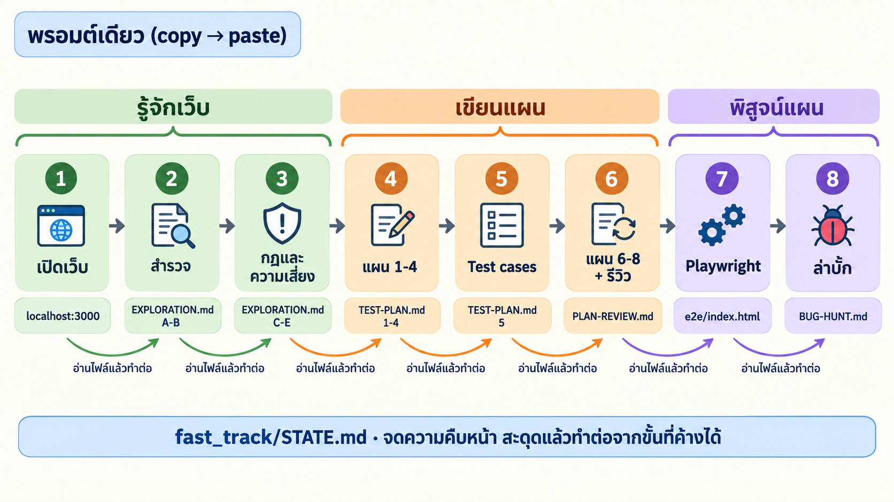

# ⚡ Fast Track · เขียนแผนการทดสอบเองจากการสำรวจเว็บ ในพรอมต์เดียว

งานเดียวกับบทเรียนหลักทั้ง 8 LAB แต่ไม่ต้อง copy พรอมต์ทีละ LAB วางพรอมต์ข้างล่างครั้งเดียว แล้ว Claude ทำต่อกันเองจนจบ


## 🧭 พรอมต์นี้ทำอะไรบ้าง

Claude ทำ 8 ขั้นต่อกัน แต่ละขั้นสร้างไฟล์ แล้ว **อ่านไฟล์นั้นก่อนทำขั้นถัดไป** และจดความคืบหน้าไว้ใน `fast_track/STATE.md` ถ้าสะดุดกลางทาง วางพรอมต์เดิมซ้ำได้เลย จะทำต่อจากขั้นที่ค้าง



## 🏷️ หัวใจที่พรอมต์บังคับไว้

ไม่มีสเปก จึงต้องบอกที่มาของ "ผลที่คาดหวัง" ทุกข้อ และ **ห้ามลอกค่าจากหน้าจอ** เพราะถ้าเว็บผิดอยู่แล้ว test จะผ่านทั้งที่ผิด


## 🚀 วิธีใช้

1. เปิด **Docker Desktop** และต่อ **Playwright MCP** ใน Claude Code ไว้ (`/mcp` เห็น `playwright`)
2. เปิด Claude Code ที่โฟลเดอร์ `03_petshop-testplan-from-exploration`
3. คัดลอกพรอมต์นี้ไปวาง แล้วรอราว 3–4 ชั่วโมง
4. จบแล้วอ่านตารางสรุป โดยเฉพาะช่อง ⚠️ และ "เรื่องที่ตัดสินแทนผม" ซึ่งเป็นจุดที่ Claude ตัดสินใจแทนคุณ

```text
ผมอยากทดสอบเว็บร้านอาหารสัตว์ PawPantry ในโฟลเดอร์ petshop แต่ไม่มีสเปกและไม่มีแผนการทดสอบ ทีมให้มาแค่ข้อมูลทดสอบหน้าเดียวใน TEST-DATA.md
ช่วยทำต่อกันให้จบทั้ง 8 ขั้นโดยไม่ต้องรอผม: เปิดเว็บ → สำรวจ → หากฎและความเสี่ยง → เขียนแผนเอง → ออกแบบ test case → รีวิวแผน → แปลงเป็น Playwright → พิสูจน์ว่าแผนจับบั๊กได้

กติกาที่ต้องถือตลอดทุกขั้น
- ห้ามเปิดอ่านโค้ดใน petshop และห้ามเปิดโฟลเดอร์ _solution ให้เรียนรู้เว็บจากหน้าจอผ่าน Playwright MCP เหมือนลูกค้าคนหนึ่ง (ดู data-testid หรือป้ายชื่อปุ่มจากเบราว์เซอร์ได้)
- ผลที่คาดหวังทุกข้อต้องบอกที่มา [D] มาจาก TEST-DATA.md · [R] กฎทั่วไปหรือคณิตศาสตร์ (เขียนเหตุผลกำกับ) · [O] เห็นจากเว็บอย่างเดียว ถ้า [O] ไม่มี [D] หรือ [R] ยืนยัน ให้เขียน [O-ยังไม่ยืนยัน] และตั้งเป็นคำถามถึงทีม
- ตัวเลขเงินต้องคำนวณเองจาก [D] และ [R] ก่อนเปิดเว็บ ห้ามลอกจากหน้าจอ เพราะถ้าเว็บผิดอยู่แล้ว test จะผ่านทั้งที่ผิด (อบบั๊กลงในผลที่คาดหวัง)
- ห้ามตัดสินว่าสิ่งที่เห็นบนหน้าจอถูกเสมอ ถ้าผลขัดกับ TEST-DATA หรือกฎทั่วไป หรือไม่ตรงกับที่คาดไว้ ห้ามแก้ผลที่คาดหวัง test หรือแผนให้ผ่าน ให้ทำ ⚠️ แล้วบอกว่าเว็บผิด แผนเข้าใจผิด หรือ test เขียนผิด เพราะอะไร (เช็กก่อนว่าไม่ได้ทดสอบผิดวิธี)
- ตรงไหนที่ปกติต้องถามผม ไม่ต้องหยุดรอ ให้ตัดสินแบบระมัดระวังแล้วจดไว้ในหัวข้อ "ตัดสินแทนผู้เรียน" เช่น API ใช้แค่ /api/health กับ /api/test/reset เป็นเครื่องมือ ไม่ทดสอบแยก · "แนะนำสำหรับคุณ" ไม่ทดสอบเพราะไม่รู้สูตร · ตัวช่วยเลือกอาหารตรวจแค่ว่าผลตรงเงื่อนไขที่เลือก · เรื่องอื่นที่ไม่แน่ใจให้ไม่ทดสอบพร้อมเหตุผล หรือตั้งเป็นคำถามถึงทีม
- ก่อนเริ่มแต่ละขั้นให้อ่านไฟล์ที่ได้จากขั้นก่อนหน้าจากดิสก์ใหม่ทุกครั้ง ไม่พึ่งความจำในแชต จบแต่ละขั้นจดลง fast_track/STATE.md ว่าขั้นไหนเสร็จ ได้ไฟล์อะไร ตัวเลขสำคัญ และเรื่องที่ตัดสินแทนผม ถ้ามีไฟล์นี้อยู่แล้วให้ทำต่อจากขั้นที่ค้าง
- เขียนทุกไฟล์เป็นภาษาไทย ใช้ตาราง เก็บไว้ที่โฟลเดอร์บท
- error จาก extension ของเบราว์เซอร์ไม่ใช่ error ของเว็บ ดูเฉพาะที่มาจาก localhost:3000
- ข้อมูลเพี้ยนหรือสินค้าหมดเพราะลองสั่งซื้อ ให้เรียก POST http://localhost:3000/api/test/reset แล้วล้าง localStorage ของ localhost:3000
- ถ้าติดจนทำต่อไม่ได้ (เช่น Docker ไม่เปิด หรือพอร์ต 3000 ถูกใช้) ให้หยุดแล้วบอกผมว่าต้องทำอะไร

ขั้นที่ 1 เปิดเว็บ
ในโฟลเดอร์ petshop รัน docker compose up -d --build (BUG_MODE=0) รอจน container petshop เป็น healthy แล้วเช็กว่า http://localhost:3000/api/health ตอบ {"ok":true} จดไว้ว่านี่คือเกณฑ์ว่าเว็บพร้อมทดสอบ

ขั้นที่ 2 สำรวจแบบลูกค้า → EXPLORATION.md ส่วน A–B
เริ่มที่หน้าแรก กดทุกเมนู ทุกปุ่มหลัก และลิงก์ในหัวและท้ายเว็บให้ครบทุกหน้า อย่าลืมหน้าที่ซ่อนอยู่ เช่น ตัวช่วยเลือกอาหาร รายการโปรด บัญชีและประวัติสั่งซื้อ หมวดของเล่นและของใช้ หน้า 404 กล่อง "มักซื้อคู่กัน" และ "แนะนำสำหรับคุณ"
ลองงานหลักของลูกค้า 1 รอบ: ค้นหา → ดูสินค้า → ใส่ตะกร้า → ใส่คูปองจาก TEST-DATA.md → เข้าสู่ระบบด้วยบัญชีใน TEST-DATA.md → สั่งซื้อให้สำเร็จ ลองจอมือถือกว้าง 390px 1 หน้า และจับภาพหน้าละ 1 รูปไว้ใน exploration/ ตั้งชื่อตามหน้า เช่น exploration/cart.png
ส่วน A แผนผังเว็บ: หน้า | URL | ไปถึงได้จากไหน | ต้องเข้าสู่ระบบไหม
ส่วน B รายการฟีเจอร์ (เลข F1, F2, …): ฟีเจอร์ | อยู่หน้าไหน | ลูกค้าทำอะไรได้ | ใส่ข้อมูลอะไรได้บ้าง
หน้าที่ไปไม่ถึงหรือไม่แน่ใจว่าทำอะไร ให้เขียนไว้ในหัวข้อ "ยังไม่รู้" อย่าเดา

ขั้นที่ 3 ล่ากฎและความเสี่ยง → EXPLORATION.md ส่วน C–E
reset ข้อมูลก่อน แล้วลองต่อด้วย Playwright MCP
1. ทุกฟอร์ม (สมัคร เข้าสู่ระบบ ที่อยู่จัดส่ง คูปอง): ส่งเปล่า ใส่ค่าผิด ใส่ค่าที่ขอบ เช่น เบอร์ 9/10/11 หลัก รหัสไปรษณีย์ 4/5 หลัก รหัสผ่าน 7/8 ตัว และจดข้อความ error ตรงตัวอักษร
2. ราคาและเงิน: ยอดรวม ส่วนลดของคูปองทุกตัวใน TEST-DATA.md ค่าส่งธรรมดาและด่วน ก่อนและหลังยอด ฿999 และการปัดเศษ (หาชุดสินค้าที่รวมได้พอดีขอบ เช่น ฿998 กับ ฿999)
3. ขีดจำกัด: สินค้าหมด สินค้าเหลือน้อย จำนวนเกินสต็อก จำนวน 0 หรือติดลบ
4. สถานะ: รีโหลดแล้วตะกร้า รายการโปรด และตัวเลขบนหัวเว็บยังถูกไหม ออกจากระบบแล้วยังเข้าหน้าชำระเงินได้ไหม
ส่วน C กฎที่พบ (เลข R1, …): กฎ | ตัวอย่างที่ลอง | ผลที่เห็น | ที่มา
ส่วน D ความเสี่ยง: ฟีเจอร์ | ถ้าพังจะเกิดอะไร | ระดับ | เหตุผล โดย P1 = ขายของไม่ได้ เงินผิด หรือสิทธิ์/ข้อมูลผิด · P2 = ฟีเจอร์สำคัญผิดแต่ยังซื้อได้ · P3 = การแสดงผลหรือกรณีเกิดไม่บ่อย
ส่วน E คำถามถึงทีม (เลข E1, …): สิ่งที่เว็บทำแต่เราไม่แน่ใจว่าถูก หรือ TEST-DATA ไม่ได้บอก อย่างน้อย 3 ข้อ

ขั้นที่ 4 เขียน TEST-PLAN.md หัวข้อ 1–4
แผนมี 8 หัวข้อ: 1 ภาพรวม · 2 ขอบเขต · 3 วิธีคิด test case · 4 ระดับความสำคัญ · 5 Test cases · 6 เกณฑ์ Entry/Exit · 7 ข้อมูลทดสอบ · 8 คุณภาพของแผน ถ้ามี ../02_petshop-test-from-plan/TEST-PLAN.md ดูรูปแบบตารางได้แต่ห้ามลอกเนื้อหา และห้ามเพิ่มฟีเจอร์ที่ไม่มีใน EXPLORATION.md
1. ภาพรวม: เป้าหมาย (ประโยคเดียว) | ระบบที่ทดสอบ (URL และวิธีเปิด) | เครื่องมือ | สิ่งที่ต้องส่ง | แหล่งของผลที่คาดหวัง (TEST-DATA.md + การสำรวจ ไม่มีสเปก เชื่อ [D] > [R] > [O])
2. ขอบเขต: ทดสอบ ✅ | ไม่ทดสอบ ❌ ทุกฟีเจอร์ในส่วน B ต้องอยู่ฝั่งใดฝั่งหนึ่ง ฝั่งไม่ทดสอบต้องมีเหตุผลในวงเล็บ และระบุเบราว์เซอร์ จอมือถือ และ API
3. วิธีคิด test case: เทคนิค | ความหมาย | ตัวอย่างจากเว็บนี้ ครบ 6 เทคนิค Happy path, Negative, Boundary, Equivalence partition, State, Security
4. ระดับความสำคัญ: นิยาม P1 P2 P3 ตามผลกระทบเมื่อพัง + คำถามจัดระดับ 3 ข้อ (ตอบ "ใช่" ข้อแรกแล้วหยุด)

ขั้นที่ 5 เขียนหัวข้อ 5 Test cases แล้วลองกับเว็บจริง
ตาราง ID | โมดูล | สิ่งที่ทดสอบ | เทคนิค | ระดับ | ผลที่คาดหวัง | ที่มา ใช้ ID แบบ TC-<โมดูล>-<เลข> เช่น TC-CART-01
- ทุกฟีเจอร์ฝั่งทดสอบต้องมีอย่างน้อย 1 ข้อ ฟีเจอร์ P1 ต้องมีทั้ง Happy และ Negative หรือ Boundary และใช้ครบ 6 เทคนิค
- ใช้ข้อมูลจาก TEST-DATA.md ครบทุกแถว (บัญชี คูปอง 4 ตัว ค่าส่ง สินค้าหมดและใกล้หมด) ค่าขอบใช้เป็นคู่ เช่น ฿998/฿999 สต็อก 3/4
- ผลที่คาดหวังต้องเป็นตัวเลขหรือข้อความที่ตรวจได้ ห้ามเขียน "แสดงถูกต้อง" เงินต้องแสดงวิธีคิด เช่น ฿189×2 + ส่ง ฿50 = ฿428 และ test เรื่องสถานะต้องบอกว่าตรวจตอนไหน (ทันที หรือหลังรีโหลด)
เขียนผลที่คาดหวังให้ครบทุกข้อก่อน แล้วค่อยลองทุกข้อกับเว็บจริง (จะเขียนสคริปต์ Playwright ชั่วคราวนอกโฟลเดอร์ e2e มาลองแทนการคลิกทีละข้อก็ได้) สรุปเป็นตาราง ID | ผลที่คาดหวัง | เว็บจริง | ตรงไหม ข้อที่ที่มาเป็น [O] อย่างเดียวให้เพิ่มลงคำถามถึงทีมในส่วน E

ขั้นที่ 6 เขียนหัวข้อ 6–8 แล้วรีวิวแผน → PLAN-REVIEW.md
6. เกณฑ์: เริ่มทดสอบได้เมื่อ container petshop เป็น healthy และ /api/health ตอบ {"ok":true} · ผ่านเกณฑ์เมื่อ P1 ผ่านทั้งหมด + อัตราผ่านรวมอย่างน้อยกี่ % (คิดเป็นจำนวนข้อด้วย) ตัดสินทีละเบราว์เซอร์ และข้อที่ล้มต้องจำแนกครบ
7. ข้อมูลทดสอบ: ข้อมูลจาก TEST-DATA.md + ค่าที่ตั้งเองในหัวข้อ 5 (เช่น เบอร์โทร อีเมลใหม่) พร้อมบอกว่าใช้กับ test case ไหน
8. คุณภาพของแผน: ตาราง "ถ้าเว็บพังแบบนี้ → test ข้อไหนต้องล้ม" อย่างน้อย 5 แบบ คิดจากความเสี่ยงในส่วน D และตาราง "จุดที่ยังกำกวม" จากคำถามถึงทีม พร้อมสมมติฐานที่แผนใช้
PLAN-REVIEW.md: ตาราง coverage ฟีเจอร์ในขอบเขต × 6 เทคนิค ช่องคือ ID ช่องที่ควรมีแต่ว่างให้ทำ ⚠️ · นับ test ตามระดับ เทคนิค และที่มา · ตรวจทีละข้อว่าผลที่คาดหวังตรวจได้ไหม กำกวมไหม ซ้ำไหม และมีฟีเจอร์ที่ยังไม่มี test ไหม · สรุป 3–5 ข้อที่ควรแก้แล้วแก้ใน TEST-PLAN.md เลย (อัปเดตจำนวนข้อในเกณฑ์ผ่านด้วย) · เช็กว่าข้อ [O-ยังไม่ยืนยัน] ไม่เกินราว 20% ของ test case ทั้งหมด

ขั้นที่ 7 แปลงแผนเป็น Playwright (TypeScript) ในโฟลเดอร์ e2e
1. test ครบทุกข้อในหัวข้อ 5 ชื่อขึ้นต้นด้วยรหัส แยกไฟล์ตามโมดูล ใส่ tag โมดูลและระดับ และใส่ผลที่คาดหวังจากแผนใน annotation
2. หา element จาก data-testid หรือป้ายชื่อที่เห็นบนหน้าเว็บ (ดูด้วย Playwright MCP) และใช้ตัวเลขและข้อความตามแผนเท่านั้น ห้ามเปลี่ยนตามที่เว็บแสดง
3. แบ่งขั้นตอนภาษาไทยด้วย test.step และตรวจด้วย expect.soft
4. ก่อนรันเช็ก /api/health แล้ว POST /api/test/reset รันบน Chromium, Firefox และ WebKit (ถ้า reset ก่อนทุก test ให้ใช้ workers: 1 เพราะ reset ล้างข้อมูลทั้งเว็บ)
5. ทำ GIF หลักฐานของทุก test และสร้างรายงานหน้าเดียว e2e/index.html ที่ดับเบิลคลิกเปิดได้โดยไม่ต้องมี server มีกล่องสรุป "ผ่านเกณฑ์ / ไม่ผ่านเกณฑ์" ตามหัวข้อ 6 แยกทีละเบราว์เซอร์ · ตารางทุก test case (รหัส · สิ่งที่ทดสอบ · ระดับ · เทคนิค · ที่มา · ผลแต่ละเบราว์เซอร์ · ลิงก์ภาพ/GIF) · ข้อที่ล้มแสดงการจำแนกที่อ่านจาก e2e/triage.json
   (ถ้ามี ../02_petshop-test-from-plan/e2e ยืม helper และตัวทำ GIF จาก reporters/tester-report.ts ได้ แต่ห้ามคัดลอก test ของบท 02)
6. ในโฟลเดอร์ e2e รัน npm install, npx playwright install แล้ว npx playwright test ข้อที่ล้มเพราะ test เขียนผิด (เช่น selector ผิด หรือ NS_BINDING_ABORTED บน Firefox เพราะเปลี่ยนหน้าเร็วเกินไป) ให้แก้ test ส่วนข้อที่เว็บผิดหรือแผนผิดให้บันทึกลง triage.json ถ้าข้อไหนแปลงเป็น test ไม่ได้ แปลว่าผลที่คาดหวังกำกวม ให้กลับไปแก้แผน
7. จำแนกครบแล้วรันเต็มอีกรอบ (ไม่ใช้ -g) เปิด e2e/index.html สรุปผลแยกตามเบราว์เซอร์ แล้วคัดลอกรายงานเก็บไว้เป็น e2e/index-normal.html ก่อนขั้นต่อไปจะเขียนทับ

ขั้นที่ 8 ล่าบั๊กปริศนา → BUG-HUNT.md
ส่วนที่ 1 จับบั๊ก: ในโฟลเดอร์ petshop ตั้ง BUG_MODE=1 แล้ว docker compose up -d รอจน healthy และเช็กว่า data-bug-mode บนหน้าเว็บเป็น 1 (ห้ามอ่านโค้ดเพื่อหาว่าบั๊กอยู่ไหน) แล้วรัน npx playwright test ชุดเดิมเต็มทุกข้อ แยกข้อที่ล้มเป็นข้อเดิม (ล้มตั้งแต่ขั้น 7) กับข้อใหม่ ดูภาพวงแดงและ GIF ว่าผิดตรงไหน จำแนกลง triage.json แล้วสร้าง index.html ใหม่ เขียนรายงานบั๊กแต่ละตัว (ขั้นตอนทำซ้ำ · ผลที่คาดหวังและที่มา · ผลจริง · หลักฐาน · ความรุนแรง) และเทียบกับหัวข้อ 8 ของแผนว่าทายไว้ถูกไหม
ส่วนที่ 2 บทเรียนเรื่อง oracle: ใช้ Playwright MCP ลองเว็บตอนนี้ซ้ำแบบเดียวกับส่วน C (ฟอร์มเปล่า ค่าผิด ค่าขอบ คิดยอดเงิน) เฉพาะส่วนที่มี test ล้ม แล้วสมมติว่าเราสำรวจวันนี้แทนวันแรกและลอกผลจากหน้าจอเป็นผลที่คาดหวังทั้งหมด ทำตาราง test case | ผลที่คาดหวังในแผนเรา (ที่มา) | ค่าที่จะลอกจากหน้าจอวันนี้ | ยังจับบั๊กได้ไหม สรุปว่า [D] และ [R] ช่วยเราอย่างไร แผนพลาดบั๊กตัวไหน เพราะอะไร และควรเพิ่ม test case อะไร
เสร็จแล้วเปิดเว็บกลับเป็น BUG_MODE=0 และเช็กว่า data-bug-mode เป็น 0

จบแล้วสรุปเป็นตาราง ขั้น | ไฟล์ที่ได้ | ตัวเลขสำคัญ | ⚠️ ต้องดู ตามด้วยผลตามเกณฑ์หัวข้อ 6 ทั้งโหมดปกติและโหมดฝังบั๊ก แผนจับบั๊กได้กี่ตัว คำถามถึงทีมที่ยังค้าง และเรื่องที่ตัดสินแทนผมทั้งหมด
```
