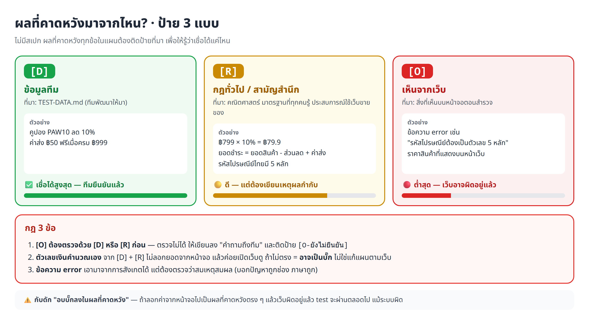

# ⚡ Fast Track · เขียนแผนการทดสอบเองจากการสำรวจเว็บ ในพรอมต์เดียว

งานเดียวกับ [บทเรียนหลัก](../README.md) ทั้ง 8 LAB แต่วางพรอมต์ **ครั้งเดียว** แล้ว Claude ทำต่อกันเองจนจบ (ราว 3–4 ชั่วโมง)


## 🧭 พรอมต์ทำอะไรบ้าง

Claude ทำ 8 ขั้นต่อกัน แต่ละขั้นสร้างไฟล์ แล้ว **อ่านไฟล์นั้นก่อนทำขั้นถัดไป** ถ้าสะดุดกลางทาง วางพรอมต์เดิมซ้ำได้เลย Claude จะดูจากไฟล์ที่มีอยู่แล้วทำต่อจากขั้นที่ค้าง


## 🏷️ หัวใจที่พรอมต์บังคับไว้

ไม่มีสเปก จึงต้องบอกที่มาของ "ผลที่คาดหวัง" ทุกข้อ และ **ห้ามลอกค่าจากหน้าจอ** เพราะถ้าเว็บผิดอยู่แล้ว test จะผ่านทั้งที่ผิด ([อบบั๊ก](../README.md#4-กับดัก-อย่าอบบั๊กลงในผลที่คาดหวัง-baking-the-bug-in)) ยอดเงินทุกข้อจึงต้องคำนวณเองก่อนเปิดเว็บ



## 🔀 เลือกพรอมต์ 1 จาก 2 แบบ

ทั้งสองแบบทำ 8 ขั้นเหมือนกัน ใช้กติกาเดียวกัน ได้ไฟล์ชุดเดียวกัน ต่างกันแค่ **Claude รู้อะไรเกี่ยวกับเว็บก่อนลงมือสำรวจ**


| | 🅰️ บอกใบ้ | 🅱️ ไม่บอกใบ้ (black-box จริง) |
|---|---|---|
| เหมือน | ครูกระซิบว่า "เว็บนี้มีหน้าลับ ลองดูตรงนี้" | tester ได้เว็บใหม่ ไม่มีใครเล่าอะไรให้ฟัง |
| Claude รู้ | ชื่อหน้าที่ซ่อน ชื่อฟอร์ม ค่าขอบ จุดน่าสงสัย (จากบทเรียนหลัก) | แค่ TEST-DATA.md กับกฎทั่วไปของเว็บขายของ |
| ผลที่น่าจะได้ | ครบใกล้บทเรียน เทียบ `_solution/` ง่าย | อาจหาหน้าได้ไม่ครบ ป้าย [O-ยังไม่ยืนยัน] มากกว่า |
| ใช้กับเว็บอื่น | ไม่ได้ (เบาะแสผูกกับเว็บนี้) | ได้ เปลี่ยนแค่ชื่อโฟลเดอร์และ TEST-DATA |
| เหมาะกับ | ทำครั้งแรก · สาธิตในห้อง | ฝึกสำรวจจริง · วัดว่าการสำรวจเองได้ผลแค่ไหน |

> 💡 สอนในห้อง: รัน 🅰️ เป็นตัวอย่างก่อน แล้วลอง 🅱️ แล้วเทียบผล จะเห็นชัดว่าเบาะแสช่วยตรงไหน

<details>
<summary>ดูว่าพรอมต์สองแบบต่างกันตรงไหนบ้าง (ทีละขั้น)</summary>

| จุด | 🅰️ บอกใบ้ | 🅱️ ไม่บอกใบ้ |
|---|---|---|
| กติกาข้อแรก | — | ใช้ข้อมูลได้แค่ 3 แหล่ง ห้ามใช้ความรู้เดิม ห้ามอ่าน README ของบท |
| ขั้น 2 หาหน้า | บอกชื่อหน้าซ่อน เช่น ตัวช่วยเลือกอาหาร รายการโปรด "มักซื้อคู่กัน" | บอกแค่วิธีหา: กดทุกลิงก์ทุกไอคอนจนไม่เจอหน้าใหม่ ลอง URL ที่ไม่มีจริง |
| ขั้น 2 ลองซื้อ | บอกลำดับ ค้นหา → ตะกร้า → คูปอง → เข้าสู่ระบบ → สั่งซื้อ | "ใช้สิ่งที่เว็บมีให้" |
| ขั้น 3 ฟอร์ม/ค่าขอบ | บอกชื่อ 4 ฟอร์ม และตัวเลขขอบ เช่น รหัสผ่าน 7/8 ตัว | ทุกฟอร์มที่เจอ ใช้กฎทั่วไปหรือเงื่อนไขที่หน้าจอบอก (N-1 / N) |
| ขั้น 3 เงิน/สถานะ | ชี้ ฿799 × 10% = ฿79.9 · บอกว่ามีรายการโปรด | ดูการปัดเศษ "เมื่อส่วนลดมีเศษ" · "สิ่งที่เว็บจำไว้ให้ลูกค้า" |
| ตัดสินแทนผู้เรียน | ระบุชื่อฟีเจอร์ที่ไม่ทดสอบ | เป็นหลักการทั่วไป เช่น ฟีเจอร์ที่ใช้สูตรที่เราไม่รู้ "ถ้าเจอ" ไม่ทดสอบ |
| ขั้น 5–7 | ตัวอย่างใช้ราคาจริง (฿189×2 + ฿50 = ฿428) · บอก error `NS_BINDING_ABORTED` | ตัวอย่างเป็นสูตรทั่วไป · อธิบาย error แบบทั่วไป |

**เหมือนกันทุกตัวอักษร:** ป้าย [D] [R] [O] · ห้ามลอกยอดเงินจากหน้าจอ · ผลไม่ตรงห้ามแก้ให้ผ่าน · ห้ามอ่านโค้ด `petshop` และห้ามเปิด `_solution` · ขั้น 4–8 เกือบทั้งหมด · ตารางสรุปตอนจบ

</details>

## 🚀 วิธีใช้

1. เตรียมให้พร้อม: ทำ [บท 01](../../01_playwright-install) แล้ว (มี Node.js + เบราว์เซอร์ Playwright) · เปิด **Docker Desktop** · Claude Code ต่อ **Playwright MCP** ไว้ (`/mcp` เห็น `playwright`) · (แนะนำ) ทำบท 02 แล้ว ขั้น 7 จะยืม helper มาใช้ได้
2. เปิด Claude Code ที่โฟลเดอร์ `03_petshop-testplan-from-exploration` ในเซสชันใหม่
3. คัดลอกพรอมต์ 🅰️ หรือ 🅱️ ไปวาง แล้วรอ (ตั้งเครื่องไม่ให้หลับ เพราะใช้เวลาหลายชั่วโมง)
4. จบแล้วตรวจผลตามหัวข้อ ✅ ข้างล่าง

> 🔁 จะรันอีกแบบต่อจากแบบแรก ให้ย้ายไฟล์ผลลัพธ์เดิม (`EXPLORATION.md` `TEST-PLAN.md` `PLAN-REVIEW.md` `BUG-HUNT.md` `e2e/` `exploration/`) ไปเก็บที่อื่นก่อน ไม่อย่างนั้น Claude จะคิดว่าทำเสร็จแล้ว

## ✅ จบแล้วตรวจอะไร

1. **ตารางสรุปท้ายแชต** ดูช่อง ⚠️ และ "เรื่องที่ตัดสินแทนผม" ก่อน เพราะเป็นจุดที่ Claude ตัดสินใจแทนคุณ
2. **สุ่มตรวจ TEST-PLAN.md 2–3 ข้อเรื่องเงิน** ต้องมีวิธีคิดกำกับ (เช่น ฿189×2 + ส่ง ฿50 = ฿428) ไม่ใช่ตัวเลขลอย ๆ ที่ลอกจากจอ
3. **เปิดรายงาน 2 ไฟล์** `e2e/index-normal.html` (เว็บปกติ ควรผ่านเกณฑ์) และ `e2e/index.html` (โหมดฝังบั๊ก ควรไม่ผ่านเกณฑ์)
4. **ให้คะแนนแผน** ด้วย[รูบริก 20 ข้อ](../README.md#-รูบริก-เช็กลิสต์-แผนการทดสอบที่ดี) แล้วค่อยเปิด `_solution/` เทียบ

ตัวเลขจากการทำจริงในบทเรียนหลัก ใช้เป็นจุดเทียบ (ของคุณไม่จำเป็นต้องตรง แต่ควรอยู่ในระดับใกล้กัน)

| ขั้น | ไฟล์ | บทเรียนหลักได้ |
|---|---|---|
| 2–3 | `EXPLORATION.md` | 13 หน้า · 22 ฟีเจอร์ · กฎ 61 ข้อ · คำถามถึงทีม 14+ ข้อ |
| 4–6 | `TEST-PLAN.md` `PLAN-REVIEW.md` | 48 test case (P1 30) · [O-ยังไม่ยืนยัน] ราว 6% |
| 7 | `e2e/index-normal.html` | ผ่านเกณฑ์แบบพอดีขอบ 46/48 ทุกเบราว์เซอร์ |
| 8 | `BUG-HUNT.md` | ไม่ผ่านเกณฑ์ · จับบั๊กได้ 3/3 · ถ้าลอกค่าจากจอจะจับได้ 0/5 |

## 🆘 ถ้าสะดุด

| อาการ | ทำอะไร |
|---|---|
| แชตหลุด หรือ Claude หยุดกลางทาง | เปิดเซสชันใหม่ วางพรอมต์เดิมซ้ำ Claude จะทำต่อจากขั้นที่ค้าง |
| Claude จะเปิดโค้ดใน `petshop` หรือ `_solution` | `หยุดก่อน ห้ามอ่านโค้ดใน petshop และห้ามเปิด _solution ให้เรียนรู้จากหน้าเว็บผ่าน Playwright MCP เท่านั้น` |
| รายงานขึ้น "ยังตัดสินไม่ได้" | `รัน npx playwright test เต็มทุกข้ออีกครั้ง (ไม่ใช้ -g) แล้วเปิด e2e/index.html` |
| จบแล้วเว็บยังเป็นโหมดฝังบั๊ก | `ช่วยเปิดเว็บกลับเป็นโหมดปกติ BUG_MODE=0 แล้วเช็กว่า data-bug-mode เป็น 0` |

อาการอื่นดู[ตารางแก้ปัญหาในบทเรียนหลัก](../README.md#ถ้าเจอปัญหา-คัดลอกพรอมต์นี้)

---

## 🅰️ พรอมต์แบบบอกใบ้ (ตามบทเรียนหลัก)

```text
ผมอยากทดสอบเว็บร้านอาหารสัตว์ PawPantry ในโฟลเดอร์ petshop แต่ไม่มีสเปกและไม่มีแผนการทดสอบ ทีมให้มาแค่ข้อมูลทดสอบหน้าเดียวใน TEST-DATA.md
ช่วยทำต่อกันให้จบทั้ง 8 ขั้นโดยไม่ต้องรอผม: เปิดเว็บ → สำรวจ → หากฎและความเสี่ยง → เขียนแผนเอง → ออกแบบ test case → รีวิวแผน → แปลงเป็น Playwright → พิสูจน์ว่าแผนจับบั๊กได้

กติกาที่ต้องถือตลอดทุกขั้น
- ห้ามเปิดอ่านโค้ดใน petshop และห้ามเปิดโฟลเดอร์ _solution ให้เรียนรู้เว็บจากหน้าจอผ่าน Playwright MCP เหมือนลูกค้าคนหนึ่ง (ดู data-testid หรือป้ายชื่อปุ่มจากเบราว์เซอร์ได้)
- ผลที่คาดหวังทุกข้อต้องบอกที่มา [D] มาจาก TEST-DATA.md · [R] กฎทั่วไปหรือคณิตศาสตร์ (เขียนเหตุผลกำกับ) · [O] เห็นจากเว็บอย่างเดียว ถ้า [O] ไม่มี [D] หรือ [R] ยืนยัน ให้เขียน [O-ยังไม่ยืนยัน] และตั้งเป็นคำถามถึงทีม
- ราคาสินค้าแต่ละชิ้นอ่านจากเว็บได้ แต่ยอดรวม ส่วนลด ค่าส่ง และยอดชำระ ต้องคำนวณเองจาก [D] และ [R] ก่อนดูตัวเลขบนเว็บ ห้ามลอกจากหน้าจอ เพราะถ้าเว็บผิดอยู่แล้ว test จะผ่านทั้งที่ผิด (อบบั๊กลงในผลที่คาดหวัง)
- ห้ามตัดสินว่าสิ่งที่เห็นบนหน้าจอถูกเสมอ ถ้าผลขัดกับ TEST-DATA หรือกฎทั่วไป หรือไม่ตรงกับที่คาดไว้ ห้ามแก้ผลที่คาดหวัง test หรือแผนให้ผ่าน ให้ทำ ⚠️ แล้วบอกว่าเว็บผิด แผนเข้าใจผิด หรือ test เขียนผิด เพราะอะไร (เช็กก่อนว่าไม่ได้ทดสอบผิดวิธี)
- ตรงไหนที่ปกติต้องถามผม ไม่ต้องหยุดรอ ให้ตัดสินแล้วจดไว้ใต้หัวข้อ "ตัดสินแทนผู้เรียน" ในไฟล์ที่กำลังเขียนในขั้นนั้น ดังนี้: API ใช้แค่ /api/health กับ /api/test/reset เป็นเครื่องมือ ไม่ทดสอบแยก · "แนะนำสำหรับคุณ" และ "มักซื้อคู่กัน" ไม่ทดสอบ เพราะไม่รู้สูตร ถ้าลอกจากจอจะอบบั๊ก · ตัวช่วยเลือกอาหารตรวจแค่ว่าผลตรงเงื่อนไขที่เลือก ไม่ตรวจ "ตรงใจ %" · ฟอร์มรับข่าวสารและการจ่ายเงิน PromptPay จริงไม่ทดสอบ (ไม่มีผลให้ตรวจ / เว็บจำลอง) · การปัดเศษส่วนลดเป็น [O-ยังไม่ยืนยัน] และถามทีม · เรื่องอื่นที่ไม่แน่ใจให้ไม่ทดสอบพร้อมเหตุผล หรือตั้งเป็นคำถามถึงทีม
- ตอนเริ่มให้ดูว่าในโฟลเดอร์บทมีผลลัพธ์ของขั้นไหนครบแล้วบ้าง โดยเปิดดูหัวข้อในไฟล์จริง (EXPLORATION.md มีส่วน A–B / C–E ไหม · TEST-PLAN.md มีหัวข้อ 1–4 / 5 / 6–8 ไหม · PLAN-REVIEW.md · e2e/index-normal.html · BUG-HUNT.md) ถ้ายังไม่มีเลยให้เริ่มขั้นที่ 1 ถ้ามีบางส่วนแปลว่าเคยทำค้างไว้ ให้เช็กว่าเว็บเปิดอยู่ในโหมดที่ขั้นนั้นต้องใช้ แล้วทำต่อจากขั้นแรกที่ยังไม่เสร็จ
- ก่อนเริ่มแต่ละขั้นให้อ่านไฟล์ที่ได้จากขั้นก่อนหน้าจากดิสก์ใหม่ทุกครั้ง ไม่พึ่งความจำในแชต
- เขียนทุกไฟล์เป็นภาษาไทย ใช้ตาราง เก็บไว้ที่โฟลเดอร์บท
- error จาก extension ของเบราว์เซอร์ (เช่น Search engine null is not supported) ไม่ใช่ error ของเว็บ ดูเฉพาะที่มาจาก localhost:3000
- ข้อมูลเพี้ยนหรือสินค้าหมดเพราะลองสั่งซื้อ ให้เรียก POST http://localhost:3000/api/test/reset แล้วล้าง localStorage ของ localhost:3000 (ตะกร้าเก็บในเบราว์เซอร์ reset ไม่ล้างให้)
- ถ้าติดจนทำต่อไม่ได้ (เช่น Docker ไม่เปิด หรือพอร์ต 3000 ถูกใช้) ให้หยุดแล้วบอกผมว่าต้องทำอะไร

ขั้นที่ 1 เปิดเว็บ
ในโฟลเดอร์ petshop รัน docker compose up -d --build โดยตั้ง BUG_MODE=0 (โหมดปกติ) รอจน container petshop เป็น healthy (Docker เช็กทุก 10 วินาที) แล้วเช็กว่า http://localhost:3000/api/health ตอบ {"ok":true} จดไว้ว่านี่คือเกณฑ์ว่าเว็บพร้อมทดสอบ จากนั้นเปิด http://localhost:3000 ดูหน้าแรก

ขั้นที่ 2 สำรวจแบบลูกค้า → EXPLORATION.md ส่วน A–B
เริ่มที่หน้าแรก กดทุกเมนู ทุกปุ่มหลัก และลิงก์ในหัวและท้ายเว็บให้ครบทุกหน้า อย่าลืมหน้าที่ซ่อนอยู่ เช่น ตัวช่วยเลือกอาหาร รายการโปรด บัญชีและประวัติสั่งซื้อ หมวดของเล่นและของใช้ เมนูมือถือ หน้า 404 กล่อง "มักซื้อคู่กัน" และ "แนะนำสำหรับคุณ"
ลองงานหลักของลูกค้า 1 รอบ: ค้นหา → ดูสินค้า → ใส่ตะกร้า → ใส่คูปองจาก TEST-DATA.md → เข้าสู่ระบบด้วยบัญชีใน TEST-DATA.md → สั่งซื้อให้สำเร็จ ลองจอมือถือกว้าง 390px 1 หน้า และจับภาพหน้าละ 1 รูปไว้ใน exploration/ ตั้งชื่อตามหน้า เช่น exploration/cart.png
ส่วน A แผนผังเว็บ: หน้า | URL | ไปถึงได้จากไหน | ต้องเข้าสู่ระบบไหม
ส่วน B รายการฟีเจอร์ (เลข F1, F2, …): ฟีเจอร์ | อยู่หน้าไหน | ลูกค้าทำอะไรได้ | ใส่ข้อมูลอะไรได้บ้าง
จดด้วยว่าเว็บมี API อะไรให้เห็นบ้าง หน้าที่ไปไม่ถึงหรือไม่แน่ใจว่าทำอะไร ให้เขียนไว้ในหัวข้อ "ยังไม่รู้" อย่าเดา

ขั้นที่ 3 ล่ากฎและความเสี่ยง → EXPLORATION.md ส่วน C–E
อ่าน EXPLORATION.md ส่วน A–B ก่อน reset ข้อมูล แล้วลองต่อด้วย Playwright MCP
1. ทุกฟอร์ม (สมัคร เข้าสู่ระบบ ที่อยู่จัดส่ง คูปอง): ส่งเปล่า ใส่ค่าผิด ใส่ค่าที่ขอบ เช่น เบอร์ 9/10/11 หลัก รหัสไปรษณีย์ 4/5/6 หลัก รหัสผ่าน 7/8 ตัว และจดข้อความ error ตรงตัวอักษร
2. ราคาและเงิน: ยอดรวม ส่วนลดของคูปองทุกตัวใน TEST-DATA.md ค่าส่งธรรมดาและด่วน ก่อนและหลังยอด ฿999 และการปัดเศษ (ลองสินค้าที่ส่วนลด 10% มีเศษ เช่น ฿799 × 10% = ฿79.9 · หาชุดสินค้าที่รวมได้พอดีขอบ เช่น ฿998 กับ ฿999 · ถ้ารวมให้ได้ยอดพอดีขอบของคูปองไม่ได้ ให้ใช้คู่ที่ใกล้ที่สุดใต้และเหนือขอบ)
3. ขีดจำกัด: สินค้าหมด สินค้าเหลือน้อย จำนวนเกินสต็อก ใส่ซ้ำจนเกินสต็อก จำนวน 0 หรือติดลบ
4. สถานะ: รีโหลดแล้วตะกร้า รายการโปรด และตัวเลขบนหัวเว็บยังถูกไหม ออกจากระบบแล้วยังเข้าหน้าชำระเงินได้ไหม
ส่วน C กฎที่พบ (เลข R1, …): กฎ | ตัวอย่างที่ลอง | ผลที่เห็น | ที่มา
ส่วน D ความเสี่ยง: ฟีเจอร์ | ถ้าพังจะเกิดอะไร | ระดับ | เหตุผล โดย P1 = ขายของไม่ได้ เงินผิด หรือสิทธิ์/ข้อมูลผิด · P2 = ฟีเจอร์สำคัญผิดแต่ยังซื้อได้ · P3 = การแสดงผลหรือกรณีเกิดไม่บ่อย
ส่วน E คำถามถึงทีม (เลข E1, …): สิ่งที่เว็บทำแต่เราไม่แน่ใจว่าถูก หรือ TEST-DATA ไม่ได้บอก อย่างน้อย 3 ข้อ

ขั้นที่ 4 เขียน TEST-PLAN.md หัวข้อ 1–4
แผนมี 8 หัวข้อ: 1 ภาพรวม · 2 ขอบเขต · 3 วิธีคิด test case · 4 ระดับความสำคัญ · 5 Test cases · 6 เกณฑ์ Entry/Exit · 7 ข้อมูลทดสอบ · 8 คุณภาพของแผน ถ้ามี ../02_petshop-test-from-plan/TEST-PLAN.md ดูรูปแบบตารางได้แต่ห้ามลอกเนื้อหา และห้ามเพิ่มฟีเจอร์ที่ไม่มีใน EXPLORATION.md
1. ภาพรวม: เป้าหมาย (ประโยคเดียว) | ระบบที่ทดสอบ (URL และวิธีเปิด) | เครื่องมือ | สิ่งที่ต้องส่ง | แหล่งของผลที่คาดหวัง (TEST-DATA.md + การสำรวจ ไม่มีสเปก เชื่อ [D] > [R] > [O] ตัวเลขเงินคำนวณก่อนดูเว็บ)
2. ขอบเขต: ทดสอบ ✅ | ไม่ทดสอบ ❌ ทุกฟีเจอร์ในส่วน B ต้องอยู่ฝั่งใดฝั่งหนึ่ง ฝั่งไม่ทดสอบต้องมีเหตุผลในวงเล็บ และระบุเบราว์เซอร์ (Chromium Firefox WebKit) จอคอม จอมือถือ 390×844 และ API
3. วิธีคิด test case: เทคนิค | ความหมาย | ตัวอย่างจากเว็บนี้ ครบ 6 เทคนิค Happy path, Negative, Boundary, Equivalence partition, State, Security
4. ระดับความสำคัญ: นิยาม P1 P2 P3 ตามผลกระทบเมื่อพัง + คำถามจัดระดับ 3 ข้อ (ตอบ "ใช่" ข้อแรกแล้วหยุด)

ขั้นที่ 5 เขียนหัวข้อ 5 Test cases แล้วลองกับเว็บจริง
ตาราง ID | โมดูล | สิ่งที่ทดสอบ | เทคนิค | ระดับ | ผลที่คาดหวัง | ที่มา ใช้ ID แบบ TC-<โมดูล>-<เลข> เช่น TC-CART-01
- ทุกฟีเจอร์ฝั่งทดสอบต้องมีอย่างน้อย 1 ข้อ ฟีเจอร์ P1 ต้องมีทั้ง Happy และ Negative หรือ Boundary และใช้ครบ 6 เทคนิค
- ใช้ข้อมูลจาก TEST-DATA.md ครบทุกแถว (บัญชี คูปอง 4 ตัว ค่าส่ง สินค้าหมดและใกล้หมด) ค่าขอบใช้เป็นคู่ "ต่ำกว่าขอบ/ที่ขอบ" เช่น ฿998/฿999 เบอร์ 9/10 หลัก สต็อก 3/4
- ผลที่คาดหวังต้องเป็นตัวเลขหรือข้อความที่ตรวจได้ ห้ามเขียน "แสดงถูกต้อง" หรือ "ทำงานได้" เงินต้องแสดงวิธีคิด เช่น ฿189×2 + ส่ง ฿50 = ฿428 และ test เรื่องสถานะต้องบอกว่าตรวจตอนไหน (ทันที หรือหลังรีโหลด)
เขียนผลที่คาดหวังให้ครบทุกข้อก่อน แล้วค่อยลองทุกข้อกับเว็บจริง (คลิกด้วย MCP ทีละข้อช้ามาก จะเขียนสคริปต์ Playwright ชั่วคราวนอกโฟลเดอร์ e2e มาลองแทนก็ได้) สรุปเป็นตาราง ID | ผลที่คาดหวัง | เว็บจริง | ตรงไหม ข้อที่ที่มาเป็น [O] อย่างเดียวให้เพิ่มลงคำถามถึงทีมในส่วน E

ขั้นที่ 6 เขียนหัวข้อ 6–8 แล้วรีวิวแผน → PLAN-REVIEW.md
6. เกณฑ์: เริ่มทดสอบได้เมื่อ container petshop เป็น healthy และ /api/health ตอบ {"ok":true} (และ reset ได้ เข้าสู่ระบบบัญชี demo ได้) · ผ่านเกณฑ์เมื่อ P1 ผ่านทั้งหมด + อัตราผ่านรวมอย่างน้อยกี่ % (คิดเป็นจำนวนข้อด้วย) ตัดสินทีละเบราว์เซอร์ ข้อที่ล้มต้องจำแนกครบ และข้อที่ล้มเพราะรอทีมตอบยังนับเป็นล้ม
7. ข้อมูลทดสอบ: ข้อมูลจาก TEST-DATA.md + ค่าที่ตั้งเองในหัวข้อ 5 (เช่น เบอร์โทร อีเมลใหม่) พร้อมบอกว่าใช้กับ test case ไหน
8. คุณภาพของแผน: ตาราง "ถ้าเว็บพังแบบนี้ → test ข้อไหนต้องล้ม" อย่างน้อย 5 แบบ คิดจากความเสี่ยงในส่วน D (เช่น คูปองคิดส่วนลดผิด ขอบส่งฟรีเขียนเป็น > แทน ≥) และตาราง "จุดที่ยังกำกวม" จากคำถามถึงทีม พร้อมสมมติฐานที่แผนใช้
PLAN-REVIEW.md: ตาราง coverage ฟีเจอร์ในขอบเขต × 6 เทคนิค ช่องคือ ID ช่องที่ควรมีแต่ว่างให้ทำ ⚠️ · นับ test ตามระดับ เทคนิค และที่มา · ตรวจทีละข้อว่าผลที่คาดหวังตรวจได้ไหม กำกวมไหม ซ้ำไหม และมีฟีเจอร์ที่ยังไม่มี test ไหม · สรุป 3–5 ข้อที่ควรแก้แล้วแก้ใน TEST-PLAN.md เลย (อัปเดตจำนวนข้อในเกณฑ์ผ่านด้วย) · เช็กว่าข้อ [O-ยังไม่ยืนยัน] ไม่เกินราว 20% ของ test case ทั้งหมด

ขั้นที่ 7 แปลงแผนเป็น Playwright (TypeScript) ในโฟลเดอร์ e2e
1. test ครบทุกข้อในหัวข้อ 5 ชื่อขึ้นต้นด้วยรหัส แยกไฟล์ตามโมดูล ใส่ tag โมดูลและระดับ และใส่ผลที่คาดหวังจากแผนใน annotation
2. หา element จาก data-testid หรือป้ายชื่อที่เห็นบนหน้าเว็บ (ดูด้วย Playwright MCP) และใช้ตัวเลขและข้อความตามแผนเท่านั้น ห้ามเปลี่ยนตามที่เว็บแสดง
3. แบ่งขั้นตอนภาษาไทยด้วย test.step และตรวจด้วย expect.soft
4. ก่อนรันเช็ก /api/health แล้ว POST /api/test/reset รันบน Chromium, Firefox และ WebKit (ถ้า reset ก่อนทุก test ให้ใช้ workers: 1 เพราะ reset ล้างข้อมูลทั้งเว็บ)
5. ทำ GIF หลักฐานของทุก test และสร้างรายงานหน้าเดียว e2e/index.html ที่ดับเบิลคลิกเปิดได้โดยไม่ต้องมี server มีกล่องสรุป "ผ่านเกณฑ์ / ไม่ผ่านเกณฑ์" ตามหัวข้อ 6 แยกทีละเบราว์เซอร์ · ตารางทุก test case (รหัส · สิ่งที่ทดสอบ · ระดับ · เทคนิค · ที่มา · ผลแต่ละเบราว์เซอร์ · ลิงก์ภาพ/GIF) · ข้อที่ล้มแสดงการจำแนกที่อ่านจาก e2e/triage.json
   (ถ้ามี ../02_petshop-test-from-plan/e2e ยืม helper และตัวทำ GIF จาก reporters/tester-report.ts ได้ แต่ห้ามคัดลอก test ของบท 02)
6. ในโฟลเดอร์ e2e รัน npm install, npx playwright install แล้ว npx playwright test ข้อที่ล้มเพราะ test เขียนผิด (เช่น selector ผิด หรือ NS_BINDING_ABORTED บน Firefox เพราะกดออกจากระบบแล้วเปิดหน้าใหม่เร็วเกินไป) ให้แก้ test ส่วนข้อที่เว็บผิดหรือแผนผิดให้บันทึกลง triage.json ถ้าข้อไหนแปลงเป็น test ไม่ได้ แปลว่าผลที่คาดหวังกำกวม ให้กลับไปแก้แผน
7. จำแนกครบแล้วรันเต็มอีกรอบ (ไม่ใช้ -g เพราะรันบางข้อรายงานจะขึ้น "ยังตัดสินไม่ได้") เปิด e2e/index.html สรุปผลแยกตามเบราว์เซอร์ แล้วเก็บรายงานโหมดปกติไว้ก่อนขั้นต่อไปจะเขียนทับ: คัดลอก e2e/index.html เป็น e2e/index-normal.html และคัดลอกโฟลเดอร์ภาพ/GIF ที่รายงานลิงก์ไปเป็นโฟลเดอร์ชื่อลงท้าย -normal แล้วแก้ลิงก์ใน index-normal.html ให้ชี้โฟลเดอร์สำเนา

ขั้นที่ 8 ล่าบั๊กปริศนา → BUG-HUNT.md
ผู้สอนเตรียมโหมดฝังบั๊กไว้ในเว็บ โดยไม่บอกว่ามีบั๊กกี่ตัวหรืออยู่ตรงไหน ขั้นนี้คือดูว่าแผนที่เราเขียนเองจับได้ไหม
ส่วนที่ 1 จับบั๊ก: ในโฟลเดอร์ petshop ตั้ง BUG_MODE=1 แล้ว docker compose up -d รอจน healthy และเช็กว่า data-bug-mode บนหน้าเว็บเป็น 1 (ห้ามอ่านโค้ดเพื่อหาว่าบั๊กอยู่ไหน) แล้วรัน npx playwright test ชุดเดิมเต็มทุกข้อ แยกข้อที่ล้มเป็นข้อเดิม (ล้มตั้งแต่ขั้น 7) กับข้อใหม่ ดูภาพวงแดงและ GIF ว่าผิดตรงไหน (test ที่มีหลายข้อย่อย ระวังข้อย่อยหลังล้มตามเพราะข้อย่อยก่อนเปลี่ยนสถานะ) จำแนกลง triage.json แล้วสร้าง index.html ใหม่ เขียนรายงานบั๊กแต่ละตัว (ขั้นตอนทำซ้ำ · ผลที่คาดหวังและที่มา · ผลจริง · หลักฐาน · ความรุนแรง) และเทียบกับหัวข้อ 8 ของแผนว่าทายไว้ถูกไหม
ส่วนที่ 2 บทเรียนเรื่อง oracle: ใช้ Playwright MCP ลองเว็บตอนนี้ซ้ำแบบเดียวกับส่วน C (ฟอร์มเปล่า ค่าผิด ค่าขอบ คิดยอดเงิน) เฉพาะส่วนที่มี test ล้ม แล้วสมมติว่าเราสำรวจวันนี้แทนวันแรกและลอกผลจากหน้าจอเป็นผลที่คาดหวังทั้งหมด ทำตาราง test case | ผลที่คาดหวังในแผนเรา (ที่มา) | ค่าที่จะลอกจากหน้าจอวันนี้ | ยังจับบั๊กได้ไหม สรุปว่า [D] และ [R] ช่วยเราอย่างไร แผนพลาดบั๊กตัวไหน เพราะอะไร และควรเพิ่ม test case อะไร
เสร็จแล้วเปิดเว็บกลับเป็น BUG_MODE=0 และเช็กว่า data-bug-mode เป็น 0

จบแล้วสรุปเป็นตาราง ขั้น | ไฟล์ที่ได้ | ตัวเลขสำคัญ | ⚠️ ต้องดู ตามด้วยผลตามเกณฑ์หัวข้อ 6 ทั้งโหมดปกติและโหมดฝังบั๊ก แผนจับบั๊กได้กี่ตัว คำถามถึงทีมที่ยังค้าง และเรื่องที่ตัดสินแทนผมทั้งหมด
```

---

## 🅱️ พรอมต์แบบไม่บอกใบ้ (black-box จริง)

```text
ผมได้รับเว็บขายของออนไลน์ในโฟลเดอร์ petshop มาทดสอบ แต่ไม่มีสเปก ไม่มีแผนการทดสอบ และไม่มีใครเล่าว่าเว็บมีหน้าอะไรหรือทำงานยังไง ทีมให้มาแค่ข้อมูลทดสอบหน้าเดียวใน TEST-DATA.md
ช่วยทำต่อกันให้จบทั้ง 8 ขั้นโดยไม่ต้องรอผม: เปิดเว็บ → สำรวจ → หากฎและความเสี่ยง → เขียนแผนเอง → ออกแบบ test case → รีวิวแผน → แปลงเป็น Playwright → พิสูจน์ว่าแผนจับบั๊กได้

กติกาที่ต้องถือตลอดทุกขั้น
- ให้ทำเหมือนไม่เคยเห็นเว็บนี้มาก่อน ทุกอย่างที่เขียนลงไฟล์ต้องมาจาก 3 แหล่งเท่านั้น: TEST-DATA.md · สิ่งที่เห็นเองตอนสำรวจด้วย Playwright MCP · กฎทั่วไปที่ใช้ได้กับเว็บขายของทุกเว็บ ห้ามใช้ความรู้เดิมเกี่ยวกับเว็บนี้ ห้ามเดาว่าเว็บน่าจะมีหน้าหรือฟีเจอร์อะไร เจอแล้วค่อยจด
- ห้ามเปิดอ่านโค้ดใน petshop ห้ามเปิดโฟลเดอร์ _solution และห้ามอ่าน README.md ของบทกับโฟลเดอร์ fast_track (มีผลการสำรวจของคนอื่นอยู่) ให้เรียนรู้เว็บจากหน้าจอผ่าน Playwright MCP เหมือนลูกค้าคนหนึ่ง (ดู data-testid หรือป้ายชื่อปุ่มจากเบราว์เซอร์ได้)
- ผลที่คาดหวังทุกข้อต้องบอกที่มา [D] มาจาก TEST-DATA.md · [R] กฎทั่วไปหรือคณิตศาสตร์ (เขียนเหตุผลกำกับ) · [O] เห็นจากเว็บอย่างเดียว ถ้า [O] ไม่มี [D] หรือ [R] ยืนยัน ให้เขียน [O-ยังไม่ยืนยัน] และตั้งเป็นคำถามถึงทีม
- ราคาสินค้าแต่ละชิ้นอ่านจากเว็บได้ แต่ยอดรวม ส่วนลด ค่าส่ง และยอดชำระ ต้องคำนวณเองจาก [D] และ [R] ก่อนดูตัวเลขบนเว็บ ห้ามลอกจากหน้าจอ เพราะถ้าเว็บผิดอยู่แล้ว test จะผ่านทั้งที่ผิด (อบบั๊กลงในผลที่คาดหวัง)
- ห้ามตัดสินว่าสิ่งที่เห็นบนหน้าจอถูกเสมอ ถ้าผลขัดกับ TEST-DATA หรือกฎทั่วไป หรือไม่ตรงกับที่คาดไว้ ห้ามแก้ผลที่คาดหวัง test หรือแผนให้ผ่าน ให้ทำ ⚠️ แล้วบอกว่าเว็บผิด แผนเข้าใจผิด หรือ test เขียนผิด เพราะอะไร (เช็กก่อนว่าไม่ได้ทดสอบผิดวิธี)
- ตรงไหนที่ปกติต้องถามผม ไม่ต้องหยุดรอ ให้ตัดสินแบบระมัดระวังแล้วจดไว้ใต้หัวข้อ "ตัดสินแทนผู้เรียน" ในไฟล์ที่กำลังเขียนในขั้นนั้น โดยใช้หลักนี้: API ใช้แค่ /api/health กับ /api/test/reset เป็นเครื่องมือ ไม่ทดสอบแยก · ฟีเจอร์ที่ผลขึ้นกับสูตรที่เราไม่รู้ (ถ้าเจอ เช่น ระบบแนะนำสินค้า) ไม่ทดสอบ เพราะไม่มีผลที่คาดหวังที่ตรวจได้ ถ้าลอกจากจอจะอบบั๊ก · ฟีเจอร์ที่ให้ลูกค้าเลือกเงื่อนไขแล้วแสดงผล ตรวจแค่ว่าผลตรงกับเงื่อนไขที่เลือก · สิ่งที่ไม่มีผลให้ตรวจหรือเป็นระบบจำลอง (เช่น การจ่ายเงินจริง) ไม่ทดสอบพร้อมเหตุผล · กฎที่ TEST-DATA ไม่ได้บอก (เช่น การปัดเศษ) เป็น [O-ยังไม่ยืนยัน] และถามทีม · เรื่องอื่นที่ไม่แน่ใจให้ไม่ทดสอบพร้อมเหตุผล หรือตั้งเป็นคำถามถึงทีม
- ตอนเริ่มให้ดูว่าในโฟลเดอร์บทมีผลลัพธ์ของขั้นไหนครบแล้วบ้าง โดยเปิดดูหัวข้อในไฟล์จริง (EXPLORATION.md มีส่วน A–B / C–E ไหม · TEST-PLAN.md มีหัวข้อ 1–4 / 5 / 6–8 ไหม · PLAN-REVIEW.md · e2e/index-normal.html · BUG-HUNT.md) ถ้ายังไม่มีเลยให้เริ่มขั้นที่ 1 ถ้ามีบางส่วนแปลว่าเคยทำค้างไว้ ให้เช็กว่าเว็บเปิดอยู่ในโหมดที่ขั้นนั้นต้องใช้ แล้วทำต่อจากขั้นแรกที่ยังไม่เสร็จ
- ก่อนเริ่มแต่ละขั้นให้อ่านไฟล์ที่ได้จากขั้นก่อนหน้าจากดิสก์ใหม่ทุกครั้ง ไม่พึ่งความจำในแชต
- เขียนทุกไฟล์เป็นภาษาไทย ใช้ตาราง เก็บไว้ที่โฟลเดอร์บท
- error จาก extension ของเบราว์เซอร์ไม่ใช่ error ของเว็บ ดูเฉพาะที่มาจาก localhost:3000
- ข้อมูลเพี้ยนหรือสินค้าหมดเพราะลองสั่งซื้อ ให้เรียก POST http://localhost:3000/api/test/reset แล้วล้าง localStorage ของ localhost:3000
- ถ้าติดจนทำต่อไม่ได้ (เช่น Docker ไม่เปิด หรือพอร์ต 3000 ถูกใช้) ให้หยุดแล้วบอกผมว่าต้องทำอะไร

ขั้นที่ 1 เปิดเว็บ
ทีมบอกวิธีเปิดไว้แค่นี้: ในโฟลเดอร์ petshop รัน docker compose up -d --build โดยตั้ง BUG_MODE=0 (โหมดปกติ) รอจน container petshop เป็น healthy แล้วเช็กว่า http://localhost:3000/api/health ตอบ {"ok":true} จดไว้ว่านี่คือเกณฑ์ว่าเว็บพร้อมทดสอบ จากนั้นเปิด http://localhost:3000 ดูหน้าแรก

ขั้นที่ 2 สำรวจแบบลูกค้า → EXPLORATION.md ส่วน A–B
เรายังไม่รู้ว่าเว็บมีกี่หน้าหรือทำอะไรได้บ้าง ให้เริ่มจากหน้าแรกแล้วไล่ดูเอง: กดทุกเมนู ทุกปุ่ม ทุกลิงก์ในหัวและท้ายเว็บ ทุกไอคอน แล้วกดต่อจากหน้าที่เพิ่งเจอไปเรื่อย ๆ จนไม่เจอหน้าใหม่ ระวังหน้าที่ไม่ได้อยู่บนเมนูหลัก เช่น ลิงก์หรือปุ่มเล็ก ๆ กล่องที่โผล่ขึ้นมาระหว่างใช้งาน หน้าที่เห็นหลังเข้าสู่ระบบ และลองพิมพ์ URL ที่ไม่มีอยู่จริงเพื่อดูหน้า error
ลองซื้อของแบบลูกค้าจริง 1 รอบตั้งแต่ต้นจนสั่งซื้อสำเร็จ โดยใช้สิ่งที่เว็บมีให้ (เช่น ถ้ามีช่องค้นหาก็ลองค้น) ใช้คูปองและบัญชีจาก TEST-DATA.md ลองจอมือถือกว้าง 390px 1 หน้า (ดูด้วยว่าเมนูเปลี่ยนไปไหม) และจับภาพหน้าละ 1 รูปไว้ใน exploration/ ตั้งชื่อตามหน้าที่เจอ
ส่วน A แผนผังเว็บ: หน้า | URL | ไปถึงได้จากไหน | ต้องเข้าสู่ระบบไหม
ส่วน B รายการฟีเจอร์ (เลข F1, F2, …): ฟีเจอร์ | อยู่หน้าไหน | ลูกค้าทำอะไรได้ | ใส่ข้อมูลอะไรได้บ้าง
หน้าที่ไปไม่ถึงหรือไม่แน่ใจว่าทำอะไร ให้เขียนไว้ในหัวข้อ "ยังไม่รู้" อย่าเดา

ขั้นที่ 3 ล่ากฎและความเสี่ยง → EXPLORATION.md ส่วน C–E
อ่าน EXPLORATION.md ส่วน A–B ก่อน reset ข้อมูล แล้วลองต่อด้วย Playwright MCP เฉพาะสิ่งที่เจอในขั้นที่ 2
1. ทุกฟอร์มที่เจอในส่วน B: ส่งเปล่า ใส่ค่าผิด และใส่ค่าที่ขอบ จดข้อความ error ตรงตัวอักษร ค่าขอบเลือกจากกฎทั่วไป (เช่น ถ้ามีช่องเบอร์โทร ลอง 9/10/11 หลัก เพราะเบอร์มือถือไทยมี 10 หลัก · ถ้ามีช่องรหัสไปรษณีย์ ลอง 4/5/6 หลัก) หรือจากเงื่อนไขที่หน้าจอบอก (เช่น ถ้าบอกว่ารหัสผ่านอย่างน้อย N ตัว ลอง N-1 กับ N) ถ้าหน้าจอไม่บอกเงื่อนไข ให้ลองหาขอบเองแล้วติดป้าย [O-ยังไม่ยืนยัน]
2. ราคาและเงิน: ยอดรวม ส่วนลดของคูปองทุกตัวใน TEST-DATA.md ค่าส่งทุกแบบที่ TEST-DATA บอก ก่อนและหลังยอด ฿999 และการปัดเศษเมื่อส่วนลดมีเศษสตางค์ (หาชุดสินค้าจากราคาที่เห็นในเว็บให้รวมได้พอดีขอบ เช่น ฿998 กับ ฿999 ถ้ารวมให้พอดีขอบไม่ได้ ให้ใช้คู่ที่ใกล้ที่สุดใต้และเหนือขอบ)
3. ขีดจำกัด: สินค้าหมดและใกล้หมดตาม TEST-DATA ใส่จำนวนเกินสต็อก (ทั้งใส่ครั้งเดียวและใส่ซ้ำหลายครั้ง) จำนวน 0 หรือติดลบ (ถ้าเว็บให้ใส่จำนวนได้)
4. สถานะ: สิ่งที่เว็บจำไว้ให้ลูกค้า (เช่น ตะกร้า หรือรายการอื่นที่เจอในส่วน B) ยังถูกไหมหลังรีโหลด · ตัวเลขที่แสดงบนหน้าเว็บอัปเดตตามจริงไหม · หน้าที่พบว่าต้องเข้าสู่ระบบ ยังเข้าได้ไหมหลังออกจากระบบ
ส่วน C กฎที่พบ (เลข R1, …): กฎ | ตัวอย่างที่ลอง | ผลที่เห็น | ที่มา
ส่วน D ความเสี่ยง: ฟีเจอร์ | ถ้าพังจะเกิดอะไร | ระดับ | เหตุผล โดย P1 = ขายของไม่ได้ เงินผิด หรือสิทธิ์/ข้อมูลผิด · P2 = ฟีเจอร์สำคัญผิดแต่ยังซื้อได้ · P3 = การแสดงผลหรือกรณีเกิดไม่บ่อย
ส่วน E คำถามถึงทีม (เลข E1, …): สิ่งที่เว็บทำแต่เราไม่แน่ใจว่าถูก หรือ TEST-DATA ไม่ได้บอก อย่างน้อย 3 ข้อ

ขั้นที่ 4 เขียน TEST-PLAN.md หัวข้อ 1–4
แผนมี 8 หัวข้อ: 1 ภาพรวม · 2 ขอบเขต · 3 วิธีคิด test case · 4 ระดับความสำคัญ · 5 Test cases · 6 เกณฑ์ Entry/Exit · 7 ข้อมูลทดสอบ · 8 คุณภาพของแผน ห้ามเพิ่มฟีเจอร์ที่ไม่มีใน EXPLORATION.md
1. ภาพรวม: เป้าหมาย (ประโยคเดียว) | ระบบที่ทดสอบ (URL และวิธีเปิด) | เครื่องมือ | สิ่งที่ต้องส่ง | แหล่งของผลที่คาดหวัง (TEST-DATA.md + การสำรวจ ไม่มีสเปก เชื่อ [D] > [R] > [O] ตัวเลขเงินคำนวณก่อนดูเว็บ)
2. ขอบเขต: ทดสอบ ✅ | ไม่ทดสอบ ❌ ทุกฟีเจอร์ในส่วน B ต้องอยู่ฝั่งใดฝั่งหนึ่ง ฝั่งไม่ทดสอบต้องมีเหตุผลในวงเล็บ และระบุเบราว์เซอร์ (Chromium Firefox WebKit) จอคอม จอมือถือ และ API
3. วิธีคิด test case: เทคนิค | ความหมาย | ตัวอย่างจากเว็บนี้ (จากที่เจอใน EXPLORATION.md) ครบ 6 เทคนิค Happy path, Negative, Boundary, Equivalence partition, State, Security
4. ระดับความสำคัญ: นิยาม P1 P2 P3 ตามผลกระทบเมื่อพัง + คำถามจัดระดับ 3 ข้อ (ตอบ "ใช่" ข้อแรกแล้วหยุด)

ขั้นที่ 5 เขียนหัวข้อ 5 Test cases แล้วลองกับเว็บจริง
ตาราง ID | โมดูล | สิ่งที่ทดสอบ | เทคนิค | ระดับ | ผลที่คาดหวัง | ที่มา ใช้ ID แบบ TC-<โมดูล>-<เลข> ตั้งชื่อโมดูลตามที่เจอในส่วน B
- ทุกฟีเจอร์ฝั่งทดสอบต้องมีอย่างน้อย 1 ข้อ ฟีเจอร์ P1 ต้องมีทั้ง Happy และ Negative หรือ Boundary และใช้ครบ 6 เทคนิค
- ใช้ข้อมูลจาก TEST-DATA.md ครบทุกแถว (บัญชี คูปองทุกตัว ค่าส่ง สินค้าหมดและใกล้หมด) ค่าขอบใช้เป็นคู่ "ต่ำกว่าขอบ/ที่ขอบ" เช่น ยอด ฿998/฿999 หรือสินค้าใกล้หมดที่ TEST-DATA บอกว่าเหลือ 3 ให้ลองใส่ 3 กับ 4
- ผลที่คาดหวังต้องเป็นตัวเลขหรือข้อความที่ตรวจได้ ห้ามเขียน "แสดงถูกต้อง" หรือ "ทำงานได้" เงินต้องแสดงวิธีคิดจากราคาสินค้าที่ใช้ เช่น (ราคา × จำนวน) + ค่าส่ง ฿50 = ยอดชำระ และ test เรื่องสถานะต้องบอกว่าตรวจตอนไหน (ทันที หรือหลังรีโหลด)
เขียนผลที่คาดหวังให้ครบทุกข้อก่อน แล้วค่อยลองทุกข้อกับเว็บจริง (คลิกด้วย MCP ทีละข้อช้ามาก จะเขียนสคริปต์ Playwright ชั่วคราวนอกโฟลเดอร์ e2e มาลองแทนก็ได้) สรุปเป็นตาราง ID | ผลที่คาดหวัง | เว็บจริง | ตรงไหม ข้อที่ที่มาเป็น [O] อย่างเดียวให้เพิ่มลงคำถามถึงทีมในส่วน E

ขั้นที่ 6 เขียนหัวข้อ 6–8 แล้วรีวิวแผน → PLAN-REVIEW.md
6. เกณฑ์: เริ่มทดสอบได้เมื่อ container petshop เป็น healthy และ /api/health ตอบ {"ok":true} (และ reset ได้ เข้าสู่ระบบด้วยบัญชีใน TEST-DATA ได้) · ผ่านเกณฑ์เมื่อ P1 ผ่านทั้งหมด + อัตราผ่านรวมอย่างน้อยกี่ % (คิดเป็นจำนวนข้อด้วย) ตัดสินทีละเบราว์เซอร์ ข้อที่ล้มต้องจำแนกครบ และข้อที่ล้มเพราะรอทีมตอบยังนับเป็นล้ม
7. ข้อมูลทดสอบ: ข้อมูลจาก TEST-DATA.md + ค่าที่ตั้งเองในหัวข้อ 5 (เช่น เบอร์โทร อีเมลใหม่) พร้อมบอกว่าใช้กับ test case ไหน
8. คุณภาพของแผน: ตาราง "ถ้าเว็บพังแบบนี้ → test ข้อไหนต้องล้ม" อย่างน้อย 5 แบบ คิดจากความเสี่ยงในส่วน D และตาราง "จุดที่ยังกำกวม" จากคำถามถึงทีม พร้อมสมมติฐานที่แผนใช้
PLAN-REVIEW.md: ตาราง coverage ฟีเจอร์ในขอบเขต × 6 เทคนิค ช่องคือ ID ช่องที่ควรมีแต่ว่างให้ทำ ⚠️ · นับ test ตามระดับ เทคนิค และที่มา · ตรวจทีละข้อว่าผลที่คาดหวังตรวจได้ไหม กำกวมไหม ซ้ำไหม และมีฟีเจอร์ที่ยังไม่มี test ไหม · สรุป 3–5 ข้อที่ควรแก้แล้วแก้ใน TEST-PLAN.md เลย (อัปเดตจำนวนข้อในเกณฑ์ผ่านด้วย) · เช็กว่าข้อ [O-ยังไม่ยืนยัน] ไม่เกินราว 20% ของ test case ทั้งหมด

ขั้นที่ 7 แปลงแผนเป็น Playwright (TypeScript) ในโฟลเดอร์ e2e
1. test ครบทุกข้อในหัวข้อ 5 ชื่อขึ้นต้นด้วยรหัส แยกไฟล์ตามโมดูล ใส่ tag โมดูลและระดับ และใส่ผลที่คาดหวังจากแผนใน annotation
2. หา element จากสิ่งที่เห็นในเบราว์เซอร์ (ดูด้วย Playwright MCP): ใช้ data-testid ถ้าหน้าเว็บมี ถ้าไม่มีใช้ป้ายชื่อปุ่มหรือข้อความบนหน้า และใช้ตัวเลขและข้อความตามแผนเท่านั้น ห้ามเปลี่ยนตามที่เว็บแสดง
3. แบ่งขั้นตอนภาษาไทยด้วย test.step และตรวจด้วย expect.soft
4. ก่อนรันเช็ก /api/health แล้ว POST /api/test/reset รันบน Chromium, Firefox และ WebKit (ถ้า reset ก่อนทุก test ให้ใช้ workers: 1 เพราะ reset ล้างข้อมูลทั้งเว็บ)
5. ทำ GIF หลักฐานของทุก test และสร้างรายงานหน้าเดียว e2e/index.html ที่ดับเบิลคลิกเปิดได้โดยไม่ต้องมี server มีกล่องสรุป "ผ่านเกณฑ์ / ไม่ผ่านเกณฑ์" ตามหัวข้อ 6 แยกทีละเบราว์เซอร์ · ตารางทุก test case (รหัส · สิ่งที่ทดสอบ · ระดับ · เทคนิค · ที่มา · ผลแต่ละเบราว์เซอร์ · ลิงก์ภาพ/GIF) · ข้อที่ล้มแสดงการจำแนกที่อ่านจาก e2e/triage.json
6. ในโฟลเดอร์ e2e รัน npm install, npx playwright install แล้ว npx playwright test ข้อที่ล้มเพราะ test เขียนผิด (เช่น selector ผิด หรือเปิดหน้าใหม่ก่อนหน้าเดิมโหลดเสร็จ ซึ่งมักล้มแค่บางเบราว์เซอร์) ให้แก้ test ส่วนข้อที่เว็บผิดหรือแผนผิดให้บันทึกลง triage.json ถ้าข้อไหนแปลงเป็น test ไม่ได้ แปลว่าผลที่คาดหวังกำกวม ให้กลับไปแก้แผน
7. จำแนกครบแล้วรันเต็มอีกรอบ (ไม่ใช้ -g) เปิด e2e/index.html สรุปผลแยกตามเบราว์เซอร์ แล้วเก็บรายงานโหมดปกติไว้ก่อนขั้นต่อไปจะเขียนทับ: คัดลอก e2e/index.html เป็น e2e/index-normal.html และคัดลอกโฟลเดอร์ภาพ/GIF ที่รายงานลิงก์ไปเป็นโฟลเดอร์ชื่อลงท้าย -normal แล้วแก้ลิงก์ใน index-normal.html ให้ชี้โฟลเดอร์สำเนา

ขั้นที่ 8 ล่าบั๊กปริศนา → BUG-HUNT.md
ผู้สอนเตรียมโหมดฝังบั๊กไว้ในเว็บ โดยไม่บอกว่ามีบั๊กกี่ตัวหรืออยู่ตรงไหน ขั้นนี้คือดูว่าแผนที่เราเขียนเองจับได้ไหม
ส่วนที่ 1 จับบั๊ก: ในโฟลเดอร์ petshop ตั้ง BUG_MODE=1 แล้ว docker compose up -d รอจน healthy และเช็กว่า data-bug-mode บนหน้าเว็บเป็น 1 (ห้ามอ่านโค้ดเพื่อหาว่าบั๊กอยู่ไหน) แล้วรัน npx playwright test ชุดเดิมเต็มทุกข้อ แยกข้อที่ล้มเป็นข้อเดิม (ล้มตั้งแต่ขั้น 7) กับข้อใหม่ ดูภาพวงแดงและ GIF ว่าผิดตรงไหน (test ที่มีหลายข้อย่อย ระวังข้อย่อยหลังล้มตามเพราะข้อย่อยก่อนเปลี่ยนสถานะ) จำแนกลง triage.json แล้วสร้าง index.html ใหม่ เขียนรายงานบั๊กแต่ละตัว (ขั้นตอนทำซ้ำ · ผลที่คาดหวังและที่มา · ผลจริง · หลักฐาน · ความรุนแรง) และเทียบกับหัวข้อ 8 ของแผนว่าทายไว้ถูกไหม
ส่วนที่ 2 บทเรียนเรื่อง oracle: ใช้ Playwright MCP ลองเว็บตอนนี้ซ้ำแบบเดียวกับส่วน C (ฟอร์มเปล่า ค่าผิด ค่าขอบ คิดยอดเงิน) เฉพาะส่วนที่มี test ล้ม แล้วสมมติว่าเราสำรวจวันนี้แทนวันแรกและลอกผลจากหน้าจอเป็นผลที่คาดหวังทั้งหมด ทำตาราง test case | ผลที่คาดหวังในแผนเรา (ที่มา) | ค่าที่จะลอกจากหน้าจอวันนี้ | ยังจับบั๊กได้ไหม สรุปว่า [D] และ [R] ช่วยเราอย่างไร แผนพลาดบั๊กตัวไหน เพราะอะไร และควรเพิ่ม test case อะไร
เสร็จแล้วเปิดเว็บกลับเป็น BUG_MODE=0 และเช็กว่า data-bug-mode เป็น 0

จบแล้วสรุปเป็นตาราง ขั้น | ไฟล์ที่ได้ | ตัวเลขสำคัญ | ⚠️ ต้องดู ตามด้วยผลตามเกณฑ์หัวข้อ 6 ทั้งโหมดปกติและโหมดฝังบั๊ก แผนจับบั๊กได้กี่ตัว คำถามถึงทีมที่ยังค้าง และเรื่องที่ตัดสินแทนผมทั้งหมด
```
