# LAB 006-2 · สร้างเว็บสปาจากพรอมต์ล้วน แล้วทดสอบด้วย Playwright (Copy & Paste)

บทนี้ **ไม่มีโค้ดให้เลย** มีแค่รูป → เราฟังร้าน แล้วให้ Claude เขียนความต้องการ สร้างเว็บ และทดสอบให้ทั้งหมด
หน้าที่ของเราคือ **คัดลอกพรอมต์ → วางใน Claude Code → อ่านผลและตัดสินใจ** ไม่ต้องเขียนโค้ดเอง

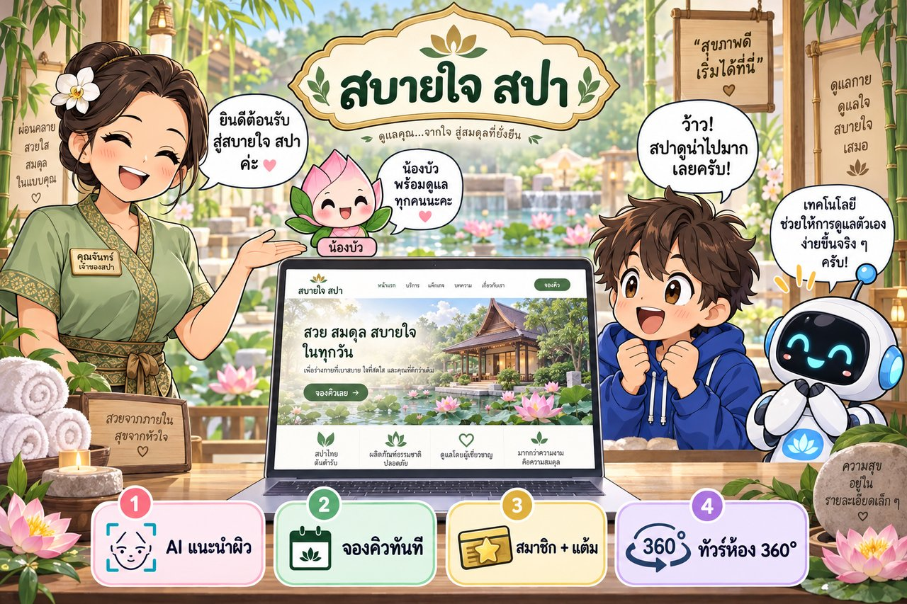

## 🌸 สบายใจ สปา คือเว็บอะไร?

เว็บสปาเพื่อสุขภาพในกรุงเทพฯ มี **"AI" แนะนำผิว · จองคิว · สมาชิกสะสมแต้ม · ทัวร์ห้อง 360°** และอีกเพียบ
ทุกฟีเจอร์ **เราไม่ได้เขียนเอง** แต่ได้มาจากการคุยกับร้าน แล้วให้ Claude สร้างให้

## 📦 บทนี้ต่างจากบท 02 ยังไง?

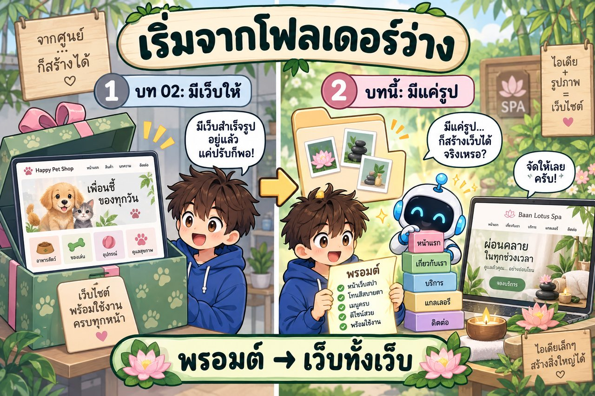

บท 02 มีเว็บให้พร้อม · บทนี้ **เริ่มจากโฟลเดอร์ว่าง** มีแค่รูป แล้วใช้ **พรอมต์สร้างเว็บทั้งเว็บ**

## 🗺️ ทำงานแบบมืออาชีพ

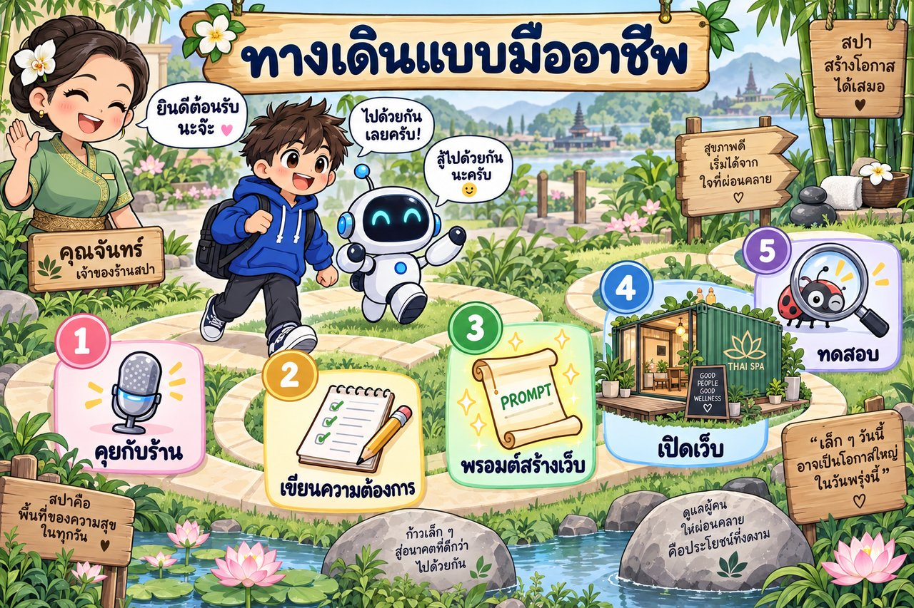

**คุยกับร้าน → เขียนความต้องการ → พรอมต์สร้างเว็บ → เปิดเว็บ → ทดสอบ** ทีมจริงก็ทำแบบนี้

## เรียนจบบทนี้แล้วได้อะไร?

| ✅ | สิ่งที่จะทำได้ |
|---|---|
| 1 | ฟังร้านแล้วเขียน **User Story** + **เกณฑ์ยอมรับ** เป็น |
| 2 | แยกความต้องการเป็น **FR / BR / NFR** ที่วัดผลได้ |
| 3 | ให้ Claude **เขียนพรอมต์สร้างเว็บ** แล้วได้เว็บ Next.js + PostgreSQL ใน **Docker 2 กล่อง** |
| 4 | เขียน **แผนทดสอบ** แล้วรัน **Playwright 3 เบราว์เซอร์** ได้ **GIF + MP4 + รายงานแบบ tester** |
| 5 | **จับบั๊ก** 3 ตัวที่ฝังไว้ด้วย `BUG_MODE=1` |

---

## 📂 ในโฟลเดอร์นี้มีอะไร?

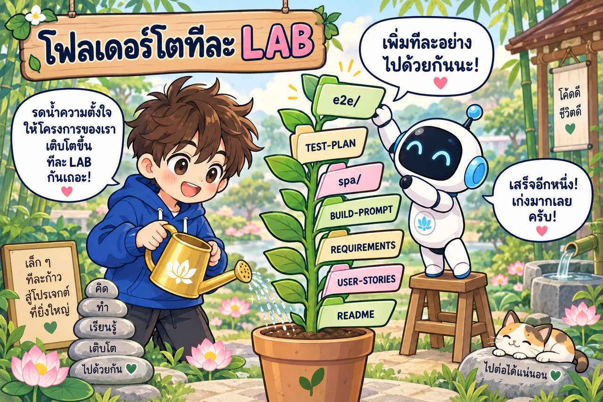

```text
03_sabai-spa-from-prompt/
├─ README.md   📖 บทเรียน + พรอมต์ทุก LAB
├─ img/        🖼️ รูปประกอบบทเรียน
└─ assets/     🌸 รูปที่เว็บจะใช้ (ทำไว้ให้แล้ว เพราะ Claude Code สร้างรูปไม่ได้)
```

แค่นี้จริง ๆ 😄 แล้วโฟลเดอร์จะ **โตขึ้นทีละ LAB** (ต้องทำตามลำดับ เพราะ LAB ถัดไปใช้ไฟล์ของ LAB ก่อน)

| LAB | ทำอะไร | ได้ไฟล์ | ⏱️ Claude ทำงาน (รอบจริง) |
|---|---|---|---|
| [1](#lab-1--ฟังร้าน--เขียน-user-story) | ฟังร้าน → User Story | `USER-STORIES.md` | ~3 นาที |
| [2](#lab-2--แยก-fr--br--nfr) | แยก FR / BR / NFR | `REQUIREMENTS.md` | ~5 นาที |
| [3](#lab-3--ให้-claude-เขียนพรอมต์สร้างเว็บ) | ให้ Claude เขียนพรอมต์สร้างเว็บ | `BUILD-PROMPT.md` | ~2 นาที |
| [4](#lab-4--วางพรอมต์--ได้เว็บ-2-กล่อง) | วางพรอมต์ → ได้เว็บ | `spa/` | **~50 นาที** ☕ |
| [5](#lab-5--เดินดูเว็บแบบลูกค้า) | เดินดูเว็บแบบลูกค้า | `screenshots/` | ~5 นาที |
| [6](#lab-6--เขียนแผนทดสอบ-test-planmd) | เขียนแผนทดสอบ | `TEST-PLAN.md` | ~5 นาที |
| [7](#lab-7--สร้างหุ่นยนต์ทดสอบ-ลอง-2-test-ก่อน) | สร้างหุ่นยนต์ทดสอบ | `e2e/` + `CLAUDE.md` | ~5 นาที |
| [8](#lab-8--รันครบ-3-เบราว์เซอร์--gif--mp4--รายงาน) | รันครบ 3 เบราว์เซอร์ | `e2e/test-report/` (GIF + MP4 + รายงาน) | **~60–90 นาที** ☕ |
| [9](#lab-9--จับบั๊ก-) | จับบั๊ก | ตาราง DEF + GIF / MP4 ของข้อที่ล้ม | ~25 นาที |

💡 เวลาส่วนใหญ่คือ **รอ Claude ทำงาน** LAB 4 และ LAB 8 นานที่สุด เริ่มก่อนพักได้เลย

---

## 🎓 พื้นฐาน: จาก "คำพูด" สู่ "เว็บ" (ดูรูปเป็นหลัก)

> ยังไม่ต้องเปิดคอมก็ได้ ดูรูปทีละรูปก่อน

### 1) ฟังก่อนสร้าง


**เจ้าของร้าน** บอก "กฎร้าน" (มีตัวเลข) · **ลูกค้า** บอก "อยากได้อะไร"

### 2) User Story = 3 ช่อง

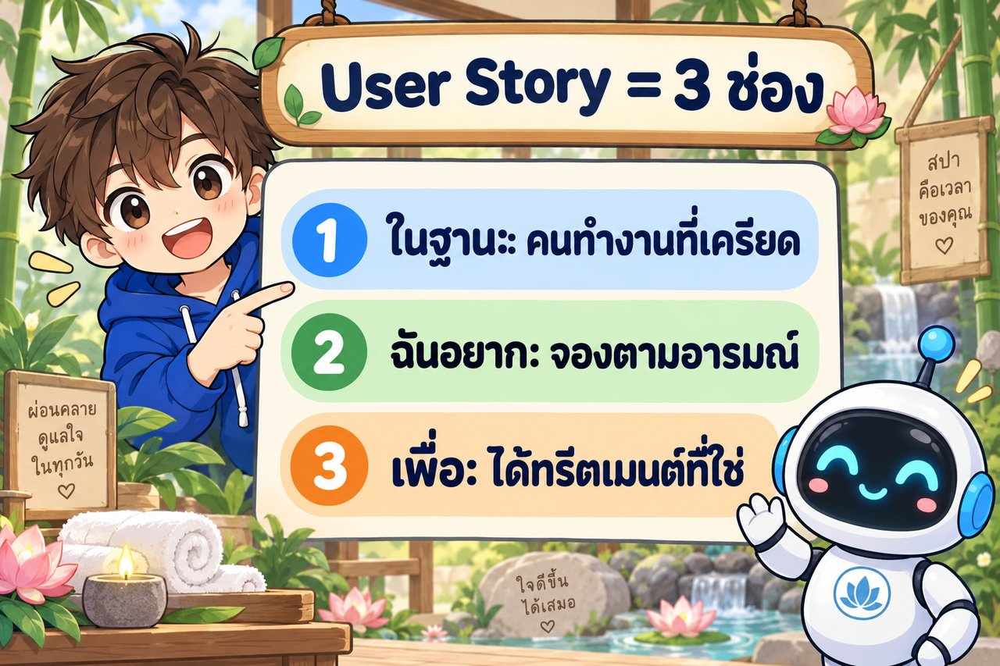

**ในฐานะ… ฉันอยาก… เพื่อ…** = ความต้องการ 1 ข้อ เล่าจากมุมของคนใช้

### 3) เสร็จแล้ว ดูยังไง? (เกณฑ์ยอมรับ)

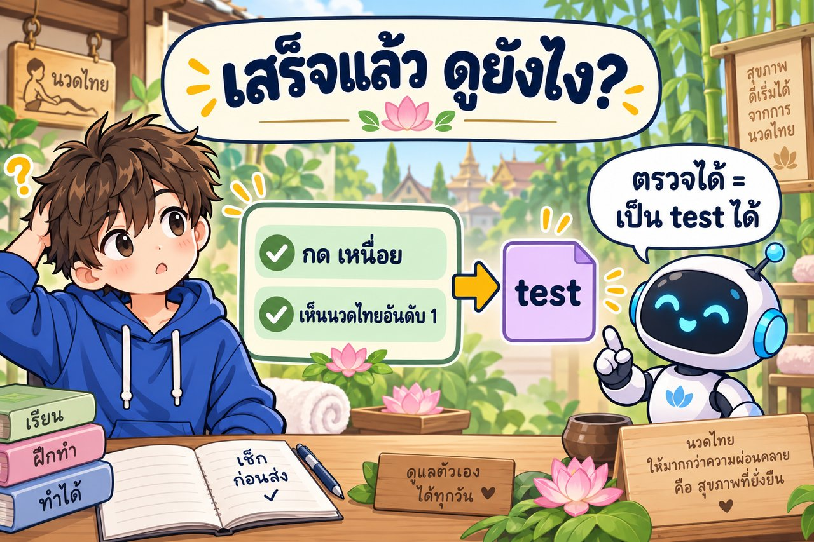

เขียนให้ **ตรวจได้** (มีตัวเลขหรือข้อความชัด ๆ) → กลายเป็น test ได้ทันที (ในรูปเป็นตัวอย่าง กฎจริงดูใน `spa/SPEC.md`)

### 4) ความต้องการ 3 แบบ: FR / BR / NFR

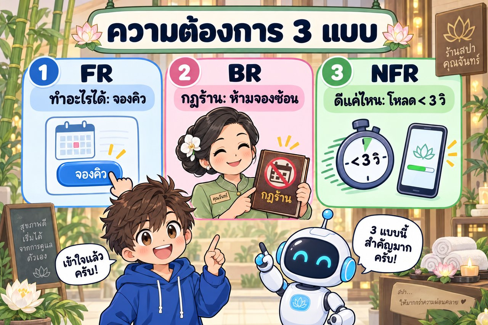

**FR** (Functional) เว็บทำอะไรได้ · **BR** (Business Rule) กฎร้าน มีตัวเลข · **NFR** (Non-Functional) ต้องดีแค่ไหน วัดได้

### 5) ทำอะไรก่อน? Must / Should / Could

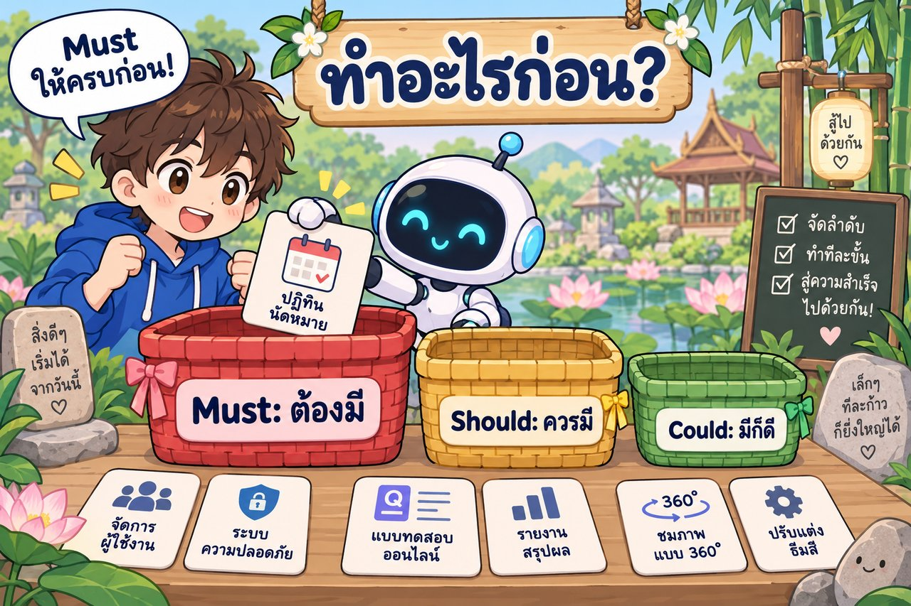

ฟีเจอร์เยอะ เวลาน้อย → ทำ **Must** ให้ครบก่อน

### 6) พรอมต์ที่เขียนพรอมต์

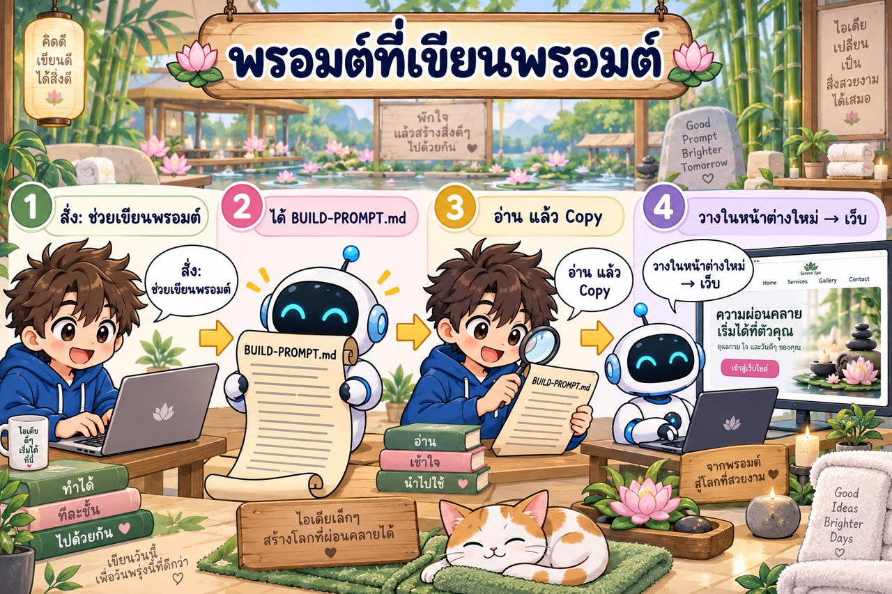

ให้ Claude เขียน **BUILD-PROMPT.md** ก่อน → เรา **อ่านตรวจได้** และ **ใช้ซ้ำได้** ทุกเมื่อ

### 7) BUILD-PROMPT ต้องมี

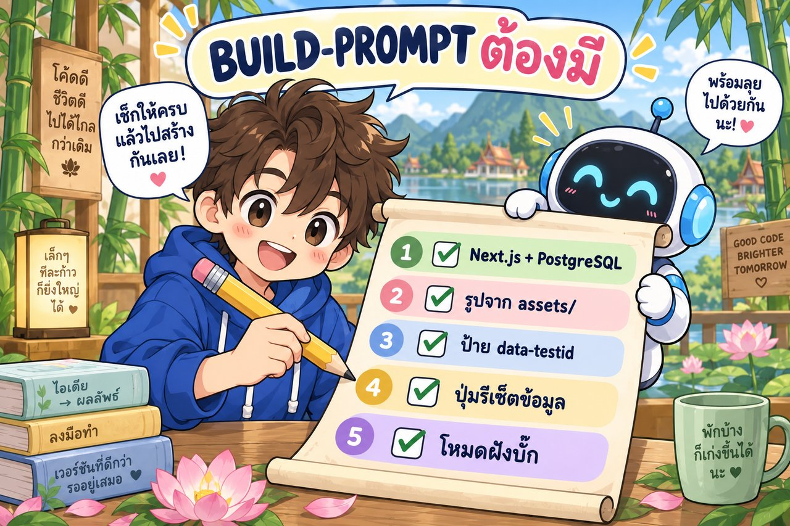

ครบ 5 ช่องนี้ → เว็บที่ได้ **สวยด้วยรูปของเรา และทดสอบได้**

### 8) เว็บ 2 กล่อง

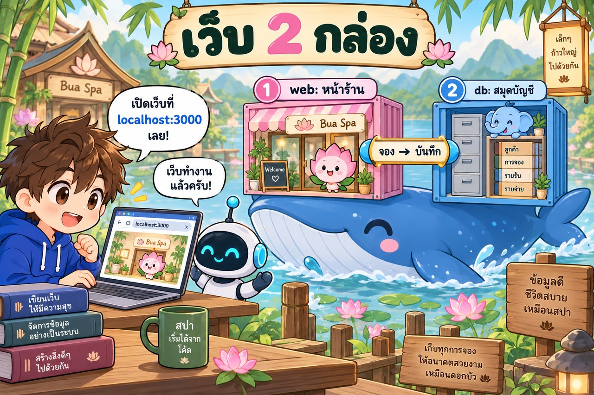

**web** = หน้าร้าน (Next.js พอร์ต 3000) · **db** = สมุดบัญชี (PostgreSQL) เก็บการจอง สมาชิก แต้ม

### 8.1) ระบบทั้งหมดหน้าตาแบบนี้ (System Architecture)


| ① คอมของเรา | ② กล่อง web | ③ กล่อง db | ④ "AI" |
|---|---|---|---|
| เบราว์เซอร์ + Playwright เปิด `localhost:3000` | Next.js: หน้าเว็บ + API | PostgreSQL 16 เก็บข้อมูลถาวร (ปิดแล้วข้อมูลไม่หาย) | กฎตายตัว ไม่สุ่ม ไม่ต้องใช้ API key |

### 9) "AI" ในเว็บนี้ = กฎตายตัว


ไม่เรียก AI จริง ใช้ **"ถ้า… แล้ว…"** → ถามเหมือนเดิมได้คำตอบเดิม จึง **ทดสอบได้** และไม่ต้องใช้ API key

### 10) 3 อย่างที่ทำให้เว็บ "ทดสอบได้"

| 🔄 ปุ่มรีเซ็ต | 🏷️ ป้ายชื่อให้หุ่นยนต์ | 📌 ล็อกวันที่ |
|---|---|---|
| 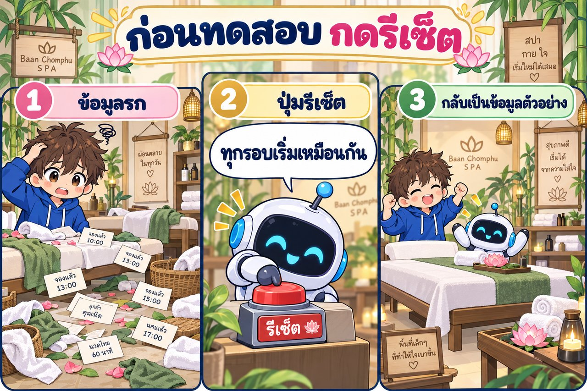 | 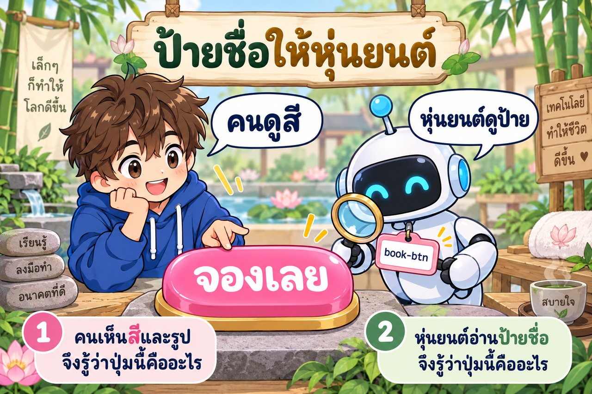 |  |
| `/api/test/reset` ทุกรอบเริ่มเหมือนกัน | `data-testid` หุ่นยนต์หาปุ่มเจอเสมอ | test ส่ง "วันนี้" เอง ผลเดิมทุกวัน |

### 11) เซลฟี่ไม่ออกจากเครื่อง

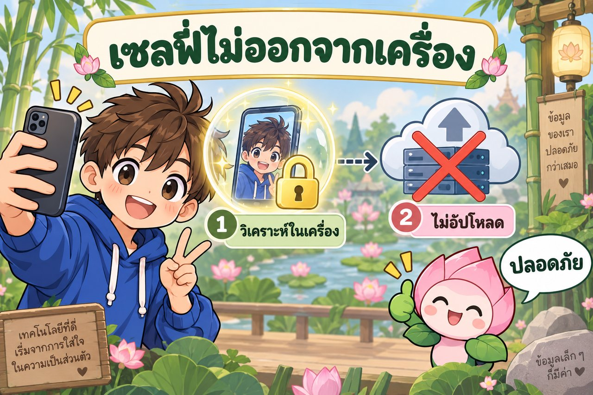

วิเคราะห์ผิว **ในเบราว์เซอร์** ไม่ส่งรูปไปเก็บที่ร้าน → ปลอดภัยตาม **PDPA**

### 12) เปิดหน้าต่างใหม่


หน้าต่างใหม่ = Claude **ความจำเริ่มจากศูนย์** → ใช้ตอนวาง BUILD-PROMPT ใน LAB 4

---

## 🧰 ก่อนเริ่ม ต้องมี

| ✅ | สิ่งที่ต้องมี | ตรวจยังไง |
|---|---|---|
| ☐ | Windows 10/11 + **Claude Code** | เปิด Claude Code ได้ |
| ☐ | **Docker Desktop** เปิดอยู่ (ไอคอนวาฬมุมขวาล่าง) | ไอคอนวาฬไม่หมุน |
| ☐ | ทำ **บท 01** (LAB 006-0) และ **บท 02** (LAB 006-1) แล้ว | มี Node.js + เบราว์เซอร์ของ Playwright |
| ☐ | เปิด Claude Code ใน **โฟลเดอร์นี้** | ชื่อโฟลเดอร์ `03_sabai-spa-from-prompt` ขึ้นที่แถบด้านบน |
| ☐ | **ปิดเว็บ petshop** ของบท 02 (ใช้พอร์ต 3000 เหมือนกัน) | ใน Docker Desktop ไม่มี `petshop` สีเขียว (ลืมปิด BUILD-PROMPT สั่งปิดให้ใน LAB 4) |
| ☐ | **ffmpeg** (ใช้ทำ GIF + MP4 ใน LAB 7–9) | PowerShell พิมพ์ `ffmpeg -version` · ไม่มีให้ `winget install Gyan.FFmpeg` แล้วเปิด terminal ใหม่ |
| ☐ | **Playwright MCP** ต่อแล้ว (บท 01 LAB 6) | `claude mcp list` เห็น playwright ✔ Connected |

📖 เจอคำไม่รู้จัก (seed, healthy, data-testid…) ดู [คำศัพท์](#-คำศัพท์) ท้ายบท

ทำ **ทีละ LAB ตามลำดับ** แต่ละ LAB มี 🎯 เป้าหมาย · 💬 พรอมต์ให้คัดลอก · ✅ ผลจริง · 👀 สิ่งที่ควรสังเกต

---

## LAB 1 · ฟังร้าน → เขียน User Story

🎯 เปลี่ยน **คำพูดของร้านและลูกค้า 6 กลุ่ม** เป็น `USER-STORIES.md` ที่ตรวจได้ทุกข้อ


💬 **คัดลอกพรอมต์นี้** (กดปุ่ม Copy มุมขวาของกรอบ · บันทึกสัมภาษณ์อยู่ในพรอมต์แล้ว)

```text
นี่คือบันทึกสัมภาษณ์เจ้าของร้านและลูกค้าของ "สบายใจ สปา" ช่วยเขียนไฟล์ USER-STORIES.md
1. เขียน User Story แบบ "ในฐานะ… ฉันอยาก… เพื่อ…" ให้ครบทุกเรื่องที่ทุกคนพูด ใส่รหัส US-01, US-02, …
2. แต่ละข้อมี "เกณฑ์ยอมรับ" 1–2 ข้อ ที่ตรวจได้จริง (มีตัวเลขหรือข้อความชัด ๆ)
3. ติดป้ายความสำคัญ Must / Should / Could
4. ท้ายไฟล์ใส่ "คำถามที่ยังไม่ชัด" ที่ควรถามร้านเพิ่ม
ใช้ภาษาไทยง่าย ๆ ใน story ห้ามใช้ศัพท์โปรแกรม (database, API) แล้วสรุปเป็นตารางให้ผมดู

--- บันทึกสัมภาษณ์ ---
👩‍💼 คุณจันทร์ (เจ้าของร้าน)
- เปิดทุกวัน 10:00–22:00 จองเป็นรอบทุก 30 นาที บริการต้องจบไม่เกิน 22:00
- นักบำบัด 1 คนรับได้ทีละคิว ห้ามจองเวลาทับกัน ต้องขึ้นว่า "เวลานี้ถูกจองแล้ว"
- จองได้ตั้งแต่ "พรุ่งนี้" ถึง 30 วันข้างหน้า
- จองคู่ = 2 คน ใช้ห้อง Couple Suite (มี 1 ห้อง) · จองกลุ่ม 3–6 คน (7 คนขึ้นไปให้โทรร้าน) · กลุ่ม 4 คนขึ้นไปลด 10%
- ยกเลิกเองได้ถ้าเหลือเวลา 24 ชม. ขึ้นไปก่อนนัด
- แต้ม: ทุก ฿100 ได้ 1 แต้ม (เศษปัดทิ้ง) · 100 แต้ม แลกส่วนลด ฿50
- ระดับสมาชิกตามยอดใช้จ่ายสะสม: Silver ต่ำกว่า ฿10,000 · Gold ตั้งแต่ ฿10,000 ลด 5% · Platinum ตั้งแต่ ฿30,000 ลด 10%
- เดือนเกิดลด 20% ได้ 1 ครั้ง (ไม่รวมกับส่วนลดระดับ ใช้อันที่มากกว่า)
- คอร์สกระชับสัดส่วน 10 ครั้ง ฿15,000 แถม 1 = 11 ครั้ง อายุ 180 วัน · เหลือ 0 ครั้งจองด้วยคอร์สไม่ได้
- Gift Card มูลค่า ฿500–฿10,000 มี 3 ลาย (กล้วยไม้ บัว ทอง) ส่งทาง LINE หรือ email ใช้ได้ 365 วัน
- แพ็กเกจนักท่องเที่ยว "Bangkok Relax" ฿2,900/คน = นวดไทย + ประคบสมุนไพร + รถรับส่งโรงแรม
- รถรับส่ง: โรงแรมห่างไม่เกิน 5 กม. ฟรี · 5–15 กม. ฿300 · เกิน 15 กม. ไม่รับ · รถ 1 คันไม่เกิน 4 คน
- อยากให้เว็บดูไทย มีข้อมูลสมุนไพรของแต่ละบริการ ทัวร์ห้อง 360° และเพลงสปาเบา ๆ (ลูกค้ากดเปิดเอง)
- เว็บต้องมี 3 ภาษา ไทย / English / 中文 · ห้ามเก็บรูปหน้าลูกค้า

😩 คุณเมย์ 29 ปี พนักงานออฟฟิศ เครียดมาก
- เลิกงาน 19:00 อยากจองรอบ 20:00 จากมือถือแบบไม่ยุ่งยาก
- วันไหนเหนื่อยหรือเครียด อยากกดเลือก "อารมณ์" แล้วเว็บแนะนำบริการให้
- ไม่รู้จะเลือกอะไร อยากทำแบบทดสอบสั้น ๆ 4 ข้อ แล้วได้แพ็กเกจที่เหมาะกับตัวเอง
- ขอดูรีวิวนักบำบัดก่อน ชอบคนที่ได้ 4.5 ดาวขึ้นไป

🧳 Mr. Li Wei 35 ปี นักท่องเที่ยวจีน
- อ่านไทยไม่ได้ อยากใช้เว็บภาษาจีน และถาม chatbot ว่า "营业时间?" "多少钱?"
- อยากจองผ่าน chatbot ได้เลย · มากัน 4 คน พักโรงแรมห่าง 12 กม. อยากรู้ค่ารถก่อนจ่าย

💑 คุณต้น & คุณฝน คู่รัก
- วันครบรอบ อยากจองคู่ห้อง Couple Suite เวลาเดียวกัน · ขอดูห้องแบบ 360° ก่อน
- ต้นเกิดเดือนนี้ อยากใช้ส่วนลดวันเกิด · ฝนอยากซื้อ Gift Card ฿2,000 ส่ง LINE ให้แม่

🏃‍♀️ คุณนิดา 41 ปี ทำคอร์สกระชับสัดส่วน (ยอดสะสม ฿12,400)
- ใช้คอร์สไปแล้ว 4 ครั้ง อยากเห็นใน Wallet ว่าเหลือกี่ครั้ง และกราฟรอบเอวที่ลดลง
- อยากเห็นประวัติทรีตเมนต์ รูป before/after และรู้ว่าอีกเท่าไรถึงระดับถัดไป
- พรุ่งนี้ติดงาน อยากยกเลิกนัดเองในเว็บ

✨ น้องแพร 23 ปี สาวรักผิว
- อยากอัปโหลดเซลฟี่ให้วิเคราะห์ผิวแล้วแนะนำทรีตเมนต์ แต่ไม่อยากให้รูปถูกส่งออกไปเก็บ
- อยากเห็นภาพจำลองก่อน/หลังทำ และรู้ว่าแต่ละทรีตเมนต์ใช้สมุนไพรอะไร (กลัวแพ้)
```

✅ **ผลจริง** ได้ `USER-STORIES.md`

| เรื่อง | ผล |
|---|---|
| User Story | **34 ข้อ** (US-01 – US-34) แบ่ง 6 หมวด |
| ความสำคัญ | **Must 7** · **Should 15** · **Could 12** |
| คำถามที่ยังไม่ชัด | **24 ข้อ** ไว้ถามร้านเพิ่ม |

ตัวอย่างจากไฟล์จริง

| รหัส | ใคร · อยากได้อะไร | เกณฑ์ยอมรับ (ตัวอย่าง) | ความสำคัญ |
|---|---|---|---|
| US-02 | เจ้าของร้าน · นักบำบัด 1 คนรับได้ทีละคิว | A ถูกจอง 14:00–15:00 แล้ว จอง 14:30 → "เวลานี้ถูกจองแล้ว" | Must |
| US-12 | สมาชิกประจำ · ได้ส่วนลดตามระดับ | ฿9,999 = Silver · ฿10,000 = Gold ลด 5% | Should |
| US-16 | คุณนิดา · เห็นคอร์สเหลือกี่ครั้ง | ใช้ไป 4 ครั้ง → "เหลือ 7 จาก 11 ครั้ง" | Should |
| US-28 | คุณเมย์ · เลือกอารมณ์แล้วได้คำแนะนำ | กดอารมณ์ → บริการแนะนำ 1–3 รายการ + ปุ่ม "จองเลย" | Could |
| US-34 | เจ้าของร้าน · ไม่เก็บรูปหน้าลูกค้า | ไม่มีช่องอัปโหลดรูปหน้าเพื่อเก็บไว้ที่ร้าน | Must |

👀 **สังเกต**
- Story ใช้ **ภาษาลูกค้า** ไม่มีคำว่า database / API · เกณฑ์ยอมรับมีตัวเลข → พร้อมเป็น test
- Claude **ไม่เดาเอง** ตั้งคำถามกลับ เช่น "ห่าง 5 กม. พอดี ฟรีหรือ ฿300?" = ค่าขอบที่ร้านยังไม่ตอบ

✔️ **ไปต่อได้เมื่อ:** มีไฟล์ `USER-STORIES.md` และมีป้าย Must อย่างน้อย 1 ข้อ

---

## LAB 2 · แยก FR / BR / NFR

🎯 แปลง User Story เป็น `REQUIREMENTS.md` 3 ตาราง ที่ **มีรหัส วัดผลได้ และโยงกลับ US ได้ทุกข้อ**


💬 **คัดลอกพรอมต์นี้**

```text
อ่าน USER-STORIES.md แล้วเขียน REQUIREMENTS.md เป็น 3 ตาราง
1. FR (ระบบต้องทำอะไรได้) รหัส FR-01, FR-02, …
2. BR (กฎของร้าน) ทุกข้อต้องมีตัวเลข และคอลัมน์ "ค่าขอบที่ต้องทดสอบ" รหัส BR-01, …
3. NFR (ต้องดีแค่ไหน) ทุกข้อต้องวัดผลได้ เช่น ใช้บนมือถือกว้าง 375px ได้, หน้าแรกโหลดไม่เกิน 3 วินาที รหัส NFR-01, …
ทุกข้อมีคอลัมน์ "มาจาก US ไหน" และ US ทุกข้อต้องมี FR หรือ BR รองรับ
เพิ่ม NFR เรื่อง "ทดสอบได้" ด้วย: AI ทุกตัวใช้กฎตายตัว (ถามเหมือนเดิมได้คำตอบเดิม), มีปุ่มรีเซ็ตข้อมูลทดสอบ, ล็อก "วันนี้" ของเว็บได้
แล้วสรุปเป็นตาราง: ชนิด | จำนวน | ตัวอย่าง 1 ข้อ
```

✅ **ผลจริง** ได้ `REQUIREMENTS.md`

| ชนิด | จำนวน | ตัวอย่าง 1 ข้อ (จากไฟล์จริง) |
|---|---|---|
| **FR** ทำอะไรได้ | **31** | FR-02 ตรวจว่านักบำบัดหรือห้องว่างก่อนยืนยัน ถ้าไม่ว่างขึ้น "เวลานี้ถูกจองแล้ว" |
| **BR** กฎร้าน | **25** | BR-13 ระดับสมาชิก · ค่าขอบ ฿9,999 Silver · ฿10,000 Gold · ฿30,000 Platinum |
| **NFR** ดีแค่ไหน | **15** | NFR-14 ล็อก "วันนี้" ของเว็บได้ แล้วกฎที่ใช้วันที่ทุกข้อคิดจากวันนั้น |

ตัวอย่างคอลัมน์ **"ค่าขอบที่ต้องทดสอบ"** ของ BR-05 (จองได้พรุ่งนี้ถึง 30 วัน)

| วันนี้ (+0) | +1 | +30 | +31 |
|---|---|---|---|
| ❌ ไม่ได้ | ✅ ได้ | ✅ ได้ | ❌ ไม่ได้ |

ผลตรวจท้ายไฟล์: **US ทั้ง 34 ข้อมี FR รองรับ ไม่มีข้อไหนตกหล่น**

📋 **ดูของจริงใน `REQUIREMENTS.md` ทั้ง 71 ข้อ** (คลิกเพื่อเปิด)

<details>
<summary>🔵 <b>FR · ระบบต้องทำอะไรได้ (31 ข้อ)</b></summary>

| รหัส | ระบบต้องทำได้ | มาจาก US ไหน |
|---|---|---|
| FR-01 | แสดงรอบเวลาที่ว่างของวันที่เลือก ให้ลูกค้าเลือกบริการ วัน รอบ แล้วยืนยันการจอง | US-01, US-04 |
| FR-02 | ตรวจว่านักบำบัดหรือห้องว่างก่อนยืนยัน ถ้าไม่ว่างแสดงข้อความ "เวลานี้ถูกจองแล้ว" และไม่บันทึกการจอง | US-02, US-05 |
| FR-03 | แสดงปฏิทินที่กดเลือกได้เฉพาะวันที่อยู่ในช่วงที่ร้านเปิดรับจอง | US-03 |
| FR-04 | จองคู่ 2 คนในห้อง Couple Suite โดยทั้งสองคนเริ่มเวลาเดียวกัน | US-05 |
| FR-05 | จองกลุ่มโดยเลือกจำนวนคน ถ้าเกินจำนวนที่รับได้ให้แสดงข้อความพร้อมเบอร์โทรร้านแทนการจอง | US-06 |
| FR-06 | คำนวณราคารวม (ส่วนลดกลุ่ม / ระดับ / วันเกิด / แต้ม / ค่ารถ) แล้วแสดงรายการแยกบรรทัดก่อนกดยืนยัน | US-07, US-11, US-12, US-14, US-21, US-22 |
| FR-07 | ให้ลูกค้ายกเลิกนัดของตัวเอง เมื่อยกเลิกแล้วเวลานั้นกลับมาว่าง ถ้าเลยเวลาที่ยกเลิกได้ ปุ่มยกเลิกกดไม่ได้และบอกให้ติดต่อร้าน | US-08 |
| FR-08 | แสดงคะแนนดาวเฉลี่ย จำนวนรีวิว และข้อความรีวิวของนักบำบัดแต่ละคน พร้อมตัวกรองตามคะแนน | US-09 |
| FR-09 | หน้าสมาชิกแสดงแต้มคงเหลือ ระดับปัจจุบัน ยอดสะสม และยอดที่ต้องใช้อีกเท่าไรถึงระดับถัดไป | US-10, US-12, US-13 |
| FR-10 | ให้สมาชิกแลกแต้มเป็นส่วนลดตอนจ่ายเงิน และหักแต้มทันทีที่จองสำเร็จ | US-11 |
| FR-11 | ให้ใช้ส่วนลดวันเกิดได้ในเดือนเกิด และจำว่าใช้ไปแล้ว | US-14 |
| FR-12 | ขายคอร์สกระชับสัดส่วน และแสดงวันหมดอายุของคอร์ส | US-15 |
| FR-13 | หน้า Wallet แสดงจำนวนครั้งที่เหลือของคอร์ส และให้เลือก "จองด้วยคอร์ส" (หักครั้งเมื่อจองสำเร็จ) | US-16 |
| FR-14 | แสดงกราฟรอบเอว (ซม.) ตามวันที่ที่ร้านวัด และตัวเลขที่ลดลงจากครั้งแรก | US-17 |
| FR-15 | แสดงประวัติทรีตเมนต์ (วันที่ บริการ นักบำบัด) เรียงจากล่าสุด และรูป before/after ที่ไม่มีใบหน้า ให้เจ้าของบัญชีดูได้คนเดียว | US-18 |
| FR-16 | ขาย Gift Card: ใส่มูลค่า เลือกลาย เลือกส่งทาง LINE หรือ email | US-19 |
| FR-17 | ใช้ Gift Card จ่ายค่าบริการ และแสดงวันหมดอายุบนบัตร | US-20 |
| FR-18 | แสดงและจองแพ็กเกจ Bangkok Relax พร้อมรายการที่รวมอยู่ในแพ็กเกจ | US-21 |
| FR-19 | ให้ใส่ชื่อโรงแรม แล้วบอกระยะทาง ค่ารถ และจำนวนรถ ก่อนกดจ่าย | US-22 |
| FR-20 | ปุ่มเปลี่ยนภาษา ไทย / English / 中文 ทุกหน้า และจำภาษาที่เลือกไว้เมื่อเปลี่ยนหน้า | US-23 |
| FR-21 | หน้าแรกใช้ลวดลาย ภาพ และโทนสีแบบไทยที่เจ้าของร้านอนุมัติ | US-24 |
| FR-22 | ทุกบริการแสดงรายชื่อสมุนไพรที่ใช้ และคำเตือนเรื่องการแพ้ | US-25 |
| FR-23 | แสดงภาพ 360° ของห้อง Couple Suite ที่ลากหมุนดูได้ พร้อมปุ่ม "จองห้องนี้" | US-26 |
| FR-24 | ปุ่มเปิด/ปิดเพลงสปา | US-27 |
| FR-25 | ให้เลือกอารมณ์ แล้วแนะนำบริการพร้อมปุ่ม "จองเลย" | US-28 |
| FR-26 | แบบทดสอบสั้น ๆ มีแถบบอกข้อที่ทำอยู่ แล้วแนะนำแพ็กเกจพร้อมเหตุผลและปุ่มจอง | US-29 |
| FR-27 | chatbot ตอบคำถามเรื่องเวลาเปิด–ปิด และราคา ในภาษาเดียวกับที่ลูกค้าพิมพ์ | US-30 |
| FR-28 | chatbot ถามข้อมูลการจองทีละข้อ สรุปราคารวมค่ารถ แล้วจองให้ โดยใช้กฎเดียวกับหน้าจอง | US-31 |
| FR-29 | วิเคราะห์ผิวจากเซลฟี่ภายในมือถือของลูกค้า แล้วแนะนำทรีตเมนต์ พร้อมข้อความว่าไม่ใช่การวินิจฉัยของแพทย์ | US-32 |
| FR-30 | แสดงภาพจำลองก่อน/หลังทำทรีตเมนต์ พร้อมป้าย "ภาพจำลองเท่านั้น ผลจริงแต่ละคนต่างกัน" | US-33 |
| FR-31 | ไม่มีช่องอัปโหลดรูปหน้าเพื่อเก็บไว้ที่ร้าน และมีหน้านโยบายความเป็นส่วนตัวที่เขียนว่า "ร้านไม่เก็บรูปใบหน้าลูกค้า" | US-34 |

</details>

<details>
<summary>🌸 <b>BR · กฎของร้าน + ค่าขอบที่ต้องทดสอบ (25 ข้อ)</b></summary>

| รหัส | กฎ (มีตัวเลข) | ค่าขอบที่ต้องทดสอบ | มาจาก US ไหน |
|---|---|---|---|
| BR-01 | ร้านเปิดทุกวัน 10:00–22:00 ไม่มีวันหยุด | รอบ 09:30 ไม่มีให้เลือก · 10:00 มี · วันอาทิตย์และวันหยุดนักขัตฤกษ์ยังจองได้ | US-01 |
| BR-02 | รอบจองห่างกันทุก 30 นาที | 10:00 และ 10:30 มีให้เลือก · 10:15 ไม่มี | US-01, US-04 |
| BR-03 | บริการต้องจบไม่เกิน 22:00 | บริการ 60 นาที: 21:00 ได้ (จบ 22:00 พอดี) · 21:30 ไม่ได้ · บริการ 90 นาที: 20:30 ได้ · 21:00 ไม่ได้ · บริการ 120 นาที: 20:00 ได้ (กรณีคุณเมย์) | US-01, US-04 |
| BR-04 | นักบำบัด 1 คนรับได้ 1 คิวในเวลาเดียวกัน | A ถูกจอง 14:00–15:00 แล้ว: จอง 14:30 → "เวลานี้ถูกจองแล้ว" · 13:00–14:00 ได้ (จบชนเวลาเริ่มพอดี) · 15:00 ได้ (เริ่มชนเวลาจบพอดี) | US-02 |
| BR-05 | จองได้ตั้งแต่พรุ่งนี้ (+1 วัน) ถึง 30 วันข้างหน้า (+30 วัน) | วันนี้ (+0) ไม่ได้ · +1 ได้ · +30 ได้ · +31 ไม่ได้ · ข้ามเดือน เช่น วันนี้ 31 ต.ค. → 30 พ.ย. ได้ 1 ธ.ค. ไม่ได้ | US-03 |
| BR-06 | จองคู่ = 2 คนพอดี · Couple Suite มี 1 ห้อง | 2 คน จองคู่ได้ · 1 หรือ 3 คน เลือกแบบคู่ไม่ได้ · คู่ที่ 2 จองรอบเดียวกันกับคู่ที่ 1 → "เวลานี้ถูกจองแล้ว" | US-05 |
| BR-07 | จองกลุ่มได้ 3–6 คน · 7 คนขึ้นไปต้องโทรร้าน | 2 คน → ไม่ใช่กลุ่ม · 3 ได้ · 6 ได้ · 7 → ข้อความ "กรุณาโทรหาร้าน" และจองไม่ได้ | US-06 |
| BR-08 | กลุ่ม 4 คนขึ้นไปลด 10% | 3 คน ไม่ลด · 4 คน ลด (฿4,000 → ฿3,600) · 6 คน ลด | US-07 |
| BR-09 | ยกเลิกเองได้เมื่อเหลือเวลา 24 ชม. ขึ้นไปก่อนนัด | นัด 15:00 พรุ่งนี้: ยกเลิก 15:00:00 วันนี้ (24 ชม. พอดี) ได้ · 14:59 ได้ · 15:01 ไม่ได้ | US-08 |
| BR-10 | ตัวกรองรีวิวแสดงนักบำบัดที่ได้ 4.5 ดาวขึ้นไป (คะแนน 1.0–5.0 ทศนิยม 1 ตำแหน่ง) | 4.4 ไม่แสดง · 4.5 แสดง · 5.0 แสดง · นักบำบัดที่ยังไม่มีรีวิว (0 รีวิว) ไม่แสดงในตัวกรอง ⚠️ | US-09 |
| BR-11 | ใช้จ่ายทุก ฿100 ได้ 1 แต้ม เศษปัดทิ้ง | ฿99 → 0 · ฿100 → 1 · ฿199 → 1 · ฿200 → 2 · ฿2,950 → 29 | US-10 |
| BR-12 | 100 แต้ม แลกส่วนลด ฿50 | 99 แต้ม แลกไม่ได้ · 100 แต้ม → ลด ฿50 เหลือ 0 แต้ม · 250 แต้ม → แลกได้สูงสุด 2 ชุด (ลด ฿100) เหลือ 50 แต้ม | US-11 |
| BR-13 | ระดับตามยอดสะสม: Silver ต่ำกว่า ฿10,000 (ลด 0%) · Gold ตั้งแต่ ฿10,000 (ลด 5%) · Platinum ตั้งแต่ ฿30,000 (ลด 10%) | ฿9,999 Silver · ฿10,000 Gold · ฿29,999 Gold · ฿30,000 Platinum · นิดา ฿12,400 → Gold และ "อีก ฿17,600 ถึง Platinum" | US-12, US-13 |
| BR-14 | เดือนเกิดลด 20% ได้ 1 ครั้ง ไม่รวมกับส่วนลดระดับ ใช้อันที่มากกว่า | เกิด ต.ค.: 30 ก.ย. ใช้ไม่ได้ · 1 ต.ค. ได้ · 31 ต.ค. ได้ · 1 พ.ย. ไม่ได้ · ใช้ครั้งที่ 2 ในเดือนเดียวกันไม่ได้ · Platinum ฿1,000 → ฿800 (ไม่ใช่ ฿700) | US-14 |
| BR-15 | คอร์ส 10 ครั้ง ฿15,000 แถม 1 = 11 ครั้ง อายุ 180 วัน (นับจากวันซื้อ ⚠️) | ซื้อแล้วได้ 11 ครั้ง · วันที่ 180 ยังจองได้ · วันที่ 181 จองด้วยคอร์สไม่ได้ | US-15, US-16 |
| BR-16 | คอร์สเหลือ 0 ครั้ง จองด้วยคอร์สไม่ได้ | ใช้ไป 4 ครั้ง → เหลือ 7 · เหลือ 1 ครั้ง จองได้แล้วเหลือ 0 · เหลือ 0 ครั้ง ตัวเลือก "จองด้วยคอร์ส" กดไม่ได้ | US-16 |
| BR-17 | Gift Card มูลค่า ฿500–฿10,000 · มี 3 ลาย (กล้วยไม้ บัว ทอง) · ส่งได้ 2 ช่องทาง (LINE, email) | ฿499 ไม่ได้ · ฿500 ได้ · ฿10,000 ได้ · ฿10,001 ไม่ได้ · ต้องเลือกลาย 1 ใน 3 · ต้องเลือกช่องทาง 1 ใน 2 | US-19 |
| BR-18 | Gift Card ใช้ได้ 365 วันนับจากวันซื้อ | วันที่ 365 ใช้ได้ · วันที่ 366 → "Gift Card หมดอายุแล้ว" | US-20 |
| BR-19 | แพ็กเกจ Bangkok Relax ราคา ฿2,900/คน รวม 3 อย่าง (นวดไทย + ประคบสมุนไพร + รถรับส่งโรงแรม) | 1 คน ฿2,900 · 4 คน ฿11,600 (ก่อนส่วนลดอื่น) | US-21 |
| BR-20 | ค่ารถรับส่ง: ไม่เกิน 5 กม. ฟรี · มากกว่า 5 ถึง 15 กม. ฿300 · เกิน 15 กม. ไม่รับ | 5.0 กม. ฟรี ⚠️ · 5.1 กม. ฿300 · 12 กม. ฿300 (กรณี Li Wei) · 15.0 กม. ฿300 ⚠️ · 15.1 กม. → "ไม่มีบริการรับส่งสำหรับระยะนี้" | US-22, US-31 |
| BR-21 | รถ 1 คันรับได้ไม่เกิน 4 คน | 4 คน → 1 คัน · 5 คน → 2 คัน · 6 คน → 2 คัน | US-22 |
| BR-22 | เว็บมี 3 ภาษา (ไทย / English / 中文) | สลับครบทั้ง 3 ภาษาได้ · ไม่มีภาษาที่ 4 ให้เลือก | US-23, US-30 |
| BR-23 | ตัวเลือกอารมณ์มีอย่างน้อย 4 แบบ · แนะนำบริการ 1–3 รายการ | ทุกอารมณ์ได้คำแนะนำ ≥ 1 รายการ และ ≤ 3 รายการ | US-28 |
| BR-24 | แบบทดสอบมี 4 ข้อพอดี · ผลลัพธ์ 1 แพ็กเกจ | ตอบ 3 ข้อ ยังไม่แสดงผล · ตอบครบ 4 ข้อ แสดงผล 1 แพ็กเกจ | US-29 |
| BR-25 | ร้านเก็บรูปใบหน้าลูกค้า 0 รูป | หลังวิเคราะห์ผิว / ดูภาพจำลอง / อัปโหลด before/after แล้ว จำนวนรูปหน้าที่ร้านเก็บไว้ = 0 | US-18, US-32, US-33, US-34 |

> ⚠️ = ค่าที่ร้านยังไม่ยืนยัน Claude ตั้งตามความหมายที่ใกล้คำพูดในบันทึกสัมภาษณ์ที่สุด

</details>

<details>
<summary>🟢 <b>NFR · ต้องดีแค่ไหน วัดผลได้ (15 ข้อ)</b></summary>

| รหัส | เรื่อง | ต้องดีแค่ไหน (วัดผลได้) | มาจาก US ไหน |
|---|---|---|---|
| NFR-01 | ใช้บนมือถือ | บนจอกว้าง 375 px ไม่มีแถบเลื่อนซ้าย–ขวา ทุกหน้า · ปุ่มกดมีขนาดอย่างน้อย 44×44 px | US-04 |
| NFR-02 | ความเร็ว | หน้าแรกโหลดเสร็จไม่เกิน 3 วินาที บนเน็ตมือถือ 4G · หน้าจองแสดงรอบว่างไม่เกิน 2 วินาที หลังเลือกวัน | US-01, US-04 |
| NFR-03 | จองง่าย | จองบริการเดี่ยวเสร็จได้ใน 4 ขั้นหรือน้อยกว่า (บริการ → วัน → รอบ → ยืนยัน) | US-04 |
| NFR-04 | แปลภาษาครบ | หน้า 中文 และ English มีข้อความภาษาไทยหลงเหลือ 0 จุด (ยกเว้นชื่อร้าน) · ข้อความ 100% แปลครบทั้ง 3 ภาษา | US-23, US-30 |
| NFR-05 | chatbot ตอบเร็ว | ตอบคำถามแต่ละข้อไม่เกิน 2 วินาที | US-30, US-31 |
| NFR-06 | จองพร้อมกันไม่ชน | ลูกค้า 2 คนกดยืนยันนักบำบัดคนเดียวกัน (หรือ Couple Suite) เวลาเดียวกันพร้อมกัน → สำเร็จ 1 คนพอดี อีกคนได้ "เวลานี้ถูกจองแล้ว" | US-02, US-05 |
| NFR-07 | รูปไม่ออกจากเครื่อง | ระหว่างวิเคราะห์ผิวและดูภาพจำลอง การส่งรูปออกจากมือถือ = 0 ครั้ง (ตรวจจากหน้าดูการรับส่งข้อมูลของเบราว์เซอร์) | US-32, US-33, US-34 |
| NFR-08 | ข้อมูลส่วนตัว | สมาชิก A เปิดดู Wallet / ประวัติ / รูป before/after ของสมาชิก B ได้ 0 ครั้ง | US-16, US-17, US-18 |
| NFR-09 | ไม่รบกวนลูกค้า | เปิดเว็บครั้งแรกมีเสียงเพลงเล่นเอง 0 ครั้ง | US-27 |
| NFR-10 | ทัวร์ 360° | โหลดภาพ 360° เสร็จไม่เกิน 5 วินาที และลากหมุนได้ทั้งบน Chrome / Safari มือถือและคอม | US-26 |
| NFR-11 | อ่านง่ายสำหรับทุกคน | สีตัวอักษรกับพื้นหลังต่างกันอย่างน้อย 4.5:1 · รูปทุกรูปมีคำอธิบายรูป 100% | US-24, US-25 |
| NFR-12 | **ทดสอบได้: AI ใช้กฎตายตัว** | ตัวแนะนำตามอารมณ์ แบบทดสอบ chatbot วิเคราะห์ผิว และภาพจำลอง ใช้กฎที่เขียนไว้ตายตัว · ถามหรือเลือกแบบเดิม 10 ครั้ง ต้องได้คำตอบเดิม 10/10 ครั้ง | US-28, US-29, US-30, US-31, US-32, US-33 |
| NFR-13 | **ทดสอบได้: ปุ่มรีเซ็ตข้อมูลทดสอบ** | กดปุ่มรีเซ็ต 1 ครั้ง ข้อมูลทั้งหมด (การจอง แต้ม คอร์ส Gift Card) กลับเป็นชุดเริ่มต้นภายใน 2 วินาที และได้ชุดเดียวกันทุกครั้ง (เช่น คุณนิดา ยอดสะสม ฿12,400 ใช้คอร์สไป 4 ครั้ง) | ทุก US (โดยเฉพาะ US-02, US-08, US-10, US-16) |
| NFR-14 | **ทดสอบได้: ล็อก "วันนี้" ของเว็บได้** | ตั้งวันเวลาจำลองได้ (เช่น 2026-10-08 10:00) แล้วกฎที่ใช้วันที่ทุกข้อ (BR-05, BR-09, BR-14, BR-15, BR-18) คิดจากวันจำลองนั้น 100% | US-03, US-08, US-14, US-15, US-20 |
| NFR-15 | ทดสอบได้: หาปุ่มเจอเสมอ | ทุกปุ่ม ช่องกรอก และข้อความแจ้งเตือนในขั้นตอนจองมีชื่อเฉพาะไม่ซ้ำกัน ให้เครื่องมือทดสอบอัตโนมัติหาเจอ 100% · ข้อความแจ้งเตือนตรงกับที่กำหนดทุกตัวอักษร (เช่น "เวลานี้ถูกจองแล้ว") | US-02, US-04, US-06, US-08 |

</details>


👀 **สังเกต**
- BR ทุกข้อมี **ค่าขอบ** เขียนไว้แล้ว → LAB 6 หยิบไปเป็น test case ได้เลย
- ค่าที่ร้านยังไม่ยืนยันติดป้าย ⚠️ (เช่น 5.0 กม. ฟรีไหม) → Claude บอกตรง ๆ ไม่แอบเดา

✔️ **ไปต่อได้เมื่อ:** มีไฟล์ `REQUIREMENTS.md` ที่มีรหัส FR-, BR-, NFR- ครบ 3 ตาราง

---

## LAB 3 · ให้ Claude เขียนพรอมต์สร้างเว็บ

🎯 ได้ `BUILD-PROMPT.md` = พรอมต์ภาษาไทยที่ **ครบพอให้ Claude อีกหน้าต่างสร้างเว็บทั้งเว็บได้เอง** (ขั้นนี้ยังไม่มีโค้ด)


💬 **คัดลอกพรอมต์นี้**

```text
อ่าน REQUIREMENTS.md และดูชื่อไฟล์รูปทั้งหมดในโฟลเดอร์ assets/ (ขั้นนี้ห้ามเขียนโค้ดเว็บ)
แล้วเขียนไฟล์ BUILD-PROMPT.md เป็นพรอมต์ภาษาไทยที่ผมจะ copy ไปวางให้ Claude สร้างเว็บ "สบายใจ สปา · Sabai Jai Wellness Spa"
พรอมต์นั้นต้องสั่งให้ครบทุกข้อนี้
1. เทคโนโลยี: Next.js (App Router, TypeScript) + PostgreSQL ใช้ไลบรารี pg เขียน SQL ตรง ๆ (ไม่ใช้ ORM) สร้างทุกอย่างในโฟลเดอร์ spa/
   docker compose มี 2 service เท่านั้น: web (ชื่อ sabai-web พอร์ต 3000) และ db (ชื่อ sabai-db, postgres:16-alpine ไม่เปิดพอร์ตออกเครื่อง)
2. Docker: db มี healthcheck pg_isready · web รอ db แบบ service_healthy · web มี healthcheck เรียก /api/health ด้วย node
   Next.js output standalone, HOSTNAME=0.0.0.0, TZ=Asia/Bangkok · ห้ามต่อ DB ตอน build · web สร้างตารางและ seed เองตอนเริ่มถ้ายังไม่มี
3. ใช้ได้บน Windows: ไม่มีไฟล์ .sh ที่ต้องรัน · ใส่ .gitattributes ให้เป็น LF · คำสั่งทุกตัวใช้ได้ใน PowerShell
   ก่อนเริ่ม ถ้ามี container ชื่อ petshop (บท 02) ใช้พอร์ต 3000 อยู่ ให้ docker stop petshop
4. รูป: คัดลอก assets/ ไปไว้ที่ spa/public/assets/ แล้วใช้รูปจากที่นั่นทุกรูป ห้ามใช้รูปจากเน็ต ห้ามแก้ไฟล์ใน assets/
5. ดีไซน์ "ว้าว": โทนไทยร่วมสมัย (เขียวใบตอง ครีม ทอง) ฟอนต์ไทยอ่านง่าย hero ใหญ่ การ์ดมีเงา animation นุ่ม ๆ ใช้บนมือถือได้
6. ฟีเจอร์ครบตาม REQUIREMENTS.md · ตัวเลขทุกตัว (ราคา ส่วนลด แต้ม ระดับ วันเกิด เวลาเปิด-ปิด) ต้องตรงตาม BR
7. "AI" ทุกตัวเป็นกฎตายตัว ไม่เรียก API ภายนอก · วิเคราะห์ผิวจากค่าสีเฉลี่ยของรูป คำนวณในเบราว์เซอร์ ไม่อัปโหลดรูป
8. เพลงเปิดด้วยปุ่มเท่านั้น สร้างเสียงด้วย Web Audio · LINE/email ของ Gift Card เป็นการจำลอง (แสดงข้อความที่ "ส่ง")
9. สำหรับ test: data-testid ทุกปุ่ม ช่องกรอก ผลลัพธ์ และข้อความ error · <html data-ready="true" data-bug-mode="0|1">
   GET /api/health ตอบ { ok: true, db: true } · POST /api/test/reset (เปิดเมื่อ ALLOW_TEST_RESET=1) ล้างข้อมูลกลับเป็น seed
   และรับ { "now": "2027-01-15T10:00:00+07:00" } เพื่อล็อก "วันนี้" ของเว็บ · seed ผู้ใช้ตัวอย่างอย่างน้อย 3 คน (คุณนิดา Gold มีคอร์ส,
   คนที่เกิดเดือนเดียวกับ now, สมาชิกใหม่) พร้อมรหัสผ่าน
10. BUG_MODE=1 (env ใน compose ค่าเริ่มต้น 0) ฝังบั๊ก 3 ตัวนี้: (1) ยอดสะสม ฿10,000 พอดียังเป็น Silver (2) จองนักบำบัดเวลาทับกันได้
    (3) จองด้วยคอร์สแล้วจำนวนครั้งไม่ลด · เขียนเฉลยไว้ที่ spa/BUGS.md เท่านั้น
11. เขียน spa/SPEC.md: ตารางหน้าเว็บ, ราคาและกฎทุกข้อโยงรหัส FR/BR, data-testid ทุกตัว, ข้อความ error แบบคำต่อคำ, API ทุกเส้น, ผู้ใช้ seed
12. ขั้นสุดท้าย: docker compose up -d --build รอจน 2 container healthy เปิด http://localhost:3000 ให้ผมดู แล้วสรุปเป็นตาราง
    ถ้าขั้นไหนไม่ผ่านให้หยุดแล้วบอกสาเหตุ
ให้ BUILD-PROMPT.md สั้นที่สุดเท่าที่ยังครบ (ไม่เกิน 150 บรรทัด) แบ่งเป็นขั้นมีเลขกำกับ
เสร็จแล้วสรุปเป็นตาราง: หัวข้อในพรอมต์ | FR/BR ที่ครอบคลุม
```

✅ **ผลจริง** ได้ `BUILD-PROMPT.md` **113 บรรทัด · 12 ขั้น (ขั้น 0–11)** ไม่เกิน 150 บรรทัดตามที่สั่ง

| ขั้นในไฟล์ | ตัวอย่างที่เขียนไว้ |
|---|---|
| ขั้น 0 เตรียมเครื่อง | ถ้ามี `petshop` ใช้พอร์ต 3000 อยู่ → `docker stop petshop` |
| ขั้น 2 Docker | 2 กล่อง `sabai-db` (postgres:16-alpine) + `sabai-web` พอร์ต 3000 รอ db `service_healthy` |
| ขั้น 5 ข้อมูลร้าน | 9 บริการ เช่น นวดไทย 60 นาที ฿800 · นักบำบัด 6 คน คะแนน 4.9 · 4.5 · 4.4 · 4.7 · 5.0 · ยังไม่มีรีวิว |
| ขั้น 8 สำหรับการทดสอบ | `/api/health` · `/api/test/reset` ล็อกวันได้ · ผู้ใช้ seed 3 คน รหัสผ่าน `Sabai1234!` |
| ขั้น 9 บั๊กสำหรับฝึกหา | `BUG_MODE=1` ฝังบั๊ก 3 ตัว เฉลยอยู่ที่ `spa/BUGS.md` เท่านั้น |

👀 **สังเกต**
- Claude **เติมข้อมูลไว้ทดสอบค่าขอบ** เอง เช่น โรงแรมห่าง 5.0 · 5.1 · 15.0 · 15.1 กม. และนักบำบัดที่ยังไม่มีรีวิว
- **อ่านก่อนวางเสมอ** ตรงไหนไม่ตรงกับ REQUIREMENTS ให้สั่งแก้ก่อน · ไฟล์นี้ใช้สร้างเว็บใหม่ได้ทุกเมื่อ
- วันที่ `2027-01-15` ในพรอมต์เป็นแค่ **ตัวอย่างรูปแบบ** ของการล็อกวันที่ ไม่ต้องตรงกับวันจริง

✔️ **ไปต่อได้เมื่อ:** มีไฟล์ `BUILD-PROMPT.md` ที่มีขั้นเรื่อง Docker, data-testid และ BUG_MODE

---

## LAB 4 · วางพรอมต์ → ได้เว็บ 2 กล่อง

🎯 ได้เว็บ **สบายใจ สปา** ที่ http://localhost:3000 จาก BUILD-PROMPT.md อย่างเดียว

💬 **LAB นี้ไม่มีพรอมต์ใหม่** พรอมต์คือไฟล์ `BUILD-PROMPT.md` ที่ได้จาก LAB 3

| ขั้น | ทำอะไร |
|---|---|
| ① | เปิด **หน้าต่าง Claude Code ใหม่** ใน **โฟลเดอร์นี้** (หรือพิมพ์ `/clear` ในหน้าต่างเดิม) → ความจำเริ่มจากศูนย์ พิสูจน์ว่าพรอมต์ครบจริง |
| ② | เปิดไฟล์ `BUILD-PROMPT.md` กด **Ctrl+A** แล้ว **Ctrl+C** |
| ③ | กลับมาที่หน้าต่างใหม่ **วาง (Ctrl+V)** แล้วกด **Enter** · ช่องพิมพ์จะขึ้นว่า `[Pasted text +113 lines]` = วางติดแล้ว ✅ |
| ④ | Claude ขออนุญาตรันคำสั่ง (docker, npm) → กด **Yes** |

⏱️ **รอ 30–60 นาที** (รอบที่ทำจริงใช้ ~50 นาที) ไปชงชารอได้เลย

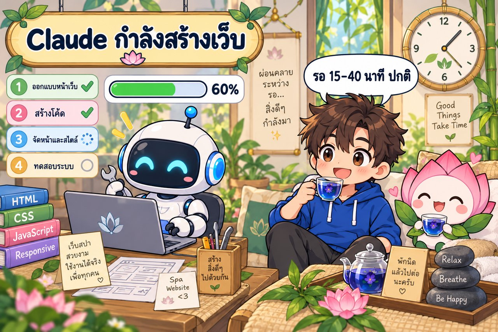

เสร็จแล้วทั้ง 2 กล่องต้องขึ้น **healthy** = พร้อมใช้งานจริง

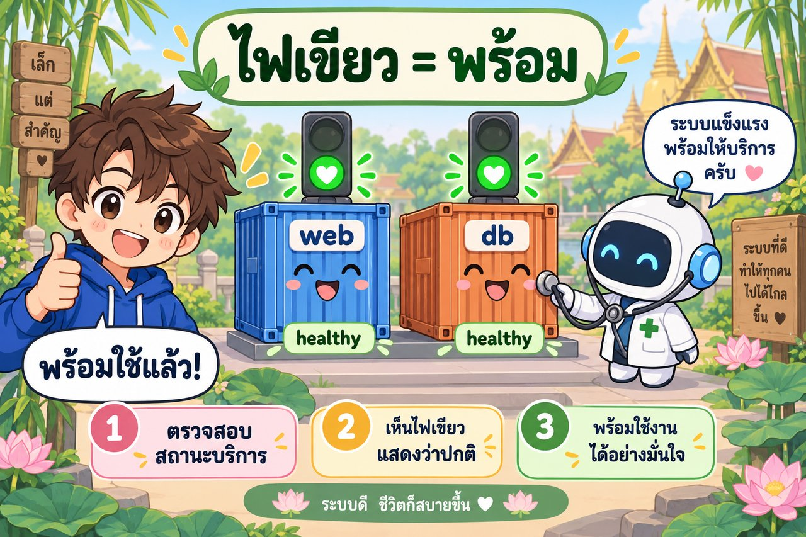

✅ **ผลจริง**

Claude ทำครบ **12 ขั้น (0–11)** ใช้เวลาประมาณ **50 นาที** และรายงานว่าตรวจกฎร้านผ่าน API เอง **79 ข้อ ผ่านทั้งหมด**

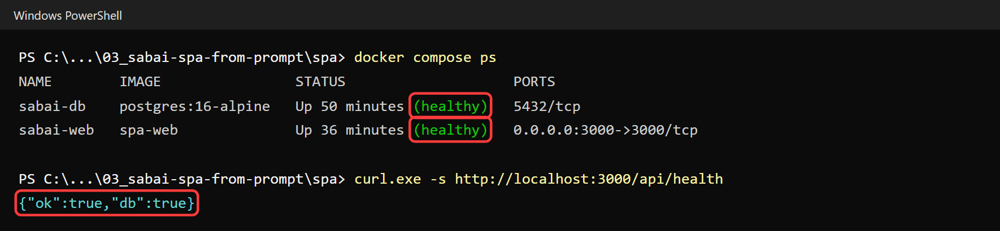

| ขั้น | ผล |
|---|---|
| Docker 2 กล่อง | ✅ `sabai-db` (postgres:16-alpine) + `sabai-web` (Next.js) ขึ้น **healthy** |
| `/api/health` | ✅ `{"ok":true,"db":true}` |
| รูปจาก `assets/` | ✅ คัดลอกครบ 35 รูป ไม่มีรูปจากเน็ต |
| ฟีเจอร์ | ✅ จองเดี่ยว/คู่/กลุ่ม · อารมณ์ · ควิซ · วิเคราะห์ผิว · ก่อน/หลัง · chatbot 3 ภาษา · Wallet · Gift Card · ทัวร์ 360° · เพลง |
| สำหรับ test | ✅ `data-testid` ทุกปุ่ม · ปุ่มรีเซ็ต + ล็อกวันที่ · ผู้ใช้ตัวอย่าง 3 คน (`nida@sabai.test` / `Sabai1234!`) |
| เอกสาร | ✅ `spa/SPEC.md` (testid, ข้อความ error, API) · `spa/BUGS.md` (เฉลยบั๊ก) |

แล้วเปิด http://localhost:3000 ได้เว็บนี้ 🎉 (รูปทุกรูปมาจาก `assets/`)

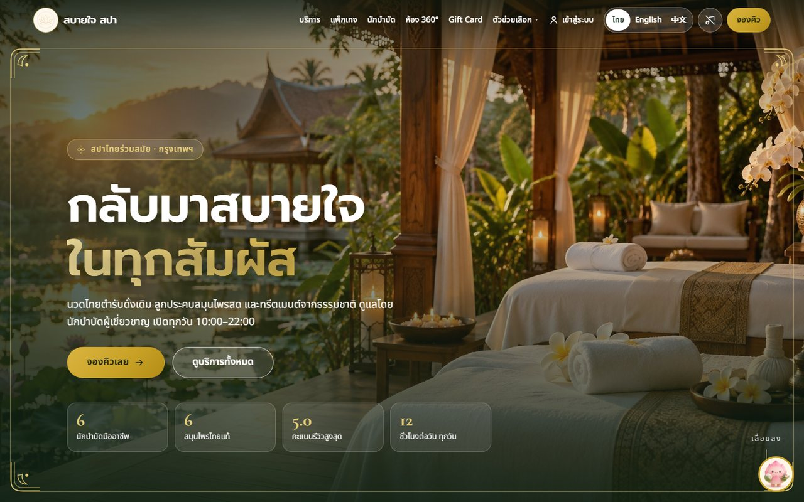

| 💆 บริการและทรีตเมนต์ | 👩 นักบำบัด + คะแนนรีวิว |
|---|---|
| 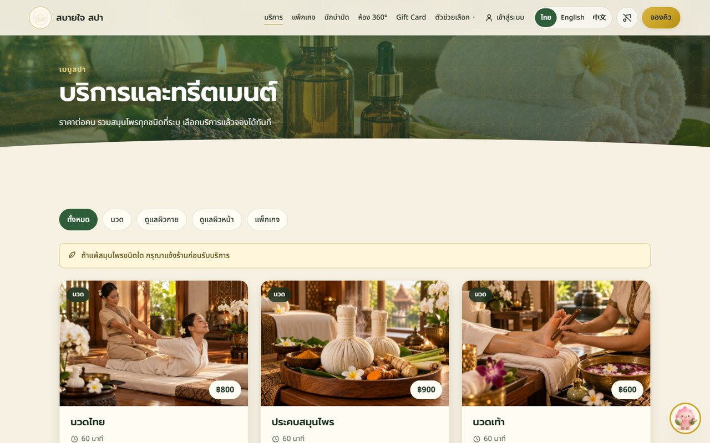 | 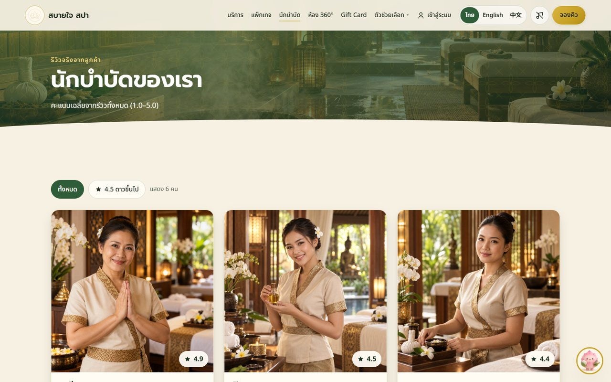 |
| 🎁 **Gift Card 3 ลาย** | 🛏️ **ทัวร์ห้อง 360°** |
| 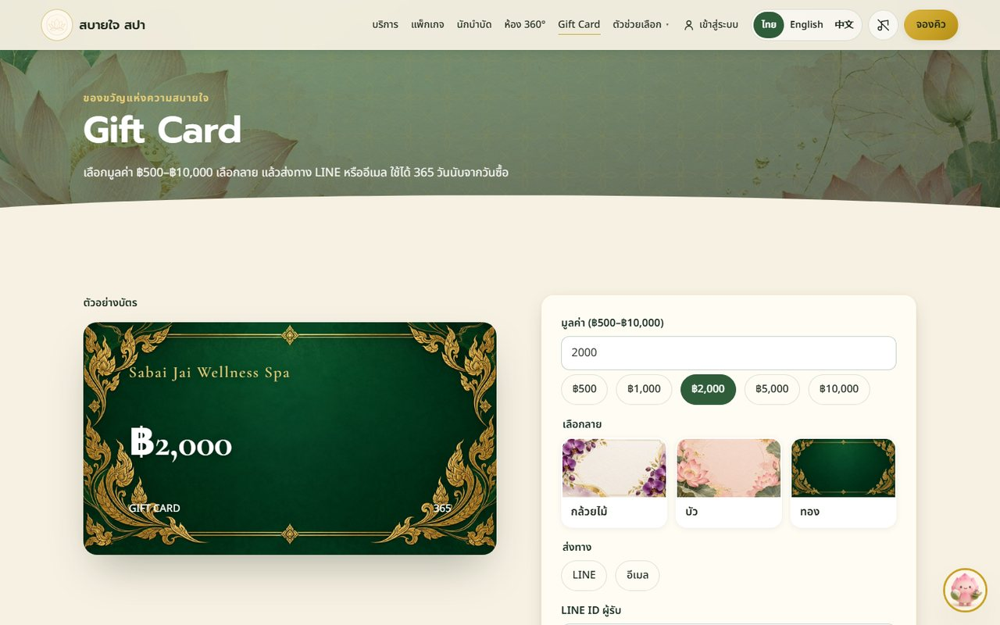 | 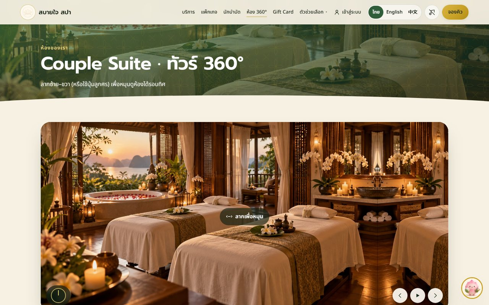 |
| 🚐 **แพ็กเกจนักท่องเที่ยว + รถรับส่ง** | 📱 **มือถือ** |
| 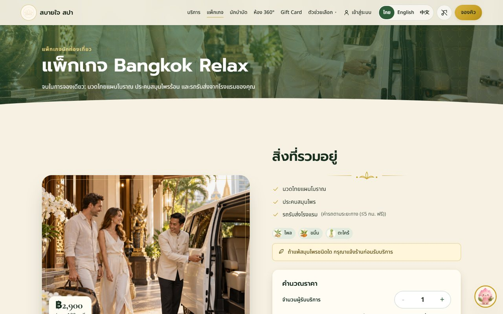 | 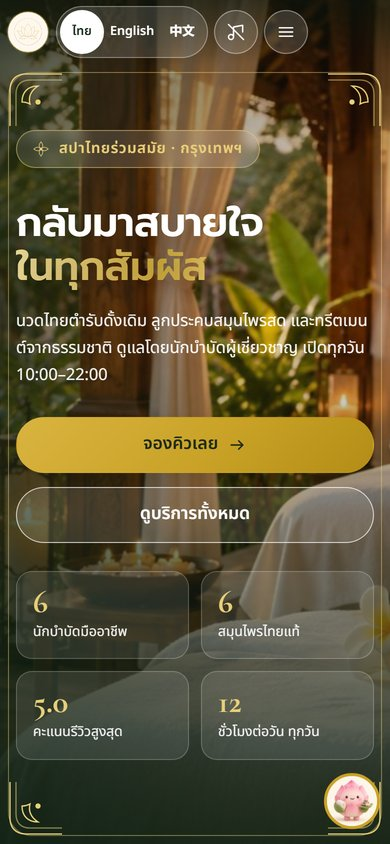 |

**ข้างในเว็บที่ได้ มีกี่ชั้น?** (นับจากโค้ดจริงที่ Claude สร้าง)

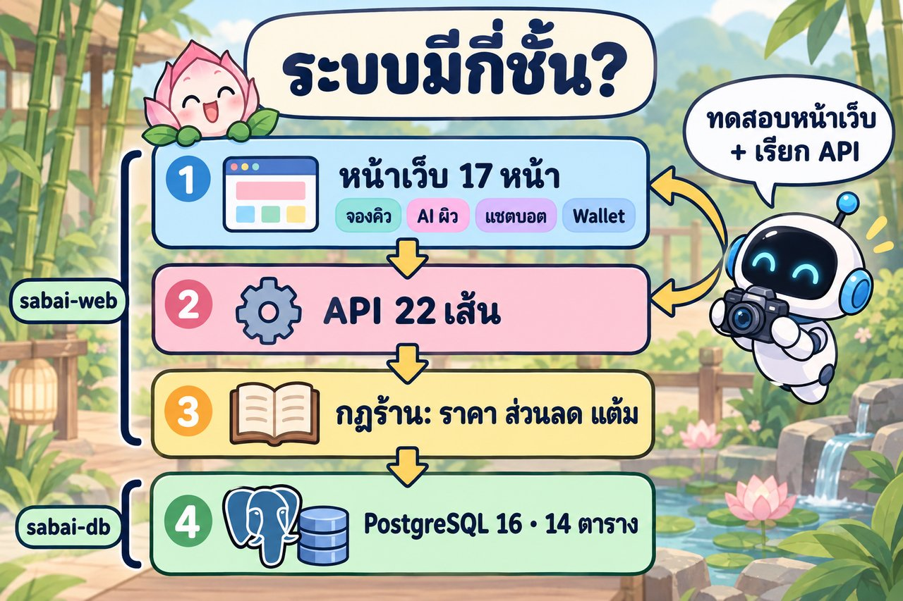

👀 **สังเกต**
- เว็บของแต่ละคน **หน้าตาไม่เหมือนกันเป๊ะ** ได้ ขอแค่ทำตาม REQUIREMENTS เดียวกัน
- `sabai-web` และ `sabai-db` ต้อง **healthy ทั้งคู่** และ `/api/health` ตอบ `{"ok":true,"db":true}` ก่อนไป LAB 5

✔️ **ไปต่อได้เมื่อ:** เปิด http://localhost:3000 แล้วเห็นหน้าเว็บสปา · ติดอยู่? → [คัดลอกพรอมต์แก้ปัญหา](#ถ้าเจอปัญหา-คัดลอกพรอมต์นี้)

---

## LAB 5 · เดินดูเว็บแบบลูกค้า

🎯 ได้ **แผนที่เว็บ + ภาพทุกหน้า** และรู้ว่าหน้าไหน **เสี่ยง** ต้องทดสอบก่อน

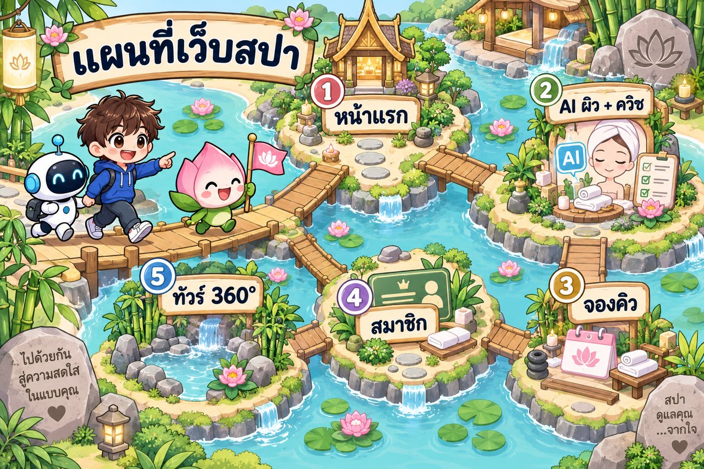

💬 **คัดลอกพรอมต์นี้**

```text
ใช้ Playwright MCP เปิด http://localhost:3000 ในแท็บใหม่ แล้วพาเดินดูเหมือนลูกค้า ห้ามแก้โค้ด
1. หน้าแรก → เลือกอารมณ์ "เครียด" → ดูบริการที่แนะนำ
2. หน้านักบำบัด → เปิดโปรไฟล์ 1 คน ดูรีวิว
3. จองคิว: เลือกบริการ นักบำบัด วันพรุ่งนี้ เวลาแรกที่ว่าง (ยังไม่ต้องกดยืนยัน)
4. วิเคราะห์ผิว: อัปโหลด assets/skin/sample-face.jpg · Chatbot: ถาม "นวดไทยราคาเท่าไหร่"
5. เข้าสู่ระบบด้วยผู้ใช้ตัวอย่างใน spa/SPEC.md → ดู Wallet และระดับสมาชิก
จับภาพทุกหน้าเก็บไว้ในโฟลเดอร์ screenshots แล้วสรุปเป็นตาราง: หน้า | สิ่งที่เห็น | สิ่งที่ควรทดสอบ | ความเสี่ยง (สูง/กลาง/ต่ำ)
```

⚠️ ตอนเปิดแท็บครั้งแรก ปลั๊กอิน Playwright ใน Chrome จะ **ขอให้กดอนุญาต** (เหมือนบท 01 LAB 6) ถ้าไม่กด Claude จะรอไปเรื่อย ๆ

✅ **ผลจริง**

Claude เดินครบ 5 ขั้น เก็บภาพไว้ใน `screenshots/` **16 รูป** และไม่มี error ใน console

| 😩 เลือก "เครียด" → อโรมา · ประคบ · ขัดผิว | ⭐ รีวิวนักบำบัด |
|---|---|
| 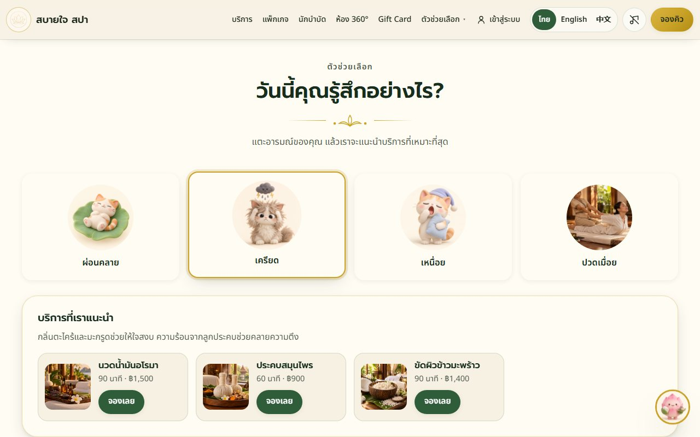 | 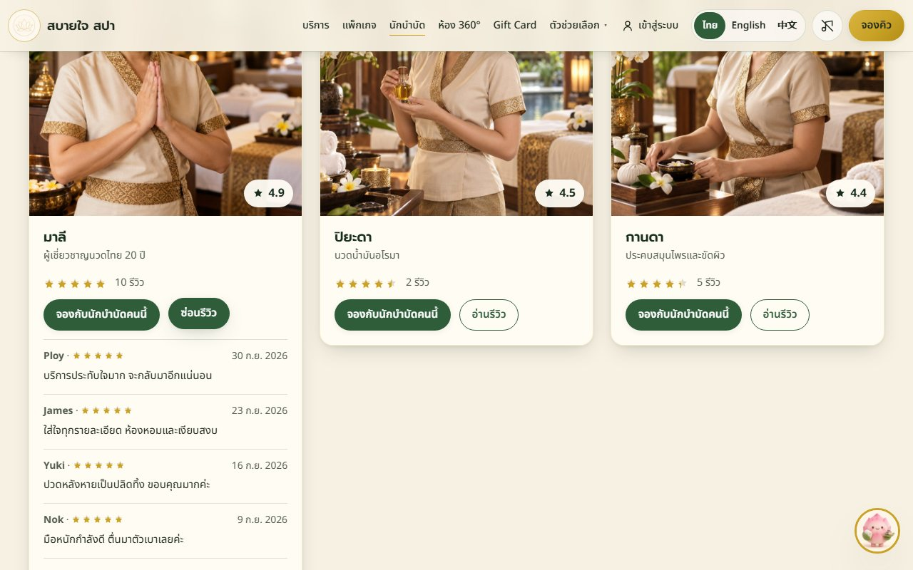 |
| 📅 **จองคิว: รอบเต็มกดไม่ได้** | 🔍 **วิเคราะห์ผิวในเครื่อง** |
| 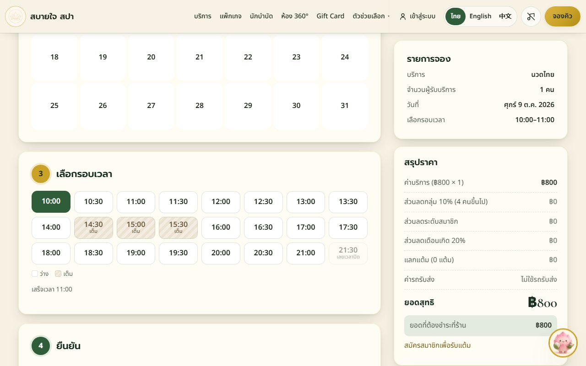 | 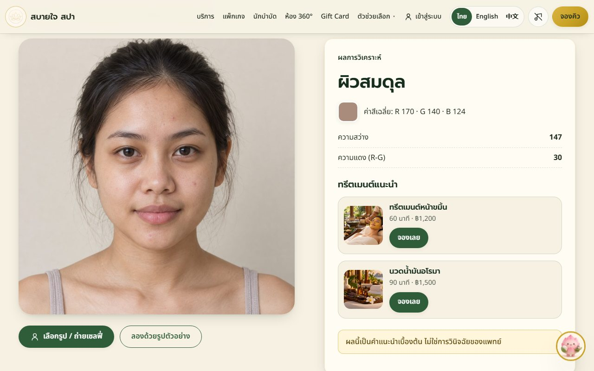 |
| ✨ **ภาพจำลองก่อน/หลัง** | 💬 **Chatbot ตอบราคา** |
| 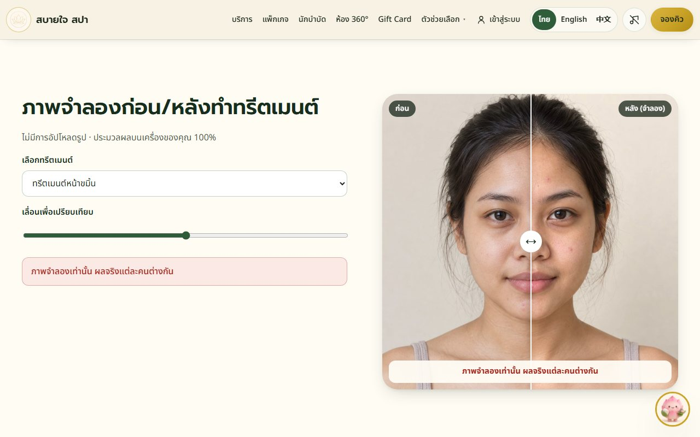 | 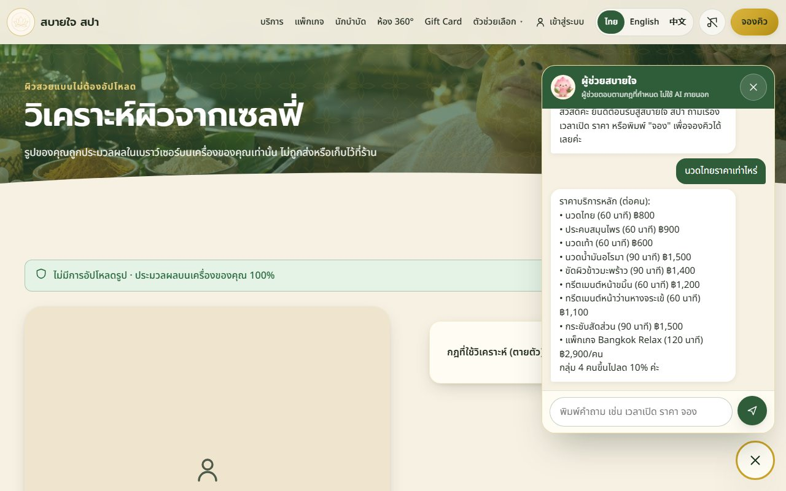 |
| 🏅 **บัญชีคุณนิดา: Gold 124 แต้ม** | 🎟️ **Wallet: เหลือ 7 จาก 11 ครั้ง** |
| 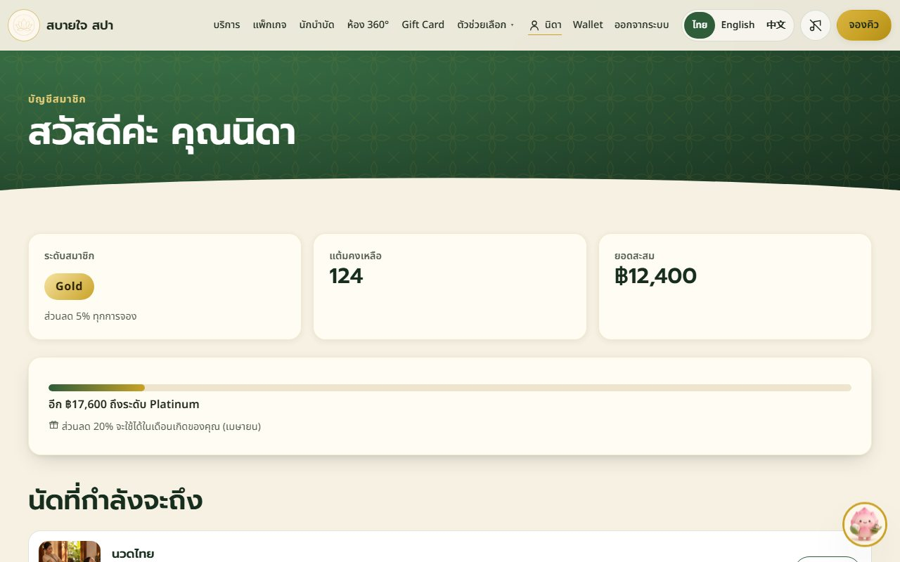 | 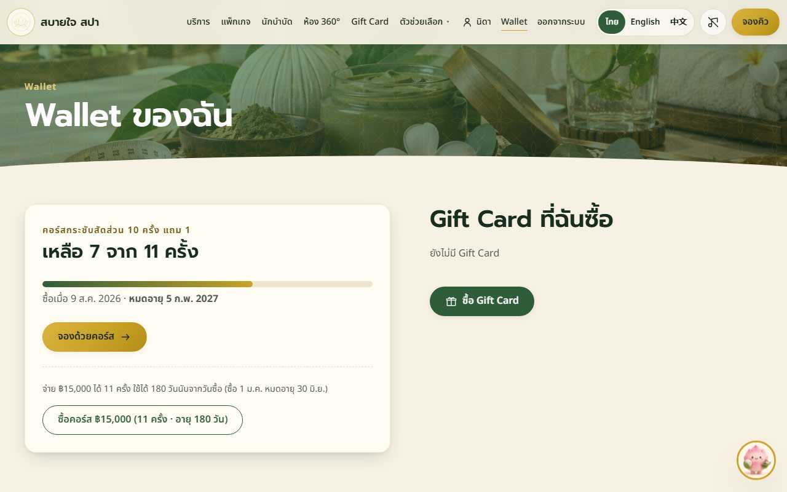 |

ตารางที่ Claude สรุป (ย่อ)

| หน้า | สิ่งที่ควรทดสอบ | ความเสี่ยง |
|---|---|---|
| จองคิว `/book` | จองซ้อน · ช่วงวันที่ +1 ถึง +30 · ราคาทุกบรรทัด | 🔴 สูง |
| บัญชี / Wallet | ระดับสมาชิก ฿10,000 · ยกเลิก 24 ชม. · คอร์สลดครั้ง | 🔴 สูง |
| เข้าสู่ระบบ | รหัสผิดต้องเตือน · เข้า `/wallet` โดยไม่ login | 🔴 สูง |
| อารมณ์ / ผิว / Chatbot | ผลต้องเหมือนเดิมทุกครั้ง · ตอบตามภาษาที่ถาม | 🟡 กลาง |
| หน้าแรก | เมนู ปุ่มจอง สลับภาษา มือถือ | 🟢 ต่ำ |

👀 **สังเกต**
- เลือกอารมณ์ "เครียด" กี่รอบก็ต้องได้บริการ **เหมือนเดิม** เพราะ "AI" ใช้กฎตายตัว
- หน้าที่มี **เงิน** หรือ **เวลาจอง** = ความเสี่ยงสูง → ต้องอยู่ในแผนทดสอบก่อนเสมอ
- 📅 วันที่ในรูปขึ้นกับวันที่เราเปิดเว็บ ของเราต่างได้ ไม่ใช่บั๊ก (test จะล็อกวันเองใน LAB 7)

✔️ **ไปต่อได้เมื่อ:** มีโฟลเดอร์ `screenshots/` และตารางความเสี่ยง

---

## LAB 6 · เขียนแผนทดสอบ (TEST-PLAN.md)

🎯 ได้ **TEST-PLAN.md ราว 30 test case** ที่ทุกข้อโยงกลับไปหา FR / BR ได้

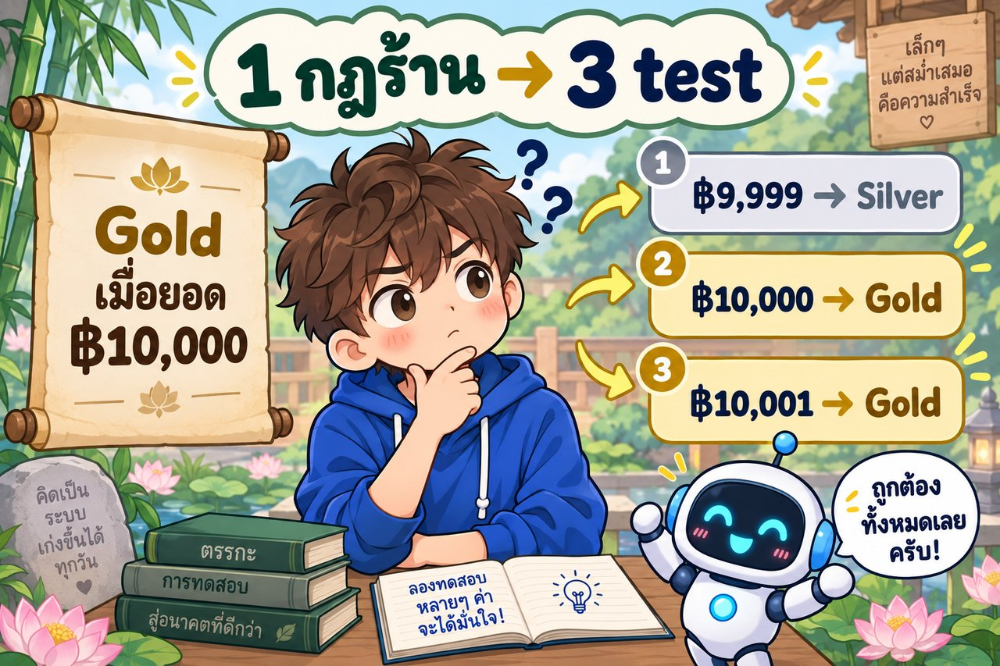

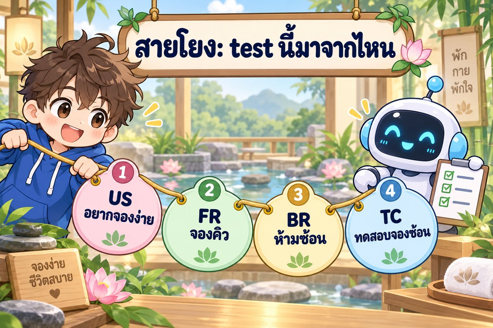

| 🤖 ทดสอบ "AI" ได้ เพราะรู้คำตอบก่อน | 🚫 ห้ามจองซ้อน | 🏅 ค่าขอบระดับสมาชิก |
|---|---|---|
|  | 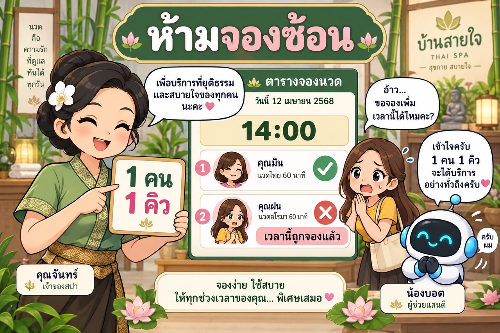 |  |
| เครียด → ต้องได้บริการเดิมทุกครั้ง | นักบำบัด 1 คน = 1 คิว | ฿9,999 / ฿10,000 |

💬 **คัดลอกพรอมต์นี้**

```text
อ่าน REQUIREMENTS.md และ spa/SPEC.md (ห้ามเปิด spa/BUGS.md) แล้วเขียน TEST-PLAN.md แบบ tester มืออาชีพ
1. ระบบที่ทดสอบ · ขอบเขต (ทดสอบ / ไม่ทดสอบ) เป็นตาราง
2. เทคนิคที่ใช้พร้อมตัวอย่างจากเว็บนี้: happy path, negative, boundary (ค่าขอบ), equivalence, state (รีโหลด/ทำซ้ำ), API
3. ระดับ P1 = เงินผิด / จองไม่ได้ / จองซ้อน · P2 = ฟีเจอร์สำคัญ · P3 = สวยงาม / เกิดไม่บ่อย
4. ตาราง test case ประมาณ 30 ข้อ: ID (TC-<โมดูล>-01) | โมดูล | สิ่งที่ทดสอบ | FR/BR | ระดับ | ข้อมูลที่ใช้ | ผลที่คาดหวัง (ตัวเลข/ข้อความจริงจาก SPEC)
   โมดูล: HOME, MOOD, BOOK, THER, AI, CHAT, MEM, WAL, GIFT, DASH, EXP, MOB, API
   ต้องมี: จองคิวจนจบ (E2E) 1 ข้อ · ค่าขอบระดับสมาชิก ฿9,999 / ฿10,000 · จองซ้อน · จองด้วยคอร์สแล้วครั้งลด · API ไม่ login ต้องได้ 401
5. ตาราง Traceability: FR/BR | TC ที่ครอบคลุม (ทุก FR/BR ต้องมีอย่างน้อย 1 TC)
6. เริ่มทดสอบได้เมื่อ 2 container healthy · ผ่านเกณฑ์เมื่อ P1 ผ่านหมด และผ่านรวม ≥ 95%
7. หลักฐาน: ทุก test ที่เปิดหน้าเว็บต้องมีไฟล์ GIF และ MP4
ถ้า SPEC ไม่บอกค่าที่ต้องใช้ ให้เขียนว่า "ต้องถาม" ห้ามเดา · สรุปท้ายเป็นตาราง: โมดูล | จำนวน TC | P1 | P2 | P3
```

✅ **ผลจริง**

ได้ `TEST-PLAN.md` **33 test case** โยงกลับ FR/BR ครบ และมีหัวข้อ **"ต้องถาม" 15 ข้อ** (ค่าที่ SPEC ไม่ได้บอก Claude ไม่เดาเอง)

| โมดูล | จำนวน | P1 | P2 | P3 |
|---|---|---|---|---|
| BOOK จองคิว | 8 | 8 | – | – |
| MEM สมาชิก / แต้ม | 4 | 4 | – | – |
| WAL คอร์ส | 3 | 3 | – | – |
| อื่น ๆ (HOME MOOD THER AI CHAT GIFT DASH EXP MOB API) | 18 | 4 | 11 | 3 |
| **รวม** | **33** | **19** | **11** | **3** |

ตัวอย่างจากไฟล์จริง

| ID | สิ่งที่ทดสอบ | มาจาก | ระดับ |
|---|---|---|---|
| TC-BOOK-01 | **E2E** จองคิวเดี่ยวจนจบ: บริการ → วัน → รอบ → ยืนยัน | FR-01, FR-06 | P1 |
| TC-BOOK-03 | ปฏิทินกดได้แค่ +1 ถึง +30 วัน (ข้ามเดือนด้วย) | BR-05 | P1 |
| TC-MEM-01 | ค่าขอบระดับ ฿9,999 / ฿10,000 / ฿29,999 / ฿30,000 | BR-13 | P1 |
| TC-WAL-01 | จองด้วยคอร์สแล้ว **7 → 6 ครั้ง** ยกเลิกแล้วคืน | BR-16 | P1 |
| TC-MOOD-01 | เลือกอารมณ์ 10 รอบ ต้องได้คำแนะนำเดิมทุกรอบ | BR-23 | P2 |
| TC-API-01 | เรียก API ที่ต้อง login โดยไม่ login → **401** | FR-07 | P2 |

เกณฑ์ผ่าน: P1 ผ่านครบ **19/19** และผ่านรวม ≥ 95% (อย่างน้อย **32 จาก 33**)

👀 **สังเกต**
- ตาราง Traceability ช่วยหา **FR / BR ที่ยังไม่มี test** ได้ทันที (ช่องว่าง = ยังไม่ได้ทดสอบ)
- ห้ามเปิด `spa/BUGS.md` เพราะ test ต้องคิดจาก **ความต้องการ** ไม่ใช่จากเฉลย · ไม่รู้ค่าให้เขียน **"ต้องถาม"**

✔️ **ไปต่อได้เมื่อ:** มี `TEST-PLAN.md` ที่มีตาราง TC-… และตาราง Traceability

---

## LAB 7 · สร้างหุ่นยนต์ทดสอบ (ลอง 2 test ก่อน)

🎯 ได้โฟลเดอร์ **e2e/** ที่รันได้ 3 เบราว์เซอร์ และ **อัดทุก test เป็น GIF + MP4** ให้อัตโนมัติ

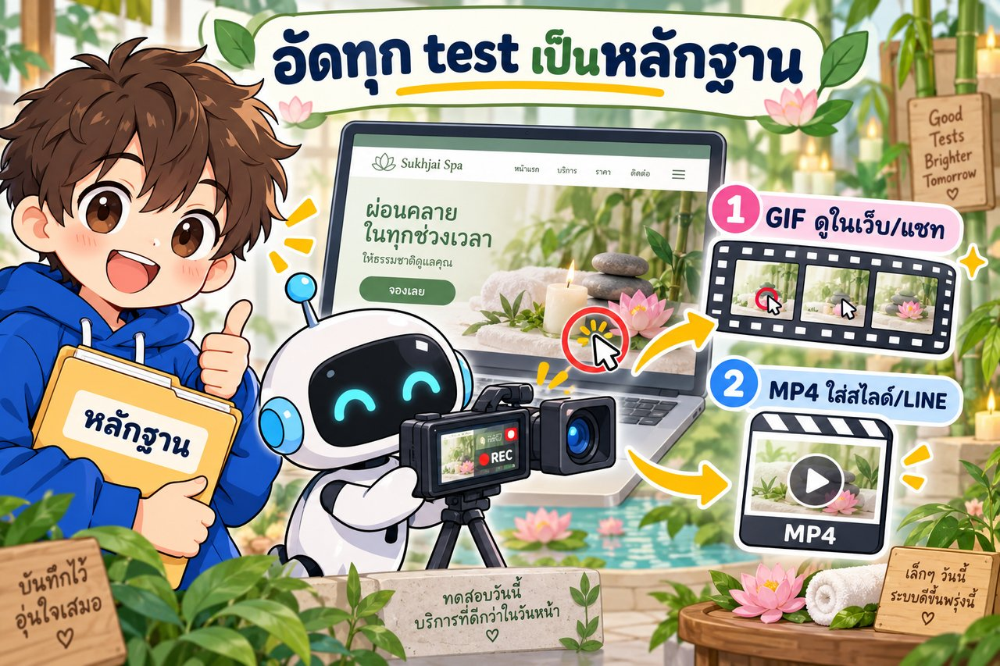

💬 **คัดลอกพรอมต์นี้**

```text
สร้างโฟลเดอร์ e2e/ เป็นโปรเจกต์ Playwright (TypeScript) สำหรับทดสอบ http://localhost:3000 ห้ามแก้โค้ดใน spa/
0. เช็กก่อน: node -v, ffmpeg -version และ http://localhost:3000/api/health · ถ้าไม่มี ffmpeg ให้หยุดแล้วบอกวิธีติดตั้งบน Windows
1. package.json: @playwright/test, cross-env, typescript · scripts: test, test:gif (cross-env GIF=1 ... --project=chromium), report
2. playwright.config.ts: chromium / firefox / webkit, viewport 1280x800, locale th-TH, timezoneId Asia/Bangkok
   GIF=1 → อัดวิดีโอทุก test + slowMo 650 เฉพาะ chromium
3. global-setup.ts: เช็ก /api/health ถ้าเว็บยังไม่เปิดให้ error ภาษาไทยบอกวิธีเปิด แล้ว POST /api/test/reset พร้อม now ที่ล็อกไว้
   (reset แค่ครั้งเดียวตรงนี้ ห้าม reset ใน test เพราะ 3 เบราว์เซอร์รันพร้อมกัน)
4. tests/fixtures.ts: open(page, path) รอ html[data-ready=true] · login ผ่าน API · สร้างผู้ใช้ใหม่อีเมลไม่ซ้ำ
   · จองคนละวันตามชื่อเบราว์เซอร์ กันชนกันตอนรันพร้อมกัน · โหมด GIF: ป้ายชื่อ test มุมซ้ายล่าง + วงแดงตรงจุดคลิก + ค้างเฟรมสุดท้าย 2.5 วินาที
5. reporters/tester-report.ts: แปลงวิดีโอของทุก test เป็น test-report/gifs/<TC>.gif และ test-report/videos/<TC>.mp4 ด้วย ffmpeg
   แล้วเขียน test-report/TEST-REPORT.md แบบ tester: สรุปผล + ผ่านเกณฑ์ไหม, ผลตามโมดูล, ผลราย TC ทุกเบราว์เซอร์พร้อมลิงก์ GIF/MP4,
   ข้อบกพร่อง DEF-001… (ระดับ, ขั้นตอน, ผลที่คาดหวัง, ผลจริงเป็นภาษาคน, หลักฐาน) และบอกโหมด BUG_MODE จาก data-bug-mode
6. ชื่อ test ขึ้นต้นด้วยรหัส TC จาก TEST-PLAN.md · tag ['@<โมดูล>', '@P1|@P2|@P3'] · annotation expected = ผลที่คาดหวัง
   หา element ด้วย getByTestId ตาม spa/SPEC.md เท่านั้น ห้ามเดา selector
7. เขียน test แค่ 2 ข้อก่อน (TC-HOME-01 และ TC-API-01) รัน npx playwright test ให้ผ่าน 3 เบราว์เซอร์ แล้วรัน npm run test:gif
   ตรวจว่าได้ทั้งไฟล์ .gif และ .mp4 ครบ
8. เขียน CLAUDE.md ที่โฟลเดอร์บท: โครงสร้างโฟลเดอร์, คำสั่งเปิดเว็บ/BUG_MODE ใน PowerShell, วิธีเขียน test ใหม่ตามข้อ 6
ถ้าขั้นไหนไม่ผ่านให้หยุดแล้วบอก · สรุปเป็นตาราง: ไฟล์ | ทำหน้าที่อะไร
```

✅ **ผลจริง**

Claude สร้างหุ่นยนต์ทดสอบเสร็จใน **ประมาณ 5 นาที** และลอง 2 test ก่อน

| เช็ก | ผล |
|---|---|
| Node · ffmpeg · `/api/health` | ✅ v26.7.0 · 8.0.1 · `{"ok":true,"db":true}` |
| `npx playwright test` (2 test × 3 เบราว์เซอร์) | ✅ **6/6 passed** (chromium 2 · firefox 2 · webkit 2) |
| `npm run test:gif` | ✅ `TC-HOME-01.gif` + `TC-HOME-01.mp4` (TC-API-01 เรียก API อย่างเดียว เก็บเป็นไฟล์ `.log` แทน) |
| `CLAUDE.md` | ✅ คู่มือ: เปิดเว็บ · สลับ BUG_MODE · วิธีเขียน test ใหม่ |

| ไฟล์ | ทำหน้าที่อะไร |
|---|---|
| `e2e/playwright.config.ts` | 3 เบราว์เซอร์ · ภาษาไทย · เวลาไทย · โหมด GIF อัดวิดีโอช้า ๆ |
| `e2e/global-setup.ts` | เช็กว่าเว็บเปิด แล้วรีเซ็ตข้อมูล + ล็อกวันที่ `2026-10-08 10:00` **ครั้งเดียว** |
| `e2e/tests/fixtures.ts` | ตัวช่วย: เปิดหน้า · login · สร้างสมาชิกใหม่ · ป้ายชื่อ test + วงแดงตรงจุดคลิก |
| `e2e/reporters/tester-report.ts` | วิดีโอ → **GIF + MP4** และเขียน **TEST-REPORT.md** แบบ tester |

⚠️ **เจอจริง:** npm ติดตั้ง Playwright รุ่นใหม่กว่าเบราว์เซอร์ในเครื่อง ทำให้ Firefox / WebKit เปิดไม่ขึ้น Claude จึงล็อกรุ่นให้ตรงกัน (`1.63.0`) ถ้าเจอแบบนี้ใช้พรอมต์ในตาราง "ถ้าเจอปัญหา"

📁 **หลักฐานอยู่ที่ไหน** (ชื่อไฟล์ = รหัส TC)

```text
e2e/test-report/
├─ TEST-REPORT.md        📋 รายงานแบบ tester
├─ gifs/TC-HOME-01.gif   🎞️ ดูใน GitHub / แชท
└─ videos/TC-HOME-01.mp4 ▶️ ใส่สไลด์ / ส่ง LINE
```

👀 **สังเกต**
- ลอง **2 test ก่อน** ถ้า ffmpeg หรือเบราว์เซอร์มีปัญหาจะรู้เร็ว ไม่ต้องรอ 30 ข้อ
- test ที่เปิดหน้าเว็บต้องได้ **ไฟล์คู่ .gif + .mp4** ทุกข้อ (test API ไม่เปิดหน้าเว็บ จึงไม่มีภาพ)

✔️ **ไปต่อได้เมื่อ:** มี `e2e/test-report/gifs/TC-HOME-01.gif` และ `videos/TC-HOME-01.mp4` · ติดอยู่? → [คัดลอกพรอมต์แก้ปัญหา](#ถ้าเจอปัญหา-คัดลอกพรอมต์นี้)

---

## LAB 8 · รันครบ 3 เบราว์เซอร์ + GIF + MP4 + รายงาน

🎯 ได้ **ผลทดสอบทุกข้อ × 3 เบราว์เซอร์** พร้อม **GIF + MP4 + TEST-REPORT.md** ส่งหัวหน้าได้เลย

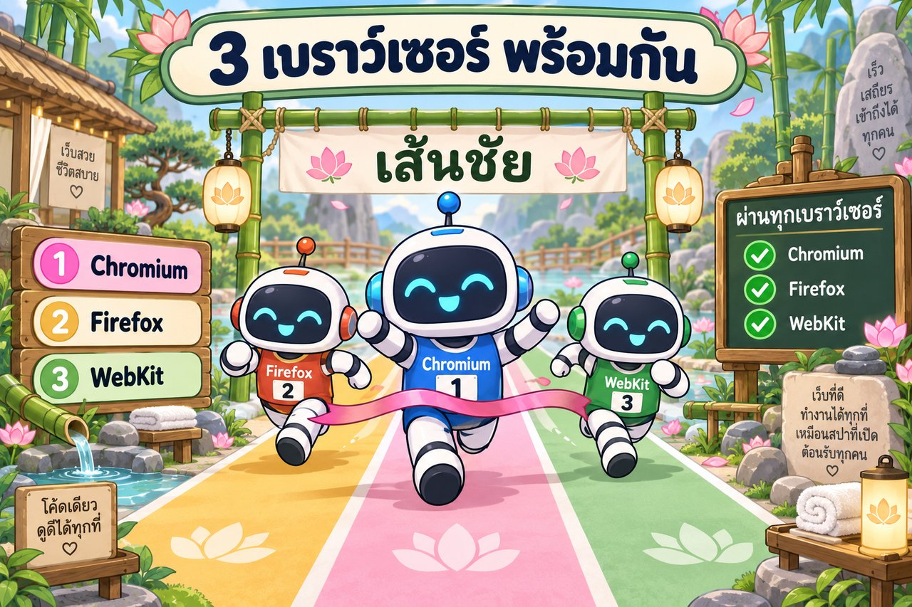

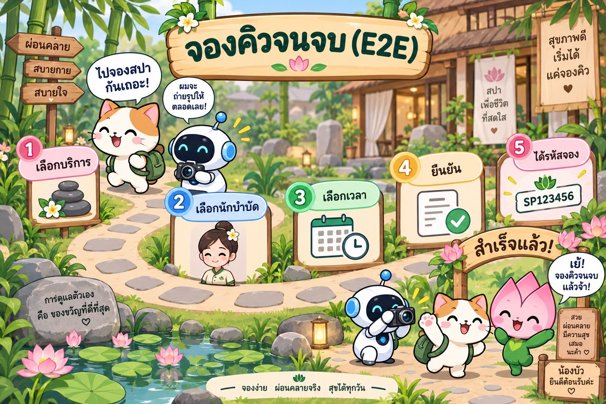

💬 **คัดลอกพรอมต์นี้**

```text
เขียน test ทุกข้อใน TEST-PLAN.md ลงใน e2e/tests/ (แยกไฟล์ตามโมดูล ใช้ fixtures เดิม) ห้ามอ่าน spa/BUGS.md
1. รัน npx playwright test (3 เบราว์เซอร์) · ถ้ามีข้อล้ม ให้ดูภาพตอนล้มก่อน แล้วบอกว่าเป็น "บั๊กของเว็บ" หรือ "test เขียนผิด"
   แก้ได้เฉพาะ test ที่เขียนผิดจริง ห้ามเปลี่ยนผลที่คาดหวังให้ผ่าน ห้ามแก้โค้ดเว็บ
2. รันซ้ำอีก 1 รอบ ถ้าผลไม่เหมือนรอบแรก ให้บอกข้อนั้นและสาเหตุ
3. รัน npm run test:gif ตรวจว่าทุก test ที่เปิดหน้าเว็บมีทั้ง .gif และ .mp4 แล้วเปิด GIF ของ test จองคิวจนจบ (E2E) ให้ผมดู
4. สรุปจาก e2e/test-report/TEST-REPORT.md เป็นตาราง: เบราว์เซอร์ | ผ่าน | ล้ม · จำนวน GIF | จำนวน MP4 · และผ่านเกณฑ์ไหม
```

✅ **ผลจริง**

Claude เขียน test ครบ **33 ข้อ** (13 ไฟล์ตามโมดูล) ใช้เวลารันจริง **4.3 นาที** และรันซ้ำ 3 รอบได้ผลเหมือนเดิมทุกรอบ (ไม่ flaky)

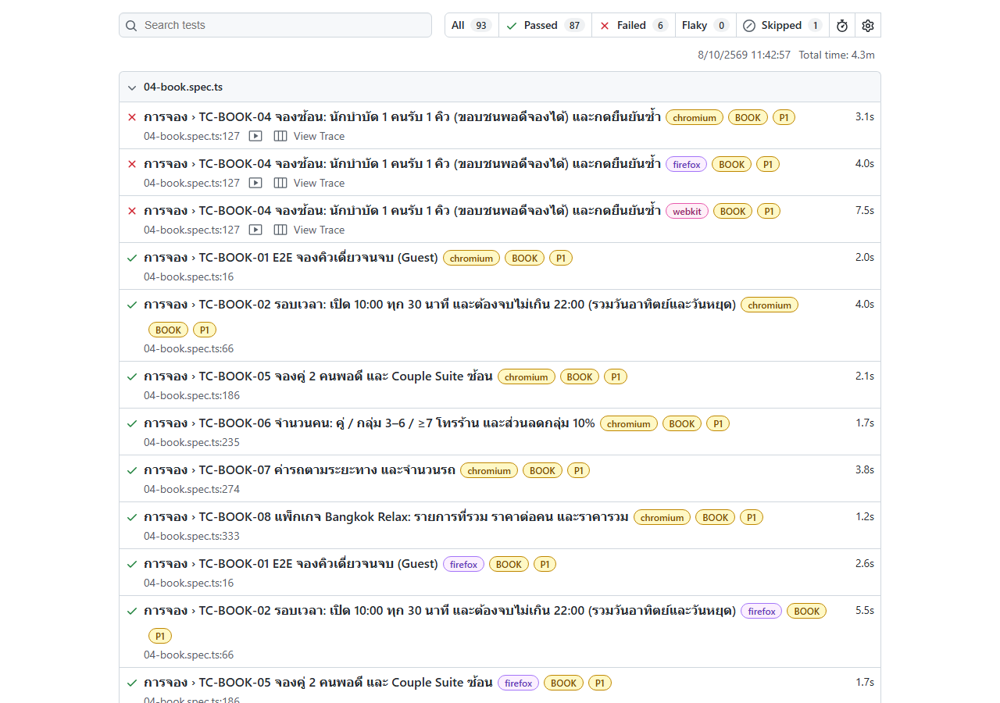

| เบราว์เซอร์ | ✅ ผ่าน | ❌ ล้ม | ⏭️ ข้าม | ข้อที่ล้ม |
|---|---|---|---|---|
| Chromium | 31 | 2 | 0 | TC-BOOK-04, TC-MOB-01 |
| Firefox | 28 | 2 | 0 | TC-BOOK-04, TC-MOB-01 |
| WebKit (Safari) | 27 | 2 | 1 | TC-BOOK-04, TC-MOB-01 |

| 🎞️ GIF | 🎬 MP4 | 📄 log (test API) |
|---|---|---|
| **31 ไฟล์** | **31 ไฟล์** | TC-API-01, TC-API-02 |

**🎬 TC-BOOK-01 จองคิวจนจบ (E2E)** (วงแดง = จุดที่ Playwright คลิก · ป้ายมุมซ้ายล่าง = ชื่อ test)


▶️ ดูแบบวิดีโอ: [video-TC-BOOK-01.mp4](img/video-TC-BOOK-01.mp4)

| 😩 เลือกอารมณ์ 10 รอบ ผลเดิม | 🎟️ จองด้วยคอร์ส 7 → 6 ครั้ง | 🏅 ค่าขอบระดับ ฿9,999 / ฿10,000 |
|---|---|---|
|  | 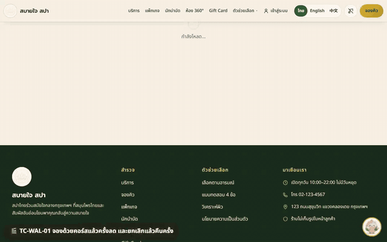 |  |

**รายงานแบบ tester** (`e2e/test-report/TEST-REPORT.md` สร้างเองอัตโนมัติ)

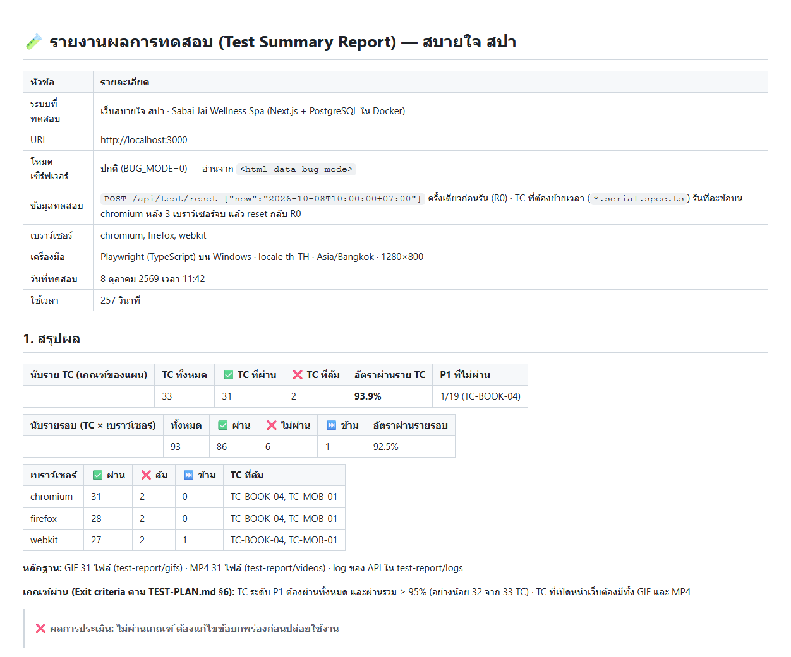

### 🐞 เซอร์ไพรส์! test เจอ **บั๊กจริง** 2 ตัว (ยังไม่ได้เปิดโหมดฝังบั๊ก)

| บั๊กจริง | test ที่จับได้ | ผลที่คาดหวัง | ผลจริง |
|---|---|---|---|
| กดปุ่มยืนยันจอง **2 ครั้งติดกัน** ได้ 2 การจอง | TC-BOOK-04 (P1) | จองได้ครั้งเดียว | ได้ SB00024 + SB00025 เวลาเดียวกัน ❌ |
| บนมือถือ เมนูที่ซ่อนอยู่ **บังปุ่ม "จองคิวเลย"** | TC-MOB-01 (P2) | แตะแล้วไปหน้า `/book` | ไปหน้า `/quiz` (Chromium) หรือ `/mood` (Firefox / WebKit) แทน ❌ |

| 🐞 กดยืนยัน 2 ครั้ง = จอง 2 รายการ | 🐞 แตะปุ่มบนมือถือแล้วไปผิดหน้า |
|---|---|
|  |  |

ผลจึง **ไม่ผ่านเกณฑ์** (P1 ไม่ผ่าน 1 ข้อ · ผ่าน 31/33 = 93.9% < 95%) → ต้องส่งกลับให้คนสร้างเว็บแก้ก่อนเปิดร้าน

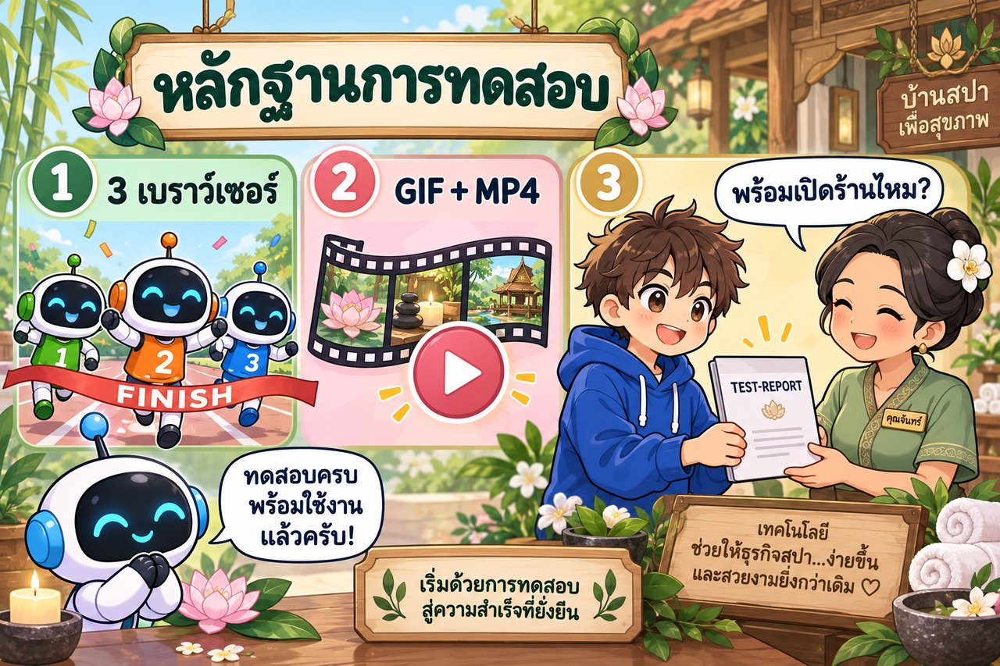

| ✅ | ตรวจหลักฐานให้ครบ | ดูที่ |
|---|---|---|
| ☐ | ผลแยก Chromium / Firefox / WebKit | `TEST-REPORT.md` |
| ☐ | จำนวน **GIF** = จำนวน test ที่เปิดหน้าเว็บ | `e2e/test-report/gifs/` |
| ☐ | จำนวน **MP4** = จำนวน GIF | `e2e/test-report/videos/` |
| ☐ | GIF จองคิวจนจบ (E2E) เปิดดูได้ | Claude เปิดให้ดูในข้อ 3 |
| ☐ | บอกว่า **ผ่านเกณฑ์ไหม** (P1 ผ่านหมด + ผ่านรวม ≥ 95%) | `TEST-REPORT.md` |

👀 **สังเกต**
- รัน **รอบ 2** ต้องได้ผลเหมือนรอบแรก ถ้าไม่เหมือน = test **ไม่นิ่ง (flaky)** ต้องหาสาเหตุ
- ถ้ามีข้อล้มทั้งที่ยังไม่เปิดโหมดบั๊ก อาจเป็น **บั๊กจริง** จากการสร้างเว็บ → ดู GIF ก่อน ห้ามแก้ผลที่คาดหวังให้ผ่าน

✔️ **ไปต่อได้เมื่อ:** มี `e2e/test-report/TEST-REPORT.md` และจำนวน GIF = จำนวน MP4 · ติดอยู่? → [คัดลอกพรอมต์แก้ปัญหา](#ถ้าเจอปัญหา-คัดลอกพรอมต์นี้)

---

## LAB 9 · จับบั๊ก 🐞

🎯 เปิด **โหมดฝังบั๊ก** (`BUG_MODE=1`) แล้วดูว่า test ของเรา **จับได้ครบ 3 ตัวไหม** พร้อม GIF + MP4 เป็นหลักฐาน

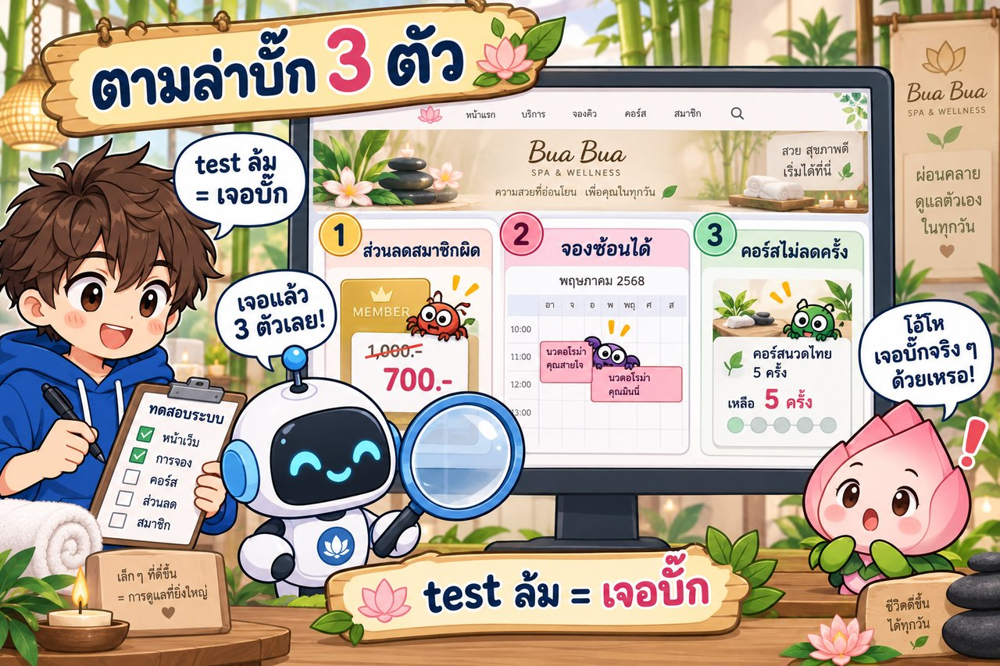

💬 **คัดลอกพรอมต์นี้**

```text
เปิดเว็บโหมดฝังบั๊ก: ในโฟลเดอร์ spa รันใน PowerShell  $env:BUG_MODE=1; docker compose up -d
รอจน healthy แล้วเช็กว่าหน้าเว็บมี data-bug-mode="1"
1. ในโฟลเดอร์ e2e รัน npx playwright test แล้ว npm run test:gif (ต้องได้ GIF + MP4 ของ test ที่ล้มด้วย)
   แล้วคัดลอก TEST-REPORT.md และ GIF/MP4 ของข้อที่ล้มไปเก็บที่ e2e/test-report/bugmode/ กันรอบหน้าเขียนทับ
2. บอกว่า test ไหนล้ม ล้มเพราะอะไร ดู GIF ประกอบ (ห้ามแก้ test ห้ามแก้เว็บ)
3. เขียนรายงานบั๊กแบบ tester เป็นตาราง: DEF | TC | ระดับ | ขั้นตอนทำซ้ำ | ผลที่คาดหวัง | ผลจริง | GIF | MP4
4. ตอนนี้ค่อยเปิด spa/BUGS.md แล้วเทียบ: บั๊กที่ฝัง | test ที่จับได้ | จับได้ไหม
5. เปิดเว็บกลับโหมดปกติ: $env:BUG_MODE=0; docker compose up -d แล้วเช็ก data-bug-mode="0"
```

✅ **ผลจริง**

✅ **test จับบั๊กที่ฝังไว้ได้ครบทั้ง 3 ตัว** และรายงานบอกว่า **ไม่ผ่านเกณฑ์** (ใช้เวลา ~25 นาที)

| เบราว์เซอร์ | ✅ ผ่าน | ❌ ล้ม | ⏭️ ข้าม |
|---|---|---|---|
| Chromium | 24 | 9 | 0 |
| Firefox | 21 | 9 | 0 |
| WebKit (Safari) | 20 | 9 | 1 |

ทั้ง 3 เบราว์เซอร์ล้ม **9 ข้อเดียวกัน** (โหมดปกติล้มแค่ 2) → เพิ่มมา 7 ข้อ = บั๊กที่ฝังไว้

| 🐞 บั๊กที่ฝัง (`spa/BUGS.md`) | test ที่จับได้ | ผลที่คาดหวัง | ผลจริง | จับได้? |
|---|---|---|---|---|
| ยอดสะสม ฿10,000 พอดี ยังเป็น Silver | TC-MEM-01 (P1) | Gold ลด 5% → ฿760 | Silver ไม่ลด → ฿800 | ✅ |
| จองนักบำบัดเวลาทับกันได้ | TC-BOOK-04 · TC-API-02 · TC-BOOK-01 · TC-CHAT-02 · TC-EXP-01 | "เวลานี้ถูกจองแล้ว" | จองซ้อนสำเร็จ · รอบที่จองแล้วยังขึ้นว่าง | ✅ (5 test) |
| จองด้วยคอร์สแล้วครั้งไม่ลด | TC-WAL-01 · TC-WAL-02 (P1) | เหลือ 6 จาก 11 | ยังเหลือ 7 จาก 11 | ✅ |

| 🐞 ฿10,000 ยังเป็น Silver | 🐞 รอบ 14:00 มีคิวแล้วยังจองได้ | 🐞 จองด้วยคอร์สแล้วยังเหลือ 7 |
|---|---|---|
|  |  |  |

**รายงานบั๊กที่ได้** (สร้างอัตโนมัติ มี DEF-001 ถึง DEF-009 พร้อมขั้นตอนทำซ้ำ ผลที่คาดหวัง ผลจริง GIF และ MP4)

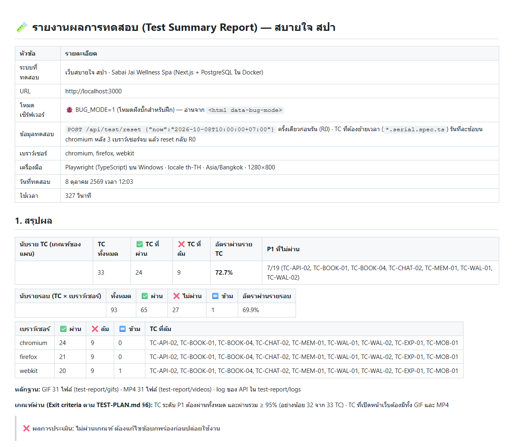

📁 หลักฐานโหมดบั๊กเก็บแยกไว้ที่ `e2e/test-report/bugmode/` (GIF + MP4 ของข้อที่ล้ม และ `.log` ของ test API) จะได้ไม่โดนรอบถัดไปเขียนทับ

จบแล้ว Claude เปิดเว็บกลับเป็น **โหมดปกติ** ให้: `data-bug-mode="0"` · 2 กล่อง healthy ✅

**test ล้ม = ผิดที่ไหน?** ดู GIF ก่อนเสมอ แล้วเลือก 1 ใน 3 ทาง

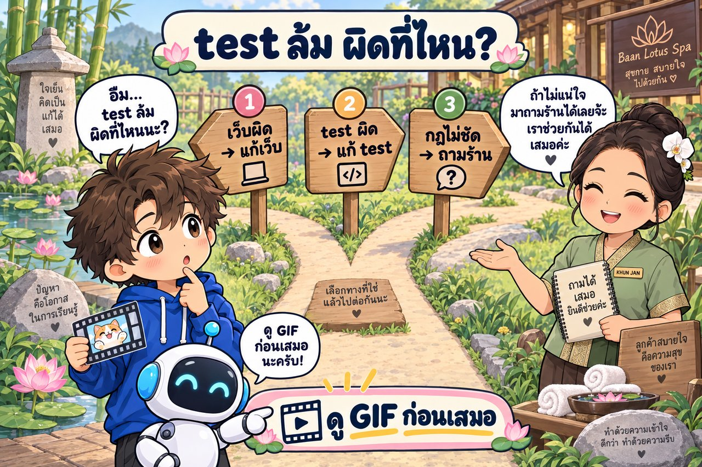

| ทาง | เห็นใน GIF ว่า | ทำอะไรต่อ |
|---|---|---|
| 1️⃣ เว็บผิด | เว็บคิดเงิน / จองผิดจากกฎร้าน | เขียนรายงานบั๊ก ส่งคนสร้างเว็บ |
| 2️⃣ test ผิด | test หาปุ่มผิด หรือรอไม่พอ | แก้ test ได้ แต่ **ห้ามเปลี่ยนผลที่คาดหวัง** |
| 3️⃣ กฎไม่ชัด | ทั้งเว็บและ test ถูก "คนละแบบ" | ถามร้าน แล้วแก้ `REQUIREMENTS.md` ก่อน |

👀 **สังเกต**
- test ล้ม = **เจอบั๊กก่อนลูกค้าเจอ** 🎉 และมี GIF + MP4 เป็นหลักฐานให้ทีมดู
- เปิด `spa/BUGS.md` **หลัง** เขียนรายงานเท่านั้น (ดูเฉลยก่อน = ลอกข้อสอบ) · จบแล้วต้องกลับ `BUG_MODE=0` เสมอ

---

## ถ้าเจอปัญหา: คัดลอกพรอมต์นี้

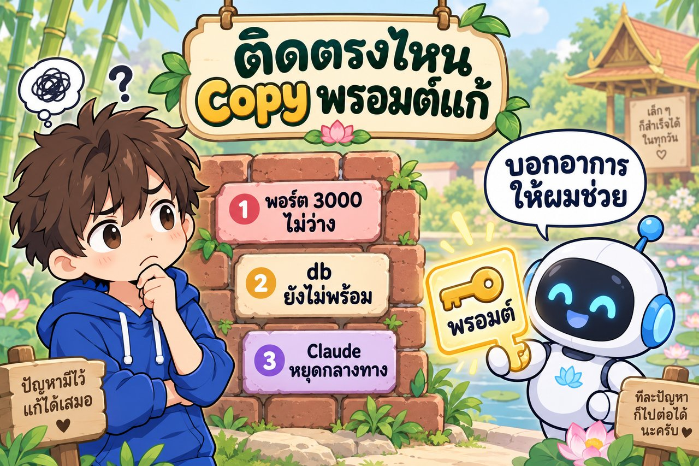

| อาการ | 💬 พรอมต์ |
|---|---|
| พอร์ต 3000 ไม่ว่าง | `เปิดเว็บไม่ได้เพราะพอร์ต 3000 ถูกใช้ ช่วยหาว่าโปรแกรมหรือ container ไหนใช้อยู่ (เช่น petshop จากบท 02) บอกผมก่อนว่าจะปิดอะไร แล้วค่อยปิด` |
| db ยังไม่พร้อม / web ไม่ healthy | `sabai-web ไม่ขึ้น healthy ช่วยดู docker compose logs web และ db บอกสาเหตุเป็นภาษาง่าย ๆ ถ้าเป็นเพราะ db ยังไม่พร้อมให้แก้ให้ web รอ db (healthcheck + retry)` |
| build ล้ม | `docker compose build ล้ม ช่วยอ่าน error ถ้าเป็นเพราะหน้าเว็บพยายามต่อ DB ตอน build ให้แก้หน้านั้นเป็น dynamic แล้ว build ใหม่ สรุปว่าแก้ไฟล์ไหน` |
| รูปในเว็บไม่ขึ้น | `รูปในเว็บไม่ขึ้น ช่วยเช็กว่า spa/public/assets มีไฟล์ครบตาม assets/ และ path ในโค้ดตรงกัน (ตัวพิมพ์เล็ก/ใหญ่) ห้ามแก้ไฟล์ใน assets/` |
| Claude หยุดกลางทาง | `อ่าน BUILD-PROMPT.md และไฟล์ที่สร้างแล้วใน spa/ ตรวจว่ายังขาดขั้นไหน แล้วทำต่อเฉพาะส่วนที่ขาด เสร็จแล้วสรุปเป็นตาราง` |
| test ล้มทุกข้อ | `test ล้มทุกข้อ ช่วยเช็กว่า /api/health ตอบ ok, /api/test/reset ใช้ได้ (ALLOW_TEST_RESET=1) และ data-bug-mode เป็น 0 หรือยัง` |
| ผ่านบ้างล้มบ้าง (flaky) | `test ข้อนี้ผ่านบ้างล้มบ้าง ช่วยรันข้อนี้ซ้ำ 5 รอบ (--repeat-each=5) บอกสาเหตุ เช่น ข้อมูลชนกันข้ามเบราว์เซอร์ หรือเวลา/วันที่ แก้ที่ test โดยไม่เปลี่ยนผลที่คาดหวัง` |
| ล้มเฉพาะ WebKit | `test ข้อนี้ล้มเฉพาะ webkit ช่วยดูภาพและ trace ตอนล้ม บอกว่าเป็นบั๊กของเว็บบน Safari หรือ test เขียนไม่รองรับ webkit ห้ามข้าม webkit เอง` |
| Firefox / WebKit เปิดไม่ขึ้น | `test บน firefox หรือ webkit เปิดเบราว์เซอร์ไม่ขึ้น ช่วยเช็กว่ารุ่น @playwright/test ใน e2e ตรงกับเบราว์เซอร์ที่ติดตั้งไว้ไหม ถ้าไม่ตรงให้ล็อกรุ่นให้ตรง หรือรัน npx playwright install` |
| ไม่มี GIF / MP4 | `รัน test:gif แล้วไม่มี GIF หรือ MP4 ใน e2e/test-report ช่วยเช็ก ffmpeg -version ถ้าไม่มีบอกวิธีติดตั้งบน Windows (winget) และบอกว่าต้องเปิด terminal ใหม่` |
| ยังเป็นโหมดบั๊กอยู่ | `ช่วยเปิดเว็บกลับโหมดปกติ: ในโฟลเดอร์ spa รัน $env:BUG_MODE=0; docker compose up -d แล้วเช็กว่า data-bug-mode เป็น 0` |

🛑 **เลิกใช้แล้ว ปิดเว็บ:** `ปิดเว็บด้วย docker compose down ในโฟลเดอร์ spa (เก็บข้อมูลไว้) ถ้าจะล้างข้อมูลด้วยให้ถามผมก่อน`

---

## 🎉 จบบทแล้ว

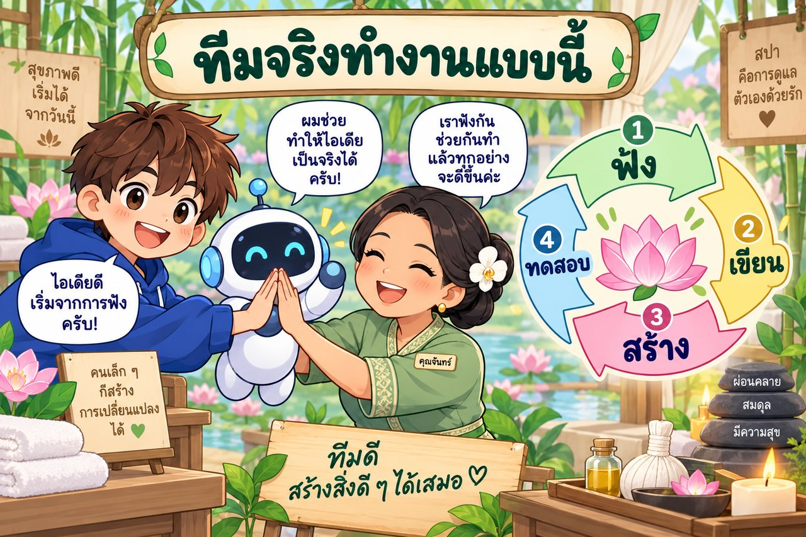

ทีมจริงก็ทำแบบนี้: **ฟัง → เขียน → สร้าง → ทดสอบ** แล้ววนกลับไปฟังใหม่ 🔁

## 📖 คำศัพท์

| คำ | ความหมายง่าย ๆ (เทียบกับสปา) |
|---|---|
| **User Story** | คำขอของลูกค้า 1 ข้อ "ในฐานะ… ฉันอยาก… เพื่อ…" |
| **เกณฑ์ยอมรับ** | ต้องเห็นอะไรถึงนับว่า "เสร็จ" เหมือนลูกค้าเช็กว่านวดครบ 60 นาที |
| **FR / BR / NFR** | สปาทำอะไรได้ / กฎของร้าน (เปิด 10:00–22:00) / ดีแค่ไหน (โหลดไม่เกิน 3 วินาที) |
| **BUILD-PROMPT** | ใบสั่งงานช่างแต่งร้าน เขียนให้ครบก่อนลงมือ |
| **เซสชันใหม่** | พนักงานกะใหม่ จำเรื่องเก่าไม่ได้ ต้องอ่านใบสั่งงาน |
| **docker compose** | เปิดร้าน 2 ห้องพร้อมกัน: หน้าร้าน (`web`) + ห้องเก็บสมุด (`db`) |
| **PostgreSQL** | สมุดนัดและสมุดบัญชีของร้าน |
| **healthy** | ร้านเปิดไฟ พร้อมรับลูกค้าแล้วจริง ๆ |
| **กฎตายตัว (Rule-based)** | พนักงานตอบตามคู่มือ ถามเหมือนเดิมตอบเหมือนเดิม |
| **seed / reset** | ตารางนัดตัวอย่าง / ล้างสมุดนัดกลับเป็นแบบเช้าวันเปิดร้าน |
| **data-testid** | ป้ายชื่อติดประตูห้อง ให้หุ่นยนต์หาเจอ |
| **Playwright MCP** | ให้ Claude ใช้เบราว์เซอร์เดินดูร้านแทนเรา |
| **Traceability** | สายโยง: test ข้อนี้มาจาก BR / FR / US ข้อไหน |
| **หลักฐาน GIF / MP4** | กล้องวงจรปิดของร้าน ย้อนดูได้ว่าเกิดอะไรขึ้นจริง |
| **Flaky** | ผลไม่นิ่ง วันนี้ผ่าน พรุ่งนี้ล้ม เช่น 2 เบราว์เซอร์แย่งจองคิวเดียวกัน |
| **BUG_MODE** | วันซ้อมรับมือ: แอบทำผิด 3 จุดให้ทีมตรวจหา |
| **E2E (End-to-End)** | ทดสอบจนจบเรื่อง เหมือนลูกค้าเดินเข้าร้านจนได้ใบนัด |
| **P1 / P2 / P3** | ความสำคัญของ test: P1 = เงินผิด / จองผิด ต้องผ่านหมด |
| **401** | เว็บตอบว่า "ยังไม่ login ห้ามเข้า" เหมือนพนักงานขอดูบัตรสมาชิก |
| **System Architecture** | แผนผังว่าระบบมีกล่องอะไรบ้าง และคุยกันยังไง |

### ไฟล์ในบทนี้

**ก่อนเริ่ม** (มีให้แค่นี้)

```text
03_sabai-spa-from-prompt/
├─ README.md     # บทเรียน + พรอมต์ทุก LAB
├─ img/          # รูปประกอบบทเรียน
└─ assets/       # รูปที่เว็บใช้ (ห้ามแก้)
```

**หลังจบทุก LAB** (สร้างจากพรอมต์ทั้งหมด)

```text
03_sabai-spa-from-prompt/
├─ README.md, img/, assets/
├─ USER-STORIES.md       # LAB 1  User Story + เกณฑ์ยอมรับ
├─ REQUIREMENTS.md       # LAB 2  FR / BR / NFR
├─ BUILD-PROMPT.md       # LAB 3  พรอมต์สร้างเว็บ
├─ spa/                  # LAB 4  เว็บสบายใจ สปา (Next.js + PostgreSQL)
│  ├─ docker-compose.yml # 2 กล่อง: sabai-web + sabai-db
│  ├─ SPEC.md            # หน้าเว็บ ราคา กฎ data-testid ข้อความ error
│  ├─ BUGS.md            # เฉลยบั๊ก (ห้ามเปิดก่อน LAB 9)
│  └─ public/assets/     # สำเนารูปจาก assets/
├─ screenshots/          # LAB 5  ภาพทุกหน้า
├─ TEST-PLAN.md          # LAB 6  แผนทดสอบ ~30 test case
├─ CLAUDE.md             # LAB 7  คู่มือให้ Claude
└─ e2e/                  # LAB 7–9 หุ่นยนต์ทดสอบ Playwright
   ├─ playwright.config.ts, global-setup.ts
   ├─ tests/             # fixtures.ts + test แยกตามโมดูล
   ├─ reporters/tester-report.ts   # สร้าง GIF + MP4 + TEST-REPORT.md
   └─ test-report/       # TEST-REPORT.md, gifs/, videos/
```
