# สบายใจ สปา: จากบันทึกสัมภาษณ์ สู่เว็บและแผนทดสอบ (Copy & Paste)

บทนี้มี **input แค่อย่างเดียว** คือบันทึกสัมภาษณ์เจ้าของร้านและลูกค้าของ "สบายใจ สปา"
ที่เหลือทั้งหมด **Claude Code สร้างให้จากพรอมต์** ตั้งแต่ User Story, Requirements, ไดอะแกรมออกแบบ, ข้อมูลทดสอบ, ตัวเว็บ (Next.js + PostgreSQL), รูปในเว็บ, การสำรวจ, แผนทดสอบ จนถึงชุดทดสอบ Playwright และรายงานจับบั๊ก
หน้าที่ของเราคือ **คัดลอกพรอมต์ → วางใน Claude Code → อ่านผล → ตัดสินใจ** ไม่ต้องเขียนโค้ดเอง

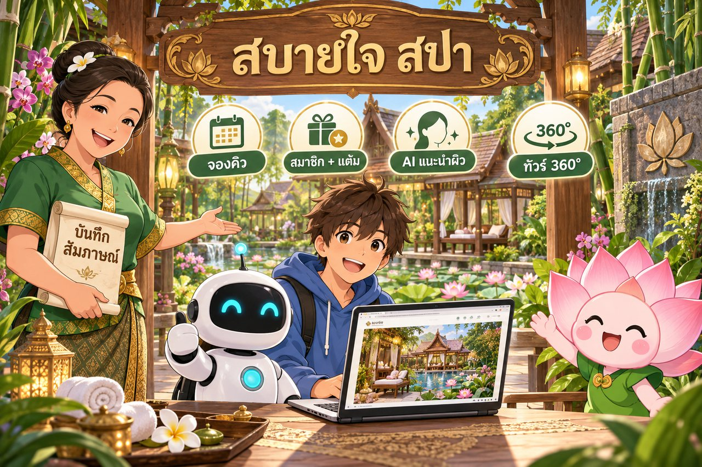

## 🧭 ภาพรวม: Input เดียว → ทุกอย่าง

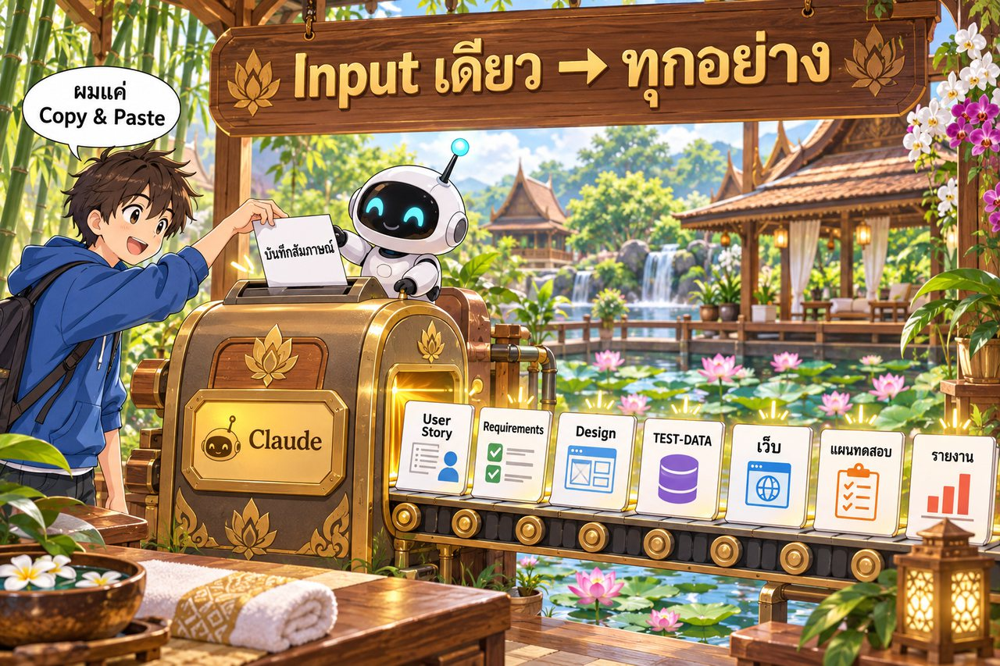


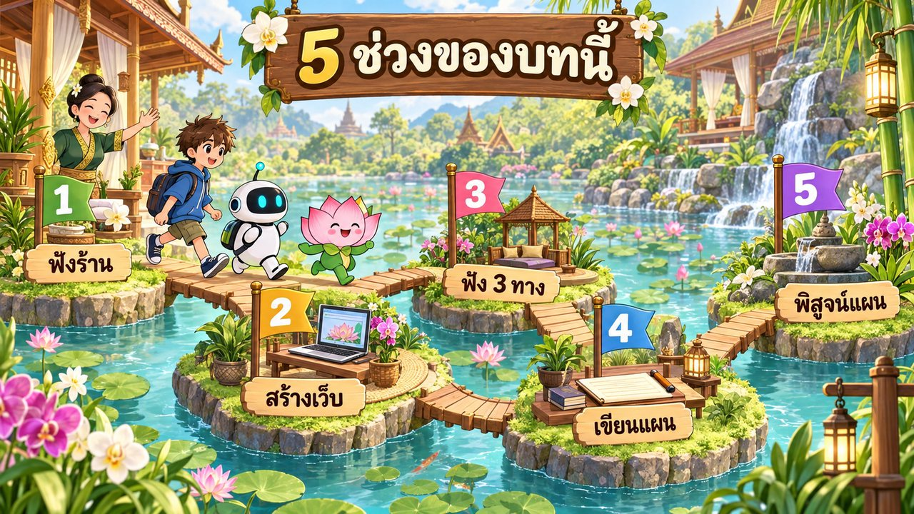

ประโยคหลักของบท: **"ร้านขอ ≠ AI บอกว่าทำแล้ว ≠ เว็บทำจริง"**
เว็บนี้ AI สร้างเองทั้งหมด และ AI ก็รายงานว่า "ตรวจกฎผ่านครบ" แต่งานของ tester คือ **พิสูจน์** ไม่ใช่เชื่อ

---

## 📦 บทนี้ต่างจากบท 02 และ 03 อย่างไร

| | บท 02 | บท 03 | **บท 04 (บทนี้)** |
|---|---|---|---|
| ตอนเริ่มมี | เว็บ + SPEC + TEST-PLAN | เว็บ + TEST-DATA | **บันทึกสัมภาษณ์อย่างเดียว** |
| เว็บมาจาก | ให้มาพร้อม | ให้มาพร้อม | **Claude สร้างใหม่ทั้งหมดจากพรอมต์** |
| ผลที่คาดหวังมาจาก | SPEC.md | [D] [R] [O] | **[D] [R] [A] [O]** (เพิ่มเสียงของ AI ผู้สร้าง) |
| แผนทดสอบ | อ่านแผนที่มีให้ | เขียนเองจากการสำรวจ | **เขียนเองจากการสำรวจ + โยงกลับ FR/BR** |
| บั๊กในโหมดฝังบั๊ก | บอกล่วงหน้า | ไม่บอก | **Claude เลือกเอง ผู้เรียนก็ไม่รู้** |
| ทักษะที่ได้ | อ่านแผน รันเทสต์ | สำรวจ เขียนแผน | **ครบวงจร: ฟัง → ออกแบบ → สร้าง → สำรวจ → แผน → พิสูจน์** |

---

## 🎓 พื้นฐาน: ดูรูปก่อนลงมือ

### 1) ฟังก่อนสร้าง → User Story → FR / BR / NFR

| 👂 ฟังร้านและลูกค้า | 📝 User Story = 3 ช่อง | 📋 ความต้องการ 3 แบบ |
|---|---|---|
|  | 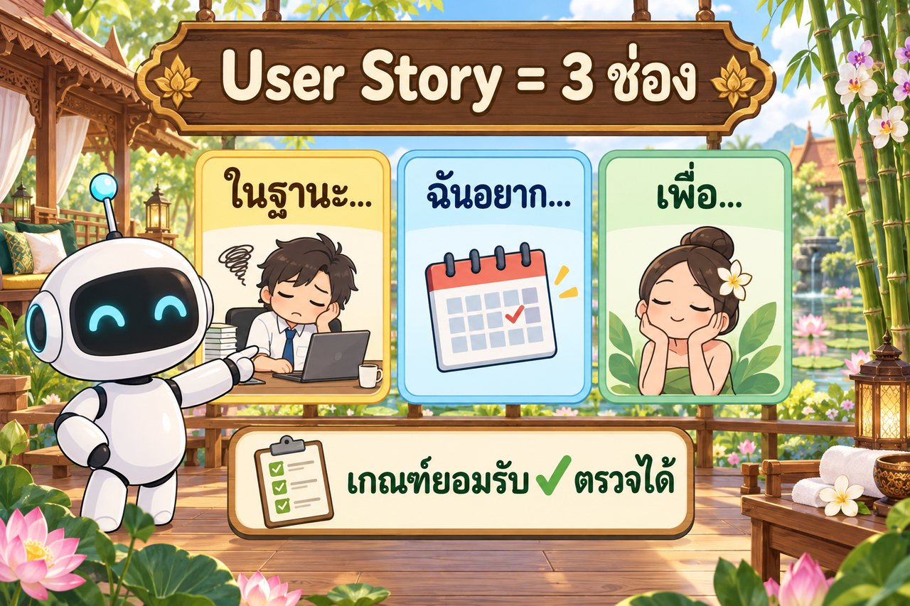 | 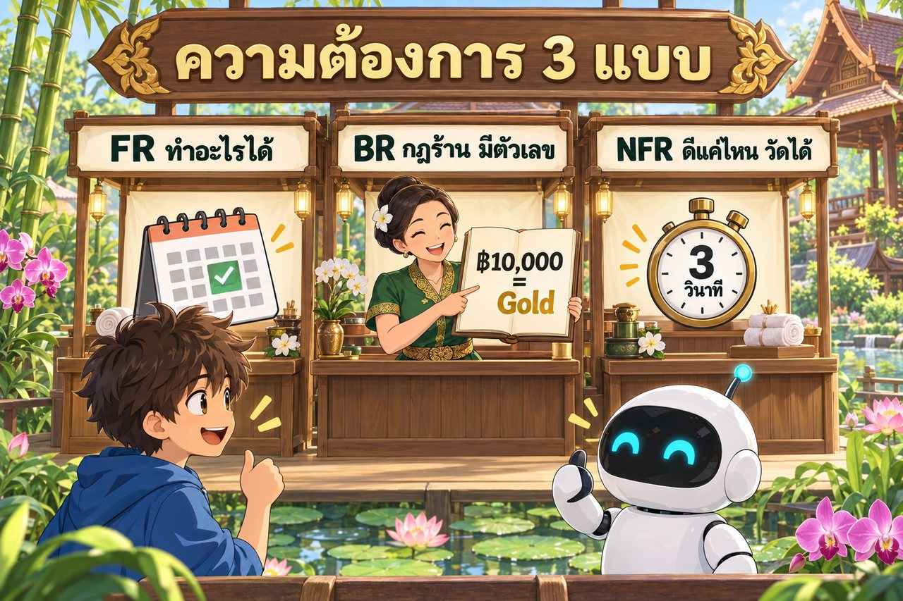 |
| เจ้าของร้านบอก "กฎ" · ลูกค้าบอก "สิ่งที่อยากได้" | ในฐานะ… ฉันอยาก… เพื่อ… + เกณฑ์ยอมรับที่ตรวจได้ | **FR** ทำอะไรได้ · **BR** กฎร้าน มีตัวเลข · **NFR** ดีแค่ไหน วัดได้ |

### 2) ออกแบบก่อนสร้าง: Architecture · Use Case · Flowchart · ERD · Sequence

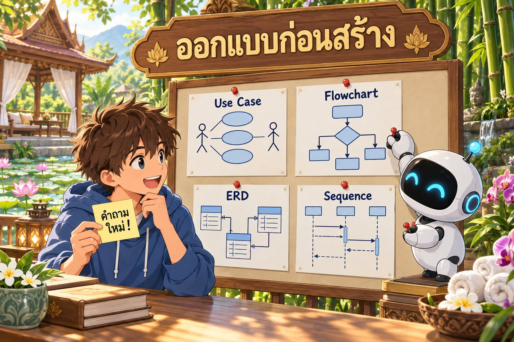

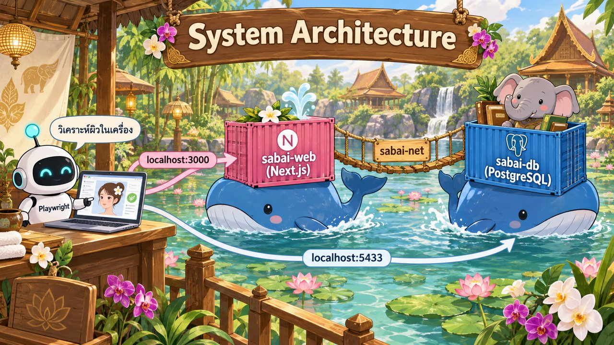

| ① เครื่องของเรา | ② `sabai-web` (Docker) | ③ `sabai-db` (Docker **แยกอีกโปรเจกต์**) |
|---|---|---|
| เบราว์เซอร์ + Playwright เปิด `localhost:3000` · วิเคราะห์ผิวทำในเบราว์เซอร์ | Next.js: หน้าเว็บ + API + กฎร้าน · ต่อ db ที่ `sabai-db:5432` | PostgreSQL 16 · เปิดให้เครื่องเราดูที่ `localhost:5433` · คุยกับ web ผ่าน network `sabai-net` |

### 3) TEST-DATA = ข้อมูลที่ร้านยืนยัน · พรอมต์ที่เขียนพรอมต์

| 🏷️ TEST-DATA = [D] | 📜 พรอมต์ที่เขียนพรอมต์ | 🎨 รูปในเว็บ สร้างเอง |
|---|---|---|
| ![คุณจันทร์ประทับตราเขียว [D] ร้านยืนยัน บนการ์ด TEST-DATA.md](img/concept-06-test-data.jpg) | 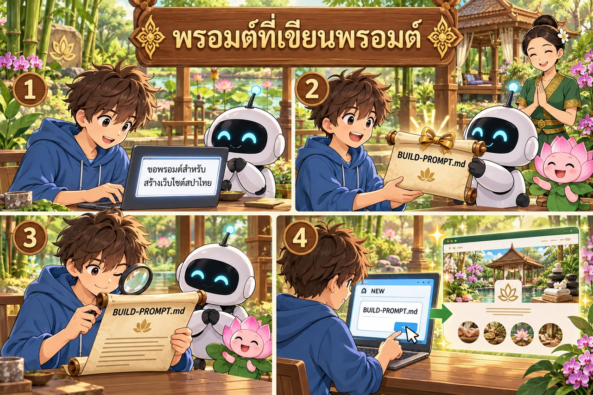 |  |
| ราคา ผู้ใช้ตัวอย่าง วันล็อก ค่าขอบ — เว็บ seed ตามนี้ และ test ใช้เทียบ | ให้ Claude เขียน `BUILD-PROMPT.md` ก่อน เราอ่านตรวจได้และใช้ซ้ำได้ | เครื่องมี **Codex CLI** → ใช้ image gen ของ Codex · ไม่มี → Claude วาดเองเป็น SVG/CSS |

### 4) 3 อย่างที่ทำให้เว็บทดสอบได้ + บั๊กปริศนา

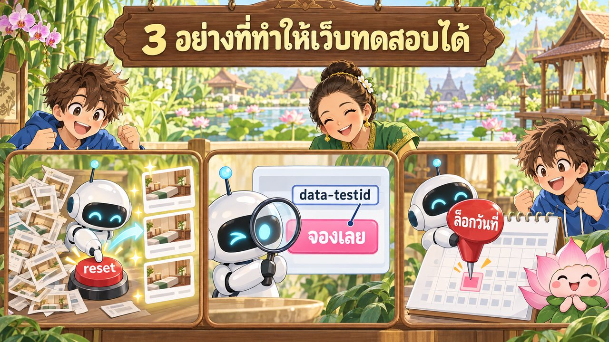

| 🔄 `/api/test/reset` | 🏷️ `data-testid` | 📌 ล็อก "วันนี้" | 🐞 `BUG_MODE=1` |
|---|---|---|---|
| ทุกรอบเริ่มจากข้อมูลชุดเดียวกัน | หุ่นยนต์หาปุ่มเจอเสมอ | กฎที่ใช้วันที่ให้ผลเดิมทุกวัน | **Claude เลือกบั๊ก 3 ตัวเอง** เฉลยอยู่ใน `web/BUGS.md` เท่านั้น |


### 5) ฟัง 3 ทาง และป้ายที่มาของผลที่คาดหวัง (หัวใจของบท)

![ฟัง 3 ทาง คุณจันทร์พูด [D] ร้าน: ฿10,000 = Gold หุ่นยนต์ถือ SPEC.md พูด [A] AI: ทำแล้วนะ หน้าจอแล็ปท็อปพูด [O] เว็บ: Silver ? เด็กตรงกลางถือคลิปบอร์ดเทียบ](img/concept-12-listen-3-ways.jpg)

![ผลที่ถูกมาจากไหน? ป้ายบอกทาง 4 ป้าย [D] ร้าน [R] กฎทั่วไป [A] AI ผู้สร้าง [O] หน้าจอ ชี้ไปที่ ผลที่คาดหวัง หุ่นยนต์ชั่งตาชั่ง ฝั่งตุ้ม [D] ร้าน หนักที่สุด](img/concept-13-oracle-badges.jpg)

![ผลที่คาดหวังมาจากไหน 4 ป้าย [D] ร้าน เขียว เชื่อได้สูงสุด · [R] กฎทั่วไป เหลือง · [A] AI ผู้สร้าง ส้ม ตรวจงานตัวเอง · [O] หน้าจอ แดง ต่ำสุด · แถบล่าง ทุก TC ต้องมี [D] หรือ [R]](img/oracle-badges.png)

| ป้าย | ฟังจาก | ไฟล์ | เชื่อได้ |
|---|---|---|---|
| **[D]** ร้าน | เจ้าของร้านและลูกค้า | USER-STORIES · REQUIREMENTS · TEST-DATA | ✅ สูงสุด |
| **[R]** กฎทั่วไป | คณิตศาสตร์ สามัญสำนึก | — | 🟡 ดี ต้องเขียนเหตุผล |
| **[A]** AI ผู้สร้าง | คำอ้างของ AI ที่สร้างเว็บ | `web/SPEC.md` · สรุปท้าย LAB 6 | 🟠 ต่ำ เพราะตรวจงานตัวเอง |
| **[O]** หน้าจอ | สิ่งที่เห็นตอนสำรวจ | `exploration/*.png` | 🔴 ต่ำสุด เว็บอาจผิดอยู่แล้ว |

**กติกา:** ผลที่คาดหวังทุกข้อต้องมี **[D] หรือ [R]** รองรับ · ถ้ามีแค่ [A] หรือ [O] ให้ติด `[O-ยังไม่ยืนยัน]` แล้วถามร้าน


> **อย่าอบบั๊กลงในผลที่คาดหวัง** ถ้าลอกตัวเลขจากหน้าจอตอนที่เว็บผิดอยู่แล้ว test จะ "ผ่าน" ตลอดไปทั้งที่ระบบผิด · ตัวเลขเงินให้ **คำนวณจาก [D]+[R] ก่อนเปิดเว็บ** เสมอ

---

## 🧰 ก่อนเริ่ม ต้องมี

| ✅ | สิ่งที่ต้องมี | ตรวจยังไง |
|---|---|---|
| ☐ | Windows 10/11 + **Claude Code** | เปิด Claude Code ได้ |
| ☐ | **Docker Desktop** เปิดอยู่ | ไอคอนวาฬไม่หมุน |
| ☐ | **Node.js 20+** และเบราว์เซอร์ของ Playwright (บท 01) | `node -v` |
| ☐ | **Playwright MCP** ต่อแล้ว (บท 01) | `claude mcp list` เห็น playwright ✔ Connected |
| ☐ | **ffmpeg** (ทำ GIF + MP4 ใน LAB 11–12) | `ffmpeg -version` · ไม่มีให้ `winget install Gyan.FFmpeg` แล้วเปิด terminal ใหม่ |
| ☐ | พอร์ต **3000** และ **5433** ว่าง (ปิด petshop ของบท 02/03) | LAB 0 เช็กให้ |
| ☐ | (ไม่บังคับ) **Codex CLI** ใช้สร้างรูปในเว็บ | `codex --version` · ไม่มีก็ทำบทนี้ได้ Claude จะวาดรูปเองเป็น SVG |
| ☐ | เปิด Claude Code ใน **โฟลเดอร์นี้** | ชื่อโฟลเดอร์ขึ้นที่แถบด้านบน |

**ตอนเริ่ม โฟลเดอร์นี้มีแค่**

```text
04_sabai-spa-from-prompt/
├─ README.md     📖 บทเรียน + พรอมต์ทุก LAB (บันทึกสัมภาษณ์ = input เดียว อยู่ในพรอมต์ LAB 1)
├─ img/          🖼️ รูปประกอบบทเรียน (ไม่ได้ใช้เป็น input)
└─ _solution/    🔑 เฉลย = ผลจากการรันพรอมต์ในหน้านี้จริงทุก LAB (ห้ามเปิดก่อนจบ)
```

**แนะนำเปิดเซสชันใหม่ทุก LAB** ไฟล์ที่แต่ละ LAB สร้างคือ "ความจำ" ที่ส่งต่อให้ LAB ถัดไป
แต่ละ LAB มี 🎯 เป้าหมาย · 💬 พรอมต์ให้คัดลอก · ✅ ผลจริง (จากการรันจริง 10 ต.ค. 2026) · 👀 สิ่งที่ควรสังเกต · ✔️ ไปต่อได้เมื่อ

> ผลของแต่ละคน **ไม่เหมือนกันเป๊ะ** ได้ (AI สร้างเว็บต่างกันเล็กน้อย บั๊กที่เลือกก็ต่างกัน) ตัวเลขใน ✅ คือตัวอย่างจากรอบที่ทำจริง เปรียบเทียบไฟล์เต็มได้ที่ [`_solution/`](_solution/)

💡 **พรอมต์ที่ดีมี 4 อย่าง** (เหมือนบท 01–03): บอกให้ชัดและอ้างไฟล์ · แบ่งเป็นข้อ · ไม่แน่ใจให้หยุดถาม · ขอผลเป็นตาราง

---

## 🗺️ เส้นทาง 12 LAB

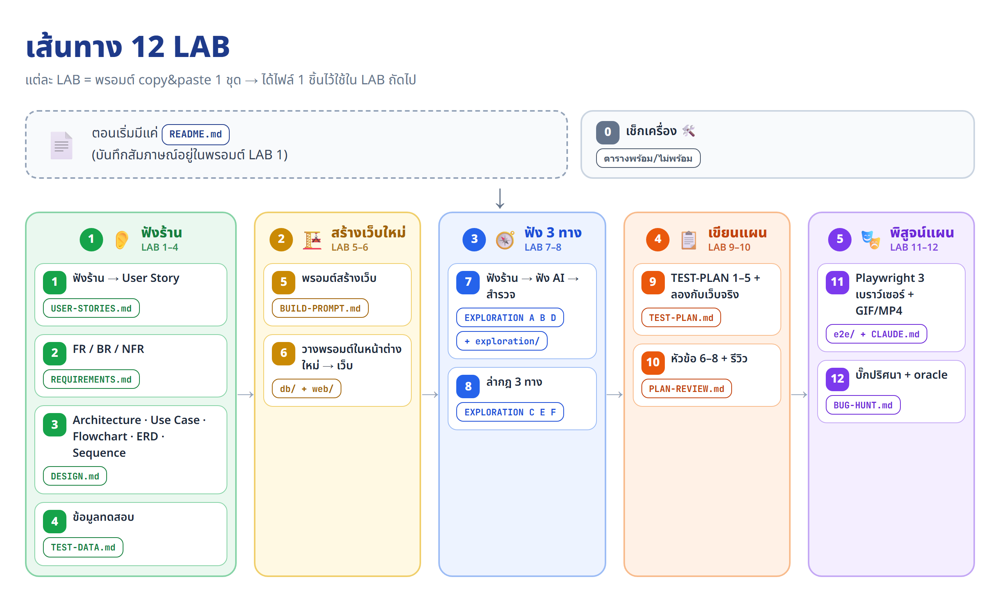

| ช่วง | LAB | ทำอะไร | ได้ไฟล์ | ⏱️ รอบจริง |
|---|---|---|---|---|
| ⚙️ | [0](#lab-0--เช็กเครื่อง) | เช็กเครื่อง | (ตาราง) | ~2 นาที |
| 🟢 **ฟังร้าน** | [1](#lab-1--ฟังร้าน--user-story) | บันทึกสัมภาษณ์ → User Story | `USER-STORIES.md` | ~4 นาที |
| | [2](#lab-2--fr--br--nfr) | FR / BR / NFR + ค่าขอบ | `REQUIREMENTS.md` | ~6 นาที |
| | [3](#lab-3--ออกแบบระบบ-designmd) | Architecture · Use Case · Flowchart · ERD · Sequence | `DESIGN.md` | ~5 นาที |
| | [4](#lab-4--ข้อมูลทดสอบ-test-datamd) | ข้อมูลทดสอบ | `TEST-DATA.md` | ~7 นาที |
| 🟡 **สร้างเว็บ** | [5](#lab-5--ให้-claude-เขียนพรอมต์สร้างเว็บ) | พรอมต์สร้างเว็บ | `BUILD-PROMPT.md` | ~4 นาที |
| | [6](#lab-6--วางพรอมต์--ได้เว็บใหม่-2-กล่อง) | วางพรอมต์ในหน้าต่างใหม่ → เว็บ | `db/` · `web/` | **~52 นาที** ☕ |
| 🔵 **ฟัง 3 ทาง** | [7](#lab-7--ฟังร้าน--ฟัง-ai--สำรวจเว็บ) | ฟังร้าน → ฟัง AI → สำรวจ | `EXPLORATION.md` A B D | ~9 นาที |
| | [8](#lab-8--ล่ากฎ-3-ทาง) | ล่ากฎ 3 ทาง + ความเสี่ยง + คำถาม | `EXPLORATION.md` C E F | ~24 นาที |
| 🟠 **เขียนแผน** | [9](#lab-9--test-plan-หัวข้อ-15--ลองกับเว็บจริง) | TEST-PLAN 1–5 + ลองกับเว็บจริง | `TEST-PLAN.md` · `TEST-RUN-1.md` | ~16 นาที |
| | [10](#lab-10--หัวข้อ-68--รีวิวแผน) | หัวข้อ 6–8 + รีวิว | `PLAN-REVIEW.md` | ~13 นาที |
| 🟣 **พิสูจน์แผน** | [11](#lab-11--แปลงแผนเป็น-playwright-3-เบราว์เซอร์) | Playwright 3 เบราว์เซอร์ + GIF/MP4 + รายงาน | `e2e/` · `CLAUDE.md` | **~76 นาที** ☕ |
| | [12](#lab-12--บั๊กปริศนา-) | บั๊กปริศนา + วิเคราะห์ oracle | `BUG-HUNT.md` | ~35 นาที |

---

## LAB 0 · เช็กเครื่อง

🎯 รู้ก่อนว่าเครื่องพร้อมไหม จะได้ไม่ไปติดกลางทาง (โดยเฉพาะ LAB 6 ที่ใช้เวลานาน)

💬 **คัดลอกพรอมต์นี้** (กดปุ่ม Copy มุมขวาของกรอบ)

```text
ตรวจเครื่องให้พร้อมสำหรับบทนี้ (อ่านอย่างเดียว ห้ามติดตั้งหรือแก้อะไร) ทุกค่าต้องมาจากคำสั่งที่รันจริง
1. Docker Desktop เปิดอยู่ไหม: docker version และ docker compose version
2. Node.js: node -v (ต้อง 20 ขึ้นไป) และ npm -v
3. ffmpeg -version (ใช้ทำ GIF + MP4 ตอนทดสอบ)
4. claude mcp list ดูว่า playwright ขึ้น Connected ไหม
5. codex --version (ไม่บังคับ ถ้ามีจะใช้สร้างรูปในเว็บ ถ้าไม่มี Claude จะวาดรูปเองเป็น SVG)
6. พอร์ต 3000 (เว็บ) และ 5433 (ฐานข้อมูล) ว่างไหม ถ้ามี container หรือโปรแกรมใช้อยู่ให้บอกชื่อ (ยังไม่ต้องปิด)
สรุปเป็นตาราง: รายการ | ผล | พร้อมไหม | ถ้าไม่พร้อมต้องทำอะไร
```

✅ **ผลจริง: พร้อม 9/9 รายการ**

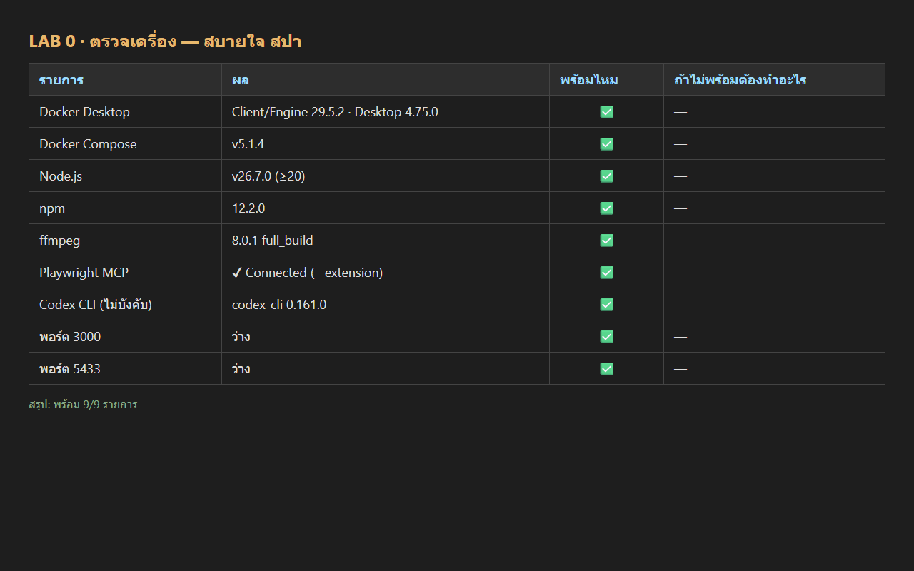

👀 **สังเกต**
- พอร์ตฐานข้อมูลเป็น **5433** ไม่ใช่ 5432 (ค่าปกติของ Postgres) จะได้ไม่ชนกับ Postgres ที่อาจติดตั้งไว้ในเครื่องแล้ว
- มี **Codex CLI** → LAB 6 จะใช้ Codex สร้างรูปในเว็บ ถ้าไม่มี Claude จะวาดรูปเองเป็น SVG แทน (เว็บทดสอบได้เหมือนกัน)

✔️ **ไปต่อได้เมื่อ:** Docker · Node · Playwright MCP พร้อม และพอร์ต 3000 / 5433 ว่าง

---

## LAB 1 · ฟังร้าน → User Story

🎯 เปลี่ยนคำพูดของเจ้าของร้าน 1 คนและลูกค้า 5 กลุ่มเป็น `USER-STORIES.md` ที่ตรวจได้ทุกข้อ

💬 **คัดลอกพรอมต์นี้** (บันทึกสัมภาษณ์อยู่ในพรอมต์แล้ว = **input เดียวของทั้งบท**)

```text
นี่คือบันทึกสัมภาษณ์เจ้าของร้านและลูกค้าของ "สบายใจ สปา" ช่วยเขียนไฟล์ USER-STORIES.md
1. เขียน User Story แบบ "ในฐานะ… ฉันอยาก… เพื่อ…" ให้ครบทุกเรื่องที่ทุกคนพูด ใส่รหัส US-01, US-02, …
2. แต่ละข้อมี "เกณฑ์ยอมรับ" 1–2 ข้อ ที่ตรวจได้จริง (มีตัวเลขหรือข้อความชัด ๆ)
3. ติดป้ายความสำคัญ Must / Should / Could
4. ท้ายไฟล์ใส่ "คำถามที่ยังไม่ชัด" ที่ควรถามร้านเพิ่ม
ใช้ภาษาไทยง่าย ๆ ใน story ห้ามใช้ศัพท์โปรแกรม (database, API)
แล้วสรุปเป็นตาราง: รหัส | เรื่อง | ใครขอ | ความสำคัญ และนับจำนวน Must / Should / Could

--- บันทึกสัมภาษณ์ ---
👩‍💼 คุณจันทร์ (เจ้าของร้าน)
- เปิดทุกวัน 10:00–22:00 จองเป็นรอบทุก 30 นาที บริการต้องจบไม่เกิน 22:00
- นักบำบัด 1 คนรับได้ทีละคิว ห้ามจองเวลาทับกัน ต้องขึ้นว่า "เวลานี้ถูกจองแล้ว"
- จองได้ตั้งแต่ "พรุ่งนี้" ถึง 30 วันข้างหน้า
- จองคู่ = 2 คน ใช้ห้อง Couple Suite (มี 1 ห้อง) · จองกลุ่ม 3–6 คน (7 คนขึ้นไปให้โทรร้าน) · กลุ่ม 4 คนขึ้นไปลด 10%
- ยกเลิกเองได้ถ้าเหลือเวลา 24 ชม. ขึ้นไปก่อนนัด
- แต้ม: ทุก ฿100 ได้ 1 แต้ม (เศษปัดทิ้ง) · 100 แต้ม แลกส่วนลด ฿50
- ระดับสมาชิกตามยอดใช้จ่ายสะสม: Silver ต่ำกว่า ฿10,000 · Gold ตั้งแต่ ฿10,000 ลด 5% · Platinum ตั้งแต่ ฿30,000 ลด 10%
- เดือนเกิดลด 20% ได้ 1 ครั้ง (ไม่รวมกับส่วนลดระดับ ใช้อันที่มากกว่า)
- คอร์สกระชับสัดส่วน 10 ครั้ง ฿15,000 แถม 1 = 11 ครั้ง อายุ 180 วัน · เหลือ 0 ครั้งจองด้วยคอร์สไม่ได้
- Gift Card มูลค่า ฿500–฿10,000 มี 3 ลาย (กล้วยไม้ บัว ทอง) ส่งทาง LINE หรือ email ใช้ได้ 365 วัน
- แพ็กเกจนักท่องเที่ยว "Bangkok Relax" ฿2,900/คน = นวดไทย + ประคบสมุนไพร + รถรับส่งโรงแรม
- รถรับส่ง: โรงแรมห่างไม่เกิน 5 กม. ฟรี · 5–15 กม. ฿300 · เกิน 15 กม. ไม่รับ · รถ 1 คันไม่เกิน 4 คน
- อยากให้เว็บดูไทย มีข้อมูลสมุนไพรของแต่ละบริการ ทัวร์ห้อง 360° และเพลงสปาเบา ๆ (ลูกค้ากดเปิดเอง)
- เว็บต้องมี 3 ภาษา ไทย / English / 中文 · ห้ามเก็บรูปหน้าลูกค้า

😩 คุณเมย์ 29 ปี พนักงานออฟฟิศ เครียดมาก
- เลิกงาน 19:00 อยากจองรอบ 20:00 จากมือถือแบบไม่ยุ่งยาก
- วันไหนเหนื่อยหรือเครียด อยากกดเลือก "อารมณ์" แล้วเว็บแนะนำบริการให้
- ไม่รู้จะเลือกอะไร อยากทำแบบทดสอบสั้น ๆ 4 ข้อ แล้วได้แพ็กเกจที่เหมาะกับตัวเอง
- ขอดูรีวิวนักบำบัดก่อน ชอบคนที่ได้ 4.5 ดาวขึ้นไป

🧳 Mr. Li Wei 35 ปี นักท่องเที่ยวจีน
- อ่านไทยไม่ได้ อยากใช้เว็บภาษาจีน และถาม chatbot ว่า "营业时间?" "多少钱?"
- อยากจองผ่าน chatbot ได้เลย · มากัน 4 คน พักโรงแรมห่าง 12 กม. อยากรู้ค่ารถก่อนจ่าย

💑 คุณต้น & คุณฝน คู่รัก
- วันครบรอบ อยากจองคู่ห้อง Couple Suite เวลาเดียวกัน · ขอดูห้องแบบ 360° ก่อน
- ต้นเกิดเดือนนี้ อยากใช้ส่วนลดวันเกิด · ฝนอยากซื้อ Gift Card ฿2,000 ส่ง LINE ให้แม่

🏃‍♀️ คุณนิดา 41 ปี ทำคอร์สกระชับสัดส่วน (ยอดสะสม ฿12,400)
- ใช้คอร์สไปแล้ว 4 ครั้ง อยากเห็นใน Wallet ว่าเหลือกี่ครั้ง และกราฟรอบเอวที่ลดลง
- อยากเห็นประวัติทรีตเมนต์ รูป before/after และรู้ว่าอีกเท่าไรถึงระดับถัดไป
- พรุ่งนี้ติดงาน อยากยกเลิกนัดเองในเว็บ

✨ น้องแพร 23 ปี สาวรักผิว
- อยากอัปโหลดเซลฟี่ให้วิเคราะห์ผิวแล้วแนะนำทรีตเมนต์ แต่ไม่อยากให้รูปถูกส่งออกไปเก็บ
- อยากเห็นภาพจำลองก่อน/หลังทำ และรู้ว่าแต่ละทรีตเมนต์ใช้สมุนไพรอะไร (กลัวแพ้)
```

✅ **ผลจริง** ได้ `USER-STORIES.md` · **36 story** (Must 19 · Should 11 · Could 6) · เกณฑ์ยอมรับ 72 ข้อ · คำถามที่ยังไม่ชัด 19 ข้อ

| รหัส | เรื่อง | ใครขอ | เกณฑ์ยอมรับ (ตัวอย่าง) | ความสำคัญ |
|---|---|---|---|---|
| US-01 | จองรอบทุก 30 นาที บริการจบไม่เกิน 22:00 | คุณจันทร์ | บริการ 90 นาทีไม่มีรอบ 21:00 · รอบสุดท้าย 20:30 | Must |
| US-02 | ห้ามจองทับ | คุณจันทร์ | คิว 14:00–15:00 แล้วจอง 14:30 → "เวลานี้ถูกจองแล้ว" · 15:00 พอดียังจองได้ | Must |
| US-14 | เดือนเกิดลด 20% ใช้อันที่มากกว่า | คุณต้น | Platinum เดือนเกิด ฿1,000 จ่าย **฿800** (ไม่ใช่ ฿700) | Must |
| US-16 | เห็นคอร์สเหลือกี่ครั้ง | คุณนิดา | ใช้ไป 4 ครั้ง → "เหลือ 7 จาก 11 ครั้ง" | Must |
| US-24 | รู้ค่ารถก่อนจ่าย | Mr. Li Wei | 4 คน 12 กม. → ฿300 รถ 1 คัน | Must |

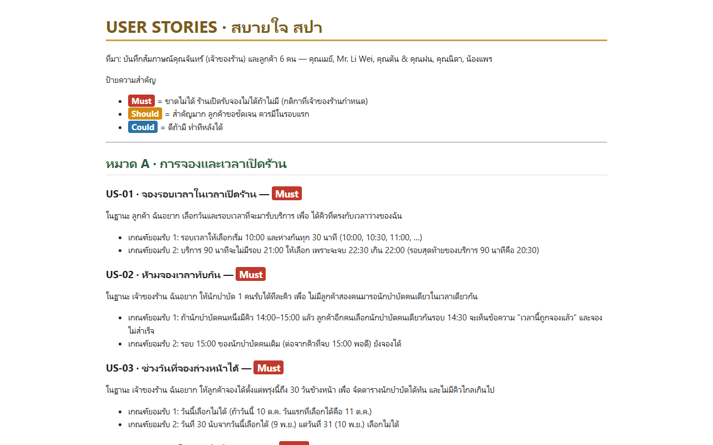

👀 **สังเกต**
- **บันทึกสัมภาษณ์ขัดกันเอง:** ร้านบอก "ห้ามเก็บรูปหน้าลูกค้า" แต่น้องแพรอยากอัปโหลดเซลฟี่ → Claude ไม่ตัดทิ้ง เขียน story ที่เคารพกติกา (วิเคราะห์ในเครื่อง ไม่เก็บ) แล้วตั้งเป็นคำถาม
- **เกณฑ์ยอมรับที่ดีมี "กรณีขอบ"** เช่น ฿9,999 vs ฿10,000 · 23:59 ชม. vs 24 ชม. → เป็นจุดที่ test จะจับบั๊กได้
- บันทึกสัมภาษณ์ **ไม่มีราคา/เวลาของบริการ** → Claude ต้องสมมติ และยกเป็นคำถามถึงร้าน (Q1)

✔️ **ไปต่อได้เมื่อ:** มี `USER-STORIES.md` ที่มีป้าย Must อย่างน้อย 1 ข้อ

---

## LAB 2 · FR / BR / NFR

🎯 แปลง User Story เป็น `REQUIREMENTS.md` 3 ตาราง ที่มีรหัส วัดผลได้ และโยงกลับ US ได้ทุกข้อ

💬 **คัดลอกพรอมต์นี้**

```text
อ่าน USER-STORIES.md แล้วเขียน REQUIREMENTS.md เป็น 3 ตาราง
1. FR (ระบบต้องทำอะไรได้) รหัส FR-01, FR-02, …
2. BR (กฎของร้าน) ทุกข้อต้องมีตัวเลข และคอลัมน์ "ค่าขอบที่ต้องทดสอบ" (ค่าต่ำกว่า / ที่ขอบ / เกินขอบ) รหัส BR-01, …
3. NFR (ต้องดีแค่ไหน) ทุกข้อต้องมีคอลัมน์ "วิธีวัด" เช่น ใช้บนมือถือกว้าง 375px ได้, หน้าแรกโหลดไม่เกิน 3 วินาที รหัส NFR-01, …
ทุกข้อมีคอลัมน์ "มาจาก US ไหน" และ US ทุกข้อต้องมี FR หรือ BR รองรับ (ตรวจท้ายไฟล์เป็นตาราง US | FR | BR | ✅/❌)
เพิ่ม NFR เรื่อง "ทดสอบได้" ด้วย: AI ทุกตัวใช้กฎตายตัว (ถามเหมือนเดิมได้คำตอบเดิม), มีปุ่มรีเซ็ตข้อมูลทดสอบ, ล็อก "วันนี้" ของเว็บได้, ทุกปุ่มมีป้ายชื่อให้เครื่องมือทดสอบหาเจอ
ค่าที่ร้านยังไม่ได้บอกชัด (เช่น ค่ารถ ฿300 คิดต่อคันหรือต่อคน) ให้ติด ⚠️ และเขียนสมมติฐานที่ใช้ ห้ามเดาเงียบ ๆ
สรุปสมมติฐานทั้งหมดเป็นตารางท้ายไฟล์ โยงกับ "คำถามที่ยังไม่ชัด" ใน USER-STORIES.md
แล้วสรุปเป็นตาราง: ชนิด | จำนวน | ตัวอย่าง 1 ข้อ
```

✅ **ผลจริง** ได้ `REQUIREMENTS.md` · **FR 35 · BR 20 · NFR 18** · US ทั้ง 36 ข้อมี FR/BR รองรับ (36/36) · สมมติฐาน ⚠️ 20 ข้อ

| รหัส | กฎ | ค่าขอบที่ต้องทดสอบ |
|---|---|---|
| BR-01 | บริการต้องจบไม่เกิน 22:00 รอบทุก 30 นาที | 90 นาที: 20:00 ✅ / **20:30 ✅ (จบ 22:00 พอดี)** / 21:00 ❌ |
| BR-03 | จองได้พรุ่งนี้ถึง +30 วัน | 10 ต.ค. ❌ / 11 ต.ค. ✅ · 9 พ.ย. ✅ / 10 พ.ย. ❌ |
| BR-07 | ยกเลิกเองได้เมื่อเหลือ ≥ 24 ชม. | 23:59 ❌ / **24:00 ✅** ⚠️ / 24:01 ✅ |
| BR-11 | Silver < ฿10,000 · Gold ≥ ฿10,000 (5%) · Platinum ≥ ฿30,000 (10%) | ฿9,999 / **฿10,000** · ฿29,999 / **฿30,000** |
| BR-20 | ลำดับคิดราคา: เต็ม → ส่วนลด % ที่มากสุด 1 อัน → แลกแต้ม → ค่ารถ | กลุ่ม 4 คน ฿4,000 + แลก 200 แต้ม + รถ 12 กม. → **฿3,800** ⚠️ |
| NFR-13 | ล็อก "วันนี้" ของเว็บได้ | ตั้ง `TODAY=2026-10-10T10:00` แล้วกฎวันที่ทุกข้อใช้ค่านี้ 100% |

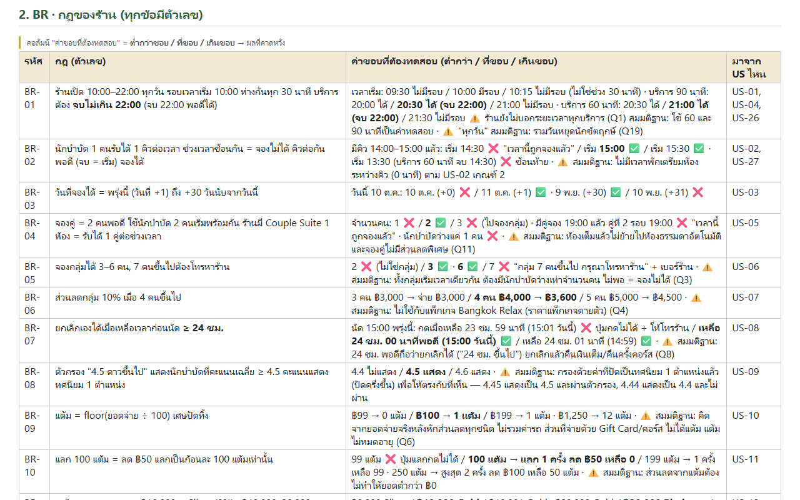

👀 **สังเกต**
- **ค่าขอบต้องมี 3 ค่าเสมอ** (ต่ำกว่า / ที่ขอบ / เกินขอบ) บั๊กชอบซ่อนที่ "ขอบพอดี" เช่น 24 ชม. พอดี · ฿10,000 พอดี · 5.0 กม. พอดี
- **BR-20 ลำดับคิดราคา** ไม่มีใน US ตรง ๆ แต่โผล่ตอนเอาส่วนลดหลายแบบมารวมกัน ("ซ้อนกันได้ไหม?") เป็นจุดที่ต้องถามร้านให้ชัด
- NFR ที่ดีต้องมี **วิธีวัด** เช่น `scrollWidth ≤ 375` · หน้า 中文 ไม่มีอักษรไทย · คำขอส่งรูปออกจากเครื่อง = 0

✔️ **ไปต่อได้เมื่อ:** มี `REQUIREMENTS.md` ครบ 3 ตาราง และตาราง US | FR | BR ท้ายไฟล์ไม่มี ❌

---

## LAB 3 · ออกแบบระบบ (DESIGN.md)

🎯 วาด **System Architecture · Use Case · Flowchart · ERD · Sequence** ก่อนสร้างเว็บ แล้วเก็บ "คำถามใหม่" ที่โผล่ตอนออกแบบ

💬 **คัดลอกพรอมต์นี้**

```text
อ่าน USER-STORIES.md และ REQUIREMENTS.md แล้วเขียน DESIGN.md ภาษาไทย ทุกแผนภาพใช้ Mermaid (ขั้นนี้ยังไม่เขียนโค้ดเว็บ)
1. System Architecture: เครื่องผู้ใช้ (เบราว์เซอร์ + Playwright) → web: Next.js (App Router, TypeScript) มีหน้าเว็บ + API + กฎร้าน
   อยู่ใน Docker ชื่อ sabai-web พอร์ต 3000 → db: PostgreSQL 16 อยู่ใน Docker แยกอีกโปรเจกต์ ชื่อ sabai-db (เปิดพอร์ต 5433 บนเครื่อง)
   ทั้งสองคุยกันผ่าน Docker network ชื่อ sabai-net (web ต่อ db ที่ sabai-db:5432 · พอร์ต 5433 ใช้จากเครื่องเราเท่านั้น) · ระบุว่าอะไรทำในเบราว์เซอร์ (เช่น วิเคราะห์ผิว) อะไรทำที่เซิร์ฟเวอร์
   ใต้แผนภาพมีตาราง: ชั้น | อยู่ที่ไหน | หน้าที่ | ทดสอบด้วยอะไร
2. Use Case (Mermaid ไม่มีชนิดนี้ ให้ใช้ flowchart LR: actor เป็นวงรี ระบบเป็น subgraph): actor = ชื่อบทบาท + ชื่อคนในวงเล็บ ครบทุกกลุ่มในบันทึกสัมภาษณ์ + เจ้าของร้าน · ทุก use case โยงรหัส FR
3. Flowchart อย่างน้อย 2 รูป: จองคิว (ตรวจช่วงวัน → รอบว่าง → คำนวณราคา → ยืนยัน) และยกเลิกนัด · ทุกจุดตัดสินใจเขียนรหัส BR กำกับ
4. ERD: ตาราง คอลัมน์หลัก และความสัมพันธ์ · คอลัมน์เงิน แต้ม และจำนวนครั้งคอร์สต้องระบุชนิดข้อมูล (เงินใช้ NUMERIC ไม่ใช้ float)
5. Sequence อย่างน้อย 2 รูป: ลูกค้าจองคิว (เบราว์เซอร์ → web → API → db) และจองด้วยคอร์ส (หักครั้ง)
6. ท้ายไฟล์ "คำถามที่ได้จากการออกแบบ": เรื่องที่ USER-STORIES / REQUIREMENTS ยังไม่บอก (เช่น ยกเลิกนัดที่จองด้วยคอร์สแล้วคืนครั้งไหม)
ตรวจว่าแผนภาพทุกรูป render ได้จริง (ไม่มี syntax error) · สรุปเป็นตาราง: แผนภาพ | จำนวน | ครอบคลุม FR/BR ไหน
```

✅ **ผลจริง** ได้ `DESIGN.md` · Mermaid **8 แผนภาพ render ผ่าน 8/8** (flowchart 5 · ERD 1 · sequence 2) · ใช้ FR 35/35 · BR 20/20 · ERD 17 ตาราง · คำถามจากการออกแบบ 15 ข้อ

**System Architecture** (จาก `DESIGN.md` จริง)


**ERD** (จาก `DESIGN.md` จริง)

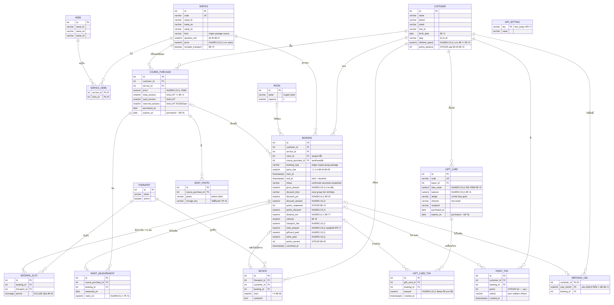

**Sequence: ลูกค้าจองคิว**

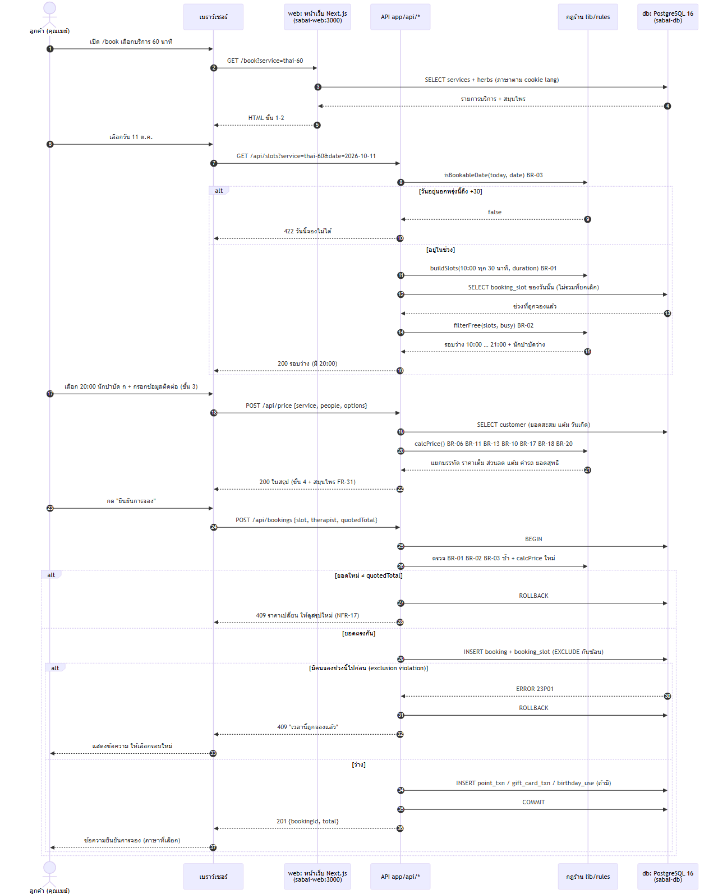

👀 **สังเกต**
- **การวาด Sequence ช่วยจับคำถามที่ US ไม่บอก** เช่น "ครั้งคอร์สหักตอนจองหรือตอนมาใช้?" ถ้าหักตอนใช้ คนเหลือ 1 ครั้งจะจองล่วงหน้าได้ 5 นัด → ออกแบบ `reserved_sessions`
- ใน network ให้ web ต่อ db ที่ **`sabai-db:5432`** · พอร์ต **5433** ใช้จากเครื่องเราเท่านั้น (จุดที่สับสนบ่อย)
- Mermaid ไม่มี use case diagram จริง จึงจำลองด้วย `flowchart` · ERD ของ Mermaid ใส่ชนิดข้อมูลได้แค่คำเดียว จึงต้องเขียน `NUMERIC(10,2)` ไว้ในช่อง comment
- ถ้าใส่ URL เช่น `http://localhost:3000` เป็นป้ายบนเส้นเชื่อม Mermaid จะแสดงผลพัง ต้องเขียนเป็น "localhost พอร์ต 3000"

✔️ **ไปต่อได้เมื่อ:** `DESIGN.md` มีครบ 5 ส่วน และทุกแผนภาพ render ได้

---

## LAB 4 · ข้อมูลทดสอบ (TEST-DATA.md)

🎯 กำหนดข้อมูลที่ "ร้านยืนยัน" ให้ทั้งเว็บ (seed) และ test (ผลที่คาดหวัง) ใช้ชุดเดียวกัน → นี่คือแหล่ง **[D]** ของบท

💬 **คัดลอกพรอมต์นี้**

```text
อ่าน REQUIREMENTS.md และ DESIGN.md แล้วเขียน TEST-DATA.md = ข้อมูลทดสอบฉบับที่ส่งให้ร้านตรวจ (ร้านยืนยันแล้วถือเป็นข้อมูลจากร้าน [D]) ใช้ทั้งสร้างเว็บและทดสอบ (เว็บจะ seed ตามไฟล์นี้ทุกค่า)
1. "วันนี้" ของเว็บตอนทดสอบ (วันเวลาล็อก) 1 ค่า พร้อมเหตุผลที่เลือก
2. ผู้ใช้ตัวอย่างอย่างน้อย 4 คน: อีเมล | รหัสผ่าน | ชื่อ | ยอดสะสม | ระดับ | แต้ม | วันเกิด | คอร์ส
   ต้องมี: คุณนิดา (ยอดสะสม ฿12,400 คอร์สใช้ไป 4 ครั้ง) · คนที่เกิดเดือนเดียวกับวันล็อก (และคนที่ใช้สิทธิ์วันเกิดไปแล้ว) · สมาชิกใหม่ · คนที่แต้มพอแลกส่วนลด
3. บริการทุกตัว: ชื่อ | เวลา (นาที) | ราคา | สมุนไพร · แพ็กเกจ · คอร์ส · Gift Card
4. นักบำบัดอย่างน้อย 6 คน (พอทดสอบกลุ่ม 6 คน): ชื่อ | บริการที่ทำได้ | คะแนนรีวิว (ต้องมี 4.4 / 4.5 / 5.0 และคนที่ยังไม่มีรีวิว)
5. โรงแรมสำหรับรถรับส่ง: ชื่อ | ระยะทาง (ต้องมี 5.0 / 5.1 / 12 / 15.0 / 15.1 กม.)
6. ข้อมูลที่มีอยู่แล้วตอนเริ่ม: การจองที่มีอยู่ (ไว้ทดสอบจองซ้อน) · Gift Card ที่ยังใช้ได้และที่หมดอายุแล้ว
7. ตาราง "ค่าขอบที่ต้องทดสอบ" รวมจาก BR ทุกข้อ พร้อมผลที่ถูก · เงินให้แสดงวิธีคิด เช่น ฿800 − 5% (฿40) = ฿760
   ค่าขอบที่ทดสอบผ่านหน้าเว็บไม่ได้ (ชนกฎอื่น) ให้ระบุว่า "unit test"
8. ค่าที่ร้านยังไม่ยืนยันให้ติด ⚠️ และเขียนสมมติฐานที่ใช้
ทุกตารางมีคอลัมน์ "มาจาก BR/US ไหน" · สรุปเป็นตาราง: หมวด | จำนวนแถว
```

✅ **ผลจริง** ได้ `TEST-DATA.md` · **165 แถว** · วันล็อก `2026-10-10 10:00` · ผู้ใช้ 8 คน · นักบำบัด 6 คน · โรงแรม 6 แห่ง · ค่าขอบ **E01–E90 ครอบ BR 20/20**

| # | เคส | ผลที่ถูก (วิธีคิด) |
|---|---|---|
| U01 | คุณนิดา ฿12,400 · Gold · 99 แต้ม · คอร์สเหลือ 7/11 | "อีก ฿17,600 ถึง Platinum" · แลกแต้มยังไม่ได้ |
| E05 | นวดไทย 90 นาที เริ่ม 20:30 | ✅ 20:30 + 90 = **22:00 พอดี** |
| E31 | ยกเลิกนัด 11 ต.ค. 10:00 ตอน 10 ต.ค. 10:00 | ✅ เหลือ 24:00 ชม. พอดี (10:01 = 23:59 ❌) |
| E54 | Platinum เดือนเกิด ฿1,000 | ฿1,000 − 20% = **฿800** (ไม่ใช่ ฿700) |
| E87 | กลุ่ม 4 คน + แลก 200 แต้ม + รถ 12 กม. | ฿4,000 − 10% = ฿3,600 − ฿100 = ฿3,500 + ฿300 = **฿3,800** |
| E78 | 5 คน รถ 12 กม. | ปัดขึ้น(5 ÷ 4) = 2 คัน × ฿300 = **฿600** |

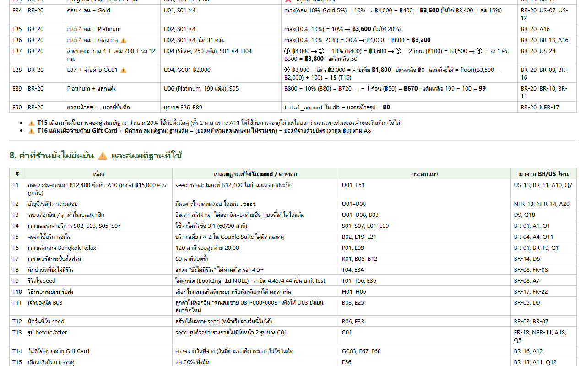

👀 **สังเกต**
- **ตัวเลขจริงทำให้เห็นจุดขัดแย้ง:** คุณนิดาซื้อคอร์ส ฿15,000 แต่ยอดสะสมแค่ ฿12,400 → ร้านนับคอร์สเข้ายอดสะสมไหม? (ติด ⚠️ ถามร้าน)
- เลือกเวลาล็อก **10:00** ทำให้นัดพรุ่งนี้ 10:00 อยู่ที่ขอบ 24 ชม. พอดี โดยไม่ต้องสร้างข้อมูลพิเศษ
- ค่าขอบบางข้อทำผ่านหน้าเว็บไม่ได้ (ชนกฎอื่น เช่น วันในอดีต) → ระบุเป็น "unit test"

✔️ **ไปต่อได้เมื่อ:** มี `TEST-DATA.md` ที่มีวันล็อก ผู้ใช้ตัวอย่าง และตารางค่าขอบครบทุก BR

---

## LAB 5 · ให้ Claude เขียนพรอมต์สร้างเว็บ

🎯 ได้ `BUILD-PROMPT.md` ที่ครบพอให้ Claude หน้าต่างใหม่สร้างเว็บทั้งเว็บได้เอง (ขั้นนี้ยังไม่มีโค้ด)

💬 **คัดลอกพรอมต์นี้**

```text
อ่าน REQUIREMENTS.md, DESIGN.md และ TEST-DATA.md (ขั้นนี้ห้ามเขียนโค้ดเว็บ)
แล้วเขียนไฟล์ BUILD-PROMPT.md = พรอมต์ภาษาไทยที่ผมจะ copy ไปวางให้ Claude หน้าต่างใหม่สร้างเว็บ "สบายใจ สปา · Sabai Jai Wellness Spa" ใหม่ทั้งหมด
พรอมต์นั้นต้องสั่งให้ครบทุกข้อนี้
1. ทำตาม DESIGN.md: Next.js (App Router, TypeScript) ต่อ PostgreSQL 16 ด้วยไลบรารี pg เขียน SQL ตรง ๆ (ไม่ใช้ ORM)
2. Docker แยก 2 โปรเจกต์ คุยกันผ่าน network ชื่อ sabai-net
   - db/ : container sabai-db (postgres:16-alpine) · volume sabai-pgdata · พอร์ต 5433:5432 · healthcheck pg_isready
           db/init/01-schema.sql ตาม ERD (ข้อมูลใน TEST-DATA ที่ ERD ยังไม่มีตาราง ให้เพิ่มตารางได้) · db/init/02-seed.sql ตาม TEST-DATA.md ทุกค่า
   - web/: container sabai-web พอร์ต 3000 · DATABASE_URL ชี้ไปที่ sabai-db:5432 · output standalone · HOSTNAME=0.0.0.0 · TZ=Asia/Bangkok
           healthcheck ด้วย node เรียก /api/health ตอบ {"ok":true,"db":true} (ต่อฐานข้อมูลไม่ได้ให้ตอบ db:false) · ห้ามต่อฐานข้อมูลตอน build
   - เปิด db ก่อน รอ healthy แล้วค่อยเปิด web
3. ใช้ได้บน Windows: ไม่มีไฟล์ .sh ที่ต้องรัน · .gitattributes ให้เป็น LF · คำสั่งทุกตัวใช้ใน PowerShell ได้
   ถ้ามี container อื่นใช้พอร์ต 3000 หรือ 5433 อยู่ (เช่น petshop จากบทก่อน) ให้ docker stop ก่อน
4. รูปในเว็บ: ห้ามใช้รูปจากเน็ต เก็บทุกรูปที่ web/public/assets/ · เช็ก codex --version ก่อน
   - ถ้ามี Codex CLI: สั่ง codex exec ให้ใช้เครื่องมือสร้างรูปในตัว (Codex เก็บรูปไว้ใต้ ~/.codex/generated_images ให้คัดลอกมาแล้วย่อขนาดด้วย node + sharp)
     โทนไทยร่วมสมัย: hero, บริการทุกตัว, นักบำบัดทุกคน, Gift Card 3 ลาย, ภาพ panorama ห้อง Couple Suite สำหรับทัวร์ 360°,
     ใบหน้าตัวอย่างแบบภาพวาด (ไม่ใช่คนจริง) สำหรับวิเคราะห์ผิว · รูปไหนสร้างไม่สำเร็จ ให้ใช้วิธีด้านล่างเฉพาะรูปนั้น
   - ถ้าไม่มี Codex CLI: Claude สร้างรูปเองเป็น SVG / CSS
   - เขียน web/ASSETS.md: ไฟล์ | ใช้ที่หน้าไหน | สร้างด้วย Codex หรือ SVG/CSS
5. ดีไซน์ไทยร่วมสมัย (เขียวใบตอง ครีม ทอง) ฟอนต์ไทยอ่านง่าย การ์ดมีเงา animation นุ่ม ๆ ใช้บนมือถือ 375px ได้
6. ฟีเจอร์ครบตาม REQUIREMENTS.md · ตัวเลขทุกตัวตรงตาม BR และ TEST-DATA.md · มีหน้า /admin ให้เจ้าของร้านกด "ใช้บริการเสร็จ" (ให้แต้ม ตัดครั้งคอร์ส)
7. "AI" ทุกตัวเป็นกฎตายตัว ไม่เรียก API ภายนอก · วิเคราะห์ผิวคำนวณในเบราว์เซอร์ ไม่อัปโหลดรูป
   เพลงเปิดด้วยปุ่มเท่านั้น · ส่ง Gift Card ทาง LINE/email เป็นการจำลอง (แสดงข้อความที่ "ส่ง")
8. สำหรับทดสอบ: data-testid ทุกปุ่ม ช่องกรอก ผลลัพธ์ และข้อความ error · <html data-ready="true" data-bug-mode="0|1">
   POST /api/test/reset (เปิดเมื่อ ALLOW_TEST_RESET=1) ล้างข้อมูลกลับเป็น seed และรับ {"now":"<วันเวลา ISO>"} เพื่อล็อก "วันนี้" ของเว็บ
   (ไม่ส่ง now = ใช้วันล็อกใน TEST-DATA.md)
9. BUG_MODE (env ของ web ค่าเริ่มต้น 0): ให้ Claude เลือกบั๊กเอง 3 ตัวจาก BR ใน REQUIREMENTS.md
   1 ตัวเรื่องเงิน · 1 ตัวเรื่องการจอง · 1 ตัวเรื่องตัวเลขหรือสถานะที่ต้องอัปเดตหลังทำรายการ
   ทุกตัวต้องเป็นแบบที่ "ถ้าลอกค่าจากหน้าจอไปเป็นผลที่คาดหวัง จะจับไม่ได้"
   เขียนเฉลยไว้ที่ web/BUGS.md เท่านั้น ห้ามบอกในแชท ห้ามเขียนใน SPEC.md หรือคอมเมนต์ที่เดาง่าย
10. เขียน web/SPEC.md: หน้าเว็บ · กฎโยงรหัส FR/BR · data-testid ทุกตัว · ข้อความ error คำต่อคำ · API ทุกเส้น · ผู้ใช้ seed
11. ขั้นสุดท้าย: เปิด db แล้ว web รอจน 2 container healthy · ตรวจ /api/health · ยิง API ตรวจกฎร้านตามตารางค่าขอบใน TEST-DATA.md แล้วรายงาน "ผ่าน X / Y ข้อ"
    · เปิด http://localhost:3000 ให้ผมดู · สรุปเป็นตาราง (ห้ามบอกว่าเลือกบั๊กอะไร) · ถ้าขั้นไหนไม่ผ่านให้หยุดแล้วบอกสาเหตุ
ให้ BUILD-PROMPT.md สั้นที่สุดเท่าที่ยังครบ (ไม่เกิน 150 บรรทัด) แบ่งเป็นขั้นมีเลขกำกับ
เสร็จแล้วสรุปเป็นตาราง: ขั้นในพรอมต์ | FR/BR ที่ครอบคลุม
```

✅ **ผลจริง** ได้ `BUILD-PROMPT.md` **110 บรรทัด · 12 ขั้น (0–11)**

| ขั้นในไฟล์ | ตัวอย่างที่เขียนไว้ |
|---|---|
| 0 อ่านก่อนลงมือ | เอกสารขัดกัน: TEST-DATA.md > REQUIREMENTS.md > DESIGN.md |
| 2 ฐานข้อมูล `db/` | `sabai-db` · `5433:5432` · `01-schema.sql` ตาม ERD · `02-seed.sql` ตาม TEST-DATA ทุกค่า |
| 4 Docker ของ web | healthcheck ด้วย node `fetch('http://127.0.0.1:3000/api/health')` ไม่ต้องพึ่ง curl |
| 5 รูปภาพ | `codex --version` → มี: สั่ง `codex exec` สร้างรูป · ไม่มี/ไม่สำเร็จ: SVG/CSS · เขียน `web/ASSETS.md` |
| 9 BUG_MODE | Claude เลือกบั๊กเอง 3 ตัว · ต้อง "ลอกจากจอแล้วจับไม่ได้" · เฉลยที่ `web/BUGS.md` เท่านั้น |
| 11 เปิดระบบ | db ก่อน → web → `/api/health` → `check-rules.mjs` ตรวจ E01–E90 "ผ่าน X/Y" |

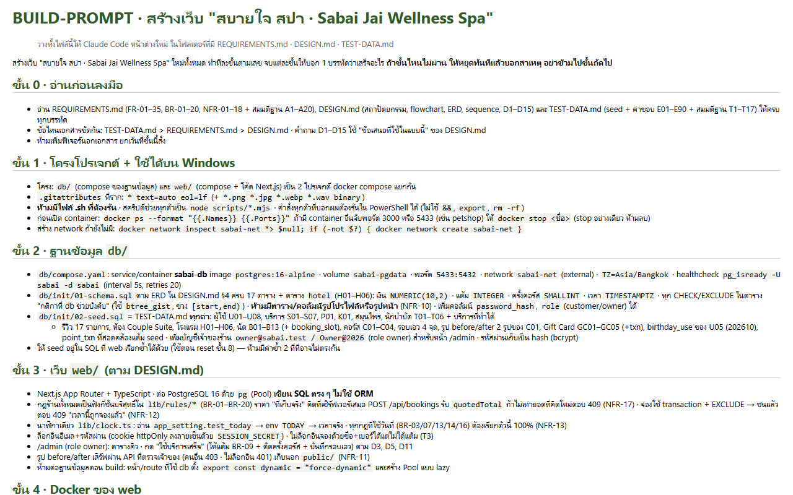

👀 **สังเกต**
- **อ่านก่อนวางเสมอ** ตรงไหนไม่ตรงกับ REQUIREMENTS ให้สั่งแก้ก่อน · ไฟล์นี้ใช้สร้างเว็บใหม่ได้ทุกเมื่อ
- ต้องมี **หน้า /admin** ให้ร้านกด "ใช้บริการเสร็จ" ไม่งั้นให้แต้มหรือตัดคอร์สไม่ได้ · ส่วน**บัญชีเจ้าของร้าน** (owner@…) Claude เพิ่มเองเพราะ TEST-DATA ไม่มี
- ข้อห้ามเปิดเผยบั๊กเขียนไว้ **2 ที่** (ขั้น 9 และสรุปท้าย) เพราะตอนสรุปเป็นจุดที่ Claude มักเผลอเล่า

✔️ **ไปต่อได้เมื่อ:** มี `BUILD-PROMPT.md` ที่มีขั้นเรื่อง db/web แยก, รูป, data-testid และ BUG_MODE

---

## LAB 6 · วางพรอมต์ → ได้เว็บใหม่ 2 กล่อง

🎯 ได้เว็บ **สบายใจ สปา** ที่ http://localhost:3000 จาก `BUILD-PROMPT.md` อย่างเดียว

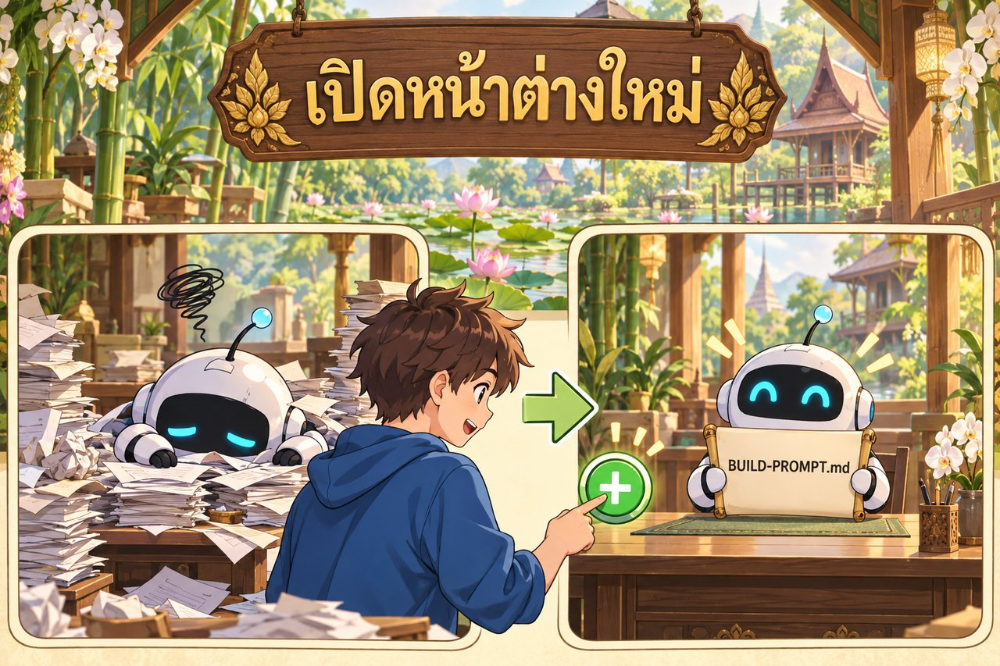

💬 **LAB นี้ไม่มีพรอมต์ใหม่** พรอมต์คือไฟล์ `BUILD-PROMPT.md` ที่ได้จาก LAB 5

| ขั้น | ทำอะไร |
|---|---|
| ① | เปิด **หน้าต่าง Claude Code ใหม่** ในโฟลเดอร์นี้ (หรือพิมพ์ `/clear`) → ความจำเริ่มจากศูนย์ พิสูจน์ว่าพรอมต์ครบจริง |
| ② | เปิดไฟล์ `BUILD-PROMPT.md` กด **Ctrl+A** แล้ว **Ctrl+C** |
| ③ | วางในหน้าต่างใหม่ (**Ctrl+V**) แล้วกด **Enter** · ช่องพิมพ์ขึ้น `[Pasted text +110 lines]` = วางติดแล้ว |
| ④ | Claude ขออนุญาตรันคำสั่ง (docker, npm, codex) → กด **Yes** |


⏱️ **รอ 30–60 นาที** (รอบจริงใช้ ~52 นาที) เพราะ Claude ต้องเขียนโค้ด สร้างรูปทีละรูปด้วย Codex แล้ว build Docker

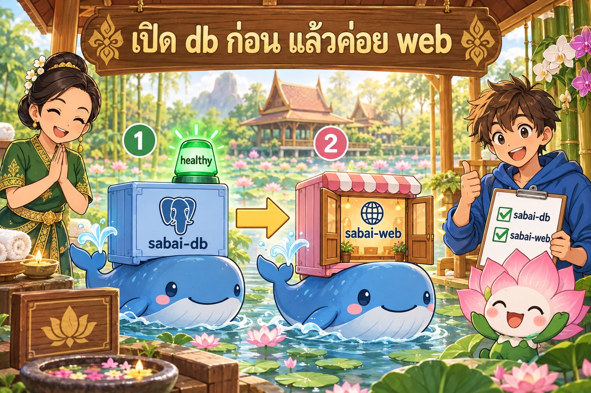

✅ **ผลจริง** ทั้ง 2 กล่อง healthy · `/api/health` → `{"ok":true,"db":true}` · Claude รายงานว่า **ตรวจกฎร้านผ่าน 90 / 90 ข้อ**

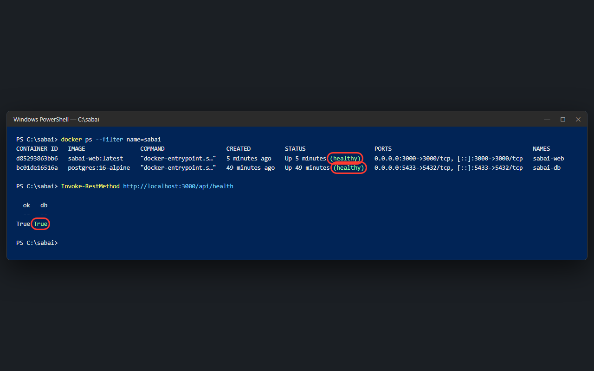

| ขั้น | ผล |
|---|---|
| Docker 2 โปรเจกต์ | ✅ `db/` (PostgreSQL 16 · 19 ตาราง) + `web/` (Next.js) · network `sabai-net` |
| เว็บ | ✅ **14 หน้า · API 25 เส้น · โค้ด 97 ไฟล์ (~7,700 บรรทัด)** |
| รูปในเว็บ | ✅ **Codex สร้าง 23 รูป · SVG แทน 0 รูป** (ดู `web/ASSETS.md`) |
| สำหรับ test | ✅ `data-testid` 244 ชื่อใน SPEC · `/api/test/reset` ~200 ms · ล็อกวันที่ได้ |
| เอกสาร | ✅ `web/SPEC.md` (หน้า · testid · error 3 ภาษา · API · ผู้ใช้ seed) · `web/ASSETS.md` · `web/BUGS.md` 🔒 |

แล้วเปิด http://localhost:3000 ได้เว็บนี้ 🎉 (รูปภาพทั้ง 23 รูปสร้างด้วย Codex ส่วนลายไทย ไอคอน และกราฟวาดด้วย SVG/CSS)

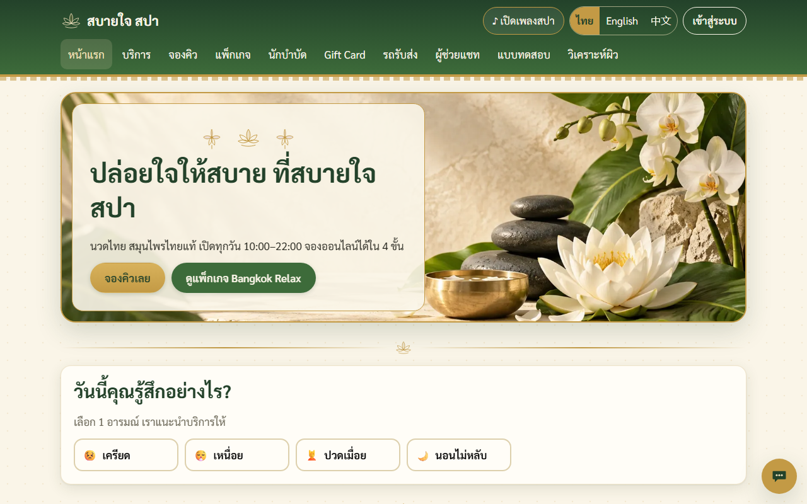

| 💆 บริการ + สมุนไพร | 👩 นักบำบัด + ตัวกรอง 4.5 ดาว |
|---|---|
| 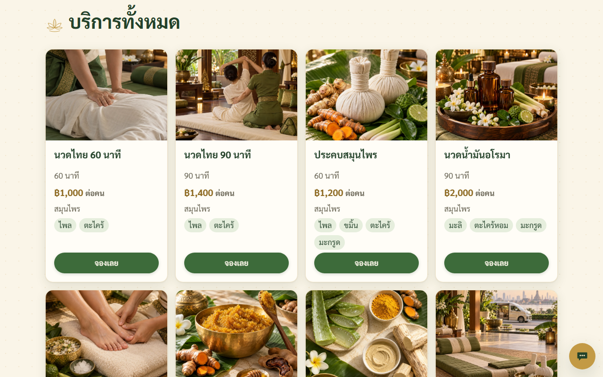 | 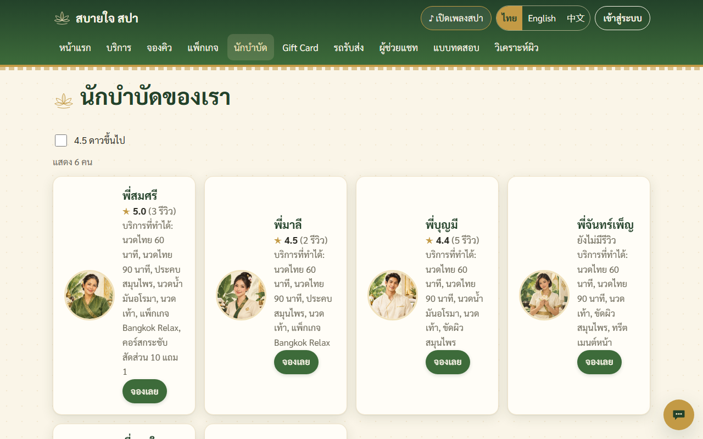 |
| 📅 **จอง 4 ขั้น: สรุปราคา** | 🏅 **บัญชีคุณนิดา: Gold · อีก ฿17,600** |
| 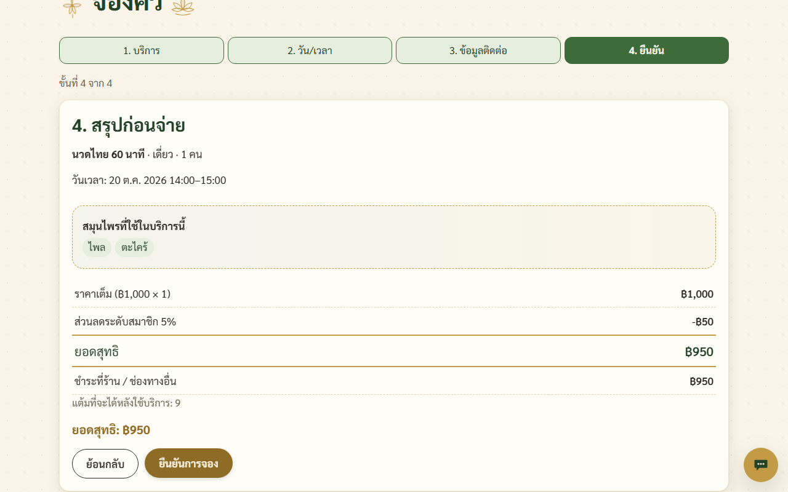 | 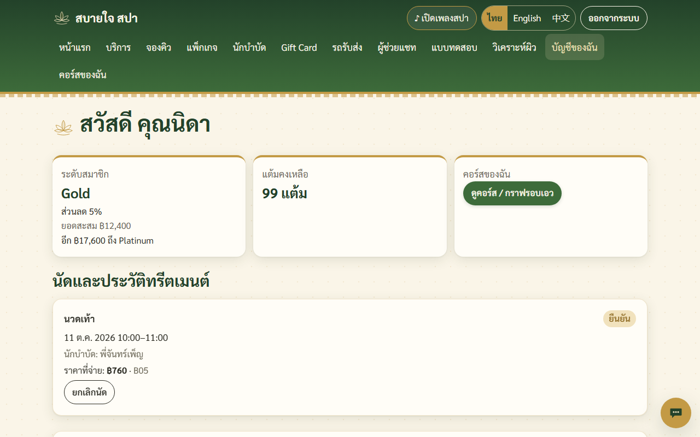 |
| 🎟️ **Wallet: เหลือ 7 จาก 11 ครั้ง** | 🎁 **Gift Card 3 ลาย** |
| 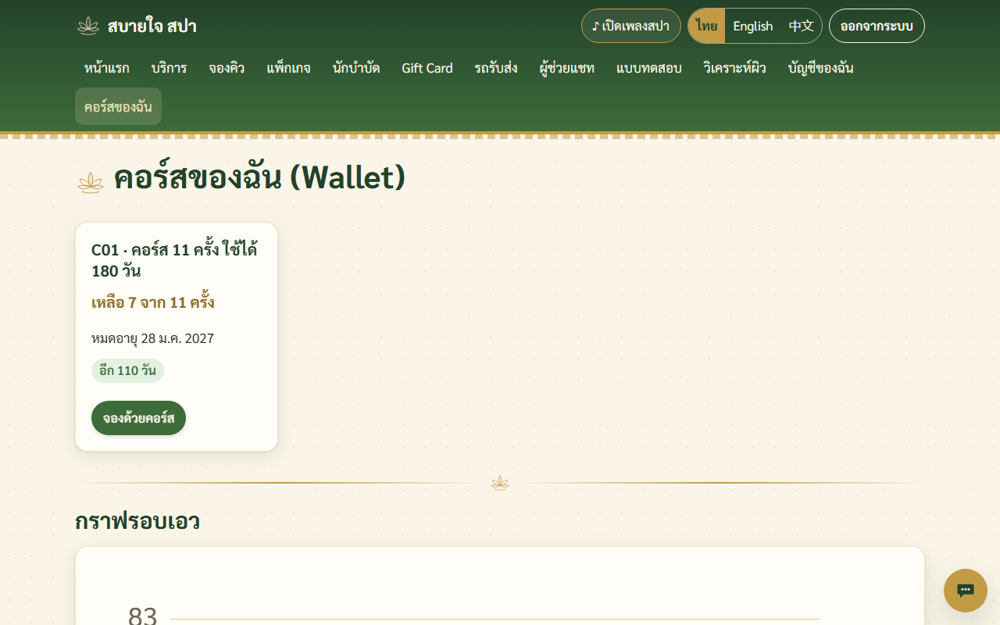 | 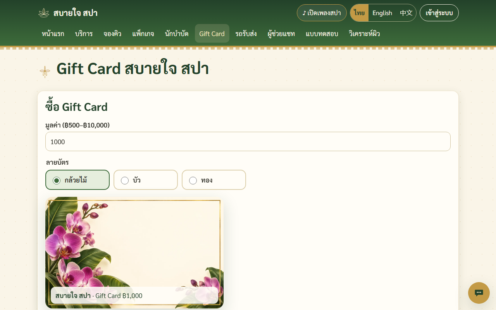 |
| 🛏️ **ทัวร์ Couple Suite 360°** | 🚐 **รถรับส่ง: 12 กม. 5 คน = 2 คัน ฿600** |
| 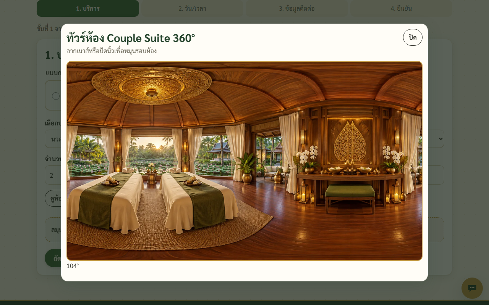 | 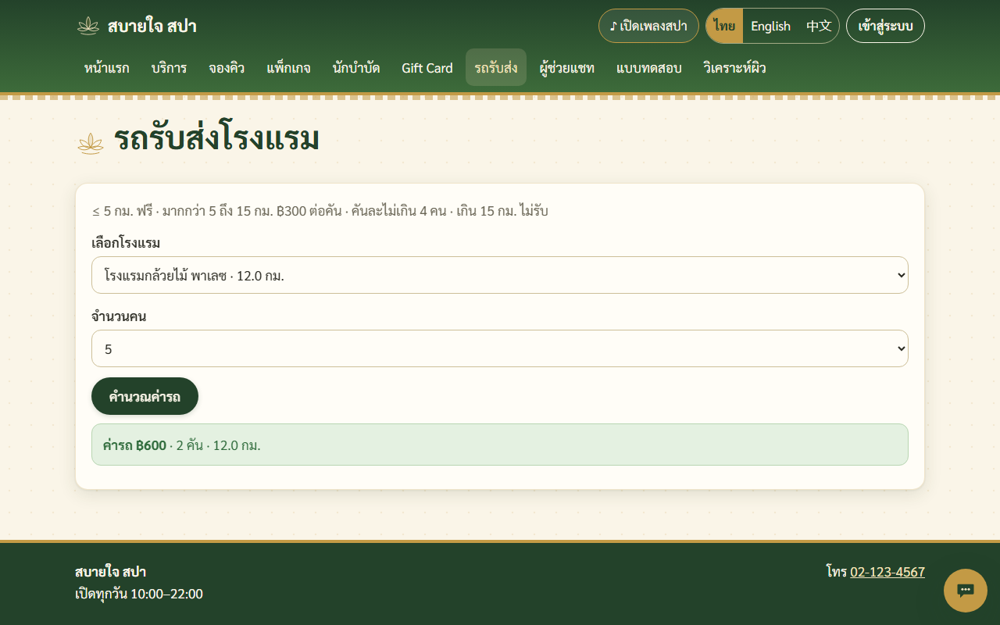 |
| 🔍 **วิเคราะห์ผิวในเครื่อง** | 📱 **มือถือ 390px** |
| 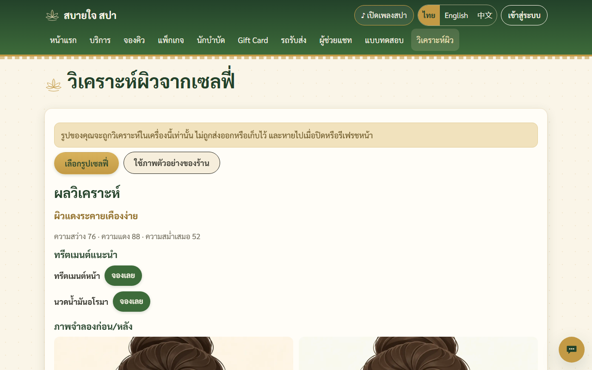 | 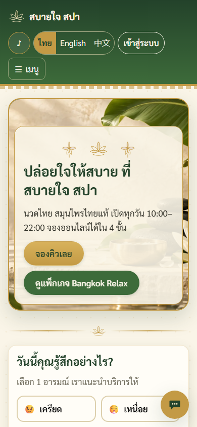 |

👀 **สังเกต**
- **AI รายงานว่า "ผ่าน 90/90"** = คำอ้าง [A] · คนสร้างตรวจงานตัวเอง ยังไม่นับว่าพิสูจน์แล้ว (LAB 7–12 จะพิสูจน์)
- Claude ตั้งสมมติฐานเพิ่มเอง (สรุปในแชท 5 ข้อ · `SPEC.md` จดไว้ 7 ข้อ) เช่น เบอร์ร้าน 02-123-4567 · แชทจองได้เฉพาะเดี่ยว 1 คน → จดไว้ใน `SPEC.md` เป็นเรื่องที่ต้องถามร้าน
- เว็บของแต่ละคน **หน้าตาและชื่อ testid ต่างกันได้** ขอแค่ทำตาม REQUIREMENTS + TEST-DATA ชุดเดียวกัน
- **ห้ามเปิด `web/BUGS.md`** จนถึงท้าย LAB 12

✔️ **ไปต่อได้เมื่อ:** `sabai-db` และ `sabai-web` healthy · `/api/health` ตอบ `{"ok":true,"db":true}` · เปิดหน้าเว็บได้

---

## LAB 7 · ฟังร้าน → ฟัง AI → สำรวจเว็บ

🎯 รู้จักเว็บจาก **3 เสียง** แล้วหาช่องว่างระหว่าง "ร้านขอ" · "AI บอกว่าทำ" · "เว็บทำจริง"

![ฟัง 3 ทาง ใน LAB 7–8 ฟังร้าน [D] REQUIREMENTS TEST-DATA เขียนสิ่งที่ต้องเจอก่อนเปิดเว็บ → ฟัง AI [A] web/SPEC.md ASSETS.md จดคำอ้าง → ฟังเว็บ [O] exploration/*.png Playwright เดินแบบลูกค้า รวมเป็น EXPLORATION.md 6 ส่วน A ถึง F](img/listen-3-ways.png)

> ลำดับนี้ตั้งใจ: **คิดผลที่ถูกจากร้านก่อน → ค่อยอ่านคำอ้างของ AI → แล้วค่อยเปิดเว็บ** จะได้ไม่ถูกหน้าจอชักนำ (กันอบบั๊ก)

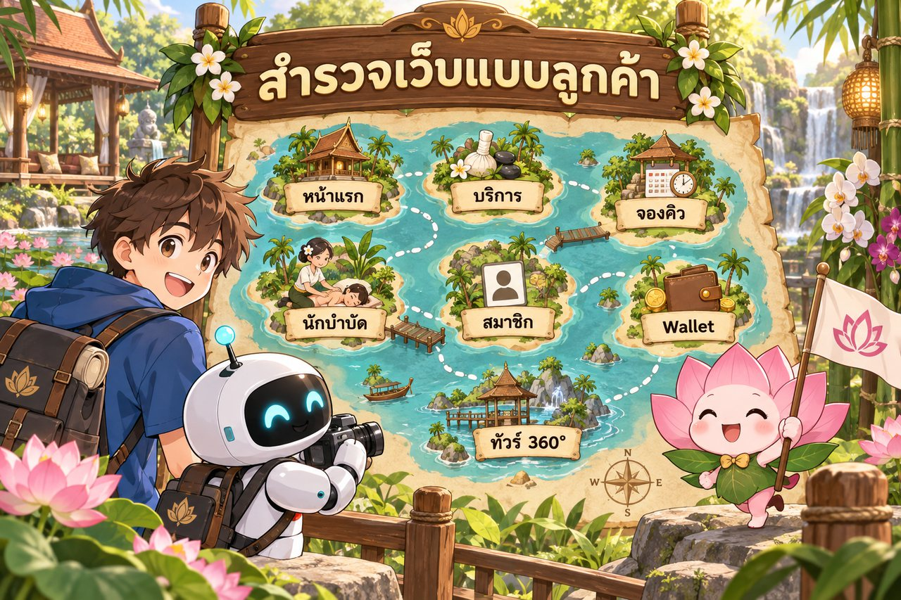

💬 **คัดลอกพรอมต์นี้**

```text
สำรวจเว็บ http://localhost:3000 ด้วยการ "ฟัง 3 ทาง" แล้วเขียน EXPLORATION.md ภาษาไทย
ห้ามเปิดอ่านโค้ดในโฟลเดอร์ web/ และ db/ (อ่านได้แค่ web/SPEC.md และ web/ASSETS.md) · ห้ามเปิด web/BUGS.md และ _solution/
ขั้นที่ 1 ฟังร้าน (ยังไม่เปิดเว็บ): จาก REQUIREMENTS.md และ TEST-DATA.md เขียนหัวข้อ "สิ่งที่ร้านบอกว่าต้องเจอบนเว็บ"
   เป็นรายการหน้า / ฟีเจอร์ / ตัวเลขที่คำนวณเองไว้ก่อน ติดป้าย [D]
ขั้นที่ 2 ฟัง AI: อ่าน web/SPEC.md และ web/ASSETS.md จดว่า AI ที่สร้างเว็บอ้างว่ามีหน้าไหน ฟีเจอร์ไหน กฎไหน ติดป้าย [A]
ขั้นที่ 3 ฟังเว็บ: เรียก POST http://localhost:3000/api/test/reset ก่อน แล้วใช้ Playwright MCP เปิดเว็บในแท็บใหม่ เดินแบบลูกค้า ติดป้าย [O]
   - กดทุกเมนูและลิงก์ในหัว/ท้ายเว็บให้ครบทุกหน้า
   - งานหลัก 1 รอบ: เข้าสู่ระบบด้วยผู้ใช้ใน TEST-DATA.md → เลือกบริการ → จองคิว → ดูบัญชีว่าการจองขึ้นไหม → ดู Wallet
   - หน้าที่ต้องใช้สิทธิ์พิเศษ (เช่น หน้าร้าน) ใช้บัญชีจาก SPEC.md ได้ แต่จดไว้ว่าร้านไม่ได้ให้บัญชีนี้
   - สลับ 3 ภาษา · ลองจอมือถือกว้าง 390px 1 หน้า
   - จับภาพหน้าละ 1 รูป (หน้าที่มีหลายขั้นจับทุกขั้นได้) เก็บใน exploration/ ชื่อไฟล์ตามหน้า เช่น exploration/book-step4.png
   - เสร็จแล้วเรียก reset อีกครั้ง
เขียนลง EXPLORATION.md
- ส่วน A แผนผังเว็บ: หน้า | URL | ไปถึงจากไหน | ต้องเข้าสู่ระบบไหม | AI อ้างไว้ใน SPEC ไหม
- ส่วน B รายการฟีเจอร์: ฟีเจอร์ | อยู่หน้าไหน | ลูกค้าทำอะไรได้ | ใส่ข้อมูลอะไรได้ | มาจาก FR ไหน
- ส่วน D ช่องว่าง 3 แบบ: ร้านขอแต่เว็บไม่มี · เว็บมีแต่ร้านไม่ได้ขอ · AI อ้างใน SPEC แต่ใช้ไม่ได้จริง (ตรวจแค่หน้าและปุ่ม กฎตัวเลขไว้ LAB 8)
ถ้าไม่แน่ใจให้เขียนไว้ในหัวข้อ "ยังไม่รู้" อย่าเดา · สรุปเป็นตาราง: ส่วน | จำนวน
```

✅ **ผลจริง** ได้ `EXPLORATION.md` ส่วน A B D + ภาพ 27 รูปใน `exploration/`

| ส่วน | ได้ |
|---|---|
| ฟังร้าน [D] | สิ่งที่ต้องเจอ 26 ข้อ · ตัวเลขที่คำนวณไว้ก่อน 16 ข้อ → **เว็บตรง 16/16** |
| ฟัง AI [A] | SPEC อ้าง 14 หน้า · ฟีเจอร์/กฎ 19 ข้อ |
| A แผนผังเว็บ | **15 หน้า** (AI อ้าง 14 · ไม่ได้อ้าง 1 = หน้า 404) |
| B รายการฟีเจอร์ | **41 ฟีเจอร์** |
| D ช่องว่าง | ร้านขอแต่ไม่มี **2** · มีแต่ร้านไม่ได้ขอ **6** · AI อ้างแต่ใช้ไม่ได้ **2** |
| ยังไม่รู้ | 11 ข้อ |

| 📅 จองแบบสมาชิก: ส่วนลด Gold + ค่ารถ | 🛠️ หลังร้าน (เว็บมีแต่ร้านไม่ได้ขอ) |
|---|---|
| 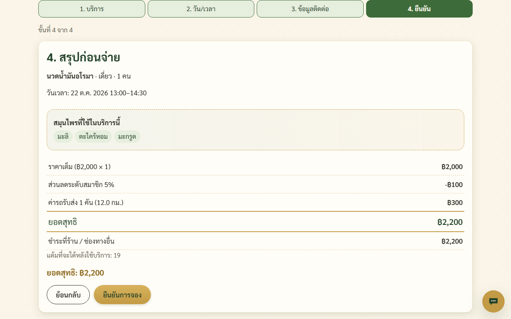 | 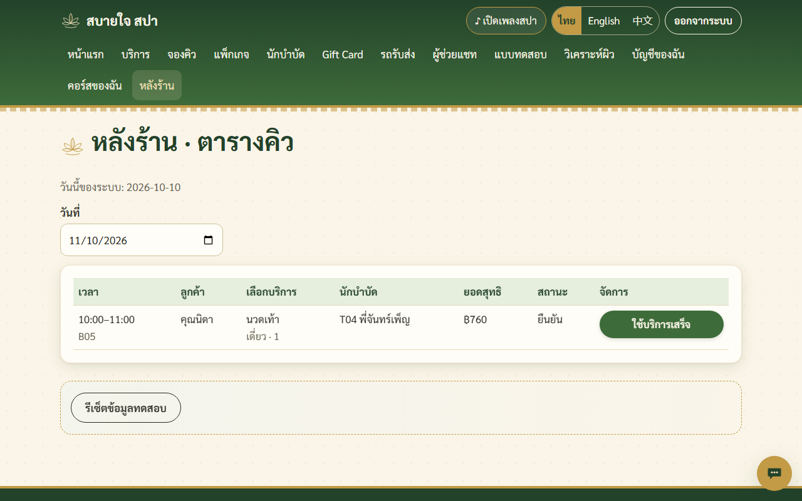 |

👀 **สังเกต**
- **"เว็บมีแต่ร้านไม่ได้ขอ"** เช่น หน้า /admin · บัญชี owner — AI เติมเองเพื่อให้ระบบครบ ต้องถามร้านว่ารับไหม
- หน้า 中文 มีเครื่องหมาย **฿** ซึ่งเป็นอักษรในช่วงภาษาไทยของ Unicode → ถ้าตรวจ "ไม่มีอักษรไทย" ต้องยกเว้น ฿
- สำรวจแล้วสร้างข้อมูลจริง (จองคิว) → reset ก่อนและหลังเสมอ

✔️ **ไปต่อได้เมื่อ:** `EXPLORATION.md` มีส่วน A B D และมีภาพใน `exploration/`

---

## LAB 8 · ล่ากฎ 3 ทาง

🎯 เปลี่ยน "เว็บทำอะไรได้" เป็น **"กฎที่ต้องถูก"** แล้วเทียบ 3 ทางทีละกฎ

💬 **คัดลอกพรอมต์นี้**

```text
อ่าน EXPLORATION.md, REQUIREMENTS.md, TEST-DATA.md และ web/SPEC.md แล้วใช้ Playwright MCP ลองเว็บต่อเพื่อหากฎ
(ห้ามเปิดอ่านโค้ดใน web/ และ db/ · ห้ามเปิด web/BUGS.md และ _solution/) · เรียก POST http://localhost:3000/api/test/reset ก่อนเริ่มแต่ละกลุ่มเคส
1. ทุกฟอร์มที่มี (สมัคร เข้าสู่ระบบ จองคิว Gift Card รถรับส่งทั้งหน้าแยกและในหน้าจอง — หาฟอร์มไหนไม่เจอให้จด ⚠️ ไม่ต้องเดา):
   ส่งเปล่า ใส่ค่าผิด ใส่ค่าขอบจาก TEST-DATA.md จดข้อความ error ตรงตัวอักษร
2. เงิน: ราคา ส่วนลดกลุ่ม ระดับสมาชิก วันเกิด แลกแต้ม ค่ารถ — คำนวณเองก่อนจาก [D]+[R] แล้วค่อยเทียบกับเว็บ
3. ขีดจำกัด: ช่วงวันที่จองได้ เวลาปิดร้าน จองซ้อน จำนวนคน ยกเลิกก่อน 24 ชม. คอร์สเหลือ 0 ครั้ง
4. สถานะ: รีโหลดแล้วข้อมูลยังถูกไหม · กดยืนยัน 2 ครั้งติดกันเร็ว ๆ แล้วนับว่าได้กี่นัด · ออกจากระบบแล้วเข้าหน้าสมาชิกได้ไหม
   · ตัวเลขแต้ม/ครั้งคอร์สอัปเดตทันทีไหม (แต้มได้ตอนร้านกด "ใช้บริการเสร็จ" ให้ลองผ่านหน้าร้านด้วยบัญชีใน SPEC.md)
เพิ่มลง EXPLORATION.md
- ส่วน C กฎ 3 ทาง: กฎ (BR) | ตัวอย่างที่ลอง | ร้านบอก [D] | AI อ้าง [A] | เว็บจริง [O] | ตรงไหม ✅ / ⚠️ / ❌
- ส่วน E ความเสี่ยง: ฟีเจอร์ | ถ้าพังจะเกิดอะไร | P1/P2/P3 | เหตุผล
  (P1 = เงินผิด จองผิด จองซ้อน หรือสิทธิ์/ข้อมูลส่วนตัวผิด · P2 = ฟีเจอร์สำคัญผิดแต่ยังจองได้ · P3 = การแสดงผลหรือกรณีเกิดไม่บ่อย)
- ส่วน F คำถาม แยก 2 กลุ่ม: "ถามร้าน" (กฎไม่ชัด) และ "ถามคนสร้างเว็บ" (เว็บทำแบบนี้เพราะอะไร)
ห้ามตัดสินว่าหน้าจอถูกเสมอ ถ้าเว็บหรือ SPEC ขัดกับร้านหรือกฎทั่วไป ให้ทำ ⚠️ หรือ ❌ · เสร็จแล้วเรียก reset อีกครั้ง
สรุปเป็นตาราง: ส่วน | จำนวน | ✅ | ⚠️ | ❌
```

✅ **ผลจริง** เพิ่มส่วน C E F ใน `EXPLORATION.md` (ใช้เวลา ~24 นาที)

| ส่วน | จำนวน | ✅ | ⚠️ | ❌ |
|---|---|---|---|---|
| C.1 ฟอร์ม (ส่งเปล่า · ค่าผิด · ค่าขอบ + ข้อความ error ตรงตัว) | 36 | 25 | 10 | 1 |
| C.2 กฎ 3 ทาง (เงิน · ขีดจำกัด · สถานะ) | 51 | 43 | 7 | 1 |
| **C รวม** | **87** | **68** | **17** | **2** |
| E ความเสี่ยง | 27 (P1 14 · P2 8 · P3 5) | | | |
| F คำถาม | 26 (ถามร้าน 12 · ถามคนสร้างเว็บ 14) | | | |

ตัวอย่างแถวในส่วน C (กฎ 3 ทาง)

| กฎ | ร้าน [D] | AI [A] | เว็บ [O] | ผล |
|---|---|---|---|---|
| BR-03 จองได้ +1 ถึง +30 วัน | 10 ต.ค. ❌ · 11 ต.ค. ✅ · 9 พ.ย. ✅ · 10 พ.ย. ❌ | `DATE_OUT_OF_RANGE` | ตรงทั้ง 4 วัน | ✅ |
| BR-02 ห้ามจองทับ | 14:30 ❌ · 15:00 ✅ | `SLOT_TAKEN` 409 | ตรง | ✅ |
| กดยืนยันจอง 2 ครั้งเร็ว ๆ | ได้ 1 นัด [R] | (ไม่ได้พูดถึง) | **ได้ 2 นัด** คนละนักบำบัด เวลาเดียวกัน | ❌ |
| รหัส Gift Card ที่ไม่มีจริง | ต้องแจ้งว่าใช้ไม่ได้ [R] | "ไม่พบ Gift Card นี้" | **หน้าจอเงียบ** จองผ่านโดยไม่ใช้บัตร | ❌ |

| ❌ กดยืนยัน 2 ครั้ง = 2 นัด | ❌ รหัสบัตรผิด หน้าจอไม่บอกอะไร |
|---|---|
| 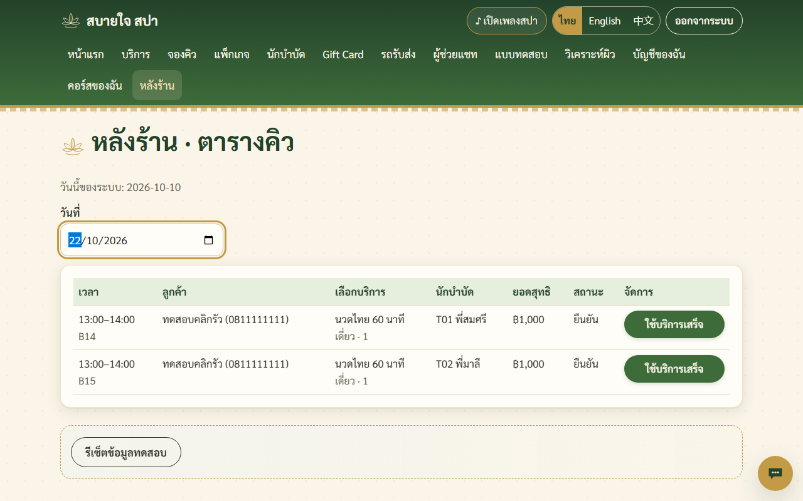 | 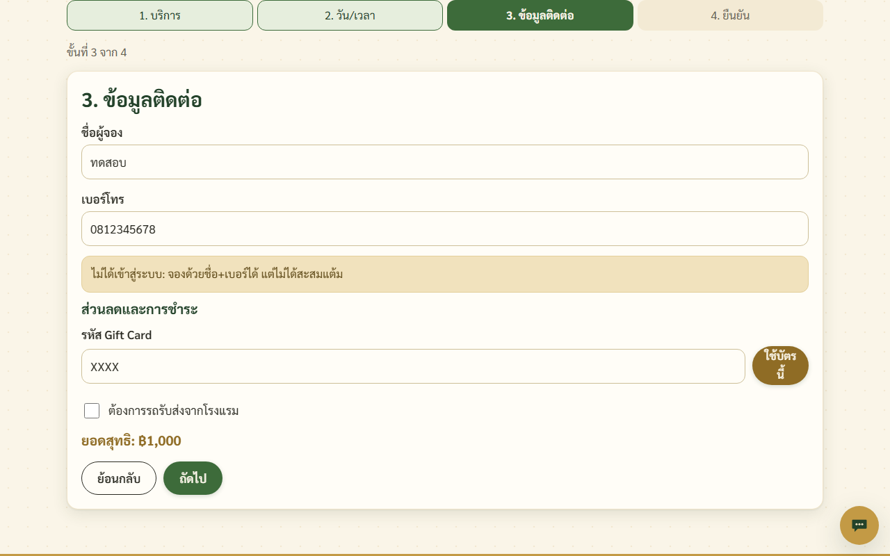 |

👀 **สังเกต**
- **เงิน: คำนวณเองก่อน 52 เคส → ตรงกับเว็บทุกเคส** เช่น ฿3,800 (กลุ่ม + แต้ม + รถ) · Platinum เดือนเกิด ฿800 ไม่ใช่ ฿700
- **AI บอกว่าผ่าน 90/90 แต่การสำรวจยังเจอบั๊กจริง 2 ตัว** ในโหมดปกติ เพราะ AI ตรวจแค่ตารางค่าขอบ E01–E90 ผ่าน API ไม่ได้ลองแบบลูกค้า (กดซ้ำ ใส่ของผิด)
- ⚠️ ที่ต้องถาม เช่น ร้านกด "ใช้บริการเสร็จ" ก่อนถึงวันนัดได้ (แต้มเข้าก่อนใช้บริการ) · cookie เดิมยังใช้ได้หลังออกจากระบบ · ไม่มีหน้าสมัครสมาชิก

✔️ **ไปต่อได้เมื่อ:** `EXPLORATION.md` มีส่วน C (ป้าย [D]/[A]/[O] + ✅⚠️❌) · E · F

---

## LAB 9 · TEST-PLAN หัวข้อ 1–5 + ลองกับเว็บจริง

🎯 ได้ test case ที่ครอบคลุมทุกฟีเจอร์ในขอบเขต ทุกข้อ **โยงกลับ FR/BR** และ **รู้ที่มา** ของผลที่คาดหวัง

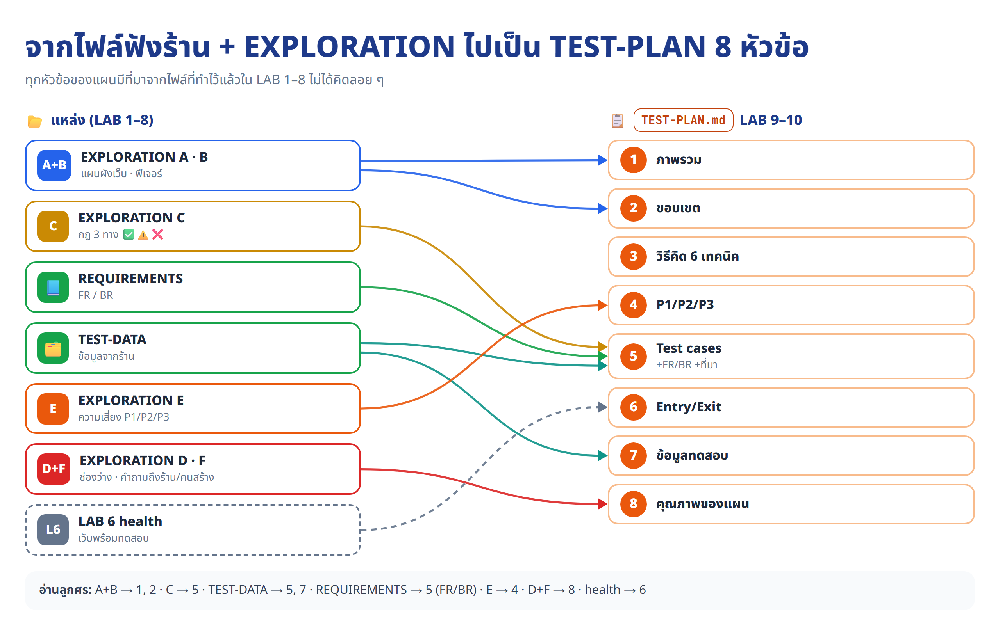

💬 **คัดลอกพรอมต์นี้**

```text
สร้าง TEST-PLAN.md ภาษาไทย 8 หัวข้อ: 1 ภาพรวม · 2 ขอบเขต · 3 วิธีคิด test case · 4 ระดับความสำคัญ · 5 Test cases · 6 เกณฑ์ Entry/Exit · 7 ข้อมูลทดสอบ · 8 คุณภาพของแผน
ตอนนี้เขียนหัวข้อ 1–5 (หัวข้อ 6–8 ใส่แค่ชื่อแล้วเขียนว่า "ยังไม่เขียน") จาก REQUIREMENTS.md, TEST-DATA.md และ EXPLORATION.md
(ห้ามเปิดอ่านโค้ดใน web/ และ db/ · ห้ามเปิด web/BUGS.md และ _solution/)
1. ภาพรวม: เป้าหมาย (ประโยคเดียว) | ระบบที่ทดสอบ | เครื่องมือ | สิ่งที่ต้องส่ง | แหล่งของผลที่คาดหวัง [D] ร้าน > [R] กฎทั่วไป > [A] SPEC ของ AI > [O] หน้าจอ
2. ขอบเขต: ทุกฟีเจอร์ใน EXPLORATION.md ส่วน B ต้องอยู่ฝั่ง ทดสอบ ✅ หรือ ไม่ทดสอบ ❌ (มีเหตุผล) · ระบุเบราว์เซอร์ จอมือถือ และ API
   ไม่แน่ใจเรื่องไหนให้ถามผมก่อน แล้วจดตาราง "คำถาม | คำตอบที่ใช้" ท้ายหัวข้อ 2
3. วิธีคิด test case: Happy path, Negative, Boundary, Equivalence partition, State, Security/API พร้อมตัวอย่างจากเว็บนี้
4. ระดับ P1/P2/P3 ตาม EXPLORATION.md ส่วน E + คำถามจัดระดับ 3 ข้อ (ตอบ "ใช่" ข้อแรกแล้วหยุด)
5. Test cases ประมาณ 30–40 ข้อ: ID (TC-<โมดูล>-01) | โมดูล | สิ่งที่ทดสอบ | FR/BR | เทคนิค | ระดับ | ข้อมูล (จาก TEST-DATA.md) | ผลที่คาดหวัง | ที่มา
   - ผลที่คาดหวังต้องเป็นตัวเลขหรือข้อความที่ตรวจได้ ห้ามเขียน "แสดงถูกต้อง" · เงินคำนวณเองพร้อมวิธีคิด
   - ที่มาต้องมี [D] หรือ [R] อย่างน้อย 1 อย่าง ถ้ามีแค่ [A] หรือ [O] ให้ติด [O-ยังไม่ยืนยัน] และเพิ่มลง EXPLORATION.md ส่วน F
   - ข้อความที่รู้จาก SPEC [A] อย่างเดียว ให้เขียนผลที่คาดหวังแบบไม่ผูกคำ เช่น "มีข้อความแจ้งว่าใช้บัตรไม่ได้"
   - ต้องมี: จองคิวจนจบ (E2E) · ค่าขอบระดับสมาชิก · จองซ้อน · กดยืนยันซ้ำ · จองด้วยคอร์สแล้วครั้งลด · ช่วงวันที่จองได้ · เรียก API ที่ต้อง login โดยไม่ login
6. จากนั้นลองทุกข้อกับเว็บจริงด้วย Playwright (เรียก reset ก่อนทุก TC) สรุปตาราง ID | ผลที่คาดหวัง | เว็บจริง | ตรงไหม ลงไฟล์ TEST-RUN-1.md
   ถ้าไม่ตรง ห้ามแก้ผลที่คาดหวังตามเว็บ ให้ทำ ⚠️ แล้วบอกว่าคิดว่าเป็นบั๊กของเว็บหรือแผนเข้าใจผิด เพราะอะไร
สรุปท้าย: โมดูล | จำนวน TC | P1 | P2 | P3 และนับตามที่มาที่น่าเชื่อที่สุดของแต่ละ TC (1 TC นับ 1 ครั้ง) [D] / [R] / [O-ยังไม่ยืนยัน]
```

✅ **ผลจริง** ได้ `TEST-PLAN.md` หัวข้อ 1–5 · **40 test case** · ลองกับเว็บจริง **ตรง 36 · ไม่ตรง ⚠️ 4**

| ID | ผลที่คาดหวัง (คิดก่อนเปิดเว็บ) | เว็บจริง | ตรงไหม |
|---|---|---|---|
| TC-PRICE-04 | กลุ่ม 4 + แลก 200 แต้ม + รถ 12 กม. = **฿3,800** · แต้มเหลือ 50 | ฿3,800 · รถ 1 คัน · แต้ม 50 | ✅ |
| TC-CXL-02 | เหลือ 23:59 ชม. → ปุ่มกดไม่ได้ + เบอร์ร้าน | disabled + "กรุณาโทรหาร้าน · 02-123-4567" | ✅ |
| TC-CRS-01 | จองด้วยคอร์ส ฿0 · 7 → 6 จาก 11 | ฿0 · "เหลือ 6 จาก 11 ครั้ง" | ✅ |
| TC-BOOK-05 | กดยืนยัน 2 ครั้ง = **1 นัด** | **2 นัด** ลูกค้าเห็นแค่รหัสเดียว | ⚠️ |
| TC-TRN-03 | ไม่ใส่ระยะโรงแรม → ไปขั้น 4 ไม่ได้ | ไปถึงขั้น 4 · ไม่มีค่ารถ | ⚠️ |
| TC-GC-04 | รหัสบัตรผิด → มีข้อความแจ้ง | ไม่มีข้อความใดเลย | ⚠️ |
| TC-SEC-04 | ออกจากระบบแล้ว cookie เดิม → 401 | **200 ได้ข้อมูลคุณนิดา** | ⚠️ |

| ⚠️ ไม่ใส่ระยะ ก็จองต่อได้ | ✅ ยกเลิกไม่ได้เมื่อเหลือ 23:59 ชม. |
|---|---|
| 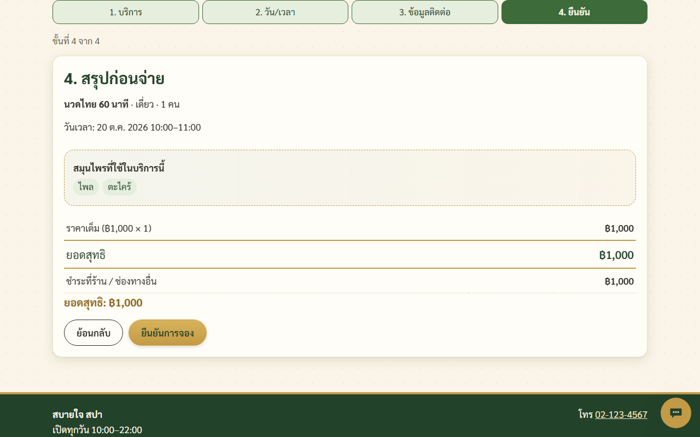 | 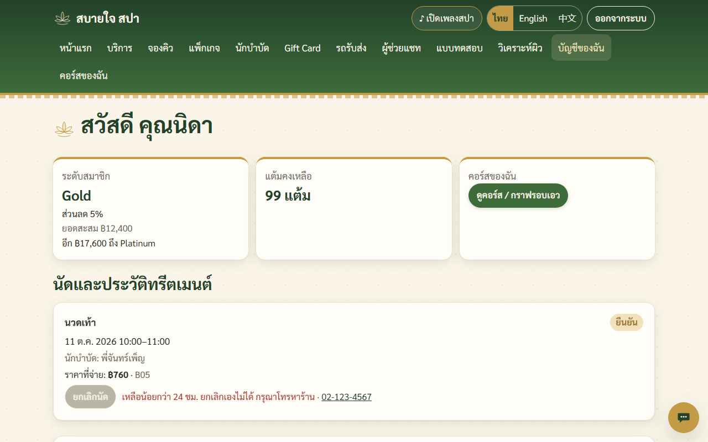 |

👀 **สังเกต**
- **ไม่ตรง ≠ แก้ผลที่คาดหวังตามเว็บ** ทั้ง 4 ข้อคง ⚠️ ไว้ แล้วจำแนกว่าเป็นบั๊กของเว็บ (จะพิสูจน์ซ้ำด้วย test อัตโนมัติใน LAB 11)
- ตัวเลขเงินทุกข้อที่คำนวณจาก [D]+[R] ก่อนเปิดเว็บ **ตรงกับเว็บหมด** → เขียนผลที่คาดหวังโดยไม่ลอกจากจอได้จริง
- ต้อง reset ก่อนทุก TC เพราะหลายข้อใช้นักบำบัด/รอบเดียวกัน

✔️ **ไปต่อได้เมื่อ:** หัวข้อ 5 มีคอลัมน์ FR/BR และ "ที่มา" ครบทุกแถว และมีตารางผลลองกับเว็บจริง

---

## LAB 10 · หัวข้อ 6–8 + รีวิวแผน

🎯 ปิดแผนให้ครบ 8 หัวข้อ แล้ว **ตรวจคุณภาพแผน** ก่อนเอาไปแปลงเป็น test

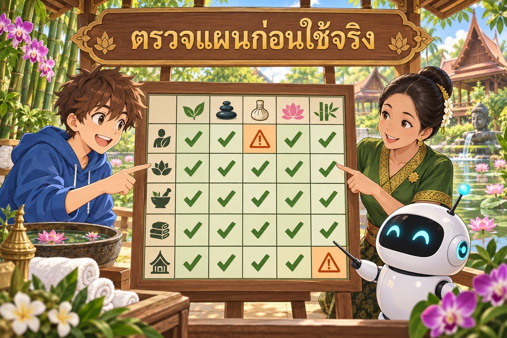

💬 **คัดลอกพรอมต์นี้**

```text
ทำ TEST-PLAN.md ให้ครบ แล้วรีวิวแผน (ห้ามเปิดอ่านโค้ดใน web/ และ db/ · ห้ามเปิด web/BUGS.md และ _solution/)
1. หัวข้อ 6 เกณฑ์: เริ่มทดสอบได้เมื่อ sabai-db และ sabai-web healthy และ /api/health ตอบ {"ok":true,"db":true}
   ผ่านเกณฑ์เมื่อ P1 ผ่านทั้งหมด และอัตราผ่านรวม ≥ 95% (คิดเป็นจำนวนข้อ ปัดขึ้น · TC ที่ไม่ได้รันนับเป็นไม่ผ่าน) ตัดสินแยกทีละเบราว์เซอร์
2. หัวข้อ 7 ข้อมูลทดสอบ: ตารางจาก TEST-DATA.md + ข้อมูลที่ตั้งเองในหัวข้อ 5 พร้อมบอกว่าใช้กับ TC ไหน
3. หัวข้อ 8 คุณภาพของแผน: ตาราง "ถ้าเว็บพังแบบนี้ → TC ไหนต้องล้ม → ทำไมจับได้ (oracle)" อย่างน้อย 6 แบบ ครอบคลุมเงิน การจอง และสถานะ
   และตาราง "จุดที่ยังกำกวม" จาก EXPLORATION.md ส่วน F พร้อมสมมติฐานที่แผนใช้
จากนั้นเขียน PLAN-REVIEW.md
- Coverage matrix (ทำหลังแก้): แถว = ฟีเจอร์ในขอบเขต, คอลัมน์ = 6 เทคนิค, ช่อง = ID · ช่องที่ควรมีแต่ว่างให้ทำ ⚠️ · ช่องที่เติมจากการรีวิวให้ทำ ✚
- Traceability: FR/BR | TC ที่ครอบคลุม (BR ทุกข้อในขอบเขตต้องมีอย่างน้อย 1 TC)
- นับ TC ตามระดับ ตามเทคนิค และตามที่มา
- ตรวจทีละข้อ: ผลที่คาดหวังตรวจได้ไหม · ข้อมูลที่เลือกทำให้คำตอบผิดได้ตัวเลขต่างจากคำตอบถูกไหม · บอกจังหวะตรวจไหม (ทันที / หลังรีโหลด) · มีข้อซ้ำไหม
- สรุป 3–5 ข้อที่ควรแก้ แล้วแก้ใน TEST-PLAN.md ให้เลย (เพิ่ม TC ได้ แล้วอัปเดตตัวเลขในหัวข้อ 6 ให้ตรง · เรื่องที่ต้องถามร้านให้บอกผม)
```

✅ **ผลจริง** `TEST-PLAN.md` ครบ 8 หัวข้อ + `PLAN-REVIEW.md`

| หัวข้อ | ได้ |
|---|---|
| 6 Entry | `sabai-db` healthy · `sabai-web` healthy · `/api/health` = `{"ok":true,"db":true}` |
| 6 Exit | **P1 ผ่าน 33/33** และผ่านรวม **≥ 40/42** (95% ปัดขึ้น) · ตัดสินแยกทีละเบราว์เซอร์ |
| 7 ข้อมูลทดสอบ | จาก TEST-DATA 28 แถว + ตั้งเอง 15 แถว พร้อม TC ที่ใช้ |
| 8.1 ถ้าเว็บพังแบบนี้ → TC ไหนล้ม | **21 แบบ** (เงิน 8 · การจอง 6 · สถานะ 5 · สิทธิ์ 2) |
| 8.2 จุดกำกวม | 20 ข้อ พร้อมสมมติฐานที่แผนใช้ |

| ตัวชี้วัดรีวิว | ก่อน | หลัง |
|---|---|---|
| จำนวน TC (P1 / P2 / P3) | 40 (32 / 7 / 1) | **42 (33 / 8 / 1)** |
| BR ที่มี TC ครอบคลุม | 20/20 | 20/20 |
| ผลที่คาดหวังตรวจได้ | 36/40 | **42/42** |
| ข้อที่บอกจังหวะตรวจ (ทันที / หลังรีโหลด) | 0/14 | **16/16** |

👀 **สังเกต**
- รีวิวเจอ **oracle อ่อน**: TC ราคาแพ็กเกจใช้ลูกค้า Silver (ไม่มีส่วนลดอยู่แล้ว) ถ้าเว็บเผลอให้ส่วนลดกับแพ็กเกจ test ก็ยัง "ผ่าน" → เปลี่ยนเป็นลูกค้า Platinum ที่เกิดเดือนนี้ ให้ตัวเลขถูกกับผิดต่างกันชัด
- เพิ่ม **TC-SEC-05** (ล็อกอินแล้วแก้ของคนอื่น) และ **TC-BOOK-10** (กลุ่ม + เดือนเกิด · ข้อมูลติดต่อว่าง) จากการรีวิว
- test เรื่องสถานะต้องบอก **"ตรวจตอนไหน"** ถ้าเขียนกว้าง ๆ คนแปลงเป็น test อาจเลือกจังหวะที่ทำให้พลาดบั๊ก

✔️ **ไปต่อได้เมื่อ:** `TEST-PLAN.md` ครบ 8 หัวข้อ และมี `PLAN-REVIEW.md`

---

## LAB 11 · แปลงแผนเป็น Playwright 3 เบราว์เซอร์

🎯 พิสูจน์ว่าแผน **ใช้งานได้จริง**: ทุกข้อแปลงเป็น test ได้ มีหลักฐาน GIF + MP4 และรายงานตัดสินตามเกณฑ์ของเราเอง

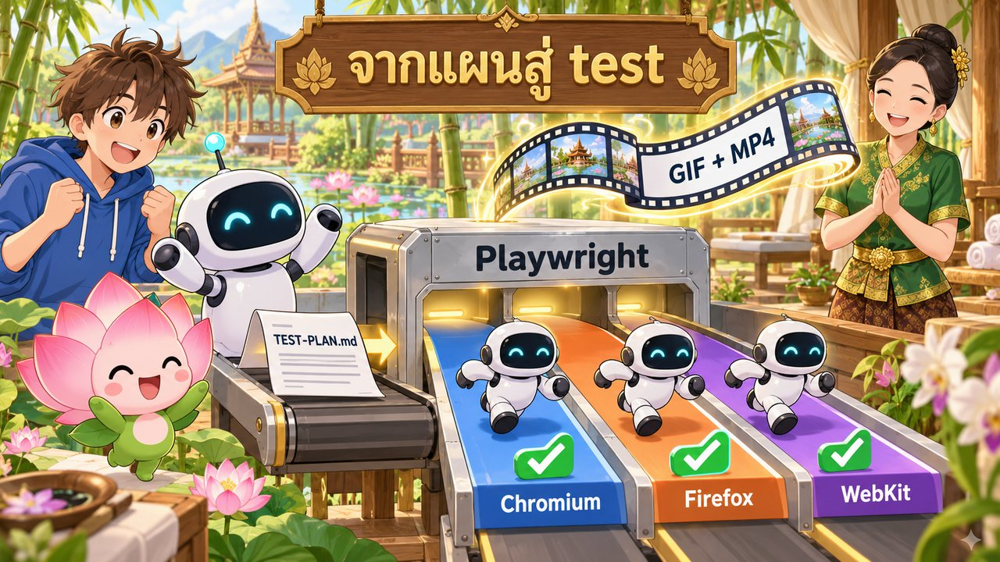

💬 **คัดลอกพรอมต์นี้**

```text
สร้างชุดทดสอบ Playwright (TypeScript) ในโฟลเดอร์ e2e จาก TEST-PLAN.md · ห้ามแก้โค้ดใน web/ และ db/ · ห้ามเปิด web/BUGS.md และ _solution/
0. เช็กก่อน: node -v, ffmpeg -version และ http://localhost:3000/api/health ถ้าไม่พร้อมให้หยุดแล้วบอก
1. playwright.config: chromium / firefox / webkit · locale th-TH · timezone Asia/Bangkok · GIF=1 อัดวิดีโอทุก test แบบช้า (เฉพาะ chromium)
2. global-setup: เช็ก /api/health อ่าน data-bug-mode เก็บไว้ใส่รายงาน แล้ว POST /api/test/reset พร้อมวันล็อกจาก TEST-DATA.md
   แผนใช้ผู้ใช้และวันจาก seed จึงให้ reset ก่อนทุก test (fixture) และตั้ง workers: 1 กันข้อมูลชน
3. test ครบทุกข้อในหัวข้อ 5 ชื่อขึ้นต้นด้วยรหัส TC แยกไฟล์ตามโมดูล · tag ['@<โมดูล>', '@P1|@P2|@P3'] · annotation ผลที่คาดหวังและที่มาจากแผน
   หา element ด้วย data-testid จาก web/SPEC.md หรือที่เห็นบนหน้าเว็บ · ใช้ตัวเลข/ข้อความตามแผนเท่านั้น ห้ามเปลี่ยนตามที่เว็บแสดง
   แบ่งขั้นตอนภาษาไทยด้วย test.step และตรวจด้วย expect.soft · ราคาบนจอมาจาก API ให้รอหน้าเว็บคิดเสร็จก่อนอ่าน (ห้ามรอจนได้ค่าที่อยากได้)
   test ที่ "กดซ้ำ" ต้องคลิก 2 ครั้งติดกันจริง (ไม่ใช่ dblclick ที่ส่งคำขอครั้งเดียว) แล้วนับผลในระบบ · ผลที่เคยเจอตอนสำรวจ (LAB 8–9) ต้องเจอซ้ำใน test
4. หลักฐาน: test ที่เปิดหน้าเว็บต้องได้ test-report/gifs/<TC>.gif และ test-report/videos/<TC>.mp4 (ใช้ ffmpeg)
   มีป้ายชื่อ test มุมซ้ายล่างและวงแดงตรงจุดคลิก · test ที่เรียก API อย่างเดียวให้บันทึก log
5. รายงานหน้าเดียว e2e/index.html (ดับเบิลคลิกเปิดได้ ไม่ต้องมี server):
   กล่อง "ผ่านเกณฑ์ / ไม่ผ่านเกณฑ์" ตามหัวข้อ 6 ของ TEST-PLAN.md แยกทีละเบราว์เซอร์ · ป้ายโหมดจาก data-bug-mode
   ตารางทุก TC: รหัส · สิ่งที่ทดสอบ · ระดับ · ที่มา · ผลแต่ละเบราว์เซอร์ · ลิงก์ GIF/MP4
   ข้อที่ล้มแสดงการจำแนก (เว็บผิด / แผนผิด / test เขียนผิด) ที่อ่านจาก e2e/triage.json
6. เขียน 2 test แรกก่อน รันให้ผ่านและได้ GIF + MP4 แล้วค่อยเขียนที่เหลือ
7. เขียน CLAUDE.md ที่โฟลเดอร์บท: โครงสร้างโฟลเดอร์ · คำสั่งเปิด db / web และ BUG_MODE ใน PowerShell · วิธีเขียน test ใหม่
รัน npm install, npx playwright install, npx playwright test (รันซ้ำอีก 1 รอบเช็กว่าผลนิ่ง เก็บผลทุกรอบไว้เทียบ) แล้ว npm run test:gif
ถ้ามี test ล้ม ดูภาพ/GIF ก่อน แล้วบอกว่าเว็บผิด แผนผิด หรือ test เขียนผิด บันทึกลง triage.json แล้วสร้าง index.html ใหม่
แก้ได้เฉพาะ test ที่เขียนผิดจริง ห้ามแก้ผลที่คาดหวังให้ผ่าน (ข้อที่จำแนกว่า "แผนผิด" ยังนับเป็นล้มจนกว่าจะแก้แผน) · สรุปเป็นตาราง: เบราว์เซอร์ | ผ่าน | ล้ม | ผ่านเกณฑ์ไหม · จำนวน GIF | MP4
```

✅ **ผลจริง** ใช้เวลา ~76 นาที (เขียน test 42 ข้อใน 12 ไฟล์ + รันเต็มรอบละ ~13 นาที × 3 รอบ + รอบ GIF ~6 นาที)

| เบราว์เซอร์ | P1 ผ่าน (EX-1) | ผ่านรวม (EX-2 ≥ 40/42) | ข้อที่ล้ม | ผลตามเกณฑ์ |
|---|---|---|---|---|
| Chromium | 32/33 ❌ | 38/42 (90.5%) ❌ | TRN-03 · GC-04 · SEC-04 · SEC-05 | ❌ ไม่ผ่าน |
| Firefox | 32/33 ❌ | 38/42 (90.5%) ❌ | ข้อเดียวกัน | ❌ ไม่ผ่าน |
| WebKit | 32/33 ❌ | 38/42 (90.5%) ❌ | ข้อเดียวกัน | ❌ ไม่ผ่าน |

- รอบ 2–3 **ผลเหมือนกันทุกข้อ** (ไม่ flaky) · รอบ 1 ต่างเพราะ test เขียนผิด แก้แล้ว · หลักฐาน **GIF 36 · MP4 36** (ทุก TC ที่เปิดหน้าเว็บ) + log ของ TC ที่ยิง API 6 ข้อ
- TC ที่ยิง API อย่างเดียว (BOOK-06, SEC-01–05) รันครั้งเดียวแล้วนับผลให้ทุกเบราว์เซอร์ ตามกติกาในแผนหัวข้อ 6

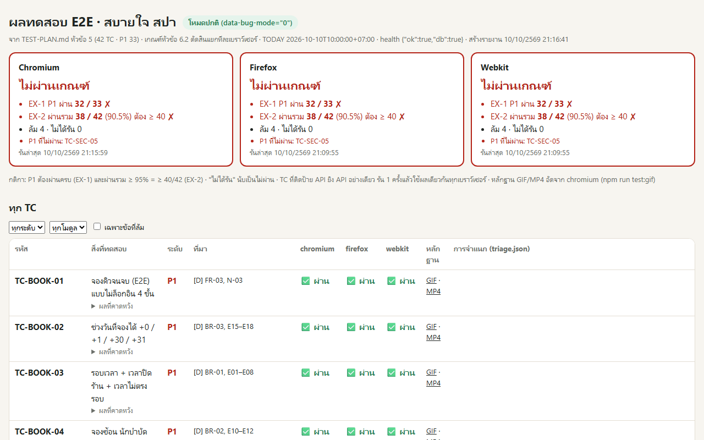

| ข้อที่ล้ม | จำแนก (`triage.json`) | ทำไม |
|---|---|---|
| TC-TRN-03 (P2) | **เว็บผิด** | ติ๊กรถรับส่งแต่ไม่ใส่โรงแรม/ระยะ → จองสำเร็จโดยไม่มีบรรทัดค่ารถ |
| TC-GC-04 (P2) | **เว็บผิด** | รหัส Gift Card ผิด หน้าจอเงียบ (SPEC บอกว่าต้องมีข้อความ "ไม่พบ Gift Card นี้") |
| TC-SEC-04 (P2) | **เว็บผิด** | ออกจากระบบแล้ว cookie เดิมยังเรียกข้อมูลคุณนิดาได้ |
| TC-SEC-05 (**P1**) | **แผนผิด** | ใช้คอร์สของคนอื่นถูกปฏิเสธจริง แต่ได้รหัส 422 ไม่ใช่ 403/404 ที่แผนเขียน → กฎยังถูก แผนระบุแคบเกินไป **ยังนับเป็นล้มจนกว่าจะแก้แผน** |

**🎬 TC-BOOK-01 จองคิวจนจบ (E2E)** (วงแดง = จุดที่ Playwright คลิก · ป้ายมุมซ้ายล่าง = ชื่อ test)


| 💰 TC-PRICE-04 กลุ่ม + แต้ม + รถ = ฿3,800 | ⚠️ TC-TRN-03 ไม่ใส่ระยะ ก็จองได้ (เว็บผิด) |
|---|---|
| 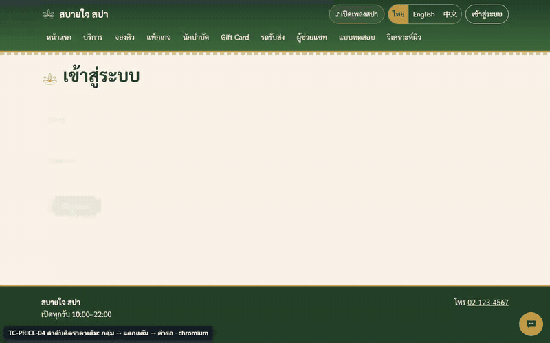 |  |


👀 **สังเกต**
- **AI ผู้สร้างบอก "ผ่าน 90/90" แต่แผนของเราตัดสินว่า "ยังไม่พร้อมเปิดร้าน"** → นี่คือคุณค่าของการมีแผนที่ tester เขียนเอง
- ถ้าแก้แผน TC-SEC-05 เป็น "ได้ 4xx และไม่มีอะไรถูกบันทึก" ผ่านรวมก็ได้แค่ 39/42 **ยังไม่ผ่าน** เพราะเว็บผิดอยู่ 3 ข้อ เกินโควตาล้ม 2 ข้อ
- ⚠️ **test ผ่านแบบหลอกก็มี:** TC-BOOK-05 (กดยืนยันซ้ำ) ที่ LAB 8–9 เจอว่าได้ 2 นัด กลับ **ผ่าน** ทั้ง 3 เบราว์เซอร์ เพราะ test ใช้ `dblclick()` ซึ่งส่งคำขอไปแค่ครั้งเดียว → บั๊ก P1 หลุดจาก test อัตโนมัติ · test กดซ้ำต้อง **คลิก 2 ครั้งติดกันจริง** แล้วนับนัดในฐานข้อมูล · เทียบผล test กับสิ่งที่เคยเจอตอนสำรวจเสมอ
- **test เขียนผิดก็เกิดได้**: รอบแรก TC-BOOK-01 ล้มเพราะ test อ่านรายชื่อสมุนไพรผิดรูปแบบ (บนจอเป็นชิปแยกกัน) และ TC-I18N-01 ล้มบน WebKit → แก้ที่ test ทั้งคู่ ไม่ได้แก้ผลที่คาดหวัง
- แผนใช้ผู้ใช้และวันจาก seed จึงต้อง **reset ก่อนทุก test และรันทีละ test** (`workers: 1`) ไม่งั้นข้อมูลชนกัน
- regex ตรวจ "ไม่มีอักษรไทย" แบบ `[ก-๛]` ครอบเครื่องหมาย **฿** ด้วย ต้องเขียนเป็น `[ก-฾เ-๛]`

✔️ **ไปต่อได้เมื่อ:** มี `e2e/index.html` ที่ตัดสินผลแยกเบราว์เซอร์ · GIF = MP4 = จำนวน TC ที่เปิดหน้าเว็บ · ข้อที่ล้มจำแนกครบใน `triage.json`

---

## LAB 12 · บั๊กปริศนา 🐞

🎯 เปิด `BUG_MODE=1` ซึ่ง **Claude เลือกฝังบั๊ก 3 ตัวเองตอน LAB 6 (เราก็ไม่รู้ว่าอยู่ไหน)** แล้วดูว่าแผนของเราจับได้กี่ตัว

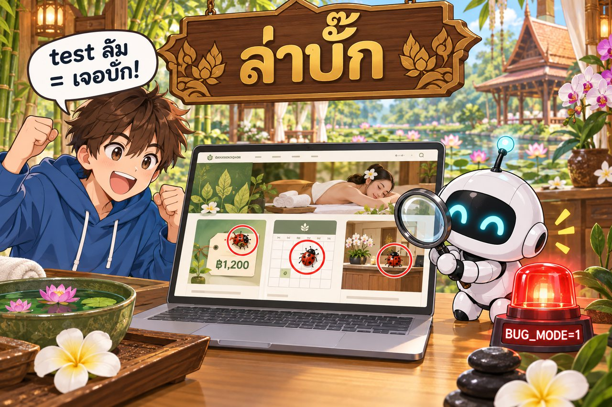

💬 **คัดลอกพรอมต์นี้** (ส่วนที่ 1 · จับบั๊ก)

```text
เปิดเว็บโหมดฝังบั๊ก: ในโฟลเดอร์ web รันใน PowerShell  $env:BUG_MODE=1; docker compose up -d
รอจน healthy แล้วเช็กว่าหน้าเว็บมี data-bug-mode="1" (ห้ามเปิด web/BUGS.md และห้ามอ่านโค้ดใน web/ เพื่อหาบั๊ก)
1. ก่อนรัน คัดลอก e2e/index.html, e2e/triage.json และ e2e/test-report ไปเก็บที่ e2e/normal-mode/ กันถูกเขียนทับ
2. ในโฟลเดอร์ e2e รัน npx playwright test แล้ว npm run test:gif
3. test ไหนล้ม ผิดตรงไหน (ดูภาพตอนล้มและ GIF) แยก "ล้มใหม่ในโหมดบั๊ก" กับ "ล้มเหมือนโหมดปกติ" เป็นบั๊กของเว็บ หรือ test/แผนผิด บันทึกลง e2e/triage.json แล้วสร้าง index.html ใหม่
4. เขียน BUG-HUNT.md ส่วนที่ 1: ตาราง BUG | TC | ระดับ | ขั้นตอนทำซ้ำ | ผลที่คาดหวัง (ที่มา) | ผลจริง | GIF | MP4
   และเทียบกับหัวข้อ 8 ของ TEST-PLAN.md ว่าบั๊กที่เจอตรงกับที่ทายไว้ไหม
ห้ามแก้ test หรือแผนให้ผ่านเฉย ๆ
```

💬 **คัดลอกพรอมต์นี้** (ส่วนที่ 2 · บทเรียนเรื่อง oracle แล้วค่อยเปิดเฉลย)

```text
ใน BUG-HUNT.md เพิ่มส่วนที่ 2 วิเคราะห์ oracle (เว็บยังเป็น BUG_MODE=1 ให้เช็ก data-bug-mode ก่อน · ยังห้ามเปิด web/BUGS.md)
1. ใช้ Playwright MCP ลองเว็บตอนนี้ซ้ำ เฉพาะส่วนที่มี test ล้มในส่วนที่ 1
2. ตาราง: TC ที่ล้มใหม่ | ผลที่คาดหวังในแผนเรา (ที่มา) | ถ้าเขียนจาก web/SPEC.md [A] | ถ้าลอกจากหน้าจอวันนี้ (โหมดบั๊ก) [O] | แต่ละแบบจับบั๊กได้ไหม
3. ตอนนี้ค่อยเปิด web/BUGS.md แล้วเทียบ: บั๊กที่ฝัง | TC ที่จับได้ | จับได้ไหม · ตัวที่พลาด ขาดเทคนิคหรือ oracle อะไร ควรเพิ่ม TC อะไร
4. เปิดเว็บกลับโหมดปกติ: $env:BUG_MODE=0; docker compose up -d แล้วเช็ก data-bug-mode="0"
สรุป: จับได้กี่ตัวจาก 3 · ถ้าใช้ oracle แบบ [D]/[R] vs [A] vs [O] จับบั๊กที่ฝังได้กี่ตัวจาก 3
```

✅ **ผลจริง** ใช้เวลา ~35 นาที → รายงานตัดสิน **"ไม่ผ่านเกณฑ์"** และแผนของเรา **จับบั๊กปริศนาได้ครบ 3/3 ตัว**

| เบราว์เซอร์ | P1 ผ่าน | ผ่านรวม | ข้อที่ล้ม |
|---|---|---|---|
| Chromium · Firefox · WebKit (เท่ากันทุกตัว) | 27/33 ❌ | 33/42 (78.6%) ❌ | 9 = **ล้มใหม่ 5** + ล้มเหมือนโหมดปกติ 4 |

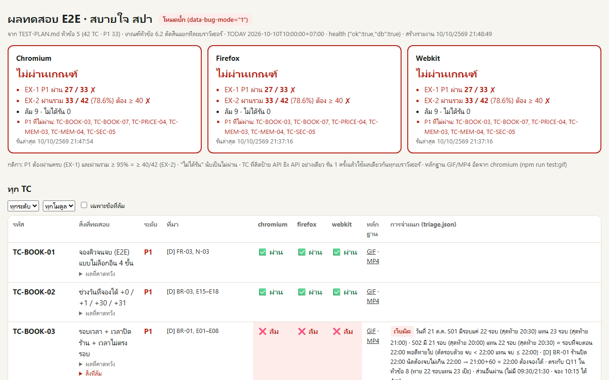

**ส่วนที่ 1 · บั๊กที่จับได้** (5 TC ที่ล้มใหม่ → รวมเป็นบั๊ก 3 ตัว)

| บั๊ก | TC | ผลที่คาดหวัง (ที่มา) | เว็บโหมดบั๊ก |
|---|---|---|---|
| ① รอบที่จบ 22:00 พอดีหายไป | TC-BOOK-03 · TC-BOOK-07 | นวดไทย 60 นาที 23 รอบ ถึง 21:00 ([D] BR-01) | **22 รอบ** ถึง 20:30 · จองคู่ 20:30 ไม่มีปุ่ม |
| ② คิดราคาผิดลำดับ (หักแต้มก่อนคิด %) | TC-PRICE-04 · TC-MEM-03 | ฿4,000 − 10% − ฿100 + ฿300 = **฿3,800** ([D] BR-20) | **฿3,810** (บันทึกลงฐานข้อมูลจริง) |
| ③ แต้มคิดจากราคาก่อนหักส่วนลด | TC-MEM-04 | 99 + ⌊฿950 ÷ 100⌋ = **108** ([D] BR-09) | **109** |

| 🐞 ฿3,810 แทน ฿3,800 | 🐞 รอบ 21:00 หายไป | 🐞 แต้ม 109 แทน 108 |
|---|---|---|
| 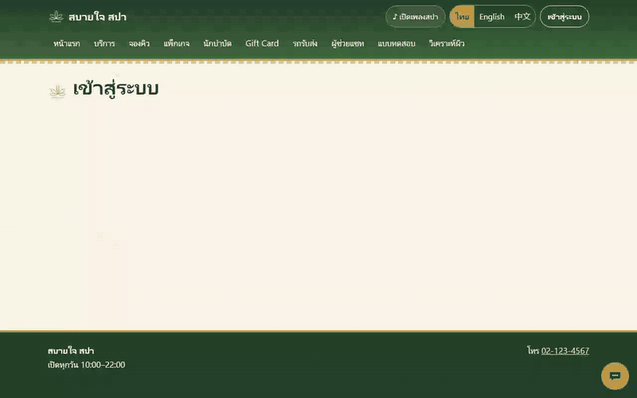 |  | 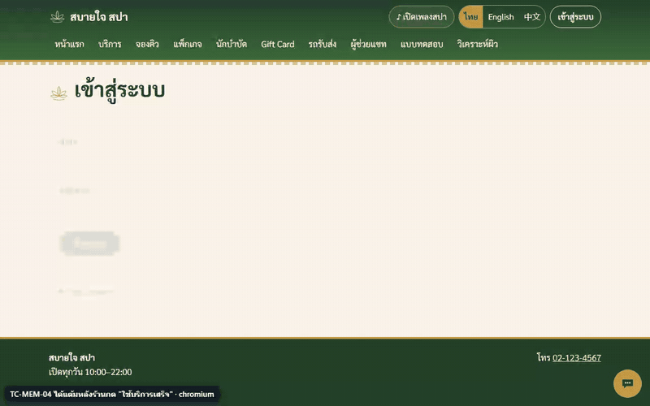 |

เทียบหัวข้อ 8 ของแผน: บั๊ก ① และ ③ **ทายไว้ตรงเป๊ะ** (22 รอบแทน 23 · 109 แทน 108) · บั๊ก ② ทาย TC ถูกแต่อาการต่างเล็กน้อย

**ส่วนที่ 2 · oracle ไหนจับบั๊กได้**

| oracle | จับบั๊กที่ฝังได้ | TC ที่ล้มเพราะเว็บผิด (8) |
|---|---|---|
| **[D]/[R] แผนของเรา** | **3/3** ✅ | **8/8** |
| [A] SPEC ของ AI | 3/3 | 6/8 (พลาด TRN-03, SEC-04 เพราะ SPEC ไม่ได้พูดถึง) |
| **[O] ลอกจากหน้าจอวันนี้** | **0/3** ❌ | **0/8** ทุกข้อจะ "ยืนยันบั๊ก" และผ่านตลอดไป |

| TC | แผนเรา [D] | ถ้าลอกจากหน้าจอวันนี้ [O] |
|---|---|---|
| TC-PRICE-04 | ฿3,800 | ฿3,810 → ผ่าน ไม่เจอบั๊ก |
| TC-BOOK-03 | 23 รอบ (สุดท้าย 21:00) | 22 รอบ → ผ่าน |
| TC-MEM-04 | 108 แต้ม | 109 → ผ่าน |

| หน้าจองโหมดบั๊ก: รอบสุดท้าย 20:30 | แต้มคุณนิดาหลังร้านกดเสร็จ: 109 |
|---|---|
| 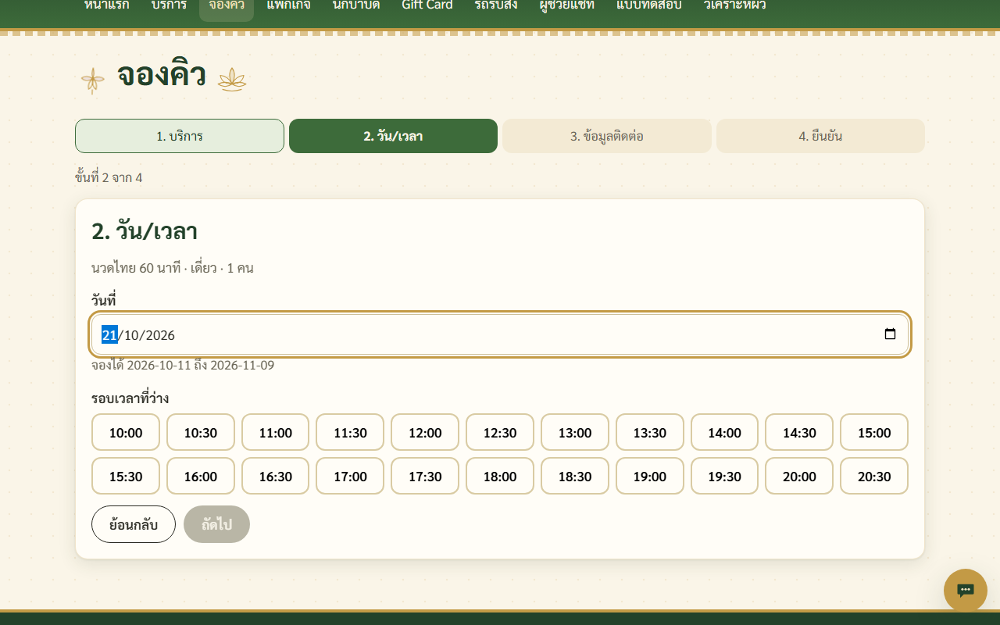 | 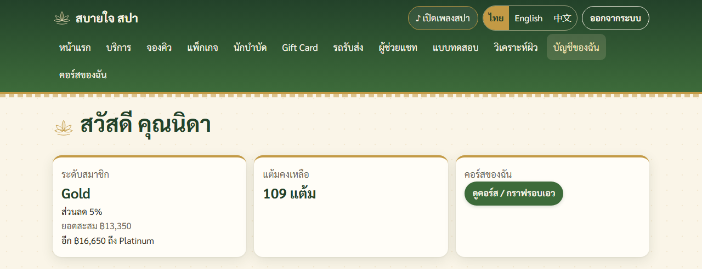 |

แล้วค่อยเปิด `web/BUGS.md` เทียบ: บั๊กที่ Claude ฝังไว้ตอน LAB 6 คือ ① BR-01 · ② BR-20 · ③ BR-09 ตรงกับที่แผนจับได้ทั้ง 3 ตัว → **"แผนดี"** · จบแล้วกลับเป็น `data-bug-mode="0"`

👀 **สังเกต**
- บั๊กทั้ง 3 ตัว **หน้าจอ = API = ฐานข้อมูล ผิดตรงกัน** ไม่มี error ไม่มี 409 → ตรวจ "หลังรีโหลด" อย่างเดียวไม่พอ ต้องมีตัวเลขที่คิดเองล่วงหน้า
- บั๊กทุกตัวอยู่ที่ **ค่าขอบ** (จบ 22:00 พอดี · ลำดับส่วนลด · แต้มหลังหักส่วนลด) ตรงกับคอลัมน์ "ค่าขอบที่ต้องทดสอบ" ที่เขียนไว้ตั้งแต่ LAB 2
- **[A] จับได้ 3/3 รอบนี้** เพราะ SPEC เขียนตอนเว็บยังถูก แล้วบั๊กเปิดด้วยสวิตช์ · ในงานจริงถ้า AI เข้าใจกฎผิดตั้งแต่ต้น SPEC จะผิดไปด้วย และ [A] พลาดเรื่องที่ SPEC ไม่ได้พูดถึง → [A] ใช้ประกอบได้ แต่แทน [D] ไม่ได้
- รอบที่หายไป **"ไม่แสดงอะไรเลย"** ลูกค้า (และคนที่ลอกจากจอ) จะคิดว่าห้องเต็ม
- TC-PRICE-04 มีตัวเลข "แต้มที่จะได้" บนจอเดียวกันผิดด้วย (39 แทน 35) แต่ test ไม่ได้ตรวจ → **ตัวเลขข้างเคียงบนจอเดียวกันควรตรวจด้วย**
- ผลของแต่ละคนจะต่างกัน เพราะ **Claude เลือกบั๊กเองตอนสร้างเว็บ** · จับได้บางตัว = ดูว่าขาดเทคนิค/oracle อะไร แล้วเพิ่ม TC

**test ล้ม = ผิดที่ไหน?** ดูภาพ/GIF ก่อนเสมอ แล้วเลือก 1 ใน 3 ทาง

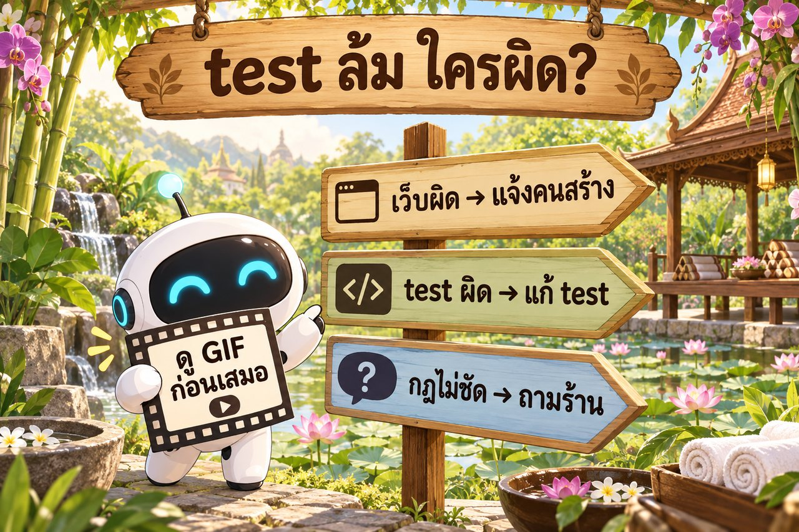

| ทาง | เห็นใน GIF ว่า | ทำอะไรต่อ |
|---|---|---|
| 1️⃣ เว็บผิด | ตัวเลข/การจองผิดจากกฎร้าน [D] หรือกฎทั่วไป [R] | เขียนรายงานบั๊ก ส่งคนสร้างเว็บ |
| 2️⃣ test ผิด | test หาปุ่มผิด หรือรอไม่พอ | แก้ test ได้ แต่ **ห้ามเปลี่ยนผลที่คาดหวัง** |
| 3️⃣ กฎไม่ชัด | ทั้งเว็บและ test ถูก "คนละแบบ" | ถามร้าน แล้วแก้ `REQUIREMENTS.md` / `TEST-DATA.md` ก่อน |

---

## ✅ รูบริก: เช็กลิสต์ "งานทั้งบทที่ดี"

ให้คะแนน 1 คะแนนต่อข้อที่ทำได้ · **ดีมาก ≥ 18/20 · ใช้ได้ 14–17 · ต้องแก้ < 14**

**A. ฟังร้านและออกแบบ (LAB 1–4)**
- ☐ 1. User Story ครอบคลุมทุกคนในบันทึกสัมภาษณ์ และเกณฑ์ยอมรับมีตัวเลข/ข้อความที่ตรวจได้
- ☐ 2. BR ทุกข้อมีค่าขอบ 3 ค่า (ต่ำกว่า / ที่ขอบ / เกินขอบ) และ US ทุกข้อมี FR หรือ BR รองรับ
- ☐ 3. DESIGN.md มีครบ Architecture · Use Case · Flowchart · ERD · Sequence และ render ได้
- ☐ 4. TEST-DATA.md มีวันล็อก ผู้ใช้ครอบขอบระดับสมาชิก และค่าขอบครบทุก BR พร้อมวิธีคิดเงิน

**B. สร้างเว็บ (LAB 5–6)**
- ☐ 5. BUILD-PROMPT.md อ่านแล้วตรงกับ REQUIREMENTS / DESIGN / TEST-DATA ไม่มีอะไรขัดกัน
- ☐ 6. db และ web เป็น Docker แยก 2 โปรเจกต์ healthy ทั้งคู่ และ seed ตรงกับ TEST-DATA
- ☐ 7. ไม่ได้เปิด `web/BUGS.md` ก่อนท้าย LAB 12

**C. ฟัง 3 ทาง (LAB 7–8)**
- ☐ 8. เขียน "สิ่งที่ร้านบอกว่าต้องเจอ" + ตัวเลขที่คำนวณเอง **ก่อน** เปิดเว็บ
- ☐ 9. กฎทุกข้อในส่วน C มีป้าย [D] / [A] / [O] และผล ✅ ⚠️ ❌
- ☐ 10. ส่วน D มีช่องว่างครบ 3 แบบ และส่วน F แยกคำถามถึงร้าน / ถึงคนสร้างเว็บ

**D. แผนทดสอบ (LAB 9–10)**
- ☐ 11. ทุกฟีเจอร์ในขอบเขตมี TC และทุก BR ในขอบเขตมี TC อย่างน้อย 1 ข้อ (traceability)
- ☐ 12. ใช้ครบ 6 เทคนิค · ฟีเจอร์ P1 มีทั้ง Happy และ Negative/Boundary
- ☐ 13. ผลที่คาดหวังเป็นตัวเลข/ข้อความที่ตรวจได้ ไม่มี "แสดงถูกต้อง" และเงินมีวิธีคิด
- ☐ 14. ที่มาทุกข้อมี [D] หรือ [R] · ข้อ [O-ยังไม่ยืนยัน] ≤ ~20% และอยู่ในคำถาม
- ☐ 15. ข้อที่ไม่ตรงกับเว็บ **ไม่ได้แก้ผลที่คาดหวังตามเว็บ**
- ☐ 16. Entry/Exit วัดได้ และหัวข้อ 8 ทาย "ถ้าพังแบบนี้ → TC ไหนล้ม" ≥ 6 แบบ
- ☐ 17. test เรื่องสถานะบอกจังหวะตรวจ (ทันที / หลังรีโหลด)

**E. พิสูจน์แผน (LAB 11–12)**
- ☐ 18. ทุก TC แปลงเป็น Playwright ได้ รันครบ 3 เบราว์เซอร์ และผลนิ่ง (รันซ้ำได้ผลเดิม)
- ☐ 19. มี GIF + MP4 ของทุก test ที่เปิดหน้าเว็บ และข้อที่ล้มจำแนกครบใน triage.json
- ☐ 20. โหมดบั๊กจับได้ ≥ 2 จาก 3 ตัว และ BUG-HUNT.md อธิบายตัวที่พลาดได้ว่าขาดเทคนิค/oracle อะไร

---

## 🔁 รันซ้ำ

| อยากทำ | 💬 พรอมต์ |
|---|---|
| ล้างข้อมูลเว็บ | `เรียก POST http://localhost:3000/api/test/reset แล้วเช็กว่าได้ {"ok":true}` |
| รันชุดทดสอบอีกรอบ | `ในโฟลเดอร์ e2e รัน npx playwright test แล้วเปิด e2e/index.html สรุปผลตามเกณฑ์หัวข้อ 6 ของ TEST-PLAN.md` |
| ดูข้อมูลในฐานข้อมูล | `ใช้ docker exec sabai-db psql ดูจำนวนการจองในตาราง bookings (อ่านอย่างเดียว ห้ามแก้)` |
| สร้างเว็บใหม่จากพรอมต์เดิม | `ปิดและลบ container sabai-web sabai-db กับ volume sabai-pgdata (ถามผมก่อนลบ) แล้วเปิดหน้าต่างใหม่วาง BUILD-PROMPT.md` |
| เทียบงานของผมกับเฉลย (หลังจบ LAB 12) | `เทียบ TEST-PLAN.md ของผมกับ _solution/TEST-PLAN.md บอกฟีเจอร์ เทคนิค หรือ oracle ที่ของผมยังขาด และข้อที่ของผมดีกว่า` |
| ปิดเว็บ | `ปิดเว็บ: docker compose down ในโฟลเดอร์ web แล้วค่อยในโฟลเดอร์ db (เก็บข้อมูลไว้)` |

## ถ้าเจอปัญหา: คัดลอกพรอมต์นี้

| อาการ | 💬 พรอมต์ |
|---|---|
| พอร์ต 3000 / 5433 ไม่ว่าง | `เปิดเว็บไม่ได้เพราะพอร์ต 3000 หรือ 5433 ถูกใช้ ช่วยหาว่า container ไหนใช้อยู่ (เช่น petshop จากบท 02) บอกผมก่อนว่าจะปิดอะไร แล้วค่อย docker stop` |
| web ต่อ db ไม่ได้ | `sabai-web ต่อ sabai-db ไม่ได้ ช่วยเช็กว่าทั้ง 2 อยู่ใน network sabai-net และ DATABASE_URL ใช้ sabai-db:5432 (ไม่ใช่ 5433) บอกสาเหตุเป็นภาษาง่าย ๆ` |
| db ยังไม่ healthy | `sabai-db ไม่ขึ้น healthy ช่วยดู docker compose logs ในโฟลเดอร์ db และเช็กไฟล์ init/*.sql ว่ามี error ไหม` |
| build เว็บล้ม | `docker compose build ของ web ล้ม ช่วยอ่าน error ถ้าเป็นเพราะหน้าเว็บต่อ DB ตอน build ให้แก้เป็น dynamic แล้ว build ใหม่ สรุปว่าแก้ไฟล์ไหน` |
| Codex สร้างรูปไม่ได้ / ค้าง | `Codex CLI สร้างรูปไม่สำเร็จ ช่วยบอก error แล้วสร้างรูปที่ขาดเป็น SVG/CSS แทน อัปเดต web/ASSETS.md แล้ว build web ใหม่` |
| รูปในเว็บไม่ขึ้น | `รูปในเว็บไม่ขึ้น ช่วยเช็กว่าไฟล์ใน web/public/assets ตรงกับ web/ASSETS.md และ path ในโค้ด (ตัวพิมพ์เล็ก/ใหญ่) แล้ว build ใหม่` |
| Claude หยุดกลาง LAB 6 | `อ่าน BUILD-PROMPT.md และไฟล์ที่สร้างแล้วใน db/ และ web/ ตรวจว่ายังขาดขั้นไหน แล้วทำต่อเฉพาะส่วนที่ขาด เสร็จแล้วสรุปเป็นตาราง` |
| Claude จะเปิดอ่านโค้ดหรือ BUGS.md | `หยุดก่อน LAB นี้ห้ามอ่านโค้ดใน web/ db/ และห้ามเปิด web/BUGS.md ให้เรียนรู้จากหน้าเว็บ SPEC.md และไฟล์ของผมเท่านั้น` |
| Claude เขียน "แสดงถูกต้อง" | `แก้ผลที่คาดหวังทุกข้อให้เป็นตัวเลขหรือข้อความที่ตรวจได้ ตัวเลขเงินให้คำนวณจาก TEST-DATA.md พร้อมวิธีคิด` |
| test ล้มบางข้อ | `test ข้อนี้ล้ม ช่วยดูภาพและ GIF ใน e2e/test-report แล้วบอกว่าเว็บผิด แผนผิด หรือ test เขียนผิด ห้ามแก้ test หรือแผนให้ผ่านเฉย ๆ` |
| Firefox / WebKit เปิดไม่ขึ้น | `test บน firefox หรือ webkit เปิดเบราว์เซอร์ไม่ขึ้น ช่วยเช็กว่ารุ่น @playwright/test ใน e2e ตรงกับเบราว์เซอร์ที่ติดตั้งไว้ไหม ถ้าไม่ตรงให้ล็อกรุ่นให้ตรง หรือรัน npx playwright install` |
| ผ่านบ้างล้มบ้าง (flaky) | `test ข้อนี้ผ่านบ้างล้มบ้าง ช่วยรันซ้ำ 5 รอบ (--repeat-each=5) บอกสาเหตุ เช่น ข้อมูลชนกันข้ามเบราว์เซอร์ แก้ที่ test โดยไม่เปลี่ยนผลที่คาดหวัง` |
| ไม่มี GIF / MP4 | `รัน test:gif แล้วไม่มี GIF หรือ MP4 ช่วยเช็ก ffmpeg -version ถ้าไม่มีบอกวิธีติดตั้งบน Windows (winget) และบอกว่าต้องเปิด terminal ใหม่` |
| ยังเป็นโหมดบั๊กอยู่ | `ช่วยเปิดเว็บกลับโหมดปกติ: ในโฟลเดอร์ web รัน $env:BUG_MODE=0; docker compose up -d แล้วเช็กว่า data-bug-mode เป็น 0` |

## 🎉 จบบทแล้ว


ทีมจริงก็ทำแบบนี้: **ฟัง → ออกแบบ → สร้าง → ทดสอบ** แล้ววนกลับไปฟังร้านใหม่ พร้อมคำถามที่เก็บได้ระหว่างทาง 🔁

## 📖 คำศัพท์

| คำ | ความหมายง่าย ๆ |
|---|---|
| **User Story** | คำขอ 1 ข้อ "ในฐานะ… ฉันอยาก… เพื่อ…" |
| **เกณฑ์ยอมรับ** | ต้องเห็นอะไรถึงนับว่า "เสร็จ" ต้องตรวจได้ |
| **FR / BR / NFR** | ระบบทำอะไรได้ / กฎร้าน (มีตัวเลข) / ดีแค่ไหน (วัดได้) |
| **ค่าขอบ (Boundary)** | ค่าที่อยู่ตรงเส้นของกฎ เช่น ฿9,999 / ฿10,000 |
| **System Architecture** | แผนผังว่าระบบมีกล่องอะไร คุยกันยังไง |
| **Use Case / Flowchart / ERD / Sequence** | ใครทำอะไรกับระบบ / ขั้นตอนและจุดตัดสินใจ / ตารางข้อมูลและความสัมพันธ์ / ลำดับการคุยกันของแต่ละส่วน |
| **TEST-DATA** | ข้อมูลที่ร้านยืนยัน ใช้ทั้ง seed เว็บและเป็นผลที่คาดหวัง |
| **BUILD-PROMPT** | ใบสั่งงานสร้างเว็บ ที่ Claude เขียนให้แล้วเราอ่านตรวจก่อนใช้ |
| **docker compose / container** | สูตรเปิดระบบ / กล่องที่รันจริง (บทนี้แยก `db/` กับ `web/`) |
| **healthy** | กล่องพร้อมใช้งานจริง ผ่านการตรวจสุขภาพแล้ว |
| **seed / reset** | ข้อมูลเริ่มต้น / ล้างกลับเป็นข้อมูลเริ่มต้น |
| **data-testid** | ป้ายชื่อที่หุ่นยนต์ทดสอบใช้หาปุ่ม |
| **Test oracle** | แหล่งที่บอกว่าผลแบบไหน "ถูก" (บทนี้ใช้ [D] [R] [A] [O]) |
| **อบบั๊ก** | ลอกค่าผิดจากหน้าจอไปเป็นผลที่คาดหวัง test เลยผ่านทั้งที่ผิด |
| **Exploratory testing** | ทดสอบไปพร้อมเรียนรู้ระบบ |
| **Coverage matrix / Traceability** | ตาราง ฟีเจอร์ × เทคนิค ใช้หารู / สายโยง TC ↔ FR/BR ↔ US |
| **Entry / Exit criteria** | เกณฑ์เริ่มทดสอบได้ / เกณฑ์ผ่านพอจะปล่อยใช้งาน |
| **Flaky** | ผลไม่นิ่ง รันซ้ำแล้วได้ไม่เหมือนเดิม |
| **BUG_MODE** | สวิตช์เปิดบั๊กที่ฝังไว้ให้ฝึกหา |
| **Playwright MCP** | ให้ Claude คุมเบราว์เซอร์เพื่อสำรวจเว็บ |

### ไฟล์ในบทนี้

**ก่อนเริ่ม** (มีให้แค่นี้)

```text
04_sabai-spa-from-prompt/
├─ README.md     # บทเรียน + พรอมต์ทุก LAB (บันทึกสัมภาษณ์อยู่ในพรอมต์ LAB 1)
├─ img/          # รูปประกอบบทเรียน
└─ _solution/    # 🔑 เฉลย: ไฟล์ทั้งหมดด้านล่างจากการรันจริง + คู่มือผู้สอน
```

**หลังจบทุก LAB** (สร้างจากพรอมต์ทั้งหมด)

```text
04_sabai-spa-from-prompt/
├─ USER-STORIES.md       # LAB 1
├─ REQUIREMENTS.md       # LAB 2  FR / BR / NFR
├─ DESIGN.md             # LAB 3  Architecture · Use Case · Flowchart · ERD · Sequence
├─ TEST-DATA.md          # LAB 4  ข้อมูลที่ร้านยืนยัน [D]
├─ BUILD-PROMPT.md       # LAB 5  พรอมต์สร้างเว็บ
├─ db/                   # LAB 6  PostgreSQL 16 (compose แยก) · init/01-schema.sql · init/02-seed.sql
├─ web/                  # LAB 6  Next.js (compose แยก)
│  ├─ SPEC.md · ASSETS.md   # คำอ้างของ AI [A]
│  ├─ BUGS.md               # 🔒 เฉลยบั๊ก (เปิดได้ท้าย LAB 12)
│  └─ public/assets/        # รูปที่ Codex (หรือ SVG) สร้าง
├─ EXPLORATION.md        # LAB 7–8  A แผนผัง · B ฟีเจอร์ · C กฎ 3 ทาง · D ช่องว่าง · E ความเสี่ยง · F คำถาม
├─ exploration/          # LAB 7  ภาพที่สำรวจ
├─ TEST-PLAN.md          # LAB 9–10  8 หัวข้อ (TC มี FR/BR + ที่มา)
├─ TEST-RUN-1.md         # LAB 9  ผลลองแผนกับเว็บจริง (ข้อ 6 ของพรอมต์)
├─ PLAN-REVIEW.md        # LAB 10  coverage matrix + traceability
├─ CLAUDE.md             # LAB 11  คู่มือให้ Claude
├─ e2e/                  # LAB 11–12  Playwright + index.html + triage.json + test-report/
└─ BUG-HUNT.md           # LAB 12  รายงานบั๊ก + วิเคราะห์ oracle
```
