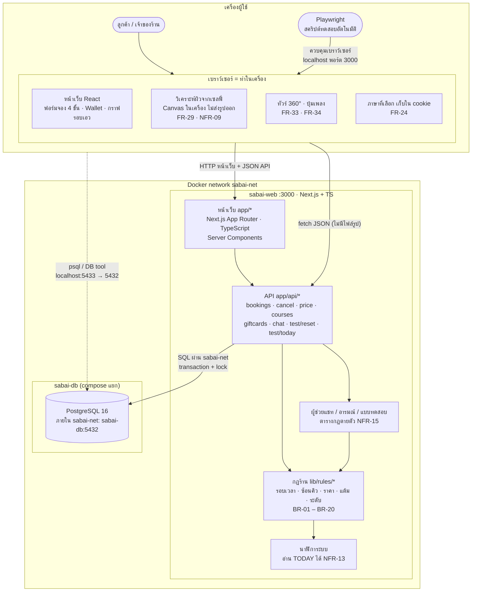
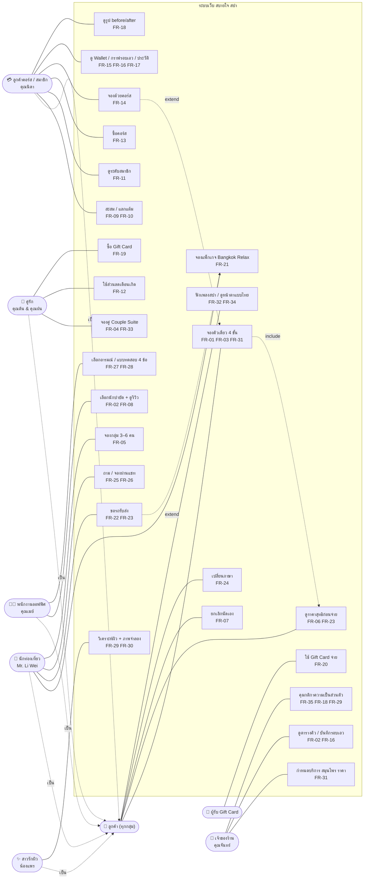
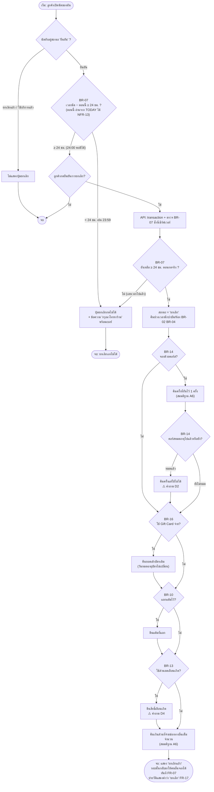
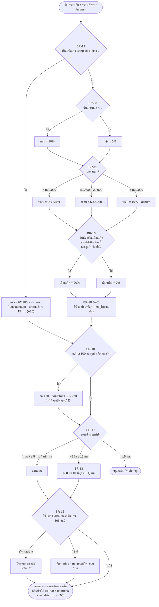
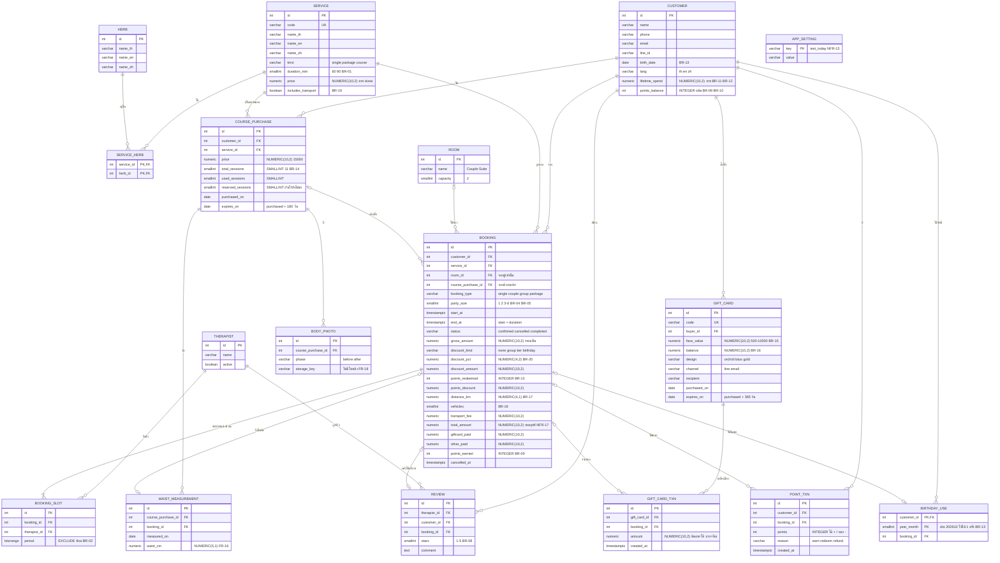
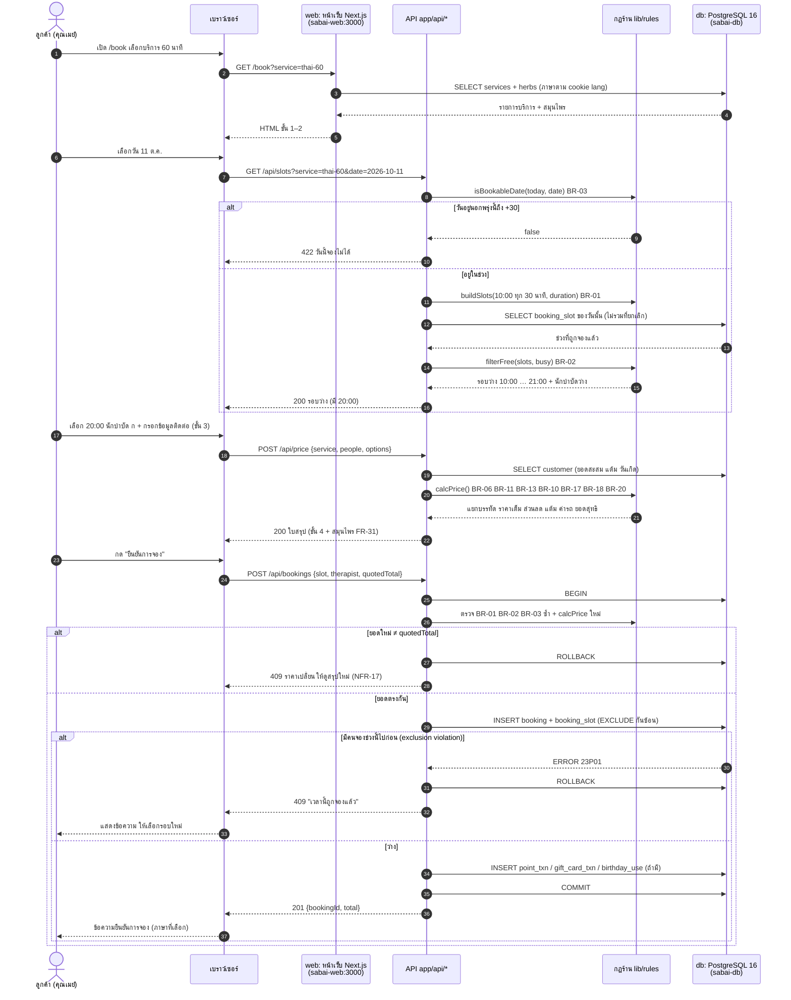
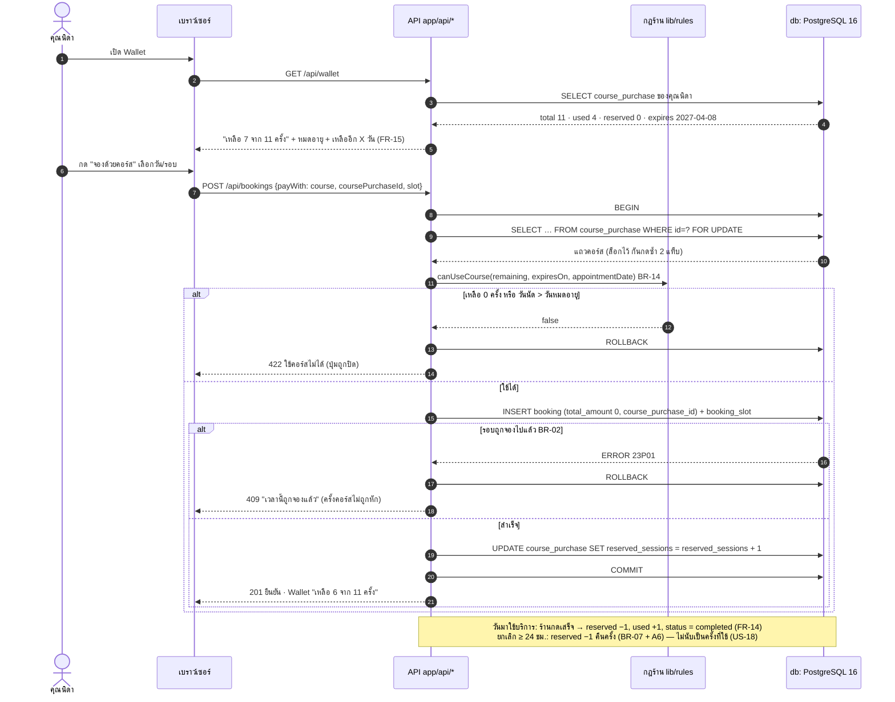

# DESIGN · สบายใจ สปา

ที่มา: USER-STORIES.md (US-01 – US-36) และ REQUIREMENTS.md (FR-01 – FR-35, BR-01 – BR-20, NFR-01 – NFR-18)

- ทุกแผนภาพเขียนด้วย Mermaid · ขั้นนี้ **ยังไม่เขียนโค้ดเว็บ** เป็นแบบที่ใช้ตกลงกันก่อนลงมือ
- ตัวอย่างวันที่ใช้ "วันนี้" = 10 ต.ค. 2026 (ล็อกได้ตาม NFR-13)
- รหัสในวงเล็บ เช่น (FR-07) (BR-07) โยงกลับไปที่ REQUIREMENTS.md

---

## 1. System Architecture

**สิ่งที่ทำในเบราว์เซอร์ vs ที่เซิร์ฟเวอร์**

| ทำในเบราว์เซอร์ (เครื่องลูกค้า) | ทำที่เซิร์ฟเวอร์ (sabai-web + sabai-db) |
|---|---|
| วิเคราะห์ผิวจากเซลฟี่ด้วย Canvas — รูปอยู่ในหน่วยความจำหน้าเว็บเท่านั้น ปิด/รีเฟรชแล้วหาย (FR-29, NFR-09) | คำนวณรอบเวลาว่าง ช่วงวัน และตรวจคิวซ้อน (BR-01 – BR-05) |
| ทัวร์ห้อง 360° ลากเมาส์/ปัดนิ้ว (FR-33) | คำนวณราคาสุทธิ ส่วนลด แต้ม ค่ารถ (BR-06 – BR-20) — **ราคาที่เก็บจริงคิดที่เซิร์ฟเวอร์เสมอ** (NFR-17) |
| ปุ่มเปิด/ปิดเพลง ไม่เล่นเองตอนเปิดหน้า (FR-34, NFR-08) | ตัดครั้งคอร์ส / ยอด Gift Card / แต้ม แบบ transaction |
| แสดงราคาตัวอย่างระหว่างกรอก (เรียก API `/api/price` ไม่คิดเองฝั่งเบราว์เซอร์) | ยกเลิกนัดตามกฎ 24 ชม. (BR-07) |
| จำภาษาที่เลือก (cookie `lang`) | ผู้ช่วยแชท / อารมณ์ / แบบทดสอบ 4 ข้อ ด้วยตารางกฎตายตัว (FR-25 – FR-28, NFR-15) |
| แบบทดสอบ 4 ข้อ: เก็บคำตอบระหว่างทำ (ส่งคำตอบไปขอผลที่ API) | ล็อก "วันนี้" และรีเซ็ตข้อมูลทดสอบ (NFR-13, NFR-14 เฉพาะโหมดทดสอบ) |

**ตารางชั้นของระบบ**

| ชั้น | อยู่ที่ไหน | หน้าที่ | ทดสอบด้วยอะไร |
|---|---|---|---|
| ผู้ใช้ + Playwright | เครื่องผู้ใช้ (host) | ลูกค้าใช้งานจริง / สคริปต์ทดสอบเปิดเว็บแทนคน | สคริปต์ Playwright (E2E) ที่ viewport 1280 และ 375 |
| เบราว์เซอร์ (UI) | เครื่องผู้ใช้ | แสดงหน้าเว็บ ฟอร์มจอง 4 ขั้น วิเคราะห์ผิว ทัวร์ 360° เพลง ภาษา | Playwright: คลิก/กรอก, ตรวจ `scrollWidth ≤ 375`, ดัก network ว่าไม่มีไฟล์รูปออก (NFR-09), axe ตรวจป้ายชื่อปุ่ม (NFR-16) |
| หน้าเว็บ (Pages) | Docker `sabai-web` พอร์ต 3000 — `app/*` | Server Components ดึงข้อมูลบริการ นักบำบัด Wallet ประวัติ ส่ง HTML 3 ภาษา | Playwright เปิดหน้า + ตรวจข้อความ/ภาษา (NFR-06) |
| API | Docker `sabai-web` — `app/api/*` | รับคำขอจอง/ยกเลิก/ซื้อคอร์ส/Gift Card/แชท ตรวจสิทธิ์ เรียกกฎร้าน แล้วบันทึกลง db | `curl` / Playwright `request` ยิง JSON ตรง ตรวจรหัส 200/409/422/403 และยิงพร้อมกัน 2 คำขอ (NFR-12) |
| กฎร้าน (Rules) | Docker `sabai-web` — `lib/rules/*` ฟังก์ชันบริสุทธิ์ ไม่แตะ db | รอบเวลา ช่วงวัน ซ้อนคิว ราคา ส่วนลด แต้ม ระดับ ค่ารถ (BR-01 – BR-20) | Unit test (เช่น Vitest) ด้วยค่าขอบในตาราง BR — ต่ำกว่า / ที่ขอบ / เกินขอบ |
| นาฬิกา / โหมดทดสอบ | Docker `sabai-web` — env `TODAY`, `/api/test/*` | ล็อกวันนี้ รีเซ็ต seed | เรียก `/api/test/reset` 2 ครั้ง ผลเหมือนกัน (NFR-14) |
| ฐานข้อมูล | Docker `sabai-db` (โปรเจกต์ compose แยก) PostgreSQL 16 · ในเครือข่าย `sabai-db:5432` · บนเครื่อง `localhost:5433` | เก็บลูกค้า นัด คอร์ส Gift Card แต้ม · กันคิวซ้อนด้วย constraint/lock | `psql -h localhost -p 5433` ตรวจแถวที่ถูกบันทึก, ตรวจว่าไม่มีคอลัมน์รูปโปรไฟล์ (NFR-10) |
| เครือข่าย | Docker network `sabai-net` (external ใช้ร่วม 2 โปรเจกต์) | ให้ `sabai-web` เรียก `sabai-db` ด้วยชื่อ container | `docker network inspect sabai-net` เห็นทั้ง 2 container |

---

## 2. Use Case

actor มาจากบันทึกสัมภาษณ์: เจ้าของร้าน (คุณจันทร์) + ลูกค้า 5 กลุ่ม — พนักงานออฟฟิศ (คุณเมย์), นักท่องเที่ยว (Mr. Li Wei), คู่รัก (คุณต้น & คุณฝน), ลูกค้าคอร์ส/สมาชิก (คุณนิดา), สาวรักผิว (น้องแพร) และผู้รับ Gift Card (แม่ของคุณฝน) · ทุกกลุ่มเป็น "ลูกค้า" ที่ใช้ use case พื้นฐานร่วมกัน

| Use case | actor หลัก | FR | US |
|---|---|---|---|
| UC1 จองคิวเดี่ยว 4 ขั้น | ลูกค้า, คุณเมย์ | FR-01, FR-03, FR-31 | US-01, US-03, US-04, US-32 |
| UC2 เลือกนักบำบัด + ดูรีวิว | คุณเมย์ | FR-02, FR-08 | US-02, US-09 |
| UC3 จองคู่ Couple Suite | คุณต้น & คุณฝน | FR-04, FR-33 | US-05, US-34 |
| UC4 จองกลุ่ม 3–6 คน | Mr. Li Wei | FR-05 | US-06, US-07 |
| UC5 ดูราคาสุทธิก่อนจ่าย | ลูกค้า | FR-06, FR-23 | US-07, US-12, US-14, US-24 |
| UC6 ยกเลิกนัดเอง | ลูกค้า (คุณนิดา) | FR-07 | US-08 |
| UC7 สะสม / แลกแต้ม | คุณนิดา | FR-09, FR-10 | US-10, US-11 |
| UC8 ดูระดับสมาชิก | คุณนิดา | FR-11 | US-12, US-13 |
| UC9 ใช้ส่วนลดเดือนเกิด | คุณต้น | FR-12 | US-14 |
| UC10 ซื้อคอร์ส | คุณนิดา | FR-13 | US-15 |
| UC11 จองด้วยคอร์ส | คุณนิดา | FR-14 | US-15, US-18 |
| UC12 Wallet / กราฟรอบเอว / ประวัติ | คุณนิดา | FR-15, FR-16, FR-17 | US-16, US-17, US-18 |
| UC13 รูป before/after | คุณนิดา | FR-18 | US-19 |
| UC14 ซื้อ Gift Card | คุณฝน | FR-19 | US-20 |
| UC15 ใช้ Gift Card จ่าย | ผู้รับ Gift Card | FR-20 | US-21 |
| UC16 แพ็กเกจ Bangkok Relax | Mr. Li Wei | FR-21 | US-22 |
| UC17 รถรับส่ง | Mr. Li Wei | FR-22, FR-23 | US-23, US-24 |
| UC18 เปลี่ยนภาษา | ลูกค้า (Mr. Li Wei) | FR-24 | US-25 |
| UC19 ถาม / จองผ่านแชท | Mr. Li Wei | FR-25, FR-26 | US-26, US-27 |
| UC20 อารมณ์ / แบบทดสอบ | คุณเมย์ | FR-27, FR-28 | US-28, US-29 |
| UC21 วิเคราะห์ผิว + ภาพจำลอง | น้องแพร | FR-29, FR-30 | US-30, US-31 |
| UC22 เพลงสปา / หน้าตาแบบไทย | ลูกค้า | FR-32, FR-34 | US-33, US-35 |
| UC23 กำหนดบริการ สมุนไพร ราคา | คุณจันทร์ | FR-31 | US-32 |
| UC24 ดูตารางคิว / บันทึกรอบเอว | คุณจันทร์ | FR-02, FR-16 | US-02, US-17 |
| UC25 คุมกติกาความเป็นส่วนตัว | คุณจันทร์ | FR-35, FR-18, FR-29 | US-36, US-19, US-30 |

ตรวจครบ: FR-01 – FR-35 ถูกโยงจาก use case อย่างน้อย 1 ครั้ง **35/35**

> 👀 UC23–UC24 (หน้าหลังร้าน) ไม่มี US ตรง ๆ — US พูดถึง "เจ้าของร้านอยาก…" ในแง่กติกา แต่ไม่มีเรื่องหน้าจัดการ ดูคำถาม D3 ท้ายไฟล์

---

## 3. Flowchart

### 3.1 จองคิว (ตรวจช่วงวัน → รอบว่าง → คำนวณราคา → ยืนยัน)

```mermaid
flowchart TD
    S([เริ่ม: ลูกค้าเปิดหน้าจอง]) --> A["ขั้น 1: เลือกบริการ / แพ็กเกจ<br/>และแบบจอง: เดี่ยว · คู่ · กลุ่ม"]
    A --> P{"BR-04 / BR-05<br/>จำนวนคนถูกแบบไหม?<br/>เดี่ยว 1 · คู่ 2 พอดี · กลุ่ม 3–6"}
    P -->|"กลุ่ม 7 คนขึ้นไป"| P7["แสดง 'กลุ่ม 7 คนขึ้นไป กรุณาโทรหาร้าน'<br/>+ เบอร์ร้าน"] --> E1([จบ: จองไม่ได้])
    P -->|"คู่ไม่ใช่ 2 คน"| A
    P -->|"ถูกต้อง"| D["ขั้น 2: เลือกวัน"]
    D --> DR{"BR-03<br/>วันนี้ +1 ≤ วันที่ ≤ วันนี้ +30 ?"}
    DR -->|"ไม่ใช่ (เช่น 10 ต.ค. หรือ 10 พ.ย.)"| DX["วันนั้นกดเลือกไม่ได้<br/>API ตอบ 422 ถ้ายิงตรง"] --> D
    DR -->|"ใช่ (11 ต.ค. – 9 พ.ย.)"| SL["สร้างรอบ 10:00 ทุก 30 นาที"]
    SL --> SE{"BR-01<br/>เวลาเริ่ม + ระยะบริการ ≤ 22:00 ?"}
    SE -->|"ไม่ (เช่น 90 นาที รอบ 21:00)"| HIDE[ไม่แสดงรอบนั้น]
    SE -->|"ใช่"| OV{"BR-02<br/>นักบำบัดว่างพอจำนวนคน?<br/>ไม่มีคิวซ้อน เริ่ม < จบเดิม และ จบ > เริ่มเดิม"}
    OV -->|"ไม่พอ"| HIDE
    OV -->|"พอ"| RM{"BR-04<br/>เป็นการจองคู่?"}
    RM -->|"ไม่ใช่"| SHOW[แสดงรอบให้เลือก]
    RM -->|"ใช่"| RMF{"BR-04<br/>Couple Suite ว่างช่วงนั้น?"}
    RMF -->|"ไม่ว่าง"| HIDE
    RMF -->|"ว่าง"| SHOW
    SHOW --> T["ขั้น 2 (ต่อ): เลือกรอบ + นักบำบัด<br/>ดูคะแนนรีวิว BR-08"]
    T --> I["ขั้น 3: ข้อมูลติดต่อ<br/>+ ตัวเลือกจ่าย: คอร์ส / แต้ม / Gift Card / รถรับส่ง"]
    I --> CO{"BR-14<br/>เลือก 'จองด้วยคอร์ส'?"}
    CO -->|"ใช่"| COK{"BR-14<br/>เหลือ ≥ 1 ครั้ง<br/>และ วันนัด ≤ วันหมดอายุ ?"}
    COK -->|"ไม่"| COX["ปุ่ม 'จองด้วยคอร์ส' กดไม่ได้"] --> I
    COK -->|"ใช่"| PR0["ราคา ฿0 · กันไว้ 1 ครั้ง"]
    CO -->|"ไม่"| PR["คำนวณราคา ดูแผนภาพ 3.3<br/>BR-06 BR-10 BR-11 BR-13 BR-17 BR-18 BR-19 BR-20"]
    PR --> TR{"BR-17<br/>ขอรถ และระยะ > 15 กม. ?"}
    TR -->|"ใช่"| TRX["แสดง 'อยู่นอกพื้นที่รับส่ง'"] --> I
    TR -->|"ไม่"| SUM
    PR0 --> SUM["ขั้น 4: หน้ายืนยัน<br/>ราคาแยกบรรทัด + ค่ารถ + สมุนไพร FR-31"]
    SUM --> OK{ลูกค้ากดยืนยัน?}
    OK -->|"ไม่ / ย้อนกลับ"| I
    OK -->|"ยืนยัน"| TX["API: เปิด transaction<br/>ตรวจ BR-02 / BR-04 ซ้ำ + ล็อกแถว<br/>คิดราคาใหม่ที่เซิร์ฟเวอร์"]
    TX --> RACE{"BR-02 / BR-04<br/>ยังว่างอยู่ไหม?<br/>(มีคนกดพร้อมกัน NFR-12)"}
    RACE -->|"ถูกจองไปแล้ว"| BUSY["แสดง 'เวลานี้ถูกจองแล้ว'<br/>ไม่บันทึก"] --> T
    RACE -->|"ว่าง"| PAY{"BR-20<br/>ยอดที่คิดใหม่ = ยอดที่แสดง ?"}
    PAY -->|"ไม่เท่า"| SUM
    PAY -->|"เท่ากัน"| SAVE["บันทึกนัด · ตัดยอด Gift Card BR-16<br/>หักแต้ม BR-10 · กันครั้งคอร์ส BR-14<br/>บันทึกใช้ส่วนลดเดือนเกิด BR-13"]
    SAVE --> E2([จบ: ข้อความยืนยันการจอง ตามภาษาที่เลือก])
```

### 3.2 ยกเลิกนัด

### 3.3 คำนวณราคาสุทธิ (ขยายกล่อง "คำนวณราคา" ของ 3.1)

ตัวอย่างตรวจมือ (จาก BR-20): กลุ่ม 4 คน ฿4,000 Gold → ใช้ 10% (ไม่ใช่ 15%) = ฿3,600 → แลก 200 แต้ม −฿100 = ฿3,500 → รถ 12 กม. 4 คน 1 คัน +฿300 = **฿3,800**

---

## 4. ERD

หลักชนิดข้อมูล
- **เงิน** ใช้ `NUMERIC(10,2)` หน่วยบาท (ห้ามใช้ float — ส่วนลด 5% ของ ฿1,250 = ฿62.50 ต้องเก็บสตางค์ได้แม่น) · Gift Card มูลค่าเป็นจำนวนเต็มตาม A13 แต่ยอดคงเหลือหลังจ่ายอาจมีสตางค์ จึงใช้ NUMERIC(10,2) เหมือนกัน
- **แต้ม** ใช้ `INTEGER` (แลกเป็นก้อน 100 ไม่มีเศษแต้ม)
- **จำนวนครั้งคอร์ส** ใช้ `SMALLINT` (สูงสุด 11) + `CHECK (0 ≤ used + reserved ≤ total)`
- เวลาเก็บเป็น `TIMESTAMPTZ` โซน Asia/Bangkok · ระยะทาง `NUMERIC(4,1)` · รอบเอว `NUMERIC(5,1)` ซม.
- **ไม่มีตาราง/คอลัมน์รูปโปรไฟล์หรือรูปหน้า** (NFR-10) และไม่มีที่เก็บเซลฟี่วิเคราะห์ผิว (FR-29)

**กติกาที่ db ช่วยบังคับ (ไม่พึ่งโค้ดอย่างเดียว)**

| กฎ | วิธีบังคับในฐานข้อมูล |
|---|---|
| BR-02 คิวนักบำบัดห้ามซ้อน (ต่อกันพอดีได้) | `BOOKING_SLOT`: `EXCLUDE USING gist (therapist_id WITH =, period WITH &&) WHERE (active)` ช่วง `[start, end)` ทำให้ 14:00–15:00 กับ 15:00–16:00 ไม่ชนกัน |
| BR-04 Couple Suite 1 คู่ต่อช่วงเวลา | EXCLUDE แบบเดียวกันบน `room_id` + ช่วงเวลา (เฉพาะนัดที่ไม่ถูกยกเลิก) |
| NFR-12 กดพร้อมกัน 2 คำขอ | constraint ข้างบนทำให้คำขอที่ 2 ล้ม → API แปลงเป็น 409 "เวลานี้ถูกจองแล้ว" |
| BR-14 ครั้งคอร์สห้ามติดลบ | `CHECK (used_sessions + reserved_sessions <= total_sessions)` + `SELECT … FOR UPDATE` |
| BR-15 มูลค่า Gift Card | `CHECK (face_value BETWEEN 500 AND 10000)` · `CHECK (balance >= 0)` |
| BR-13 เดือนเกิด 1 ครั้ง | PK (`customer_id`, `year_month`) ของ `BIRTHDAY_USE` |
| BR-05 จำนวนคน | `CHECK (party_size BETWEEN 1 AND 6)` |

---

## 5. Sequence

### 5.1 ลูกค้าจองคิว (เบราว์เซอร์ → web → API → db)

### 5.2 จองด้วยคอร์ส (หักครั้ง)

---

## 6. คำถามที่ได้จากการออกแบบ

เรื่องที่ USER-STORIES / REQUIREMENTS ยังไม่บอก และโผล่ขึ้นมาเพราะต้องวาดแผนภาพให้ครบทุกทาง

| # | คำถาม | เจอตอนวาด | ข้อเสนอที่ใช้ในแบบนี้ (รอยืนยัน) | เกี่ยวกับ |
|---|---|---|---|---|
| D1 | **ยกเลิกนัดที่จองด้วยคอร์สแล้วคืนครั้งไหม** ถ้ายกเลิกไม่ทัน 24 ชม. หรือไม่มา (no-show) ถูกหักครั้งไหม? | Flowchart 3.2, Sequence 5.2 | ยกเลิก ≥ 24 ชม. คืนครั้ง · no-show หักครั้ง | FR-07, FR-14, BR-07, BR-14 |
| D2 | ยกเลิกนัดคอร์สหลังคอร์สหมดอายุแล้ว ครั้งที่คืนมาใช้ได้ไหม / ขยายอายุให้ไหม? | Flowchart 3.2 | คืนแต่ใช้ไม่ได้ (ตามวันหมดอายุเดิม) | BR-14 |
| D3 | **เจ้าของร้านมีหน้าหลังร้านไหม** (ดูตารางคิว กดว่าใช้บริการเสร็จ บันทึกรอบเอว แก้รายการสมุนไพร) ใครเป็นคนกด "เสร็จ" เพื่อให้แต้ม/หักคอร์ส? | Use case UC23–UC25 | มีหน้า `/admin` ล็อกอินเจ้าของร้าน | FR-09, FR-14, FR-16, FR-31 |
| D4 | ยกเลิกนัดที่ใช้ส่วนลดเดือนเกิด คืนสิทธิ์เดือนเกิดไหม? | Flowchart 3.2 | คืนสิทธิ์ ถ้ายังอยู่ในเดือนเกิด | BR-13 |
| D5 | ครั้งคอร์สหัก "ตอนจอง" หรือ "ตอนมาใช้บริการ"? FR-14 เขียนว่า "เมื่อใช้บริการ" แต่ถ้าไม่กันไว้ตอนจอง คนเหลือ 1 ครั้งจองได้ 5 นัด | Sequence 5.2, ERD | กันไว้ตอนจอง (`reserved_sessions`) ตัดจริงตอนเสร็จ · Wallet แสดง "เหลือ" = total − used − reserved | FR-14, FR-15, US-16 |
| D6 | การจองคอร์สนับระยะเวลากี่นาที ใช้นักบำบัดคนไหน / ต้องเลือกนักบำบัดไหม? | ERD (`SERVICE.duration_min`) | ใช้ 60 นาทีจนกว่าร้านบอก | Q13, BR-01 |
| D7 | ลูกค้าไม่เลือกนักบำบัด ("ใครก็ได้") ระบบจัดคนให้ด้วยกฎอะไร? (ว่างคนแรก / คะแนนสูงสุด / เฉลี่ยงาน) | Flowchart 3.1 (กล่อง "นักบำบัดว่างพอ") | จัดคนที่ว่างและ id น้อยสุด (ตายตัว ทดสอบซ้ำได้) | FR-02, Q2 |
| D8 | จองกลุ่ม/คู่ แล้ว **ยกเลิกบางคน** ได้ไหม? ถ้ากลุ่ม 4 เหลือ 3 ส่วนลด 10% หายไหม? | Flowchart 3.2, ERD (`BOOKING_SLOT`) | ยกเลิกทั้งนัดเท่านั้น | BR-05, BR-06, BR-07 |
| D9 | ต้องล็อกอินก่อนจองไหม? ลูกค้าไม่เป็นสมาชิกจองได้หรือไม่ (ใช้แค่เบอร์โทร)? ถ้าได้ แต้ม/ระดับผูกกับอะไร? | ERD (`CUSTOMER`), Sequence 5.1 | จองได้ด้วยเบอร์โทร เบอร์เดียวกัน = ลูกค้าคนเดียว | Q18, FR-09 |
| D10 | ยกเลิกนัดแล้วคืนเงินอย่างไรถ้าจ่ายออนไลน์ (เข้าบัตรเดิม / เครดิตร้าน)? ยังไม่รู้ว่าจ่ายช่องทางไหน | Flowchart 3.2 | ยังไม่ต่อระบบจ่ายเงินจริง บันทึก `other_paid` เป็นยอดจ่ายที่ร้าน | Q8, Q9 |
| D11 | แต้มที่ได้จากนัด ให้ทันทีตอนจองหรือหลังใช้บริการ? ถ้ายกเลิกต้องดึงแต้มคืนไหม? | ERD (`POINT_TXN`) | ให้หลังร้านกด "เสร็จ" เท่านั้น (US-10 เกณฑ์ 2) จึงไม่ต้องดึงคืน | BR-09, FR-09 |
| D12 | นักบำบัดมีวันหยุด/เวลางานแยกไหม? ตอนนี้แบบถือว่าทุกคนทำงาน 10:00–22:00 ทุกวัน | Flowchart 3.1, ERD (`THERAPIST`) | ทุกคนทำงานทุกรอบ | BR-01, BR-02 |
| D13 | ราคาที่แสดงตอนเลือกกับตอนกดยืนยันต่างกันได้ไหม (เช่น ยอดสะสมขึ้น Gold ระหว่างนั้น)? | Sequence 5.1 (ตรวจ quotedTotal) | ถ้าต่างให้กลับไปหน้าสรุปใหม่ ไม่เก็บเงินต่างจากที่แสดง | BR-20, NFR-17 |
| D14 | ผู้ช่วยแชทจองให้ ต้องรู้ตัวตนลูกค้าอย่างไร (ไม่ได้ล็อกอินในแชท)? | Use case UC19 | แชทขอชื่อ + เบอร์ แล้วเรียก API จองเดียวกับหน้าเว็บ | FR-26 |
| D15 | รูป before/after เก็บที่ไหน (ใน db / ดิสก์ใน container / ที่เก็บไฟล์ภายนอก) และลบเมื่อไร? | ERD (`BODY_PHOTO`), Architecture | เก็บไฟล์นอก web root เสิร์ฟผ่าน API ที่ตรวจเจ้าของ (NFR-11) | FR-18, Q5, Q18 |

---

## สรุป

| แผนภาพ | จำนวน | ครอบคลุม FR / BR ไหน |
|---|---|---|
| System Architecture (+ ตารางชั้น 8 แถว + ตารางเบราว์เซอร์/เซิร์ฟเวอร์) | 1 | FR-24, FR-29, FR-33, FR-34 (ฝั่งเบราว์เซอร์) · BR-01 – BR-20 อยู่ใน `lib/rules` · NFR-09, NFR-12, NFR-13, NFR-14, NFR-15, NFR-17 |
| Use Case (actor 8: เจ้าของร้าน + ลูกค้า 7 บทบาท · use case 25) | 1 | FR-01 – FR-35 ครบ **35/35** |
| Flowchart: จองคิว / ยกเลิกนัด / คำนวณราคา | 3 | FR-01 – FR-07, FR-10, FR-12, FR-14, FR-17, FR-20, FR-22, FR-23, FR-31 · BR-01 – BR-07, BR-09 – BR-11, BR-13, BR-14, BR-16 – BR-20 (**18/20** — ขาด BR-12 ซึ่งเป็นข้อความแสดงผล ไม่ใช่จุดตัดสินใจ และ BR-15 ซึ่งอยู่ตอนซื้อบัตร ไม่ใช่ตอนจอง/ยกเลิก — ทั้งสองข้ออยู่ใน ERD) |
| ERD (ตาราง 17 · ความสัมพันธ์ 23) | 1 | FR-01 – FR-23, FR-31, FR-35 · BR-02, BR-04, BR-05, BR-09 – BR-11, BR-13 – BR-20 (ชนิดเงิน NUMERIC(10,2), แต้ม INTEGER, ครั้งคอร์ส SMALLINT) |
| Sequence: จองคิว / จองด้วยคอร์ส | 2 | FR-01 – FR-03, FR-06, FR-14, FR-15, FR-31 · BR-01 – BR-03, BR-06, BR-10, BR-11, BR-13, BR-14, BR-17, BR-18, BR-20 · NFR-12, NFR-17 |
| **รวมแผนภาพ Mermaid** | **8** | FR **35/35** · BR **20/20** (รวมทุกแผนภาพ) |
| คำถามที่ได้จากการออกแบบ | 15 ข้อ (D1 – D15) | ใหม่ที่ไม่มีใน Q1 – Q19 เดิม: D2, D3, D4, D5, D7, D8, D11, D12, D13, D14 |
