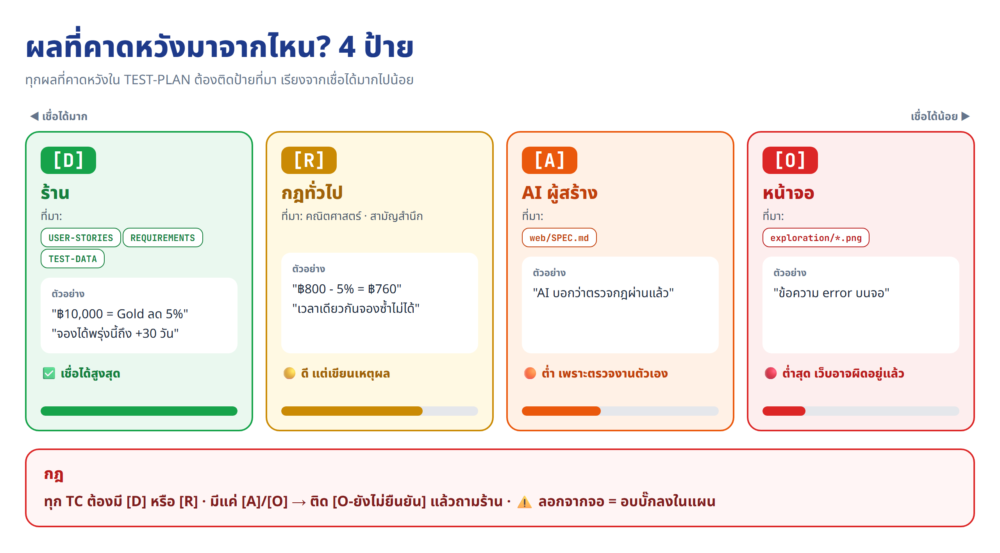

# ⚡ Fast Track · จากบันทึกสัมภาษณ์ สู่เว็บและแผนทดสอบ ในพรอมต์เดียว

งานเดียวกับ [บทเรียนหลัก](../README.md) ทั้ง LAB 0–12 แต่วางพรอมต์ **ครั้งเดียว** แล้ว Claude ทำต่อกันเองจนจบ (ราว 4–5 ชั่วโมง) input ยังมีอย่างเดียวคือบันทึกสัมภาษณ์ ซึ่งอยู่ท้ายพรอมต์แล้ว


## 🧭 พรอมต์ทำอะไรบ้าง

Claude ทำ 13 ขั้นต่อกัน (ขั้นที่ N = LAB N) แต่ละขั้นสร้างไฟล์ แล้ว **อ่านไฟล์นั้นก่อนทำขั้นถัดไป** ถ้าสะดุดกลางทาง ให้วางพรอมต์เดิมซ้ำ Claude จะทำต่อจากขั้นที่ค้าง


## 🤖 จุดที่ต่างจากบทเรียนหลัก: ขั้น 6 ให้ "ผู้ช่วยหน้าต่างใหม่" สร้างเว็บ

พรอมต์สั่งให้ Claude ใช้ **subagent ใหม่** (ไม่มีความจำจากแชตนี้) สร้างเว็บจาก `BUILD-PROMPT.md` แทนการเปิดหน้าต่างใหม่เอง ซึ่งให้ผล 2 อย่าง

1. **พิสูจน์ว่า BUILD-PROMPT.md ครบ** เพราะผู้ช่วยมีแค่ไฟล์นี้
2. **บั๊กยังเป็นความลับ** ผู้ช่วยเป็นคนเลือกบั๊ก 3 ตัวและเขียนไว้ใน `web/BUGS.md` เท่านั้น Claude ตัวหลักซึ่งต้องเขียนแผนและล่าบั๊กจึงไม่รู้ล่วงหน้า (ถ้าสร้างเว็บเอง ขั้น 12 ก็ไม่ได้พิสูจน์อะไร)


บทนี้จึงมีพรอมต์แบบเดียว ไม่แยกแบบบอกใบ้/ไม่บอกใบ้เหมือนบท 03 เพราะเว็บและบั๊กเกิดใหม่ทุกรอบ ไม่มีใครรู้คำตอบล่วงหน้า สิ่งที่ใส่เพิ่มในพรอมต์คือ **บทเรียนจากรอบที่ทำจริง** ซึ่งช่วยให้ test ถูก แต่ไม่ได้บอกคำตอบ เช่น test กดซ้ำต้องคลิก 2 ครั้งจริง (ไม่ใช่ `dblclick`) · regex ไทยต้องยกเว้น ฿ · ตรวจตัวเลขข้างเคียงบนจอเดียวกัน · เลือกข้อมูลที่ทำให้คำตอบถูกกับผิดได้ตัวเลขต่างกัน

## 🏷️ หัวใจที่พรอมต์บังคับไว้

**"ร้านขอ ≠ AI บอกว่าทำแล้ว ≠ เว็บทำจริง"** ผลที่คาดหวังทุกข้อต้องมี **[D] หรือ [R]** รองรับ ([ฟัง 3 ทาง](../README.md#5-ฟัง-3-ทาง-และป้ายที่มาของผลที่คาดหวัง-หัวใจของบท)) และตัวเลขทุกตัวต้อง **คำนวณเองก่อนเปิดเว็บ** ห้ามลอกจากหน้าจอ



## 🚀 วิธีใช้

1. เตรียมเครื่องตาม[ก่อนเริ่ม ต้องมี](../README.md#-ก่อนเริ่ม-ต้องมี): Docker Desktop · Node.js 20+ · Playwright MCP · ffmpeg · พอร์ต 3000/5433 ว่าง · (ไม่บังคับ) Codex CLI
2. เปิด Claude Code ที่โฟลเดอร์ `04_sabai-spa-web-and-testplan-from-interview` ในเซสชันใหม่ แล้วตั้งโหมดอนุญาตให้รันคำสั่งได้เอง ไม่อย่างนั้นจะค้างรอให้กด Yes
3. วางพรอมต์ข้างล่าง แล้วตั้งเครื่องไม่ให้หลับ (ขั้น 6 และ 11 ใช้ขั้นละราว 1 ชั่วโมง)

> 🔁 จะเริ่มใหม่ทั้งหมด ให้ย้ายไฟล์ที่สร้างไว้ (`*.md` ที่สร้าง `db/` `web/` `exploration/` `e2e/`) ไปเก็บที่อื่น แล้วลบ container `sabai-web` `sabai-db` และ volume `sabai-pgdata` ก่อน

## ✅ จบแล้วตรวจอะไร

1. **ตารางสรุปท้ายแชต** ดูช่อง ⚠️ และ "เรื่องที่ตัดสินแทนผม" ก่อน
2. **"AI บอกว่าผ่าน X/Y" กับผลตามเกณฑ์ของแผนเรา** ถ้าไม่ตรงกัน แปลว่าแผนของเราเจอสิ่งที่ AI ผู้สร้างมองข้าม
3. **สุ่มตรวจเรื่องเงิน 2–3 ข้อใน TEST-PLAN.md** ต้องมีวิธีคิดกำกับ เช่น ฿4,000 − 10% − ฿100 + ฿300 = ฿3,800
4. **รายงาน 2 ไฟล์** `e2e/normal-mode/index.html` (โหมดปกติ) และ `e2e/index.html` (โหมดฝังบั๊ก)
5. **ให้คะแนน**ด้วย[รูบริก 20 ข้อ](../README.md#-รูบริก-เช็กลิสต์-งานทั้งบทที่ดี) แล้วค่อยเปิด `_solution/` เทียบ

ตัวเลขจากรอบที่ทำจริงในบทเรียนหลัก ใช้เป็นจุดเทียบ (ของคุณไม่จำเป็นต้องตรง เพราะเว็บและบั๊กเกิดใหม่ทุกรอบ)

| ขั้น | บทเรียนหลักได้ |
|---|---|
| 1–4 | 36 story · FR 35 · BR 20 · NFR 18 · 8 แผนภาพ · TEST-DATA 165 แถว |
| 5–6 | BUILD-PROMPT 110 บรรทัด · เว็บ 14 หน้า · AI อ้างว่าผ่าน 90/90 |
| 7–8 | 15 หน้า · 41 ฟีเจอร์ · กฎ 3 ทาง 87 ข้อ (❌ 2 = บั๊กจริงในโหมดปกติ) |
| 9–10 | 42 TC (P1 33) · BR มี TC ครบ 20/20 |
| 11 | โหมดปกติ **ไม่ผ่านเกณฑ์** 38/42 ทุกเบราว์เซอร์ |
| 12 | โหมดบั๊ก ไม่ผ่าน 33/42 · จับบั๊กได้ **3/3** · ถ้าลอกค่าจากจอจะจับได้ **0/3** |

## 🆘 ถ้าสะดุด

| อาการ | ทำอะไร |
|---|---|
| แชตหลุด / Claude หยุดกลางทาง | เปิดเซสชันใหม่ วางพรอมต์เดิมซ้ำ |
| ขั้น 6 เรียก subagent ไม่ได้ | วาง `BUILD-PROMPT.md` ในหน้าต่างใหม่เองแบบ [LAB 6](../README.md#lab-6--วางพรอมต์--ได้เว็บใหม่-2-กล่อง) พอเว็บ healthy แล้วกลับมาวางพรอมต์นี้ซ้ำ |
| Claude จะสร้างเว็บเอง หรือเปิดโค้ด / `BUGS.md` / `README.md` | `หยุดก่อน ห้ามสร้างเว็บเอง ห้ามอ่านโค้ดใน web/ db/ web/BUGS.md README.md และ _solution ให้ subagent สร้างเว็บ แล้วเรียนรู้จาก SPEC.md กับหน้าเว็บเท่านั้น` |
| จบแล้วเว็บยังเป็นโหมดบั๊ก | `ในโฟลเดอร์ web รัน $env:BUG_MODE=0; docker compose up -d แล้วเช็กว่า data-bug-mode เป็น 0` |

อาการอื่นดู[ตารางแก้ปัญหาในบทเรียนหลัก](../README.md#ถ้าเจอปัญหา-คัดลอกพรอมต์นี้)

---

## 💬 พรอมต์

```text
ผมมี input อย่างเดียวคือบันทึกสัมภาษณ์ "สบายใจ สปา" ท้ายพรอมต์นี้ ช่วยทำ 13 ขั้นข้างล่างต่อกันจนจบโดยไม่ต้องรอผม

กติกาตลอดงาน
1. ทุกไฟล์เป็นภาษาไทย ใช้ตาราง เก็บที่โฟลเดอร์นี้ · ก่อนเริ่มแต่ละขั้นให้อ่านไฟล์ของขั้นก่อนจากดิสก์ใหม่ ไม่พึ่งความจำในแชต
2. ตอนเริ่ม ให้เปิดดูไฟล์ที่มีอยู่จริง (และ container ถ้ามี) แล้วทำต่อจากขั้นแรกที่ยังไม่เสร็จ
3. ห้ามเปิด README.md ของบท fast_track/ และ _solution/ (มีผลรันของคนอื่น) · ห้ามสร้างเว็บเอง · ห้ามอ่านโค้ดใน web/ db/ (อ่านได้แค่ web/SPEC.md และ web/ASSETS.md) · ห้ามเปิด web/BUGS.md จนถึงขั้น 12 ข้อ ⑦
4. ผลที่คาดหวังมี 4 ที่มา: [D] ร้าน (USER-STORIES/REQUIREMENTS/TEST-DATA) > [R] กฎทั่วไปหรือคณิตศาสตร์ (เขียนเหตุผล) > [A] คำอ้างของ AI ผู้สร้าง (SPEC และรายงานขั้น 6) > [O] หน้าจอ · ทุกข้อต้องมี [D] หรือ [R] ถ้าไม่มีให้ติด [O-ยังไม่ยืนยัน] แล้วตั้งเป็นคำถามถึงร้าน
5. เงิน แต้ม ครั้งคอร์ส และจำนวนรอบ ต้องคำนวณเองพร้อมวิธีคิดก่อนดูเว็บ ห้ามลอกจากจอ · ถ้าผลไม่ตรง ห้ามแก้ผลที่คาดหวัง test หรือแผนให้ผ่าน ให้ทำ ⚠️ แล้วจำแนกว่าเว็บผิด / แผนผิด / test ผิด (ดูภาพหรือ GIF ก่อน)
6. ค่าที่ร้านไม่ได้บอก ให้ติด ⚠️ พร้อมสมมติฐาน · เรื่องที่ปกติต้องถามผม ให้ตัดสินแบบระวังแล้วจดใต้หัวข้อ "ตัดสินแทนผู้เรียน" · ฟีเจอร์ AI (อารมณ์ แบบทดสอบ วิเคราะห์ผิว chatbot) ตรวจแค่สิ่งที่มีที่มา เช่น ถามซ้ำได้คำตอบเดิม ตอบเวลาและราคาตรง TEST-DATA ไม่ส่งรูปออกจากเครื่อง · การส่ง Gift Card เป็นการจำลอง · บัญชีเจ้าของร้านจาก SPEC ใช้ได้ แต่จดไว้ว่าร้านไม่ได้ให้
7. ข้อมูลเพี้ยนให้เรียก POST http://localhost:3000/api/test/reset · ถ้าติดจนทำต่อไม่ได้ให้หยุดแล้วบอกผม

ขั้นที่ 0 เช็กเครื่อง (อ่านอย่างเดียว ทุกค่าต้องมาจากคำสั่งที่รันจริง): docker version · docker compose version · node -v (≥ 20) · npm -v · ffmpeg -version · claude mcp list (playwright ต้อง Connected) · codex --version (ไม่บังคับ ถ้าไม่มี รูปในเว็บจะวาดเป็น SVG) · พอร์ต 3000/5433 ว่างไหม (ถ้าเป็น petshop ให้ docker stop ได้เลย ห้ามลบ ถ้าเป็นโปรแกรมอื่นให้หยุดถาม) · ตาราง รายการ|ผล|พร้อมไหม|ต้องทำอะไร

ขั้นที่ 1 USER-STORIES.md: story "ในฐานะ… ฉันอยาก… เพื่อ…" ครบทุกเรื่องที่ทุกคนพูด (US-01…) · เกณฑ์ยอมรับ 1–2 ข้อที่ตรวจได้ (มีตัวเลขหรือข้อความชัด และมีกรณีขอบ เช่น ฿9,999/฿10,000 · 23:59/24 ชม.) · Must/Should/Could · ท้ายไฟล์มี "คำถามที่ยังไม่ชัด" (เช่น ราคาและเวลาของบริการที่บันทึกไม่ได้บอก) · ภาษาไทยง่าย ห้ามมีศัพท์โปรแกรม (database, API) · คำพูดที่ขัดกัน (ห้ามเก็บรูปหน้า vs อยากอัปเซลฟี่) ห้ามตัดทิ้ง ให้เขียน story ที่เคารพกฎร้านแล้วตั้งคำถาม · ตารางสรุป รหัส|เรื่อง|ใครขอ|ความสำคัญ และนับ Must/Should/Could

ขั้นที่ 2 REQUIREMENTS.md 3 ตาราง: FR (FR-01…) · BR (BR-01… ทุกข้อมีตัวเลข และคอลัมน์ "ค่าขอบที่ต้องทดสอบ" ต่ำกว่า/ที่ขอบ/เกินขอบ รวมลำดับคิดราคาเมื่อส่วนลดหลายแบบซ้อนกัน) · NFR (NFR-01… ทุกข้อมีคอลัมน์ "วิธีวัด" เช่น ใช้บนมือถือกว้าง 375px ได้ · หน้าแรกโหลดไม่เกิน 3 วินาที และมี NFR "ทดสอบได้": AI ทุกตัวเป็นกฎตายตัว ถามเหมือนเดิมได้คำตอบเดิม · มีปุ่มรีเซ็ตข้อมูลทดสอบ · ล็อก "วันนี้" ของเว็บได้ · ทุกปุ่มมีป้ายชื่อให้เครื่องมือทดสอบหาเจอ) · ทุกข้อมีคอลัมน์ "มาจาก US ไหน" และตรวจท้ายไฟล์ด้วยตาราง US|FR|BR|✅/❌ ต้องไม่มี ❌ · ค่าที่ร้านไม่ได้บอก (เช่น ค่ารถ ฿300 คิดต่อคันหรือต่อคน) ติด ⚠️ แล้วรวมเป็นตารางสมมติฐานท้ายไฟล์ โยงกับ "คำถามที่ยังไม่ชัด"

ขั้นที่ 3 DESIGN.md (ทุกแผนภาพใช้ Mermaid ต้อง render ได้จริง ป้ายบนเส้นห้ามมี URL ให้เขียน "localhost พอร์ต 3000"):
① Architecture: เครื่องผู้ใช้ (เบราว์เซอร์ + Playwright) → sabai-web = Next.js (App Router, TypeScript) หน้าเว็บ + API + กฎร้าน พอร์ต 3000 → sabai-db = PostgreSQL 16 ใน Docker แยกอีกโปรเจกต์ เปิด 5433 บนเครื่อง · คุยกันผ่าน network sabai-net (web ต่อ db ที่ sabai-db:5432 ส่วน 5433 ใช้จากเครื่องเราเท่านั้น) · ระบุว่าอะไรทำในเบราว์เซอร์ (เช่น วิเคราะห์ผิว) อะไรทำที่เซิร์ฟเวอร์ · ใต้รูปมีตาราง ชั้น|อยู่ที่ไหน|หน้าที่|ทดสอบด้วยอะไร
② Use Case (ใช้ flowchart LR: actor เป็นวงรี ระบบเป็น subgraph) actor = บทบาท + ชื่อคนในวงเล็บ ครบทุกกลุ่มและเจ้าของร้าน · ทุก use case โยง FR
③ Flowchart ≥ 2 รูป: จองคิว (ตรวจช่วงวัน → รอบว่าง → คำนวณราคา → ยืนยัน) และยกเลิกนัด · ทุกจุดตัดสินใจเขียน BR กำกับ
④ ERD: ตาราง คอลัมน์หลัก ความสัมพันธ์ · คอลัมน์เงิน แต้ม ครั้งคอร์สระบุชนิดข้อมูล (เงินใช้ NUMERIC ไม่ใช้ float เขียนในช่อง comment ได้)
⑤ Sequence ≥ 2 รูป: จองคิว (เบราว์เซอร์ → web → API → db) และจองด้วยคอร์ส (หักครั้ง)
⑥ "คำถามที่ได้จากการออกแบบ" (เช่น ยกเลิกนัดที่จองด้วยคอร์สแล้วคืนครั้งไหม · หักครั้งตอนจองหรือตอนมาใช้) · ตารางสรุป แผนภาพ|จำนวน|ครอบคลุม FR/BR ไหน

ขั้นที่ 4 TEST-DATA.md (= ข้อมูลที่ส่งให้ร้านตรวจ ถือเป็น [D] เว็บจะ seed ตามนี้ทุกค่า และ test ใช้เป็นผลที่คาดหวัง) ทุกตารางมีคอลัมน์ "มาจาก BR/US ไหน":
① วันเวลาล็อก 1 ค่าพร้อมเหตุผล (เลือกให้นัดพรุ่งนี้อยู่ที่ขอบ 24 ชม. พอดีได้) ② ผู้ใช้ ≥ 4 คน: อีเมล|รหัสผ่าน|ชื่อ|ยอดสะสม|ระดับ|แต้ม|วันเกิด|คอร์ส ต้องมีคุณนิดา (฿12,400 คอร์สใช้ไป 4 ครั้ง) · คนเกิดเดือนเดียวกับวันล็อก และคนที่ใช้สิทธิ์วันเกิดไปแล้ว · สมาชิกใหม่ · คนที่แต้มพอแลก ③ บริการทุกตัว (ชื่อ|นาที|ราคา|สมุนไพร) · แพ็กเกจ · คอร์ส · Gift Card ④ นักบำบัด ≥ 6 คน (บริการที่ทำได้ · รีวิว 4.4/4.5/5.0 และยังไม่มีรีวิว) ⑤ โรงแรม 5.0/5.1/12/15.0/15.1 กม. ⑥ ข้อมูลตอนเริ่ม: การจองที่มีอยู่ (ไว้ทดสอบจองซ้อน) · Gift Card ที่ใช้ได้และหมดอายุ ⑦ ตาราง "ค่าขอบที่ต้องทดสอบ" รวมทุก BR พร้อมผลที่ถูก เงินแสดงวิธีคิด เช่น ฿800 − 5% (฿40) = ฿760 · ข้อที่ทดสอบผ่านหน้าเว็บไม่ได้ (ชนกฎอื่น) ระบุว่า "unit test" ⑧ ค่าที่ร้านยังไม่ยืนยันติด ⚠️ พร้อมสมมติฐาน · ตารางสรุป หมวด|จำนวนแถว

ขั้นที่ 5 BUILD-PROMPT.md (ห้ามเขียนโค้ด ≤ 150 บรรทัด แบ่งเป็นขั้นมีเลข) = พรอมต์ภาษาไทยให้ผู้ช่วยที่ไม่มีความจำจากแชตนี้สร้างเว็บ "สบายใจ สปา · Sabai Jai Wellness Spa" ใหม่ทั้งหมด ต้องสั่งครบ:
- ทำตาม DESIGN · Next.js (App Router, TypeScript) + ไลบรารี pg เขียน SQL ตรง (ไม่ใช้ ORM) · เอกสารขัดกันให้เชื่อ TEST-DATA > REQUIREMENTS > DESIGN
- db/: container sabai-db (postgres:16-alpine) · volume sabai-pgdata · 5433:5432 · healthcheck pg_isready · init/01-schema.sql ตาม ERD (เพิ่มตารางได้ถ้า TEST-DATA ต้องใช้) · init/02-seed.sql ตาม TEST-DATA ทุกค่า
- web/: container sabai-web พอร์ต 3000 · DATABASE_URL ชี้ sabai-db:5432 · output standalone · HOSTNAME=0.0.0.0 · TZ=Asia/Bangkok · healthcheck ด้วย node เรียก /api/health ตอบ {"ok":true,"db":true} (ต่อ db ไม่ได้ตอบ db:false) · ห้ามต่อ db ตอน build · เปิด db ให้ healthy ก่อนแล้วค่อยเปิด web
- ใช้บน Windows ได้: ไม่มีไฟล์ .sh ที่ต้องรัน · .gitattributes เป็น LF · คำสั่งทุกตัวใช้ใน PowerShell ได้ · มี container อื่นใช้พอร์ต 3000/5433 ให้ docker stop ก่อน
- รูป: ห้ามใช้รูปจากเน็ต เก็บที่ web/public/assets/ · เช็ก codex --version ถ้ามีให้ codex exec ใช้เครื่องมือสร้างรูปในตัว (คัดลอกจาก ~/.codex/generated_images แล้วย่อด้วย node + sharp) โทนไทยร่วมสมัย: hero · บริการทุกตัว · นักบำบัดทุกคน · Gift Card 3 ลาย · panorama ห้อง Couple Suite สำหรับทัวร์ 360° · ใบหน้าตัวอย่างแบบภาพวาด (ไม่ใช่คนจริง) สำหรับวิเคราะห์ผิว · รูปที่สร้างไม่สำเร็จหรือไม่มี codex ให้วาด SVG/CSS · web/ASSETS.md: ไฟล์|ใช้ที่หน้าไหน|สร้างด้วย Codex หรือ SVG/CSS
- ดีไซน์ไทยร่วมสมัย (เขียวใบตอง ครีม ทอง) ฟอนต์ไทยอ่านง่าย การ์ดมีเงา animation นุ่ม ใช้บนมือถือ 375px ได้ · ฟีเจอร์ครบตาม REQUIREMENTS ตัวเลขตรง BR และ TEST-DATA · หน้า /admin ให้เจ้าของร้านกด "ใช้บริการเสร็จ" (ให้แต้ม ตัดครั้งคอร์ส)
- "AI" ทุกตัวเป็นกฎตายตัว ไม่เรียก API ภายนอก · วิเคราะห์ผิวคำนวณในเบราว์เซอร์ ไม่อัปโหลดรูป · เพลงเปิดด้วยปุ่มเท่านั้น · ส่ง Gift Card ทาง LINE/email เป็นการจำลอง (แสดงข้อความที่ "ส่ง")
- สำหรับทดสอบ: data-testid ทุกปุ่ม ช่องกรอก ผลลัพธ์ และข้อความ error · <html data-ready="true" data-bug-mode="0|1"> · POST /api/test/reset (เปิดเมื่อ ALLOW_TEST_RESET=1) ล้างกลับเป็น seed และรับ {"now":"<ISO>"} เพื่อล็อกวันนี้ (ไม่ส่ง now = ใช้วันล็อกใน TEST-DATA)
- BUG_MODE (env ของ web ค่าเริ่มต้น 0): ผู้ช่วยเลือกบั๊กเอง 3 ตัวจาก BR · เรื่องเงิน 1 · การจอง 1 · ตัวเลขหรือสถานะที่ต้องอัปเดตหลังทำรายการ 1 · ทุกตัวต้อง "ลอกค่าจากหน้าจอไปเป็นผลที่คาดหวังแล้วจับไม่ได้" · เฉลยเขียนที่ web/BUGS.md เท่านั้น ห้ามบอกในแชต SPEC หรือคอมเมนต์ที่เดาง่าย (เขียนข้อห้ามนี้ทั้งในขั้นบั๊กและขั้นสรุป)
- web/SPEC.md: หน้าเว็บ · กฎโยง FR/BR · data-testid ทุกตัว · ข้อความ error คำต่อคำ · API ทุกเส้น · ผู้ใช้ seed · สมมติฐานที่ตั้งเพิ่ม
- ขั้นสุดท้าย: เปิด db แล้ว web รอจน healthy ทั้งคู่ · ตรวจ /api/health · ยิง API ตรวจกฎตามตารางค่าขอบใน TEST-DATA แล้วรายงาน "ผ่าน X / Y ข้อ" · เปิด http://localhost:3000 · สรุปเป็นตาราง (ห้ามบอกว่าเลือกบั๊กอะไร) · ขั้นไหนไม่ผ่านให้หยุดแล้วบอกสาเหตุ
เสร็จแล้วอ่านทวนว่าไม่ขัดกับ REQUIREMENTS/DESIGN/TEST-DATA · ตารางสรุป ขั้นในพรอมต์|FR/BR ที่ครอบคลุม

ขั้นที่ 6 สร้างเว็บ → db/ web/: ห้ามสร้างเอง ให้สั่ง subagent ใหม่ (Agent tool) ด้วยข้อความนี้เท่านั้น ห้ามเติมเนื้อหาจากแชตนี้ "เปิด BUILD-PROMPT.md ในโฟลเดอร์นี้แล้วทำตามจนจบ ห้ามเปิด README.md ของบท fast_track/ และ _solution/ · คำตอบสุดท้ายห้ามบอกหรือใบ้ว่าเลือกบั๊กอะไร" แล้วรอ (30–60 นาที) · ถ้าเรียก subagent ไม่ได้ให้หยุด บอกผมให้วาง BUILD-PROMPT.md ในหน้าต่างใหม่เอง · เสร็จแล้วเช็กโดยไม่อ่านโค้ด: sabai-db และ sabai-web healthy · /api/health ตอบ {"ok":true,"db":true} · data-bug-mode="0" · มี web/SPEC.md และ web/ASSETS.md · จด "ผ่าน X/Y" และสมมติฐานที่ผู้ช่วยรายงานไว้เป็น [A] (ยังไม่นับว่าพิสูจน์แล้ว) · ไม่ผ่านให้ส่ง subagent ใหม่ไปแก้เฉพาะส่วนนั้นพร้อมข้อห้ามเดิม

ขั้นที่ 7 EXPLORATION.md ส่วน A B D (ฟัง 3 ทางตามลำดับนี้ จะได้ไม่ถูกหน้าจอชักนำ):
① ฟังร้าน (ยังไม่เปิดเว็บ): จาก REQUIREMENTS และ TEST-DATA เขียน "สิ่งที่ร้านบอกว่าต้องเจอบนเว็บ" = หน้า / ฟีเจอร์ / ตัวเลขที่คำนวณไว้ก่อน [D]
② ฟัง AI: อ่าน web/SPEC.md และ web/ASSETS.md จดว่าอ้างว่ามีหน้า ฟีเจอร์ กฎอะไร [A]
③ ฟังเว็บ: reset แล้วใช้ Playwright MCP เปิดแท็บใหม่ เดินแบบลูกค้า [O] · กดทุกเมนูและลิงก์ในหัว/ท้ายเว็บจนครบทุกหน้า และลอง URL ที่ไม่มีจริง · งานหลัก 1 รอบ: login ด้วยผู้ใช้ใน TEST-DATA → เลือกบริการ → จองคิว → ดูบัญชีว่าการจองขึ้นไหม → ดู Wallet · หน้าที่ต้องใช้สิทธิ์พิเศษใช้บัญชีจาก SPEC ได้ (จดว่าร้านไม่ได้ให้) · สลับ 3 ภาษา · มือถือกว้าง 390px 1 หน้า · ภาพหน้าละ 1 รูป (หลายขั้นจับทุกขั้นได้) ใน exploration/ ชื่อตามหน้า เช่น exploration/book-step4.png · เสร็จแล้ว reset
ส่วน A แผนผัง: หน้า|URL|ไปถึงจากไหน|ต้อง login ไหม|SPEC อ้างไหม · ส่วน B ฟีเจอร์: ฟีเจอร์|หน้า|ลูกค้าทำอะไรได้|ใส่ข้อมูลอะไรได้|มาจาก FR ไหน · ส่วน D ช่องว่าง 3 แบบ: ร้านขอแต่เว็บไม่มี / เว็บมีแต่ร้านไม่ได้ขอ / AI อ้างใน SPEC แต่ใช้ไม่ได้จริง (ตรวจแค่หน้าและปุ่ม กฎตัวเลขไว้ขั้น 8) · หัวข้อ "ยังไม่รู้" (อย่าเดา) · ตารางสรุป ส่วน|จำนวน

ขั้นที่ 8 EXPLORATION.md ส่วน C E F (ใช้ Playwright MCP reset ก่อนแต่ละกลุ่มเคส และ reset อีกครั้งเมื่อเสร็จ):
① ทุกฟอร์ม (สมัคร เข้าสู่ระบบ จองคิว Gift Card รถรับส่งทั้งหน้าแยกและในหน้าจอง หาไม่เจอให้จด ⚠️ ไม่ต้องเดา): ส่งเปล่า ค่าผิด ค่าขอบจาก TEST-DATA · จด error ตรงตัวอักษร
② เงิน: ราคา ส่วนลดกลุ่ม ระดับสมาชิก วันเกิด แลกแต้ม ค่ารถ · คำนวณเองก่อนแล้วค่อยเทียบเว็บ
③ ขีดจำกัด: ช่วงวันที่จองได้ เวลาปิดร้าน (นับจำนวนรอบที่จองได้) จองซ้อน จำนวนคน ยกเลิกก่อน 24 ชม. คอร์สเหลือ 0 ครั้ง
④ สถานะ: รีโหลดแล้วข้อมูลยังถูกไหม · กดยืนยัน 2 ครั้งติดกันเร็ว ๆ แล้วนับนัด · ออกจากระบบแล้วเข้าหน้าสมาชิกได้ไหม (ลองเรียก API ด้วย cookie เดิมด้วย) · ใส่รหัสที่ไม่มีจริงแล้วเว็บแจ้งไหม · แต้ม/ครั้งคอร์สอัปเดตทันทีไหม (แต้มได้ตอนร้านกด "ใช้บริการเสร็จ" ให้ลองผ่านหน้าร้าน)
ส่วน C กฎ 3 ทาง: กฎ (BR)|ตัวอย่างที่ลอง|ร้านบอก [D]|AI อ้าง [A]|เว็บจริง [O]|✅/⚠️/❌ · ส่วน E ความเสี่ยง: ฟีเจอร์|ถ้าพังจะเกิดอะไร|ระดับ|เหตุผล (P1 = เงินผิด จองผิด จองซ้อน หรือสิทธิ์/ข้อมูลส่วนตัวผิด · P2 = ฟีเจอร์สำคัญผิดแต่ยังจองได้ · P3 = การแสดงผลหรือกรณีเกิดไม่บ่อย) · ส่วน F คำถาม 2 กลุ่ม: "ถามร้าน" (กฎไม่ชัด) / "ถามคนสร้างเว็บ" (ทำแบบนี้เพราะอะไร) · ตารางสรุป ส่วน|จำนวน|✅|⚠️|❌

ขั้นที่ 9 TEST-PLAN.md หัวข้อ 1–5 (แผนมี 8 หัวข้อ: 1 ภาพรวม · 2 ขอบเขต · 3 วิธีคิด test case · 4 ระดับ · 5 Test cases · 6 Entry/Exit · 7 ข้อมูลทดสอบ · 8 คุณภาพของแผน ตอนนี้หัวข้อ 6–8 ใส่แค่ชื่อว่า "ยังไม่เขียน"):
1 ภาพรวม: เป้าหมาย (ประโยคเดียว)|ระบบที่ทดสอบ|เครื่องมือ|สิ่งที่ต้องส่ง|แหล่งผลที่คาดหวัง [D] > [R] > [A] > [O]
2 ขอบเขต: ทุกฟีเจอร์ในส่วน B อยู่ฝั่ง ทดสอบ ✅ หรือ ไม่ทดสอบ ❌ (มีเหตุผล) · ระบุเบราว์เซอร์ จอมือถือ API · ท้ายหัวข้อมีตาราง คำถาม|คำตอบที่ใช้ (ตัดสินแทนผู้เรียน)
3 เทคนิค: Happy path · Negative · Boundary · Equivalence partition · State · Security/API พร้อมตัวอย่างจากเว็บนี้
4 ระดับ P1/P2/P3 ตามส่วน E + คำถามจัดระดับ 3 ข้อ (ตอบ "ใช่" ข้อแรกแล้วหยุด)
5 Test cases 30–40 ข้อ: ID (TC-<โมดูล>-01)|โมดูล|สิ่งที่ทดสอบ|FR/BR|เทคนิค|ระดับ|ข้อมูล (จาก TEST-DATA)|ผลที่คาดหวัง|ที่มา · ผลต้องเป็นตัวเลข/ข้อความที่ตรวจได้ ห้ามเขียน "แสดงถูกต้อง" เงินมีวิธีคิด · test สถานะบอกจังหวะตรวจ (ทันที/หลังรีโหลด) · เลือกข้อมูลที่ทำให้คำตอบถูกกับผิดได้ตัวเลขต่างกัน · ที่มามีแค่ [A]/[O] ให้ติด [O-ยังไม่ยืนยัน] และเพิ่มในส่วน F · ข้อความที่รู้จาก SPEC อย่างเดียวเขียนไม่ผูกคำ เช่น "มีข้อความแจ้งว่าใช้บัตรไม่ได้" · รหัส API ที่ร้านไม่ได้กำหนดเขียนเป็นช่วง เช่น "ได้ 4xx และไม่มีอะไรถูกบันทึก" · ต้องมี: จองคิวจนจบ (E2E) · ค่าขอบระดับสมาชิก · รอบใกล้เวลาปิด · จองซ้อน · กดยืนยันซ้ำ · จองด้วยคอร์สแล้วครั้งลด · ส่วนลดซ้อน · แต้มหลังร้านกดเสร็จ · ช่วงวันที่จองได้ · เรียก API ที่ต้อง login โดยไม่ login
6 ลองทุก TC กับเว็บจริงด้วย Playwright (reset ก่อนทุก TC) ลง TEST-RUN-1.md: ID|ผลที่คาดหวัง|เว็บจริง|ตรงไหม · ไม่ตรงห้ามแก้ตามเว็บ ให้ ⚠️ พร้อมบอกว่าน่าจะเป็นบั๊กของเว็บหรือแผนเข้าใจผิด เพราะอะไร
ตารางสรุป โมดูล|จำนวน TC|P1|P2|P3 และนับตามที่มาที่น่าเชื่อที่สุดของแต่ละ TC (1 TC นับครั้งเดียว) [D]/[R]/[O-ยังไม่ยืนยัน]

ขั้นที่ 10 TEST-PLAN.md หัวข้อ 6–8 และ PLAN-REVIEW.md:
6 เกณฑ์: Entry = sabai-db และ sabai-web healthy และ /api/health ตอบ {"ok":true,"db":true} · Exit = P1 ผ่านทั้งหมด และผ่านรวม ≥ 95% (คิดเป็นจำนวนข้อ ปัดขึ้น · TC ที่ไม่ได้รันนับเป็นไม่ผ่าน) ตัดสินแยกทีละเบราว์เซอร์ · ข้อที่จำแนกว่าแผนผิดยังนับเป็นล้มจนกว่าจะแก้แผน
7 ข้อมูลทดสอบ: จาก TEST-DATA + ที่ตั้งเองในหัวข้อ 5 พร้อมบอกว่าใช้กับ TC ไหน
8 คุณภาพของแผน: ตาราง "ถ้าเว็บพังแบบนี้ → TC ไหนต้องล้ม → ทำไมจับได้ (oracle)" ≥ 6 แบบ ครอบคลุมเงิน การจอง และสถานะ (คิดจากค่าขอบใน BR เช่น รอบที่จบ 22:00 พอดี ลำดับส่วนลด แต้มคิดก่อน/หลังหักส่วนลด) · ตาราง "จุดที่ยังกำกวม" จากส่วน F พร้อมสมมติฐานที่แผนใช้
PLAN-REVIEW.md: coverage matrix (ทำหลังแก้) ฟีเจอร์ในขอบเขต × 6 เทคนิค ช่อง = ID (ควรมีแต่ว่าง ⚠️ · เติมจากรีวิว ✚) · traceability FR/BR|TC (BR ทุกข้อในขอบเขตต้องมี ≥ 1 TC) · นับ TC ตามระดับ เทคนิค ที่มา · ตรวจทีละข้อ: ผลตรวจได้ไหม · ข้อมูลทำให้คำตอบผิดได้ตัวเลขต่างจากคำตอบถูกไหม · บอกจังหวะตรวจไหม · ซ้ำไหม · สรุป 3–5 ข้อที่ควรแก้แล้วแก้ใน TEST-PLAN.md เลย (เพิ่ม TC ได้ อัปเดตตัวเลขในหัวข้อ 6 ให้ตรง) · [O-ยังไม่ยืนยัน] ≤ ~20% · ตาราง ตัวชี้วัด|ก่อนรีวิว|หลังรีวิว

ขั้นที่ 11 e2e/ (Playwright TypeScript ห้ามแก้ web/ db/) และ CLAUDE.md:
① เช็ก node -v, ffmpeg -version, /api/health ก่อน ไม่พร้อมให้หยุด ② playwright.config: chromium/firefox/webkit · locale th-TH · timezone Asia/Bangkok · GIF=1 อัดวิดีโอทุก test แบบช้า (เฉพาะ chromium) ③ global-setup: เช็ก /api/health อ่าน data-bug-mode เก็บใส่รายงาน แล้ว POST /api/test/reset พร้อมวันล็อกจาก TEST-DATA · fixture reset ก่อนทุก test และ workers: 1 กันข้อมูลชน
④ test ครบทุก TC ชื่อขึ้นต้นด้วยรหัส แยกไฟล์ตามโมดูล · tag ['@<โมดูล>', '@P1|@P2|@P3'] · annotation ผลที่คาดหวังและที่มาจากแผน · หา element ด้วย data-testid จาก SPEC หรือที่เห็นบนหน้าเว็บ · ใช้ตัวเลข/ข้อความตามแผนเท่านั้น ห้ามเปลี่ยนตามเว็บ · แบ่งขั้นตอนภาษาไทยด้วย test.step ตรวจด้วย expect.soft · ราคาบนจอมาจาก API ให้รอหน้าเว็บคิดเสร็จก่อนอ่าน (ห้ามรอจนได้ค่าที่อยากได้) · ตัวเลขข้างเคียงบนจอเดียวกัน (เช่น แต้มที่จะได้) ตรวจด้วยถ้าแผนมีที่มา · test "กดซ้ำ" ต้องคลิก 2 ครั้งติดกันจริง (ไม่ใช่ dblclick ที่ส่งคำขอครั้งเดียว) แล้วนับผลในระบบ · ผลที่เจอตอนสำรวจ (ขั้น 8–9) ต้องเจอซ้ำใน test ไม่เจอให้สงสัย test ก่อน · regex "ไม่มีอักษรไทย" ต้องยกเว้น ฿ (ใช้ [ก-฾เ-๛])
⑤ หลักฐาน: test ที่เปิดหน้าเว็บได้ test-report/gifs/<TC>.gif และ test-report/videos/<TC>.mp4 (ffmpeg) มีป้ายชื่อ test มุมซ้ายล่างและวงแดงตรงจุดคลิก · test ที่ยิง API อย่างเดียวบันทึก log
⑥ รายงานหน้าเดียว e2e/index.html (ดับเบิลคลิกเปิดได้ ไม่ต้องมี server): กล่อง "ผ่านเกณฑ์ / ไม่ผ่านเกณฑ์" ตามหัวข้อ 6 แยกทีละเบราว์เซอร์ · ป้ายโหมดจาก data-bug-mode · ตารางทุก TC: รหัส · สิ่งที่ทดสอบ · ระดับ · ที่มา · ผลแต่ละเบราว์เซอร์ · ลิงก์ GIF/MP4 · ข้อที่ล้มแสดงการจำแนก (เว็บผิด / แผนผิด / test เขียนผิด) จาก e2e/triage.json
⑦ เขียน 2 test แรกให้ผ่านพร้อม GIF + MP4 ก่อน แล้วค่อยเขียนที่เหลือ ⑧ CLAUDE.md ที่โฟลเดอร์บท: โครงสร้างโฟลเดอร์ · คำสั่งเปิด db/web และ BUG_MODE ใน PowerShell · วิธีเขียน test ใหม่
รัน npm install → npx playwright install → npx playwright test (รันเต็มซ้ำอีก 1 รอบเช็กว่าผลนิ่ง เก็บผลทุกรอบไว้เทียบ) → npm run test:gif · test ล้มให้ดูภาพ/GIF แล้วจำแนกลง triage.json สร้าง index.html ใหม่ · แก้ได้เฉพาะ test ที่เขียนผิดจริง · ตารางสรุป เบราว์เซอร์|ผ่าน|ล้ม|ผ่านเกณฑ์ไหม และจำนวน GIF|MP4

ขั้นที่ 12 BUG-HUNT.md
ส่วนที่ 1 จับบั๊ก: ① คัดลอก e2e/index.html, e2e/triage.json และ e2e/test-report ไปไว้ที่ e2e/normal-mode/ กันถูกเขียนทับ ② ในโฟลเดอร์ web รัน $env:BUG_MODE=1; docker compose up -d รอ healthy แล้วเช็กว่าหน้าเว็บมี data-bug-mode="1" ③ ในโฟลเดอร์ e2e รัน npx playwright test เต็มทุกข้อ แล้ว npm run test:gif ④ test ไหนล้ม ผิดตรงไหน (ดูภาพตอนล้มและ GIF · ระวังข้อย่อยหลังล้มตามเพราะข้อย่อยก่อนเปลี่ยนสถานะ) แยก "ล้มใหม่ในโหมดบั๊ก" กับ "ล้มเหมือนโหมดปกติ" จำแนกลง triage.json แล้วสร้าง index.html ใหม่ ⑤ ตาราง BUG|TC|ระดับ|ขั้นตอนทำซ้ำ|ผลที่คาดหวัง (ที่มา)|ผลจริง|GIF|MP4 (หลาย TC อาจเป็นบั๊กตัวเดียวกัน) แล้วเทียบกับที่ทายไว้ในหัวข้อ 8 ของแผน
ส่วนที่ 2 oracle (เช็ก data-bug-mode="1" ก่อน): ⑥ ใช้ Playwright MCP ลองเว็บตอนนี้ซ้ำเฉพาะส่วนที่ล้ม แล้วทำตาราง TC ที่ล้มใหม่|ผลที่คาดหวังในแผนเรา (ที่มา)|ถ้าเขียนจาก SPEC [A]|ถ้าลอกจากหน้าจอวันนี้ [O]|แต่ละแบบจับบั๊กได้ไหม ⑦ ตอนนี้ค่อยเปิด web/BUGS.md เทียบ: บั๊กที่ฝัง|TC ที่จับได้|จับได้ไหม · ตัวที่พลาดขาดเทคนิคหรือ oracle อะไร ควรเพิ่ม TC อะไร ⑧ เปิดเว็บกลับโหมดปกติ: $env:BUG_MODE=0; docker compose up -d แล้วเช็ก data-bug-mode="0"
สรุป: จับได้กี่ตัวจาก 3 · ถ้าใช้ oracle [D]/[R] vs [A] vs [O] จะจับได้กี่ตัวจาก 3

จบแล้วสรุปเป็นตาราง ขั้น|ไฟล์ที่ได้|ตัวเลขสำคัญ|⚠️ ต้องดู ตามด้วย: "AI ผู้สร้างบอกว่าผ่าน X/Y" เทียบกับผลตามเกณฑ์หัวข้อ 6 ทั้งโหมดปกติและโหมดบั๊ก (แยกเบราว์เซอร์) · จับบั๊กได้กี่ตัวจาก 3 · คำถามถึงร้านและถึงคนสร้างเว็บที่ยังค้าง · เรื่องที่ตัดสินแทนผมทั้งหมด

--- บันทึกสัมภาษณ์ ---
👩‍💼 คุณจันทร์ (เจ้าของร้าน)
- เปิดทุกวัน 10:00–22:00 จองเป็นรอบทุก 30 นาที บริการต้องจบไม่เกิน 22:00
- นักบำบัด 1 คนรับได้ทีละคิว ห้ามจองเวลาทับกัน ต้องขึ้นว่า "เวลานี้ถูกจองแล้ว"
- จองได้ตั้งแต่ "พรุ่งนี้" ถึง 30 วันข้างหน้า
- จองคู่ = 2 คน ใช้ห้อง Couple Suite (มี 1 ห้อง) · จองกลุ่ม 3–6 คน (7 คนขึ้นไปให้โทรร้าน) · กลุ่ม 4 คนขึ้นไปลด 10%
- ยกเลิกเองได้ถ้าเหลือเวลา 24 ชม. ขึ้นไปก่อนนัด
- แต้ม: ทุก ฿100 ได้ 1 แต้ม (เศษปัดทิ้ง) · 100 แต้ม แลกส่วนลด ฿50
- ระดับสมาชิกตามยอดใช้จ่ายสะสม: Silver ต่ำกว่า ฿10,000 · Gold ตั้งแต่ ฿10,000 ลด 5% · Platinum ตั้งแต่ ฿30,000 ลด 10%
- เดือนเกิดลด 20% ได้ 1 ครั้ง (ไม่รวมกับส่วนลดระดับ ใช้อันที่มากกว่า)
- คอร์สกระชับสัดส่วน 10 ครั้ง ฿15,000 แถม 1 = 11 ครั้ง อายุ 180 วัน · เหลือ 0 ครั้งจองด้วยคอร์สไม่ได้
- Gift Card มูลค่า ฿500–฿10,000 มี 3 ลาย (กล้วยไม้ บัว ทอง) ส่งทาง LINE หรือ email ใช้ได้ 365 วัน
- แพ็กเกจนักท่องเที่ยว "Bangkok Relax" ฿2,900/คน = นวดไทย + ประคบสมุนไพร + รถรับส่งโรงแรม
- รถรับส่ง: โรงแรมห่างไม่เกิน 5 กม. ฟรี · 5–15 กม. ฿300 · เกิน 15 กม. ไม่รับ · รถ 1 คันไม่เกิน 4 คน
- อยากให้เว็บดูไทย มีข้อมูลสมุนไพรของแต่ละบริการ ทัวร์ห้อง 360° และเพลงสปาเบา ๆ (ลูกค้ากดเปิดเอง)
- เว็บต้องมี 3 ภาษา ไทย / English / 中文 · ห้ามเก็บรูปหน้าลูกค้า

😩 คุณเมย์ 29 ปี พนักงานออฟฟิศ เครียดมาก
- เลิกงาน 19:00 อยากจองรอบ 20:00 จากมือถือแบบไม่ยุ่งยาก
- วันไหนเหนื่อยหรือเครียด อยากกดเลือก "อารมณ์" แล้วเว็บแนะนำบริการให้
- ไม่รู้จะเลือกอะไร อยากทำแบบทดสอบสั้น ๆ 4 ข้อ แล้วได้แพ็กเกจที่เหมาะกับตัวเอง
- ขอดูรีวิวนักบำบัดก่อน ชอบคนที่ได้ 4.5 ดาวขึ้นไป

🧳 Mr. Li Wei 35 ปี นักท่องเที่ยวจีน
- อ่านไทยไม่ได้ อยากใช้เว็บภาษาจีน และถาม chatbot ว่า "营业时间?" "多少钱?"
- อยากจองผ่าน chatbot ได้เลย · มากัน 4 คน พักโรงแรมห่าง 12 กม. อยากรู้ค่ารถก่อนจ่าย

💑 คุณต้น & คุณฝน คู่รัก
- วันครบรอบ อยากจองคู่ห้อง Couple Suite เวลาเดียวกัน · ขอดูห้องแบบ 360° ก่อน
- ต้นเกิดเดือนนี้ อยากใช้ส่วนลดวันเกิด · ฝนอยากซื้อ Gift Card ฿2,000 ส่ง LINE ให้แม่

🏃‍♀️ คุณนิดา 41 ปี ทำคอร์สกระชับสัดส่วน (ยอดสะสม ฿12,400)
- ใช้คอร์สไปแล้ว 4 ครั้ง อยากเห็นใน Wallet ว่าเหลือกี่ครั้ง และกราฟรอบเอวที่ลดลง
- อยากเห็นประวัติทรีตเมนต์ รูป before/after และรู้ว่าอีกเท่าไรถึงระดับถัดไป
- พรุ่งนี้ติดงาน อยากยกเลิกนัดเองในเว็บ

✨ น้องแพร 23 ปี สาวรักผิว
- อยากอัปโหลดเซลฟี่ให้วิเคราะห์ผิวแล้วแนะนำทรีตเมนต์ แต่ไม่อยากให้รูปถูกส่งออกไปเก็บ
- อยากเห็นภาพจำลองก่อน/หลังทำ และรู้ว่าแต่ละทรีตเมนต์ใช้สมุนไพรอะไร (กลัวแพ้)
```
