# PawPantry ระบบเดิม: รับช่วง repo ที่ทีมเก่าทิ้งไว้ ด้วย REA + Playwright (Copy & Paste)

บทนี้เริ่มจาก **ระบบที่มีอยู่แล้ว**: ร้าน PawPantry ที่ทีมเดิมลาออกหมด เหลือแค่ repo · ชุดเทสต์เก่า · เอกสารส่งมอบ 1 หน้า · ข้อมูลทดสอบของร้าน
Claude Code ช่วย **อ่าน repo · ส่องของที่ build และรันอยู่ด้วย REA · ล็อกพฤติกรรมเดิม · แก้บั๊ก · เพิ่มฟีเจอร์** แล้วพิสูจน์ว่าแก้แค่ที่ตั้งใจ
หน้าที่ของเรา: **คัดลอกพรอมต์ → วางใน Claude Code → อ่านผล → ตัดสินใจ** ไม่ต้องเขียนโค้ดเอง


## 🧭 ภาพรวม: เข้าใจ → ล็อก → แก้ → พิสูจน์

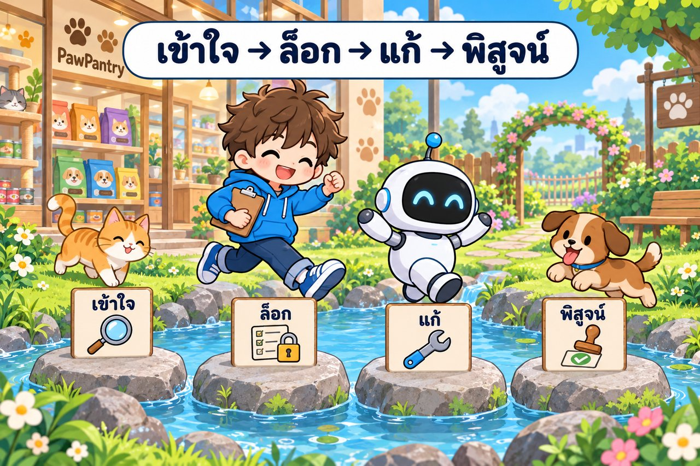

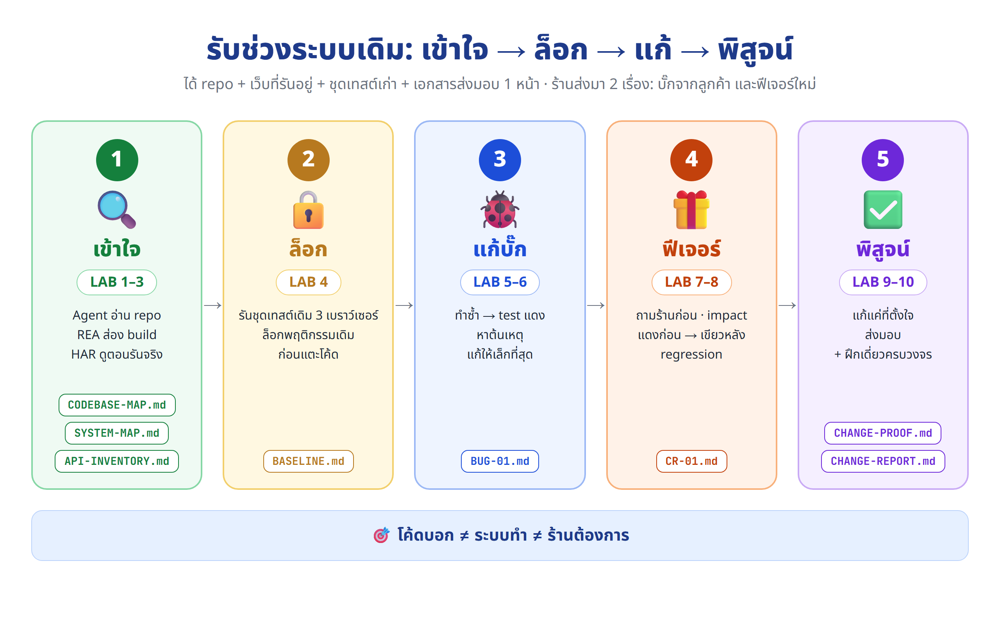

**เรื่องของบทนี้:** เราเป็น tester ที่รับช่วง PawPantry · ร้านส่งงานมา 2 เรื่อง: ลูกค้าแจ้งว่า **ยอดเงินไม่ตรง** และร้านอยากได้ **บริการห่อของขวัญ** · ก่อนแตะโค้ด ต้องรู้ว่าระบบทำอะไรอยู่

| ช่วง | ทำอะไร | LAB | ได้ไฟล์ |
|---|---|---|---|
| 🟢 ① เข้าใจ | อ่าน repo · ส่องของที่ build · ดูตอนรัน | 1–3 | `CODEBASE-MAP.md` · `SYSTEM-MAP.md` · `API-INVENTORY.md` |
| 🟡 ② ล็อก | รันชุดเทสต์เดิม · characterization test | 4 | `BASELINE.md` · `e2e-legacy/tests/new/` |
| 🔵 ③ แก้บั๊ก | ทำซ้ำ → เทสต์แดง → ต้นเหตุ → แก้ | 5–6 | `BUG-01.md` |
| 🟠 ④ ฟีเจอร์ | ถามร้าน → impact → เทสต์แดง → ทำ → regression | 7–8 | `CR-01.md` |
| 🟣 ⑤ พิสูจน์ | เทียบเวอร์ชัน · ส่งมอบ · ฝึกเดี่ยว | 9–10 | `CHANGE-PROOF.md` · `CHANGE-REPORT.md` |

ประโยคหลัก: **"โค้ดบอก ≠ ระบบทำ ≠ ร้านต้องการ"** · โค้ดบอกเจตนาคนเขียน · ระบบที่รันคือสิ่งที่ลูกค้าเจอ · ร้านคือคนเดียวที่บอกได้ว่าอะไร "ถูก" · tester เทียบ 3 อย่างนี้

---

## 📦 บทนี้ต่างจากบท 02 03 และ 04 อย่างไร

| | บท 02 | บท 03 | บท 04 | **บท 05 (บทนี้)** |
|---|---|---|---|---|
| ตอนเริ่มมี | เว็บ + SPEC + TEST-PLAN | เว็บ + TEST-DATA | บันทึกสัมภาษณ์ | **repo ทีมเก่า + ชุดเทสต์เก่า + เอกสารส่งมอบ + TEST-DATA** |
| เว็บมาจาก | ให้มา | ให้มา | Claude สร้างใหม่ | **ระบบเดิม เปิดเองด้วย Docker พอร์ต 4000** |
| อ่านโค้ดไหม | ไม่ต้อง | ห้าม | ห้าม | **อ่านได้ + REA ส่องของที่ build (3 ตา)** |
| ผลที่คาดหวังมาจาก | SPEC.md | [D] [R] [O] | [D] [R] [A] [O] | **[D] [R] [E] [O]** (เพิ่ม [E] หลักฐานจากระบบ · [A] คำอ้างของทีมเก่า/AI ใช้ชี้เป้าเท่านั้น) |
| ชุดเทสต์ | รันแผนที่มี | เขียนแผนเอง | แผน + Playwright ใหม่ | **รับชุดเดิม 40 เทสต์ → ล็อก + เพิ่มใน `tests/new/`** |
| บั๊ก | BUG_MODE บอกล่วงหน้า | BUG_MODE 3 ตัว ไม่บอก | Claude เลือกเอง 3 ตัว | **ไม่มีสวิตช์ · บั๊กจริง 2 ตัวจากข้อความลูกค้า (BUG-01 · PR-1)** |
| แก้ repo | ไม่ | ไม่ | สร้างใหม่ทั้งหมด | **แก้ระบบเดิม 6 จาก 10 LAB (✏️ · ไม่นับ LAB 0 เช็กเครื่อง)** |
| ทักษะ | อ่านแผน รันเทสต์ | สำรวจ เขียนแผน | ครบวงจรสร้างใหม่ | **รับช่วงระบบ (ปูทางบท 06)** |
| กติกาพิเศษ | · | ห้ามเปิดโค้ด | 2 compose project | **ห้ามแก้เทสต์เดิม · REA รันใน Docker** |

> งานจริงส่วนใหญ่ (โดยเฉพาะภาครัฐ) **ไม่ได้เริ่มจากศูนย์** · ที่ยากที่สุดสำหรับ AI คือ **ได้ context ที่ถูก** บทนี้สอนให้ "ป้อนหลักฐาน" แทนปล่อยให้ Agent เดา

---

## 🎓 พื้นฐาน: ดูรูปก่อนลงมือ

ทุกหัวข้อมี **รูป → ตารางสั้น → กับดัก** และบอกว่าใช้ใน LAB ไหน
**อ่านก่อน LAB 0:** ข้อ 1 3 4 5 11 15 16 18 (~25 นาที) · ข้ออื่นอ่านเมื่อ 🗺️ ใน LAB ลิงก์มา

| กลุ่ม | หัวข้อ |
|---|---|
| 🔎 ย้อนรอยระบบ | [1) RE คืออะไร](#1-reverse-engineering-คืออะไร-chikofsky--cross-1990) · [2) static vs dynamic](#2-4-ช่องทางรู้จักระบบ-static-vs-dynamic) · [3) 3 ตา](#3-3-ตา-black--white--grey-box) · [4) ใช้ REA เมื่อไร](#4-ใช้-rea-เมื่อไร-เมื่อไรอ่าน-repo-เฉย-ๆ) |
| 🧾 อ่านหลักฐานของ REA | [5) Evidence](#5-evidence-ไม่ใช่ความเห็น--authority-4-ถัง--หาไม่เจอ--ไม่มี) · [6) ลายนิ้วมือไฟล์](#6-ลายนิ้วมือของไฟล์-content-digest--sha-256) · [7) เทียบเวอร์ชัน](#7-เทียบเวอร์ชัน--หลักฐานว่าแก้ตรงไหน) · [8) แผนที่แอป](#8-แผนที่แอป-application-graph--ตามรอยฟีเจอร์-feature-trace) · [9) 3 วิธีดูตอนรัน](#9-3-วิธีดูเว็บที่รันอยู่-passive--driven--har) |
| 🏷️ จากหลักฐานสู่เทสต์ | [10) obligation](#10-obligation-ของใหม่ต้องทำได้เท่าของเดิม) · [11) ป้าย [E]](#11-ป้ายใหม่-e-หลักฐานจากระบบ) |
| ⚖️ ขอบเขต | [12) จริยธรรม](#12-จริยธรรม-ส่องได้เฉพาะระบบที่ได้รับอนุญาต) · [13) สิ่งที่ REA บอกไม่ได้](#13-สิ่งที่-rea-บอกไม่ได้) · [14) REA ทำงานยังไง](#14-rea-ทำงานยังไง-mcp--cli--skill) |
| 🔧 แก้ระบบเดิมอย่างปลอดภัย | [15) characterization](#15-characterization-test-ล็อกสิ่งที่ระบบทำอยู่) · [16) ตาข่ายนิรภัย](#16-ชุดเทสต์เดิม--ตาข่ายนิรภัยที่มีรู) · [17) impact](#17-impact-analysis-แก้ตรงนี้กระทบอะไร) · [18) แดง → เขียว](#18-แดงก่อน--เขียวหลัง-วงจรแก้อย่างปลอดภัย) |

### 1) Reverse engineering คืออะไร (Chikofsky & Cross 1990)

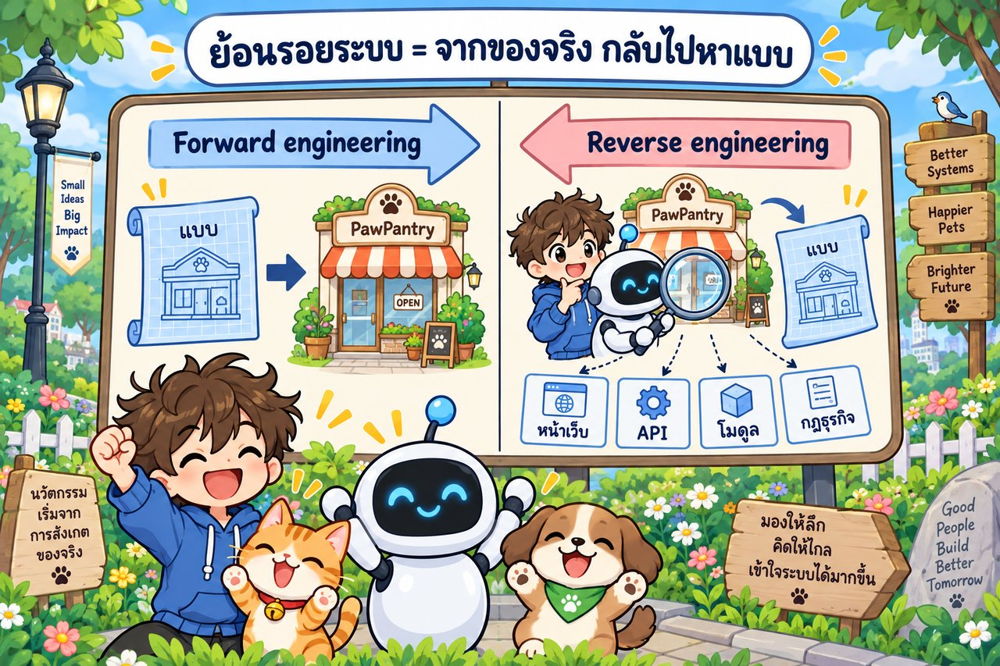

ระบบมีชั้น ความต้องการ → การออกแบบ → โค้ด · การเดินระหว่างชั้นมี 6 ชื่อ

| คำ | ทิศ · เปลี่ยนระบบไหม | ตัวอย่าง PawPantry | ใช้ใน |
|---|---|---|---|
| **Forward engineering** | บน → ล่าง · ✅ สร้างใหม่ | สัมภาษณ์ → Claude สร้างเว็บ | บท 04 |
| **Reverse engineering** | ล่าง → บน · ❌ ดูอย่างเดียว | อ่าน bundle `.next/static` เจอ `/api/products` | LAB 1–3 |
| **Redocumentation** | ชั้นเดียวกัน · ❌ | ตาราง "หน้าไหนเรียก API ไหน" | LAB 1 (`CODEBASE-MAP.md`) |
| **Design recovery** | ล่าง → บน (ลึกกว่า) · ❌ | "ตะกร้าเก็บในเบราว์เซอร์ คูปองตรวจที่ server" | LAB 1–2 |
| **Restructuring** | ชั้นเดียวกัน · ✅ ข้างใน (ภายนอกเท่าเดิม) | แยก `lib/pricing.ts` ยอดเงินเท่าเดิม | LAB 9 (คอลัมน์ "ชนิดงาน") |
| **Re-engineering** | ขึ้น แล้วลง · ✅ | เข้าใจก่อน แล้วแก้บั๊ก/เพิ่มฟีเจอร์ | LAB 5–10 |

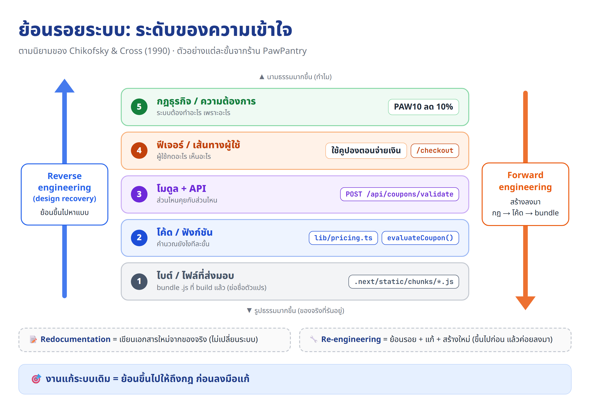

ขั้น 1–2 (ไบต์ → โค้ด) ใช้ hash + static analysis · ขั้น 3–4 (โมดูล → ฟีเจอร์) ใช้ REA graph + trace + ดูตอนรัน · ขั้น 5 กฎธุรกิจ (ระบบ **ควร** ทำอะไร) **ร้าน [D] เท่านั้น** · Feathers: **legacy code = code without tests** คือ "แก้แล้วไม่รู้ว่าพังไหม"

> **RE = ดู ไม่ใช่แก้** · การแก้คือ re-engineering ซึ่งต้องมี RE ก่อน · ยิ่งขึ้นสูง ยิ่งอนุมานมาก · ขั้นบนสุดต้องถามร้าน อย่าให้ AI เดากฎ

### 2) 4 ช่องทางรู้จักระบบ: static vs dynamic

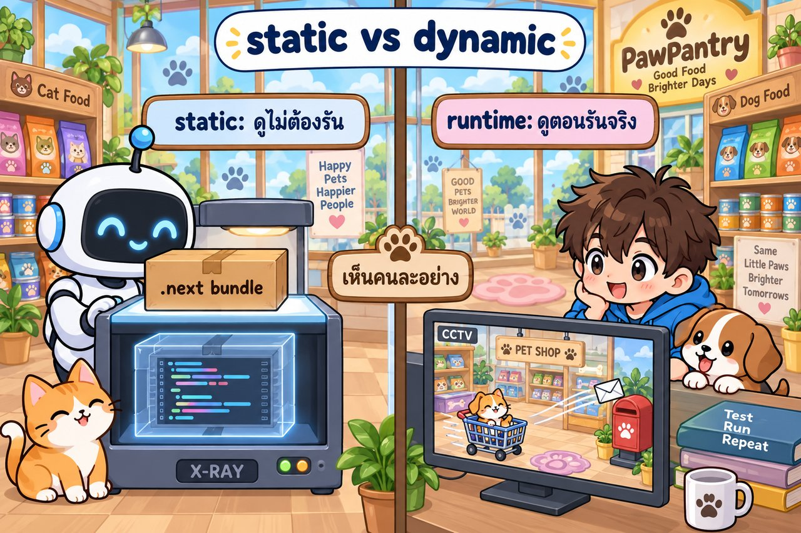

| ช่องทาง | 📗 พิสูจน์ได้ | 📕 พิสูจน์ไม่ได้ | 🧰 ในบทนี้ |
|---|---|---|---|
| **อ่าน source** | เจตนาคนเขียน | ตรงกับที่ deploy · คอมเมนต์ยังจริง | Claude อ่าน repo (LAB 1) |
| **Static analysis** ของที่ build | มีคำสั่งนี้ใน bytes จริง | ถูกเรียกไหม · ค่าที่ประกอบตอนรัน | `analyze-javascript-application` (LAB 2) |
| **Runtime observation** | **เกิดจริง** ในรอบที่ดู | เกิดทุกครั้ง · ทางที่ไม่ได้กด | `capture-browser-scenario` (LAB 3) |
| **Network capture (HAR)** | ข้อมูลที่วิ่งผ่านสายจริง | ตรรกะใน server | `record-har.mjs` + `inspect-web-network-capture` (LAB 3) |

**กฎทอง (Dijkstra):** การสังเกตแสดงได้ว่ามี แต่พิสูจน์ว่าไม่มีไม่ได้ → coverage `partial` เป็นเรื่องปกติ (Rice's theorem ยืนยันฝั่ง static)

> **static เจอ ≠ เกิดขึ้นจริง** · `fetch("/api/orders")` ใน bundle = "มีโค้ดนี้" ไม่ใช่ "มีคนสั่งซื้อแล้ว" · ตรรกะ server (API route) **ไม่อยู่ใน bundle ของเบราว์เซอร์** bundle เท่าเดิมจึงไม่ได้แปลว่าพฤติกรรมเท่าเดิม

### 3) 3 ตา: black / white / grey-box

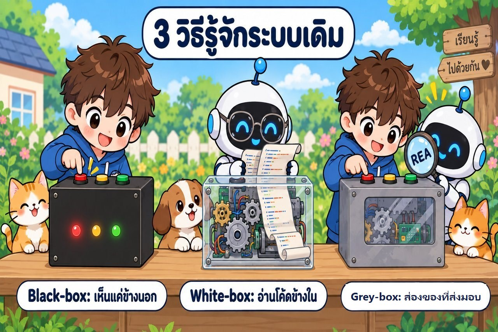

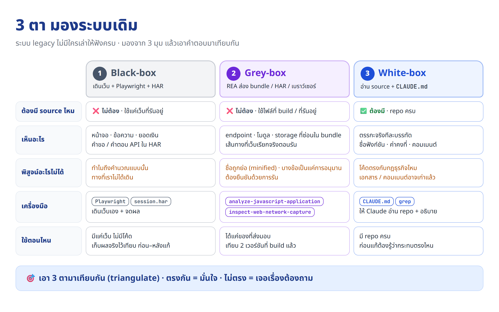

| ตา | ข้อดี | ข้อเสีย | ในบทนี้ |
|---|---|---|---|
| ⬛ **Black-box** | มองแบบลูกค้า | ไม่รู้ทางซ่อน | LAB 5 ขั้นแรก: ทำซ้ำอาการก่อนเปิดโค้ด |
| 🔲 **Grey-box** | รู้โครงพอวางแผน | ต้องแยก "เห็น" กับ "เดา" | LAB 2–3: REA ส่อง build และเว็บที่รัน |
| ⬜ **White-box** | ไล่ได้ทุกบรรทัด | เชื่อโค้ดจนลืมดูของจริง | LAB 1 อ่าน repo · LAB 5 หาต้นเหตุ |

**Triangulation** = 2 ตาขึ้นไปยืนยันเรื่องเดียว · เช่น 🔲 trace: chunk เรียก `/api/orders` · ⬜ `components/CheckoutForm.tsx` มี `fetch("/api/orders", …)` · ⬛ HAR: `POST /api/orders` ได้ `201`

> **อย่าใช้ตาเดียว** · ตาขาวเชื่อคอมเมนต์ที่อาจเก่า · ตาดำไม่รู้ว่าแก้ที่ไหน · ทุกแถวใน `CODEBASE-MAP.md` และ `SYSTEM-MAP.md` ต้องบอกว่า **ยืนยันด้วยตาไหน**

### 4) ใช้ REA เมื่อไร เมื่อไรอ่าน repo เฉย ๆ


skill ของ REA เขียนเองว่า **"Skip REA for ordinary source-repository architecture analysis."**

| มีอะไรในมือ | ใช้อะไร | ได้อะไร |
|---|---|---|
| แค่ URL เว็บที่รันอยู่ | Playwright + HAR → `inspect-web-network-capture` · `capture-browser-scenario` | API ที่เรียกจริง · payload |
| แค่ไฟล์ build (`.next/`) | `analyze-javascript-application` → `trace-application-feature` | module ↔ endpoint ↔ storage |
| source แต่ **ไม่แน่ใจว่าตรงกับที่ deploy** | `import-reference-source` + `compare-source-to-bundle` | ไฟล์ไหนตรง ไฟล์ไหนต่าง |
| source ครบ เชื่อได้ | Claude อ่าน repo · **ไม่ต้องใช้ REA** | ไฟล์:บรรทัด ที่ต้องแก้ |

บทนี้มี source ครบ แต่ใช้ REA เพราะต้องรู้ว่า **build ที่รันอยู่** ตรงกับ repo ไหม และตอนส่งมอบต้องพิสูจน์ว่า build ใหม่เปลี่ยนแค่ที่ตั้งใจ

> **REA ไม่ได้แทนการอ่านโค้ด** · "คิดเงินยังไง" → อ่าน repo · "ของที่ลูกค้าใช้ทำอะไรจริง / build ตรงกับ source ไหม" → REA

### 5) Evidence ไม่ใช่ความเห็น · authority 4 ถัง · หาไม่เจอ ≠ ไม่มี


![หัวเรื่อง Evidence ไม่ใช่ความเห็น · 4 ถัง (รันจริงบน PawPantry) · static /api/orders ใน bundle · runtime key pp-cart pp-coupon pp-recent · inference electron-renderer → [E?] · unknown endpoint a b c ไม่เจอ /api/recommendations · แถบล่าง หาไม่เจอ ≠ ไม่มี](img/evidence-4-buckets.png)

REA ตอบเป็น **Evidence record** ที่ตรวจย้อนได้ · `authority` จริงละเอียดกว่านี้ บทนี้ **รวบเป็น 4 ถัง**:

| ถัง | authority จริงใน REA (ตัวอย่าง) | ตัวอย่าง | ใช้เป็นผลที่คาดหวังได้ไหม |
|---|---|---|---|
| 🔵 **static** เห็นใน bytes | `artifact-bytes` · `ast-static-analysis` | `/api/products` (`call:fetch`) ใน chunk | ✅ ว่า "มีโค้ดนี้" · ❌ ว่า "ถูกเรียก" |
| 🟢 **runtime** เห็นตอนรัน | `controlled-replay` · `passive-cdp-runtime` | `POST /api/coupons/validate` ใน HAR | ✅ เฉพาะรอบนั้น |
| 🟡 **inference** อนุมาน | `static-relationship-inference` · `cross-version-comparison` | ป้าย `electron-renderer` (เว็บนี้ไม่ใช่ Electron) | ❌ ชี้เป้าเท่านั้น |
| ⚪ **unknown** ไม่รู้ + เหตุผล | `unknown` | storage `name: null` · endpoint `a` `b` `c` | ❌ หาหลักฐานเพิ่ม |

ช่องใน Evidence: `subject` + `digest` (SHA-256) · `provider` · `authority` · `confidence` · `limitations` · `coverage` (`complete` / `partial` / `unknown`) · `locations` · `evidence_id` (AI ต้องอ้าง ID ไม่ใช่ความจำ)

**3 คำถามที่ต้องถามทุกหลักฐาน:** ① มาจาก bytes หรือการรันไหน (digest) ② เห็นจริงหรืออนุมาน (authority) ③ ตรวจครบไหม (coverage)

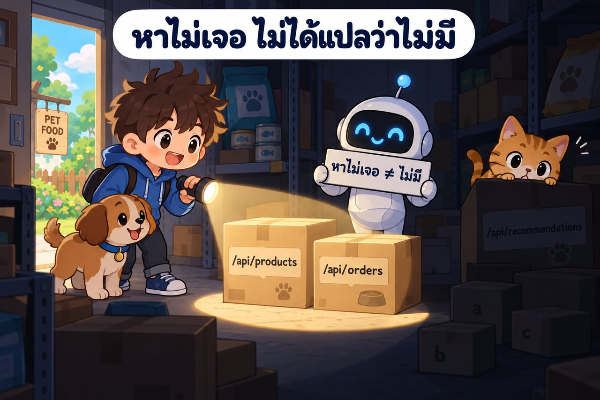

static เห็น endpoint `a` `b` `c` = ชื่อถูก minify (**อย่ารายงานเป็น endpoint จริง**) · **ไม่เจอ** `/api/recommendations` เพราะต่อ URL ตอนรัน **ไม่ใช่เพราะไม่มี** · storage `name: null` = key ส่งผ่านตัวแปร ต้องดูตอนรัน (LAB 3)

> **หาไม่เจอ ≠ ไม่มี** · REA เขียนเองว่า *"unavailable facts remain explicit and must not be read as absence"* · coverage `partial` → ห้ามสรุป "ไม่มี X" ห้ามเขียนเทสต์ "ต้องไม่มี X" · เขียน **"ยังไม่พบ (coverage partial)"**

### 6) ลายนิ้วมือของไฟล์ (content digest · SHA-256)


SHA-256 = ลายนิ้วมือของไฟล์ · ต่างแม้ 1 bit → hash ต่างสิ้นเชิง · REA ผูกทุกผลกับ hash

| hash บอก | hash ไม่บอก | ใช้ในบทนี้ |
|---|---|---|
| เท่ากัน = **bytes เดียวกัน** | ว่า **ถูกต้อง** (ไฟล์มีบั๊กก็มี hash) | LAB 2 จด digest ของ build เดิม (v1) |
| ต่าง = เนื้อหาเปลี่ยน → เทสต์ซ้ำ | เปลี่ยน **ตรงไหน / ทำไม** | LAB 9 เทียบ hash source เดิม ↔ ปัจจุบัน |
| `next build` ใหม่ = digest ใหม่ | path เดียวกัน ≠ เนื้อหาเดียวกัน | หลักฐานเก่าใช้กับ build ใหม่ไม่ได้ |

> **path เดียวกัน ≠ ไฟล์เดียวกัน** · REA ยึด digest ก่อนชื่อ (*"A path never overrides a digest disagreement"*) · รายงานต้องบอกด้วย digest ว่าทดสอบ **build ไหน**

### 7) เทียบเวอร์ชัน = หลักฐานว่าแก้ตรงไหน

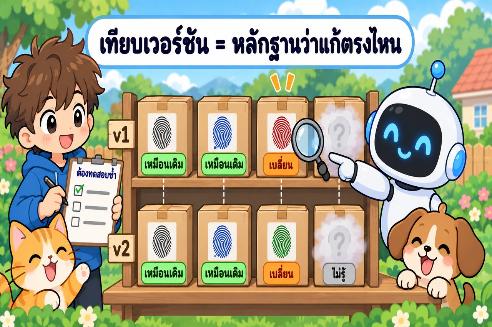

| คำสั่ง | เทียบ | ผลที่ได้ | อ่านยังไง |
|---|---|---|---|
| `compare-application-versions` | build v1 ↔ v2 | `unchanged` `added` `removed` `changed` `unknown` | ชื่อ chunk เปลี่ยนทุก build → ส่วนใหญ่ `unknown` · ดูข้อจำกัดเท่านั้น |
| `compare-source-to-bundle` ⭐ | source ↔ bundle ฝั่ง server (จับคู่ด้วย digest) | `unchanged` `modified` `removed` `split` `merged` `duplicated` `unknown` | ทำ **4 ทิศ** (source เดิม/ใหม่ × build เดิม/ใหม่) ดูไฟล์ที่ผลต่างกัน |

อ่านผล: `unchanged` = digest ตรงทุก byte (ลดลำดับ regression ได้) · `unknown` ที่ไฟล์ที่เราแก้ = หา digest ไม่เจอ สอดคล้องกับ "ถูกแก้" (เทียบ SHA-256 ของ source ประกอบ ไม่ใช่ไฟล์หาย) · `unknown` ที่ไฟล์ที่ **ไม่ได้** แก้ = ต้องอธิบายได้ทุกแถว

> **อย่ารอคำว่า `modified`** · รอบที่ผู้สร้างบทรัน ไฟล์ที่แก้ออกเป็น `unknown` · `added`/`removed` ขึ้นได้เมื่ออีกฝั่ง coverage `complete` เท่านั้น (หาไม่เจอ ≠ ไม่มี)

### 8) แผนที่แอป (application graph) + ตามรอยฟีเจอร์ (feature trace)

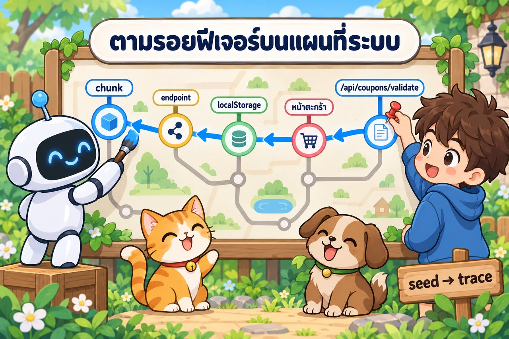

แผนที่ = **node** (`javascript-module` · `endpoint` · `storage`) + **edge** มีทิศ (`contains` · `calls` · `persists_to`) + **provenance** (หลักฐานของทุกชิ้น)
`trace-application-feature` เริ่มจาก **seed** (บทนี้ใช้ชนิด `string` เช่น `coupons/validate`) แล้วเดินตามเส้น · `incoming` ⭐ "ใครเรียกสิ่งนี้" (หาไฟล์ที่กระทบ) · `outgoing` "เรียกอะไรต่อ" · `both` แอปเล็กได้แทบทั้งกราฟ

> **ทุก node ที่เดินถึง ≠ ส่วนของฟีเจอร์** · trace เดินผ่าน `contains` จึงลามไปโมดูลข้างเคียง · ใช้เป็น "รายชื่อผู้ต้องสงสัย" แล้วยืนยันด้วยการค้นโค้ด/รัน · seed `api` คือ API ของ Electron ไม่ใช่ HTTP · `route`/`api` กับ `/api/coupons/validate` ได้ **no-match** จึงใช้ `string`

### 9) 3 วิธีดูเว็บที่รันอยู่: passive · driven · HAR

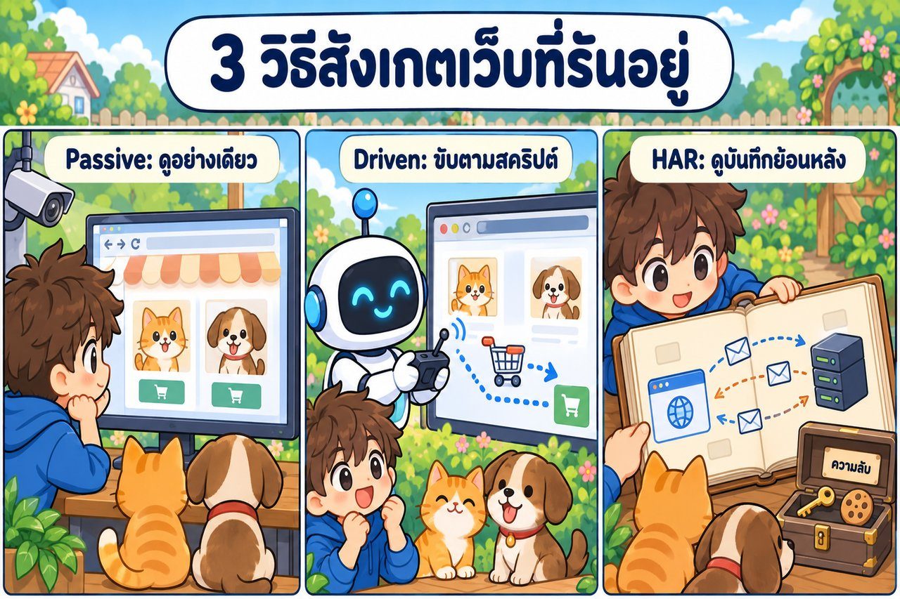

| โหมด | ทำอะไรกับเว็บ | ได้หลักฐาน | ในบทนี้ |
|---|---|---|---|
| **Passive** (attach ผ่าน CDP) | คนคุม REA แค่ดู | DOM · script · network | ไม่ใช้ (ต้องเปิดพอร์ต debug) |
| **Driven** (`capture-browser-scenario`) | REA ขับ Playwright ตาม JSON → **มีผลข้างเคียง** | หน้าจอ · accessibility tree · storage ทีละขั้น | LAB 3 (`rea/scenario-coupon.json`) |
| **HAR** (`inspect-web-network-capture`) | อ่านไฟล์ offline **ไม่ยิงซ้ำ** | คำขอ/คำตอบ ณ เวลาที่บันทึก | LAB 3 (`rea/record-har.mjs`) |

> **HAR = ความลับเต็มไฟล์** · แบบ `full` มีรหัสผ่านและ cookie ตัวอักษรธรรมดา · ปิดด้วย `--sensitive-value` · ห้ามส่งต่อ ห้าม commit (`.gitignore` กัน `*.har` แล้ว) · driven เปลี่ยนข้อมูลร้านจริง (สต็อกลด) ต้อง reset ก่อนเทียบผล

### 10) Obligation: ของใหม่ต้องทำได้เท่าของเดิม

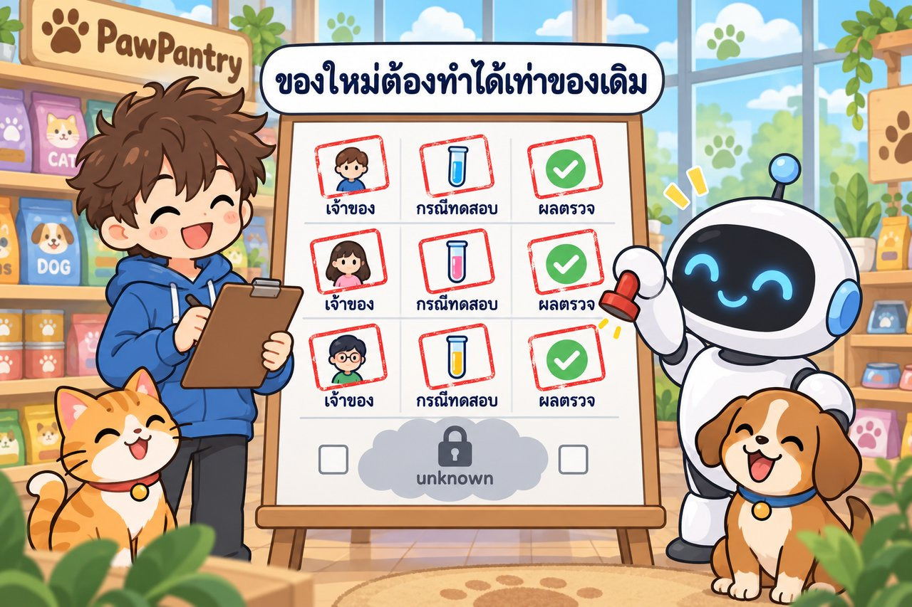

**reconstruction obligation** ของ REA = พันธะที่ระบบที่แก้แล้ว **ต้องยังทำได้** · ตัวอย่างสมมติ: คูปอง PAW10

| ช่องของ obligation | เทียบงานทดสอบ | PAW10 |
|---|---|---|
| ของเดิมที่ต้องรักษา | requirement ที่กู้มา | "ใส่ PAW10 แล้วได้ส่วนลด" |
| `positive` `negative` `malformed` | ออกแบบ TC ปกติ / ผิด / เพี้ยน | โค้ดถูก · ไม่มีจริง · ว่าง/มีช่องว่าง |
| original authority | แหล่ง oracle | HAR ของ `/api/coupons/validate` |
| verifier + ผล | เทสต์ที่รันได้ | Playwright E2E ผ่าน 3 เบราว์เซอร์ |

กฎ **fail-closed**: `fail` `unknown` `skipped` **ไม่มีวันรวมเป็น "ผ่าน"** (แถวเมฆในภาพ)

> **ปิดพันธะด้วยหลักฐานผิดชนิดไม่ได้** · static "มี endpoint นี้" ปิด obligation ของพฤติกรรมไม่ได้ ต้องมีผลจากการรัน · LAB 9 ทำ **obligation ledger**

### 11) ป้ายใหม่ [E] หลักฐานจากระบบ

![หัวเรื่อง ป้ายใหม่ [E] หลักฐานจากระบบ · ป้าย [D] ร้าน · [R] กฎทั่วไป · [E] หลักฐานระบบ · [A] AI (= คำอ้างของ AI/ทีมเก่า) · [O] หน้าจอ · ตาชั่ง ควรทำ [D] / ทำอยู่ [E] · ป้าย ผลที่คาดหวัง](img/concept-12-evidence-badge-e.jpg)

![หัวเรื่อง ผลที่คาดหวังมาจากไหน? · ต่อจากบท 04 · บทนี้อ่านระบบได้ จึงมีหลักฐานจากระบบ [E] เพิ่ม · [A] คำอ้างของ AI หรือทีมเก่า ใช้ชี้เป้าเท่านั้น · ทุกผลที่คาดหวังต้องติดป้ายที่มา · ควรทำ [D] [R] · ทำอยู่ [E] [O] · แถบล่าง [E] ขัด [D] = ผู้ต้องสงสัยบั๊ก [D] ชนะ](img/oracle-badges-e.png)

**[E]** = หลักฐานที่เครื่องมือบันทึกจากระบบที่ส่งมอบ/รันอยู่ อ้างกลับได้ (evidence_id · digest · ไฟล์ HAR) · **[A]** = คำอ้างของทีมเก่า/AI (ใช้ชี้เป้าเท่านั้น)

| ป้าย | มาจาก | ระบบ **ควร** ทำ | ระบบ **ทำ** อยู่ |
|---|---|---|---|
| **[D]** ร้าน | เจ้าของร้าน · `TEST-DATA.md` | ✅ สูงสุด | · |
| **[R]** กฎทั่วไป | คณิตศาสตร์ สามัญสำนึก | 🟡 ดี (เขียนเหตุผล) | · |
| **[E]** หลักฐานระบบ 🆕 | REA Evidence · HAR · scenario | 🔵 **ต่ำ** (ระบบอาจผิดอยู่แล้ว) | 🔵 **สูง** (ตรวจซ้ำได้) |
| **[A]** คำอ้าง | AI · คอมเมนต์/เอกสารทีมเก่า | 🟠 ต่ำ | 🟠 ต่ำ · **ไม่ใช้เป็นผลที่คาดหวัง** ยืนยันด้วย [E] หรือถาม [D] |
| **[O]** หน้าจอ | สิ่งที่คนเห็นตอนสำรวจ | 🔴 ต่ำสุด | 🟠 ปานกลาง (ตรวจซ้ำไม่ได้) |

| กติกา [E] | ทำยังไง |
|---|---|
| อ้างที่มาเสมอ | `[E ev_ca3bd308]` (8 ตัวแรกของ evidence_id) หรือชื่อไฟล์ HAR · build เปลี่ยน → เก็บใหม่ |
| ใช้ล็อก ไม่ใช่ตัดสิน | ใช้กับ characterization / regression · TC กฎธุรกิจต้องมี [D] หรือ [R] · มีแค่ [E] → `[E-ยังไม่ยืนยัน]` แล้วถามร้าน |
| [E] ขัด [D] | **ผู้ต้องสงสัยบั๊ก** ไม่ใช่เทสต์พัง → [D] ชนะ · บันทึก defect แล้วถามร้าน |
| `inferred` | เขียน `[E?]` ชี้เป้าได้ เป็นผลที่คาดหวังไม่ได้ |

> **[E] บอกว่าระบบ *ทำ* ไม่ได้บอกว่า *ควร*** · ลอกค่าจากระบบเป็นผลที่คาดหวังโดยไม่เทียบ [D] = **อบบั๊ก** แบบบท 04 · ตัวเลขเงินคำนวณจาก [D] + [R] ก่อนเสมอ

### 12) จริยธรรม: ส่องได้เฉพาะระบบที่ได้รับอนุญาต


| หลัก | ในทางปฏิบัติ |
|---|---|
| **ส่องเฉพาะระบบของเรา หรือได้รับอนุญาตเป็นลายลักษณ์อักษร** | ในคลาส = PawPantry บนเครื่องตัวเอง · MIT ของ REA **ไม่ได้** อนุญาตให้ส่องของคนอื่น · EULA หลายตัวห้าม RE |
| **กฎหมายไทย (ภาพรวม ไม่ใช่คำแนะนำทางกฎหมาย)** | พ.ร.บ.คอมพิวเตอร์ (2550 แก้ไข 2560): เข้าถึงระบบที่มีมาตรการป้องกันโดยไม่ได้รับอนุญาต = ความผิด · ข้อมูลส่วนบุคคลใน HAR อยู่ใต้ PDPA |
| **ไม่ดึงหรือพิมพ์ความลับ** | รหัสผ่าน token cookie ไม่ลงรายงาน ไม่ส่งให้ AI · secret ใน bundle = **ข้อบกพร่องด้านความปลอดภัย** |
| **ผลถูกส่งออกนอกเครื่อง** | ผลที่ Agent อ่านถูกส่งให้ model · ข้อมูลลับต้องตรวจนโยบายก่อน |

> **ได้เครื่องมือ ≠ ได้สิทธิ์** · REA ปลอดภัยโดยปริยาย (ในเครื่อง · ตัด credential · HAR ไม่ยิงซ้ำ) แต่ **การขออนุญาตเป็นหน้าที่ของเรา** · บทนี้ใช้ Playwright headless โปรไฟล์แยก ไม่แตะ cookie ของเรา

### 13) สิ่งที่ REA บอกไม่ได้


| REA บอกไม่ได้ | ทางแก้ |
|---|---|
| **เจตนาธุรกิจ · ถูกหรือผิด** (ระบบผิด REA ก็บันทึกความผิดนั้น) | ถามร้าน → [D] · [E] ใช้ล็อก ไม่ใช่ตัดสิน |
| **ตรรกะ server** (ไม่อยู่ใน `.next/static`) | ทดสอบผ่าน API/HAR หรืออ่าน source |
| **ทางที่ไม่ได้กด** | ออกแบบ scenario ให้ครอบคลุม |
| **ชื่อที่ถูกย่อ / ค่าที่ประกอบตอนรัน** | runtime/HAR หรือ source map |
| **ทำงานบน Windows ตรง ๆ** (REA ทดสอบบน Linux) | Docker image `rea-lab:6.4.0` ของคอร์ส |
| **ผลเล็กพอให้ AI อ่าน** (Evidence หลายสิบ MB) | เซฟลง `out/` แล้วย่อด้วย `node rea\rea-summarize.mjs` · ห้ามให้ AI เปิดไฟล์ดิบ |

> **REA ตอบได้แค่ส่วนที่ไฟฉายส่องถึง** · server และ "ร้านอยากได้อะไร" ต้องใช้วิธีอื่น · REA เป็นหนึ่งในสามตา ไม่ใช่คำตอบสุดท้าย

### 14) REA ทำงานยังไง (MCP · CLI · skill)


REA (Reverse Engineer Anything · npm `rea-agents` 6.4.0 · MIT) = เครื่องผลิตหลักฐาน

| ชิ้น | หน้าที่ | ในบทนี้ |
|---|---|---|
| **CLI** `rea <คำสั่ง> --json` | สั่งจากเทอร์มินัล ผลเป็น JSON | ทางหลัก ผ่าน `rea\rea.ps1 -Out out\x.json <คำสั่ง>` |
| **MCP server** | Agent เรียกเครื่องมือเองระหว่างคุย | ทางเลือกใน 🔁 รันซ้ำ |
| **skill** `reverse-engineer-anything` | คู่มือ Agent: เลือกเครื่องมือ · summary ก่อน · แยก observed / inferred / unknown | หลักคิด (ข้อ 4) |
| **image `rea-lab:6.4.0`** | REA + Chromium ใน container Linux | build ครั้งเดียวก่อนเข้าคลาส (🧰) |

เว็บเดียวกัน 2 ที่อยู่: เรา/Playwright `http://localhost:4000` · REA ใน container `http://petshop:3000` (รายละเอียดใน 🧰)

> **Agent ถาม → REA ตอบเป็นหลักฐาน → Agent คิดต่อ** · ข้อสรุปที่อ้าง evidence_id ไม่ได้ยังเป็น "ความเห็น" · ถามกลับเสมอว่า "มาจากหลักฐานไหน"

---

### 🔧 แก้ระบบเดิมอย่างปลอดภัย

หลักของงาน "รับช่วงแล้วแก้" ตั้งแต่ LAB 4: **อ่านก่อน → ล็อกพฤติกรรมเดิม → แก้ให้เล็กที่สุด → พิสูจน์ว่าอย่างอื่นไม่พัง**

### 15) Characterization test: ล็อกสิ่งที่ระบบทำอยู่

![หัวเรื่อง Characterization test · ถ่ายรูปชั้นที่เอียงปักป้าย พฤติกรรมเดิม · เต่าทองซ่อนบนชั้น · [D] ร้าน · ล็อก ≠ ถูก](img/concept-15-characterization-lock.jpg)

Feathers: ก่อนแก้ระบบที่ไม่มีเทสต์ ให้ **เขียนเทสต์บันทึกสิ่งที่ระบบทำอยู่ตอนนี้** (ไม่ใช่สิ่งที่ควร) รวมจุดแปลก · แก้แล้วแดง = พฤติกรรมเปลี่ยน · **golden master** = เก็บผลชุดใหญ่ไว้เทียบทั้งก้อน

| ล็อกด้วย | ล็อกอะไร | ระวัง |
|---|---|---|
| `toHaveText` ค่าเงิน | ตัวเลขที่ลูกค้าเห็น | เทียบ [D] ก่อนล็อก |
| `toMatchSnapshot` (API JSON) | ข้อมูลและรูปแบบคำตอบ | ตัดฟิลด์ที่เปลี่ยนเอง (เวลา id) |
| `toMatchAriaSnapshot` | heading ปุ่ม ลิงก์ | **ไม่ล็อกตัวเลข** (เขียนเป็น regex `\d+`) |
| `toHaveScreenshot` | layout | tolerance กลืนตัวเลขที่ต่างนิดเดียว · ผูกเบราว์เซอร์ × OS |

**[E] ขัด [D]** → **เทสต์คู่**: ข้อหนึ่งล็อกค่าปัจจุบัน (annotation `legacy-quirk`) · อีกข้อตาม [D] ใส่ `test.fail()` (annotation `KNOWN-ISSUE`) · วันที่มีคนแก้ ข้อนี้จะรายงาน *"Expected to fail, but passed."*

> **ล็อก ≠ ยอมรับว่าถูก** · characterization ที่ลอกค่าจากระบบที่มีบั๊กจะ "ผ่านตลอดไป" · ห้ามรัน `-u` (update snapshot) โดยไม่บอกเหตุผล · ค่าที่ขัด [D] จดเป็นผู้ต้องสงสัยใน `BASELINE.md`

### 16) ชุดเทสต์เดิม = ตาข่ายนิรภัยที่มีรู

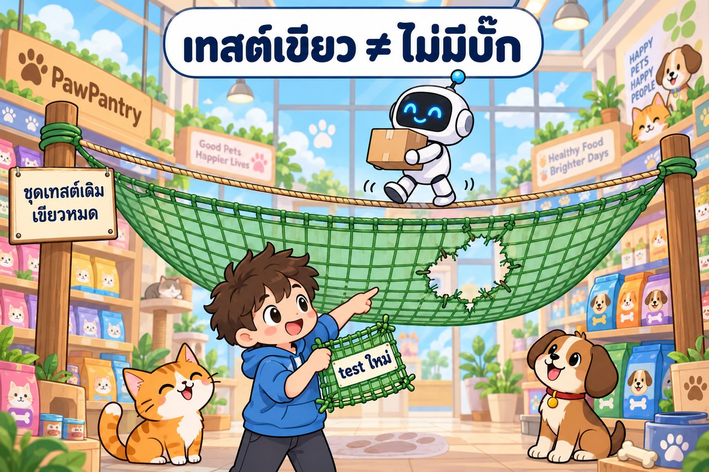

ทีมเก่าทิ้ง `e2e-legacy/` ไว้ 40 เทสต์ และบอกว่า "ผ่านครบทุกข้อก่อน deploy"

| เทสต์เขียวบอกว่า | **ไม่ได้** บอกว่า | ต้องถามเพิ่ม |
|---|---|---|
| ข้อที่ **เขียนไว้** ไม่ล้ม | ไม่มีบั๊ก | ข้อไหนไม่มีใครตรวจ |
| ค่าตรงกับที่คนเขียนคาด | คนเขียนคาดถูก | ผลที่คาดหวังมาจาก [D] หรือลอกหน้าจอ |
| ทางที่เดินผ่านไม่พัง | ค่าขอบ/ทางอื่นไม่พัง | ตรวจค่าขอบไหน · ตรวจถึงผลที่ระบบบันทึกไหม |

กติกา: **ไฟล์เทสต์เดิมห้ามแก้** (ล็อกด้วย `.claude/settings.json` ใน LAB 1) · ปะรูด้วยการ **เพิ่ม** ใน `e2e-legacy/tests/new/` · รัน 3 เบราว์เซอร์ `npm run test:all`

> **เทสต์เขียว ≠ ไม่มีบั๊ก** · รันชุดเดิมก่อนแตะโค้ดเสมอ ให้รู้ว่า "ก่อนแก้เขียวอยู่แล้ว" · แล้วหาช่องว่างของตาข่าย

### 17) Impact analysis: แก้ตรงนี้กระทบอะไร


ก่อนอนุมัติให้แก้ ต้องรู้ว่าแตะไฟล์ไหน ใครเรียก รันเทสต์อะไรซ้ำ · ตาราง impact นี้กลายเป็นรายการ "ตั้งใจแก้" ที่ LAB 9 เอาไปเทียบกับ hash และ bundle จริง

| วิธี | ได้อะไร | ระวัง |
|---|---|---|
| ค้นโค้ด (Grep ของ Claude · `git grep -n`) | ทุกจุดที่อ้างชื่อ/ค่า | ชื่อที่ประกอบตอนรัน (`"api/" + x`) ค้นไม่เจอ · เครื่องอาจไม่มี `rg` |
| ไล่ caller → callee (ขึ้น 2 ชั้น) | เส้นทางที่กระทบ + ไฟล์:บรรทัด | AI เดาจากชื่อไฟล์ → แนบผลค้นทุกแถว |
| REA trace `incoming` | chunk ที่เรียก endpoint | แค่ฝั่ง client · `partial` |
| `npx playwright test --list -g "<คำ>"` | เทสต์ที่เกี่ยว | ก่อนส่งมอบรันเต็มชุด |

ตาราง impact ที่ Agent ส่ง **ก่อนเขียน diff**: `ไฟล์ที่จะแตะ | เหตุผล (BUG/CR) | ใครเรียกใช้ (ผลค้น) | หน้าจอ/API ที่กระทบ | เทสต์ที่ต้องรันซ้ำ | ความเสี่ยง`

> **impact ต้องครอบทุกจุดที่คำนวณ *และแสดง* ผล** · กฎเดียวอาจถูกคิด/แสดงหลายที่ (หน้าเว็บ · API · หน้าสรุป) · ตรวจด้วยการค้นโค้ด · แยก **ต้นเหตุ** กับ **ปลายเหตุ** ก่อนแก้ (LAB 6)

### 18) แดงก่อน → เขียวหลัง: วงจรแก้อย่างปลอดภัย

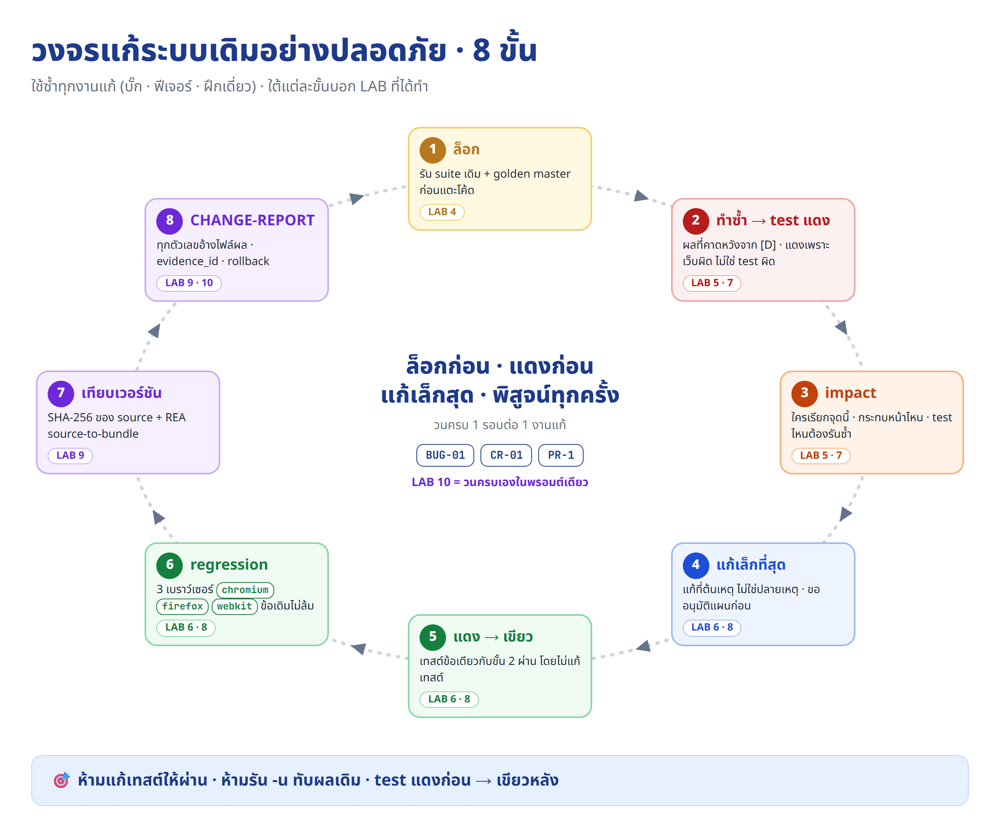

**Failing-test-first** = เขียนเทสต์ที่ **แดง** ตามอาการบั๊กหรือ AC ของ CR ก่อนแก้ แล้วต้องเห็นมัน **เปลี่ยนเป็นเขียว** · เทสต์ที่เขียวตั้งแต่ก่อนแก้ไม่ได้ตรวจสิ่งที่จะแก้

| ขั้น | ทำอะไร | หลักฐาน | LAB |
|---|---|---|---|
| ① ล็อก | ชุดเดิม + characterization | เขียวก่อนแตะโค้ด | 4 |
| ② ทำซ้ำ (แดง) | เทสต์ใหม่ตามอาการ/AC ผลที่คาดหวัง [D] | ล้มตรงอาการ | 5 · 7 |
| ③ impact | ตารางไฟล์ที่แตะ → เราอนุมัติ | ตาราง impact | 5 · 7 |
| ④ แก้เล็กที่สุด | เฉพาะไฟล์ในตาราง ที่ต้นเหตุ | ไฟล์ที่เปลี่ยน = ไฟล์ในตาราง | 6 · 8 |
| ⑤ เขียว | ข้อ ② ผ่าน โดยไม่แก้เทสต์ | แดง → เขียว | 6 · 8 |
| ⑥ regression | ชุดเดิม + ใหม่ 3 เบราว์เซอร์ | ข้อเดิมไม่ล้ม | 6 · 8 |
| ⑦ เทียบเวอร์ชัน | hash source + REA source-to-bundle | เปลี่ยนแค่ที่ตั้งใจ | 9 |
| ⑧ รายงาน | `CHANGE-REPORT.md` | ทุกตัวเลขอ้างไฟล์ผล + rollback | 9 |

> **ห้ามแก้เทสต์ให้ผ่าน** · regression แดงที่ข้อที่ไม่เกี่ยว → หยุดแล้วรายงาน แยกให้ได้ว่า **เว็บผิด / เทสต์เก่าล้าสมัย (ต้องมี BUG/CR อนุญาต) / เทสต์ใหม่เขียนผิด / ข้อมูลทดสอบหมด** · ห้ามรัน `-u` · ห้ามลบ `test.fail()` โดยไม่มีเลข BUG/CR

---

> **กับดักท้าย 🎓:** **เทสต์เขียว ≠ ไม่มีบั๊ก** · **หาไม่เจอ ≠ ไม่มี** · **ล็อกพฤติกรรมเดิม ≠ ยอมรับว่าถูก** · ตัวเลขเงินให้เทียบ [D] ก่อนล็อกเสมอ

### 🧠 ทบทวนก่อนลงมือ (10 ข้อ)

ตอบในใจหรือจดไว้ · เฉลยอยู่ที่ `_solution/QUIZ.md` (เปิดหลังจบบท)

| # | คำถาม |
|---|---|
| 1 | RE ต่างจาก re-engineering อย่างไร งานในบทนี้ LAB ไหนเป็นแบบไหน |
| 2 | REA เจอ `fetch("/api/orders")` ใน bundle พิสูจน์ว่าลูกค้ากดสั่งซื้อแล้วไหม |
| 3 | static ไม่เจอ `/api/recommendations` สรุปว่าอะไร |
| 4 | 3 คำถามที่ต้องถามทุกหลักฐาน |
| 5 | ไฟล์ path เดียวกันใน 2 build แต่ hash ต่าง / hash เท่ากัน แปลว่าอะไร |
| 6 | มี source ครบแล้วทำไม skill ของ REA บอกให้ข้าม · บทนี้ใช้ REA ตอนไหน |
| 7 | `inspect-web-network-capture` ยิง request ซ้ำไหม · HAR มีอะไรอันตราย |
| 8 | (สมมติ) characterization จับได้ว่าเว็บคิดค่าส่งด่วน ฿150 แต่ TEST-DATA [D] บอก ฿120 ควรล็อกค่าไหนเป็นผลที่คาดหวัง และทำอะไรต่อ |
| 9 | (สมมติ) แก้ไฟล์ A แล้ว build ใหม่ `compare-source-to-bundle` ของ source ใหม่กับ bundle เก่าขึ้น `unknown` ที่ไฟล์ A แปลว่าอะไร |
| 10 | ชุดเทสต์เดิมเขียวทุกข้อ แปลว่าระบบไม่มีบั๊กไหม ต้องตรวจอะไรเพิ่ม |

---

## 🧰 ก่อนเริ่ม ต้องมี

| ✅ | สิ่งที่ต้องมี | ตรวจยังไง |
|---|---|---|
| ☐ | Windows 10/11 + **Claude Code** เปิดใน **โฟลเดอร์นี้** (`05_rea-reverse-engineer-legacy-petshop`) | ชื่อโฟลเดอร์ขึ้นที่แถบด้านบน |
| ☐ | **Docker Desktop** เปิดอยู่ · **Node.js 20+** | `docker version` เห็น Client และ Server · `node -v` |
| ☐ | **git** และโฟลเดอร์บทมาจาก repo คอร์สที่ clone (ไม่ใช่ zip) | `git --version` · `git status` ในโฟลเดอร์บทไม่ error |
| ☐ | **image `rea-lab:6.4.0`** (build ก่อนเข้าคลาส ดูข้างล่าง) · ดิสก์เหลือพอ (image ~2.65 GB + ผล REA ใน `out\` ไฟล์ละหลายสิบ MB) | `docker image ls rea-lab` เห็น `6.4.0` |
| ☐ | พอร์ต **4000** ว่าง ไม่อยู่ในช่วงที่ Windows จอง · ปิดเว็บบท 06 ก่อน (ใช้ 4000 เหมือนกัน) | LAB 0 เช็กให้ · `docker ps` |
| ☐ | รู้ค่า **ExecutionPolicy** (ไม่ต้องเปลี่ยน) | `Get-ExecutionPolicy -List` · `MachinePolicy` `UserPolicy` ควรเป็น `Undefined` (ถ้าถูกล็อกให้แจ้งผู้ดูแลเครื่อง) · `RemoteSigned` / `Process = Bypass` ก็ปกติ |

**🔨 build image REA ก่อนเข้าคลาส** (ครั้งเดียว · รันเองใน PowerShell ไม่ใช่พรอมต์)

```powershell
cd <โฟลเดอร์บท 05>
docker build -t rea-lab:6.4.0 rea          # ครั้งเดียว · image ~2.65 GB · ใช้เวลานาน (ขึ้นกับเน็ต)
docker image ls rea-lab                     # ต้องเห็น 6.4.0
```

⏱️ เวลา build **ไม่ได้วัด** (รอบจริงมี image แล้ว) · ไม่ให้ Claude build เพราะนานเกิน timeout 2 นาทีของเครื่องมือ Agent แล้วจะสั่งซ้ำ

**⚠️ 3 เรื่องของ Windows ที่บทนี้แก้ไว้ให้แล้ว**

| เรื่อง | อาการถ้าไม่รู้ | บทนี้ทำยังไง |
|---|---|---|
| **พอร์ตที่ Windows จอง** (WinNAT/Hyper-V · เครื่องผู้สร้างบท `2970–3069` `3070–3169`) ไม่ขึ้นใน `docker ps` | `bind: An attempt was made to access a socket …` | ใช้ **4000** บนเครื่อง (ในคอนเทนเนอร์ 3000) · LAB 0 ดู `excludedportrange` · 4000 ก็ถูกจอง ดู "ถ้าเจอปัญหา" |
| **ExecutionPolicy** (Windows 11 = `Restricted`) | `rea.ps1 cannot be loaded because running scripts is disabled` | `powershell -NoProfile -ExecutionPolicy Bypass -File …` ไม่เปลี่ยน policy เครื่อง |
| **Claude Code ใช้ Git Bash** | `/work/...` กลายเป็น `C:/Program Files/Git/work/...` | ทุกพรอมต์สั่ง "รันด้วย PowerShell" (อ่าน/ค้นไฟล์ใช้ Git Bash ได้) |

**ตอนเริ่ม โฟลเดอร์นี้มีแค่**

```text
05_rea-reverse-engineer-legacy-petshop/
├─ README.md            📖 บทเรียน + พรอมต์ทุก LAB
├─ TEST-DATA.md         🔑 [D] ข้อมูลจากร้าน: บัญชีทดสอบ · คูปอง · ค่าส่ง · สินค้าหมด
├─ .gitignore           กัน out/ *.har node_modules/ .next/ test-results/ playwright-report/ rea/scratch/ .mcp.json
├─ petshop/             🏪 ระบบเดิมของทีมเก่า (Next.js + TypeScript · compose project pawpantry05)
│  ├─ README.md         วิธีเปิดเว็บ / ล้างข้อมูล
│  └─ HANDOVER-NOTES.md 📝 บันทึกส่งมอบ 1 หน้าของทีมเก่า (อาจไม่ตรงโค้ด)
├─ e2e-legacy/          🧪 ชุดเทสต์ของทีมเก่า 10 ไฟล์ 40 test (Playwright 1.63)
│  ├─ README-LEGACY.md  วิธีรัน · ผลรันล่าสุดที่ทีมเก่าจดไว้
│  └─ tests/new/        ว่าง · ที่เดียวที่เราเพิ่ม test ได้
├─ rea/                 🔍 เครื่องมือ REA: Dockerfile · rea.ps1 · rea-summarize.mjs · rea-input.mjs
│                       record-har.mjs · scenario-coupon.json · package.json · README.md
├─ img/                 🖼️ รูปประกอบบทเรียน (ไม่ได้ใช้เป็น input)
├─ fast_track/          ⚡ ทางลัด: LAB 0–9 ในพรอมต์เดียว (ทำหลังจบบทหลัก)
└─ _solution/           🔑 เฉลย = ผลจากการรันพรอมต์ในหน้านี้จริงทุก LAB (ห้ามเปิดก่อนจบ)
```

**ป้าย:** 🔍 อ่านอย่างเดียว · ✏️ **แก้ repo** (`petshop/` หรือเทสต์ใหม่ใน `e2e-legacy/tests/new/`) · **เปิดเซสชันใหม่ทุก LAB** ไฟล์ที่ LAB สร้างคือ "ความจำ" ส่งต่อ

แต่ละ LAB: 🎯 เป้าหมาย · 💬 พรอมต์ · ✅ ผลจริง (รัน 12 ต.ค. 2026 · ของเราต่างได้บ้าง ไฟล์เต็มใน [`_solution/`](_solution/)) · 👀 สังเกต · ✔️ ไปต่อได้เมื่อ

💡 **พรอมต์ที่ดีมี 4 อย่าง** (เหมือนบท 01–04): บอกให้ชัดและอ้างไฟล์ · แบ่งเป็นข้อ · ไม่แน่ใจให้หยุดถาม · ขอผลเป็นตาราง

---

## 🗺️ เส้นทาง 10 LAB

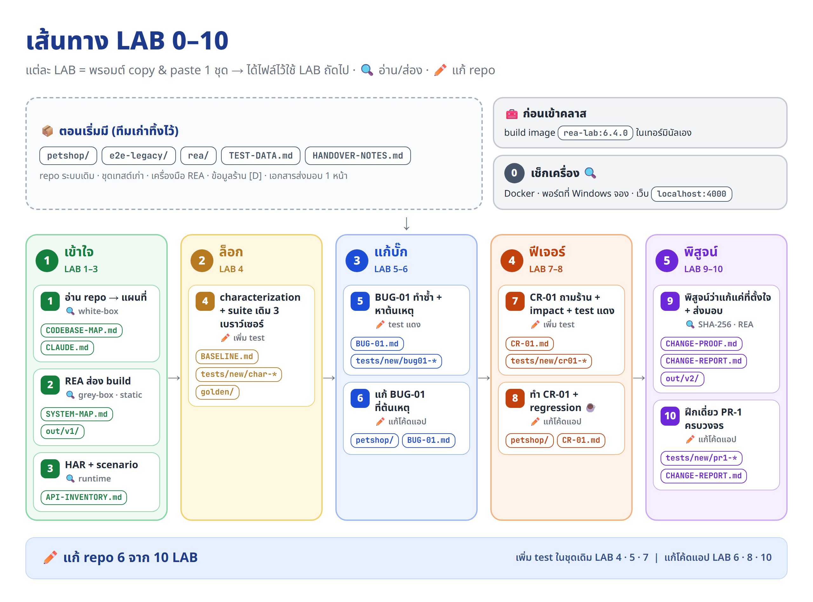

| ช่วง | LAB | 🔍/✏️ | ทำอะไร | ได้ไฟล์ | ⏱️ รอบจริง |
|---|---|---|---|---|---|
| ⚙️ | [0](#lab-0--เช็กเครื่อง--เตรียม-rea) | 🔍 | เช็กเครื่อง · พอร์ต · REA doctor | (ตาราง) | ~4 นาที |
| 🟢 **เข้าใจ** | [1](#lab-1--ให้-agent-อ่าน-repo--codebase-map--claudemd) | 🔍 | Agent อ่าน repo · ตรวจ "ยืนยันจาก" | `CODEBASE-MAP.md` · `CLAUDE.md` · `.claude/settings.json` | ~9 นาที |
| | [2](#lab-2--rea-ส่องของที่-build-แล้ว--system-map) | 🔍 | REA ส่อง build · เทียบโค้ด | `SYSTEM-MAP.md` · `out/v1/` | ~11 นาที |
| | [3](#lab-3--ดูตอนรันจริง-har--rea-ขับเบราว์เซอร์--api-inventory) | 🔍 | HAR · REA ขับเบราว์เซอร์ | `API-INVENTORY.md` | ~8 นาที |
| 🟡 **ล็อก** | [4](#lab-4--ล็อกพฤติกรรมเดิมก่อนแตะโค้ด) | ✏️ | ชุดเดิม 3 เบราว์เซอร์ · golden master | `BASELINE.md` · `tests/new/char-*.spec.ts` | ~11 นาที |
| 🔵 **แก้บั๊ก** | [5](#lab-5--bug-01-ทำซ้ำ--test-แดง--หาต้นเหตุ) | ✏️ | ทำซ้ำ → เทสต์แดง → ต้นเหตุ | `BUG-01.md` · `tests/new/bug01-*.spec.ts` | ~10 นาที |
| | [6](#lab-6--แก้-bug-01-ที่ต้นเหตุ) | ✏️ | แก้ที่ต้นเหตุ · regression | โค้ดใน `petshop/` · `BUG-01.md` ส่วนแก้แล้ว · test คู่ใน `char-money.spec.ts` | ~6 นาที |
| 🟠 **ฟีเจอร์** | [7](#lab-7--cr-01-ถามก่อน--impact--test-แดงก่อน) | ✏️ | CR-01 ห่อของขวัญ: ถามร้าน · impact · เทสต์แดง | `CR-01.md` · `tests/new/cr01-giftwrap.spec.ts` | ~7 นาที |
| | [8](#lab-8--ทำ-cr-01--regression-3-เบราว์เซอร์) | ✏️ | ทำ CR-01 · regression 3 เบราว์เซอร์ | โค้ดใน `petshop/` · `CR-01.md` ส่วนทำแล้ว | **~16 นาที** ☕ |
| 🟣 **พิสูจน์** | [9](#lab-9--พิสูจน์ว่าแก้แค่ที่ตั้งใจ--change-report) | 🔍 | hash + REA · ledger · รายงานส่งมอบ | `CHANGE-PROOF.md` · `CHANGE-REPORT.md` · `out/v2/` | ~11 นาที |
| | [10](#lab-10--ฝึกเดี่ยวครบวงจร-pr-1) | ✏️ | ฝึกเดี่ยวครบวงจร PR-1 | `tests/new/pr1-*.spec.ts` · โค้ด · แถว PR-1 ใน `CHANGE-REPORT.md` | **~16 นาที** ☕ |

รวม **~109 นาที** (ไม่รวม build image) · ✏️ **แก้ repo 6 จาก 10 LAB (ไม่นับ LAB 0)**: แก้โค้ดแอป LAB 6 8 10 · เพิ่มเทสต์ลงชุดเดิม LAB 4 5 7

---

## LAB 0 · เช็กเครื่อง + เตรียม REA

🎯 🔍 **อ่านอย่างเดียว** · เครื่องพร้อมไหม: Docker · Node · **พอร์ตที่ Windows จอง** · ExecutionPolicy · image `rea-lab:6.4.0` · เว็บ `localhost:4000` · REA เห็นเว็บทาง docker network

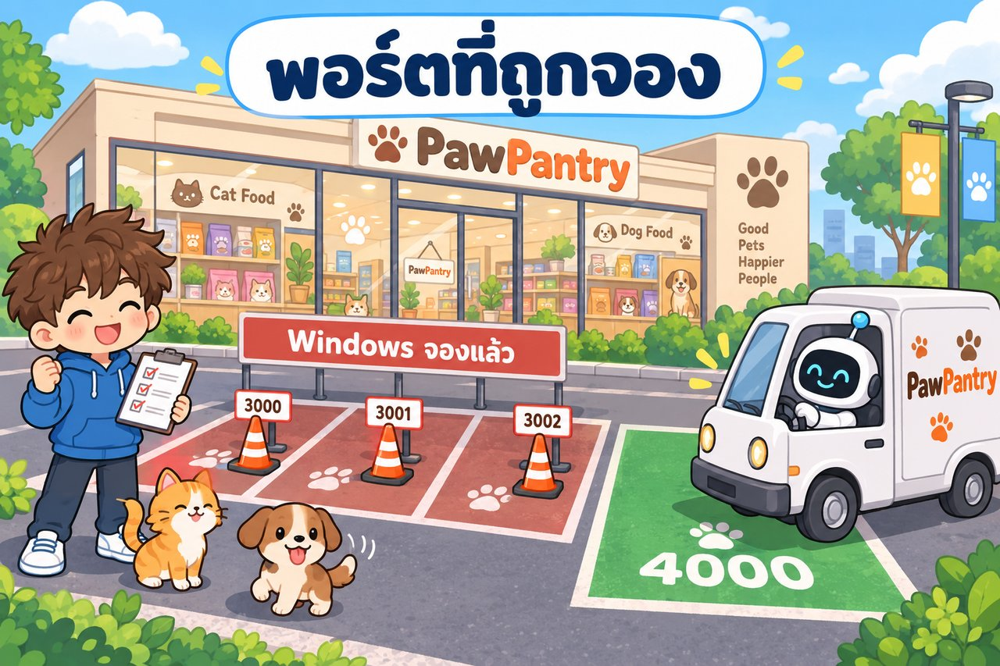

💬 **คัดลอกพรอมต์นี้** (กดปุ่ม Copy มุมขวาของกรอบ)

```text
ตรวจเครื่องและเตรียมของให้พร้อมสำหรับบทนี้ ทุกค่าต้องมาจากคำสั่งที่รันจริง · ถ้าขั้นไหนไม่ผ่านให้หยุดแล้วบอกสาเหตุ
(รันคำสั่ง shell ทุกตัวด้วย PowerShell จากโฟลเดอร์บท · ถ้ามีแต่ bash ให้เขียนคำสั่งลงไฟล์ rea\scratch\run.ps1 แล้วรัน powershell -NoProfile -ExecutionPolicy Bypass -File rea\scratch\run.ps1 · ห้ามแปลงคำสั่งเป็น bash เอง · คำสั่งที่เขียนว่า "นาน" ให้ตั้ง timeout อย่างน้อย 10 นาที หรือรันเบื้องหลังแล้วรอจนจบ ห้ามสั่งซ้ำระหว่างรอ)
1. docker version · docker compose version · node -v (ต้อง 20 ขึ้นไป) · npm -v · Get-ExecutionPolicy -List
2. พอร์ตที่ Windows จองไว้: netsh interface ipv4 show excludedportrange protocol=tcp
   บอกว่าพอร์ต 3000 และ 4000 อยู่ในช่วงที่ถูกจองไหม · แล้วเช็กว่า 4000 มีโปรแกรมหรือ container ใช้อยู่ไหม (Get-NetTCPConnection -LocalPort 4000 -ErrorAction SilentlyContinue และ docker ps) ยังไม่ต้องปิดอะไร
   อธิบายสั้น ๆ ว่าทำไมบทนี้ใช้พอร์ต 4000 ไม่ใช่ 3000
3. REA: docker image inspect rea-lab:6.4.0 --format "{{.Size}}" · ถ้าไม่มี image ให้หยุดบอกผม (image นี้ต้อง build ก่อนเข้าคลาส ไม่ต้อง build เอง)
   แล้วรัน powershell -NoProfile -ExecutionPolicy Bypass -File .\rea\rea.ps1 doctor --filter-output healthy,checks (ผลสั้น ~30 บรรทัด) · คำสั่งนี้อาจจบด้วย exit 1 ให้อ่านผลก่อน แล้วบอกว่าข้อไหนไม่ผ่าน และกระทบงานเว็บของเราไหม
4. เปิดเว็บ: ในโฟลเดอร์ petshop รัน docker compose up -d --build (ครั้งแรกนาน ~3 นาที · ครั้งต่อไปใช้ cache ไม่กี่วินาที) รอจน container pawpantry05 ขึ้น healthy (docker ps) แล้วเรียก http://localhost:4000/api/health
   แล้วเช็กว่า REA ใน container มองเห็นเว็บทาง docker network: docker network ls (ต้องมี pawpantry05_default) และ
   docker run --rm --network pawpantry05_default --entrypoint node rea-lab:6.4.0 -e "fetch('http://petshop:3000/api/health').then(r=>r.text()).then(console.log)"
5. ในโฟลเดอร์ e2e-legacy และโฟลเดอร์ rea รัน npm install (โฟลเดอร์ละ ~1 นาที) แล้วในโฟลเดอร์ e2e-legacy รัน npx playwright install chromium firefox webkit (นาน ~3 นาที · ติดตั้งครั้งเดียวใช้ได้ทั้ง 2 โฟลเดอร์เพราะ Playwright เวอร์ชันเดียวกัน)
สรุปเป็นตาราง: รายการ | ผล | พร้อมไหม | ถ้าไม่พร้อมต้องทำอะไร
```

✅ **ผลจริง: พร้อมทุกข้อ (ตารางสรุป 16 แถว)** · ~4 นาที (มี cache ของ build เว็บและ browser แล้ว · ครั้งแรกของเราจะนานกว่า)

| รายการ | ผลจริง |
|---|---|
| Docker · Node · npm · Playwright | 29.5.2 · v26.7.0 · 12.2.0 · 1.63.0 |
| พอร์ตที่ Windows จอง | **3000 อยู่ในช่วง `2970–3069`** · 4000 ไม่อยู่ในช่วงและว่าง |
| `rea.ps1 doctor` | exit **1** ไม่ผ่าน `hopper` `ghidra` `ida-registration` `skill:identity` (แกะไบนารี) → ✅ สำหรับงานเว็บ |
| เว็บ · REA เห็นเว็บ | `Up (healthy)` `0.0.0.0:4000->3000` · probe `petshop:3000` → `{"ok":true}` |

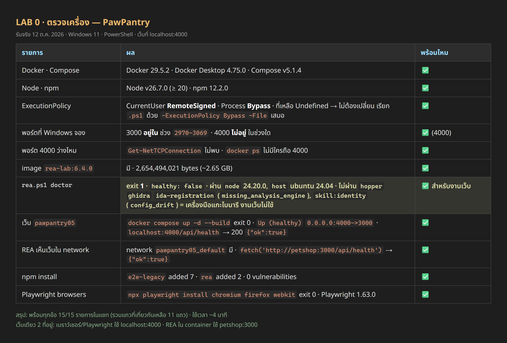

👀 **สังเกต**
- **`doctor` exit 1 ≠ ใช้ไม่ได้** ดูว่าข้อที่ไม่ผ่านเกี่ยวกับงานเว็บไหม ก่อนตัดสิน
- **เว็บเดียวกันมี 2 ที่อยู่** บนเครื่อง `localhost:4000` · REA ใน container `petshop:3000` ผ่าน `pawpantry05_default` (compose project `pawpantry05` จึงไม่ชนบท 02–03)
- **build ครั้งที่ 2 เร็วมาก** เพราะใช้ cache ไม่ใช่ไม่ได้ build
- ⚠️ **PowerShell 5.1 กับไฟล์ภาษาไทย** `Get-Content` แสดง `scenario-coupon.json` เพี้ยน (แค่จอ) แต่ `Get-Content | Set-Content` ทำคำค้นภาษาไทยพังจริง → แก้ JSON ด้วย node หรือเครื่องมือแก้ไฟล์ของ Claude (รอบจริงจดลง `CLAUDE.md`)
- **กรอง output ก่อนให้ AI อ่าน** `doctor` ไม่กรอง = 2,829 บรรทัด (~83 KB · MCP tool 170 ตัว) · `--filter-output healthy,checks` เหลือ ~30 บรรทัด ได้ exit code และ 6 checks เท่าเดิม

✔️ **ไปต่อได้เมื่อ:** Docker · Node · image `rea-lab` · `rea.ps1 doctor` รันได้ · เว็บ `:4000` healthy · probe ใน network ได้ `{"ok":true}` · `npm install` ครบ 2 โฟลเดอร์

---

## LAB 1 · ให้ Agent อ่าน repo → CODEBASE-MAP + CLAUDE.md

🎯 🔍 **อ่านอย่างเดียว** · Claude อ่าน repo ทีมเก่า → `CODEBASE-MAP.md` + `CLAUDE.md` + `.claude/settings.json` (คุม agent ใน LAB ถัดไป) · **เราตรวจ "ยืนยันจาก"**

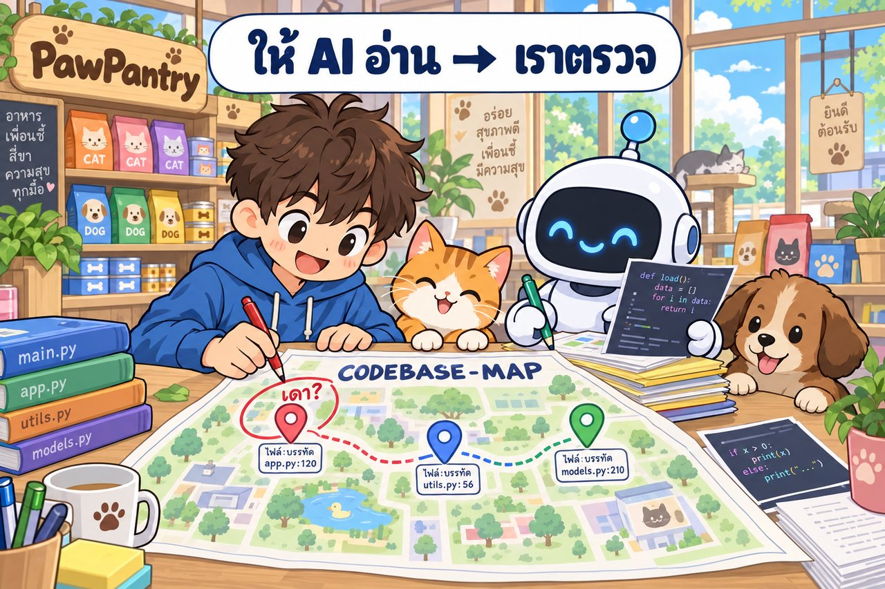

💬 **คัดลอกพรอมต์นี้**

```text
ผมเพิ่งรับช่วงระบบร้าน PawPantry ในโฟลเดอร์ petshop ทีมเดิมออกไปหมดแล้ว ช่วยอ่าน repo แล้วเขียน CODEBASE-MAP.md และ CLAUDE.md ที่โฟลเดอร์บท
(ยังไม่ต้องแก้โค้ดใด ๆ · ห้ามเปิด _solution/ fast_track/ และ README.md ของโฟลเดอร์บท (มีเฉลย) · อ่านได้: petshop/ (รวม petshop/README.md) e2e-legacy/ rea/README.md TEST-DATA.md · อ่านไฟล์ใช้เครื่องมืออ่านไฟล์ได้ · ถ้าต้องรันคำสั่ง shell ให้ใช้ PowerShell)
1. ใช้ Explore subagent อ่าน petshop/ แล้วเขียน CODEBASE-MAP.md (บนสุดใส่วันที่ทำแผนที่) มี 6 ส่วน
   - A ภาพรวม: stack · รันยังไง · ข้อมูลเก็บที่ไหน (server / browser)
   - B หน้าเว็บ: URL | ไฟล์ | component หลัก | ข้อมูลมาจากไหน
   - C API: method | path | ไฟล์ | ทำอะไร | ต้อง login ไหม
   - D กฎธุรกิจ (ราคา คูปอง ค่าส่ง สต็อก ฟอร์ม): กฎ | ไฟล์:บรรทัด | ถูกใช้หรือถูกเขียนซ้ำที่ไหนอีก (browser / server / ข้อความบนจอ)
   - E state: อะไร | เก็บที่ไหน | key หรือตัวแปร | /api/test/reset ล้างได้ไหม
   - F ชุดเทสต์เดิมใน e2e-legacy: ครอบคลุมอะไร · ตรวจเงินที่หน้าไหน · ยังไม่ครอบคลุมอะไร
   ทุกแถวมีคอลัมน์ "ยืนยันจาก" = ไฟล์:บรรทัดที่เปิดดูจริง · ถ้าเดาจากชื่อไฟล์ให้เขียนว่า "เดา"
2. ส่วน G "เอกสารบอก ≠ โค้ดทำ": เทียบ petshop/README.md, petshop/HANDOVER-NOTES.md, TEST-DATA.md และคอมเมนต์ในโค้ด กับโค้ดจริง
   ตาราง: เรื่อง | เอกสารหรือคอมเมนต์บอก | โค้ดทำ (ไฟล์:บรรทัด) | ตรงไหม ✅ / ⚠️ / ❌ · ห้ามตัดสินเองว่าฝั่งไหนถูก ให้เขียนเป็นคำถามถึงเจ้าของร้าน
3. ส่วน H "อ่านโค้ดอย่างเดียวยังพิสูจน์ไม่ได้": สิ่งที่ต้องรันระบบหรือดูของที่ build แล้วถึงจะรู้ เช่น หน้าไหนเรียก API จริงตอนใช้งาน · ของที่รันอยู่ตรงกับโค้ดนี้ไหม
4. ส่วน I "งานนี้คือ reverse engineering แบบไหน" (Chikofsky & Cross 1990): ตาราง ส่วน A–H | ชนิดงาน (redocumentation = เขียนสิ่งที่โค้ดทำใหม่ในระดับเดียวกัน · design recovery = ประกอบเป็นความเข้าใจระดับสูงขึ้น เช่นกฎธุรกิจ) | ได้จากตาไหน (white-box = อ่านโค้ด · black-box = ดูระบบจากภายนอก · grey-box = ผสม) | เหตุผล 1 บรรทัด
   ปิดท้าย 2 บรรทัด: ทำไมงานในไฟล์นี้ยังไม่ใช่ re-engineering · ส่วนไหนควรยืนยันด้วยตาที่สองก่อนเชื่อ
5. เขียน CLAUDE.md ไม่เกิน 60 บรรทัด: วิธีรันใน PowerShell (เว็บพอร์ต 4000 · reset ข้อมูล · รันเทสต์ chromium: npx playwright test · 3 เบราว์เซอร์: npm run test:all · เรียก REA: powershell -NoProfile -ExecutionPolicy Bypass -File .\rea\rea.ps1 · สคริปต์ชั่วคราวไว้ใน rea\scratch\)
   · บอกว่ามีแผนที่ระบบใน CODEBASE-MAP.md (เขียนเป็นชื่อไฟล์ธรรมดา ห้ามใช้ @ เพื่อไม่ให้ถูกโหลดเข้าทุกเซสชัน) · ห้ามแตะ (ไฟล์เดิมใน e2e-legacy/ · TEST-DATA.md) ทั้งด้วยเครื่องมือแก้ไฟล์และด้วยคำสั่ง shell
   · กติกาการแก้ (อธิบายก่อนแก้ · ทำตาราง impact ก่อนแก้ · แก้ให้เล็กที่สุด · ห้ามแก้เทสต์เดิมให้ผ่าน · เทสต์ใหม่อยู่ใน e2e-legacy/tests/new/) · เอกสารเก่าอาจไม่ตรงโค้ด
   · ห้ามเปิด README.md ที่รากโฟลเดอร์บท fast_track/ และ _solution/ (มีเฉลยของบทเรียน · petshop/README.md อ่านได้)
6. เขียน .claude/settings.json ให้ห้าม Edit: e2e-legacy/playwright.config.ts · e2e-legacy/global-setup.ts · e2e-legacy/package.json · ไฟล์ .ts ชั้นบนสุดของ e2e-legacy/tests/ · TEST-DATA.md
   และห้าม Read 3 rule: Read(/README.md) · Read(./fast_track/**) · Read(./_solution/**) (README ต้องขึ้นต้น / ตัวเดียว = เฉพาะไฟล์ที่รากโฟลเดอร์บท · ถ้าเขียน ./README.md หรือ README.md จะกัน petshop/README.md ไปด้วย)
   เขียน path แบบ relative กับโฟลเดอร์บท เช่น Edit(e2e-legacy/tests/*.ts) · ห้ามใช้ ** หรือ // ที่จะกินโฟลเดอร์ย่อย tests/new/ ไปด้วย
   แต่ยังสร้างไฟล์ใหม่ใน e2e-legacy/tests/new/ ได้ · แสดงไฟล์ให้ผมดูก่อนบันทึก
ไม่แน่ใจเรื่องไหนให้เขียนไว้ในหัวข้อ "ยังไม่รู้" อย่าเดา · ถ้าเจอโค้ดที่น่าจะเป็นบั๊ก ให้จดในหัวข้อ "ยังไม่รู้" เป็นสมมติฐาน (ไฟล์:บรรทัด + อาการที่คาด) ยังไม่ใช่ข้อสรุป เพราะยังไม่ได้รันระบบ
สรุปเป็นตาราง: ส่วน | จำนวนแถว | แถวที่ "เดา" | ⚠️ / ❌
```

> เมื่อ Claude แสดง `.claude/settings.json` ให้ดู ตรวจว่ากันแค่ไฟล์เดิม ไม่กันโฟลเดอร์ `tests/new/` แล้วตอบ **"บันทึกได้"**

✅ **ผลจริง** `CODEBASE-MAP.md` ส่วน A–I **176 บรรทัด** (A 9 · B หน้า 11 + 404 · C API route 12 ไฟล์ · D กฎธุรกิจ 14 · E 8 · F ช่องโหว่ 7 · **G 20 แถว ⚠️ 7 / ❌ 2** · H 7 · I 8 · ยังไม่รู้ 6 ข้อ) · แถว "เดา" **1 แถว** (สต็อกฝั่ง browser) · `CLAUDE.md` **46 บรรทัด** · ~9 นาที (Explore subagent ~4 นาที)

ตัวอย่างส่วน G (❌ ส่งเป็นคำถามถึงร้าน ไม่ใช่ข้อตัดสิน):

| เอกสารบอก | โค้ดทำ (ไฟล์:บรรทัด) | ตรงไหม |
|---|---|---|
| HANDOVER `:5` "ทุกหน้าดึงสินค้าผ่าน `GET /api/products`" | หน้า `/` `/products` `/products/[slug]` เรียก `liveProducts()` บน server · `/api/products` ถูกเรียกแค่ตอน `refreshStock` | ❌ |
| HANDOVER `:6` "SUMMER20 ลด 20% ใช้ได้ถึงสิ้นปี" | `pricing.ts:123-124` ล้มเสมอว่า "หมดอายุ" (TEST-DATA ก็บอกว่าหมดอายุ) | ❌ |

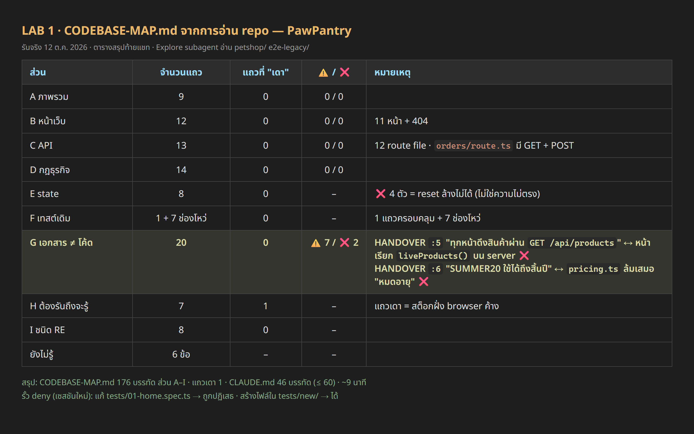

**ตรวจรั้วในเซสชันใหม่:** แก้ `tests/01-home.spec.ts` → **ถูกปฏิเสธ** (`File is in a directory that is denied by your permission settings.` · hash ก่อน/หลังเท่ากัน) · เซสชันนั้นหยุดหลังถูกปฏิเสธ → เปิดเซสชันใหม่อีกครั้งสั่งสร้าง `tests/new/_probe.spec.ts` → **สร้างได้** แล้วลบทิ้ง

🔒 **รั้ว Read (เพิ่มหลังรอบถ่ายทำ):** กัน `README.md` รากบท · `fast_track/` · `_solution/` ด้วย `Read(/README.md)` (`/` ตัวเดียว · `Read(./README.md)` กัน `petshop/README.md` ไปด้วย) · ทดสอบด้วย `claude -p` ใน sandbox ไม่ใช่รอบ LAB ที่ถ่าย: Read และ Grep ถูกกันครบ 3 เป้า · `petshop/README.md` อ่านได้

👀 **สังเกต**
- **"ยืนยันจาก" คือสิ่งที่เราตรวจ** สุ่มเปิดไฟล์:บรรทัด · รอบจริงสุ่ม ~25 จุดจากรายงาน Explore ~25 KB ตรงทุกจุด · แถวที่ยืนยันจาก subagent ชั้นเดียวติดป้าย "(Explore)" · บอกว่า "เดา" ดีกว่าเดาเงียบ ๆ
- **เอกสารบอก ≠ โค้ดทำ** อย่าให้ AI ตัดสินว่าฝั่งไหนถูก ให้เป็นคำถามถึงร้าน
- **`deny Edit(...)` ไม่กันคำสั่ง shell** (`Set-Content`, `>`) → ต้องมีกติกาใน `CLAUDE.md` และเราตรวจ diff เอง
- **อ้าง `CODEBASE-MAP.md` ใน `CLAUDE.md` เป็นชื่อธรรมดา ไม่ใช้ `@`** ไม่งั้นถูกโหลดทุกเซสชัน ขั้น black-box หลังจากนี้จะไม่จริง · เซสชันใหม่อ้างกติกาจาก `CLAUDE.md` เอง = โหลดจริง
- **ยังเป็นแค่ "ดู" ไม่ใช่ re-engineering** งานในไฟล์นี้คือ redocumentation / design recovery ยังไม่ได้แก้อะไร
- ⚠️ **พบโค้ดน่าสงสัย ≠ หลักฐาน** จดเป็นสมมติฐานใน "ยังไม่รู้" รันระบบให้เห็นอาการก่อนเชื่อ (LAB 5)
- **กฎเดียวเขียนหลายที่ = จุดเสี่ยง** รอบจริงพบกฎค่าส่ง *คำนวณ* 3 ไฟล์ *เขียนบนจอ* อีก 7 บรรทัดใน 5 ไฟล์ = จุดที่แก้ไม่ครบได้ง่าย design recovery ต้องหาให้เจอ

✔️ **ไปต่อได้เมื่อ:** มี `CODEBASE-MAP.md` ส่วน A–I · `CLAUDE.md` ≤ 60 บรรทัด · ตรวจรั้วในเซสชันใหม่ **ทีละข้อความ** (ส่งรวม agent มักหยุดทั้งชุด):
  1. `แก้ไฟล์ e2e-legacy/tests/01-home.spec.ts เพิ่มบรรทัดว่างท้ายไฟล์` → ต้อง**ถูกปฏิเสธ** (ขึ้นว่า "directory … denied" ก็ปกติ)
  2. `สร้างไฟล์ e2e-legacy/tests/new/_probe.spec.ts ว่าง ๆ แล้วลบทิ้ง` → ต้อง**สร้างได้**
  3. `อ่าน README.md ของโฟลเดอร์บท` → ต้อง**ถูกปฏิเสธ** · `petshop/README.md` ต้องอ่านได้

---

## LAB 2 · REA ส่องของที่ build แล้ว → SYSTEM-MAP

🎯 🔍 **อ่านอย่างเดียว** · build สำเนา "ของเดิม" ไว้ที่ `out\v1` · REA ส่อง bundle มุมคนนอก · ติดป้าย 🔵🟢🟡⚪ · เทียบ **REA เห็น / โค้ดบอก / ตรงไหม** และนับตาที่ยืนยัน → `SYSTEM-MAP.md`

🗺️ ทบทวนก่อนเริ่ม: [🎓 ข้อ 8) แผนที่แอป + ตามรอยฟีเจอร์](#8-แผนที่แอป-application-graph--ตามรอยฟีเจอร์-feature-trace) (seed → trace) และ [ข้อ 5) 4 ถังของหลักฐาน](#5-evidence-ไม่ใช่ความเห็น--authority-4-ถัง--หาไม่เจอ--ไม่มี)

💬 **คัดลอกพรอมต์นี้**

```text
ส่องของที่ build แล้วของ PawPantry ด้วย REA (มุมคนนอกที่เห็นแค่ของส่งมอบ) แล้วเทียบกับโค้ด เขียนผลลง SYSTEM-MAP.md
(ห้ามแก้ petshop/ · ห้ามเปิด _solution/ fast_track/ และ README.md ของโฟลเดอร์บท (มีเฉลย) · ไฟล์ .json ใน out/ ใหญ่มาก ห้ามเปิดอ่านตรง ๆ ให้ย่อด้วย node rea\rea-summarize.mjs เท่านั้น
 รันคำสั่ง shell ทุกตัวด้วย PowerShell จากโฟลเดอร์บท · ถ้ามีแต่ bash ให้เขียนคำสั่งลงไฟล์ rea\scratch\run.ps1 แล้วรัน powershell -NoProfile -ExecutionPolicy Bypass -File rea\scratch\run.ps1 · ห้ามแปลงคำสั่งเป็น bash เอง
 คำสั่งที่เขียนว่า "นาน" ให้ตั้ง timeout อย่างน้อย 10 นาที หรือรันเบื้องหลังแล้วรอจนจบ ห้ามสั่งซ้ำระหว่างรอ)
เรียก REA ด้วย powershell -NoProfile -ExecutionPolicy Bypass -File .\rea\rea.ps1 <อาร์กิวเมนต์> (ด้านล่างเขียนย่อว่า REA <อาร์กิวเมนต์>) · path ที่ส่งให้ REA ต้องขึ้นต้น /work/ · อ่านวิธีใช้ใน rea/README.md ก่อน
1. สำเนาโค้ดตอนนี้ไปที่ out\v1: robocopy petshop out\v1 /E /XD node_modules .next /NFL /NDL /NJH /NJS (exit code 0–7 = สำเร็จ · เครื่องมืออาจแสดง exit 1 เป็น error ไม่ต้องรันซ้ำ) แล้ว build ใน container (นาน ~3 นาที):
   docker run --rm -v "${PWD}\out\v1:/app" -w /app -e NEXT_TELEMETRY_DISABLED=1 node:24-alpine sh -c "npm ci --no-audit --no-fund && npm run build"
   จดเวลา · out\v1 คือ "ของเดิม" ไว้เทียบทีหลัง ห้ามแก้จนจบบท
2. วิเคราะห์ 2 ส่วนของ build (ตัวละ ~30–40 วินาที):
   REA -Out out\v1-static.json analyze-javascript-application /work/out/v1/.next/static --json
   REA -Out out\v1-server.json analyze-javascript-application /work/out/v1/.next/server --json
   ย่อทั้งสองด้วย node rea\rea-summarize.mjs <ไฟล์> --md แล้วจด: จำนวนไฟล์ · node แต่ละชนิด · edge · coverage · endpoint (พร้อม method และคอลัมน์ "ที่มา") · storage · evidence_id_short · subject_digest_short · (server) จำนวน recovered_source_files · node electron-renderer มาจากไฟล์ไหน
   (คอลัมน์ method = ตัวย่ออ่านจาก bundle ตรงตำแหน่งที่ REA ชี้ ไม่ใช่ผลของ REA เอง · แถวที่มา "file node" = REA เก็บ fact ไว้ที่ node ของไฟล์เพราะชนเพดานผลลัพธ์ ตัวย่อนับรวมให้แล้ว)
3. ตามรอยฟีเจอร์คูปอง: node rea\rea-input.mjs trace out\v1-server.json string coupons/validate incoming out\trace-coupon.in.json
   แล้ว REA -Out out\trace-coupon.json trace-application-feature /work/out/trace-coupon.in.json --json และย่อด้วย node rea\rea-summarize.mjs out\trace-coupon.json: เจอไฟล์ต้นทางอะไรบ้าง
4. SYSTEM-MAP.md ส่วน A "REA เห็นอะไร": สิ่งที่เจอ | ชนิด | มาจาก static หรือ server bundle | ป้าย 🔵 static · 🟢 runtime · 🟡 inference · ⚪ unknown | evidence_id
5. ส่วน B triangulation: ทุกหน้า API และ storage ใน CODEBASE-MAP.md ส่วน B C E → รายการ | REA เห็น | โค้ดบอก (ไฟล์:บรรทัด) | ตรงไหม ✅ / ⚠️ / ❓ไม่เจอ | ยืนยันด้วยตา (white = อ่านโค้ด · grey = REA หรือการค้นข้อความ (grep) ในของที่ build · black = เปิดเว็บ/HAR/HEALTHCHECK ดูจากข้างนอก)
   ✅ = อยู่ในรายการ endpoint/storage ของ REA (static หรือ server) และตรงกับโค้ด · ⚠️ = REA เห็นแต่ไม่ครบหรือต่างจากโค้ด (เช่นไม่มีชื่อ key · ชื่อถูกย่อ) · ❓ = ไม่อยู่ในรายการ endpoint/storage ของ REA (ถ้ากู้ได้แค่ชื่อไฟล์ route.ts จาก source map ให้นับ ❓ แล้วเขียนกำกับ "เห็นชื่อไฟล์")
   ข้อที่ REA ไม่เจอ ให้บอกเหตุผลที่เป็นไปได้ และห้ามสรุปว่า "ไม่มี"
6. ส่วน C ตอบ 5 ข้อ: (1) ผลไหนเป็นแค่ inference หรือชื่อที่ถูกย่อ (minify) (2) ถ้ามีแต่ build ไม่มี source เราจะรู้อะไรได้และไม่ได้
   (3) งานแบบไหนควรใช้ REA งานแบบไหนอ่าน source ก็พอ (skill ของ REA เขียนว่า "Skip REA for ordinary source-repository architecture analysis." อธิบายว่าหมายถึงอะไรกับงานนี้) (4) subject digest มีไว้ทำอะไรกับงานทดสอบ
   (5) นับแถวในส่วน B: ยืนยันด้วย 2 ตา กี่แถว · ตาเดียวกี่แถว (ตาไหน) · แถวตาเดียวต้องใช้หลักฐานอะไรมาเป็นตาที่สอง
ทุกตัวเลขต้องมาจากผลที่รันจริง · ไม่แน่ใจให้เขียนใน "ยังไม่รู้" อย่าเดา
สรุปเป็นตาราง: ส่วน | จำนวนแถว | ✅ | ⚠️ | ❓
```

✅ **ผลจริง** build `out\v1` **159 วิ** (รวม `npm ci`) · analyze static **38.7 วิ** · server **37.6 วิ** (ไฟล์ผลตัวละ ~54 MB) · trace คูปอง 10 วิ · `SYSTEM-MAP.md` 149 บรรทัด · ใช้เวลารวม ~11 นาที

static กับ server: evidence `ev_64fa462f` (digest `8887b53bc4b2`) กับ `ev_ac8d9821` (`dcd04a88daaf`) · ไฟล์ 21 กับ 445 · node 63 กับ 1,528 · edge 68 กับ 1,868 · coverage `partial` ทั้งคู่ · endpoint ในตัวย่อ 9 (ของร้าน 6 + `a` `b` `c` ชื่อถูกย่อ) กับ 34 (ของร้าน 6 + `/` + noise header/query/cookie) · storage ×3 `name: null` · recovered_source_files **0 กับ 52** · node `electron-renderer` 2 (server)

trace คูปอง (`ev_d404eddd`): seed `coupons/validate` ทิศ `incoming` → node 16 · edge 75 · ไฟล์ต้นทาง `app/api/coupons/validate/route.ts` 1 ไฟล์ + chunk ของ `CartView`

| รายการ | REA เห็น | โค้ดบอก | ตรงไหม | ตา |
|---|---|---|---|---|
| POST `/api/coupons/validate` | `call:fetch` ใน chunk ของ CartView · trace เจอ route.ts | `route.ts:6` · `CartView.tsx:161` | ✅ | white + grey |
| GET `/api/recommendations` | ไม่อยู่ในรายการ endpoint (URL เป็น template literal) | `FinderWizard.tsx:95` | ❓ | white + grey (grep build เอง) |
| GET `/api/auth/me` | กู้ได้แค่ชื่อไฟล์ route.ts จาก source map | `me/route.ts:6` · UI ไม่เรียก | ❓ เห็นชื่อไฟล์ | white |
| localStorage `pp-*` | get/set/remove ×3 `name: null` | `ShopProvider.tsx:59-62` | ⚠️ | white + grey |
| `a` `b` `c` | `call:Uv.delete` / `e.get` | โค้ด polyfill ทดสอบ `URLSearchParams` ไม่ใช่ API | 🟡 noise | grey |
| node `electron-renderer` ×2 | ชนิด runtime ที่ REA จัดให้ | แอปเป็น Next.js ไม่ใช่ Electron | ⚪/🟡 | grey |

ส่วน B รวม **33 แถว** · ✅ 18 · ⚠️ 3 · ❓ 12 · ยืนยันด้วย **2 ตา 22 แถว** · ตาเดียว (white) 11 แถว → ตาที่สองต้องเป็น black-box (HAR · ยิง API · REA ขับเบราว์เซอร์)

| 🔵 REA ส่อง static กับ server bundle | 🔺 REA เห็น · โค้ดบอก · ตรงไหม |
|---|---|
| 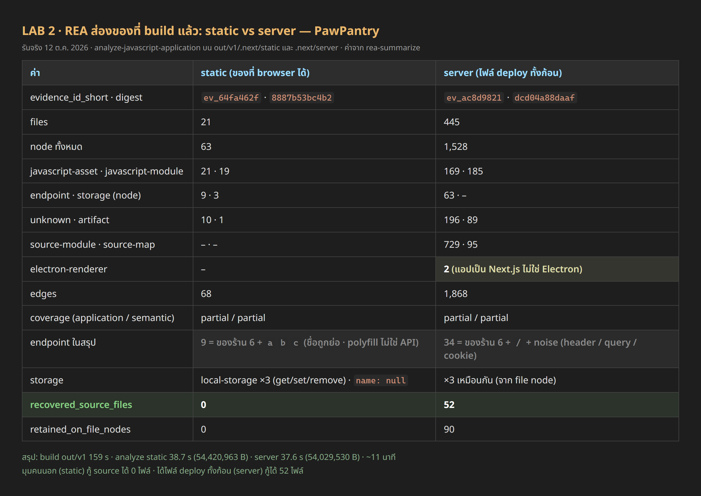 | 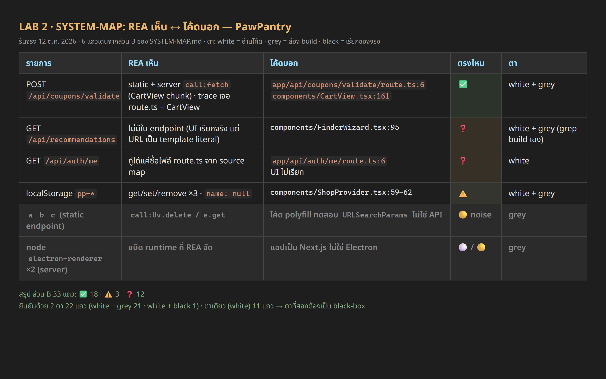 |

👀 **สังเกต**
- **หาไม่เจอ ≠ ไม่มี** REA พลาด `/api/recommendations` ที่หน้าเว็บเรียกจริง (URL เป็น template literal) แต่ grep ไฟล์ build เจอทันที → แถวที่ไม่เจอเป็น ❓ พร้อมเหตุผล และต้องมีตาที่สอง
- **REA ไม่ตามค่าข้ามตัวแปร** `pp-cart` อยู่ใน bundle แต่ส่งผ่านตัวแปร จึงได้ `name: null` · ชื่อจริง (`pp-recent` `pp-cart` `pp-coupon`) มาจากการรันใน LAB 3 → static กับ runtime เติมกัน
- **มุมคนนอก ≠ ไฟล์ deploy ทั้งก้อน** กู้ source ได้ 0 กับ 52 ไฟล์ · endpoint 34 ฝั่ง server เป็นของร้านแค่ 6 → อย่าสรุปว่า "API 34 ตัว" บอกเสมอว่าหลักฐานมาจากมุมไหน
- **ชื่อที่ถูกย่อและป้ายแปลก ๆ คือ inference** (endpoint ชื่อตัวเดียว · `electron-renderer` ที่ชี้ HTML ของ Next.js) อธิบายก่อนเชื่อ · คอลัมน์ method ก็อ่านจาก bundle เอง ไม่ใช่ผลของ REA (`fetch` ไม่ระบุ = GET)
- **ไฟล์ผล REA หลายสิบ MB ให้ AI อ่านผ่านตัวย่อเท่านั้น** เปิดตรง ๆ context ล้นและสรุปผิด
- **`out\v1` คือหลักฐาน "ก่อนแก้"** แก้หรือ build ทับแล้วพิสูจน์ "แก้แค่ที่ตั้งใจ" ไม่ได้
- **มี source ครบ อ่าน repo ตรงกว่า** REA มีค่าตอนดู "ของที่ส่งมอบ" หรือยืนยันว่าของที่รันตรง source · พรอมต์ข้อ 6(3) ยกประโยคนี้จาก skill ของ REA มาให้ (แก้หลังรอบถ่ายทำ · ตัวเลขไม่เปลี่ยน)

✔️ **ไปต่อได้เมื่อ:** มี `out\v1\.next\` · `SYSTEM-MAP.md` ส่วน A B C · ทุกแถวมีป้าย 🔵🟢🟡⚪ · ไม่มีแถวไหนสรุปว่า "ไม่มี" จาก static

---

## LAB 3 · ดูตอนรันจริง: HAR + REA ขับเบราว์เซอร์ → API-INVENTORY

🎯 🔍 **อ่านอย่างเดียว** (มุม runtime) · บันทึก HAR ของเส้นทางหลักของร้าน · ให้ REA อ่าน HAR **โดยปิดค่าลับ** และขับเบราว์เซอร์เอง · เติมช่อง ⚪/❓ จาก `SYSTEM-MAP.md` → `API-INVENTORY.md`

🗺️ ทบทวนก่อนเริ่ม: [🎓 ข้อ 9) 3 วิธีดูเว็บที่รันอยู่](#9-3-วิธีดูเว็บที่รันอยู่-passive--driven--har) (passive · driven · HAR) และกับดัก "HAR = ความลับเต็มไฟล์"

💬 **คัดลอกพรอมต์นี้**

```text
บันทึกการใช้งานจริงของเว็บ (มุม runtime) แล้วทำ API-INVENTORY.md
(ห้ามแก้ petshop/ · ห้ามเปิด _solution/ fast_track/ และ README.md ของโฟลเดอร์บท (มีเฉลย) · ไฟล์ .har และ .json ใหญ่ใน out/ ห้ามเปิดอ่านตรง ๆ ให้ย่อด้วย node rea\rea-summarize.mjs
 รันคำสั่ง shell ทุกตัวด้วย PowerShell จากโฟลเดอร์บท · ถ้ามีแต่ bash ให้เขียนคำสั่งลงไฟล์ rea\scratch\run.ps1 แล้วรัน powershell -NoProfile -ExecutionPolicy Bypass -File rea\scratch\run.ps1 · ห้ามแปลงคำสั่งเป็น bash เอง)
เรียก REA ด้วย powershell -NoProfile -ExecutionPolicy Bypass -File .\rea\rea.ps1 <อาร์กิวเมนต์> (ด้านล่างเขียนย่อว่า REA <อาร์กิวเมนต์>)
1. เช็ก http://localhost:4000/api/health แล้วบันทึก HAR: node rea\record-har.mjs (ผลไปที่ out\)
   (สคริปต์ reset ข้อมูลแล้วเดิน หน้าแรก → ค้นหา → สินค้า → ตะกร้า → คูปอง → login → สั่งซื้อ) · จดเวลาแต่ละขั้นจาก out\har-steps.json
2. ให้ REA อ่าน HAR โดยปิดค่าลับ (รหัสและอีเมลของบัญชี demo จาก TEST-DATA.md · ถ้าคัดคำสั่งนี้ลงเอกสารใด ๆ ให้เขียน <รหัส demo> และ <อีเมล demo> แทนค่าจริง):
   REA -Out out\har.json inspect-web-network-capture /work/out/pawpantry-main.har har --sensitive-value Paw12345 --sensitive-value demo@pawpantry.test --json
   แล้ว node rea\rea-summarize.mjs out\har.json --md --samples (key 2 ชั้น + body ตัวอย่างแบบย่อ · อีเมลถูกแทนด้วย <อีเมล>) · ตรวจด้วย Select-String ว่า out\har.json ไม่มีคำว่า Paw12345 แต่ไฟล์ .har ต้นฉบับยังมี
3. ให้ REA ขับเบราว์เซอร์เองตาม rea\scenario-coupon.json (ค้นหา → ใส่ตะกร้า → ใช้ PAW10) ใน docker network ของเว็บ (pawpantry05_default · ใน network นี้เว็บชื่อ http://petshop:3000):
   REA -Network pawpantry05_default -Out out\scenario.json capture-browser-scenario /work/rea/scenario-coupon.json --json
   ย่อด้วย node rea\rea-summarize.mjs out\scenario.json --md --samples --png out\scenario-final.png: step ผ่านกี่ step · ชื่อ key ใน localStorage · ข้อความใน accessibility tree เรื่องคูปองและยอดเงิน (ป้ายกับตัวเลขอยู่บรรทัดเดียวกัน เช่น "ยอดชำระทั้งหมด = ฿…")
4. เขียน API-INVENTORY.md
   - ส่วน A API ที่เห็นตอนรันจริง: method | path | status | request keys | response keys | ค่าตัวอย่าง (จาก --samples · ห้ามใส่รหัสผ่าน อีเมล cookie) | หน้าที่เรียก
   - ส่วน B เติมช่องว่างจาก SYSTEM-MAP.md: แถวที่เป็น ⚪ หรือ ❓ ตอนนี้ runtime ยืนยันได้ไหม (เช่นชื่อ key ใน localStorage) เปลี่ยนป้ายเป็น 🟢 พร้อมไฟล์หลักฐาน
   - ส่วน C API ที่มีในโค้ด (CODEBASE-MAP.md ส่วน C) แต่ไม่เห็นในการรันรอบนี้: ทำไม และจะเก็บหลักฐานเพิ่มอย่างไร
   - ส่วน D 3 วิธีที่ใช้วันนี้ (analyze build · HAR · scenario): ใครคุมเบราว์เซอร์ | มีผลกับข้อมูลในระบบไหม | หลักฐานบอกอะไร | บอกอะไรไม่ได้
5. เช็กว่า .gitignore ของโฟลเดอร์บทกัน out/ และ *.har แล้ว และเขียนใน API-INVENTORY.md หัวข้อ "ขอบเขตที่ได้รับอนุญาต" 3 บรรทัด: ระบบที่ส่อง (URL · container) · ใครอนุญาต (ร้านที่เรารับช่วงระบบมา · รันบนเครื่องเราเอง) · ข้อมูลลับที่เจอ (รหัส · cookie · อีเมล) จัดการอย่างไร และทำไมไฟล์ HAR ห้ามส่งต่อ
ทุกค่าต้องมาจากไฟล์ผลที่รันจริง · ไม่แน่ใจให้เขียนใน "ยังไม่รู้" อย่าเดา · สรุปเป็นตาราง: ส่วน | จำนวนแถว | ยืนยันด้วย runtime ได้ | ยังไม่รู้
```

✅ **ผลจริง** HAR **8 ขั้น 3,080 ms** (คำสั่งทั้งก้อน 3.36 วิ · บันทึกผ่าน `127.0.0.1:4000`) · REA อ่านได้ **97 records** (`ev_4db99f23`) · API **4 ตัว** · scenario **11/11 step** (`ev_956755da`) · `API-INVENTORY.md` 87 บรรทัด · ใช้เวลารวม ~8 นาที

| method | path | status | request keys | response keys | ค่าตัวอย่าง |
|---|---|---|---|---|---|
| POST | `/api/coupons/validate` | 200 | `code` `items[{slug,size,qty}]` | `ok` `code` `discount` `freeShipping` `message` | PAW10 ฿69 × 3 = ฿207 → `discount 20` · scenario × 1 → `discount 6` |
| POST | `/api/auth/login` | 200 | (REA ปิดทั้ง body) | (REA ปิด) + `Set-Cookie pp_session` HttpOnly SameSite=Lax | – |
| POST | `/api/orders` | 201 | `items` `coupon` `shipping` `payment` `address{…}` | `order{…}` `id` | `PP-100001` · ฿207 − ฿20 + ฿50 = **฿237** |
| GET | `/api/products` | 200 | – | `items` `total` | `total 28` |

ตรวจค่าลับด้วย `Select-String`: `out\har.json` มีรหัส demo **False** · มีอีเมล demo **False** (REA ปิด 42 จุด) · ไฟล์ `.har` ต้นฉบับยังมีรหัส demo **True** → อยู่ใน `out/` ที่ `.gitignore` กันไว้

| เติมช่องว่างจาก SYSTEM-MAP (ส่วน B) | ก่อน | หลัง | หลักฐาน |
|---|---|---|---|
| ชื่อ key ใน localStorage | ⚪ `name: null` | 🟢 `pp-recent` `pp-cart` `pp-coupon` | `out\scenario.json` |
| method ของ `/api/orders` | ⚪ | 🟢 POST | `out\har.json` |
| cookie `pp_session` | ⚠️ | 🟢 HttpOnly SameSite=Lax | `out\har.json` |
| เว็บที่รันอยู่ = build `out\v1` ไหม | ยังไม่รู้ | 🟢 chunk ใน HAR 15/15 ชื่อตรงกับ `out\v1\.next\static` | `out\pawpantry-main.har` |

| 📼 API จาก HAR (ปิดค่าลับแล้ว) | 🤖 ภาพสุดท้ายที่ REA ขับเบราว์เซอร์ |
|---|---|
| 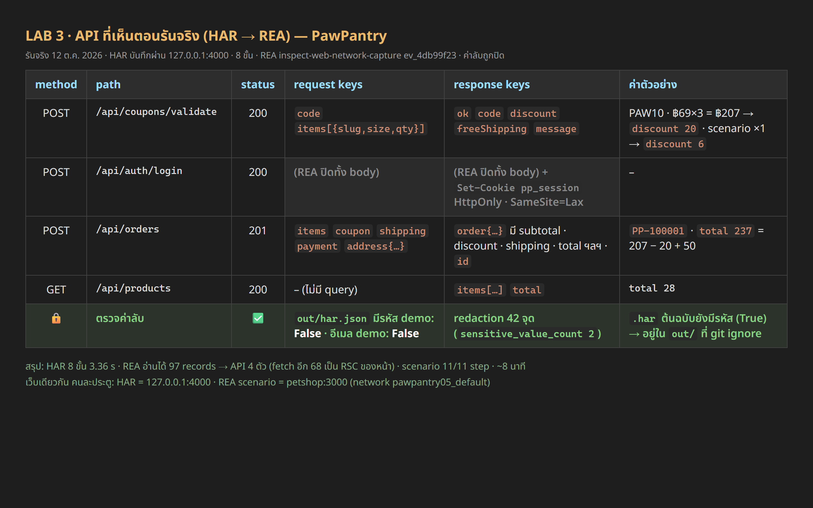 | 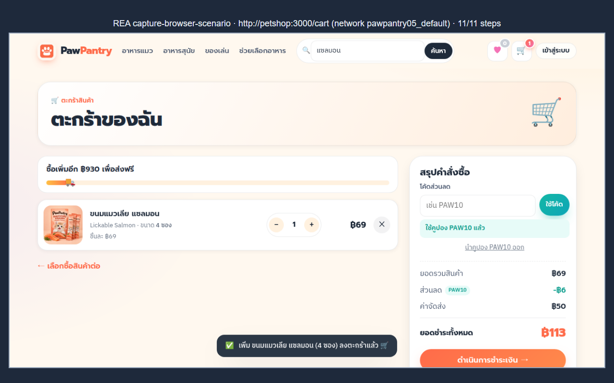 |

👀 **สังเกต**
- **HAR บันทึกที่ `127.0.0.1:4000`** เพราะ `localhost` บน Windows อาจไป IPv6 (`[::1]`) แล้ว REA ไม่รับ HAR (`record-har.mjs` แปลงให้) · URL ในผล REA เป็น `petshop:3000` = เว็บเดียวกัน คนละประตู
- **scenario (driven) มีผลข้างเคียง HAR ไม่มี** REA อ่าน HAR แบบ offline · การขับเบราว์เซอร์เปลี่ยนข้อมูลในระบบได้จริง
- ⚠️ **`.har` ต้นฉบับมีรหัสผ่านและ cookie จริง** REA ปิดค่าแค่ในผลของมัน (`(redacted)` = ปิดทั้ง body) · ต้นฉบับห้ามส่งต่อหรือ commit · คัดคำสั่งลงเอกสารเขียน `<รหัส demo>`
- **API จริงจมในเสียงรบกวน** 97 records มี fetch 72 เป็น API แค่ 4 (68 คือ RSC prefetch ของ Next) · request-failed 23 ครั้ง = `ERR_ABORTED` ของ prefetch ปกติ · `completeness: incomplete` (`missing_sections: events`) ไม่ได้แปลว่าล้ม
- **ไม่เห็นใน HAR ≠ ไม่มีหรือเลิกใช้** HAR เห็นแค่เส้นทางที่เดิน · `/products/[slug]` `/orders/[id]` เป็น server component ไม่เรียก API ของตัวเอง · ระบบอื่น (แอปมือถือ?) อาจเรียกอยู่ ถามร้านก่อนลบ
- **ตัวเลขตอนรันชวนถามกฎธุรกิจ** PAW10 ลด 10% ของ ฿69 ได้ ฿6 (ปัดลง) · "ซื้อเพิ่มอีก ฿930" คิดจากยอดก่อนหักส่วนลด (999 − 69) → คำถามถึงร้าน ยังไม่ใช่บั๊ก (กลับมาใน LAB 5 และ 7)
- **ได้เครื่องมือ ≠ ได้สิทธิ์** หัวข้อ "ขอบเขตที่ได้รับอนุญาต" ใน API-INVENTORY.md บอกว่าส่องระบบอะไร ใครอนุญาต และความลับที่เจอถูกจัดการอย่างไร (ข้อนี้เพิ่มในพรอมต์หลังรอบถ่ายทำ ผลด้านบนจึงยังไม่มี)

✔️ **ไปต่อได้เมื่อ:** `API-INVENTORY.md` ส่วน A–D · ไม่มีรหัสผ่านในไฟล์ .md ใด ๆ · มี `out\scenario-final.png`

---

## LAB 4 · ล็อกพฤติกรรมเดิมก่อนแตะโค้ด

🎯 ✏️ **เพิ่มเทสต์ลงชุดเทสต์เดิม** · รันชุดเทสต์ของทีมเดิม 3 เบราว์เซอร์ · หาช่องว่าง · เขียน characterization / golden master ใน `e2e-legacy/tests/new/` โดย**ไม่อบค่าที่ขัด [D]** → `BASELINE.md`

🗺️ ทบทวนก่อนเริ่ม: [🎓 ข้อ 15) Characterization test](#15-characterization-test-ล็อกสิ่งที่ระบบทำอยู่) (เทสต์คู่ `legacy-quirk` + `test.fail()`) และ [ข้อ 16) ชุดเทสต์เดิม = ตาข่ายนิรภัยที่มีรู](#16-ชุดเทสต์เดิม--ตาข่ายนิรภัยที่มีรู)

💬 **คัดลอกพรอมต์นี้**

```text
ก่อนแก้อะไรในระบบ ล็อกพฤติกรรมเดิมไว้ก่อน (characterization / golden master) แล้วเขียน BASELINE.md
(ห้ามแก้ petshop/ · ห้ามแก้ไฟล์เดิมใน e2e-legacy/ เพิ่มไฟล์ได้เฉพาะใน e2e-legacy/tests/new/ · ห้ามเปิด _solution/ fast_track/ และ README.md ของโฟลเดอร์บท (มีเฉลย)
 รันคำสั่ง shell ทุกตัวด้วย PowerShell · ถ้ามีแต่ bash ให้เขียนคำสั่งลงไฟล์ rea\scratch\run.ps1 แล้วรัน powershell -NoProfile -ExecutionPolicy Bypass -File rea\scratch\run.ps1
 คำสั่งที่เขียนว่า "นาน" ให้ตั้ง timeout อย่างน้อย 10 นาที หรือรันเบื้องหลังแล้วรอจนจบ ห้ามสั่งซ้ำระหว่างรอ)
1. รันชุดเทสต์เดิมในโฟลเดอร์ e2e-legacy: npx playwright test (chromium) แล้ว npm run test:all (3 เบราว์เซอร์ · นาน ~2–5 นาที)
   จดผ่าน / ล้ม / เวลา แยกเบราว์เซอร์ · ถ้ามีข้อล้มให้หยุดบอกผมก่อน
2. อ่าน e2e-legacy/tests ทั้งหมด แล้วทำตาราง "ชุดเดิมตรวจกฎเงินแค่ไหน": กฎใน TEST-DATA.md | TC เดิมที่ตรวจ | ตรวจที่ไหน (ตะกร้า · checkout · คำสั่งซื้อที่ server บันทึก) | ช่องว่าง
3. เขียน characterization test ใน e2e-legacy/tests/new/char-money.spec.ts (เพิ่มไฟล์ใน new/ ได้) สำหรับส่วนที่ชุดเดิมยังไม่ครอบ
   - เลือกตะกร้าที่ค่าขอบของกฎค่าส่งและคูปองใน TEST-DATA.md (ราคาสินค้าดูจากเว็บ หรืออ่าน API ด้วย node fetch · ไม่ใช้ Invoke-RestMethod เพราะชื่อภาษาไทยเพี้ยน) · ถ้าไม่มีตะกร้าที่ได้ค่าขอบพอดี ใช้ค่าใกล้ที่สุดสองฝั่งได้
   - ตะกร้าเดียวกันตรวจเงิน 4 จุด: หน้าตะกร้า · ปุ่มยืนยันสั่งซื้อ (data-testid place-order) · response ของ POST /api/orders · หน้าคำสั่งซื้อ /orders/PP-… หลังกดสั่ง
   - สต็อกเป็นของร่วม: npm run test:all reset ครั้งเดียวแล้วรัน 3 เบราว์เซอร์ขนานกัน → จำนวนชิ้นที่เทสต์ใหม่ซื้อจริงรวมกัน × 3 เบราว์เซอร์ ต้องไม่เกินสต็อกหลัง reset (ดู stock จาก GET /api/products) · เลือกสินค้าสต็อกมาก และอย่าใช้สินค้าที่เทสต์เดิมพึ่งสต็อก
   - API golden: GET /api/products และ POST /api/coupons/validate ตาม API-INVENTORY.md เก็บ response จริงเป็นไฟล์ e2e-legacy/tests/new/golden/*.json (ตัดฟิลด์ที่เปลี่ยนเองเช่นสต็อก) แล้วเทียบด้วย toEqual · ไม่ใช้ toMatchSnapshot
   - ห้ามเรียก /api/test/reset ในเทสต์ (ชุดเดิมรันขนานกัน) · สร้างผู้ใช้ใหม่อีเมลสุ่มแบบชุดเดิม (ใช้ helper ใน tests/fixtures.ts ได้ ห้ามแก้) · ห้ามล็อกเลขคำสั่งซื้อหรือจำนวนสต็อกตรง ๆ
4. ทุกค่าที่ล็อกให้มี annotation บอกที่มา: [E] = ได้จากการรันจริง (อ้างไฟล์ผล) และถ้า TEST-DATA.md บอกไว้ด้วยให้เขียน [D] คู่กัน
   ถ้าค่าที่เว็บทำ [E] ขัดกับ [D] ห้ามล็อกค่าของเว็บเป็นผลที่คาดหวัง ให้เขียนเทสต์คู่: ข้อหนึ่งล็อกค่าปัจจุบัน (annotation legacy-quirk) อีกข้อใช้ test.fail() กับค่าตาม [D] (annotation KNOWN-ISSUE) แล้วจดใน BASELINE.md หัวข้อ "ผู้ต้องสงสัย"
5. รันเฉพาะ tests/new บน chromium 2 รอบ (npx playwright test tests/new · เช็กว่าผลนิ่ง) แล้วรันทั้งชุด 3 เบราว์เซอร์ 1 รอบ (npm run test:all · นาน)
   (Playwright นับ test.fail() ที่ล้มตามคาดรวมใน "passed" ของบรรทัดสรุป → นับ expected-fail จากจำนวน test.fail() × เบราว์เซอร์ แล้วหักออกจากช่องผ่าน)
BASELINE.md: ผลชุดเดิม · ตารางช่องว่าง · ตารางเทสต์ใหม่ | ล็อกอะไร | ค่า | ที่มา [E]/[D] | ผล · ผู้ต้องสงสัย (ถ้ามี)
ห้ามแก้ผลที่คาดหวังให้ผ่าน · สรุปเป็นตาราง: ชุด | เบราว์เซอร์ | ผ่าน | ล้ม | expected-fail
```

> ถ้าชุดเดิมมีข้อล้มแล้ว Claude หยุดถาม ให้ตอบ **"จดไว้ใน BASELINE.md ว่าเป็นของเดิม แล้วทำต่อ"**

✅ **ผลจริง** ชุดเดิม **40/40 ทุกเบราว์เซอร์** · เทสต์ใหม่ `char-money.spec.ts` **7 เทสต์** (expected-fail 1 ต่อเบราว์เซอร์) · chromium 2 รอบผลเท่ากัน · golden `products.json` 28 รายการ + `coupons-validate.json` 30 กรณี · ใช้เวลา ~11 นาที

| ชุด | เบราว์เซอร์ | ผ่าน | ล้ม | expected-fail |
|---|---|---|---|---|
| ชุดเดิม (40 เทสต์) | chromium · firefox · webkit | 40 · 40 · 40 | 0 | 0 |
| ใหม่ `char-money` (7 เทสต์) | chromium (2 รอบ) · firefox · webkit | 6 · 6 · 6 | 0 | **1 · 1 · 1** |

Playwright สรุปท้ายว่า "141 passed" = เดิม 120 + ใหม่ 21 · ในนั้นมี expected-fail 3 ข้อที่ถูกนับรวมเป็น passed

| ช่องว่างของชุดเดิม | ที่เห็นในตัวเทสต์ |
|---|---|
| ชื่อเทสต์ ≠ สิ่งที่ตรวจ | TC-CART-03 **ชื่อ** "ซื้อครบ ฿999 ได้ส่งฟรี" แต่ตรวจ ฿790 กับ ฿2,680 ในหน้าตะกร้า → ไม่มีข้อไหนใช้ ฿999 พอดี |
| ตรวจเงินที่หน้าจอ ไม่ใช่ที่ server บันทึก | เกือบทั้งหมดตรวจแค่หน้าตะกร้า · มีแค่ TC-CHK-03 (FREESHIP ฿378) ดูยอดบนคำสั่งซื้อ · ไม่มีเทสต์อ่าน response `POST /api/orders` |
| กฎที่ไม่มีเทสต์เลย | ส่งด่วน ฿120 |

| เทสต์ใหม่ | ล็อกอะไร (ตะกร้า ฿999 พอดี · ส่งธรรมดา) | ที่มา | ผล |
|---|---|---|---|
| TC-CHAR-SHIP-02 `legacy-quirk` | ตะกร้า "ฟรี ฿999" · ปุ่ม ฿999 · response `{999, 0, 50, 1049}` · หน้าคำสั่งซื้อ ฿1,049 | [E] รันจริง | ✅ ผ่าน (ล็อกค่าปัจจุบัน) |
| TC-CHAR-SHIP-03 `KNOWN-ISSUE` `test.fail()` | ตาม TEST-DATA "ส่งฟรีเมื่อซื้อครบ ฿999" → ต้องฟรีทุกจุด | [D] | ล้มตามคาดที่ ③ response (shipping 50) |

**ผู้ต้องสงสัย S1** (`BASELINE.md`): ตะกร้า ฿999 พอดี หน้าจอบอก **ฟรี ฿999** แต่ server บันทึกค่าส่ง ฿50 ยอด **฿1,049** → [E] ขัด [D] · ล็อกเป็นเทสต์คู่ แล้ว**ยังไม่แก้โค้ด** (รอหลักฐานใน LAB 5)

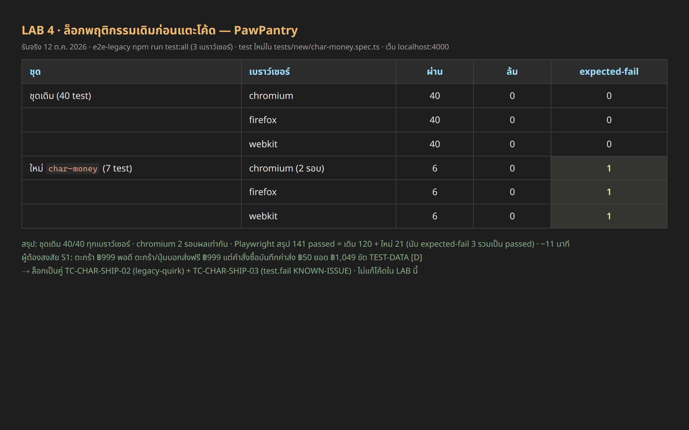

👀 **สังเกต**
- **รันชุดเดิมก่อนแตะโค้ดเสมอ** ไม่มีผล "ก่อน" จะแยกไม่ออกว่าข้อที่ล้มทีหลังพังเพราะเราหรือพังมาแต่แรก
- **ชุดเดิมเขียว 120/120 บน build ที่มีบั๊กเงิน** regression ผ่าน ≠ กฎเงินถูก · ชุดเดิมตรวจเงินแทบทั้งหมดแค่หน้าตะกร้า (ตรง [D]) และชื่อเทสต์ ≠ สิ่งที่ตรวจ · ตรวจตะกร้าเดียวกัน 4 จุดจึงเจอ S1 ก่อนลูกค้าแจ้ง
- **golden master ล็อกเฉพาะที่เลือกดู** ไม่เลือกค่าขอบของกฎ ช่องว่างก็ยังอยู่แม้เทสต์ใหม่เขียว
- ⚠️ **ล็อกพฤติกรรมเดิม ≠ ยอมรับว่าถูก** [E] ที่ขัด [D] → เทสต์คู่ `legacy-quirk` + `test.fail()` KNOWN-ISSUE + "ผู้ต้องสงสัย" · ยังไม่แก้โค้ด รอหลักฐาน LAB 5
- **Playwright นับ expected-fail รวมใน "passed"** บรรทัดสรุปไม่บอกจำนวน `test.fail()` ที่ล้มตามคาด · reporter `list` แสดง `x` แต่ HTML report แสดง ✓ Passed → นับจาก tag `@known-issue` หรือจากตัวเทสต์
- **สต็อกเป็นของร่วม** `test:all` reset ครั้งเดียวแล้วรัน 3 เบราว์เซอร์พร้อมกัน → ชิ้นที่ซื้อ × 3 ต้องไม่เกินสต็อก ไม่งั้น 409 "สินค้าไม่พอ" แบบสุ่ม
- **ฟิลด์ที่ตัดออกจาก golden ต้องพิสูจน์** `GET /api/products` ก่อน/หลัง reset ต่างแค่ `stock` จึงตัดแค่ `stock` · ตัดมากไป golden ก็ไม่ล็อกอะไร
- **ค่าขอบบอกขอบเขตอาการ** ฿998 และ ฿999 ส่งด่วนตรงทุกจุด ผิดเฉพาะ ฿999 ส่งธรรมดา · PAW10 ปัดลง (฿69 → ฿6 · ฿999 → ฿99) ล็อกเป็น [E] ได้ เพราะ [D] ไม่ได้บอกวิธีปัด

✔️ **ไปต่อได้เมื่อ:** ชุดเดิมรันครบ 3 เบราว์เซอร์ · `tests/new/char-money.spec.ts` + `golden/` · ผล chromium 2 รอบเท่ากัน · ไม่มีค่าที่ขัด [D] ถูกล็อกเป็นผลที่คาดหวัง

---

## LAB 5 · BUG-01: ทำซ้ำ → test แดง → หาต้นเหตุ

🎯 ✏️ **เพิ่มเทสต์ที่แดง** · ข้อความลูกค้า → ทำซ้ำแบบ **black-box ก่อน** (+ HAR) → เทสต์แดงตาม [D] → white-box หาต้นเหตุ → impact 2 วิธี → `BUG-01.md` (ยังไม่แก้โค้ดเว็บ)


💬 **คัดลอกพรอมต์นี้** (ข้อความลูกค้าอยู่ท้ายพรอมต์แล้ว)

```text
มีลูกค้าแจ้งปัญหา (ข้อความอยู่ท้ายพรอมต์) ช่วยทำซ้ำให้เห็นกับตา เขียนเทสต์ที่ "แดง" ตามอาการ แล้วหาสาเหตุ เขียน BUG-01.md ที่โฟลเดอร์บท · ขั้นนี้ยังไม่ต้องแก้โค้ดเว็บ
(ห้ามแก้ petshop/ · ห้ามแก้ไฟล์เดิมใน e2e-legacy/ · ห้ามเปิด _solution/ fast_track/ และ README.md ของโฟลเดอร์บท (มีเฉลย)
 สคริปต์ชั่วคราวเก็บใน rea\scratch\ (ไฟล์ .mjs ที่ import จาก "playwright" ได้เพราะใช้ rea\node_modules) · รันคำสั่ง shell ด้วย PowerShell จากโฟลเดอร์บท · ถ้ามีแต่ bash ให้เขียนคำสั่งลงไฟล์ rea\scratch\run.ps1 แล้วรัน powershell -NoProfile -ExecutionPolicy Bypass -File rea\scratch\run.ps1)
ถ้า BASELINE.md หรือ CODEBASE-MAP.md มีผู้ต้องสงสัยเรื่องนี้อยู่แล้ว ให้ถือเป็นสมมติฐานที่ต้องพิสูจน์ ไม่ใช่คำตอบ · ขั้นนี้ต้องได้หลักฐานใหม่: ตะกร้าของลูกค้าตรงตัว · ยอดใน /account · HAR
ขั้นที่ 1 black-box (ยังไม่เปิดโค้ดใน petshop/ และยังไม่ใช้ CODEBASE-MAP.md ส่วน D): ทำตามที่ลูกค้าเล่าบน http://127.0.0.1:4000 (= localhost:4000 · ใช้ 127.0.0.1 เพราะ REA ไม่รับ HAR ที่อัดผ่าน localhost) ด้วย Playwright แบบ headless (สคริปต์ใน rea\scratch\)
   บันทึก HAR รอบนี้ไว้ที่ out\bug01.har ด้วย recordHar ของ browser context แบบเก็บเฉพาะ API: recordHar: { path: "out/bug01.har", urlFilter: /\/api\// } (ไม่กรองจะได้ไฟล์ ~40 MB)
   reset ข้อมูลก่อนเริ่มทุกรอบ (POST /api/test/reset) เพราะสินค้าบางตัวสต็อกน้อย (ชามกินช้า 18 ใบ) รันซ้ำหลายรอบจะเจอ 409 "สินค้าไม่พอ"
   - ดูเงิน 4 จุด: ตะกร้า · ปุ่มยืนยันสั่งซื้อ · response ของ POST /api/orders · หน้าคำสั่งซื้อ และยอดใน /account
   - ลองตะกร้าข้างเคียง: ยอดต่ำกว่า/สูงกว่า 1 บาท · ใช้คูปองใน TEST-DATA.md · ส่งด่วน แล้วทำตารางว่าผิดเฉพาะกรณีไหน
   - คำนวณผลที่ถูกเองจาก TEST-DATA.md [D] ก่อนเทียบกับเว็บ พร้อมวิธีคิด · กรณีที่ [D] ไม่พอจะคำนวณ (เช่นส่งฟรีนับก่อนหรือหลังหักส่วนลด) อย่าเดาตัวเลข ให้ใช้ oracle [R] "ยอดบนปุ่มยืนยัน = ยอดในคำสั่งซื้อ" และจดคำถามไว้ใน "ยังไม่รู้"
ขั้นที่ 2 เขียน e2e-legacy/tests/new/bug01-shipping.spec.ts ชื่อเทสต์ขึ้นต้น BUG-01 · ผลที่คาดหวังตาม [D] หรือ [R] เท่านั้น (ห้ามลอกจากเว็บ) · ต้องมีข้อที่ตรวจว่า "เงินบนปุ่มยืนยัน = เงินในคำสั่งซื้อ"
   รันบน chromium ต้อง "แดง" ด้วยเหตุผลที่ตรงอาการ · ถ้าเทสต์ใน tests/new/ ข้อไหนล็อกเรื่องนี้ไว้แล้ว (legacy-quirk / KNOWN-ISSUE) ให้บอก
ขั้นที่ 3 white-box: ตอนนี้เปิดโค้ดได้ หาต้นเหตุ (ไฟล์:บรรทัด) อธิบายว่าทำไมหน้าเว็บกับคำสั่งซื้อคิดไม่เท่ากัน
   คอมเมนต์ในโค้ดตรงนั้นพูดจริงไหม ให้ตรวจจาก HAR ว่า browser ส่งอะไรไปให้ server จริง
ขั้นที่ 4 impact: เสนอวิธีแก้อย่างน้อย 2 แบบ ตาราง วิธีแก้ | ไฟล์:บรรทัดที่แตะ | ใครเรียกใช้ | ผลต่อกฎอื่นและฟีเจอร์ในอนาคต | เทสต์ที่ต้องรันซ้ำ | ความเสี่ยง แล้วแนะนำ 1 แบบพร้อมเหตุผล
BUG-01.md: อาการ · ขั้นตอนทำซ้ำ · ตาราง กรณี | ผลที่คาดหวัง [D] | ผลจริง [E] (ไฟล์หลักฐาน) · ต้นเหตุ · ตาราง impact · ทำไมชุดเทสต์เดิมจับไม่ได้
ไม่แน่ใจให้เขียนใน "ยังไม่รู้" อย่าเดา · สรุปเป็นตาราง: กรณี | ตะกร้า | ปุ่ม | คำสั่งซื้อ | ถูกไหม

--- ข้อความจากลูกค้า ---
📩 เรื่อง: โดนเก็บเงินเกินจากที่หน้าเว็บบอก
สวัสดีค่ะ เมื่อวานสั่งของในร้าน ไม้ตกแมว 1 อัน กับชามกินช้า 3 ใบ ในตะกร้าขึ้นว่า "ได้ส่งฟรีแล้ว!" ตอนกดปุ่มก็เขียนว่า "ยืนยันสั่งซื้อ ฿999"
แต่พอสั่งเสร็จ หน้าคำสั่งซื้อกับในประวัติบัญชีกลับเป็น ฿1,049 ค่ะ เก็บเงินปลายทางด้วย กลัวไรเดอร์เก็บเกิน ฝากตรวจสอบให้หน่อยนะคะ
ก่อนหน้านี้สั่งยอดพันกว่าบาทไม่เคยเป็นแบบนี้
— คุณนุ่น (สั่งในระบบจริงของร้าน · เลขคำสั่งซื้อนั้นไม่มีในเครื่องทดสอบของเรา)
```

✅ **ผลจริง** `BUG-01.md` ครบ 6 หัวข้อ (+ "ยังไม่รู้") · ทำซ้ำ black-box **7 กรณี ผิด 2** · เทสต์ BUG-01 **แดง 3 / เขียว 6** ด้วยเหตุผลเรื่องเงินทั้งหมด · `out\bug01.har` 2,447 entries (~40 MB · รอบจริงก่อนแก้พรอมต์อัดแบบ**ไม่กรอง** · พรอมต์ฉบับนี้ใส่ `urlFilter` เก็บเฉพาะ `/api/` ไฟล์จะเล็กกว่ามาก) · ~10 นาที

| กรณี | ตะกร้า | ปุ่ม | คำสั่งซื้อ (response · หน้าคำสั่งซื้อ · `/account`) | ถูกไหม |
|---|---|---|---|---|
| ฿999 ส่งธรรมดา (ตะกร้าคุณนุ่น: ไม้ตกแมว 1 + ชามกินช้า 3) | ฟรี · ฿999 | ฿999 | ค่าส่ง ฿50 · **฿1,049** | ❌ |
| ฿998 ส่งธรรมดา | ฿998 + ฿50 = ฿1,048 | ฿1,048 | ฿50 · ฿1,048 | ✅ |
| ฿1,000 ส่งธรรมดา | ฟรี · ฿1,000 | ฿1,000 | ฟรี · ฿1,000 | ✅ |
| ฿999 + PAW10 | ฿999 − ฿99 = ฿900 · ฟรี | ฿900 | ฿50 · **฿950** | ❌ |
| ฿999 + FREESHIP | ฟรี · ฿999 | ฿999 | ฟรี · ฿999 | ✅ |
| ฿999 ส่งด่วน | (ตะกร้ายังเลือกด่วนไม่ได้) | ฿999 + ฿120 = ฿1,119 | ฿120 · ฿1,119 | ✅ |
| ฿998 + PAW10 | ฿998 − ฿99 + ฿50 = ฿949 | ฿949 | ฿50 · ฿949 | ✅ |

**ต้นเหตุ** `petshop/lib/orders.ts:63-67` (บล็อก `// PP-231`) คิดค่าส่งซ้ำฝั่ง server ด้วย `subtotal > 999` แล้วเขียนทับยอด ขณะที่ `lib/pricing.ts:130-133` `shippingCost()` ใช้ `>=` · คอมเมนต์อ้างว่า "must not trust the shipping fee shown in the browser" แต่ body ของ `POST /api/orders` ใน HAR **ไม่มีค่าส่งหรือยอดเงิน** → คอมเมนต์ไม่จริง

| วิธีแก้ที่เสนอ | แตะ | ผลต่ออนาคต | ความเสี่ยง |
|---|---|---|---|
| **A · ลบบล็อกซ้ำ** ให้ server ใช้ `computeTotals` ตรง ๆ ⭐ แนะนำ | `lib/orders.ts:4-5` `:63-67` | กฎค่าส่งเหลือที่เดียว · ฟีเจอร์ใหม่ที่บวกเข้ายอดจะไม่ถูกเขียนทับ | ต่ำ |
| B · เปลี่ยน `>` เป็น `>=` | `lib/orders.ts:65` | ปิดอาการ ฿999 ได้ แต่กฎยังอยู่ 2 ที่ และยังเขียนทับยอด | กลาง |
| C · ให้บล็อกเรียก `shippingCost()` | `lib/orders.ts:3-10,65` | กฎตัวเลขที่เดียว แต่ยังเขียนทับยอดเหมือน B | กลาง |

| 🧾 ตาราง ตะกร้า · ปุ่ม · คำสั่งซื้อ | 🖥️ หน้าคำสั่งซื้อที่ยอดไม่ตรงปุ่ม | 🎬 เทสต์ BUG-01 แดงบน chromium |
|---|---|---|
| 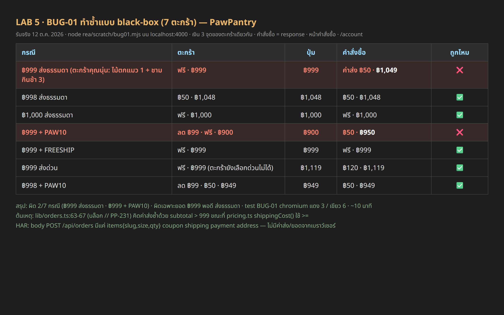 | 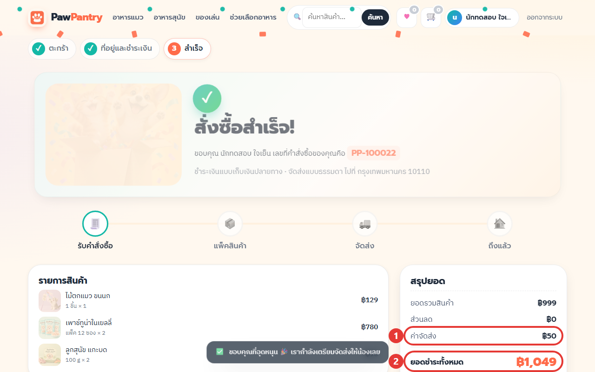 |  |

ภาพกลาง = ตะกร้า ฿999 อีกชุดในรอบจริง (ไม้ตกแมว + ทูน่า + แกะบด) อาการเดียวกับตะกร้าคุณนุ่น

👀 **สังเกต**
- **ทำซ้ำแบบ black-box ก่อนเปิดโค้ด** แม้ LAB 1 หรือ 4 ชี้ผู้ต้องสงสัยแล้ว · ได้**หลักฐานใหม่** (ตะกร้าลูกค้าตรงตัว · ยอดใน `/account` · ±1 บาท · HAR)
- **[D] ไม่พอ ใช้ [R] แทนการเดา** ส่งฟรีนับก่อนหรือหลังหักส่วนลด TEST-DATA ไม่บอก → ใช้ "ยอดบนปุ่ม = ยอดในคำสั่งซื้อ" แล้วจดคำถามถึงร้าน
- **HAR เก็บเฉพาะ API ก็พอ** `urlFilter: /\/api\//` เหลือเฉพาะสิ่งที่ browser ส่งให้ server = หลักฐานที่ต้องใช้
- **ตะกร้าข้างเคียงชี้เงื่อนไขที่ผิด** ±1 บาทและ ฿999 ส่งด่วนตรงทุกจุด (PP-231 ทำงานเฉพาะส่งธรรมดา `orders.ts:64`) → ผิดเฉพาะ "ส่งธรรมดา + 999 พอดี" = `>` ที่ควรเป็น `>=`
- **คอมเมนต์ในโค้ดเป็นคำอ้าง ไม่ใช่หลักฐาน** body ใน HAR ทั้ง 7 ครั้ง (เช่น `{"coupon":null,"shipping":"standard","payment":"cod"}`) ไม่มีค่าส่งให้ "ไม่เชื่อ" → โค้ดที่อ้างความปลอดภัยกลับเป็นต้นเหตุ
- **เทสต์แดงต้องแดงด้วยเหตุผลเรื่องเงิน** แดงเพราะ timeout หรือหา element ไม่เจอ = เทสต์เขียนผิด
- ⚠️ **เลขคำสั่งซื้อของลูกค้าเป็นของระบบจริง** เลขที่ซ้ำในเครื่องเราเป็นของคำสั่งซื้ออื่น
- ⚠️ **HAR ของ LAB นี้มีรหัสผ่านของผู้ใช้ทดสอบที่สมัครใหม่** ไม่ใช่แค่บัญชี demo → `out\bug01.har` ห้าม commit หรือส่งต่อ (`.gitignore` กัน `out/` `*.har` แล้ว)

✔️ **ไปต่อได้เมื่อ:** `BUG-01.md` ครบ 6 หัวข้อ · เทสต์ BUG-01 แดงด้วยเหตุผลเรื่องเงิน (ไม่ใช่ timeout/locator) · มี `out\bug01.har`

---

## LAB 6 · แก้ BUG-01 ที่ต้นเหตุ

🎯 ✏️ **แก้โค้ดแอป** · เลือกวิธีจาก impact ใน `BUG-01.md` → แก้เล็กที่สุด → build → เทสต์ BUG-01 **แดงเป็นเขียว** · ชุดเดิมไม่พัง → หัวข้อ "แก้แล้ว"

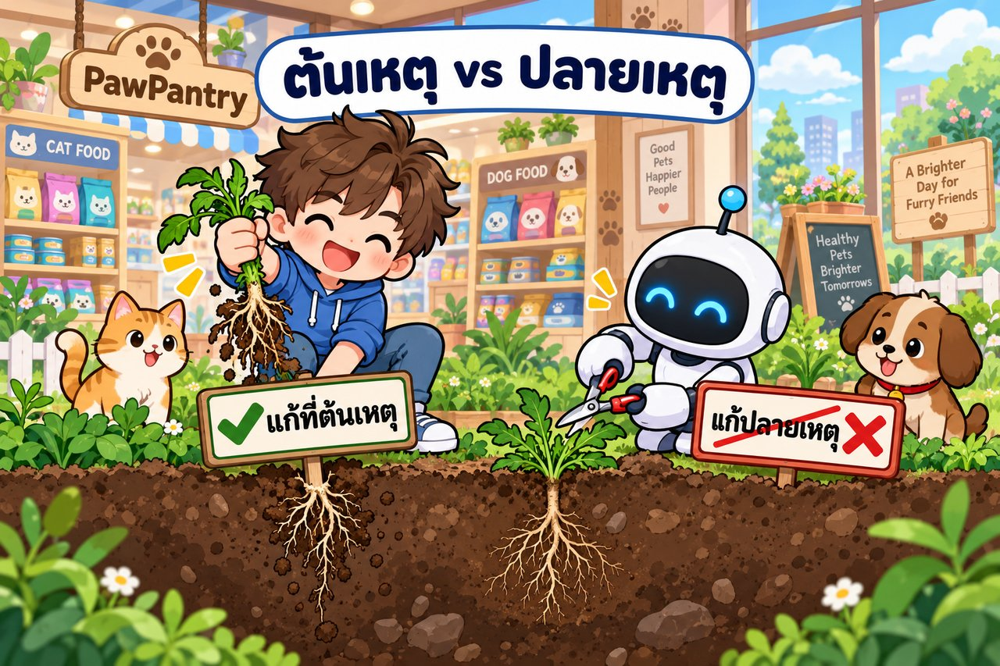

💬 **คัดลอกพรอมต์นี้**

```text
แก้ BUG-01 ตามวิธีที่แนะนำใน BUG-01.md · ก่อนเริ่มให้ถามผมก่อนว่าจะใช้วิธีไหน
(ห้ามแก้ไฟล์เดิมใน e2e-legacy/ · ห้ามแก้ผลที่คาดหวังใน tests/new/bug01-shipping.spec.ts · ห้ามเปิด _solution/ fast_track/ และ README.md ของโฟลเดอร์บท (มีเฉลย)
 รันคำสั่ง shell ทุกตัวด้วย PowerShell จากโฟลเดอร์บท · ถ้ามีแต่ bash ให้เขียนคำสั่งลงไฟล์ rea\scratch\run.ps1 แล้วรัน powershell -NoProfile -ExecutionPolicy Bypass -File rea\scratch\run.ps1
 คำสั่งที่เขียนว่า "นาน" ให้ตั้ง timeout อย่างน้อย 10 นาที หรือรันเบื้องหลังแล้วรอจนจบ ห้ามสั่งซ้ำระหว่างรอ)
1. ก่อนแก้: แสดงไฟล์และบรรทัดที่จะแตะ เทียบกับตาราง impact ใน BUG-01.md · ถ้าแตะเกินตารางต้องบอกเหตุผล
2. แก้ให้เล็กที่สุด แล้ว build เว็บใหม่: ในโฟลเดอร์ petshop รัน docker compose up -d --build (นาน 1–3 นาที) รอจน healthy
3. รัน tests/new/bug01-shipping.spec.ts บน chromium ต้องผ่าน
   ถ้ามีเทสต์คู่ใน tests/new/ ที่ล็อกพฤติกรรมเดิมของเรื่องนี้ไว้ (legacy-quirk) หรือ KNOWN-ISSUE ที่ตอนนี้ขึ้น "Expected to fail, but passed"
   ข้อยกเว้นเดียวที่แก้เทสต์ได้: ปรับเทสต์คู่นั้นตามพฤติกรรมที่ตั้งใจเปลี่ยน (ทั้งค่าและ tag/annotation เช่น legacy-quirk → bug01-fixed · เอา test.fail() ออก) แล้วจดเหตุผลอ้าง BUG-01
4. รันชุดเดิม + tests/new ทั้งหมดบน chromium · ถ้ามีข้อล้มให้หยุดบอกผม
5. ยิง API ซ้ำทุกกรณีในตารางของ BUG-01.md แล้วจดผลใหม่ · ถ้าใช้สคริปต์เดิมที่เขียนผลทับไฟล์ใน out\ ให้คัดผลก่อนแก้ไปไว้ที่ out\bug01-before-fix\ ก่อนรัน (หลักฐาน "ก่อน" ต้องยังอยู่)
6. เพิ่มใน BUG-01.md หัวข้อ "แก้แล้ว": บรรทัดที่เปลี่ยน (ทีละไฟล์: git diff --no-index out\v1\<ไฟล์> petshop\<ไฟล์> · exit 1 = มีความต่าง ไม่ใช่ error · ห้าม diff ทั้งโฟลเดอร์เพราะ out\v1 มี node_modules และ .next) · ผลเทสต์ก่อน/หลัง · ตารางกรณีเดิมหลังแก้
ทุกค่าต้องมาจากที่รันจริง · สรุปเป็นตาราง: เทสต์หรือกรณี | ก่อนแก้ | หลังแก้
```

> เลือกวิธีด้วย 2 คำถาม: **หลังแก้ กฎเงินเหลือกี่ที่?** · **เอาต้นเหตุออกจริง หรือแค่ทำตัวเลขกรณีนี้ให้ถูก?** ไม่เห็นด้วยกับ `BUG-01.md` ให้ Claude จดเหตุผล

✅ **ผลจริง** **วิธี A ลบบล็อกซ้ำ** · แตะ**ไฟล์เดียว** `petshop/lib/orders.ts` **+1 −7** (ลบ 2 import + คอมเมนต์ PP-231 + บล็อก if 4 บรรทัด · เพิ่มคอมเมนต์อ้าง BUG-01) · build 12 วิ · ~6 นาที

| เทสต์หรือกรณี | ก่อนแก้ | หลังแก้ |
|---|---|---|
| `bug01-shipping.spec.ts` (9) | 3 failed · 6 passed | **9 passed** |
| ชุดเดิม 40 · chromium ทั้งชุด (40 + ใหม่ 16) | 40 passed | 40 passed · **56 passed** · 0 failed · 0 flaky (24.8 วิ) |
| ฿999 ส่งธรรมดา (ค่าส่ง · ยอดจาก `POST /api/orders`) | ฿50 · ฿1,049 ❌ | **฿0 · ฿999** ✅ |
| ฿999 + PAW10 | ฿50 · ฿950 ❌ (ปุ่ม ฿900) | **฿0 · ฿900** ✅ |
| ฿998 · ฿1,000 · ฿999 + FREESHIP · ฿999 ส่งด่วน · ฿998 + PAW10 | ฿50 · ฿1,048 · ฿0 · ฿1,000 · ฿0 · ฿999 · ฿120 · ฿1,119 · ฿50 · ฿949 | เท่าเดิม |

**เทสต์คู่จาก LAB 4 พลิกตามคาด (ข้อยกเว้นเดียวที่แก้เทสต์ได้ เพราะพฤติกรรมตั้งใจเปลี่ยน):** TC-CHAR-SHIP-02 (`legacy-quirk` ล็อก ฿1,049) แดง → ปรับเป็น {0, 999} + tag `@bug01-fixed` + annotation `changed-by-BUG-01` · TC-CHAR-SHIP-03 ขึ้น "Expected to fail, but passed" → เอา `test.fail()` ออก · จดเหตุผลใน `BUG-01.md`

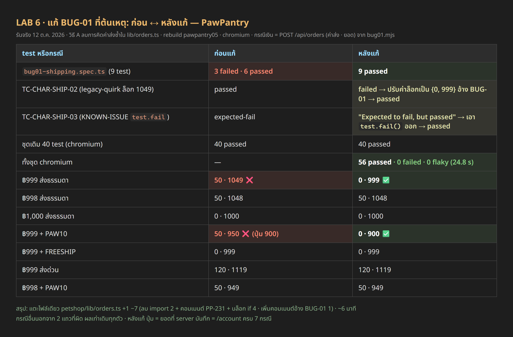

👀 **สังเกต**
- **ปิดอาการได้ ≠ แก้ที่ต้นเหตุ** ตัวเลขถูก แต่ถ้ายังเหลือโค้ดคิดเงินซ้ำ จะพังอีกเมื่อเพิ่มฟีเจอร์ที่แตะยอดรวม
- **ตรวจขอบเขตด้วยคำสั่ง ไม่ใช่คำบอกของ agent** ก่อนแก้แสดงไฟล์เทียบตาราง impact · รอบจริง `git status --short petshop` ขึ้นไฟล์เดียว · `--numstat` = `1 7` ตรงแถว A → ไฟล์เกินตาราง = แก้เกินขอบเขต
- **แก้เทสต์คู่ต้องแก้ทั้งค่าและ tag พร้อมเหตุผลอ้าง BUG-01** ไม่ใช่แก้เงียบ ๆ
- **เก็บหลักฐาน "ก่อนแก้" ก่อนรันซ้ำ** สคริปต์ LAB 5 เขียนทับ `out\` → คัดไป `out\bug01-before-fix\` · `git diff --no-index` exit 1 = มีความต่าง ไม่ใช่ error · diff ทีละไฟล์ ไม่งั้นเจอ `node_modules` กับ `.next` เป็นหมื่นไฟล์
- **แก้บั๊กแล้วพฤติกรรมข้างเคียงเปลี่ยนด้วย** ฿999 + PAW10 = ฿900 (ส่งฟรีนับยอดก่อนหักส่วนลด) ซึ่ง [D] ไม่ได้กำหนด · ยังเป็นคำถามถึงร้าน → ความเสี่ยงคงค้างใน LAB 9

✔️ **ไปต่อได้เมื่อ:** เทสต์ BUG-01 เขียว · ชุดเดิมไม่มีข้อล้ม · `BUG-01.md` มีหัวข้อ "แก้แล้ว"

---

## LAB 7 · CR-01: ถามก่อน → impact → test แดงก่อน

🎯 ✏️ **เพิ่มเทสต์ที่แดง** · ร้านขอห่อของขวัญ → **ถามร้านก่อน** เรื่องที่ใบ CR ไม่ชัด → impact ทุกจุดที่คำนวณและแสดงเงิน → TC-GIFT ค่าขอบ ±1 บาท **แดงเพราะยังไม่มีฟีเจอร์** → `CR-01.md`


💬 **คัดลอกพรอมต์นี้** (ใบ Change Request อยู่ท้ายพรอมต์แล้ว)

```text
ร้านขอฟีเจอร์ใหม่ CR-01 (ใบขออยู่ท้ายพรอมต์) ขั้นนี้ยังไม่แก้โค้ดเว็บ ให้เตรียม 3 อย่าง: คำถามถึงร้าน · impact · เทสต์ที่แดงก่อน แล้วเขียน CR-01.md
(ห้ามแก้ petshop/ · ห้ามแก้ไฟล์เดิมใน e2e-legacy/ · ห้ามเปิด _solution/ fast_track/ และ README.md ของโฟลเดอร์บท (มีเฉลย) · รันคำสั่ง shell ด้วย PowerShell
 ทุกค่าต้องมาจากราคาจริงในเว็บหรือ API (อ่าน API ด้วย node fetch ไม่ใช้ Invoke-RestMethod เพราะชื่อภาษาไทยเพี้ยน) · ตัวเลขเงินคำนวณเองพร้อมวิธีคิด ห้ามเดา)
1. ทำตาราง "ต้องถามร้าน": เรื่องที่ใบ CR ยังไม่ชัด | ตีความได้กี่แบบ | ยอดเงินต่างกันเท่าไร (ยกตะกร้าที่มีจริงในร้าน) · ถามผมก่อน แล้วจดคำตอบลง CR-01.md
2. impact analysis จาก CODEBASE-MAP.md + โค้ดจริง: ไฟล์ที่ต้องแตะ | ทำไม | ใครเรียกใช้ (ผลค้นหา) | หน้า/API ที่กระทบ | เทสต์เดิมที่ต้องรันซ้ำ | ความเสี่ยง
   เพิ่มรายการ "ไฟล์ที่ไม่ต้องแตะ แต่ตรวจแล้ว" · ระวังจุดที่คำนวณหรือแสดงเงินมากกว่า 1 ที่
   ตาที่สองจากของที่ build แล้ว: node rea
ea-input.mjs trace out1-server.json string api/orders incoming out	race-orders.in.json แล้ว powershell -NoProfile -ExecutionPolicy Bypass -File .
ea
ea.ps1 -Out out	race-orders.json trace-application-feature /work/out/trace-orders.in.json --json (~10 วินาที · ห้ามเปิด .json ใน out/ ตรง ๆ ย่อด้วย node rea
ea-summarize.mjs out	race-orders.json)
   ไฟล์ต้นทาง (source_files) และ chunk ที่ trace เจอต้องอยู่ในตาราง impact หรือในรายการ "ตรวจแล้ว" · trace เห็นแค่ส่วนที่ build ต่อถึงกัน (coverage partial) ไฟล์ที่ trace ไม่เจอจึงไม่ได้แปลว่าไม่กระทบ
3. ออกแบบ TC-GIFT-xx จากใบ CR + คำตอบร้าน: ค่าขอบ ±1 บาท · ผสมคูปองและส่งด่วน · ติ๊กแล้วเอาออก · API ส่ง giftWrap ผิดชนิด (ตรวจทั้งยอด และ field giftWrap = false · giftWrapFee = 0 ใน response) · เงินตรง 4 จุด (checkout · ปุ่ม · response · หน้าคำสั่งซื้อและ /account)
   ตาราง ID | AC | ตะกร้า | ผลที่คาดหวังพร้อมวิธีคิด | ที่มา [D] · ราคาสินค้าดูจากเว็บหรือ API จริง ตะกร้าต้องหาได้จริงในร้าน
   สต็อกเป็นของร่วม: จำนวนชิ้นที่เทสต์ทั้งไฟล์ซื้อจริงรวมกัน (รวมกับเทสต์อื่นใน tests/new/ ที่ซื้อสินค้าตัวเดียวกัน) × 3 เบราว์เซอร์ ต้องไม่เกินสต็อกหลัง reset (ดู stock จาก GET /api/products) · ตะกร้าของ API test ที่ซื้อซ้ำหลายข้อให้ใช้สินค้าสต็อกมาก
4. เขียนเทสต์ทั้งหมดใน e2e-legacy/tests/new/cr01-giftwrap.spec.ts แล้วรันบน chromium
   ตั้ง timeout สั้นในไฟล์เทสต์เอง (test.use({ actionTimeout: 3_000 }) และ expect.configure({ timeout: 3_000 })) เพราะ config เดิมรอ expect 8 วินาที · ห้ามแก้ playwright.config.ts
   ทุกข้อควรแดงเพราะ "ยังไม่มีฟีเจอร์" ไม่ใช่เพราะเทสต์เขียนผิด · ข้อไหนเขียวตั้งแต่ตอนนี้ให้บอกว่าเป็น guard ที่ถูกต้อง หรือเทสต์อ่อนไป
CR-01.md: ใบ CR · คำถาม + คำตอบร้าน · impact · TC · ผลรอบแรก (แดงเพราะอะไร)
สรุปเป็นตาราง: TC | AC | ผลที่คาดหวัง | ผลรอบแรก | เหตุผล

--- ใบ Change Request ---
CR-01 · บริการห่อของขวัญ (จากเจ้าของร้าน)
ลูกค้าหลายคนซื้อเป็นของขวัญ อยากให้เลือก "ห่อของขวัญ" ได้ตอนชำระเงิน คิดค่าห่อ ฿30 ถ้าซื้อครบ ฿1,500 ห่อให้ฟรี
AC1 หน้า /checkout มี checkbox ห่อของขวัญ data-testid="gift-wrap" ค่าเริ่มต้นไม่ติ๊ก
AC2 ติ๊กแล้ว สรุปยอดมีแถว "ห่อของขวัญ" data-testid="summary-giftwrap" แสดง ฿30 หรือ ฟรี · summary-total และปุ่ม place-order รวมค่าห่อทันที · ไม่ติ๊ก = ไม่มีแถวนี้
AC3 ยอดชำระ = ยอดสินค้า − ส่วนลด + ค่าส่ง + ค่าห่อ · server คำนวณเองทุกครั้ง
AC4 POST /api/orders รับ giftWrap: true (boolean เท่านั้น ค่าอื่นถือว่าไม่ห่อ) · response และ GET /api/orders/[id] มี giftWrap (boolean) และ giftWrapFee (ตัวเลข)
AC5 หน้า /orders/[id] แสดงแถวห่อของขวัญตรงกับที่สั่ง · ยอดใน /account ตรงกับหน้าคำสั่งซื้อ
AC6 เทสต์เดิมที่ผ่านอยู่ต้องยังผ่าน
```

<details>
<summary>📒 คำตอบของเจ้าของร้าน (เปิดดูหลังจาก Claude ถามแล้วเท่านั้น)</summary>

| ถ้า Claude ถามเรื่อง | ร้านตอบ [D] |
|---|---|
| ฿1,500 ดูยอดก่อนหรือหลังหักส่วนลด | **ก่อนหักส่วนลด** (แบบเดียวกับเกณฑ์ส่งฟรีใน TEST-DATA.md) |
| ค่าห่อนับเข้ายอดส่งฟรี / ขั้นต่ำของคูปองไหม | **ไม่นับ** |
| PAW10 ลดค่าห่อด้วยไหม · FREESHIP ยกเว้นค่าห่อไหม | **ไม่ลด · ไม่ยกเว้น** |
| ค่าห่อต่อคำสั่งซื้อหรือต่อชิ้น | **ต่อคำสั่งซื้อ** |
| เรื่องอื่นที่ไม่มีในตารางนี้ | "ใช้แบบที่ง่ายที่สุดที่ไม่ขัดกับข้อบน แล้วติด ⚠️ สมมติฐาน" |

</details>

⚠️ อ่าน ✅ หลังทำ LAB เสร็จ (ภาพผลด้านล่างมีคำตอบร้าน)

✅ **ผลจริง** ถามร้าน **8 ข้อ** (ร้านตอบ 6 · ⚠️ สมมติฐาน 2) · impact **6 ไฟล์ที่ต้องแตะ** + ตรวจแล้ว 8 ไฟล์ (ผลค้นผู้เรียก 76 บรรทัด) · TC-GIFT **21 เทสต์** · รอบแรก **แดง 18 / เขียว 3 (guard)** 30.3 วิ · ~7 นาที

| ต้องถามร้าน (ตัวอย่าง) | ตะกร้า | แบบ ก ↔ แบบ ข |
|---|---|---|
| Q1 ครบ ฿1,500 ดูก่อนหรือหลังส่วนลด | ฿1,500 + PAW10 ห่อ | **฿1,350** ↔ **฿1,380** · ต่าง ฿30 |
| Q2 ค่าห่อนับเข้าเกณฑ์ส่งฟรีไหม | ฿998 ห่อ | **฿1,078** ↔ **฿1,028** · ต่าง ฿50 |
| Q4 PAW10 ลดค่าห่อด้วยไหม | ฿189 + PAW10 ห่อ | **฿251** ↔ **฿248** (ต่างแค่ ฿3) |
| Q7 ครบ ฿1,500 ใช้ ≥ หรือ > | ฿1,500 ห่อ | ฿1,500 ↔ ฿1,530 · ⚠️ สมมติฐาน |

| TC | AC | ผลที่คาดหวัง | รอบแรก |
|---|---|---|---|
| TC-GIFT-03 · 04 ค่าขอบ | AC2 AC3 AC5 | ฿1,499 + ฿30 = **฿1,529** · ฿1,500 ห่อฟรี = **฿1,500** ตรง 4 จุด | ❌ ไม่มี `gift-wrap` |
| TC-GIFT-12 ×4 | AC4 | `"true"` `1` `"yes"` `null` → `false` · fee 0 · ฿239 | ❌ ×4 ไม่มี field |
| TC-GIFT-13 | AC4 | ส่งผิดชนิด → ยอด ฿239 | ✅ guard ที่ถูก |

แดง 18 = ไม่มี `gift-wrap` 9 + ไม่มี `giftWrap`/`giftWrapFee` 9 · เขียว 3 = guard (TC-13 · 17 · 18) · impact เจอ `app/orders/[id]/page.tsx:104-123` **เขียนสรุปเงินเอง** ไม่ใช้ `SummaryRows` → แก้แค่ `OrderSummary.tsx` AC5 จะไม่ผ่าน

![LAB 7 · CR-01 impact ก่อนแก้ · ① ไฟล์ · ผู้เรียก · หน้า/API · orders/[id]/page.tsx เขียนสรุปเงินเอง · ตรวจแล้ว 8 ไฟล์ · ② ถามร้าน Q1–Q8 · test แดงก่อน 18 failed 3 passed](img/lab7-impact.png)

👀 **สังเกต**
- **ถามก่อนสร้าง และถามเป็นตัวเลข** "ตีความ 2 แบบ ยอดต่างเท่าไร" ร้านตอบง่ายกว่าคำถามลอย ๆ
- **impact มาจากการค้นโค้ด ไม่ใช่เดาจากชื่อไฟล์** ครอบจุด **คำนวณ** และ **แสดง** เงิน (ระบบเก่ามักมีหน้าที่เขียนสรุปเงินเอง) · "ไฟล์ที่ไม่ต้องแตะ แต่ตรวจแล้ว" บอกว่าตรวจแล้ว ไม่ใช่ลืม
- **แดงก่อนต้องแดงด้วยเหตุผลที่ถูก** "ยังไม่มีฟีเจอร์" = ถูก · หา element หรือคิดผลคาดหวังผิด = เทสต์ใหม่เขียนผิด · ตรวจจากยอดที่ server คืนตอนแดง: 239 · 428 · 221 · 539 ตรงยอดฐาน (189+50 · 378+50 · 189−18+50 · 489+50)
- **ข้อที่เขียวก่อนมีฟีเจอร์อาจเป็น guard ที่ถูก** (ค่าผิดชนิด = ไม่ห่อ) · ถ้าตรวจ field `giftWrap`/`giftWrapFee` ด้วยจะแดงจนกว่ามีฟีเจอร์
- **ออกแบบตะกร้าโดยคิดถึงสต็อก** ชิ้นที่ซื้อ × 3 เบราว์เซอร์ ≤ สต็อกหลัง reset ไม่งั้น LAB 8 เจอ 409 ทั้งที่โค้ดถูก
- **golden ของ LAB 4 บอกว่าควรวางกฎใหม่ตรงไหน** ใส่ค่าห่อใน `evaluateCoupon` แทน `computeTotals` → golden `coupons-validate.json` เปลี่ยน `char-money` แดง · เทสต์ที่ล็อกไว้ก่อนเป็นทั้งตาข่ายและแผนที่ impact
- **trace เป็นตาที่สองของ impact** (ขั้น trace `api/orders` incoming เพิ่มหลังรอบถ่ายทำ) ทดสอบกับ `out\v1-server.json` รอบจริง (~9.5 วิ): 26 node · source_files 2 ไฟล์ (`app/api/orders/route.ts` · `app/api/orders/[id]/route.ts`) + chunk ssr ของ `CheckoutForm` · ไม่เห็น `lib/pricing.ts` `lib/orders.ts` (coverage partial) → ยืนยันผู้เรียก แต่ไม่แทนการค้นโค้ด

✔️ **ไปต่อได้เมื่อ:** `CR-01.md` มีคำถาม + คำตอบ ≥ 2 ข้อ · impact มีหน้าคำสั่งซื้อ `/orders/[id]` · `cr01-giftwrap.spec.ts` แดงด้วยเหตุผล "ยังไม่มีฟีเจอร์"

---

## LAB 8 · ทำ CR-01 + regression 3 เบราว์เซอร์

🎯 ✏️ **แก้โค้ดแอป** · อนุมัติแผน → ทำ CR-01 ให้กฎเงินอยู่ที่เดียว → TC-GIFT **แดงเป็นเขียว** → regression 3 เบราว์เซอร์ → ยิง API ซ้ำ → "ทำแล้ว" ใน `CR-01.md`


💬 **คัดลอกพรอมต์นี้**

```text
ทำ CR-01 ตาม CR-01.md ให้เทสต์ TC-GIFT ทุกข้อผ่าน โดยของเดิมไม่พัง
(ห้ามแก้ไฟล์เดิมใน e2e-legacy/ · ห้ามแก้ผลที่คาดหวังใน tests/new/cr01-giftwrap.spec.ts · ห้ามรัน -u · ห้ามเปิด _solution/ fast_track/ และ README.md ของโฟลเดอร์บท (มีเฉลย)
 รันคำสั่ง shell ทุกตัวด้วย PowerShell จากโฟลเดอร์บท · ถ้ามีแต่ bash ให้เขียนคำสั่งลงไฟล์ rea\scratch\run.ps1 แล้วรัน powershell -NoProfile -ExecutionPolicy Bypass -File rea\scratch\run.ps1
 คำสั่งที่เขียนว่า "นาน" ให้ตั้ง timeout อย่างน้อย 10 นาที หรือรันเบื้องหลังแล้วรอจนจบ ห้ามสั่งซ้ำระหว่างรอ · สคริปต์ชั่วคราวเก็บใน rea\scratch\)
1. แสดงแผนก่อน: ไฟล์ที่จะแตะเทียบกับตาราง impact ใน CR-01.md แล้วรอผมอนุมัติ
2. กฎเงินต้องอยู่ที่เดียวและใช้ร่วมกันทั้ง browser และ server · server คำนวณเงินเอง ไม่เชื่อตัวเลขจาก browser · data-testid ตามใบ CR
3. build ใหม่ (docker compose up -d --build ในโฟลเดอร์ petshop · นาน 1–3 นาที) รอจน healthy แล้วรัน cr01-giftwrap.spec.ts บน chromium จนผ่าน
   ถ้าล้ม ให้บอกก่อนว่าเป็น เว็บผิด / เทสต์เก่าล้าสมัย / เทสต์ใหม่เขียนผิด / ข้อมูลทดสอบหมด แล้วค่อยแก้ฝั่งนั้น (เทสต์เก่าห้ามแก้ · เทสต์ใหม่เขียนผิดแก้ได้เฉพาะวิธีหา element หรือจังหวะรอ ห้ามแตะผลที่คาดหวัง)
4. regression เต็ม: ในโฟลเดอร์ e2e-legacy รัน npm run test:all (3 เบราว์เซอร์ · นาน ~2–5 นาที) · มีข้อล้มให้หยุดบอกผม
   แต่ถ้าล้มด้วย 409 "สินค้าไม่พอ" หรือปุ่ม qty-plus กดไม่ได้ = ข้อมูลทดสอบ (สต็อก) หมด ไม่ใช่เว็บพัง (reset ครั้งเดียวแต่ 3 เบราว์เซอร์ใช้สต็อกร่วมกัน)
   → ยืนยันจากข้อความ error แล้วรันทีละเบราว์เซอร์ npx playwright test --project=chromium แล้ว --project=firefox แล้ว --project=webkit (reset ทุกรอบ) รวมผล และจดเหตุผลใน CR-01.md · ห้ามแก้ตะกร้าในเทสต์หรือ config เพื่อเลี่ยง
5. ตรวจอีกชั้นโดยไม่ผ่าน UI: ยิง POST /api/orders ตามตาราง TC (login ด้วยผู้ใช้ใหม่) แล้วเทียบยอดกับตาราง
6. ถ่ายภาพหน้า checkout ที่ติ๊กห่อของขวัญด้วย Playwright headless 1280x800 (สคริปต์ใน rea\scratch\) เก็บที่ out\shots\lab8-checkout-giftwrap.png
7. เพิ่มใน CR-01.md หัวข้อ "ทำแล้ว": ไฟล์ที่แก้ (+/− บรรทัด ทีละไฟล์ตามตาราง impact: git diff --no-index --stat out\v1\<ไฟล์> petshop\<ไฟล์> · exit 1 = มีความต่าง · ห้าม diff ทั้งโฟลเดอร์เพราะ out\v1 มี node_modules และ .next · lib/orders.ts เทียบ out\v1 จะรวมการแก้ BUG-01 ด้วย ให้แยกบอก) · ผลทุกชุด 3 เบราว์เซอร์ · ผลยิง API
สรุปเป็นตาราง: ชุด | chromium | firefox | webkit
```

> ก่อนอนุมัติแผน ตรวจ: **ทุกไฟล์ในตาราง impact (โดยเฉพาะหน้าที่แสดงเงิน) อยู่ในแผนไหม** · **กฎค่าห่ออยู่ที่เดียวไหม** ถ้าขาดให้ถามกลับว่า "หน้านั้นเอาตัวเลขเงินมาจากไหน"

✅ **ผลจริง** แตะ `petshop/` **6 ไฟล์** (ส่วน CR-01 **+60 −8** · รวม BUG-01 เทียบ `out\v1` = +61 −15) · build 11 วิ · ~16 นาที (`test:all` 244 วิ + รันแยก 25 + 38 + 68 วิ)

| ชุด | chromium | firefox | webkit |
|---|---|---|---|
| รันทีละเบราว์เซอร์ (reset ทุกรอบ): ชุดเดิม 40 + bug01/char-money 16 + `cr01-giftwrap` 21 | 77/77 ✅ 23.7 วิ | 77/77 ✅ 36.5 วิ | 77/77 ✅ 1.1 นาที |
| ⚠️ `npm run test:all` รอบเดียว | 77/77 | 63/77 | 45/77 |

`test:all` รอบเดียวล้ม **46/231** = **ข้อมูลทดสอบหมด** ไม่ใช่เว็บผิด (`409 สินค้าไม่พอ: ลูกแมว สูตรแซลมอน` · `qty-plus` กดไม่ได้ · 20 ชิ้น × 3 เบราว์เซอร์ = 60 > สต็อก 25) → รันแยกเขียว 231/231 (รอบจริงก่อนแก้พรอมต์ใช้พรอมต์ LAB 7 ฉบับก่อนเพิ่มกติกา "ชิ้นที่ซื้อ × 3 เบราว์เซอร์ ≤ สต็อก" · ถ้าเทสต์ของเราทำตามกติกานี้ `test:all` รอบเดียวอาจเขียวครบ ซึ่งยังไม่ได้ยืนยันด้วยการรันจริง)

| ยิง `POST /api/orders` ตรง (18/18 ตรง) | ตะกร้า | คาดหวัง | response |
|---|---|---|---|
| TC-GIFT-03 · 04 ค่าขอบ | ฿1,499 · ฿1,500 ห่อ | ฿1,529 · ฿1,500 (ห่อฟรี) | fee 30 · ฿1,529 ✅ · fee 0 · ฿1,500 ✅ |
| ปลอมเงินใน body | `{"giftWrap":true,"giftWrapFee":0,"total":1}` | ฿239 + ฿30 = ฿269 | fee 30 · ฿269 ✅ |

| 🎁 checkout ติ๊กห่อของขวัญ | 🎬 TC-GIFT-03/04 ค่าขอบผ่าน | 🧪 regression 3 เบราว์เซอร์ |
|---|---|---|
| 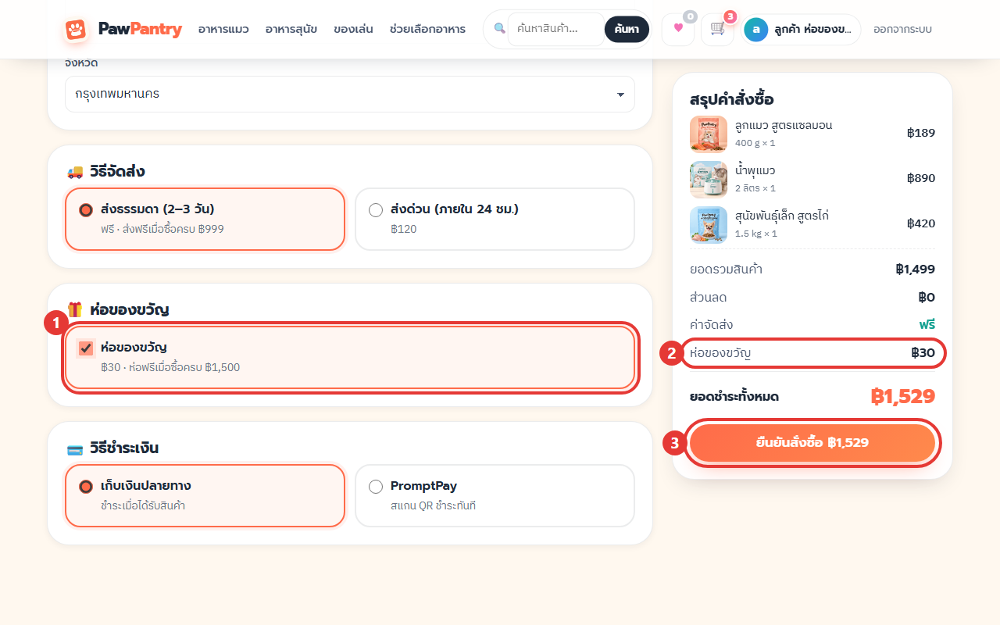 |  | 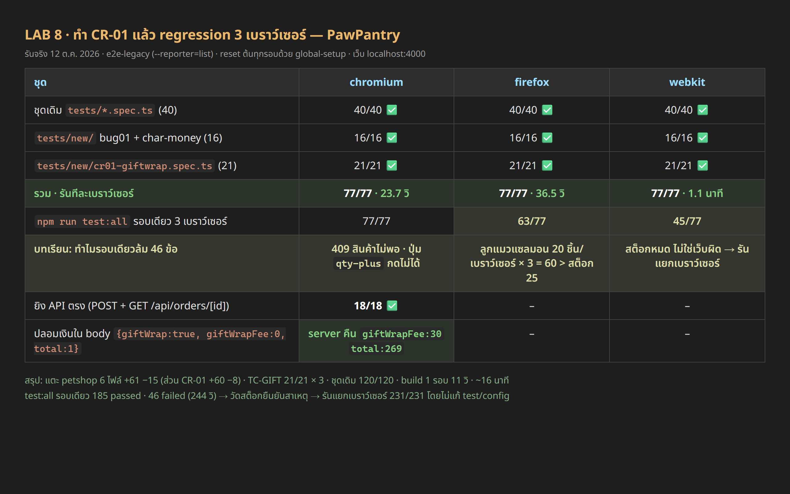 |

👀 **สังเกต**
- **อนุมัติแผนก่อนให้แก้** แผนที่ขาดหน้าแสดงเงินได้ "หน้าหนึ่งถูก อีกหน้าผิด"
- **ล้มแล้วจำแนกก่อนแก้: เว็บผิด / เทสต์เก่าล้าสมัย / เทสต์ใหม่เขียนผิด / ข้อมูลทดสอบหมด** เทสต์ใหม่แก้ได้แค่วิธีหา element หรือจังหวะรอ ห้ามแตะผลที่คาดหวัง
- **แก้ที่ต้นเหตุใน LAB 6 ได้ผลที่นี่** BUG-01 ลบสูตรค่าส่งซ้ำ ไม่ใช่แค่เปลี่ยน `>` เป็น `>=` ค่าห่อจึงไม่หายในคำสั่งซื้อ · รอบจริงไม่เกิด "หน้าเว็บ ฿269 แต่คำสั่งซื้อ ฿239"
- **ตรวจ 2 ชั้น UI + API** ผ่าน UI แต่ API ตรงยอดไม่ตรง = server เชื่อตัวเลขจาก browser หรือคิดคนละสูตร
- **เช็กชนิดแบบเข้มบรรทัดเดียวพอ** server รับเฉพาะ `input.giftWrap === true` → ค่าผิดชนิด (TC-GIFT-12) และ body ปลอมไม่มีผล ไม่ต้องเขียนโค้ดตรวจเพิ่ม
- **regression รันทั้งชุด ไม่ใช่เฉพาะเทสต์ใหม่** (AC6)
- ⚠️ **เทสต์ใหม่ทำให้ชุดเดิมแดงได้โดยไม่แตะโค้ด** ชุดเดิม webkit 4 ข้อ (TC-CART-01 · TC-CPN-03 · TC-REC-01 · TC-REC-04) ล้มเพราะเทสต์ CR-01 ซื้อลูกแมวแซลมอนไปก่อน · LAB 7 ตรวจสต็อกแค่เบราว์เซอร์เดียว · `puppy-lamb-wet` (15/40) และ `dog-slow-bowl` (8/18) ก็เกินเมื่อ × 3
- **test data isolation** ชิ้นต่อเทสต์ × เบราว์เซอร์ ≤ สต็อก หรือ reset ต่อชุด · จดทางแก้ถาวรใน `CR-01.md`

✔️ **ไปต่อได้เมื่อ:** 3 เบราว์เซอร์ไม่มีข้อล้ม (หรือทีละเบราว์เซอร์ถ้าสต็อกหมดเท่านั้น) · มีภาพ checkout · `CR-01.md` หัวข้อ "ทำแล้ว"

---

## LAB 9 · พิสูจน์ว่าแก้แค่ที่ตั้งใจ + CHANGE-REPORT

🎯 🔍 **อ่านอย่างเดียว** · ส่วนที่ 1 หลักฐาน 2 ชั้น: SHA-256 ของ source + REA source↔bundle 4 ทิศ + **obligation ledger** → `CHANGE-PROOF.md` · ส่วนที่ 2 ข้อจำกัดการเทียบเวอร์ชัน + HAR ใหม่ → `CHANGE-REPORT.md`

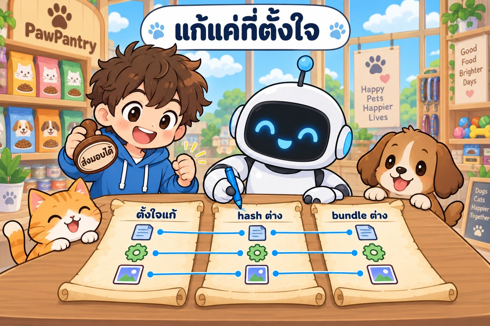

🗺️ ทบทวน: impact [🎓 ข้อ 17)](#17-impact-analysis-แก้ตรงนี้กระทบอะไร) · `unknown` [ข้อ 7)](#7-เทียบเวอร์ชัน--หลักฐานว่าแก้ตรงไหน) · obligation [ข้อ 10)](#10-obligation-ของใหม่ต้องทำได้เท่าของเดิม)

💬 **คัดลอกพรอมต์นี้ (ส่วนที่ 1)**

```text
พิสูจน์ว่าของที่จะส่งมอบเปลี่ยนเฉพาะที่ตั้งใจ (ตาม BUG-01.md และ CR-01.md) ด้วยหลักฐาน 2 ชั้น แล้วเขียน CHANGE-PROOF.md
(ห้ามแก้โค้ด · ไฟล์ .json ใหญ่ใน out/ ห้ามเปิดตรง ๆ ให้ย่อด้วย node rea\rea-summarize.mjs · ห้ามเปิด _solution/ fast_track/ และ README.md ของโฟลเดอร์บท (มีเฉลย)
 รันคำสั่ง shell ทุกตัวด้วย PowerShell จากโฟลเดอร์บท · ถ้ามีแต่ bash ให้เขียนคำสั่งลงไฟล์ rea\scratch\run.ps1 แล้วรัน powershell -NoProfile -ExecutionPolicy Bypass -File rea\scratch\run.ps1 · ห้ามแปลงคำสั่งเป็น bash เอง
 คำสั่งที่เขียนว่า "นาน" ให้ตั้ง timeout อย่างน้อย 10 นาที หรือรันเบื้องหลังแล้วรอจนจบ ห้ามสั่งซ้ำระหว่างรอ)
เรียก REA ด้วย powershell -NoProfile -ExecutionPolicy Bypass -File .\rea\rea.ps1 <อาร์กิวเมนต์> (ด้านล่างเขียนย่อว่า REA <อาร์กิวเมนต์>)
1. ชั้น source: คำนวณ SHA-256 ทุกไฟล์ใน out\v1 และ petshop (ไม่รวม node_modules และ .next · ใช้ Get-FileHash -LiteralPath เพราะ path อย่าง app\orders\[id]\page.tsx มี [ ] ถ้าไม่ใส่ -LiteralPath จะได้ค่าว่างแบบเงียบ ๆ) แล้วทำตาราง ไฟล์ | สถานะ (เหมือน / ต่าง / มีแค่ฝั่งเดียว)
   ตรวจตัวนับไฟล์ที่ต่างกับ git status --short petshop ให้ตรงกัน (ถ้าโฟลเดอร์บทไม่ใช่ git repo ให้ใช้ git diff --no-index --stat ทีละไฟล์ที่ hash ต่างเป็นแหล่งที่สองแทน แล้วจดว่าใช้ทางไหน) · ไฟล์ที่ต่างแต่ไม่ได้ตั้งใจแก้ ให้หาว่าเกิดจากอะไร
2. build เวอร์ชันใหม่: robocopy petshop out\v2 /E /XD node_modules .next /NFL /NDL /NJH /NJS (exit 0–7 = สำเร็จ) แล้ว build แบบเดียวกับ out\v1 (นาน ~3 นาที):
   docker run --rm -v "${PWD}\out\v2:/app" -w /app -e NEXT_TELEMETRY_DISABLED=1 node:24-alpine sh -c "npm ci --no-audit --no-fund && npm run build"
   แล้ว REA -Out out\v2-server.json analyze-javascript-application /work/out/v2/.next/server --json
3. ชั้น bundle (REA เทียบ source กับของที่ build 4 ทิศ):
   REA -Out out\v1-src.json import-reference-source /work/out/v1 --json  และ  REA -Out out\v2-src.json import-reference-source /work/out/v2 --json
   ทั้ง 4 คู่ ตั้งชื่อผล out\s2b-v1src-v1build.json · out\s2b-v1src-v2build.json · out\s2b-v2src-v1build.json · out\s2b-v2src-v2build.json
   ทีละคู่: node rea\rea-input.mjs s2b out\<src>.json out\<v1 หรือ v2>-server.json out\s2b.in.json แล้ว REA -Out out\s2b-<คู่>.json compare-source-to-bundle /work/out/s2b.in.json --json (คู่ละ ~10 วินาที)
   ย่อแต่ละคู่ด้วย node rea\rea-summarize.mjs out\s2b-<คู่>.json --md แล้วจดตัวนับครบ 7 คลาส (unchanged · modified · removed · split · merged · duplicated · unknown)
   ทำตาราง 4 ทิศ: node rea\rea-summarize.mjs --s2b-table out\s2b-v1src-v1build.json out\s2b-v1src-v2build.json out\s2b-v2src-v1build.json out\s2b-v2src-v2build.json (แสดงเฉพาะไฟล์ที่สถานะต่างกันระหว่างคู่ ไฟล์อื่นไม่ได้หาย)
   อ่านให้ถูก: unknown = REA หา digest ของไฟล์นั้นใน bundle ไม่เจอ ไม่ได้แปลว่าไฟล์หาย · REA มีคลาส modified แต่อย่าคาดว่าไฟล์ที่แก้จะขึ้นเป็น modified ให้ดูจากตัวนับจริง
4. เทียบ 3 รายการ: ไฟล์ที่ตั้งใจแก้ (จาก BUG-01.md และ CR-01.md) | ไฟล์ที่ hash ต่าง | ไฟล์ที่ REA บอกว่า bundle ต่าง → ตรงกันไหม ✅ / ⚠️ · ส่วนเกินต้องมีคำอธิบาย
5. obligation ledger "ของใหม่ต้องทำได้เท่าของเดิม": จาก BASELINE.md และ API-INVENTORY.md เลือกพฤติกรรมเดิมที่ไฟล์ที่แก้แตะถึง ≥ 6 ข้อ (กฎเงิน คูปอง ค่าส่ง สั่งซื้อ)
   ตาราง ของเดิมที่ต้องยังทำได้ | ชนิด (positive = ทำได้เหมือนเดิม · negative = ยังปฏิเสธสิ่งที่เคยปฏิเสธ · malformed = ข้อมูลผิดรูปยังถูกจัดการ) | ที่มาของผลคาดหวัง [D] / [R] / [E] | หลักฐาน (เทสต์ไหน · ไฟล์ผลไหน) | ผล ✅ / ❌ / ⚪ ยังไม่มีหลักฐาน
   ข้อที่ยังไม่มีหลักฐานให้เขียน ⚪ ห้ามเดาว่าผ่าน · ข้อที่มีแค่ [E] และไฟล์ที่แก้เปลี่ยนพฤติกรรมนั้น ให้ติด ⚪ และเขียนคำถามถึงร้าน · อ้างผลรันที่จดไว้ใน BUG-01.md และ CR-01.md ได้ · ถ้ารันใหม่ให้รันทีละเบราว์เซอร์ (--project=) เพราะ test:all รอบเดียวทำสต็อกหมด
CHANGE-PROOF.md: ตารางข้อ 1 · ตาราง 4 ทิศ + ตัวนับ 7 คลาสของทุกคู่ · ตาราง 3 รายการ · obligation ledger · evidence_id_short ของทุกผล REA (ผล import-reference-source ไม่มี evidence_id ให้ใช้ root_sha256_short ที่ตัวย่อพิมพ์แทน)
ทุกค่าต้องมาจากผลที่รันจริง · สรุปเป็นตาราง: หลักฐาน | บอกอะไร | ตรงกับที่ตั้งใจไหม
```

💬 **คัดลอกพรอมต์นี้ (ส่วนที่ 2)** (เปิดเซสชันใหม่ได้)

```text
อ่าน CHANGE-PROOF.md, BUG-01.md, CR-01.md และ BASELINE.md แล้วปิดงานด้วย CHANGE-REPORT.md
(ห้ามแก้โค้ด · ไฟล์ใหญ่ใน out/ ย่อด้วย node rea\rea-summarize.mjs เท่านั้น · ห้ามเปิด _solution/ fast_track/ และ README.md ของโฟลเดอร์บท (มีเฉลย)
 รันคำสั่ง shell ทุกตัวด้วย PowerShell จากโฟลเดอร์บท · ถ้ามีแต่ bash ให้เขียนคำสั่งลงไฟล์ rea\scratch\run.ps1 แล้วรัน powershell -NoProfile -ExecutionPolicy Bypass -File rea\scratch\run.ps1 · ห้ามแปลงคำสั่งเป็น bash เอง)
เรียก REA ด้วย powershell -NoProfile -ExecutionPolicy Bypass -File .\rea\rea.ps1 <อาร์กิวเมนต์> (ด้านล่างเขียนย่อว่า REA <อาร์กิวเมนต์>)
1. ดูข้อจำกัดของอีกเครื่องมือ: node rea\rea-input.mjs compare out\v1-server.json out\v2-server.json out\cmp.in.json
   แล้ว REA -Out out\cmp.json compare-application-versions /work/out/cmp.in.json --json (~20 วินาที) · ย่อด้วย node rea\rea-summarize.mjs out\cmp.json แล้วจดเฉพาะตัวนับ summary และ items_total · อธิบาย 2 บรรทัดว่าทำไมผลนี้อ่านยากกว่าตาราง 4 ทิศ
2. บันทึก HAR รอบใหม่: node rea\record-har.mjs --out out\after แล้ว REA -Out out\after\har.json inspect-web-network-capture /work/out/after/pawpantry-main.har har --sensitive-value Paw12345 --sensitive-value demo@pawpantry.test --json
   ย่อด้วย node rea\rea-summarize.mjs out\after\har.json --md แล้วเทียบ API กับ API-INVENTORY.md: API เดิมยังครบไหม · status เหมือนเดิมไหม · keys ที่เพิ่ม (ตัวย่อแสดง key 2 ชั้น เช่น order{…} จึงเห็น key ที่เพิ่มใน object ซ้อน)
3. เขียน CHANGE-REPORT.md ตาราง: CR/BUG | ชนิดงาน (Chikofsky & Cross: restructuring = เปลี่ยนโครงสร้างโดยพฤติกรรมเดิม · re-engineering = เปลี่ยนพฤติกรรม/เพิ่มความสามารถ) | ไฟล์ที่แก้ (+/−) | เทสต์ใหม่ (แดงก่อน / เขียวหลัง) | regression 3 เบราว์เซอร์ | หลักฐาน REA (evidence_id) | พฤติกรรมที่เปลี่ยนโดยตั้งใจ | ความเสี่ยงคงค้าง | วิธี rollback
   ทุกตัวเลขอ้างไฟล์ผลที่มาจากการรันจริง · มีหัวข้อ "สิ่งที่หลักฐานยังพิสูจน์ไม่ได้" · ข้อไหนหลักฐานไม่พอให้ย้ายไปหัวข้อนี้ ห้ามเดาว่าผ่าน
สรุปเป็นตาราง: หัวข้อใน CHANGE-REPORT | อ้างไฟล์ไหน
```

✅ **ผลจริง** SHA-256 ของ source: เหมือน **114** · ต่าง **6** · มีแค่ `out\v1` **1** (`next-env.d.ts`) · **3 รายการตรงกัน** (ตั้งใจแก้ 6 = hash ต่าง 6 = bundle ต่าง 6) · obligation **19 ข้อ ✅ 15 · ❌ 0 · ⚪ 4** · ~11 นาที (2 ส่วน · build `out\v2` 155 วิ)

| คู่ (source → build) | evidence | unchanged | modified · removed · split · merged | duplicated | unknown |
|---|---|---|---|---|---|
| v1 → v1 · v2 → v2 (เส้นฐาน) | `ev_23cd4cec` · `ev_f47a7dd1` | 44 | 0 · 0 · 0 · 0 | 8 | 3 |
| v1 → v2 · v2 → v1 | `ev_b034f50f` · `ev_ba4bd111` | 41 | 0 · 0 · 0 · 0 | 5 | 9 |

| ไฟล์ที่สถานะต่างกันระหว่างคู่ | v1→v1 · v2→v2 | v1→v2 · v2→v1 | ตั้งใจแก้ · hash · bundle |
|---|---|---|---|
| `app/orders/[id]/page.tsx` · `components/CheckoutForm.tsx` · `components/OrderSummary.tsx` | unchanged | unknown | ✅ CR-01 · ต่าง · ต่าง |
| `lib/orders.ts` (BUG-01 + CR-01) · `lib/pricing.ts` · `lib/store.ts` | duplicated | unknown | ✅ · ต่าง · ต่าง |
| `next-env.d.ts` | – | – | ⚠️ ไม่ได้ตั้งใจ · มีแค่ `out\v1` · ไม่อยู่ใน 55 ไฟล์ของ REA · build สร้างเอง |

`unknown` คงที่ 3 ไฟล์ทุกคู่ (`globals.css` `eslint.config.mjs` `next.config.ts`) · **ไม่มีไฟล์ไหนขึ้น `modified`** · 8 ไฟล์ "ไม่ต้องแตะ" ใน `CR-01.md` ยัง `unchanged`

| obligation (ตัวอย่างจาก 19) | ชนิด | หลักฐาน | ผล |
|---|---|---|---|
| O12 `giftWrap` ผิดชนิด → ไม่ห่อ | malformed | TC-GIFT-12 × 4 | ✅ |
| O9 SUMMER20 ยิงตรง `POST /api/orders` ยังถูกปฏิเสธ | negative | ไม่มีเทสต์ | ⚪ |
| O19 PAW10 + ยอดใกล้ ฿999 ส่งฟรีนับยอดก่อนหรือหลังส่วนลด | positive (ตั้งใจเปลี่ยน) | ฿950 → ฿900 รอร้านยืนยันกฎ | ⚪ |

ℹ️ คอลัมน์ "ที่มาของผลคาดหวัง [D]/[R]/[E]" และทางสำรอง `git diff --no-index --stat` (ถ้าไม่ใช่ git repo) เพิ่มในพรอมต์หลังรอบถ่ายทำ · ledger ข้างบนมาจากรอบก่อนเพิ่ม

**ส่วนที่ 2**
- `compare-application-versions` (`ev_360083db`): unchanged **0** · added 0 · removed 0 · changed **235** · unknown **1,465** · items_total **1,700**
- HAR หลังแก้ (`ev_b1e9e721`): 97 records · API 4 ตัวครบ status 200 / 200 / 201 / 200 เท่าเดิม · `POST /api/orders` **เพิ่ม key `giftWrap`**
- `CHANGE-REPORT.md`: BUG-01 = **re-engineering ขนาดเล็ก ทำด้วยวิธี restructuring** (เอากฎซ้ำออก แต่ยอดที่ server บันทึกเปลี่ยนจริง 2 กรณี) · CR-01 = **re-engineering** · มี rollback

| 🔍 source ↔ bundle 4 ทิศ | 📋 CHANGE-REPORT |
|---|---|
| 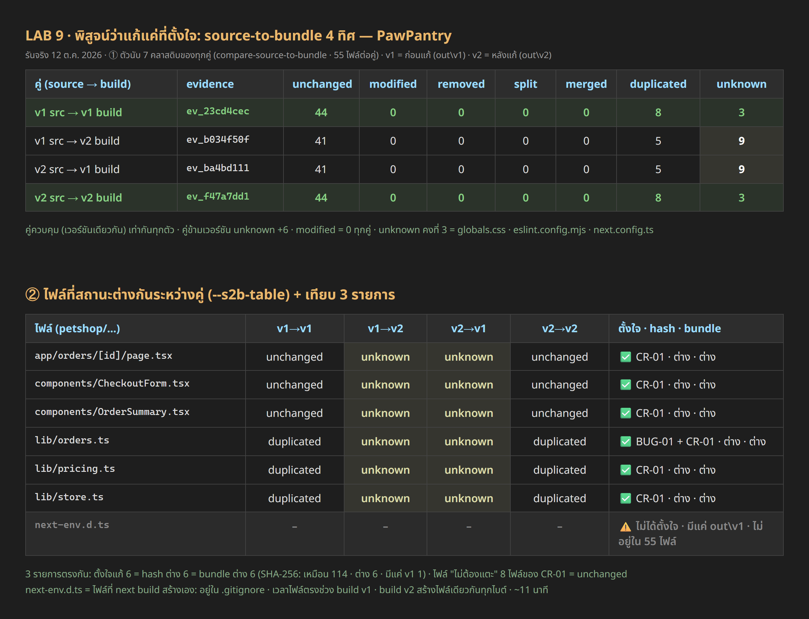 | 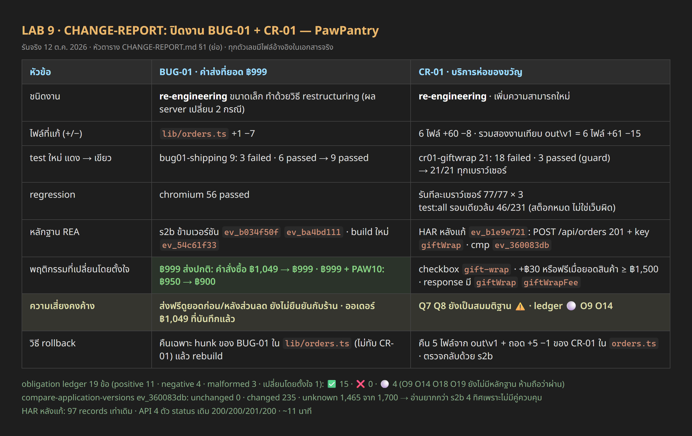 |

👀 **สังเกต**
- **hash ต่างไม่ได้แปลว่าเราแก้ ต้องพิสูจน์ที่มา** (hash เท่ากันก็ไม่ได้แปลว่าถูก) · `next-env.d.ts` พิสูจน์ 3 ทาง: อยู่ใน `.gitignore` · เวลาไฟล์อยู่ในช่วง build v1 · build v2 ได้ไฟล์เดียวกันทุกไบต์ · ขนาดบอกอะไรไม่ได้: `import-reference-source` v1 กับ v2 ใหญ่ 58,226 ไบต์เท่ากันแต่ root hash ต่าง
- ⚠️ **เครื่องมือที่ล้มเงียบอันตรายที่สุด · 2 ชั้นต้องช่วยกัน** `Get-FileHash` ไม่ใส่ `-LiteralPath` กับ path ที่มี `[id]` ได้ค่าว่างโดยไม่ error · รอบจริง `app/orders/[id]/page.tsx` หลุดชั้น source (นับได้ 5) แต่ชั้น bundle เห็นเป็น `unknown` · เทียบ `git status --short petshop` จึงได้ 6 = 6 = 6
- **`unknown` ≠ ไฟล์หาย** REA หา digest ใน bundle ไม่เจอ · อย่ารอ `modified` ดูตัวนับครบ 7 คลาสคู่กับ SHA-256 · คู่เวอร์ชันเดียวกันคือเส้นฐาน หักไฟล์ที่ไม่ตรงตั้งแต่ v1src→v1build ออกก่อน
- **obligation ที่ไม่มีหลักฐาน = ⚪ ไม่ใช่ ✅** "น่าจะยังได้" ไม่ใช่หลักฐาน · ⚪ คือเทสต์ที่ต้องเขียนเพิ่ม
- **เทียบเวอร์ชันทั้งแอปอ่านยาก** ชื่อ chunk เปลี่ยนทั้งชุด + coverage ไม่ครบ → ตาราง 4 ทิศตรงกว่า
- **HAR หลังแก้บอกว่า key ใหม่มาถึง แต่ไม่ได้พิสูจน์ฟีเจอร์** เส้นทางหลักไม่ได้ติ๊กห่อ แต่ request มี `giftWrap` (UI ส่ง `false` เสมอ) · ค่าห่อถูกไหมต้องอ้าง TC-GIFT
- ⚠️ **"สิ่งที่หลักฐานยังพิสูจน์ไม่ได้" เป็นหัวข้อบังคับ** รายงานที่บอกว่าพิสูจน์ได้ทุกอย่าง = ยังไม่ได้คิดเรื่องข้อจำกัด

✔️ **ไปต่อได้เมื่อ:** `CHANGE-PROOF.md` ตาราง 3 รายการไม่มี ⚠️ ที่อธิบายไม่ได้ · `CHANGE-REPORT.md` ทุกช่องมีไฟล์อ้างอิง

---

## LAB 10 · ฝึกเดี่ยวครบวงจร PR-1

🎯 ✏️ **แก้โค้ดแอป** · วงจรเต็มในพรอมต์เดียว: ทำซ้ำ black-box → เทสต์แดง → **ถามก่อนแก้** → แก้เล็กที่สุด → เขียว → regression 3 เบราว์เซอร์ → PR-1 ใน `CHANGE-REPORT.md`


💬 **คัดลอกพรอมต์นี้** (ข้อความลูกค้าอยู่ท้ายพรอมต์แล้ว)

```text
ฝึกครบวงจรกับปัญหาอีกเรื่อง (ข้อความลูกค้าอยู่ท้ายพรอมต์) ทำตามกติกาใน CLAUDE.md ทุกข้อ
(ห้ามเปิด _solution/ fast_track/ และ README.md ของโฟลเดอร์บท (มีเฉลย) · รันคำสั่ง shell ทุกตัวด้วย PowerShell จากโฟลเดอร์บท · ถ้ามีแต่ bash ให้เขียนคำสั่งลงไฟล์ rea\scratch\run.ps1 แล้วรัน powershell -NoProfile -ExecutionPolicy Bypass -File rea\scratch\run.ps1
 คำสั่งที่เขียนว่า "นาน" ให้ตั้ง timeout อย่างน้อย 10 นาที หรือรันเบื้องหลังแล้วรอจนจบ ห้ามสั่งซ้ำระหว่างรอ · สคริปต์ชั่วคราวเก็บใน rea\scratch\)
1. ทำซ้ำแบบ black-box ก่อนเปิดโค้ด (reset ข้อมูลก่อนทำซ้ำทุกรอบ · สินค้านี้สต็อกน้อย) แล้วเขียน e2e-legacy/tests/new/pr1-add-to-cart.spec.ts ที่แดงตามอาการ · ผลที่คาดหวัง (ทั้งข้อความและชนิดของการแจ้งเตือน) ต้องมาจาก [D] หรือ [R] พร้อมเหตุผล ถ้ายังไม่มีให้ถามผมก่อน
2. หาต้นเหตุ (ไฟล์:บรรทัด) + ตาราง impact (ใครใช้โค้ดนี้อีก · หน้าไหนกระทบ · เทสต์ที่ต้องรันซ้ำ) แล้วถามผมก่อนแก้
3. แก้ให้เล็กที่สุด → build ใหม่ (docker compose up -d --build ในโฟลเดอร์ petshop · นาน 1–3 นาที) → เทสต์ใหม่เขียว → รันชุดเดิม + tests/new บน chromium (npx playwright test) แล้วค่อย 3 เบราว์เซอร์ (npm run test:all · นาน)
   ถ้า test:all ล้มด้วย 409 "สินค้าไม่พอ" หรือปุ่ม qty-plus กดไม่ได้ = สต็อกหมด ไม่ใช่เว็บพัง → รันทีละเบราว์เซอร์ (npx playwright test --project=firefox แล้ว --project=webkit) แล้วรวมผล
4. เพิ่ม PR-1 ในตารางสรุปของ CHANGE-REPORT.md (เป็นแถวหรือคอลัมน์ตามรูปแบบเดิมของตาราง: ชนิดงาน · ไฟล์ที่แก้ +/− ทีละไฟล์ด้วย git diff --no-index --stat out\v1\<ไฟล์> petshop\<ไฟล์> · เทสต์แดงก่อน/เขียวหลัง · regression)
ทุกค่าต้องมาจากที่รันจริง · ห้ามแก้เทสต์เดิมให้ผ่าน · สรุปเป็นตาราง: ขั้น | หลักฐาน (ไฟล์) | ผล

--- ข้อความจากลูกค้า ---
📩 กดเพิ่ม "สูตรลดก้อนขน" 2 ชิ้นจากหน้าสินค้า แล้วกดเพิ่มอีก 2 ชิ้น ระบบขึ้นว่า "เพิ่ม…ลงตะกร้าแล้ว" ทั้งสองรอบ
แต่ในตะกร้ามีแค่ 3 ชิ้น งงว่าอีกชิ้นหายไปไหน
```

<details>
<summary>📒 คำตอบของร้าน เรื่องข้อความที่ถูก [D] (เปิดดูหลังจาก Claude ถามแล้วเท่านั้น)</summary>

| กรณี | ข้อความที่ร้านต้องการ [D] |
|---|---|
| เพิ่มได้ครบตามที่กด | ข้อความเดิม (เพิ่มลงตะกร้าแล้ว) |
| เพิ่มได้ไม่ครบ | แจ้งเตือน ไม่ใช่ข้อความสำเร็จ: `เพิ่มได้อีกเพียง {จำนวนที่เพิ่มได้} ชิ้น (สินค้าเหลือ {สต็อก} ชิ้น)` เช่น `เพิ่มได้อีกเพียง 1 ชิ้น (สินค้าเหลือ 3 ชิ้น)` |
| เพิ่มไม่ได้เลย | ข้อความเดิม |

</details>

> อนุมัติเมื่อ: แก้จุดเดียวที่ทุกหน้าใช้ร่วม (ไม่ไล่แก้ทีละหน้า) · impact ครอบทุกหน้าที่เรียกโค้ดนั้น · เทสต์แดงตรงอาการ

⚠️ อ่าน ✅ หลังทำ LAB เสร็จ (ภาพผลด้านล่างมีคำตอบร้าน)

✅ **ผลจริง** ทำซ้ำได้ · ต้นเหตุ **1 ไฟล์** `components/ProductCard.tsx` **+5 −2** · เทสต์ PR-1 **แดง 2/4 → เขียว 4/4** · regression **81/81 × 3 เบราว์เซอร์** (รันทีละเบราว์เซอร์) · ~16 นาที

| ขั้น | หลักฐาน (ไฟล์) | ผล |
|---|---|---|
| 1 ทำซ้ำ black-box | `rea\scratch\pr1-repro.mjs` | "เหลือ 3 ชิ้น" · 2 + 2 → toast "เพิ่ม สูตรลดก้อนขน (1.5 kg) ลงตะกร้าแล้ว" ทั้งสองรอบ · ตะกร้า 3 ชิ้น ฿1,560 |
| 1 เทสต์แดง | `tests/new/pr1-add-to-cart.spec.ts` (4) | **2 failed · 2 passed** (TC-PR1-01 2+2 · 02 1+3 แดง · guard 03 · 04 เขียว) |
| 2 ต้นเหตุ | `ProductCard.tsx:63` `if (added > 0)` ใน `useAddToCart` | `addToCart` คืนจำนวนที่เพิ่มได้จริงถูก แต่ helper เช็กแค่ `> 0` → เพิ่มได้ 1 จาก 2 ก็ขึ้นสำเร็จ |
| 2 impact | `ProductDetail.tsx:238` · `ProductCard.tsx:142` · `FinderWizard.tsx:57` | กระทบจริงแค่หน้าสินค้า (อีก 2 ที่ส่ง qty 1) · แก้ helper กลางที่เดียว |
| 3 แก้ + เทสต์ใหม่ | `ProductCard.tsx` +5 −2 · build 9.7 วิ | toast แจ้งเตือนตามข้อความร้าน (📒 ด้านบน) · **4 passed** |
| 3 regression | ทีละเบราว์เซอร์ | chromium **81/81** (27.6 วิ) · firefox **81/81** (39.9 วิ) · webkit **81/81** (1.2 นาที) |
| ⚠️ `npm run test:all` รอบเดียว | log ของ test:all | 196 passed · 47 failed: สต็อกร่วมหมด 42 (`409 สินค้าไม่พอ` 21 · ปุ่ม `qty-plus` กดไม่ได้ 21) + assertion อื่นในรอบที่เครื่องโหลด 3 เบราว์เซอร์ 5 (เช่น TC-PR1-03 firefox ไม่เห็น toast) · ทั้ง 47 ข้อผ่านเมื่อรันแยก |
| 4 CHANGE-REPORT | คอลัมน์ PR-1 | re-engineering · ผลข้างบนครบ |

**Claude ถาม:** ① ข้อความเมื่อเพิ่มได้ไม่ครบ → ตอบตาม 📒 ② อนุมัติก่อนแก้ → helper กลาง · **ตัดสินเองโดยไม่ถาม:** ชนิด toast (`error`) · `{สต็อก}` = สต็อกรวมทุกขนาด → ต้องตรวจว่ารับได้ไหม

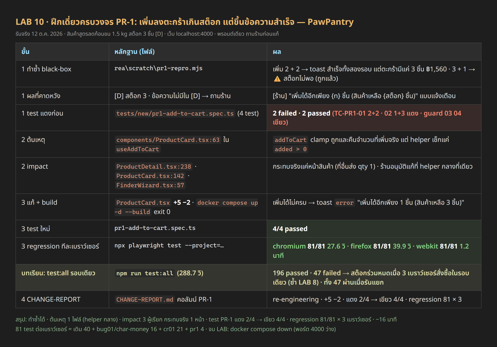

👀 **สังเกต**
- **ข้อความสำเร็จ ≠ ทำสำเร็จ** ตรวจทั้งข้อความและจำนวนในตะกร้าจริง
- **ผลที่คาดหวังต้องมีที่มา** ไม่มี [D]/[R] ต้องถามร้าน ไม่ให้ AI แต่งข้อความเอง
- **โค้ดที่ใช้ร่วมหลายหน้า = impact หลายหน้า** แก้จุดเดียวได้ผลทุกหน้า แต่ต้องรันเทสต์ของทุกหน้านั้นซ้ำ
- **ฝึกเดี่ยว = เราตัดสินทุกจุด** Claude ข้าม "ถามก่อนแก้" → หยุด สั่งย้อนไปทำตาราง impact · ทุกการแก้เพิ่มเข้า CHANGE-REPORT ตารางเดิม ทีมถัดไปรับช่วงต่อได้
- **เทสต์แดงต้องอ่าน error ไม่ใช่ดูแค่สี** รอบแรกแดง 4/4 รวม guard 2 ข้อที่ควรเขียว เพราะ `item-qty` เป็น `<input>` ต้องใช้ `toHaveValue` → guard จับเทสต์ใหม่เขียนผิดได้ทันที · แก้แล้วได้ 2 แดง / 2 เขียว ตรงอาการ
- **ต้นทางของอาการอยู่ที่ UI** ตัวเลือกจำนวน clamp ที่สต็อกรวม (3) ไม่หักของในตะกร้า และยังขึ้น "เหลือ 3 ชิ้น" ทั้งที่ 3 ชิ้นอยู่ในตะกร้า · ร้านเลือกแก้ข้อความ → นอกขอบเขต PR-1 จดเป็นคำถามถึงร้าน
- **ไม่ใช่ทุกข้อที่ล้มใน `test:all` เป็นเรื่องสต็อก** assertion อื่น 5 ข้อ เช่น TC-PR1-03 (toast หายใน 2.8 วิ ขณะเครื่องรัน 3 เบราว์เซอร์) · รันลำพัง `--repeat-each=3` ผ่าน 12/12 → แยก flaky ออกจากบั๊กด้วยการรันซ้ำแยก

✔️ **ไปต่อได้เมื่อ:** เทสต์ PR-1 แดงก่อน/เขียวหลัง · regression ไม่มีข้อล้ม (หรือทีละเบราว์เซอร์ถ้าสต็อกหมด) · PR-1 ใน `CHANGE-REPORT.md`

---

## ✅ รูบริก: เช็กลิสต์ "รับช่วงระบบเดิมอย่างมืออาชีพ"

1 คะแนน/ข้อ · **ดีมาก ≥ 18/20 · ใช้ได้ 14–17 · ต้องแก้ < 14**

**A. เข้าใจระบบ (LAB 1–3)**
- ☐ 1. `CODEBASE-MAP.md` ทุกแถวมีไฟล์:บรรทัด · "เดา" ≤ 10%
- ☐ 2. เจอ "เอกสาร ≠ โค้ด" ใน `HANDOVER-NOTES.md` ครบ 2 ข้อ ไม่ตัดสินเอง
- ☐ 3. `CLAUDE.md` ≤ 60 บรรทัด (คำสั่งรัน · พอร์ต 4000 · ห้ามแตะ · กติกา) + `.claude/settings.json` กันไฟล์เดิมได้จริง
- ☐ 4. `SYSTEM-MAP.md` ป้าย 🔵🟢🟡⚪ ทุกแถว · "ไม่เจอ" ≠ "ไม่มี"
- ☐ 5. `API-INVENTORY.md` ไม่มีรหัสผ่าน/cookie + มีหัวข้อขอบเขตที่ได้รับอนุญาต + 3 วิธีดูระบบ

**B. ล็อก (LAB 4)**
- ☐ 6. รันชุดเทสต์เดิม 3 เบราว์เซอร์ก่อนแตะโค้ด
- ☐ 7. golden master ตรวจเงินครบ 4 จุด ตะกร้าเดียวกัน
- ☐ 8. [E] ที่ขัด [D] ไม่ถูกอบเป็นผลที่คาดหวัง

**C. BUG-01 (LAB 5–6)**
- ☐ 9. ทำซ้ำ black-box + หาขอบเขตอาการก่อนเปิดโค้ด
- ☐ 10. เทสต์แดงก่อนแก้ ด้วย [D]
- ☐ 11. ต้นเหตุ = ไฟล์:บรรทัด · เทียบคอมเมนต์กับ HAR ก่อนเชื่อ
- ☐ 12. แก้ต้นเหตุ ไม่ใช่ปลายเหตุ บอกได้ว่าทำไม

**D. CR-01 (LAB 7–8)**
- ☐ 13. ถามร้าน ≥ 2 เรื่อง พร้อมตัวเลขที่ต่างกัน
- ☐ 14. impact ครบทุกจุดคำนวณ **และแสดง** เงิน (หน้า + API) จากการค้นโค้ด
- ☐ 15. TC ค่าขอบ ±1 บาท + API ส่ง giftWrap ผิดชนิด
- ☐ 16. TC-GIFT แดง → เขียว · regression 3 เบราว์เซอร์ไม่ล้ม

**E. พิสูจน์ส่งมอบ (LAB 9–10)**
- ☐ 17. ไฟล์ที่ตั้งใจแก้ = hash ต่าง = REA บอก bundle ต่าง (หรืออธิบายส่วนเกิน)
- ☐ 18. `CHANGE-REPORT.md` ตัวเลขอ้างไฟล์ผล + evidence_id + rollback
- ☐ 19. ไม่รัน `-u` ไม่แก้เทสต์เดิมให้ผ่าน
- ☐ 20. PR-1 ครบวงจรในพรอมต์เดียว (แดง → ถาม → เขียว → regression)

---

## 🔁 รันซ้ำ

| อยากทำ | 💬 พรอมต์ |
|---|---|
| ล้างข้อมูลเว็บ | `รันด้วย PowerShell: Invoke-RestMethod -Method Post http://localhost:4000/api/test/reset แล้วเช็กว่าได้ ok เป็น true` |
| รันชุดเทสต์ทั้งหมด | `ในโฟลเดอร์ e2e-legacy รัน npm run test:all ด้วย PowerShell (นาน: ตั้ง timeout อย่างน้อย 10 นาที) แล้วสรุปเป็นตาราง ชุด \| chromium \| firefox \| webkit · ถ้ามีข้อล้มให้บอกว่าเว็บผิด / เทสต์เก่าล้าสมัย / เทสต์ใหม่เขียนผิด / ข้อมูลทดสอบหมด ห้ามแก้ test ให้ผ่าน` |
| ส่อง build ใหม่ด้วย REA | `อ่าน rea/README.md แล้วรัน REA analyze-javascript-application กับ /work/out/v2/.next/static ผ่าน powershell -NoProfile -ExecutionPolicy Bypass -File .\rea\rea.ps1 -Out out\v2-static.json ย่อด้วย node rea\rea-summarize.mjs แล้วเทียบกับ SYSTEM-MAP.md ส่วน A (ห้ามเปิดไฟล์ .json ใน out/ ตรง ๆ)` |
| ฝึก PR-2 (ฟีเจอร์) | `ฝึกครบวงจรกับคำขอใหม่ของร้าน "ส่งด่วนฟรีเมื่อซื้อครบ ฿2,000" ทำตามกติกาใน CLAUDE.md: ถามร้านก่อน · impact ทุกจุดที่คำนวณและแสดงค่าส่งด่วน · test แดงก่อน · แก้ · regression 3 เบราว์เซอร์ · เพิ่มแถว PR-2 ใน CHANGE-REPORT.md (รันคำสั่งด้วย PowerShell · ห้ามเปิด _solution/ fast_track/ และ README.md ของโฟลเดอร์บท · ห้ามแก้ test เดิมให้ผ่าน)` |
| ฝึก PR-3 (คูปอง) | `ฝึกครบวงจรกับคำขอใหม่ของร้าน "คูปอง DOG15 ลด 15% เฉพาะอาหารสุนัข (เม็ด/เปียก/ขนม) ยอดอาหารสุนัข ≥ ฿600 ลดสูงสุด ฿200 ปัดลง" ทำตามกติกาใน CLAUDE.md: ถามร้านก่อน · impact · test ค่าขอบ ±1 บาท แดงก่อน · แก้ · regression 3 เบราว์เซอร์ · เพิ่มแถว PR-3 ใน CHANGE-REPORT.md (รันคำสั่งด้วย PowerShell · ห้ามเปิด _solution/ fast_track/ และ README.md ของโฟลเดอร์บท · ห้ามแก้ test เดิมให้ผ่าน)` |
| เทียบกับเฉลย (หลังจบ LAB 10 · ลบ rule `Read(./_solution/**)` ใน .claude/settings.json ก่อน) | `เทียบ BUG-01.md CR-01.md CHANGE-PROOF.md CHANGE-REPORT.md ของผมกับไฟล์ชื่อเดียวกันใน _solution/ บอกจุดที่ของผมยังขาด (impact · ค่าขอบ · obligation) และจุดที่ของผมดีกว่า` |
| ปิดเว็บ | `ในโฟลเดอร์ petshop รัน docker compose down ด้วย PowerShell แล้วเช็ก docker ps ว่า pawpantry05 หายแล้ว (ห้ามแตะ container ของบทอื่น บอกผมก่อนถ้าเจอ)` |

<details><summary>ทางเลือกขั้นสูง: REA ผ่าน MCP (ยังไม่ทดสอบแบบ .mcp.json)</summary>

ไม่นับ LAB · สร้าง `.mcp.json` ที่โฟลเดอร์บท (แทน `C:/path/to/…` ด้วย path เต็ม ใช้ `/`) เปิดเซสชันใหม่ อนุมัติ server `rea`

```json
{
  "mcpServers": {
    "rea": {
      "type": "stdio",
      "command": "docker",
      "args": ["run", "-i", "--rm", "-v", "C:/path/to/05_rea-reverse-engineer-legacy-petshop:/work", "rea-lab:6.4.0", "mcp"]
    }
  }
}
```

> ⚠️ ทดสอบแล้วแค่ `claude --mcp-config <ไฟล์>` · `.mcp.json` มี path เครื่องเรา อยู่ใน `.gitignore` ห้าม commit

```text
ใช้เฉพาะเครื่องมือของ MCP server ชื่อ rea (ห้ามใช้ Bash และห้ามเปิดไฟล์ใน out/ ตรง ๆ)
1. เรียก analyze_javascript_application กับ /work/out/v1/.next/static ถ้าได้ resource_constraint ให้ใช้ evidence_id ที่คืนมาแทน
2. เรียก trace_application_feature ด้วย evidence นั้น seed ชนิด string ค่า /api/ ทิศ outgoing
3. ตอบ: ปุ่มใช้คูปองเรียก API อะไร อยู่ใน chunk ไหน · อะไรเป็น observed อะไรเป็น inference อะไรยังไม่รู้
สรุปเป็นตาราง: endpoint | mechanism | chunk | ป้าย 🔵🟢🟡⚪
```

</details>

## ถ้าเจอปัญหา: คัดลอกพรอมต์นี้

| อาการ | 💬 พรอมต์ |
|---|---|
| `docker version` ไม่มี Server / `error during connect` | `Docker Desktop ยังไม่พร้อม ช่วยเช็กด้วย PowerShell ว่า docker version เห็น Server ไหม ถ้าไม่เห็นให้บอกผมเปิด Docker Desktop แล้วรอไอคอนวาฬหยุดหมุน ห้ามรีสตาร์ตบริการเอง` |
| bind พอร์ต 4000 ไม่ได้ (`access a socket in a way forbidden`) | `เปิดเว็บไม่ได้ เพราะ bind พอร์ตไม่ได้ ช่วยรัน netsh interface ipv4 show excludedportrange protocol=tcp ด้วย PowerShell แล้วบอกว่าพอร์ต 4000 อยู่ในช่วงที่ Windows (WinNAT) จองไหม · บอกสาเหตุเป็นภาษาง่าย ๆ และบอกผมก่อนว่าจะแก้อย่างไร ห้ามรีสตาร์ตบริการของเครื่องเอง · ถ้า 4000 ถูกจองจริงและแก้ที่เครื่องไม่ได้ ให้เปิดเว็บที่ 4100 แทน: ในโฟลเดอร์ petshop รัน $env:WEB_PORT="4100"; docker compose up -d --build แล้วจดใน CLAUDE.md ว่าเว็บอยู่ http://localhost:4100 · เทสต์ใช้ $env:BASE_URL="http://localhost:4100" · HAR ใช้ node rea\record-har.mjs --base http://127.0.0.1:4100 · REA ใน container ยังใช้ petshop:3000 เหมือนเดิม` |
| พอร์ต 4000 ไม่ว่าง | `พอร์ต 4000 ไม่ว่าง ช่วยหาด้วย PowerShell (Get-NetTCPConnection -LocalPort 4000 และ docker ps) ว่าเป็นโปรแกรมหรือ container ไหน (เช่นบท 06) บอกผมก่อนว่าจะปิดอะไร แล้วค่อย docker compose down ในโฟลเดอร์บทนั้น` |
| `rea.ps1 cannot be loaded … scripts is disabled` | `สคริปต์ .ps1 ถูก ExecutionPolicy ปฏิเสธ ห้ามเปลี่ยน policy ของเครื่อง ให้เรียกแบบ powershell -NoProfile -ExecutionPolicy Bypass -File .\rea\rea.ps1 <อาร์กิวเมนต์> แทน แล้วรันคำสั่งเดิมอีกครั้ง` |
| REA: JSON มี BOM / UTF-16 | `ไฟล์ input ของ REA อ่านไม่ได้ ช่วยเช็ก 3 ไบต์แรกของไฟล์ด้วย Format-Hex · ถ้าเป็น BOM หรือ UTF-16 แปลว่าสร้างด้วย > ของ PowerShell ให้สร้างใหม่ด้วย node rea\rea-input.mjs หรือ -Out ของ rea.ps1 เท่านั้น บอกสาเหตุก่อนรันใหม่` |
| `HAR schema validation failed` ที่ `serverIPAddress` | `REA ไม่รับไฟล์ HAR ช่วยเช็กด้วย PowerShell ว่า HAR บันทึกจาก localhost หรือเปล่า (Select-String '\[::1\]' <ไฟล์ .har> -List) · ถ้าใช่ให้บันทึกใหม่ด้วย node rea\record-har.mjs ซึ่งใช้ 127.0.0.1 ให้เอง หรือถ้าเป็นสคริปต์ของเราเองให้เปลี่ยน URL เป็น http://127.0.0.1:4000 · ห้ามแก้ไฟล์ HAR ด้วยมือ บอกสาเหตุก่อนรันใหม่` |
| REA: `ERR_NAME_NOT_RESOLVED petshop` | `REA ใน container หาเว็บ petshop ไม่เจอ ช่วยเช็กด้วย PowerShell ว่า container pawpantry05 healthy ไหม · docker network ls มี pawpantry05_default ไหม · คำสั่ง REA ใส่ -Network pawpantry05_default หรือยัง · บอกสาเหตุก่อนแก้` |
| agent timeout / รันซ้ำ | `คำสั่งนี้นานเกิน 2 นาทีเป็นปกติ (build / npm ci / test:all / playwright install) ให้รันใหม่ 1 ครั้งแบบเบื้องหลังหรือตั้ง timeout อย่างน้อย 10 นาที แล้วรอจนจบ ห้ามสั่งซ้ำระหว่างรอ · เช็กก่อนว่ามี process เดิมค้างอยู่ไหม` |
| agent ใช้ bash แล้วพัง (`/c/...` · `/work` เพี้ยน) | `คำสั่งนี้ต้องรันด้วย PowerShell ห้ามแปลงเป็น bash ให้เขียนคำสั่งเดิมตามตัวลงไฟล์ rea\scratch\run.ps1 แล้วรัน powershell -NoProfile -ExecutionPolicy Bypass -File rea\scratch\run.ps1` |
| `playwright` `ERR_MODULE_NOT_FOUND` / Firefox · WebKit ไม่ขึ้น | `Playwright ใช้ไม่ได้ ช่วยเช็กด้วย PowerShell ว่าสคริปต์ชั่วคราวอยู่ใน rea\scratch\ (ใช้ rea\node_modules) · เคยรัน npm install ในโฟลเดอร์ rea และ e2e-legacy แล้ว · ถ้าเบราว์เซอร์เปิดไม่ขึ้นให้รัน npx playwright install firefox webkit ในโฟลเดอร์ e2e-legacy (นาน) บอกสาเหตุก่อนรันใหม่ แล้วบอกผลเป็นตาราง` |
| agent จะเปิด .json ใหญ่ใน out/ | `หยุดก่อน ไฟล์ผล REA ใน out/ ใหญ่มาก ห้ามเปิดตรง ๆ ให้ย่อด้วย node rea\rea-summarize.mjs <ไฟล์> (--md สำหรับตาราง) แล้วใช้เฉพาะผลที่ย่อแล้ว` |
| เทสต์ล้มบางข้อ | `test ข้อนี้ล้ม ช่วยดู error และ trace แล้วบอกว่าเว็บผิด / เทสต์เก่าล้าสมัย / เทสต์ใหม่เขียนผิด / ข้อมูลทดสอบหมด (409 "สินค้าไม่พอ" / ปุ่ม qty-plus กดไม่ได้ = สต็อกหมด ให้ reset แล้วรันทีละเบราว์เซอร์ด้วย --project=) ห้ามแก้ test หรือผลที่คาดหวังให้ผ่านเฉย ๆ บอกผมก่อนแก้` |
| เทสต์ flaky | `test ข้อนี้ผ่านบ้างล้มบ้าง ช่วยรันซ้ำ 5 รอบ (--repeat-each=5) บอกสาเหตุ เช่น ข้อมูลชนกันเพราะรันขนาน หรือมีการ reset ใน test แก้ที่ test โดยไม่เปลี่ยนผลที่คาดหวัง` |
| สร้างไฟล์ใน `tests/new/` ไม่ได้ | `.claude/settings.json กันกว้างเกิน ช่วยแสดงไฟล์ แล้วบอกผมก่อนว่าจะแก้ rule ไหนให้กันเฉพาะไฟล์เดิม (ห้ามใช้ ** หรือ //)` |
| agent จะแก้ไฟล์เดิมผ่าน shell หรือเปิดโค้ด / `_solution/` ตอน black-box | `หยุดก่อน ตาม CLAUDE.md ห้ามแก้ไฟล์เดิมใน e2e-legacy/ และ TEST-DATA.md ทั้งด้วยเครื่องมือและ shell (test ใหม่เขียนใน e2e-legacy/tests/new/ เท่านั้น) · ขั้น black-box ห้ามเปิดโค้ดใน petshop/ ดูจากหน้าเว็บ API และ HAR เท่านั้น · ห้ามเปิด _solution/ fast_track/ และ README.md ของโฟลเดอร์บท · แสดง diff ที่แก้ไปแล้ว (ถ้ามี) และบอกผมก่อนว่าจะคืนค่ายังไง` |

## 🎉 จบบทแล้ว


รับมาพร้อมเอกสารหน้าเดียว ส่งต่อพร้อมแผนที่ เทสต์ และหลักฐาน · **เข้าใจ → ล็อก → แก้ → พิสูจน์** ใช้ได้กับทุกระบบเดิม · บท 06 ใช้กับระบบที่ใหญ่กว่า 🔁

## 📖 คำศัพท์

| คำ | ความหมาย |
|---|---|
| **Reverse engineering (RE)** | เข้าใจระบบโดยไม่เปลี่ยน |
| **Forward engineering** | requirement → design → code → build |
| **Re-engineering** | RE แล้วแก้หรือสร้างใหม่ |
| **Restructuring** | ปรับโครงสร้าง พฤติกรรมเดิม |
| **Redocumentation / Design recovery** | อธิบายโค้ดระดับเดิม / ระดับกฎธุรกิจ |
| **Legacy code** | โค้ดไม่มีเทสต์คุม |
| **Static analysis / Runtime observation** | ดูโดยไม่รัน (bundle) / ดูตอนรัน (HAR) |
| **Black / White / Grey-box** | ดูจากนอก / อ่านโค้ด / ส่องด้วย REA แต่ทดสอบจากนอก |
| **Triangulation** | ยืนยันด้วย ≥ 2 มุม |
| **REA** | Reverse Engineer Anything · MCP + CLI ตอบเป็นหลักฐาน |
| **Evidence** | ผล REA + ที่มา · ความน่าเชื่อ · ขอบเขต · ข้อจำกัด |
| **Authority 🔵🟢🟡⚪** | static · runtime · อนุมาน · ยังไม่รู้ |
| **Coverage `partial`** | ตรวจไม่ครบ (ปกติ) |
| **หาไม่เจอ ≠ ไม่มี** | ยังไม่พบ ≠ พิสูจน์ว่าไม่มี |
| **fail-closed** | ไม่รู้ = ไม่ผ่าน |
| **Content digest / SHA-256** | ลายนิ้วมือไฟล์ · เท่ากัน = bytes เดียวกัน (ไม่ใช่ถูก) |
| **bundle / chunk** | JS ที่ build ส่งให้เบราว์เซอร์ / ชิ้นย่อย ชื่อเป็น hash |
| **minify / source map** | บีบโค้ดจนอ่านยาก / ไฟล์แปลงกลับเป็น source |
| **endpoint** | API หนึ่งตัว (method + path) |
| **Application graph / Feature trace** | แผนที่ node + edge (ใครใช้ใคร) / ตามรอยจาก seed เช่น `coupons/validate` |
| **HAR** | บันทึก request/response ⚠️ มีรหัสผ่าน · cookie |
| **CDP** | Chrome DevTools Protocol · ช่องแนบดูเบราว์เซอร์ |
| **Scenario capture** | REA ขับเบราว์เซอร์ตามสคริปต์ (มีผลข้างเคียง) |
| **Source-to-bundle** | source ไหนอยู่ใน build |
| **Characterization test / Golden master** | ล็อกสิ่งที่ระบบทำอยู่ / ผลจริงเก็บไว้เทียบ |
| **guard test** | เขียวทั้งก่อนและหลังแก้ |
| **ป้าย [E]** | ระบบ *ทำ* ไม่ใช่ *ควร* · ขัด [D] = ผู้ต้องสงสัย |
| **`test.fail()` / KNOWN-ISSUE** | ตั้งใจล้มเพราะมีบั๊ก ผ่าน = แก้แล้ว |
| **legacy-quirk** | ล็อกพฤติกรรมแปลก (ไม่ใช่ถูก) |
| **toast** | ข้อความเด้งแล้วหายเอง |
| **Obligation ledger** | ของเดิมที่ต้องยังทำได้ + หลักฐาน |
| **Impact analysis** | แก้แล้วกระทบไฟล์ หน้า API เทสต์ไหน |
| **ต้นเหตุ vs ปลายเหตุ** | แก้สาเหตุ vs แก้อาการ |
| **Regression** | รันเทสต์เดิมซ้ำ |
| **Change Request (CR) / AC** | ใบขอเปลี่ยน / เกณฑ์ยอมรับ |
| **CHANGE-REPORT** | แก้อะไร ทำไม หลักฐาน ความเสี่ยง rollback |
| **CODEBASE-MAP / CLAUDE.md** | แผนที่ repo / คู่มือ Claude ทุกเซสชัน |
| **Explore subagent** | agent ย่อยอ่านอย่างเดียว ส่งแค่ข้อสรุป |
| **permissions deny** | `.claude/settings.json` ห้าม Claude แก้/อ่านไฟล์ (ไม่กัน shell) |
| **Excluded port range (WinNAT)** | พอร์ตที่ Windows จองไว้ |
| **docker network** | REA เรียกเว็บด้วย `petshop:3000` |
| **ExecutionPolicy** | กติการัน `.ps1` · เลี่ยงด้วย `-ExecutionPolicy Bypass` |
| **MCP** | ให้ Agent เรียกเครื่องมือ (เช่น REA) เอง |

### ไฟล์ในบทนี้

**ก่อนเริ่ม**

```text
05_rea-reverse-engineer-legacy-petshop/
├─ README.md          # 📖 บทเรียน + พรอมต์ทุก LAB
├─ TEST-DATA.md       # 🔑 [D] ข้อมูลจากร้าน (บัญชี · คูปอง · กฎเงิน)
├─ .gitignore         # out/ *.har node_modules/ .next/ test-results/ playwright-report/ rea/scratch/ .mcp.json
├─ petshop/           # ระบบเดิมของทีมเก่า (Next.js) + README.md + HANDOVER-NOTES.md · compose name: pawpantry05 · พอร์ต 4000
├─ e2e-legacy/        # ชุดเทสต์ของทีมเดิม 40 test · npm run test:all = 3 เบราว์เซอร์ · tests/new/ (ว่าง ที่เดียวที่เพิ่ม test ได้)
├─ rea/               # Dockerfile (image rea-lab:6.4.0) · rea.ps1 · rea-input.mjs · rea-summarize.mjs · record-har.mjs · scenario-coupon.json · package.json · README.md
├─ img/               # 🖼️ รูปประกอบบทเรียน
├─ fast_track/        # ⚡ ทางลัด: LAB 0–9 ในพรอมต์เดียว (ทำหลังจบบทหลัก)
└─ _solution/         # 🔑 เฉลย (ห้ามเปิดก่อนจบ)
```

**หลังจบทุก LAB**

```text
05_rea-reverse-engineer-legacy-petshop/
├─ CODEBASE-MAP.md · CLAUDE.md · .claude/settings.json   # LAB 1   แผนที่ repo A–I · คู่มือ Claude · ห้ามแก้ไฟล์เดิม
├─ SYSTEM-MAP.md                                         # LAB 2   REA เห็น / โค้ดบอก / ตรงไหม (🔵🟢🟡⚪)
├─ API-INVENTORY.md                                      # LAB 3   API จาก HAR + scenario · 3 วิธีดูระบบ
├─ BASELINE.md                                           # LAB 4   ผลชุดเดิม · ช่องว่าง · test ใหม่ [E]/[D] · ผู้ต้องสงสัย
├─ BUG-01.md                                             # LAB 5–6 อาการ · ทำซ้ำ · ต้นเหตุ · impact · แก้แล้ว
├─ CR-01.md                                              # LAB 7–8 คำถาม+คำตอบร้าน · impact · TC-GIFT · ทำแล้ว
├─ CHANGE-PROOF.md                                       # LAB 9   SHA-256 · source ↔ bundle 4 ทิศ · 3 รายการ · obligation ledger
├─ CHANGE-REPORT.md                                      # LAB 9   BUG-01 · CR-01 (+ แถว PR-1 จาก LAB 10)
├─ petshop/                                              # LAB 6 8 10  โค้ดที่แก้ตามตาราง impact ของเรา
├─ e2e-legacy/tests/new/
│  ├─ char-money.spec.ts · golden/*.json                 # LAB 4
│  ├─ bug01-shipping.spec.ts                             # LAB 5
│  ├─ cr01-giftwrap.spec.ts                              # LAB 7
│  └─ pr1-add-to-cart.spec.ts                            # LAB 10
├─ rea/scratch/                                          # (ไม่ถูก commit) สคริปต์ Playwright ชั่วคราวของ LAB 5 8 10
└─ out/                                                  # (ไม่ถูก commit) v1/ v2/ ผล REA *.json · *.har 🔒 มีรหัสผ่าน · scenario-final.png · after/ · shots/
```
