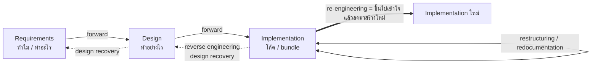
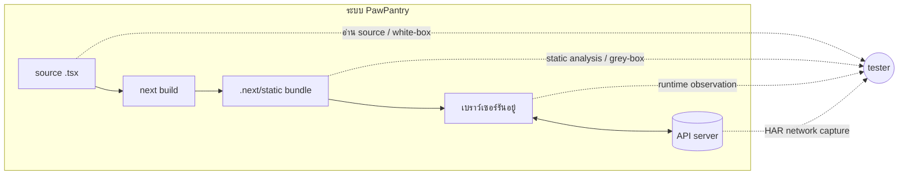
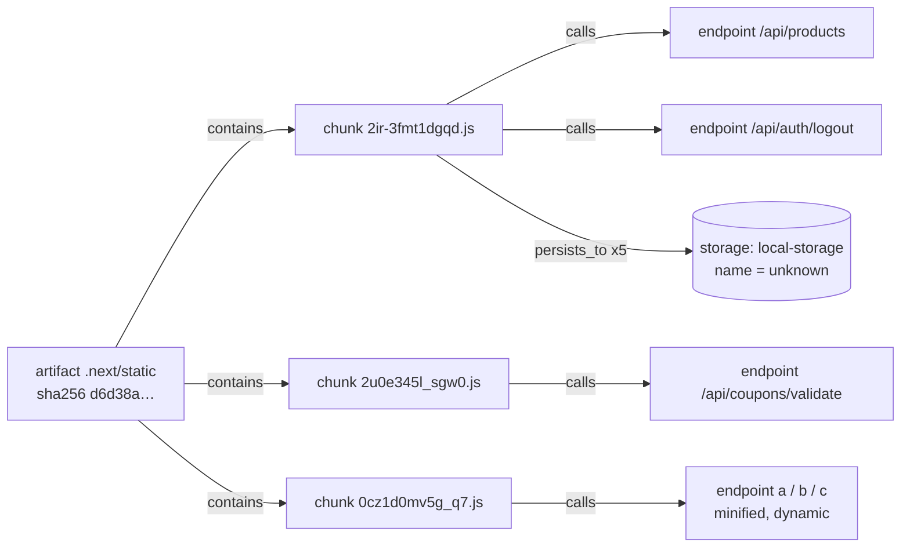
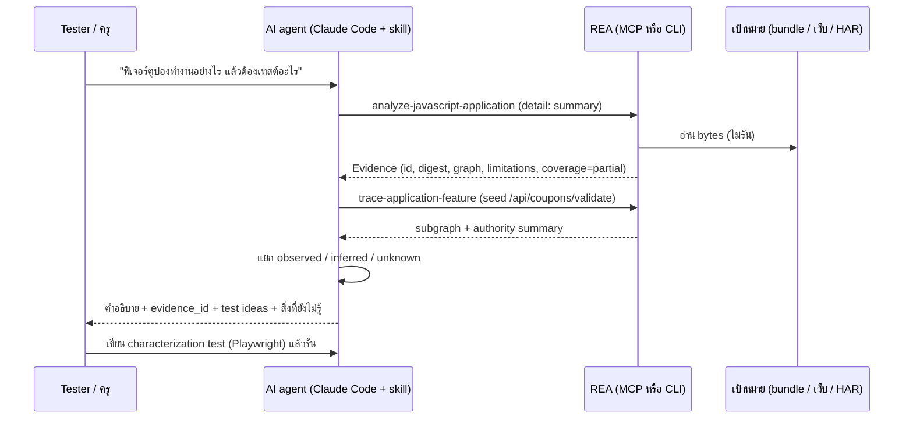

# REA-THEORY · ทฤษฎีและแนวคิดเบื้องหลัง Reverse Engineering และ REA (แกนความรู้ของบท 05)

> **สำหรับผู้สอน:** เอกสารนี้คือ "ทำไม" ที่อยู่เบื้องหลังคำสั่งใน LAB บท 05 · ผู้สอนไม่ต้องเชี่ยวชาญ RE ก็สอนได้ ถ้าอ่านตามลำดับ 1 → 7 · ทุกหัวข้อมี **ตัวอย่าง PawPantry** และ **ไอเดียภาพ/แผนภาพ**
> ตัวเลขจาก REA ในเอกสารนี้มาจากผลรันจริง `rea-lab:6.4.0 analyze-javascript-application /work/.next/static` บน PawPantry ที่ `next build` แล้ว (orchestrator รัน 12 ต.ค. 2026, ไฟล์ `rea-static.json`) · ที่ไม่ได้รันจริงจะเขียนกำกับว่า "ตัวอย่างสมมติ" หรือ "ต้องยืนยันใน LAB"

**แหล่งอ้างอิง:** REA repo (`README.md`, `AGENTS.md`, `docs/*.md` ด้าน JavaScript Application Graph, reconciliation, browser observation, HAR, scenario, obligation ledgers, readiness, `src/domain/evidence.ts`, skill `reverse-engineer-anything`) · Chikofsky & Cross (1990) *Reverse Engineering and Design Recovery: A Taxonomy*, IEEE Software 7(1) · Feathers (2004) *Working Effectively with Legacy Code* · Weyuker (1982) *On Testing Non-Testable Programs* (test oracle problem) · Dijkstra (1970) "testing shows the presence, not the absence of bugs"

---

## 1. Reverse Engineering คืออะไร

### 1.1 นิยามตามอนุกรมวิธานของ Chikofsky & Cross (1990)

Chikofsky & Cross วางระบบเป็น **ขั้น (abstraction levels)**: Requirements → Design → Implementation แล้วนิยามการเดินทางระหว่างขั้นไว้ดังนี้

| คำศัพท์ | ทิศทาง | ความหมายสั้น ๆ | เปลี่ยนระบบไหม | ตัวอย่าง PawPantry |
|---|---|---|---|---|
| **Forward engineering** | บน → ล่าง | จาก requirements → design → code ตามปกติ | สร้างใหม่ | บท 04: สัมภาษณ์ → Claude สร้างเว็บ |
| **Reverse engineering** | ล่าง → บน | วิเคราะห์ระบบเพื่อ **ระบุส่วนประกอบและความสัมพันธ์** และสร้าง **ตัวแทนในระดับที่สูงขึ้น** | ❌ ไม่แตะ (examination ไม่ใช่ change) | อ่าน bundle `.next/static` แล้วรู้ว่ามี endpoint `/api/orders` |
| **Redocumentation** | ระดับเดียวกัน | สร้าง/แก้เอกสารที่ระดับนามธรรมเดิม (เช่น ผัง call graph, data flow) | ❌ | วาดผังว่าหน้าไหนเรียก API ไหน |
| **Design recovery** | ล่าง → บน (ลึกกว่า) | RE + ความรู้โดเมน + ข้อมูลภายนอก → ได้ "ระบบนี้ทำอะไร ทำไม ทำอย่างไร" | ❌ | "ตะกร้าเก็บใน localStorage ส่วนคูปองตรวจที่ server" |
| **Restructuring** | ระดับเดียวกัน | ปรับโครงสร้างโดย **พฤติกรรมภายนอกเหมือนเดิม** (refactoring) | ✅ ภายใน | แยก `pricing.ts` เป็นหลายไฟล์ |
| **Re-engineering** | ขึ้น แล้ว ลง | RE เพื่อเข้าใจ → แล้ว forward engineering เป็นรูปใหม่ (= RE + ปรับ + สร้างใหม่) | ✅ | เข้าใจ PawPantry แล้วเขียนใหม่ หรือเพิ่มฟีเจอร์ (บท 06) |

> **ประโยคจำ:** *Reverse engineering คือการ "ดู" ไม่ใช่การ "แก้"* · การแก้คือ re-engineering ซึ่งต้องมี RE ก่อนเสมอ

💡 **ไอเดียแผนภาพ:** บันได 3 ขั้นแบบรูปตัว U · ลูกศรขึ้นสีฟ้า (reverse) ลงสีส้ม (forward) · ป้าย "ดู" กับ "แก้"

### 1.2 บันไดระดับนามธรรม (ขยายจาก Chikofsky & Cross ให้เห็นภาพ)

| ระดับ | คำถามที่ตอบ | PawPantry | เครื่องมือ/วิธีที่พาขึ้นมาถึง |
|---|---|---|---|
| 0 · Bytes | ไฟล์นี้คือไฟล์ไหนแน่ ๆ | `.next/static` (SHA-256 `d6d38adb…ad7b2`) | hash, inventory |
| 1 · Code | มีคำสั่ง/literal อะไร | `fetch("/api/products")` ใน `chunks/2ir-3fmt1dgqd.js` บรรทัด 1 คอลัมน์ 8461 | AST parse (static analysis) |
| 2 · Modules | ไฟล์ไหนโหลด/เรียกไฟล์ไหน | 19 module, 21 asset, 69 edge | dependency / application graph |
| 3 · Features | ผู้ใช้ทำอะไรได้ ฟีเจอร์ไหนแตะ API/storage ไหน | "ใส่คูปอง" → `/api/coupons/validate` | feature tracing + runtime observation |
| 4 · Requirements / กฎธุรกิจ | ระบบ **ควร** ทำอะไร เพราะอะไร | "PAW10 ลด 10%" | **มนุษย์/เจ้าของงาน [D]** — เครื่องมือขึ้นมาไม่ถึงเอง |

> ยิ่งขึ้นสูง ยิ่งต้องใช้ **การอนุมาน (inference)** มากขึ้น และ **ความมั่นใจลดลง** · ขั้น 4 เครื่องมือบอกได้แค่ "ระบบ *ทำ* อะไร" ไม่ใช่ "ระบบ *ควร* ทำอะไร"

💡 **ไอเดียแผนภาพ:** บันได 5 ขั้น หุ่นยนต์ปีนได้ถึงขั้น 3 อย่างมั่นใจ ขั้น 4 มีเมฆบัง ต้องให้เจ้าของร้านยื่นมือลงมาช่วย

### 1.3 ทำไม tester ต้องรู้ RE (โดยเฉพาะงานภาครัฐ/legacy)

| สถานการณ์จริง | ปัญหา | RE ช่วยอย่างไร |
|---|---|---|
| ไม่มีเอกสาร หรือเอกสารเก่ากว่าระบบ 5 ปี | ไม่รู้ว่าต้องทดสอบอะไร | กู้ "แผนที่" ของระบบจากของที่ส่งมอบ |
| Vendor เดิมหมดสัญญา/เลิกกิจการ ได้แต่ไฟล์ build | ไม่มี source หรือ source ไม่ตรงกับที่ deploy | วิเคราะห์ **ของที่ส่งมอบจริง** (bundle, HAR) |
| เอกสาร ≠ ระบบ (TOR บอกอย่าง ระบบทำอีกอย่าง) | ไม่รู้ว่าอะไรคือบั๊ก อะไรคือกฎที่ถูกเปลี่ยน | ได้หลักฐานว่าระบบ **ทำ** อะไร แล้วเทียบกับเอกสาร |
| ได้ Change Request ให้แก้ระบบเดิม | กลัวแก้แล้วพังที่อื่น | impact analysis + characterization test ก่อนแก้ |
| ให้ AI agent ช่วยแก้ repo เดิม | AI "เดา" โครงสร้าง (hallucinate) | ป้อน **หลักฐานที่ตรวจสอบได้** เป็น context แทนการเดา |

> Michael Feathers นิยาม **legacy code = code without tests** · ปัญหาไม่ใช่ "โค้ดเก่า" แต่คือ "แก้แล้วไม่รู้ว่าพังไหม" → RE คือก้าวแรกเพื่อให้รู้ว่าต้องล็อกพฤติกรรมอะไรไว้ก่อนแก้

---

## 2. วิธี "รู้จัก" ระบบ: แต่ละวิธีพิสูจน์อะไรได้ อะไรไม่ได้

### 2.1 สี่ช่องทางของความรู้

| ช่องทาง | ทำอะไร | พิสูจน์ได้ | พิสูจน์ **ไม่ได้** | ใน REA |
|---|---|---|---|---|
| **อ่าน source** | อ่านโค้ดต้นฉบับ | เจตนาของโปรแกรมเมอร์ (ชื่อตัวแปร คอมเมนต์) | ว่า source นี้คือสิ่งที่ deploy อยู่ · ว่า path ไหนถูกรันจริง | skill ของ REA บอก **"Skip REA for ordinary source-repository analysis"** → ใช้ Read/Grep ปกติ |
| **Static analysis** (ของที่ build แล้ว) | parse ไฟล์โดย **ไม่รัน** | มี literal/import/call นี้อยู่ใน bytes เหล่านี้จริง | ว่าโค้ดนั้นถูกเรียกตอนรัน · ค่าที่คำนวณตอนรัน · โค้ด dynamic | `analyze-javascript-application` (AST, inert text) |
| **Dynamic / runtime observation** | ดูระบบตอนกำลังรัน | สิ่งนี้ **เกิดขึ้นจริง** ในรอบที่สังเกต | ว่าจะเกิดทุกครั้ง · path ที่ไม่ได้กด | CDP attach (`inspect-web-page`), Playwright (`capture-browser-scenario`) |
| **Network capture (HAR)** | บันทึก request/response | ข้อมูลที่วิ่งผ่านสายจริง ณ เวลานั้น | ตรรกะภายใน server · ว่า request มาจากโค้ดบรรทัดไหน | `inspect-web-network-capture` (offline) |

> **กฎทอง (Dijkstra):** การทดสอบ/สังเกต **แสดงว่ามี** บั๊ก/พฤติกรรมได้ แต่ **พิสูจน์ว่าไม่มี** ไม่ได้ · และจากทฤษฎีการคำนวณ (Rice's theorem) static analysis ไม่มีทางตัดสินพฤติกรรมทุกแบบของโปรแกรมได้ครบ → **coverage จึง "partial" เป็นเรื่องปกติ ไม่ใช่ความล้มเหลว**

### 2.2 Black / White / Grey box

| กล่อง | tester เห็นอะไร | ข้อดี | ข้อเสีย | บทในคอร์ส |
|---|---|---|---|---|
| ⬛ Black-box | แค่ input/output (หน้าจอ, API) | มองแบบผู้ใช้ ไม่ลำเอียงตามโค้ด | ไม่รู้ว่ามีเส้นทางซ่อนอยู่ไหน | บท 02–03 |
| ⬜ White-box | source ทั้งหมด | ครอบคลุมเส้นทางในโค้ดได้ | อาจ "เชื่อโค้ด" จนลืมดูของจริง | บท 06 (มี repo) |
| 🔲 **Grey-box** | ของที่ส่งมอบ + runtime + บางส่วนของภายใน | รู้โครงสร้างพอวางแผน แต่ยังทดสอบจากข้างนอก | ต้องระวังแยก "เห็น" กับ "เดา" | **บท 05 = REA** |

💡 **ไอเดียแผนภาพ:** เด็กยืนหน้ากล่อง 3 ใบ ดำ เทา ขาว ถือแว่นขยาย / หูฟัง / กุญแจ ตามลำดับ

---

## 3. แนวคิดหลักของ REA (อธิบายแบบไม่ต้องรู้คำสั่ง)

### 3.1 "Evidence, not opinions" — ทุกข้อสรุปต้องมีหลักฐานติดมา

REA ไม่ตอบเป็นประโยคลอย ๆ แต่ตอบเป็น **Evidence record** (นิยามใน `src/domain/evidence.ts`) ฟิลด์สำคัญ:

| ฟิลด์ | ความหมาย | ค่าจริงจาก PawPantry |
|---|---|---|
| `evidence_id` | ID = SHA-256 ของเนื้อหา record เอง (แก้เนื้อหา ID เปลี่ยน) | `ev_b825243a…2ab5e` |
| `subject` | ของที่ถูกวิเคราะห์: ชื่อ, **digest SHA-256**, format, path | `static`, `d6d38adb…ad7b2`, `directory`, `/work/.next/static` |
| `provider` | ใคร/เครื่องมืออะไรผลิตหลักฐาน + เวอร์ชัน | `rea-javascript-application` v1 |
| `authority` | หลักฐานมาจากแหล่งประเภทไหน | `shipped-artifact` (ของที่ส่งมอบ) |
| `confidence` | `observed` / `derived` / `inferred` | `derived` (คำนวณจาก bytes ที่เห็น) |
| `limitations` | ข้อจำกัดที่ต้องอ่านทุกครั้ง | "JavaScript and HTML were parsed as inert text; bundle bootstrap code was never executed." · "Static imports … do not prove runtime execution." |
| `relationship_coverage` / `coverage` | ครบแค่ไหน: `complete` / `partial` / `unknown` | graph = `partial` |
| `locations` | ชี้ตำแหน่งได้: ไฟล์ บรรทัด คอลัมน์ / offset / address | `chunks/2ir-3fmt1dgqd.js` L1:C8461–8502 |
| `evidence_links` | ลิงก์ไปหลักฐานต้นทาง | สร้างเป็นสายโซ่ได้ |

**ทำไมสำคัญกับ AI agent**
1. **กันหลอน (anti-hallucination):** agent ต้องอ้าง `evidence_id` + location ถ้าอ้างไม่ได้ = ข้อสรุปนั้นยังเป็น "ความเห็น"
2. **ตรวจย้อนได้ (auditability):** ผู้ตรวจ (ครู/หัวหน้า/สตง.) เปิดไฟล์ตามตำแหน่งแล้วเห็นเองได้
3. **บังคับให้พูดความไม่แน่นอน:** `limitations` + `coverage` ทำให้ agent พูดว่า "ไม่รู้" ได้อย่างเป็นระบบ — skill ของ REA สั่งว่า *"Every conclusion must distinguish observations, inferences, and unknowns"*

💡 **ไอเดียภาพ:** หุ่นยนต์ยื่นการ์ดข้อสรุป ด้านหลังการ์ดมีถุงหลักฐานใส ๆ ติดลวดเย็บ (ลายนิ้วมือ SHA-256, หมุดตำแหน่งไฟล์, ป้าย "ข้อจำกัด")

### 3.2 Authority และ "หาไม่เจอ ≠ ไม่มี"

REA แยก **"มาจากไหน" (authority)** ออกจาก **"รู้แน่แค่ไหน" (state/confidence)** ใน Application Graph ทุก node/edge มี:
- `authority` เช่น `artifact-bytes`, `ast-static-analysis`, `static-relationship-inference`, `passive-cdp-runtime`, `controlled-replay`, `cross-layer-reconciliation`, `cross-version-comparison`, `historical-reference`, `user-assertion`, `unknown`
- `state`: `observed` / `inferred` / `unknown` / `unavailable`
- `confidence`: `exact` / `high` / `medium` / `low` / `unknown`

สำหรับสอน ให้รวบเป็น **4 ถัง**:

| ถัง | authority ที่อยู่ในถัง | แปลว่า | กฎของ REA |
|---|---|---|---|
| 🔵 Static observation | `artifact-bytes`, `ast-static-analysis` | "เห็นใน bytes จริง" | ไม่อ้าง runtime location ได้ |
| 🟢 Runtime observation | `passive-cdp-runtime`, `controlled-replay` | "เห็นเกิดขึ้นตอนรันจริง" (รอบที่สังเกต) | passive ห้ามอ้างว่าคลิก/รันโค้ดเอง |
| 🟡 Inference | `static-relationship-inference`, `cross-layer-reconciliation`, `cross-version-comparison` | "อนุมานจากหลักฐาน" | ได้แค่ state `inferred` + ต้องมี limitation · `exact` สงวนให้ observation เท่านั้น |
| ⚪ Unknown / unavailable | `unknown` | "ไม่รู้" | ต้อง confidence `unknown` + บอกเหตุผล |

**Missing ≠ absent** — ตัวอย่างจริงจาก PawPantry:

| สิ่งที่ REA (static) เจอ | ความจริงใน source | บทเรียน |
|---|---|---|
| endpoint 9 ตัว: `/api/products` `/api/orders` `/api/auth/login` `/api/auth/logout` `/api/auth/register` `/api/coupons/validate` + **`a` `b` `c`** | — | `a` `b` `c` = ชื่อตัวแปรที่ถูก minify → REA เห็นว่า "มีการ fetch" แต่ค่าจริงเป็น dynamic |
| **ไม่มี** `/api/recommendations` ในรายการ | `FinderWizard.tsx` เรียก `` fetch(`/api/recommendations?${sp}`) `` (template literal) | หาไม่เจอเพราะเป็นค่าประกอบตอนรัน **ไม่ใช่เพราะไม่มี** |
| storage 3 node เป็น `local-storage` แต่ `name: null` | key จริงคือ `pp-cart` `pp-wishlist` `pp-recent` `pp-coupon` ส่งผ่านตัวแปร | รู้ว่า "มีการเขียน localStorage" แต่ไม่รู้ "key อะไร" → ต้องใช้ runtime ยืนยัน |

> REA เขียนเองใน limitations: *"Graph coverage is incomplete; unavailable facts remain explicit and must not be read as absence."* · และใน version comparison: จะบอก `added`/`removed` **ได้ก็ต่อเมื่ออีกฝั่ง coverage = complete** ไม่งั้นเป็น `unknown`

**Coverage 3 ระดับ:** `complete` (ตรวจครบในขอบเขตที่ประกาศ) · `partial` (ตรวจบางส่วน + ต้องบอกว่าติดขีดจำกัดอะไร เช่น heap 1 GiB, timeout 300 s) · `unknown` (ไม่รู้ + เหตุผล) · ถ้า `truncated` ต้องเป็น partial เสมอ

💡 **ไอเดียภาพ:** เด็กส่องไฟฉายในห้องมืด เจอแมว 2 ตัวในวงไฟ หุ่นยนต์ถือป้าย "นอกวงไฟ = ไม่รู้ ≠ ไม่มีแมว"

### 3.3 Content addressing: ผูกผลกับ bytes ด้วย SHA-256

SHA-256 = "ลายนิ้วมือ" ของไฟล์ · bytes ต่างแม้ 1 bit → hash ต่างโดยสิ้นเชิง · REA ใช้ hash ทุกชั้น: subject digest, artifact digest ต่อไฟล์ (`art_dd301b71…`), node ID (`jag_node_…`), graph ID, evidence ID

| ทำไมต้องผูกกับ bytes | ความหมายต่องานทดสอบ |
|---|---|
| **Reproducibility** — วิเคราะห์ bytes เดิม ได้ผล/ID เดิม (canonical JSON RFC 8785) | รายงานทดสอบอ้างอิงซ้ำได้ ไม่ใช่ "รันบนเครื่องผมได้" |
| **Version identity** — `next build` ใหม่ = digest ใหม่ | รู้แน่ว่าทดสอบ build ไหน (สำคัญมากตอนส่งมอบงานรัฐ) |
| **Tamper/stale detection** — แก้ record แล้ว ID ไม่ตรง → ถูกปฏิเสธ | หลักฐานในรายงานปลอมแปลงไม่ได้ง่าย ๆ |
| **เทียบเวอร์ชัน** — chunk ที่ digest เท่ากัน = เหมือนกันทุก byte | ตัดส่วนที่ไม่เปลี่ยนออกจาก regression scope ได้มั่นใจ |

> ⚠️ hash ยืนยันว่า "**bytes เดียวกัน**" ไม่ได้ยืนยันว่า "**ถูกต้อง**" · และ path เดียวกันไม่ได้แปลว่าเนื้อหาเดียวกัน (REA: *"A path never overrides a digest disagreement"*)

💡 **ไอเดียภาพ:** กล่องพัสดุ 2 กล่องหน้าตาเหมือนกัน ป้ายชื่อเดียวกัน แต่ลายนิ้วมือบนสติกเกอร์ต่างกัน หุ่นยนต์ส่องแล้วชูป้าย "คนละกล่อง!"

### 3.4 JavaScript Application Graph และ Feature tracing

**Graph** = แผนที่ของแอป: **node** (สิ่งของ) + **edge** (ความสัมพันธ์มีทิศทาง) + **provenance** (หลักฐานต่อทุกชิ้น)

| ส่วน | คำศัพท์ใน REA (ตัวอย่าง) | PawPantry (ผลจริง) |
|---|---|---|
| Node kinds | package, artifact, javascript-asset, chunk, javascript-module, source map, endpoint, storage, worker, IPC, native add-on, runtime script, `unknown` | javascript-module 19 · javascript-asset 21 · endpoint 9 · storage 3 |
| Edge relations | `contains` `loads` `imports` `maps_to` `exposes` `sends` `invokes` `handles` `calls` `persists_to` `observed_as` `changed_from` | 69 edges = `contains` 51 + `calls` 13 + `persists_to` 5 |
| Identity strategy | `content-digest` (ข้ามเวอร์ชันได้), `canonical-path`/`artifact-local-key` (ในเวอร์ชันเดียว), `structural-fingerprint` (อนุมานข้ามเวอร์ชัน), `runtime-instance` (ใน capture เดียว) | endpoint `/api/products` ใช้ `artifact-local-key` = คงที่เฉพาะ build นี้ |
| Statistics | ไฟล์ที่ parse, AST node ที่เยี่ยม | parse 21 ไฟล์ · 214,798 AST nodes · parse failure 0 |

*(edge จริงจาก `rea-static.json` คัดมาบางส่วน · ชื่อ chunk เปลี่ยนทุกครั้งที่ build ใหม่)*

**Feature tracing** (`trace-application-feature`) = เริ่มจาก **seed** แล้วเดินตาม edge
- seed ได้ 7 แบบ: node ID, route, string, API, IPC channel, module, native export (จับแบบ exact/substring ไม่ใช่ regex)
- ทิศ: `incoming` (อะไรนำมาสู่ seed) · `outgoing` (seed ไปไหนต่อ) · `both`
- ตัวอย่างคิด: tester อยากรู้ว่า "ใส่คูปอง" อยู่ chunk ไหน → seed = string `/api/coupons/validate`, direction `incoming` → ได้ chunk ที่เรียก (ในผลจริงคือ `chunks/2u0e345l_sgw0.js`) → รู้ว่าถ้า chunk นี้เปลี่ยน ต้อง regression ฟีเจอร์คูปอง
- ⚠️ trace เดินผ่าน `contains` ด้วย จึงอาจลามไปโมดูลข้างเคียง → **ไม่ใช่ทุก node ที่เดินถึงคือส่วนของฟีเจอร์** (skill เตือนตรงนี้)

💡 **ไอเดียภาพ:** แผนที่รถไฟใต้ดิน สถานี = module/endpoint/storage · เด็กปักหมุด seed ที่สถานี "/api/coupons/validate" หุ่นยนต์ระบายสีเส้นทางย้อนกลับ

### 3.5 สังเกตแบบเงียบ vs ขับเอง vs ดูบันทึกย้อนหลัง

| โหมด | REA | ใครคุม browser | ทำอะไรกับเว็บ | ได้หลักฐานแบบไหน |
|---|---|---|---|---|
| **Passive (attach)** | `list-browser-targets`, `inspect-web-page`, `observe-web-session` ผ่าน CDP loopback (`http://127.0.0.1:9222`) | **ผู้ใช้** (REA ไม่ launch/ไม่ปิด) | ❌ ไม่คลิก ไม่ navigate ไม่ eval · คนเป็นผู้กดระหว่าง "หน้าต่างสังเกต" | `passive-cdp-runtime` · DOM, scripts, network metadata ในช่วงเวลา attach |
| **Owned / driven** | `capture-browser-scenario` (Playwright, scenario JSON) | **REA** launch + cleanup เอง | ✅ ทำตาม action list ที่ประกาศ (click, wait_for…) เท่านั้น | DOM/a11y/screenshot/storage ต่อ step · เทียบ before/after ได้ (`compare-web-captures`) |
| **Historical (HAR)** | `inspect-web-network-capture` | ไม่มี browser | ❌ **offline, ไม่ fetch URL ซ้ำ** | หลักฐาน "ณ เวลาที่บันทึก" · credential/auth header ถูกตัด (redactions) |

ทำไมแยก provider: *"CDP and V8 attach … never launch, drive, evaluate, or mutate it, while Playwright providers own and drive the runtime … Merging them would mix attach-only and owned-process lifecycles"* → **ความรับผิดชอบต่อผลกระทบ (side effect) ต่างกัน**

**Reconciliation** (`reconcile-javascript-runtime`) จับคู่ static ↔ runtime และให้สถานะ:
`loaded` (เห็นโหลดจริง) · `resident-in-loaded-asset` (อยู่ในไฟล์ที่โหลด แต่ไม่รู้ว่ารัน) · `not-observed-in-capture` (ไม่เห็นใน capture นี้ — **ไม่ใช่** "ไม่เคยโหลด") · `unknown`

💡 **ไอเดียภาพ:** 3 ช่อง: (1) เด็กนั่งดูกล้องวงจรปิดเงียบ ๆ (2) หุ่นยนต์ถือรีโมตบังคับรถตามสคริปต์ (3) เด็กเปิดอัลบั้มรูปเก่า ป้าย "ไม่ย้อนไปถ่ายใหม่"

### 3.6 เทียบเวอร์ชัน = หลักฐานผลกระทบของการเปลี่ยน (change-impact evidence)

`compare-application-versions` จับคู่ entity 2 ฝั่งเป็นชั้น (tier) จากแน่นสุด → หลวมสุด: content digest → module-source digest → node identity → source-map → structural fingerprint → semantic key · ชั้นล่าง **ไม่ทับ** ชั้นบน · ผลแต่ละรายการ = `unchanged` / `added` / `removed` / `changed` / `unknown`

| กฎ | ทำไม |
|---|---|
| **ชื่อ minify และลำดับ module ไม่ใช่ identity** | build ใหม่ชื่อ `a` อาจกลายเป็น `b` ทั้งที่โค้ดเดิม |
| `added`/`removed` เฉพาะเมื่ออีกฝั่ง coverage complete | missing ≠ absent (ข้อ 3.2) |
| ผล static diff เป็น "candidate" ไม่ใช่ "สาเหตุ" | *"static differences remain candidates, not causal proof"* |

**ใช้ในงานทดสอบ:** chunk `unchanged` (digest เท่ากัน) → ลดลำดับความสำคัญ regression · chunk `changed` ที่ trace ถึงฟีเจอร์คูปอง → ต้องเทสต์คูปองซ้ำ · `unknown` → ห้ามตัดทิ้ง

> 🧪 **กับดักที่ควรสอน (ต้องยืนยันใน LAB):** PawPantry อ่าน `BUG_MODE` ที่ server ตอน request (คอมเมนต์ใน `app/layout.tsx`) และกฎ PAW10 อยู่ใน `lib/pricing.ts` (`bugMode ? 1 : 10` %) ที่ API ฝั่ง server ใช้ → bundle ฝั่ง client ของ `BUG_MODE=0` กับ `=1` **น่าจะ** เหมือนกัน แต่พฤติกรรมต่างกัน = *"bundle เหมือน ≠ พฤติกรรมเหมือน"* → ต้องใช้ runtime/HAR (ดู response ของ `/api/coupons/validate`) ช่วย

### 3.7 Reconstruction obligations / readiness = เช็กลิสต์ "ของใหม่ต้องทำได้เท่าของเดิม"

`build-reconstruction-obligation-ledger` เปลี่ยน Evidence → **รายการพันธะ (obligation)** ที่ระบบที่สร้างใหม่/แก้แล้ว **ต้องทำให้ได้** · แต่ละข้อมี:

| ฟิลด์ | ความหมาย | เทียบกับงานทดสอบ |
|---|---|---|
| `obligation_id`, `title` | พันธะ 1 ข้อ | = requirement ที่กู้มา / test condition |
| `required_case_kinds` | `positive` `negative` `malformed` `cancellation` `teardown` … | = เทคนิคออกแบบ TC (ปกติ/ผิด/เพี้ยน) |
| `required_original_authority` | หลักฐานของเดิมต้องเป็นประเภทไหน (runtime, process…) | = แหล่ง oracle |
| `required_verifier_authority` | ตัวตรวจต้องมี authority เทียบเท่า | **unit test ปิดพันธะระดับ process ไม่ได้** |
| owner + fixtures + verifier `pass` | ปิดได้เมื่อมีเจ้าของโค้ด + กรณีครบ + ผลตรวจผ่าน อยู่ใน bundle | = traceability matrix ที่ปิดครบ |
| `residual_unknown_ids`, `unavailable_authority` | สิ่งที่ยังไม่รู้ | ปิดไม่ได้จนกว่าจะรู้ |

กฎ **fail-closed** (จาก readiness): `fail` `unknown` `unsupported` `truncated` `skipped` **ไม่มีวันรวมเป็น `pass`** · contradiction ห้ามติดป้าย "equivalent" · `blocked`/`out-of-scope` บันทึกได้แต่ไม่นับว่า verified

**ตัวอย่างสมมติ (PawPantry):** obligation `coupon.paw10.discount` · cases = positive (PAW10 กับตะกร้าปกติ), negative (โค้ดไม่มีอยู่จริง), malformed (โค้ดว่าง/ช่องว่าง) · original authority = runtime (HAR ของ `/api/coupons/validate`) · verifier = Playwright E2E → ถ้ามีแค่ static ว่า "มี endpoint นี้" ยังปิดไม่ได้

💡 **ไอเดียภาพ:** กระดานเช็กลิสต์ แต่ละช่องต้องมีตรา 3 ดวง (เจ้าของ, กรณีทดสอบ, ผลตรวจ) ช่องที่มีเมฆ "unknown" ถูกล็อกกุญแจไว้

### 3.8 สถาปัตยกรรม: MCP server + CLI + skill และวงจร agent ↔ REA

| ชิ้น | หน้าที่ |
|---|---|
| **MCP server** (`src/main.ts`) | ให้ agent (Claude Code, Codex…) เรียกเครื่องมือได้ผ่าน MCP · คืน Evidence เต็มใน `structuredContent` |
| **CLI** `rea` (`src/cli.ts`) | คำสั่งเดียวกันจาก terminal/Docker · `--json` ได้ Evidence เดียวกัน |
| **Skill** `reverse-engineer-anything` | คู่มือให้ agent: เลือกเครื่องมือตามชนิดเป้าหมาย, ทำ summary ก่อน, แยก observed/inferred/unknown |
| **Application layer** | workflow ที่ CLI และ MCP ใช้ร่วม (จึงได้ผลเหมือนกัน) |
| **Providers** | ตัววิเคราะห์จริง: JS analyzer, CDP, Playwright, HAR parser, Hopper/Ghidra/IDA (native), JADX (Android) … แต่ละตัวมี authority ของตัวเอง |
| **Domain** | กฎบริสุทธิ์ไม่มี side effect: Evidence, graph, comparison (dependencies ไหลเข้าด้านใน) |

💡 **ไอเดียภาพ:** วงกลม 3 จังหวะ: เด็กถาม → หุ่นยนต์ส่งคำขอไปเครื่องสแกนชื่อ REA → เครื่องคืนถุงหลักฐาน → หุ่นยนต์อธิบาย/เขียนเทสต์ → วนกลับ

---

## 4. เชื่อมกับการทดสอบ

### 4.1 Test oracle problem

**Oracle** = กลไกที่บอกว่าผลลัพธ์ "ถูก" หรือ "ผิด" · Weyuker (1982) ชี้ว่าระบบจำนวนมาก "non-testable" เพราะไม่มี oracle ที่เชื่อได้ · ระบบ legacy ไม่มีเอกสาร = ปัญหา oracle ขั้นรุนแรง → REA **ไม่ได้แก้ปัญหา oracle** แต่ให้ **ข้อเท็จจริงที่ตรวจสอบได้ว่าระบบทำอะไรอยู่** ซึ่งใช้เป็น oracle ได้บางประเภท

| แนวคิดทดสอบ | REA ป้อนอะไรให้ | ตัวอย่าง PawPantry |
|---|---|---|
| **Characterization test** (Feathers) = เทสต์ที่ล็อก "พฤติกรรมปัจจุบัน" ก่อนแก้ | ผลสังเกต runtime/HAR = ค่าที่จะล็อก | ล็อก response ของ `/api/products` ก่อนแก้ catalog |
| **Golden master** | capture ก่อน/หลัง + `compare-web-captures` | snapshot DOM หน้า cart ก่อนแก้ vs หลังแก้ |
| **Impact analysis** | graph + trace (อะไรเชื่อมกับอะไร) | แก้ chunk ที่ `persists_to` localStorage → กระทบ cart/wishlist |
| **Regression scope** | version comparison (`unchanged`/`changed`/`unknown`) | เทสต์ซ้ำเฉพาะฟีเจอร์ที่ trace ถึง chunk `changed` + ทุกอย่างที่ `unknown` |
| **Test coverage ของแผน** | obligation ledger | ทุก obligation ต้องมี TC positive/negative/malformed |
| **Test design (หา input)** | endpoint, storage, route ที่กู้ได้ | รู้ว่ามี `/api/auth/register` → ต้องมี TC สมัครสมาชิก |

> ⚠️ **Characterization ≠ correctness:** Feathers เตือนว่า characterization test บอกว่า "ระบบทำอะไรอยู่" ไม่ใช่ "ควรทำอะไร" · ถ้าระบบมีบั๊กอยู่แล้ว เทสต์จะล็อกบั๊กไว้ (ตรงกับบทเรียนบท 04 "อย่าอบบั๊กลงในผลที่คาดหวัง")

### 4.2 ป้ายใหม่ **[E] Evidence** — ต่อจาก [D] [R] [A] [O] ของบท 04

**นิยาม [E]:** ผลที่คาดหวังที่มาจาก **หลักฐานที่เครื่องมือบันทึกจากของที่ส่งมอบหรือระบบที่รันอยู่** และ **อ้างอิงกลับได้** (evidence_id + digest + location) เช่น Evidence ของ REA, HAR ที่บันทึกไว้, capture ของ Playwright scenario

| ป้าย | มาจาก | ความน่าเชื่อถือ "ระบบ **ควร** ทำ" | ความน่าเชื่อถือ "ระบบ **ทำ** อยู่" |
|---|---|---|---|
| **[D]** ร้าน/เจ้าของงาน | เจ้าของร้าน, TOR, เอกสารที่ยืนยันแล้ว | ✅ สูงสุด | — |
| **[R]** กฎทั่วไป | คณิตศาสตร์ สามัญสำนึก | 🟡 ดี (ต้องเขียนเหตุผล) | — |
| **[E]** หลักฐานจากระบบ 🆕 | REA Evidence / HAR / scenario capture | 🔵 **ต่ำ** (ระบบอาจผิดอยู่แล้ว) | 🔵 **สูง** (บันทึกโดยเครื่อง มี digest ตรวจซ้ำได้) |
| **[A]** AI ผู้สร้าง | คำอ้างของ AI | 🟠 ต่ำ | 🟠 ต่ำ (ยังไม่ได้ตรวจ) |
| **[O]** หน้าจอ | สิ่งที่คนเห็นตอนสำรวจ | 🔴 ต่ำสุด | 🟠 ปานกลาง (ไม่มี provenance) |

> **[E] ต่างจาก [O] อย่างไร:** ทั้งคู่บอก "ระบบทำอะไร" แต่ [E] มี **provenance** (ใคร/เมื่อไร/bytes ไหน/ข้อจำกัดอะไร) ตรวจซ้ำได้ ส่วน [O] คือความจำ/ภาพหน้าจอของคน

**กติกาใช้ [E] (ให้ใส่ใน TEST-PLAN บท 05–06):**
1. ทุก [E] ต้องอ้าง `evidence_id` (8 ตัวแรกพอ) **หรือ** ชื่อไฟล์ HAR/capture + SHA-256 ย่อ เช่น `[E ev_b825243a]`
2. [E] ใช้เป็นผลที่คาดหวังได้ **เฉพาะ characterization / regression test** (ล็อกพฤติกรรมเดิมก่อนแก้) — ไม่ใช่ตัวตัดสินกฎธุรกิจ
3. TC ที่ตรวจ **กฎธุรกิจ** ยังต้องมี **[D] หรือ [R]** เหมือนบท 04 · [E] อย่างเดียว → ติด `[E-ยังไม่ยืนยัน]` แล้วถามเจ้าของงาน
4. ถ้า **[E] ขัดกับ [D]** → ไม่ใช่เทสต์พัง แต่คือ **ผู้ต้องสงสัยบั๊ก** (เช่น HAR บอก PAW10 ลด 1% แต่ร้านบอก 10%) · [D] ชนะเสมอ บันทึกเป็น defect
5. หลักฐาน state `inferred` → เขียน **[E?]** (ใช้ชี้เป้าเทสต์ได้ ใช้เป็นผลที่คาดหวังไม่ได้)
6. coverage `partial`/`unknown` → **ห้ามเขียน TC แบบ "ต้องไม่มี X"** จากหลักฐานนั้น (missing ≠ absent)
7. [E] ผูกกับ build: ถ้า digest ของ build เปลี่ยน ต้องเก็บหลักฐานใหม่หรือเทียบเวอร์ชันก่อนใช้ต่อ

💡 **ไอเดียภาพ:** ป้ายบอกทาง 5 ป้ายต่อจากภาพบท 04 ป้ายใหม่สีฟ้า **[E] หลักฐานระบบ** มีรูปถุงหลักฐานกับลายนิ้วมือ · ตาชั่งสองข้าง "ควรทำ" (ตุ้ม [D] หนักสุด) กับ "ทำอยู่" (ตุ้ม [E] หนักสุด)

---

## 5. จริยธรรมและกฎหมาย

| หลัก | รายละเอียด |
|---|---|
| **วิเคราะห์เฉพาะระบบที่เป็นของเรา หรือได้รับอนุญาตเป็นลายลักษณ์อักษร** | ในห้องเรียน = PawPantry / Sabai Spa ที่รันบนเครื่องตัวเองเท่านั้น · งานจริงต้องมีขอบเขตในสัญญา/หนังสืออนุญาต |
| **กฎหมายไทย (ภาพรวม ไม่ใช่คำแนะนำทางกฎหมาย)** | พ.ร.บ.ว่าด้วยการกระทำความผิดเกี่ยวกับคอมพิวเตอร์ (พ.ศ. 2550 แก้ไข 2560) มีความผิดเรื่องการเข้าถึงระบบ/ข้อมูลที่มีมาตรการป้องกันโดยไม่ได้รับอนุญาต และการรบกวนระบบ · ข้อมูลส่วนบุคคลใน HAR/ฐานข้อมูลอยู่ใต้ พ.ร.บ.คุ้มครองข้อมูลส่วนบุคคล (PDPA) · ไม่แน่ใจ → ถามฝ่ายกฎหมาย/ผู้ว่าจ้างก่อน |
| **ลิขสิทธิ์และเงื่อนไขใบอนุญาต (EULA/License)** | ซอฟต์แวร์เชิงพาณิชย์หลายตัวห้าม RE ในสัญญา · REA เองเป็น MIT แต่ใบอนุญาตของ REA **ไม่ได้** อนุญาตให้วิเคราะห์ของคนอื่น · README ของ REA: *"You are responsible for obtaining any required authorization"* |
| **ห้ามดึง/พิมพ์ความลับ** | token, password, cookie, API key ที่เจอ → ไม่คัดลอก ไม่ใส่ในรายงาน ไม่ส่งให้ AI · ถ้าเจอ secret ใน bundle = รายงานเป็น **ข้อบกพร่องด้านความปลอดภัย** ไม่ใช่เอาไปใช้ |
| **ระวังข้อมูลส่งออกนอกเครื่อง** | REA วิเคราะห์ในเครื่อง แต่ผลลัพธ์ถูกส่งให้ model ของ agent (README: *"its model provider has its own data policy"*) → ระบบราชการที่มีข้อมูลลับต้องตรวจนโยบายก่อน |

**ขอบเขตที่ REA วางไว้เอง (ใช้สอนว่า "เครื่องมือที่ดีออกแบบให้ปลอดภัยโดยปริยาย")**
- ทำงาน **local-only** · CDP ต้องเป็น loopback พอร์ตระบุชัด (`127.0.0.1:9222`) ห้าม `localhost`/LAN · ห้ามเปิดพอร์ต debug สู่เครือข่าย
- passive capture **ตัด credential, cookie, authorization header, ค่าใน storage, body ของ WebSocket** ออกโดยเจตนา · HAR มี `redactions` + `--sensitive-value`
- ไม่ launch/ปิด browser ของผู้ใช้ (passive) · ไม่เรียก WebMCP tool ของหน้าเว็บ · HAR ไม่ fetch URL ซ้ำ
- setup ต้องแสดงแผนและขออนุมัติก่อนเขียนไฟล์ · ไม่ติดตั้งซอฟต์แวร์อื่นเอง
- ในคอร์ส: ใช้ browser profile แยก (headless Playwright) **ไม่แตะ Chrome/cookie ของผู้เรียน**

💡 **ไอเดียภาพ:** เด็กกับหุ่นยนต์ยืนหน้าประตู 2 บาน บาน "ร้านของเรา" เปิดอยู่มีกุญแจห้อย บาน "ร้านคนอื่น" มีป้ายหยุดสีแดงและเครื่องหมายตาชั่งกฎหมาย หุ่นยนต์เก็บกุญแจ/คุกกี้ลงกล่องล็อก

---

## 6. ข้อจำกัด: สิ่งที่ REA บอกไม่ได้

| ข้อจำกัด | ผลต่องานทดสอบ | ทางแก้ |
|---|---|---|
| **ไม่รู้เจตนาทางธุรกิจ** | บอกได้ว่า PAW10 ลดเท่าไร (ถ้ามีหลักฐาน runtime) แต่ไม่รู้ว่า "ควร" เท่าไร | ถามเจ้าของงาน → [D] |
| **ไม่ตัดสินความถูกต้อง** | ระบบผิดอยู่แล้ว REA ก็บันทึกความผิดนั้นอย่างซื่อสัตย์ | [E] ใช้ล็อกพฤติกรรม ไม่ใช่ตัดสินว่าถูก |
| **ชื่อ minify / ค่า dynamic** | endpoint `a` `b` `c`, storage key = unknown, `/api/recommendations` หาไม่เจอ | ใช้ runtime/HAR/source map ช่วย |
| **Coverage partial** | ไม่มีใครพิสูจน์ "ไม่มี" ได้จาก static | เขียนเทสต์แบบ "มี" ไม่ใช่ "ไม่มี" · บันทึก unknown |
| **Static ≠ runtime** | import/endpoint ในไฟล์ไม่ได้แปลว่าถูกเรียก | passive/driven observation + reconciliation |
| **Runtime = เฉพาะรอบที่สังเกต** | path ที่ไม่ได้กดไม่มีหลักฐาน | ออกแบบ scenario ให้ครอบคลุม (เทคนิค test design เดิม) |
| **มองไม่เห็นตรรกะ server** | กฎใน `lib/pricing.ts` ฝั่ง server ไม่อยู่ใน client bundle | ทดสอบผ่าน API/HAR หรืออ่าน source ถ้ามี |
| **ทดสอบจริงบน Linux** | บน Windows ใช้ผ่าน Docker (`rea-lab:6.4.0`) · ต้องมี `ps` (procps) ไม่งั้น `spawn ps ENOENT` | ใช้ image ของคอร์ส |
| **ต้นทุนเวลา/ทรัพยากร** | Evidence ใหญ่ (~400 KB สำหรับ PawPantry) · analyzer default heap 1 GiB / timeout 300 s ต่อไฟล์ · context ของ AI เต็มง่าย | `detail: summary` + `inspect-analysis-view` · เซฟเป็นไฟล์ |
| **มี source ครบอยู่แล้ว** | REA ไม่ได้เพิ่มอะไรมาก | skill บอกเอง: อ่าน repo ปกติ (บท 06) |

---

## 7. สรุปหน้าเดียว · คำถามทดสอบ · ไอเดียภาพ

### 7.1 สรุปหน้าเดียว (ใช้เป็นสไลด์/แผ่นพับ)

> **RE = ดู ไม่ใช่แก้** · ไต่จาก bytes → code → modules → features แต่ขั้น requirements ต้องให้คน [D]
>
> **4 ช่องทางรู้จักระบบ:** อ่าน source · static analysis · runtime observation · network capture — แต่ละอย่างพิสูจน์ได้ต่างกัน **ไม่มีอันไหนพิสูจน์ "ไม่มี" ได้**
>
> **REA = เครื่องผลิตหลักฐาน:** ทุกข้อสรุปมี subject digest · provider · authority · confidence · limitations · coverage · location
>
> **3 คำถามที่ต้องถามทุกหลักฐาน:** (1) มาจาก bytes/การรันไหน? (digest) (2) เห็นจริงหรืออนุมาน? (authority/state) (3) ตรวจครบไหม? (coverage) → **หาไม่เจอ ≠ ไม่มี**
>
> **Graph + trace** = แผนที่ฟีเจอร์ → impact analysis · **compare versions** = regression scope · **obligations** = เช็กลิสต์ที่ของใหม่ต้องทำได้
>
> **Passive (ดูเฉย ๆ) · Driven (Playwright ขับเอง) · HAR (ประวัติ ไม่ไปดึงซ้ำ)**
>
> **ป้าย [E]** = หลักฐานจากระบบ → เชื่อได้ว่าระบบ *ทำ* แต่ไม่ใช่ว่า *ควร* · กฎธุรกิจยังต้องมี [D]/[R] · [E] ขัด [D] = ผู้ต้องสงสัยบั๊ก
>
> **จริยธรรม:** เฉพาะระบบที่เป็นของเรา/ได้รับอนุญาต · ไม่แตะความลับ · REA ตัด credential ให้โดยปริยาย

### 7.2 คำถามทดสอบ 10 ข้อ (พร้อมเฉลย)

| # | คำถาม | เฉลย |
|---|---|---|
| 1 | ตาม Chikofsky & Cross ต่างกันอย่างไรระหว่าง reverse engineering กับ re-engineering | RE = วิเคราะห์เพื่อสร้างตัวแทนระดับสูงขึ้น **ไม่เปลี่ยนระบบ** · re-engineering = RE แล้วตามด้วยการสร้าง/แก้ใหม่ (forward) จึง **เปลี่ยนระบบ** |
| 2 | ทำไม REA หา `/api/recommendations` ใน bundle PawPantry ไม่เจอ ทั้งที่หน้า Finder เรียกจริง และควรสรุปว่าอะไร | เพราะ URL สร้างด้วย template literal ตอนรัน (dynamic) · สรุปได้แค่ "static ไม่พบ (coverage partial)" **ห้าม** สรุปว่าไม่มีการเรียก — missing ≠ absent |
| 3 | Evidence ของ REA ต้องมีอะไรบ้างอย่างน้อย 5 อย่าง และ field ไหนช่วยกัน AI หลอนมากที่สุด | subject+digest, provider, authority, confidence, limitations, coverage, locations, evidence_id · locations+evidence_id ทำให้ตรวจย้อนได้ (และ limitations บังคับบอกสิ่งที่ไม่รู้) |
| 4 | ผล static บอกว่า chunk หนึ่ง `calls` endpoint `/api/orders` นี่พิสูจน์ว่าผู้ใช้กดสั่งซื้อแล้ว request ถูกส่งหรือไม่ | ไม่ · static พิสูจน์แค่ว่ามีโค้ดเรียกอยู่ใน bytes · ต้องใช้ runtime observation/HAR (และ REA เองเขียนว่า static relationships do not prove runtime execution) |
| 5 | ทำไม REA ผูกผลกับ SHA-256 ของไฟล์ ยกตัวอย่างประโยชน์ต่อ tester 2 ข้อ | reproducibility (bytes เดิม ID เดิม) · รู้แน่ว่าทดสอบ build ไหน · ตรวจการแก้ไข/หลักฐานเก่า · เทียบเวอร์ชันโดย chunk digest เท่ากัน = ไม่เปลี่ยน |
| 6 | Passive CDP attach ต่างจาก `capture-browser-scenario` อย่างไร ในแง่ "ใครคุม browser" และ side effect | Passive: ผู้ใช้คุม REA แค่ดู ไม่คลิก/ไม่ navigate · Scenario: REA launch Playwright เอง ทำตาม action ที่ประกาศ แล้ว cleanup → มี side effect กับระบบตาม action นั้น |
| 7 | HAR ที่เก็บไว้เมื่อวาน ถ้าเปิดด้วย `inspect-web-network-capture` REA จะยิง request ไปเว็บอีกครั้งไหม | ไม่ · เป็น offline historical evidence ไม่ fetch URL ซ้ำ และ credential ถูก redact |
| 8 | เทียบ 2 เวอร์ชันแล้ว module หนึ่ง "หายไป" แต่ฝั่งใหม่ coverage = partial REA จะรายงานว่าอะไร เพราะอะไร | `unknown` ไม่ใช่ `removed` · removed ได้เฉพาะเมื่ออีกฝั่ง coverage complete |
| 9 | HAR บอกว่า PAW10 ลด 1% แต่เจ้าของร้านบอก 10% ควรติดป้ายอะไรและทำอะไรต่อ | หลักฐานระบบ = [E] · ร้าน = [D] · ขัดกัน → [D] ชนะ บันทึกเป็น defect/ผู้ต้องสงสัยบั๊ก **ไม่** เอา 1% เป็นผลที่คาดหวัง (อย่าอบบั๊ก) |
| 10 | ทำไมมี source ครบแล้ว skill ของ REA แนะนำว่าไม่ต้องใช้ REA และเมื่อไรที่ REA คุ้ม | อ่าน repo ปกติให้ข้อมูลตรงกว่า/ถูกกว่า · REA คุ้มเมื่อมีแต่ของที่ส่งมอบ (bundle, binary), อยากเห็นพฤติกรรมตอนรัน, มี HAR, หรือต้องเทียบเวอร์ชันที่ deploy จริง |

**ข้อเสริม (ใช้ใน rubric):** อธิบายว่าทำไม characterization test ที่สร้างจาก [E] อาจ "ผ่านตลอดไป" ทั้งที่ระบบผิด → เพราะล็อกพฤติกรรมปัจจุบันรวมบั๊ก ต้องตรวจกฎธุรกิจกับ [D]/[R] แยก

### 7.3 ไอเดียภาพประกอบ (`img/concept-NN-*.jpg`) สไตล์เดียวกับบท 04

ตัวละครประจำ: **เด็กผู้ชาย tester** (ถือคลิปบอร์ด/แว่นขยาย) และ **หุ่นยนต์ผู้ช่วย** · ฉากร้าน PawPantry (ร้านอาหารสัตว์ มีหมาแมวการ์ตูน) · ภาพการ์ตูนสีพาสเทล ข้อความไทยบนป้ายสั้น ๆ

| ไฟล์ | คำบรรยายสำหรับ image generator (ใช้เป็น alt text ได้) |
|---|---|
| `concept-01-re-vs-forward.jpg` | บันไดรูปตัว U 3 ขั้น Requirements Design Code · ฝั่งซ้ายหุ่นยนต์เดินลงสร้างเว็บ ป้ายส้ม "forward = สร้าง" · ฝั่งขวาเด็กปีนขึ้นถือแว่นขยาย ป้ายฟ้า "reverse = ดู ไม่แก้" · ด้านล่างกล่องเว็บ PawPantry มีหมาแมวโผล่หน้าต่าง |
| `concept-02-abstraction-ladder.jpg` | บันได 5 ขั้นมีป้าย Bytes · Code · Modules · Features · Requirements หุ่นยนต์ปีนถึงขั้น Features อย่างมั่นใจ ขั้นบนสุดมีเมฆ เจ้าของร้านอาหารสัตว์ยื่นมือจากเมฆถือสมุด "PAW10 = 10%" ป้าย [D] |
| `concept-03-four-ways.jpg` | เด็กยืนกลางวง 4 ทาง: อ่าน source (หนังสือเปิด), static (เครื่องเอกซเรย์ส่องกล่อง bundle), runtime (กล้องวงจรปิดดูเว็บที่กำลังทำงาน), HAR (ม้วนฟิล์มบันทึกจดหมายวิ่ง) · กล่องดำ เทา ขาว วางเรียงด้านหลัง กล่องเทามีป้าย "บท 05" |
| `concept-04-evidence-bag.jpg` | หุ่นยนต์ยื่นการ์ดข้อสรุป "ตะกร้าเก็บใน localStorage" ด้านหลังติดถุงหลักฐานใส มีลายนิ้วมือ SHA-256 หมุดตำแหน่ง "ไฟล์ บรรทัด คอลัมน์" ป้าย authority และป้ายเหลือง "ข้อจำกัด" เด็กพยักหน้าถือคลิปบอร์ด |
| `concept-05-missing-not-absent.jpg` | ห้องมืดในโกดังร้านสัตว์เลี้ยง เด็กส่องไฟฉาย วงไฟเห็นกล่อง /api/products /api/orders นอกวงไฟมีเงากล่อง /api/recommendations และป้าย "a b c" หุ่นยนต์ชูป้าย "หาไม่เจอ ≠ ไม่มี" |
| `concept-06-app-graph-trace.jpg` | แผนที่รถไฟใต้ดิน สถานีเป็น chunk, endpoint, localStorage · เด็กปักหมุดสีแดงที่สถานี "/api/coupons/validate" หุ่นยนต์ระบายเส้นทางย้อนกลับเป็นสีฟ้าไปถึง chunk ต้นทาง ป้ายมุมขวา "seed → trace" |
| `concept-07-passive-driven-har.jpg` | 3 ช่อง (1) เด็กนั่งดูจอกล้องวงจรปิดเงียบ ๆ ป้าย "Passive: ดูอย่างเดียว" (2) หุ่นยนต์ถือรีโมตบังคับรถเข็นช็อปปิ้งตามสคริปต์ ป้าย "Playwright: ขับเอง" (3) เด็กเปิดอัลบั้มรูปเก่ามีป้าย "HAR: ไม่ย้อนไปดึงซ้ำ" กุญแจกับคุกกี้ถูกเก็บในกล่องล็อก |
| `concept-08-version-compare.jpg` | กล่องพัสดุ 2 แถว v1 กับ v2 กล่องลายนิ้วมือเหมือนกันติดสติกเกอร์เขียว "unchanged" กล่องต่างติดส้ม "changed" กล่องในหมอกติดเทา "unknown" หุ่นยนต์ชี้ว่า "ชื่อ a เปลี่ยนเป็น b ไม่ได้แปลว่าคนละกล่อง" เด็กเขียนรายการ regression |
| `concept-09-evidence-badge-e.jpg` | ต่อจากภาพป้ายบท 04: ป้ายบอกทาง 5 ป้าย [D] ร้าน เขียว · [R] กฎทั่วไป เหลือง · **[E] หลักฐานระบบ ฟ้า** (ไอคอนถุงหลักฐาน) · [A] AI ส้ม · [O] หน้าจอ แดง · ตาชั่งสองแขน "ควรทำ" ตุ้ม [D] หนักสุด "ทำอยู่" ตุ้ม [E] หนักสุด |
| `concept-10-ethics-door.jpg` | ประตู 2 บาน บาน "ร้านของเรา" เปิดอยู่ มีกุญแจห้อย เด็กกับหุ่นยนต์เดินเข้า · บาน "ระบบคนอื่น" มีป้ายหยุดแดงกับตาชั่งกฎหมาย หุ่นยนต์ถือป้าย "ต้องได้รับอนุญาต" และเก็บ password/cookie ลงตู้เซฟ |

---

*จบเอกสาร · ใช้คู่กับ README บท 05 (LAB) และ `_solution/` · ข้อความที่ติด "ต้องยืนยันใน LAB" ให้ผู้สอนรันจริงก่อนนำไปสอนเป็นข้อเท็จจริง*
