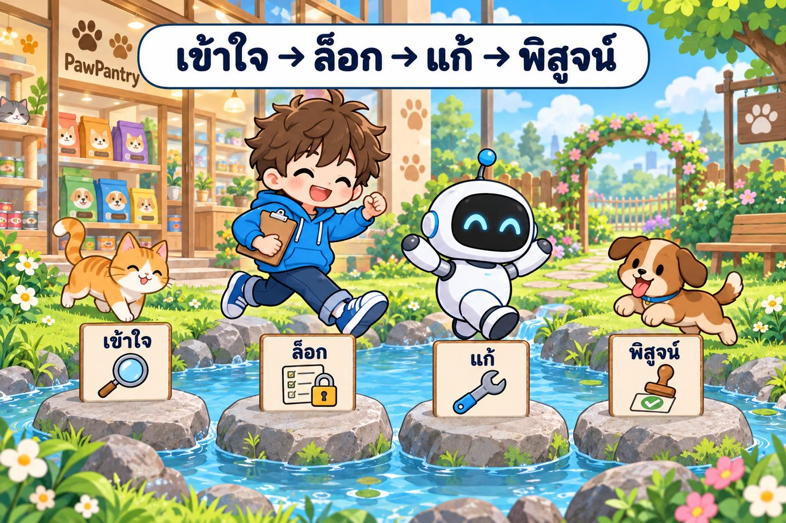

# ⚡ Fast Track · รับช่วงระบบเดิม PawPantry ด้วย REA ในพรอมต์เดียว

งานเดียวกับ [บทเรียนหลัก](../README.md) ทั้ง LAB 0–9 แต่วางพรอมต์ **ครั้งเดียว** แล้ว Claude ทำต่อกันเองจนจบ (ราว 45–60 นาที · รอบจริง 🅰️ 12 ต.ค. 2026 ใช้ ~45 นาที 11:30–12:15 · Opus 5.5) input มีแค่ของในโฟลเดอร์บท (repo `petshop/` · ชุดเทสต์เดิม `e2e-legacy/` · `rea/` · `TEST-DATA.md`) กับข้อความลูกค้า ใบ CR และคำตอบร้าน ซึ่งอยู่ท้ายพรอมต์แล้ว (คำตอบร้านใช้เมื่อถึงขั้น 7)


## 🧭 พรอมต์ทำอะไรบ้าง

Claude ทำ 10 ขั้นต่อกัน (ขั้นที่ N = LAB N) แต่ละขั้นสร้างไฟล์ แล้ว **อ่านไฟล์นั้นก่อนทำขั้นถัดไป** ถ้าสะดุดกลางทาง ให้วางพรอมต์เดิมซ้ำ Claude จะทำต่อจากขั้นที่ค้าง · LAB 10 (ฝึกเดี่ยว PR-1) ไม่อยู่ในพรอมต์นี้ ทำต่อในบทเรียนหลักหลังจบ




| ช่วง | ขั้น | ไฟล์ที่ได้ |
|---|---|---|
| ⚙️ | 0 | (ตารางในแชต) |
| 🟢 เข้าใจ | 1–3 | `CODEBASE-MAP.md` `CLAUDE.md` `.claude/settings.json` · `SYSTEM-MAP.md` `out\v1\` · `API-INVENTORY.md` |
| 🟡 ล็อก | 4 | `BASELINE.md` · `e2e-legacy/tests/new/char-money.spec.ts` `golden/` |
| 🔵 แก้บั๊ก | 5–6 | `BUG-01.md` · `tests/new/bug01-shipping.spec.ts` · `out\bug01.har` · โค้ดใน `petshop/` |
| 🟠 ฟีเจอร์ | 7–8 | `CR-01.md` · `tests/new/cr01-giftwrap.spec.ts` · โค้ดใน `petshop/` · `out\shots\lab8-checkout-giftwrap.png` |
| 🟣 พิสูจน์ | 9 | `CHANGE-PROOF.md` `CHANGE-REPORT.md` · `out\v2\` |

## 🤖 จุดที่ต่างจากบทเรียนหลัก: ขั้น 5 ให้ "ผู้ช่วยตาใหม่" ทำซ้ำบั๊ก

บทเรียนหลักเปิดเซสชันใหม่ทุก LAB ทำให้ LAB 5 เริ่มแบบ black-box ได้จริง แต่ในพรอมต์เดียว Claude อ่านโค้ดทั้งหมดไปแล้วตั้งแต่ขั้น 1 จึง "ทำเป็นไม่รู้" ไม่ได้ พรอมต์จึงสั่งให้ Claude ใช้ **subagent ใหม่** (ไม่มีความจำจากแชตนี้ และห้ามเปิด `petshop/` กับแผนที่โค้ด) ทำซ้ำอาการจากข้อความลูกค้าและเขียน test แดง แล้ว Claude ตัวหลักค่อยหาต้นเหตุแบบ white-box ให้ผล 2 อย่าง

1. **หลักฐานแบบ black-box เป็นของจริง** ตารางกรณีและ test แดงมาจากคนที่เห็นแค่เว็บ ไม่ได้มาจากคนที่รู้คำตอบในโค้ดแล้วเขียนย้อน
2. **เห็นชัดว่าตาไหนรู้อะไร** ผู้ช่วยตาใหม่บอกได้แค่ "เงินไม่ตรงในกรณีไหน" ส่วน "ทำไม" ต้องรอตา white-box ซึ่งต้องเทียบกับ HAR อีกที


## 🏷️ หัวใจที่พรอมต์บังคับไว้

**"โค้ดบอก ≠ ระบบทำ ≠ ร้านต้องการ"** ทำตามลำดับ **เข้าใจ → ล็อก → แก้ → พิสูจน์** ผลที่คาดหวังเรื่องเงินทุกข้อต้องมี **[D] หรือ [R]** รองรับ ส่วน **[E] หลักฐานจากระบบ** บอกได้แค่ว่าระบบ *ทำ* อะไร ไม่ได้บอกว่า *ควร* ทำ ถ้า [E] ขัด [D] ห้ามล็อกค่าของเว็บเป็นผลที่คาดหวัง และห้ามแก้ test เดิมหรือผลที่คาดหวังให้ผ่าน

![ป้ายบอกทาง 5 แผ่น D ร้าน R กฎทั่วไป E หลักฐานระบบ A AI O หน้าจอ หุ่นยนต์ถือตาชั่ง ถ้วยซ้าย D ควรทำ ถ้วยขวา E ทำอยู่ เด็กชายถือคลิปบอร์ด แมวส้มกับลูกหมานั่งข้างล่าง ป้ายเครื่องหมายถูก ผลที่คาดหวัง หัวเรื่อง ป้ายใหม่ [E] หลักฐานจากระบบ](../img/concept-12-evidence-badge-e.jpg)

## 🔀 เลือกพรอมต์ 1 จาก 2 แบบ

ทั้งสองแบบทำ 10 ขั้นเหมือนกัน ใช้กติกาเดียวกัน ได้ไฟล์ชุดเดียวกัน หัวข้อในไฟล์เหมือนกัน และใช้ผู้ช่วยตาใหม่ในขั้น 5 เหมือนกัน ต่างกันแค่ **Claude รู้บทเรียนจากรอบที่ทำจริงในบทเรียนหลักหรือไม่**


| | 🅰️ บอกใบ้ | 🅱️ ไม่บอกใบ้ (black-box จริง) |
|---|---|---|
| เหมือน | รุ่นพี่ที่เคยรับช่วงระบบนี้เล่าว่า "เครื่องมือนี้หลอกตาตรงนี้ จุดนี้ต้องระวัง" | ทีมใหม่ได้แค่ repo ข้อความลูกค้า และใบ CR ไม่มีใครเล่าอะไรให้ฟัง |
| Claude รู้ | กับดักของ REA และ PowerShell · วิธีอ่านผล REA · จุดที่รอบจริงพลาดง่าย (จาก ✅ และ 👀 ของบทเรียนหลัก) · หลักตัดสินแทนผู้เรียนที่เจาะจง | ของในโฟลเดอร์บท ไฟล์ที่สร้างเอง ข้อความท้ายพรอมต์ และกฎทั่วไปของงานทดสอบ |
| ผลที่น่าจะได้ | ใกล้บทเรียนหลัก เทียบ `_solution/` ง่าย | อาจอ่านผล REA ผิด (เช่น สรุปว่า "ไม่มี" เพราะหาไม่เจอ) · characterization อาจไม่ครอบค่าขอบ · impact อาจพลาดจุดแสดงเงิน |
| ใช้กับงานอื่น | ไม่ได้ (เบาะแสผูกกับ PawPantry) | ได้ เปลี่ยนข้อความลูกค้าและใบ CR |
| เหมาะกับ | ทำครั้งแรก · สาธิตในห้อง | ฝึกจริง · วัดว่าพรอมต์ที่ไม่มีเบาะแสพาไปถึงต้นเหตุได้ไหม |

> 💡 สอนในห้อง: รัน 🅰️ เป็นตัวอย่างก่อน แล้วลอง 🅱️ แล้วเทียบผล จะเห็นชัดว่าบทเรียนจากรอบจริงช่วยตรงไหน · ข้อความลูกค้าเล่าแค่อาการ ทั้งสองแบบไม่มีใครบอกต้นเหตุล่วงหน้า

<details>
<summary>ดูว่าพรอมต์สองแบบต่างกันตรงไหนบ้าง (ทีละขั้น)</summary>

| จุด | 🅰️ บอกใบ้ | 🅱️ ไม่บอกใบ้ |
|---|---|---|
| กติกาข้อแรก | — | ใช้ข้อมูลได้แค่ 3 แหล่ง ห้ามใช้ความรู้เดิมเกี่ยวกับบทเรียนนี้ ห้ามเดาว่าบั๊กอยู่ตรงไหน |
| ขั้น 0 เช็กเครื่อง | บอกว่า `doctor` จบ exit 1 เป็นเรื่องปกติ (engine ที่ไม่ใช้กับเว็บ) · 3000 มักอยู่ในช่วงที่ Windows จอง · เว็บเดียวมี 2 ที่อยู่ | แค่ "อ่านผลก่อนสรุปว่าพัง" |
| ขั้น 1 อ่าน repo | บอกกับดัก `permissions.deny` (ใช้ `Edit(...)` · ไม่กัน shell) · เอกสารส่งมอบมีเรื่องเก่า ให้เทียบทีละบรรทัด | เทียบเอกสารทุกฉบับกับโค้ด · settings ต้องลองว่ากันได้จริง |
| ขั้น 2–3 REA | ชื่อ endpoint ที่ถูกย่อ · ผลที่อยู่ใน file node · แถว login `(redacted)` · ป้าย `electron-renderer` · `completeness: incomplete` (อ่าน missing) · URL `petshop:3000` · skill ของ REA บอกให้ข้ามเมื่อมี source ครบ | หลัก: ทุกแถวติดป้าย 🔵🟢🟡⚪ · หาไม่เจอ ≠ ไม่มี |
| ขั้น 4 ล็อก | ชื่อ test ≠ สิ่งที่ test ตรวจ · ดูว่าชุดเดิมตรวจเงินที่จุดไหน · เลือกตะกร้าที่ขอบของกฎค่าส่งและคูปอง | เลือกค่าขอบของทุกกฎเงินใน TEST-DATA เอง |
| ขั้น 5 BUG-01 | เลขคำสั่งซื้อของลูกค้าไม่มีในเครื่องเรา · ถามตรง ๆ ว่าคอมเมนต์ในโค้ดตรงนั้นพูดจริงไหม (ตรวจกับ HAR) | หลักเดียวกันแบบทั่วไป: ทำซ้ำ · กรณีข้างเคียง · หลักฐาน 2 ตา · เทียบโค้ดและเอกสาร (ถ้ามี) กับ HAR |
| ขั้น 6 แก้ | ตัดสินแทนผู้เรียน: เลือกวิธีที่ให้กฎเงินอยู่ที่เดียว ไม่ใช่วิธีที่ปิดอาการ | ตัดสินแทนผู้เรียน: วิธีที่แก้ต้นเหตุและแตะน้อยที่สุด |
| ขั้น 7–8 CR-01 | impact ต้องครอบหน้าที่แสดงเงินของคำสั่งซื้อ · ค่าขอบรอบ ฿1,500 · giftWrap ผิดชนิด · ถ้าขั้น 6 แก้แค่ปลายเหตุ ค่าห่ออาจหายจากคำสั่งซื้อ | หลัก: ทุกจุดที่คำนวณ **และแสดง** เงิน หาด้วยการค้นโค้ด |
| ขั้น 9 พิสูจน์ | ไฟล์ที่ `next build` เขียนเอง · ไฟล์ที่แก้ขึ้นเป็น `unknown` ไม่ใช่ `modified` · compare-versions ได้ผลเป็นร้อยรายการ | หลัก: อ่านตัวนับจริงก่อนตีความ · ส่วนเกินต้องอธิบาย |

**เหมือนกันทุกตัวอักษร:** ข้อความลูกค้า · ใบ CR-01 · คำตอบร้าน · ไฟล์ที่ได้และหัวข้อในไฟล์ · ป้าย [D] [R] [E] [O] · PowerShell + `rea.ps1` ผ่าน `-ExecutionPolicy Bypass` · พอร์ต 4000 และ network `pawpantry05_default` · ห้ามแก้ไฟล์เดิมใน `e2e-legacy/` · ห้ามแก้ผลที่คาดหวังหรือรัน `-u` · ห้ามเปิด `README.md` `fast_track/` `_solution/` · ขั้น 5 ผู้ช่วยตาใหม่ (ข้อความถึงผู้ช่วยมีกติกาสต็อกและห้าม skip เบราว์เซอร์) · ขั้น 7 เขียนคำถามก่อนใช้คำตอบร้าน · regression 3 เบราว์เซอร์ · กติกาข้อ 9 ข้อมูลทดสอบ (สต็อก × 3 เบราว์เซอร์ · ล้มเพราะสต็อกหมดให้รันทีละเบราว์เซอร์) · ตารางสรุปตอนจบ

</details>

## 🚀 วิธีใช้

1. เตรียมเครื่องตามบทเรียนหลัก: Docker Desktop · Node.js 20+ · **build image `rea-lab:6.4.0` ไว้แล้ว** (`docker build -t rea-lab:6.4.0 rea` ก่อนเข้าคลาส · ~2.65 GB) · พอร์ต 4000 ว่าง (ถ้าเปิดเว็บบท 06 ค้างไว้ให้ `docker compose down` ก่อน)
2. เปิด Claude Code ที่โฟลเดอร์ `05_rea-reverse-engineer-legacy-petshop` ในเซสชันใหม่ แล้วตั้งโหมดอนุญาตให้รันคำสั่งได้เอง ไม่อย่างนั้นจะค้างรอให้กด Yes
3. คัดลอกพรอมต์ 🅰️ หรือ 🅱️ ไปวาง แล้วตั้งเครื่องไม่ให้หลับ (รอบจริง: build `out\v1` `out\v2` รอบละ ~3 นาที (168 / 161 วินาที) · rebuild เว็บหลังแก้โค้ด ~11 วินาทีเมื่อมี cache (ไม่มี cache ~3 นาที) · `npm run test:all` 3 เบราว์เซอร์ 70–102 วินาทีต่อรอบ)
4. จบแล้วตรวจผลตามหัวข้อ ✅ ข้างล่าง

> ⚠️ ข้อจำกัดของพรอมต์เดียว: คำตอบร้านเรื่อง CR-01 อยู่ท้ายพรอมต์ Claude จึงเห็นตั้งแต่ต้น (พรอมต์สั่งให้ใช้เมื่อถึงขั้น 7 และให้เขียนคำถามจากใบ CR ก่อน แต่บังคับไม่ได้ 100%) · อยากฝึกตั้งคำถามเอง ให้เขียนคำถามของคุณจากใบ CR **ก่อน**อ่านส่วนคำตอบร้านในพรอมต์ แล้วค่อยเทียบกับตาราง "ต้องถามร้าน" ใน `CR-01.md`

> 🔁 จะรันอีกแบบต่อจากแบบแรก หรือเริ่มใหม่ทั้งหมด ให้ย้ายไฟล์ที่สร้างไว้ (`*.md` ที่สร้างที่รากบท · `CLAUDE.md` · `.claude/` · ไฟล์ใน `e2e-legacy/tests/new/` ยกเว้น `.gitkeep` · `out/`) ไปเก็บที่อื่น คืนโค้ด `petshop/` เป็นของตั้งต้น (clone ใหม่ หรือคัดลอกจาก `out\v1` ซึ่งเป็นสำเนาก่อนแก้ ก่อนย้าย `out/`) แล้ว `docker compose down` ในโฟลเดอร์ `petshop` ไม่อย่างนั้น Claude จะคิดว่าทำเสร็จแล้ว · รอบจริง `out\` หลังจบ ~1.35 GB (`out\v1` `out\v2` มี node_modules ชุดละ ~533 MB ลบได้หลังจบขั้น 9)

## ✅ จบแล้วตรวจอะไร

1. **ตารางสรุปท้ายแชต** ดูช่อง ⚠️ และ "เรื่องที่ตัดสินแทนผม" ก่อน
2. **test แดงก่อน → เขียวหลัง** ใน `BUG-01.md` และ `CR-01.md` ต้องมีผลรอบแดงที่แดงด้วยเหตุผลเรื่องเงินหรือ "ยังไม่มีฟีเจอร์" (ไม่ใช่ timeout หรือหา element ไม่เจอเพราะเขียนผิด) แล้วค่อยเขียว
3. **ไม่มีใครแตะของเดิม** เปิด `BASELINE.md` เทียบผลชุดเดิมก่อนแก้กับผล regression ตอนจบ · ไฟล์เดิมใน `e2e-legacy/` ต้องไม่ถูกแก้ และค่าที่ [E] ขัด [D] ต้องเป็น test คู่ ไม่ใช่ถูกล็อกเป็นผลที่คาดหวัง
4. **3 รายการใน `CHANGE-PROOF.md` ตรงกัน** ไฟล์ที่ตั้งใจแก้ = ไฟล์ที่ hash ต่าง = ไฟล์ที่ REA บอกว่า bundle ต่าง (ส่วนเกินต้องมีคำอธิบาย) และ `CHANGE-REPORT.md` ทุกตัวเลขอ้างไฟล์ผล + `evidence_id`
5. **ให้คะแนน**ด้วยรูบริก 20 ข้อในบทเรียนหลัก (ข้อ 1–19 · ข้อ 20 เป็นของ LAB 10) แล้วค่อยเปิด `_solution/` เทียบ

ตัวเลขจากรอบจริงของพรอมต์ 🅰️ (12 ต.ค. 2026 · Opus 5.5 · 11:30–12:15 ~45 นาที) ใช้เป็นจุดเทียบ (ของคุณไม่จำเป็นต้องตรงทุกตัว เพราะ agent เลือกตะกร้า วิธีแก้ และ test เอง · แบบ 🅱️ อาจต่างมากกว่า) · บันทึกเต็มอยู่ใน `_solution/_design/results/FT-RESULT.md`

| ขั้น | รอบจริง 🅰️ ได้ |
|---|---|
| 0 | พร้อม 14/14 รายการ · `doctor` exit 1 (hopper / ghidra / ida + skill identity ไม่กระทบงานเว็บ) · probe `petshop:3000/api/health` ใน `pawpantry05_default` = `{"ok":true}` |
| 1 | CODEBASE-MAP 99 แถว / เดา 1 · หน้า 12 (+layout) · API 13 · ส่วน G ⚠️7 / ❌2 · CLAUDE.md 37 บรรทัด · deny ลองแล้วกันได้จริง |
| 2 | static 21 ไฟล์ / endpoint 9 (จริง 6 + `a` `b` `c` ชื่อย่อ) / storage 3 / coverage partial · server recovered_source_files 52 (retained_on_file_nodes 94) · trace `coupons/validate` 16 node 75 edge · ส่วน B ✅6 ⚠️7 ❓20 |
| 3 | HAR 97 records · API 4 · scenario 11/11 step (completeness incomplete · missing: events) · storage keys `pp-recent` `pp-cart` `pp-coupon` |
| 4 | ชุดเดิม 40/40 ทุกเบราว์เซอร์ (chromium firefox webkit) · test ใหม่ 9 (char-money: เงิน 4 จุด + golden API 2 + คู่ ฿999) · expected-fail 1 × 3 เบราว์เซอร์ |
| 5–6 | subagent ลอง 12 กรณี · ผิด 4 (฿999 · ฿999+PAW10 · ฿999+NEWCAT50 · ฿999+SUMMER20) · test BUG-01 แดง 3/7 → เขียว 7/7 · แตะไฟล์เดียว +2 −13 · ⚠️ subagent ใช้สต็อกเกินและ skip firefox/webkit → ตัวหลักเปลี่ยนตะกร้า (แก้ในพรอมต์แล้ว) |
| 7–8 | คำถามถึงร้าน 10 (ร้านตอบ 7 · ⚠️ สมมติฐาน 3) · impact 6 ไฟล์ (+ตรวจแล้วไม่แตะ 6) · TC-GIFT 17 แดง → 17 เขียว · regression 73/73 × 3 เบราว์เซอร์ (ชุดเดิม 40/40 × 3) |
| 9 | hash ต่าง 6 = ตั้งใจแก้ 6 = bundle ต่าง 6 (+`next-env.d.ts` ที่ build เขียนเอง) · s2b เวอร์ชันเดียวกัน unchanged 44 · modified 0 · removed 0 · split 0 · merged 0 · duplicated 8 · unknown 3 · ข้ามเวอร์ชัน 41/0/0/0/0/5/9 (6 ไฟล์ที่แก้ = unknown) · obligation ✅13 ⚪3 · HAR ใหม่ API เดิมครบ 4/4 status เดิม (+`giftWrap` `giftWrapFee`) |

## 🆘 ถ้าสะดุด

| อาการ | ทำอะไร |
|---|---|
| แชตหลุด / Claude หยุดกลางทาง | เปิดเซสชันใหม่ วางพรอมต์เดิมซ้ำ |
| `rea.ps1 cannot be loaded because running scripts is disabled` | `เรียก REA ด้วย powershell -NoProfile -ExecutionPolicy Bypass -File .\rea\rea.ps1 เท่านั้น ห้ามเรียก .\rea\rea.ps1 ตรง ๆ และห้ามเปลี่ยน ExecutionPolicy ของเครื่อง` |
| Claude ใช้ Git Bash แล้ว path เพี้ยน (`/c/...` หรือ `/work` ถูกแปลง) | `หยุดก่อน รันคำสั่งด้วย PowerShell เท่านั้น ถ้ามีแต่ bash ให้เขียนคำสั่งลง rea\scratch\run.ps1 แล้วรันผ่าน powershell -NoProfile -ExecutionPolicy Bypass -File` |
| REA ต่อเว็บไม่ได้ (`net::ERR_NAME_NOT_RESOLVED petshop`) | เว็บยังไม่ขึ้น หรือลืม `-Network pawpantry05_default` · ให้ Claude ตรวจ `docker ps` และ `docker network ls` |
| Claude รันคำสั่งนานซ้ำ ๆ (build / test:all) | `รันเบื้องหลังแล้วรอจนจบ ห้ามสั่งซ้ำระหว่างรอ` |
| `npm run test:all` ล้มด้วย `409 สินค้าไม่พอ` หรือปุ่ม `qty-plus` กดไม่ได้ | ข้อมูลทดสอบ (สต็อก) หมด ไม่ใช่เว็บพัง: 3 เบราว์เซอร์ใช้สต็อกที่ reset ครั้งเดียว · พรอมต์สั่งให้รันทีละเบราว์เซอร์แล้ว (กติกาข้อ 9) ถ้า Claude หยุดถาม ตอบ `รันทีละเบราว์เซอร์ด้วย --project แล้วรวมผล ห้ามแก้ test` |
| ขั้น 5 เรียก subagent ไม่ได้ | วางพรอมต์ LAB 5 ของบทเรียนหลักในหน้าต่างใหม่เอง พอได้ `BUG-01.md` แล้วกลับมาวางพรอมต์เดิมซ้ำ |
| Claude จะแก้ test เดิม / รัน `-u` / เปลี่ยนผลที่คาดหวังตามเว็บ | `หยุดก่อน ห้ามแก้ไฟล์เดิมใน e2e-legacy/ ห้ามรัน -u ห้ามแก้ผลที่คาดหวัง ให้จำแนกว่าเว็บผิดหรือ test เขียนผิด แล้วแก้ฝั่งนั้น` |
| พอร์ต 4000 ไม่ว่าง | `docker ps` ดูว่าเป็นบท 06 ไหม → `docker compose down` ในโฟลเดอร์บทนั้น · ถ้าเป็นช่วงที่ Windows จอง ดูวิธีแก้ในบทเรียนหลัก LAB 0 |

อาการอื่นดูตารางแก้ปัญหาใน[บทเรียนหลัก](../README.md)

---

## 🅰️ พรอมต์แบบบอกใบ้ (ตามบทเรียนหลัก)

```text
ผมเพิ่งรับช่วงระบบร้าน PawPantry (ทีมเดิมออกไปหมดแล้ว) ในโฟลเดอร์บทนี้มี repo petshop/ ชุดเทสต์เดิม e2e-legacy/ เครื่องมือ REA ใน rea/ และ TEST-DATA.md ส่วนข้อความลูกค้า ใบ CR-01 และคำตอบร้านอยู่ท้ายพรอมต์ ช่วยทำ 10 ขั้นข้างล่างต่อกันจนจบโดยไม่ต้องรอผม ตัวอย่างและเบาะแสในพรอมต์มาจากรอบที่เคยทำจริง ตัวเลขรอบนี้อาจต่างกัน ผลทุกอย่างต้องมาจากการรันจริง

กติกาตลอดงาน
1. ทุกไฟล์เป็นภาษาไทย ใช้ตาราง เก็บที่โฟลเดอร์บท · ก่อนเริ่มแต่ละขั้นให้อ่านไฟล์ของขั้นก่อนจากดิสก์ใหม่ ไม่พึ่งความจำในแชต
2. ตอนเริ่ม ให้เปิดดูไฟล์ที่มีอยู่จริง (และ container กับ out\ ถ้ามี) แล้วทำต่อจากขั้นแรกที่ยังไม่เสร็จ
3. ห้ามเปิด README.md ของบท fast_track/ และ _solution/ · ห้ามแก้ไฟล์เดิมใน e2e-legacy/ และ TEST-DATA.md (เพิ่มไฟล์ได้เฉพาะใน e2e-legacy/tests/new/) ทั้งด้วยเครื่องมือแก้ไฟล์และคำสั่ง shell · ห้ามรัน -u · ห้ามแก้ผลที่คาดหวังให้ผ่าน · ห้ามใช้ git ที่เปลี่ยนสถานะ repo (อ่านได้: status log diff)
4. รันคำสั่ง shell ทุกตัวด้วย PowerShell จากโฟลเดอร์บท · ถ้ามีแต่ bash ให้เขียนคำสั่งลงไฟล์ rea\scratch\run.ps1 แล้วรัน powershell -NoProfile -ExecutionPolicy Bypass -File rea\scratch\run.ps1 ห้ามแปลงเป็น bash เอง · เรียก REA ด้วย powershell -NoProfile -ExecutionPolicy Bypass -File .\rea\rea.ps1 <อาร์กิวเมนต์> (ข้างล่างย่อว่า REA) path ที่ส่งให้ REA ขึ้นต้น /work/ และเก็บผลด้วย -Out เท่านั้น (> ของ PowerShell 5.1 ใส่ BOM ที่ REA ไม่รับ) · คำสั่งที่เขียนว่า "นาน" ให้ตั้ง timeout ≥ 10 นาที หรือรันเบื้องหลังแล้วรอจนจบ ห้ามสั่งซ้ำระหว่างรอ · สคริปต์ชั่วคราวเก็บใน rea\scratch\ (import "playwright" ได้) · อ่าน API ด้วย node fetch ไม่ใช้ Invoke-RestMethod และแก้ไฟล์ JSON ด้วย node ไม่ใช้ Get-Content | Set-Content (PowerShell 5.1 ทำภาษาไทยเพี้ยน · อ่านไฟล์ภาษาไทยด้วยเครื่องมืออ่านไฟล์ของ Claude ไม่ใช่ Get-Content/cat) · สคริปต์ node ที่มี $ หรือ regex ให้เขียนเป็นไฟล์ใน rea\scratch\ ห้ามใช้ node -e (PowerShell แปลง $ เงียบ ๆ)
5. เว็บบนเครื่องเราคือ http://localhost:4000 (เบราว์เซอร์และ Playwright) · REA ใน container เข้าเว็บทาง -Network pawpantry05_default ที่ http://petshop:3000 · ไฟล์ .json และ .har ใน out\ ใหญ่มาก ห้ามเปิดตรง ๆ ให้ย่อด้วย node rea\rea-summarize.mjs · HAR มีรหัสผ่านจริง ห้ามคัดค่าลับลงไฟล์ .md
6. ผลที่คาดหวังมี 4 ที่มา: [D] ร้าน (TEST-DATA.md และคำตอบร้าน) > [R] กฎทั่วไปหรือคณิตศาสตร์ > [E] หลักฐานจากระบบที่รันจริง (อ้างไฟล์ผล) > [O] หน้าจอ · เงินทุกตัวคำนวณเองพร้อมวิธีคิดก่อนดูเว็บ · [E] ขัด [D] ห้ามล็อกค่าของเว็บเป็นผลที่คาดหวัง ให้เขียน test คู่ (ข้อหนึ่งล็อกค่าปัจจุบัน annotation legacy-quirk อีกข้อ test.fail() ตาม [D] annotation KNOWN-ISSUE) · ผลไม่ตรงให้จำแนกว่า เว็บผิด / test เขียนผิด ก่อนแก้ฝั่งนั้น
7. จุดที่ปกติต้องถามผม ให้ตัดสินตามนี้แล้วจดใต้หัวข้อ "ตัดสินแทนผู้เรียน" ในไฟล์ของขั้นนั้น: settings.json บันทึกได้ · ชุดเดิมมีข้อล้มตั้งแต่ก่อนแก้ ให้จดใน BASELINE.md ว่าเป็นของเดิมแล้วทำต่อ · วิธีแก้ BUG-01 เลือกวิธีที่ทำให้กฎเงินอยู่ที่เดียว ไม่ใช่วิธีที่ปิดอาการอย่างเดียว (ถ้า BUG-01.md แนะนำอีกแบบ ให้จดว่าไม่เห็นด้วยเพราะอะไร) · คำถามถึงร้านเรื่อง CR-01 ใช้คำตอบท้ายพรอมต์ เรื่องที่ไม่มีคำตอบใช้แบบที่ง่ายที่สุดที่ไม่ขัดข้ออื่นแล้วติด ⚠️ · แผนทำ CR-01 อนุมัติเมื่อมีทุกหน้าที่แสดงเงินของคำสั่งซื้อ และกฎค่าห่ออยู่ในไฟล์กฎเงินที่เดียว
8. หาไม่เจอ ≠ ไม่มี · ไม่แน่ใจให้เขียนใน "ยังไม่รู้" อย่าเดา · โค้ดที่น่าจะเป็นบั๊กที่เจอตอนอ่าน repo ให้จดเป็นสมมติฐานใน "ยังไม่รู้" จนกว่าจะเห็นจากการรันจริง · ถ้าติดจนทำต่อไม่ได้ให้หยุดแล้วบอกผม
9. ข้อมูลทดสอบเป็นของร่วม: npm run test:all reset ครั้งเดียวแล้วรัน 3 เบราว์เซอร์ขนานกัน → test ใหม่ที่ซื้อของจริง จำนวนชิ้นรวม × 3 เบราว์เซอร์ต้องไม่เกินสต็อกหลัง reset (ดู stock จาก GET /api/products) · ถ้าข้อล้มด้วย 409 "สินค้าไม่พอ" หรือปุ่ม qty-plus กดไม่ได้ = ข้อมูลทดสอบหมด ไม่ใช่เว็บพัง → รันทีละเบราว์เซอร์ npx playwright test --project=chromium / --project=firefox / --project=webkit (reset ทุกรอบ) แล้วรวมผล · ห้ามแก้ตะกร้าใน test หรือ config เพื่อเลี่ยง

ขั้นที่ 0 เช็กเครื่อง (อ่านอย่างเดียว ทุกค่าจากคำสั่งที่รันจริง): docker version · docker compose version · node -v (≥ 20) · npm -v · Get-ExecutionPolicy -List · netsh interface ipv4 show excludedportrange protocol=tcp บอกว่า 3000 และ 4000 อยู่ในช่วงที่จองไหม (เครื่องที่ทำรอบจริง 3000 ถูกจอง จึงใช้ 4000) และ 4000 มีคนใช้ไหม (Get-NetTCPConnection -LocalPort 4000 -ErrorAction SilentlyContinue · docker ps) · docker image inspect rea-lab:6.4.0 --format "{{.Size}}" ถ้าไม่มีให้หยุดบอกผม (ไม่ต้อง build เอง) · REA doctor --filter-output healthy,checks (รอบจริงจบ exit 1 เพราะ engine วิเคราะห์ไบนารีที่ไม่ได้ใช้กับเว็บ ให้อ่านว่าข้อไหนไม่ผ่านและกระทบงานเว็บไหม) · ในโฟลเดอร์ petshop: docker compose up -d --build (ครั้งแรกนาน ~3 นาที · ครั้งต่อไปใช้ cache ไม่กี่วินาที) รอ container pawpantry05 healthy แล้วเรียก http://localhost:4000/api/health · docker network ls ต้องมี pawpantry05_default แล้ว docker run --rm --network pawpantry05_default --entrypoint node rea-lab:6.4.0 -e "fetch('http://petshop:3000/api/health').then(r=>r.text()).then(console.log)" (เว็บเดียวกัน 2 ที่อยู่: เรา localhost:4000 · REA petshop:3000) · npm install ใน e2e-legacy และ rea แล้ว npx playwright install chromium firefox webkit ใน e2e-legacy (นาน) · ตาราง รายการ|ผล|พร้อมไหม|ต้องทำอะไร

ขั้นที่ 1 CODEBASE-MAP.md + CLAUDE.md + .claude/settings.json (ยังไม่แก้โค้ด · อ่านได้ petshop/ e2e-legacy/ rea/README.md TEST-DATA.md): ใช้ Explore subagent อ่าน petshop/ แล้วเขียน CODEBASE-MAP.md (บนสุดใส่วันที่) ส่วน A ภาพรวม (stack · รันยังไง · ข้อมูลอยู่ server หรือ browser) · B หน้าเว็บ URL|ไฟล์|component หลัก|ข้อมูลมาจากไหน · C API method|path|ไฟล์|ทำอะไร|ต้อง login ไหม · D กฎธุรกิจ (ราคา คูปอง ค่าส่ง สต็อก ฟอร์ม) กฎ|ไฟล์:บรรทัด|ถูกใช้หรือถูกเขียนซ้ำที่ไหนอีก (browser / server / ข้อความบนจอ) · E state อะไร|เก็บที่ไหน|key|/api/test/reset ล้างได้ไหม · F ชุดเทสต์เดิมครอบคลุมอะไร ตรวจเงินที่หน้าไหน · G "เอกสารบอก ≠ โค้ดทำ" เทียบ petshop/README.md, petshop/HANDOVER-NOTES.md, TEST-DATA.md และคอมเมนต์ในโค้ดกับโค้ดจริงทีละบรรทัด (รอบจริงเอกสารส่งมอบมีเรื่องที่เก่าแล้ว) ✅/⚠️/❌ ห้ามตัดสินเองว่าฝั่งไหนถูก ให้เป็นคำถามถึงร้าน · H สิ่งที่อ่านโค้ดอย่างเดียวพิสูจน์ไม่ได้ · I ชนิดงานตาม Chikofsky & Cross (redocumentation / design recovery) และตาที่ใช้ (white / black / grey-box) ของส่วน A–H + 2 บรรทัดว่าทำไมยังไม่ใช่ re-engineering · ทุกแถวมีคอลัมน์ "ยืนยันจาก" ไฟล์:บรรทัด ถ้าเดาให้เขียน "เดา" · CLAUDE.md ≤ 60 บรรทัด: คำสั่ง PowerShell (เว็บ 4000 · reset · npx playwright test · npm run test:all · REA · rea\scratch\) · อ้าง CODEBASE-MAP.md เป็นชื่อไฟล์ธรรมดา ห้ามใช้ @ · ห้ามแตะไฟล์เดิมใน e2e-legacy/ และ TEST-DATA.md · ห้ามเปิด README.md ที่รากบท fast_track/ _solution/ (มีเฉลย · petshop/README.md อ่านได้) · กติกาการแก้ (อธิบายก่อน · impact ก่อน · แก้เล็กสุด · ห้ามแก้เทสต์เดิมให้ผ่าน · test ใหม่ใน tests/new/) · .claude/settings.json ใช้ permissions.deny แบบ Edit(...) (ไม่ใช่ Write(...)) กัน e2e-legacy/playwright.config.ts global-setup.ts package.json ไฟล์ .ts ชั้นบนสุดของ e2e-legacy/tests/ และ TEST-DATA.md แต่ต้องยังสร้างไฟล์ใน tests/new/ ได้ (path relative กับโฟลเดอร์บท เช่น Edit(e2e-legacy/tests/*.ts) · ห้าม ** หรือ // ที่กิน tests/new/) และ deny Read 3 rule: Read(/README.md) Read(./fast_track/**) Read(./_solution/**) (README ขึ้นต้น / ตัวเดียว = เฉพาะไฟล์ที่รากบท · ./README.md จะกัน petshop/README.md ไปด้วย) · เขียนใน CLAUDE.md ด้วยว่า deny กันแค่เครื่องมือแก้ไฟล์ ไม่กันคำสั่ง shell · ตาราง ส่วน|จำนวนแถว|แถวที่เดา|⚠️/❌

ขั้นที่ 2 SYSTEM-MAP.md (ห้ามแก้ petshop/ · อ่าน rea/README.md ก่อน): ① robocopy petshop out\v1 /E /XD node_modules .next /NFL /NDL /NJH /NJS (exit 0–7 = สำเร็จ) แล้ว docker run --rm -v "${PWD}\out\v1:/app" -w /app -e NEXT_TELEMETRY_DISABLED=1 node:24-alpine sh -c "npm ci --no-audit --no-fund && npm run build" (นาน ~3 นาที) · out\v1 คือของเดิมไว้เทียบ ห้ามแก้จนจบ ② REA -Out out\v1-static.json analyze-javascript-application /work/out/v1/.next/static --json และแบบเดียวกันกับ .next/server → out\v1-server.json ย่อด้วย rea-summarize --md แล้วจด ไฟล์ · node แต่ละชนิด · edge · coverage · endpoint (พร้อม method และคอลัมน์ "ที่มา" · method ตัวย่ออ่านจาก bundle ไม่ใช่ผลของ REA) · storage · evidence_id_short · subject_digest_short · recovered_source_files · node electron-renderer มาจากไฟล์ไหน ③ node rea\rea-input.mjs trace out\v1-server.json string coupons/validate incoming out\trace-coupon.in.json แล้ว REA -Out out\trace-coupon.json trace-application-feature /work/out/trace-coupon.in.json --json ④ ส่วน A REA เห็นอะไร|ชนิด|static หรือ server|ป้าย 🔵 static 🟢 runtime 🟡 inference ⚪ unknown|evidence_id ⑤ ส่วน B triangulation ทุกหน้า API storage ใน CODEBASE-MAP ส่วน B C E: REA เห็น|โค้ดบอก|✅/⚠️/❓ไม่เจอ|ยืนยันด้วยตาไหน (white = อ่านโค้ด · grey = REA หรือ grep ในของที่ build · black = เปิดเว็บ/HAR/HEALTHCHECK) · ✅ = อยู่ในรายการ endpoint/storage ของ REA และตรงโค้ด · ⚠️ = เห็นแต่ไม่ครบหรือต่าง · ❓ = ไม่อยู่ในรายการ (กู้ได้แค่ชื่อไฟล์จาก source map ก็ยังนับ ❓ แล้วเขียนกำกับ) · ที่ไม่เจอห้ามสรุปว่าไม่มี ⑥ ส่วน C 5 ข้อ: inference/ชื่อถูกย่อ · ถ้ามีแต่ build รู้อะไรได้ไม่ได้ · งานไหนควรใช้ REA (skill ของ REA เองบอกให้ข้ามเมื่อมี source ครบ) · digest ใช้ทำอะไร · แถวไหนยืนยัน 2 ตา แถวตาเดียวต้องใช้หลักฐานอะไรเป็นตาที่สอง · เบาะแสรอบจริง: endpoint บางตัวเป็นชื่อย่อแบบ minify (เช่น a b c) = 🟡 · REA อาจชนเพดานแล้วเก็บผลไว้ใน file node แทน graph node ให้ดูคอลัมน์ "ที่มา" ของ rea-summarize ทั้ง static และ server (รอบจริงล่าสุด static ได้ endpoint 9 storage 3 เป็น graph node ตรง ส่วน server มี retained_on_file_nodes 94 · บางรอบได้ endpoint ในกราฟน้อยกว่านี้) = หาไม่เจอในกราฟ ≠ ไม่มี · storage ได้ name: null · server bundle กู้ path ต้นทางได้จาก source map · ป้าย electron-renderer ชี้ไปที่ไฟล์ HTML ของ Next (ตัวย่อบอกชื่อไฟล์) ไม่ได้แปลว่าเป็น Electron · coverage partial เป็นเรื่องปกติ · ตาราง ส่วน|จำนวนแถว|✅|⚠️|❓

ขั้นที่ 3 API-INVENTORY.md (ห้ามแก้ petshop/): ① node rea\record-har.mjs (reset แล้วเดินเส้นทางหลัก 8 ขั้น · จดเวลาจาก out\har-steps.json) ② REA -Out out\har.json inspect-web-network-capture /work/out/pawpantry-main.har har --sensitive-value Paw12345 --sensitive-value demo@pawpantry.test --json (ถ้าคัดคำสั่งนี้ลงเอกสาร ให้เขียน <รหัส demo> <อีเมล demo> แทน) แล้วย่อด้วย --md --samples (key 2 ชั้น + body ตัวอย่างย่อ ใช้เป็นค่าตัวอย่างในส่วน A) · ตรวจด้วย Select-String ว่า out\har.json ไม่มี Paw12345 แต่ .har ต้นฉบับยังมี ③ REA -Network pawpantry05_default -Out out\scenario.json capture-browser-scenario /work/rea/scenario-coupon.json --json ย่อด้วย --md --samples --png out\scenario-final.png: step ผ่านกี่ step · key ใน localStorage · ข้อความเรื่องคูปองและยอดเงินใน accessibility tree (รอบจริง แถว POST /api/auth/login ในตาราง HAR ขึ้น (redacted) ทั้ง request และ response keys เพราะ REA ปิด body ทั้งก้อน ≠ ไม่มี body · completeness อาจขึ้น incomplete ให้อ่านเหตุผลที่ REA ให้ใน missing ก่อนตีความ (รอบจริง missing: events) · URL ในผลเป็น petshop:3000 = เว็บเดียวกันคนละประตู) ④ ส่วน A API ที่เห็นตอนรัน method|path|status|request keys|response keys|ค่าตัวอย่าง (ห้ามรหัสผ่าน อีเมล cookie)|หน้าที่เรียก · B แถว ⚪/❓ ใน SYSTEM-MAP ที่ runtime ยืนยันได้ เปลี่ยนเป็น 🟢 พร้อมไฟล์หลักฐาน · C API ในโค้ดที่ไม่เห็นรอบนี้ ทำไม เก็บเพิ่มอย่างไร · D 3 วิธี (analyze · HAR · scenario) ใครคุมเบราว์เซอร์|มีผลกับข้อมูลไหม (scenario = driven มีผลข้างเคียง · HAR อ่านอย่างเดียว)|บอกอะไรได้|บอกอะไรไม่ได้ ⑤ เช็ก .gitignore กัน out/ และ *.har + 2 บรรทัดว่าทำไม HAR ห้ามส่งต่อ · ตาราง ส่วน|จำนวนแถว|ยืนยันด้วย runtime|ยังไม่รู้

ขั้นที่ 4 BASELINE.md (ล็อกก่อนแตะโค้ด · ห้ามแก้ petshop/): ① ใน e2e-legacy: npx playwright test แล้ว npm run test:all (นาน) จดผ่าน/ล้ม/เวลาแยกเบราว์เซอร์ (ชุดเดิมมี 40 test ต่อเบราว์เซอร์) ② อ่าน e2e-legacy/tests ทุกไฟล์ (ตัว test ไม่ใช่แค่ชื่อ · รอบจริงมีชื่อ test ที่ไม่ตรงกับค่าที่ตรวจจริง) ทำตาราง กฎใน TEST-DATA.md|TC เดิมที่ตรวจ|ตรวจที่ไหน (ตะกร้า · checkout · คำสั่งซื้อที่ server บันทึก)|ช่องว่าง ③ tests/new/char-money.spec.ts: เลือกตะกร้าที่ค่าขอบของกฎค่าส่งและคูปองใน TEST-DATA.md (ราคาดูจากเว็บหรือ API) ตะกร้าเดียวกันตรวจเงิน 4 จุด: หน้าตะกร้า · ปุ่มยืนยันสั่งซื้อ · response ของ POST /api/orders · หน้าคำสั่งซื้อ · ตะกร้าที่สั่งซื้อจริงต้องผ่านกติกาข้อ 9 (สต็อก × 3 เบราว์เซอร์) · API golden ของ GET /api/products และ POST /api/coupons/validate เก็บเป็น tests/new/golden/*.json (ตัดฟิลด์ที่เปลี่ยนเองเช่นสต็อก) เทียบด้วย toEqual ไม่ใช้ toMatchSnapshot · ห้ามเรียก /api/test/reset ในเทสต์ (ชุดเดิมรันขนาน) สร้างผู้ใช้อีเมลสุ่มด้วย helper ใน tests/fixtures.ts (ห้ามแก้) ห้ามล็อกเลขคำสั่งซื้อและสต็อก ④ ทุกค่ามี annotation [E] (อ้างไฟล์ผล) และ [D] ถ้า TEST-DATA บอก · [E] ขัด [D] = test คู่ตามกติกาข้อ 6 + หัวข้อ "ผู้ต้องสงสัย" ⑤ รัน tests/new บน chromium 2 รอบ (ต้องนิ่ง) แล้ว npm run test:all 1 รอบ (นาน) · golden master ล็อกแค่ที่เราเลือกดู ให้เขียนช่องว่างที่ยังเหลือ · ตาราง ชุด|เบราว์เซอร์|ผ่าน|ล้ม|expected-fail (Playwright นับ test.fail() ที่ล้มตามคาดรวมใน passed → นับจากจำนวน test.fail() × เบราว์เซอร์)

ขั้นที่ 5 BUG-01.md (ยังไม่แก้โค้ดเว็บ): ① black-box ด้วยผู้ช่วยตาใหม่: สั่ง subagent ใหม่ (Agent tool) ด้วยข้อความนี้เท่านั้น ห้ามเติมอะไรจากแชตนี้ "อ่าน TEST-DATA.md, API-INVENTORY.md, BASELINE.md, rea/README.md และข้อความลูกค้าใน out\ticket-bug01.txt · ห้ามเปิด petshop/ CODEBASE-MAP.md SYSTEM-MAP.md README.md fast_track/ _solution/ · ห้ามแก้ไฟล์เดิมใน e2e-legacy/ · รันคำสั่งด้วย PowerShell สคริปต์ไว้ใน rea\scratch\ · ทำตามที่ลูกค้าเล่าด้วย Playwright headless บนเว็บ http://127.0.0.1:4000 (เว็บเดียวกับ localhost:4000 · อัด HAR ต้องใช้ 127.0.0.1 ไม่งั้น REA อ่าน HAR ไม่ได้) บันทึก HAR ที่ out\bug01.har (recordHar: { path: "out/bug01.har", urlFilter: /\/api\// } เก็บเฉพาะ API ไม่งั้นไฟล์ ~40 MB) · reset ข้อมูล (POST /api/test/reset) ก่อนรันทุกรอบเพราะบางสินค้าสต็อกน้อย · ข้อมูลทดสอบเป็นของร่วม: npm run test:all reset ครั้งเดียวแล้วรัน 3 เบราว์เซอร์ขนานกัน → ใน spec ทุก test ที่สั่งซื้อจริง รวมจำนวนชิ้นของแต่ละสินค้า × 3 เบราว์เซอร์ต้องไม่เกิน stock หลัง reset (ดูจาก GET /api/products) · ตะกร้าตามที่ลูกค้าเล่าใช้แค่ 1 test กรณีอื่นใช้ตะกร้ายอดเท่ากันจากสินค้าสต็อกมาก · ห้าม test.skip หรือแยกตามเบราว์เซอร์ · ดูเงิน 4 จุด (ตะกร้า · ปุ่มยืนยัน · response POST /api/orders · หน้าคำสั่งซื้อ) และยอดใน /account · ลองตะกร้าข้างเคียง ต่ำกว่า/สูงกว่า 1 บาท · คูปองใน TEST-DATA.md · ส่งด่วน · คำนวณผลที่ถูกจาก TEST-DATA.md [D] เองก่อนเทียบ (กรณีที่ [D] ไม่พอคำนวณ อย่าเดาตัวเลข ใช้ [R] ยอดบนปุ่มยืนยัน = ยอดในคำสั่งซื้อ แล้วจดคำถามใน ยังไม่รู้) · เขียน e2e-legacy/tests/new/bug01-shipping.spec.ts ชื่อ test ขึ้นต้น BUG-01 ผลที่คาดหวังตาม [D] หรือ [R] เท่านั้น มีข้อตรวจว่าเงินบนปุ่มยืนยัน = เงินในคำสั่งซื้อ รันบน chromium ต้องแดงด้วยเหตุผลเรื่องเงิน · เขียน BUG-01.md หัวข้อ อาการ · ขั้นตอนทำซ้ำ · ตาราง กรณี|ผลที่คาดหวัง [D]|ผลจริง [E] (ไฟล์หลักฐาน) · ห้ามเดาต้นเหตุ" (ก่อนสั่งให้คัดข้อความลูกค้าท้ายพรอมต์ลง out\ticket-bug01.txt · ถ้าเรียก subagent ไม่ได้ ให้ทำเองโดยไม่เปิดโค้ดแล้วติด ⚠️ ว่าไม่ใช่ black-box จริงเพราะอ่านโค้ดไปแล้วในขั้น 1) · เบาะแสรอบจริง: เลขคำสั่งซื้อของลูกค้าเป็นของระบบจริง ห้ามไปหาในเครื่องเรา ② ตรวจงานผู้ช่วยโดยไม่เปิดโค้ด: test แดงเพราะเงินไม่ใช่ locator/timeout · spec ผ่านกติกาข้อ 9 (นับชิ้น × 3 เบราว์เซอร์เทียบ stock) และไม่มี test.skip ตามเบราว์เซอร์ ถ้าไม่ผ่านให้เปลี่ยนตะกร้าเป็นยอดเท่ากันจากสินค้าสต็อกมาก ผลที่คาดหวังเท่าเดิม เก็บต้นฉบับไว้ใน out\ แล้วจดใน "ตัดสินแทนผู้เรียน" · ถ้า tests/new มีข้อที่ล็อกเรื่องนี้ไว้แล้ว (legacy-quirk / KNOWN-ISSUE) ให้บอก ③ white-box: ตอนนี้เปิดโค้ด หาต้นเหตุ (ไฟล์:บรรทัด) ว่าทำไมหน้าเว็บกับคำสั่งซื้อคิดไม่เท่ากัน · คอมเมนต์ในโค้ดตรงนั้นพูดจริงไหม ตรวจจาก out\bug01.har ว่า browser ส่งอะไรให้ server จริง ④ impact ≥ 2 วิธี: วิธีแก้|ไฟล์:บรรทัดที่แตะ|ใครเรียกใช้|ผลต่อกฎอื่นและฟีเจอร์ในอนาคต (เช่น ค่าใหม่ที่จะเพิ่มในยอดรวม)|test ที่ต้องรันซ้ำ|ความเสี่ยง แล้วแนะนำ 1 แบบ · เพิ่มใน BUG-01.md หัวข้อ ต้นเหตุ · ตาราง impact · ทำไมชุดเทสต์เดิมจับไม่ได้ · ตาราง กรณี|ตะกร้า|ปุ่ม|คำสั่งซื้อ|ถูกไหม

ขั้นที่ 6 แก้ BUG-01: ① แสดงไฟล์และบรรทัดที่จะแตะเทียบตาราง impact (เกินต้องมีเหตุผล) แล้วตัดสินวิธีตามกติกาข้อ 7 ② แก้ให้เล็กที่สุด · ใน petshop: docker compose up -d --build (นาน) รอ healthy ③ bug01-shipping.spec.ts บน chromium ต้องผ่าน (ห้ามแก้ผลที่คาดหวัง) · ข้อยกเว้นเดียว: test คู่ legacy-quirk / KNOWN-ISSUE ของเรื่องนี้ที่ตอนนี้ขึ้น "Expected to fail, but passed" ปรับตามพฤติกรรมที่ตั้งใจเปลี่ยน (ทั้งค่าและ tag/annotation เช่น legacy-quirk → bug01-fixed · เอา test.fail() ออก) แล้วจดเหตุผลอ้าง BUG-01 ④ ชุดเดิม + tests/new ทั้งหมดบน chromium ⑤ ยิง API ซ้ำทุกกรณีในตาราง (สคริปต์ที่เขียนทับไฟล์ใน out\ ให้คัดผลก่อนแก้ไป out\bug01-before-fix\ ก่อนรัน) ⑥ หัวข้อ "แก้แล้ว": บรรทัดที่เปลี่ยนทีละไฟล์ด้วย git diff --no-index out\v1\<ไฟล์> petshop\<ไฟล์> (exit 1 = มีความต่าง ไม่ใช่ error · ห้าม diff ทั้งโฟลเดอร์) · test ก่อน/หลัง · ตารางกรณีหลังแก้ · ตาราง test หรือกรณี|ก่อนแก้|หลังแก้

ขั้นที่ 7 CR-01.md (ยังไม่แก้โค้ดเว็บ · ใบ CR และคำตอบร้านอยู่ท้ายพรอมต์): ① ตาราง "ต้องถามร้าน" เรื่องที่ใบ CR ยังไม่ชัด|ตีความได้กี่แบบ|ยอดต่างกันเท่าไร (ยกตะกร้าที่มีจริงในร้าน) คิดจากใบ CR + CODEBASE-MAP + ราคาจริงเท่านั้น เขียนให้เสร็จก่อน แล้วค่อยใช้ส่วนคำตอบร้านท้ายพรอมต์เติมคอลัมน์ คำตอบร้าน|ร้านตอบไหม (ไม่ตอบ = ⚠️ ตามกติกาข้อ 7) · จดใน CR-01.md ว่าคำตอบร้านอยู่ในพรอมต์ตั้งแต่ต้น (ข้อจำกัดของพรอมต์เดียว) ② impact จาก CODEBASE-MAP + การค้นโค้ด (ไม่เดาจากชื่อไฟล์): ไฟล์ที่ต้องแตะ|ทำไม|ใครเรียกใช้|หน้า/API ที่กระทบ|test ที่ต้องรันซ้ำ|ความเสี่ยง + "ไฟล์ที่ไม่ต้องแตะแต่ตรวจแล้ว" · รอบจริงพลาดง่าย: เงินถูกคำนวณและแสดงมากกว่า 1 ที่ มีหน้าที่แสดงสรุปเงินของคำสั่งซื้อเองโดยไม่ใช้ component ร่วม ให้ค้นทุกจุดที่แสดงเงิน ③ TC-GIFT-xx: ค่าขอบ ±1 บาทรอบ ฿1,500 · ผสมคูปองทุกตัวและส่งด่วน · ติ๊กแล้วเอาออก · API ส่ง giftWrap ผิดชนิด ("true" หรือ 1 · ตรวจทั้งยอดและ field giftWrap = false · giftWrapFee = 0 ใน response) · เงินตรง 4 จุด (checkout · ปุ่ม · response · หน้าคำสั่งซื้อและ /account) · ID|AC|ตะกร้า|ผลที่คาดหวังพร้อมวิธีคิด|ที่มา [D] · ตะกร้าต้องประกอบจากราคาจริงในร้าน และผ่านกติกาข้อ 9 (ตะกร้าที่ใช้ซ้ำหลายข้อใช้สินค้าสต็อกมาก) ④ tests/new/cr01-giftwrap.spec.ts รันบน chromium (ตั้ง timeout สั้นในไฟล์เอง: test.use({ actionTimeout: 3_000 }) และ expect.configure({ timeout: 3_000 }) · ห้ามแก้ playwright.config.ts) ทุกข้อควรแดงเพราะ "ยังไม่มีฟีเจอร์" · ข้อที่เขียวแล้ว (เช่น ส่งค่าผิดชนิดแล้วไม่คิดค่าห่อ) บอกว่าเป็น guard ที่ถูกหรือ test อ่อน · CR-01.md: ใบ CR · คำถาม+คำตอบร้าน · impact · TC · ผลรอบแรก · ตาราง TC|AC|ผลที่คาดหวัง|ผลรอบแรก|เหตุผล

ขั้นที่ 8 ทำ CR-01: ① แผนไฟล์ที่จะแตะเทียบ impact แล้วอนุมัติตามกติกาข้อ 7 ② กฎเงินอยู่ที่เดียวใช้ร่วมทั้ง browser และ server · server คิดเงินเองไม่เชื่อตัวเลขจาก browser · data-testid ตามใบ CR ③ docker compose up -d --build (นาน) แล้วรัน cr01-giftwrap.spec.ts บน chromium จนผ่าน · ล้มให้บอกก่อนว่าเว็บผิดหรือ test เขียนผิด (test แก้ได้แค่วิธีหา element และจังหวะรอ) · ถ้าค่าห่อขึ้นบนจอแต่หายจากคำสั่งซื้อ ให้กลับไปดูว่า BUG-01 แก้ที่ต้นเหตุจริงไหม ④ ใน e2e-legacy: npm run test:all (นาน) ไม่มีข้อเดิมล้ม (ล้มด้วย 409 สินค้าไม่พอ = ทำตามกติกาข้อ 9) ⑤ ยิง POST /api/orders ตามตาราง TC ด้วยผู้ใช้ใหม่ เทียบยอด ⑥ ภาพหน้า checkout ที่ติ๊กห่อของขวัญ headless 1280x800 → out\shots\lab8-checkout-giftwrap.png ⑦ หัวข้อ "ทำแล้ว": +/− ทีละไฟล์ด้วย git diff --no-index --stat out\v1\<ไฟล์> petshop\<ไฟล์> (ไฟล์ที่แก้ทั้ง BUG-01 และ CR-01 จะรวมสองเรื่อง ให้แยกบอก) · ผลทุกชุด 3 เบราว์เซอร์ · ผลยิง API · ตาราง ชุด|chromium|firefox|webkit

ขั้นที่ 9 พิสูจน์ + ส่งมอบ (ห้ามแก้โค้ด):
ส่วนที่ 1 CHANGE-PROOF.md: ① SHA-256 ทุกไฟล์ใน out\v1 กับ petshop (ไม่รวม node_modules .next · Get-FileHash -LiteralPath เพราะ path ที่มี [ ] จะได้ค่าว่างแบบเงียบ ๆ · เทียบตัวนับไฟล์ที่ต่างกับ git status --short petshop) ไฟล์|เหมือน/ต่าง/มีฝั่งเดียว · ไฟล์ที่ต่างแต่ไม่ได้ตั้งใจแก้ต้องหาสาเหตุ (รอบจริง next build เขียนไฟล์บางตัวเอง เช่น next-env.d.ts) ② robocopy petshop out\v2 แบบเดียวกับ out\v1 แล้ว build แบบเดียวกัน (นาน) · REA -Out out\v2-server.json analyze-javascript-application /work/out/v2/.next/server --json ③ REA -Out out\v1-src.json import-reference-source /work/out/v1 --json และ v2 · 4 คู่ v1src-v1build v1src-v2build v2src-v1build v2src-v2build: node rea\rea-input.mjs s2b out\<src>.json out\<v1|v2>-server.json out\s2b.in.json แล้ว REA -Out out\s2b-<คู่>.json compare-source-to-bundle /work/out/s2b.in.json --json · ย่อแต่ละคู่ จดตัวนับครบ 7 คลาส (unchanged modified removed split merged duplicated unknown แม้เป็น 0) · ตาราง 4 ทิศด้วย node rea\rea-summarize.mjs --s2b-table <4 ไฟล์> (แสดงเฉพาะไฟล์ที่สถานะต่างกันระหว่างคู่) · รอบจริงไฟล์ที่แก้ขึ้นเป็น unknown ในคู่ข้ามเวอร์ชัน และ modified = 0 เพราะ REA จับคู่ด้วย digest ไม่ได้ (unknown ≠ ไฟล์หาย) ④ เทียบ ไฟล์ที่ตั้งใจแก้|hash ต่าง|bundle ต่าง ✅/⚠️ ส่วนเกินต้องอธิบาย ⑤ obligation ledger ≥ 6 ข้อจาก BASELINE.md และ API-INVENTORY.md (กฎเงิน คูปอง ค่าส่ง สั่งซื้อ) ของเดิม|positive/negative/malformed|หลักฐาน|✅/❌/⚪ (ไม่มีหลักฐาน = ⚪ ห้ามเดาว่าผ่าน · อ้างผลรันใน BUG-01.md CR-01.md ได้) · evidence_id_short ทุกผล REA (import-reference-source ไม่มี evidence_id ใช้ root_sha256_short)
ส่วนที่ 2 CHANGE-REPORT.md: ① node rea\rea-input.mjs compare out\v1-server.json out\v2-server.json out\cmp.in.json แล้ว REA -Out out\cmp.json compare-application-versions /work/out/cmp.in.json --json จดแค่ summary และ items_total + 2 บรรทัดว่าทำไมอ่านยากกว่าตาราง 4 ทิศ (รอบจริงขึ้น changed/unknown เป็นร้อยรายการเพราะชื่อ chunk เปลี่ยนทั้งชุด) ② node rea\record-har.mjs --out out\after แล้ว inspect-web-network-capture แบบขั้น 3 (ปิดค่าลับเหมือนเดิม) เทียบกับ API-INVENTORY.md: API เดิมครบไหม status เดิมไหม key ที่เพิ่ม (ตัวย่อแสดง key 2 ชั้น เช่น order{…}) ③ ตาราง CR/BUG|ชนิดงาน (restructuring / re-engineering พร้อมเหตุผล)|ไฟล์ที่แก้ (+/−)|test ใหม่ แดงก่อน/เขียวหลัง|regression 3 เบราว์เซอร์|หลักฐาน REA (evidence_id)|พฤติกรรมที่เปลี่ยนโดยตั้งใจ|ความเสี่ยงคงค้าง|วิธี rollback · ทุกตัวเลขอ้างไฟล์ผล · หัวข้อ "สิ่งที่หลักฐานยังพิสูจน์ไม่ได้"

จบแล้วสรุปเป็นตาราง ขั้น|ไฟล์ที่ได้|ตัวเลขสำคัญ|⚠️ ต้องดู ตามด้วย: ชุดเดิมก่อนแก้ vs หลังแก้ (แยกเบราว์เซอร์) · test BUG-01 และ TC-GIFT แดงก่อน/เขียวหลัง · 3 รายการใน CHANGE-PROOF ตรงกันไหม · คำถามถึงร้านที่ยังค้าง · เรื่องที่ตัดสินแทนผมทั้งหมด

--- ข้อความจากลูกค้า (BUG-01) ---
📩 เรื่อง: โดนเก็บเงินเกินจากที่หน้าเว็บบอก
สวัสดีค่ะ เมื่อวานสั่งของในร้าน ไม้ตกแมว 1 อัน กับชามกินช้า 3 ใบ ในตะกร้าขึ้นว่า "ได้ส่งฟรีแล้ว!" ตอนกดปุ่มก็เขียนว่า "ยืนยันสั่งซื้อ ฿999"
แต่พอสั่งเสร็จ หน้าคำสั่งซื้อกับในประวัติบัญชีกลับเป็น ฿1,049 ค่ะ เก็บเงินปลายทางด้วย กลัวไรเดอร์เก็บเกิน ฝากตรวจสอบให้หน่อยนะคะ
ก่อนหน้านี้สั่งยอดพันกว่าบาทไม่เคยเป็นแบบนี้
— คุณนุ่น (สั่งในระบบจริงของร้าน · เลขคำสั่งซื้อนั้นไม่มีในเครื่องทดสอบของเรา)

--- ใบ Change Request ---
CR-01 · บริการห่อของขวัญ (จากเจ้าของร้าน)
ลูกค้าหลายคนซื้อเป็นของขวัญ อยากให้เลือก "ห่อของขวัญ" ได้ตอนชำระเงิน คิดค่าห่อ ฿30 ถ้าซื้อครบ ฿1,500 ห่อให้ฟรี
AC1 หน้า /checkout มี checkbox ห่อของขวัญ data-testid="gift-wrap" ค่าเริ่มต้นไม่ติ๊ก
AC2 ติ๊กแล้ว สรุปยอดมีแถว "ห่อของขวัญ" data-testid="summary-giftwrap" แสดง ฿30 หรือ ฟรี · summary-total และปุ่ม place-order รวมค่าห่อทันที · ไม่ติ๊ก = ไม่มีแถวนี้
AC3 ยอดชำระ = ยอดสินค้า − ส่วนลด + ค่าส่ง + ค่าห่อ · server คำนวณเองทุกครั้ง
AC4 POST /api/orders รับ giftWrap: true (boolean เท่านั้น ค่าอื่นถือว่าไม่ห่อ) · response และ GET /api/orders/[id] มี giftWrap (boolean) และ giftWrapFee (ตัวเลข)
AC5 หน้า /orders/[id] แสดงแถวห่อของขวัญตรงกับที่สั่ง · ยอดใน /account ตรงกับหน้าคำสั่งซื้อ
AC6 test เดิมที่ผ่านอยู่ต้องยังผ่าน

--- คำตอบร้าน (ใช้เมื่อถึงขั้น 7 หลังเขียนตาราง "ต้องถามร้าน" เสร็จ · ก่อนหน้านั้นห้ามใช้) ---
- ฿1,500 ดูยอดก่อนหักส่วนลด (แบบเดียวกับกฎส่งฟรี)
- ค่าห่อไม่นับเข้ายอดส่งฟรี และไม่นับเข้าขั้นต่ำของคูปอง
- คูปองส่วนลด % ไม่ลดค่าห่อ · คูปองส่งฟรีไม่ยกเว้นค่าห่อ
- ค่าห่อคิดต่อคำสั่งซื้อ ไม่ใช่ต่อชิ้น
- เรื่องอื่นที่ไม่ได้ถาม: ใช้แบบที่ง่ายที่สุดที่ไม่ขัดข้อบน แล้วติด ⚠️ สมมติฐาน
```

---

## 🅱️ พรอมต์แบบไม่บอกใบ้ (black-box จริง)

```text
ผมเพิ่งรับช่วงระบบร้าน PawPantry (ทีมเดิมออกไปหมดแล้ว) ในโฟลเดอร์บทนี้มี repo petshop/ ชุดเทสต์เดิม e2e-legacy/ เครื่องมือ REA ใน rea/ และ TEST-DATA.md ส่วนข้อความลูกค้า ใบ CR-01 และคำตอบร้านอยู่ท้ายพรอมต์ ไม่มีใครเล่าว่าเคยทำแล้วเจออะไร ช่วยทำ 10 ขั้นข้างล่างต่อกันจนจบโดยไม่ต้องรอผม

กติกาตลอดงาน
0. ให้ทำเหมือนไม่เคยเห็นงานนี้มาก่อน ทุกอย่างที่เขียนลงไฟล์ต้องมาจาก 3 แหล่งเท่านั้น: ของในโฟลเดอร์บท (ยกเว้นที่ห้ามเปิด) ข้อความท้ายพรอมต์ และไฟล์ที่สร้างต่อจากมันในงานนี้ · ผลที่รันจริงจากคำสั่ง Playwright และ REA · กฎทั่วไปของงานทดสอบและคณิตศาสตร์ ห้ามใช้ความรู้เดิมเกี่ยวกับบทเรียนนี้ ห้ามเดาว่าบั๊กอยู่ตรงไหน เจอแล้วค่อยจด
1. ทุกไฟล์เป็นภาษาไทย ใช้ตาราง เก็บที่โฟลเดอร์บท · ก่อนเริ่มแต่ละขั้นให้อ่านไฟล์ของขั้นก่อนจากดิสก์ใหม่ ไม่พึ่งความจำในแชต
2. ตอนเริ่ม ให้เปิดดูไฟล์ที่มีอยู่จริง (และ container กับ out\ ถ้ามี) แล้วทำต่อจากขั้นแรกที่ยังไม่เสร็จ
3. ห้ามเปิด README.md ของบท fast_track/ และ _solution/ · ห้ามแก้ไฟล์เดิมใน e2e-legacy/ และ TEST-DATA.md (เพิ่มไฟล์ได้เฉพาะใน e2e-legacy/tests/new/) ทั้งด้วยเครื่องมือแก้ไฟล์และคำสั่ง shell · ห้ามรัน -u · ห้ามแก้ผลที่คาดหวังให้ผ่าน · ห้ามใช้ git ที่เปลี่ยนสถานะ repo (อ่านได้: status log diff)
4. รันคำสั่ง shell ทุกตัวด้วย PowerShell จากโฟลเดอร์บท · ถ้ามีแต่ bash ให้เขียนคำสั่งลงไฟล์ rea\scratch\run.ps1 แล้วรัน powershell -NoProfile -ExecutionPolicy Bypass -File rea\scratch\run.ps1 ห้ามแปลงเป็น bash เอง · เรียก REA ด้วย powershell -NoProfile -ExecutionPolicy Bypass -File .\rea\rea.ps1 <อาร์กิวเมนต์> (ข้างล่างย่อว่า REA) path ที่ส่งให้ REA ขึ้นต้น /work/ และเก็บผลด้วย -Out เท่านั้น (> ของ PowerShell 5.1 ใส่ BOM ที่ REA ไม่รับ) · คำสั่งที่เขียนว่า "นาน" ให้ตั้ง timeout ≥ 10 นาที หรือรันเบื้องหลังแล้วรอจนจบ ห้ามสั่งซ้ำระหว่างรอ · สคริปต์ชั่วคราวเก็บใน rea\scratch\ (import "playwright" ได้) · อ่าน API ด้วย node fetch ไม่ใช้ Invoke-RestMethod และแก้ไฟล์ JSON ด้วย node ไม่ใช้ Get-Content | Set-Content (PowerShell 5.1 ทำภาษาไทยเพี้ยน · อ่านไฟล์ภาษาไทยด้วยเครื่องมืออ่านไฟล์ของ Claude ไม่ใช่ Get-Content/cat) · สคริปต์ node ที่มี $ หรือ regex ให้เขียนเป็นไฟล์ใน rea\scratch\ ห้ามใช้ node -e (PowerShell แปลง $ เงียบ ๆ)
5. เว็บบนเครื่องเราคือ http://localhost:4000 (เบราว์เซอร์และ Playwright) · REA ใน container เข้าเว็บทาง -Network pawpantry05_default ที่ http://petshop:3000 · ไฟล์ .json และ .har ใน out\ ใหญ่มาก ห้ามเปิดตรง ๆ ให้ย่อด้วย node rea\rea-summarize.mjs · HAR มีรหัสผ่านจริง ห้ามคัดค่าลับลงไฟล์ .md
6. ผลที่คาดหวังมี 4 ที่มา: [D] ร้าน (TEST-DATA.md และคำตอบร้าน) > [R] กฎทั่วไปหรือคณิตศาสตร์ > [E] หลักฐานจากระบบที่รันจริง (อ้างไฟล์ผล) > [O] หน้าจอ · เงินทุกตัวคำนวณเองพร้อมวิธีคิดก่อนดูเว็บ · [E] ขัด [D] ห้ามล็อกค่าของเว็บเป็นผลที่คาดหวัง ให้เขียน test คู่ (ข้อหนึ่งล็อกค่าปัจจุบัน annotation legacy-quirk อีกข้อ test.fail() ตาม [D] annotation KNOWN-ISSUE) · ผลไม่ตรงให้จำแนกว่า เว็บผิด / test เขียนผิด ก่อนแก้ฝั่งนั้น
7. จุดที่ปกติต้องถามผม ให้ตัดสินแบบระวังแล้วจดใต้หัวข้อ "ตัดสินแทนผู้เรียน" ในไฟล์ของขั้นนั้น โดยใช้หลักนี้: การตั้งค่าที่กันการแก้ไฟล์เดิมบันทึกได้ · ของเดิมที่ล้มอยู่ก่อนแก้ให้จดเป็นของเดิมแล้วทำต่อ · วิธีแก้เลือกแบบที่แก้ต้นเหตุและแตะน้อยที่สุด · คำถามถึงร้านใช้คำตอบท้ายพรอมต์ เรื่องที่ไม่มีคำตอบใช้แบบที่ง่ายที่สุดที่ไม่ขัดข้ออื่นแล้วติด ⚠️ · แผนแก้อนุมัติเมื่อครอบทุกจุดที่คำนวณและแสดงผลที่เปลี่ยน
8. หาไม่เจอ ≠ ไม่มี · ไม่แน่ใจให้เขียนใน "ยังไม่รู้" อย่าเดา · โค้ดที่น่าจะเป็นบั๊กที่เจอตอนอ่าน repo ให้จดเป็นสมมติฐานใน "ยังไม่รู้" จนกว่าจะเห็นจากการรันจริง · ถ้าติดจนทำต่อไม่ได้ให้หยุดแล้วบอกผม
9. ข้อมูลทดสอบเป็นของร่วม: npm run test:all reset ครั้งเดียวแล้วรัน 3 เบราว์เซอร์ขนานกัน → test ใหม่ที่ซื้อของจริง จำนวนชิ้นรวม × 3 เบราว์เซอร์ต้องไม่เกินสต็อกหลัง reset (ดู stock จาก GET /api/products) · ถ้าข้อล้มด้วย 409 "สินค้าไม่พอ" หรือปุ่ม qty-plus กดไม่ได้ = ข้อมูลทดสอบหมด ไม่ใช่เว็บพัง → รันทีละเบราว์เซอร์ npx playwright test --project=chromium / --project=firefox / --project=webkit (reset ทุกรอบ) แล้วรวมผล · ห้ามแก้ตะกร้าใน test หรือ config เพื่อเลี่ยง

ขั้นที่ 0 เช็กเครื่อง (อ่านอย่างเดียว ทุกค่าจากคำสั่งที่รันจริง): docker version · docker compose version · node -v (≥ 20) · npm -v · Get-ExecutionPolicy -List · netsh interface ipv4 show excludedportrange protocol=tcp บอกว่า 3000 และ 4000 อยู่ในช่วงที่จองไหม และ 4000 มีคนใช้ไหม (Get-NetTCPConnection -LocalPort 4000 -ErrorAction SilentlyContinue · docker ps) · docker image inspect rea-lab:6.4.0 --format "{{.Size}}" ถ้าไม่มีให้หยุดบอกผม (ไม่ต้อง build เอง) · REA doctor --filter-output healthy,checks (อ่านผลก่อนสรุปว่าพัง แล้วบอกว่าข้อไหนไม่ผ่านและกระทบงานเว็บไหม) · ในโฟลเดอร์ petshop: docker compose up -d --build (ครั้งแรกนาน ~3 นาที · ครั้งต่อไปใช้ cache ไม่กี่วินาที) รอ container pawpantry05 healthy แล้วเรียก http://localhost:4000/api/health · docker network ls ต้องมี pawpantry05_default แล้ว docker run --rm --network pawpantry05_default --entrypoint node rea-lab:6.4.0 -e "fetch('http://petshop:3000/api/health').then(r=>r.text()).then(console.log)" · npm install ใน e2e-legacy และ rea แล้ว npx playwright install chromium firefox webkit ใน e2e-legacy (นาน) · ตาราง รายการ|ผล|พร้อมไหม|ต้องทำอะไร

ขั้นที่ 1 CODEBASE-MAP.md + CLAUDE.md + .claude/settings.json (ยังไม่แก้โค้ด · อ่านได้ petshop/ e2e-legacy/ rea/README.md TEST-DATA.md): ใช้ Explore subagent อ่าน petshop/ แล้วเขียน CODEBASE-MAP.md (บนสุดใส่วันที่) ส่วน A ภาพรวม (stack · รันยังไง · ข้อมูลอยู่ server หรือ browser) · B หน้าเว็บ URL|ไฟล์|component หลัก|ข้อมูลมาจากไหน · C API method|path|ไฟล์|ทำอะไร|ต้อง login ไหม · D กฎธุรกิจ (ราคา คูปอง ค่าส่ง สต็อก ฟอร์ม) กฎ|ไฟล์:บรรทัด|ถูกใช้หรือถูกเขียนซ้ำที่ไหนอีก (browser / server / ข้อความบนจอ) · E state อะไร|เก็บที่ไหน|key|/api/test/reset ล้างได้ไหม · F ชุดเทสต์เดิมครอบคลุมอะไร ตรวจเงินที่หน้าไหน · G "เอกสารบอก ≠ โค้ดทำ" เทียบเอกสารทุกฉบับใน petshop/ TEST-DATA.md และคอมเมนต์ในโค้ดกับโค้ดจริง ✅/⚠️/❌ ห้ามตัดสินเองว่าฝั่งไหนถูก ให้เป็นคำถามถึงร้าน · H สิ่งที่อ่านโค้ดอย่างเดียวพิสูจน์ไม่ได้ · I ชนิดงานตาม Chikofsky & Cross (redocumentation / design recovery) และตาที่ใช้ (white / black / grey-box) ของส่วน A–H + 2 บรรทัดว่าทำไมยังไม่ใช่ re-engineering · ทุกแถวมีคอลัมน์ "ยืนยันจาก" ไฟล์:บรรทัด ถ้าเดาให้เขียน "เดา" · CLAUDE.md ≤ 60 บรรทัด: คำสั่ง PowerShell (เว็บ 4000 · reset · npx playwright test · npm run test:all · REA · rea\scratch\) · อ้าง CODEBASE-MAP.md เป็นชื่อไฟล์ธรรมดา ห้ามใช้ @ · ห้ามแตะไฟล์เดิมใน e2e-legacy/ และ TEST-DATA.md · ห้ามเปิด README.md ที่รากบท fast_track/ _solution/ (มีเฉลย · petshop/README.md อ่านได้) · กติกาการแก้ (อธิบายก่อน · impact ก่อน · แก้เล็กสุด · ห้ามแก้เทสต์เดิมให้ผ่าน · test ใหม่ใน tests/new/) · .claude/settings.json กันการแก้ config ชุดเทสต์เดิม ไฟล์ test ชั้นบนสุดของ e2e-legacy/tests/ และ TEST-DATA.md แต่ต้องยังสร้างไฟล์ใน tests/new/ ได้ (ระวัง pattern ที่กินโฟลเดอร์ย่อย) และกันการอ่าน README.md ที่รากบท fast_track/ _solution/ โดย petshop/README.md ยังอ่านได้ · เขียนใน CLAUDE.md ด้วยว่า settings กันอะไรได้และกันอะไรไม่ได้ · ตาราง ส่วน|จำนวนแถว|แถวที่เดา|⚠️/❌

ขั้นที่ 2 SYSTEM-MAP.md (ห้ามแก้ petshop/ · อ่าน rea/README.md ก่อน): ① robocopy petshop out\v1 /E /XD node_modules .next /NFL /NDL /NJH /NJS (exit 0–7 = สำเร็จ) แล้ว docker run --rm -v "${PWD}\out\v1:/app" -w /app -e NEXT_TELEMETRY_DISABLED=1 node:24-alpine sh -c "npm ci --no-audit --no-fund && npm run build" (นาน ~3 นาที) · out\v1 คือของเดิมไว้เทียบ ห้ามแก้จนจบ ② REA -Out out\v1-static.json analyze-javascript-application /work/out/v1/.next/static --json และแบบเดียวกันกับ .next/server → out\v1-server.json ย่อด้วย rea-summarize --md แล้วจด ไฟล์ · node แต่ละชนิด · edge · coverage · endpoint (พร้อม method และคอลัมน์ "ที่มา" · method ตัวย่ออ่านจาก bundle ไม่ใช่ผลของ REA) · storage · evidence_id_short · subject_digest_short · recovered_source_files · node electron-renderer มาจากไฟล์ไหน ③ node rea\rea-input.mjs trace out\v1-server.json string coupons/validate incoming out\trace-coupon.in.json แล้ว REA -Out out\trace-coupon.json trace-application-feature /work/out/trace-coupon.in.json --json ④ ส่วน A REA เห็นอะไร|ชนิด|static หรือ server|ป้าย 🔵 static 🟢 runtime 🟡 inference ⚪ unknown|evidence_id ⑤ ส่วน B triangulation ทุกหน้า API storage ใน CODEBASE-MAP ส่วน B C E: REA เห็น|โค้ดบอก|✅/⚠️/❓ไม่เจอ|ยืนยันด้วยตาไหน (white = อ่านโค้ด · grey = REA หรือ grep ในของที่ build · black = เปิดเว็บ/HAR/HEALTHCHECK) · ✅ = อยู่ในรายการ endpoint/storage ของ REA และตรงโค้ด · ⚠️ = เห็นแต่ไม่ครบหรือต่าง · ❓ = ไม่อยู่ในรายการ (กู้ได้แค่ชื่อไฟล์จาก source map ก็ยังนับ ❓ แล้วเขียนกำกับ) · ที่ไม่เจอห้ามสรุปว่าไม่มี ⑥ ส่วน C 5 ข้อ: ผลไหนเป็น inference หรือชื่อถูกย่อ · ถ้ามีแต่ build รู้อะไรได้ไม่ได้ · งานไหนควรใช้ REA งานไหนอ่าน source ก็พอ · digest ใช้ทำอะไร · แถวไหนยืนยัน 2 ตา แถวตาเดียวต้องใช้หลักฐานอะไรเป็นตาที่สอง · ตาราง ส่วน|จำนวนแถว|✅|⚠️|❓

ขั้นที่ 3 API-INVENTORY.md (ห้ามแก้ petshop/): ① node rea\record-har.mjs (จดเวลาจาก out\har-steps.json) ② REA -Out out\har.json inspect-web-network-capture /work/out/pawpantry-main.har har --sensitive-value Paw12345 --sensitive-value demo@pawpantry.test --json (ถ้าคัดคำสั่งนี้ลงเอกสาร ให้เขียน <รหัส demo> <อีเมล demo> แทน) แล้วย่อด้วย --md --samples (key 2 ชั้น + body ตัวอย่างย่อ ใช้เป็นค่าตัวอย่างในส่วน A) · ตรวจด้วย Select-String ว่า out\har.json ไม่มี Paw12345 แต่ .har ต้นฉบับยังมี ③ REA -Network pawpantry05_default -Out out\scenario.json capture-browser-scenario /work/rea/scenario-coupon.json --json ย่อด้วย --md --samples --png out\scenario-final.png: step ผ่านกี่ step · key ใน localStorage · ข้อความเรื่องคูปองและยอดเงินใน accessibility tree · completeness และ URL ในผลบอกอะไร ④ ส่วน A API ที่เห็นตอนรัน method|path|status|request keys|response keys|ค่าตัวอย่าง (ห้ามรหัสผ่าน อีเมล cookie)|หน้าที่เรียก · B แถว ⚪/❓ ใน SYSTEM-MAP ที่ runtime ยืนยันได้ เปลี่ยนเป็น 🟢 พร้อมไฟล์หลักฐาน · C API ในโค้ดที่ไม่เห็นรอบนี้ ทำไม เก็บเพิ่มอย่างไร · D 3 วิธี (analyze · HAR · scenario) ใครคุมเบราว์เซอร์|มีผลกับข้อมูลไหม|บอกอะไรได้|บอกอะไรไม่ได้ ⑤ เช็ก .gitignore กัน out/ และ *.har + 2 บรรทัดว่าทำไม HAR ห้ามส่งต่อ · ตาราง ส่วน|จำนวนแถว|ยืนยันด้วย runtime|ยังไม่รู้

ขั้นที่ 4 BASELINE.md (ล็อกก่อนแตะโค้ด · ห้ามแก้ petshop/): ① ใน e2e-legacy: npx playwright test แล้ว npm run test:all (นาน) จดผ่าน/ล้ม/เวลาแยกเบราว์เซอร์ ② อ่าน e2e-legacy/tests ทุกไฟล์ (ดูตัว test ไม่ใช่แค่ชื่อ) ทำตาราง กฎใน TEST-DATA.md|TC เดิมที่ตรวจ|ตรวจที่ไหน (ตะกร้า · checkout · คำสั่งซื้อที่ server บันทึก)|ช่องว่าง ③ tests/new/char-money.spec.ts: เลือกตะกร้าที่ค่าขอบของทุกกฎเงินใน TEST-DATA.md (ราคาดูจากเว็บหรือ API) ตะกร้าเดียวกันตรวจเงิน 4 จุด: หน้าตะกร้า · ปุ่มยืนยันสั่งซื้อ · response ของ POST /api/orders · หน้าคำสั่งซื้อ · ตะกร้าที่สั่งซื้อจริงต้องผ่านกติกาข้อ 9 (สต็อก × 3 เบราว์เซอร์) · API golden ของ API ที่อยู่ใน API-INVENTORY.md เก็บเป็น tests/new/golden/*.json (ตัดฟิลด์ที่เปลี่ยนเอง) เทียบด้วย toEqual ไม่ใช้ toMatchSnapshot · ห้ามเรียก /api/test/reset ในเทสต์ (ชุดเดิมรันขนาน) สร้างผู้ใช้อีเมลสุ่มด้วย helper ใน tests/fixtures.ts (ห้ามแก้) ห้ามล็อกเลขคำสั่งซื้อและสต็อก ④ ทุกค่ามี annotation [E] (อ้างไฟล์ผล) และ [D] ถ้า TEST-DATA บอก · [E] ขัด [D] = test คู่ตามกติกาข้อ 6 + หัวข้อ "ผู้ต้องสงสัย" ⑤ รัน tests/new บน chromium 2 รอบ (ต้องนิ่ง) แล้ว npm run test:all 1 รอบ (นาน) · เขียนช่องว่างที่ยังเหลือหลังล็อก · ตาราง ชุด|เบราว์เซอร์|ผ่าน|ล้ม|expected-fail (Playwright นับ test.fail() ที่ล้มตามคาดรวมใน passed → นับจากจำนวน test.fail() × เบราว์เซอร์)

ขั้นที่ 5 BUG-01.md (ยังไม่แก้โค้ดเว็บ): ① black-box ด้วยผู้ช่วยตาใหม่: สั่ง subagent ใหม่ (Agent tool) ด้วยข้อความนี้เท่านั้น ห้ามเติมอะไรจากแชตนี้ "อ่าน TEST-DATA.md, API-INVENTORY.md, BASELINE.md, rea/README.md และข้อความลูกค้าใน out\ticket-bug01.txt · ห้ามเปิด petshop/ CODEBASE-MAP.md SYSTEM-MAP.md README.md fast_track/ _solution/ · ห้ามแก้ไฟล์เดิมใน e2e-legacy/ · รันคำสั่งด้วย PowerShell สคริปต์ไว้ใน rea\scratch\ · ทำตามที่ลูกค้าเล่าด้วย Playwright headless บนเว็บ http://127.0.0.1:4000 (เว็บเดียวกับ localhost:4000 · อัด HAR ต้องใช้ 127.0.0.1 ไม่งั้น REA อ่าน HAR ไม่ได้) บันทึก HAR ที่ out\bug01.har (recordHar: { path: "out/bug01.har", urlFilter: /\/api\// } เก็บเฉพาะ API ไม่งั้นไฟล์ ~40 MB) · reset ข้อมูล (POST /api/test/reset) ก่อนรันทุกรอบเพราะบางสินค้าสต็อกน้อย · ข้อมูลทดสอบเป็นของร่วม: npm run test:all reset ครั้งเดียวแล้วรัน 3 เบราว์เซอร์ขนานกัน → ใน spec ทุก test ที่สั่งซื้อจริง รวมจำนวนชิ้นของแต่ละสินค้า × 3 เบราว์เซอร์ต้องไม่เกิน stock หลัง reset (ดูจาก GET /api/products) · ตะกร้าตามที่ลูกค้าเล่าใช้แค่ 1 test กรณีอื่นใช้ตะกร้ายอดเท่ากันจากสินค้าสต็อกมาก · ห้าม test.skip หรือแยกตามเบราว์เซอร์ · ดูเงิน 4 จุด (ตะกร้า · ปุ่มยืนยัน · response POST /api/orders · หน้าคำสั่งซื้อ) และยอดใน /account · ลองตะกร้าข้างเคียง ต่ำกว่า/สูงกว่า 1 บาท · คูปองใน TEST-DATA.md · ส่งด่วน · คำนวณผลที่ถูกจาก TEST-DATA.md [D] เองก่อนเทียบ (กรณีที่ [D] ไม่พอคำนวณ อย่าเดาตัวเลข ใช้ [R] ยอดบนปุ่มยืนยัน = ยอดในคำสั่งซื้อ แล้วจดคำถามใน ยังไม่รู้) · เขียน e2e-legacy/tests/new/bug01-shipping.spec.ts ชื่อ test ขึ้นต้น BUG-01 ผลที่คาดหวังตาม [D] หรือ [R] เท่านั้น มีข้อตรวจว่าเงินบนปุ่มยืนยัน = เงินในคำสั่งซื้อ รันบน chromium ต้องแดงด้วยเหตุผลเรื่องเงิน · เขียน BUG-01.md หัวข้อ อาการ · ขั้นตอนทำซ้ำ · ตาราง กรณี|ผลที่คาดหวัง [D]|ผลจริง [E] (ไฟล์หลักฐาน) · ห้ามเดาต้นเหตุ" (ก่อนสั่งให้คัดข้อความลูกค้าท้ายพรอมต์ลง out\ticket-bug01.txt · ถ้าเรียก subagent ไม่ได้ ให้ทำเองโดยไม่เปิดโค้ดแล้วติด ⚠️ ว่าไม่ใช่ black-box จริงเพราะอ่านโค้ดไปแล้วในขั้น 1) ② ตรวจงานผู้ช่วยโดยไม่เปิดโค้ด: test แดงเพราะเงินไม่ใช่ locator/timeout · spec ผ่านกติกาข้อ 9 (นับชิ้น × 3 เบราว์เซอร์เทียบ stock) และไม่มี test.skip ตามเบราว์เซอร์ ถ้าไม่ผ่านให้เปลี่ยนตะกร้าเป็นยอดเท่ากันจากสินค้าสต็อกมาก ผลที่คาดหวังเท่าเดิม เก็บต้นฉบับไว้ใน out\ แล้วจดใน "ตัดสินแทนผู้เรียน" · ถ้า tests/new มีข้อที่ล็อกเรื่องนี้ไว้แล้ว (legacy-quirk / KNOWN-ISSUE) ให้บอก ③ white-box: ตอนนี้เปิดโค้ด หาต้นเหตุ (ไฟล์:บรรทัด) ว่าทำไมหน้าเว็บกับคำสั่งซื้อคิดไม่เท่ากัน · ตรวจจาก out\bug01.har ว่า browser ส่งอะไรให้ server จริง แล้วเทียบกับที่โค้ดและเอกสารหรือคอมเมนต์ที่เกี่ยวข้อง (ถ้ามี) อ้างไว้ ④ impact ≥ 2 วิธี: วิธีแก้|ไฟล์:บรรทัดที่แตะ|ใครเรียกใช้|ผลต่อกฎอื่นและฟีเจอร์ในอนาคต|test ที่ต้องรันซ้ำ|ความเสี่ยง แล้วแนะนำ 1 แบบ · เพิ่มใน BUG-01.md หัวข้อ ต้นเหตุ · ตาราง impact · ทำไมชุดเทสต์เดิมจับไม่ได้ · ตาราง กรณี|ตะกร้า|ปุ่ม|คำสั่งซื้อ|ถูกไหม

ขั้นที่ 6 แก้ BUG-01: ① แสดงไฟล์และบรรทัดที่จะแตะเทียบตาราง impact (เกินต้องมีเหตุผล) แล้วตัดสินวิธีตามกติกาข้อ 7 ② แก้ให้เล็กที่สุด · ใน petshop: docker compose up -d --build (นาน) รอ healthy ③ bug01-shipping.spec.ts บน chromium ต้องผ่าน (ห้ามแก้ผลที่คาดหวัง) · ข้อยกเว้นเดียว: test คู่ legacy-quirk / KNOWN-ISSUE ของเรื่องนี้ที่ตอนนี้ขึ้น "Expected to fail, but passed" ปรับตามพฤติกรรมที่ตั้งใจเปลี่ยน (ทั้งค่าและ tag/annotation เช่น legacy-quirk → bug01-fixed · เอา test.fail() ออก) แล้วจดเหตุผลอ้าง BUG-01 ④ ชุดเดิม + tests/new ทั้งหมดบน chromium ⑤ ยิง API ซ้ำทุกกรณีในตาราง (สคริปต์ที่เขียนทับไฟล์ใน out\ ให้คัดผลก่อนแก้ไป out\bug01-before-fix\ ก่อนรัน) ⑥ หัวข้อ "แก้แล้ว": บรรทัดที่เปลี่ยนทีละไฟล์ด้วย git diff --no-index out\v1\<ไฟล์> petshop\<ไฟล์> (exit 1 = มีความต่าง ไม่ใช่ error · ห้าม diff ทั้งโฟลเดอร์) · test ก่อน/หลัง · ตารางกรณีหลังแก้ · ตาราง test หรือกรณี|ก่อนแก้|หลังแก้

ขั้นที่ 7 CR-01.md (ยังไม่แก้โค้ดเว็บ · ใบ CR และคำตอบร้านอยู่ท้ายพรอมต์): ① ตาราง "ต้องถามร้าน" เรื่องที่ใบ CR ยังไม่ชัด|ตีความได้กี่แบบ|ยอดต่างกันเท่าไร (ยกตะกร้าที่มีจริงในร้าน) คิดจากใบ CR + CODEBASE-MAP + ราคาจริงเท่านั้น เขียนให้เสร็จก่อน แล้วค่อยใช้ส่วนคำตอบร้านท้ายพรอมต์เติมคอลัมน์ คำตอบร้าน|ร้านตอบไหม (ไม่ตอบ = ⚠️ ตามกติกาข้อ 7) · จดใน CR-01.md ว่าคำตอบร้านอยู่ในพรอมต์ตั้งแต่ต้น (ข้อจำกัดของพรอมต์เดียว) ② impact จาก CODEBASE-MAP + การค้นโค้ด (ไม่เดาจากชื่อไฟล์): ไฟล์ที่ต้องแตะ|ทำไม|ใครเรียกใช้|หน้า/API ที่กระทบ|test ที่ต้องรันซ้ำ|ความเสี่ยง + "ไฟล์ที่ไม่ต้องแตะแต่ตรวจแล้ว" · ค้นทุกจุดที่คำนวณ และทุกจุดที่แสดงเงิน ทั้งหน้าและ API ③ TC-GIFT-xx: ค่าขอบ ±1 บาทของทุกเกณฑ์ในใบ CR · ผสมกับกฎเงินเดิมทุกตัว · ติ๊กแล้วเอาออก · API ส่งค่าผิดชนิด (ตรวจทั้งยอดและ field ใหม่ใน response) · เงินตรง 4 จุด (checkout · ปุ่ม · response · หน้าคำสั่งซื้อและ /account) · ID|AC|ตะกร้า|ผลที่คาดหวังพร้อมวิธีคิด|ที่มา [D] · ตะกร้าต้องประกอบจากราคาจริงในร้าน และผ่านกติกาข้อ 9 (ตะกร้าที่ใช้ซ้ำหลายข้อใช้สินค้าสต็อกมาก) ④ tests/new/cr01-giftwrap.spec.ts รันบน chromium (ตั้ง timeout สั้นในไฟล์เอง: test.use({ actionTimeout: 3_000 }) และ expect.configure({ timeout: 3_000 }) · ห้ามแก้ playwright.config.ts) ทุกข้อควรแดงเพราะ "ยังไม่มีฟีเจอร์" · ข้อที่เขียวแล้วบอกว่าเป็น guard ที่ถูกหรือ test อ่อน · CR-01.md: ใบ CR · คำถาม+คำตอบร้าน · impact · TC · ผลรอบแรก · ตาราง TC|AC|ผลที่คาดหวัง|ผลรอบแรก|เหตุผล

ขั้นที่ 8 ทำ CR-01: ① แผนไฟล์ที่จะแตะเทียบ impact แล้วอนุมัติตามกติกาข้อ 7 ② กฎเงินอยู่ที่เดียวใช้ร่วมทั้ง browser และ server · server คิดเงินเองไม่เชื่อตัวเลขจาก browser · data-testid ตามใบ CR ③ docker compose up -d --build (นาน) แล้วรัน cr01-giftwrap.spec.ts บน chromium จนผ่าน · ล้มให้บอกก่อนว่าเว็บผิดหรือ test เขียนผิด (test แก้ได้แค่วิธีหา element และจังหวะรอ) ④ ใน e2e-legacy: npm run test:all (นาน) ไม่มีข้อเดิมล้ม (ล้มด้วย 409 สินค้าไม่พอ = ทำตามกติกาข้อ 9) ⑤ ยิง POST /api/orders ตามตาราง TC ด้วยผู้ใช้ใหม่ เทียบยอด ⑥ ภาพหน้า checkout ที่ติ๊กห่อของขวัญ headless 1280x800 → out\shots\lab8-checkout-giftwrap.png ⑦ หัวข้อ "ทำแล้ว": +/− ทีละไฟล์ด้วย git diff --no-index --stat out\v1\<ไฟล์> petshop\<ไฟล์> (ไฟล์ที่แก้ทั้ง BUG-01 และ CR-01 จะรวมสองเรื่อง ให้แยกบอก) · ผลทุกชุด 3 เบราว์เซอร์ · ผลยิง API · ตาราง ชุด|chromium|firefox|webkit

ขั้นที่ 9 พิสูจน์ + ส่งมอบ (ห้ามแก้โค้ด):
ส่วนที่ 1 CHANGE-PROOF.md: ① SHA-256 ทุกไฟล์ใน out\v1 กับ petshop (ไม่รวม node_modules .next · Get-FileHash -LiteralPath เพราะ path ที่มี [ ] จะได้ค่าว่างแบบเงียบ ๆ · เทียบตัวนับไฟล์ที่ต่างกับ git status --short petshop) ไฟล์|เหมือน/ต่าง/มีฝั่งเดียว · ไฟล์ที่ต่างแต่ไม่ได้ตั้งใจแก้ต้องหาสาเหตุ ② robocopy petshop out\v2 แบบเดียวกับ out\v1 แล้ว build แบบเดียวกัน (นาน) · REA -Out out\v2-server.json analyze-javascript-application /work/out/v2/.next/server --json ③ REA -Out out\v1-src.json import-reference-source /work/out/v1 --json และ v2 · 4 คู่ v1src-v1build v1src-v2build v2src-v1build v2src-v2build: node rea\rea-input.mjs s2b out\<src>.json out\<v1|v2>-server.json out\s2b.in.json แล้ว REA -Out out\s2b-<คู่>.json compare-source-to-bundle /work/out/s2b.in.json --json · ย่อแต่ละคู่ จดตัวนับครบ 7 คลาส (unchanged modified removed split merged duplicated unknown แม้เป็น 0) · ตาราง 4 ทิศด้วย node rea\rea-summarize.mjs --s2b-table <4 ไฟล์> (แสดงเฉพาะไฟล์ที่สถานะต่างกันระหว่างคู่) · อ่านจากตัวนับจริง อย่าคาดคลาสล่วงหน้า และ unknown = หา digest ไม่เจอ ไม่ได้แปลว่าไฟล์หาย ④ เทียบ ไฟล์ที่ตั้งใจแก้|hash ต่าง|bundle ต่าง ✅/⚠️ ส่วนเกินต้องอธิบาย ⑤ obligation ledger ≥ 6 ข้อจาก BASELINE.md และ API-INVENTORY.md (กฎเงิน คูปอง ค่าส่ง สั่งซื้อ) ของเดิม|positive/negative/malformed|หลักฐาน|✅/❌/⚪ (ไม่มีหลักฐาน = ⚪ ห้ามเดาว่าผ่าน · อ้างผลรันใน BUG-01.md CR-01.md ได้) · evidence_id_short ทุกผล REA (import-reference-source ไม่มี evidence_id ใช้ root_sha256_short)
ส่วนที่ 2 CHANGE-REPORT.md: ① node rea\rea-input.mjs compare out\v1-server.json out\v2-server.json out\cmp.in.json แล้ว REA -Out out\cmp.json compare-application-versions /work/out/cmp.in.json --json จดแค่ summary และ items_total + 2 บรรทัดว่าผลนี้ต่างจากตาราง 4 ทิศอย่างไร ② node rea\record-har.mjs --out out\after แล้ว inspect-web-network-capture แบบขั้น 3 (ปิดค่าลับเหมือนเดิม) เทียบกับ API-INVENTORY.md: API เดิมครบไหม status เดิมไหม key ที่เพิ่ม (ตัวย่อแสดง key 2 ชั้น เช่น order{…}) ③ ตาราง CR/BUG|ชนิดงาน (restructuring / re-engineering พร้อมเหตุผล)|ไฟล์ที่แก้ (+/−)|test ใหม่ แดงก่อน/เขียวหลัง|regression 3 เบราว์เซอร์|หลักฐาน REA (evidence_id)|พฤติกรรมที่เปลี่ยนโดยตั้งใจ|ความเสี่ยงคงค้าง|วิธี rollback · ทุกตัวเลขอ้างไฟล์ผล · หัวข้อ "สิ่งที่หลักฐานยังพิสูจน์ไม่ได้"

จบแล้วสรุปเป็นตาราง ขั้น|ไฟล์ที่ได้|ตัวเลขสำคัญ|⚠️ ต้องดู ตามด้วย: ชุดเดิมก่อนแก้ vs หลังแก้ (แยกเบราว์เซอร์) · test BUG-01 และ TC-GIFT แดงก่อน/เขียวหลัง · 3 รายการใน CHANGE-PROOF ตรงกันไหม · คำถามถึงร้านที่ยังค้าง · เรื่องที่ตัดสินแทนผมทั้งหมด

--- ข้อความจากลูกค้า (BUG-01) ---
📩 เรื่อง: โดนเก็บเงินเกินจากที่หน้าเว็บบอก
สวัสดีค่ะ เมื่อวานสั่งของในร้าน ไม้ตกแมว 1 อัน กับชามกินช้า 3 ใบ ในตะกร้าขึ้นว่า "ได้ส่งฟรีแล้ว!" ตอนกดปุ่มก็เขียนว่า "ยืนยันสั่งซื้อ ฿999"
แต่พอสั่งเสร็จ หน้าคำสั่งซื้อกับในประวัติบัญชีกลับเป็น ฿1,049 ค่ะ เก็บเงินปลายทางด้วย กลัวไรเดอร์เก็บเกิน ฝากตรวจสอบให้หน่อยนะคะ
ก่อนหน้านี้สั่งยอดพันกว่าบาทไม่เคยเป็นแบบนี้
— คุณนุ่น (สั่งในระบบจริงของร้าน · เลขคำสั่งซื้อนั้นไม่มีในเครื่องทดสอบของเรา)

--- ใบ Change Request ---
CR-01 · บริการห่อของขวัญ (จากเจ้าของร้าน)
ลูกค้าหลายคนซื้อเป็นของขวัญ อยากให้เลือก "ห่อของขวัญ" ได้ตอนชำระเงิน คิดค่าห่อ ฿30 ถ้าซื้อครบ ฿1,500 ห่อให้ฟรี
AC1 หน้า /checkout มี checkbox ห่อของขวัญ data-testid="gift-wrap" ค่าเริ่มต้นไม่ติ๊ก
AC2 ติ๊กแล้ว สรุปยอดมีแถว "ห่อของขวัญ" data-testid="summary-giftwrap" แสดง ฿30 หรือ ฟรี · summary-total และปุ่ม place-order รวมค่าห่อทันที · ไม่ติ๊ก = ไม่มีแถวนี้
AC3 ยอดชำระ = ยอดสินค้า − ส่วนลด + ค่าส่ง + ค่าห่อ · server คำนวณเองทุกครั้ง
AC4 POST /api/orders รับ giftWrap: true (boolean เท่านั้น ค่าอื่นถือว่าไม่ห่อ) · response และ GET /api/orders/[id] มี giftWrap (boolean) และ giftWrapFee (ตัวเลข)
AC5 หน้า /orders/[id] แสดงแถวห่อของขวัญตรงกับที่สั่ง · ยอดใน /account ตรงกับหน้าคำสั่งซื้อ
AC6 test เดิมที่ผ่านอยู่ต้องยังผ่าน

--- คำตอบร้าน (ใช้เมื่อถึงขั้น 7 หลังเขียนตาราง "ต้องถามร้าน" เสร็จ · ก่อนหน้านั้นห้ามใช้) ---
- ฿1,500 ดูยอดก่อนหักส่วนลด (แบบเดียวกับกฎส่งฟรี)
- ค่าห่อไม่นับเข้ายอดส่งฟรี และไม่นับเข้าขั้นต่ำของคูปอง
- คูปองส่วนลด % ไม่ลดค่าห่อ · คูปองส่งฟรีไม่ยกเว้นค่าห่อ
- ค่าห่อคิดต่อคำสั่งซื้อ ไม่ใช่ต่อชิ้น
- เรื่องอื่นที่ไม่ได้ถาม: ใช้แบบที่ง่ายที่สุดที่ไม่ขัดข้อบน แล้วติด ⚠️ สมมติฐาน
```
