# สบายใจ สปา: รับงานแก้ระบบเดิมด้วย Change Request (Copy & Paste)

บทนี้ **ไม่ได้เริ่มจากศูนย์** เราได้รับมอบระบบจองคิว "สบายใจ สปา" ที่ใช้งานจริงอยู่แล้ว (เว็บ + ฐานข้อมูลที่มีข้อมูลลูกค้า) พร้อมเอกสารเก่า ชุดทดสอบที่ผู้รับเหมาเดิมส่งมอบ และ **หนังสือขอเปลี่ยนแปลงระบบ (Change Request) 5 ฉบับ** จากคุณจันทร์
Claude Code ช่วยอ่านและอธิบายระบบเดิม ส่องด้วย REA ล็อกพฤติกรรมเดิม แล้ว **แก้ repo เดิม** ทีละ CR จนส่งมอบได้ (✏️ แก้ repo เดิม 8 จาก 12 LAB · ไม่นับ LAB 0 เช็กเครื่อง)
หน้าที่ของเราคือ **คัดลอกพรอมต์ → วางใน Claude Code → อ่านผล → ตัดสินใจ** ไม่ต้องเขียนโค้ดเอง · บทนี้เราตัดสินหนักขึ้น: อนุมัติแผนก่อนแก้ · ดูว่าเทสต์ใหม่ **แดงก่อน** จริง · ไม่ยอมให้แก้เทสต์เดิมให้ผ่าน


## 🧭 ภาพรวม: รับมอบ → เข้าใจ → ตาข่าย → Change Request → ส่งมอบ


ระบบจากบท 04 **ใช้งานจริงมาแล้ว** ผู้รับเหมาเดิม "บริษัท โค้ดไว จำกัด" (ชื่อสมมติ) ส่งมอบโค้ด `SPEC.md` และชุดทดสอบ 2 ชุด แล้ว **หมดสัญญา** 30 ก.ย. 2026
คุณจันทร์จ้างทีมใหม่ = **เรา + Claude Code** · 12 ต.ค. 2026 ร้านส่งหนังสือขอเปลี่ยนแปลงมา 5 ฉบับ
เหมือนงานภาครัฐจริง: มีข้อมูลลูกค้าอยู่ · เอกสารเก่าไม่ตรงโค้ด · ทุกการเปลี่ยนต้องมีหลักฐานให้กรรมการตรวจรับ · ต้องถอยกลับได้

| CR | เรื่อง (จากหนังสือ) | ชนิดงาน | ทำใน LAB |
|---|---|---|---|
| CR-02 | ส่วนลดกลุ่มแบบขั้นบันได มีผล 1 พ.ย. | เปลี่ยนกฎเดิม | 6 |
| CR-03 | ลูกค้าโดนจองซ้ำ 2 นัด (เรื่องร้องเรียน · **ด่วน**) | แก้บั๊ก | 7 |
| CR-04 | วันหยุดร้าน | เปลี่ยน schema บนฐานที่มีข้อมูล | 8 |
| CR-01 | ลูกค้าเลื่อนนัดเองได้ | ฟีเจอร์ใหม่ | 9 |
| CR-05 | รายงานยอดสำหรับเจ้าของร้าน | หน้าใหม่ + CSV | 10 |

ลำดับในบทเรียง **เล็ก → ใหญ่** (กฎ → บั๊ก → schema → ฟีเจอร์ → รายงาน) ไม่ใช่ตามเลข CR · ปิดด้วยข้อสอบ [`EXAM.md`](EXAM.md) ที่ส่วนใหญ่เป็นการแก้ repo เดิม

ประโยคหลักของบท: **"ทำตามที่ขอ ≠ ของเดิมไม่พัง ≠ ส่งมอบได้"**
แต่ละช่วงต้องมีหลักฐานของตัวเอง ไม่ใช่คำพูดของ AI หรือผู้รับเหมา

| ✅ ทำตามที่ขอ | 🛡️ ของเดิมไม่พัง | ✍️ ส่งมอบได้ |
|---|---|---|
| เทสต์ใหม่ตาม CR **แดงก่อนแก้ → เขียวหลังแก้** | regression ชุดเดิม + ชุดใหม่ ครบ 3 เบราว์เซอร์ | CR → กฎ → เทสต์ โยงครบ · แผนถอยกลับที่ซ้อมแล้ว · คุณจันทร์ตรวจรับตามรายการ |

> 📅 เอกสารของร้านใช้ปี พ.ศ. แบบหนังสือราชการ: **2569 = 2026** · บทเรียนใช้ ค.ศ.

---

## 📦 บทนี้ต่างจากบท 04 และ 05 อย่างไร

| | บท 04 | บท 05 | **บท 06 (บทนี้)** |
|---|---|---|---|
| ตอนเริ่มมี | บันทึกสัมภาษณ์ | repo ทีมเก่า + เทสต์เก่า 40 + เอกสารส่งมอบ 1 หน้า + TEST-DATA | **ระบบจริง 2 กล่อง + SPEC เก่า + ชุดทดสอบที่ส่งมอบ + หนังสือ CR 5 ฉบับ** |
| เว็บมาจาก | Claude สร้างใหม่ | PawPantry (in-memory) Docker พอร์ต 4000 | **ระบบที่ใช้งานจริง มีข้อมูลลูกค้าอยู่** |
| ค่าที่คาดหวังมาจาก | [D] [R] [A] [O] | [D] [R] [O] + **[E]** หลักฐานจากระบบ · [A] ชี้เป้าเท่านั้น | **[E] ล็อกพฤติกรรมเดิม** + **[D:CR-0N]** ค่าที่ร้านยืนยันในคำตอบ CR · **[E] ขัด [D:CR] = ผู้ต้องสงสัยบั๊ก** · ค่าเดิมเปลี่ยนได้เมื่อมี CR |
| งานหลัก | สร้าง → แผน → พิสูจน์ | เข้าใจ → ล็อก → แก้บั๊ก 1 + CR 1 → พิสูจน์ + PR-1 | **รับมอบ → เข้าใจ 3 มุม → ตาข่าย → 5 CR → ส่งมอบ** |
| บั๊ก | `BUG_MODE` 3 ตัว | ไม่มีสวิตช์ · บั๊กจริง 2 ตัว (BUG-01 · PR-1) | **ไม่มีสวิตช์ · บั๊กจริงของระบบเดิม** (เจอผ่านเรื่องร้องเรียนและการสำรวจ) |
| ฐานข้อมูล | สร้างจาก init | ไม่มี (in-memory) | **migration บนฐานที่มีข้อมูล + ซ้อมถอยกลับ** |
| แก้ repo เดิม | — | ✏️ 6 จาก 10 LAB | **✏️ 8 จาก 12 LAB (ไม่นับ LAB 0)** (โค้ด · schema · เทสต์ · คอนฟิก Agent) |
| ทักษะที่ได้ | ครบวงจรสร้าง | รับช่วงระบบเดิม + REA พื้นฐาน | **Change Request ครบวงจรแบบหน่วยงานรัฐ** |

---

## 🎓 พื้นฐาน: ดูรูปก่อนลงมือ

REA · หลักฐาน · ป้าย [E] สอนแล้วใน [บท 05](../05_rea-reverse-engineer-legacy-petshop/README.md) · บทนี้ **ใช้ต่อ** (กล่อง 🔁 ทบทวนสั้น ๆ) แล้วเพิ่มเรื่องที่งานแก้ระบบจริงต้องมี

### 1) ระบบเดิมแบบหน่วยงานรัฐ: รับมอบ → หนังสือ CR → ตรวจรับ

| 📦 ระบบที่ได้รับมอบ | 🔄 ชีวิตของ 1 CR |
|---|---|
|  |  |

| 📦 ของที่ได้รับมอบ | 📨 Change Request (CR) | ✍️ ตรวจรับ (UAT / sign-off) |
|---|---|---|
| โค้ด · DB ที่มีข้อมูลจริง · เอกสารที่อาจเก่า · ชุดทดสอบที่อาจแดงค้าง · คำอ้างของผู้รับเหมา | 1 ฉบับ = 1 เรื่อง · ภาษาคน มีช่องว่าง · **ต้องถามก่อนทำ** · มีทะเบียนคุม | กรรมการ (คุณจันทร์) ตรวจตามรายการ · ดูหลักฐาน ไม่ดูคำพูด |

สถานะใน `CHANGE-REQUESTS/REGISTER.md`: รับเรื่อง → วิเคราะห์ → อนุมัติแผน → กำลังทำ → ทดสอบผ่าน → รอตรวจรับ (UAT) → ปิดงาน
คำตอบของร้านอยู่ใน `CHANGE-REQUESTS/answers/` **เปิดหลังเขียนคำถามเสร็จ** เหมือนงานจริงที่ต้องตกลงขอบเขตก่อนลงมือ

> **คำอ้าง ≠ หลักฐาน** "ผ่านทั้งหมด" ในบันทึกส่งมอบคือ [A] ของผู้รับเหมา · รันเองแล้วจดผลก่อนเชื่อ

### 2) มองระบบ 3 ตา + ตาที่ 4 คือฐานข้อมูล (ทบทวนบท 05 + เพิ่ม DB)

> 🔁 **ทบทวนบท 05** (ไม่สอนซ้ำ · ยังไม่ได้ทำบท 05 ให้อ่าน 🎓 ของบท 05 [ข้อ 3 (3 ตา)](../05_rea-reverse-engineer-legacy-petshop/README.md#3-3-ตา-black--white--grey-box) · [ข้อ 5 (หลักฐาน)](../05_rea-reverse-engineer-legacy-petshop/README.md#5-evidence-ไม่ใช่ความเห็น--authority-4-ถัง--หาไม่เจอ--ไม่มี) · [ข้อ 11 (ป้าย [E])](../05_rea-reverse-engineer-legacy-petshop/README.md#11-ป้ายใหม่-e-หลักฐานจากระบบ) ก่อน ~15 นาที)
> - **3 ตา:** ⬛ black-box เดินเว็บ · 🔲 grey-box REA ส่องของที่ส่งมอบ · ⬜ white-box อ่าน source → ≥ 2 มุมยืนยันกัน = **triangulation**
> - **หลักฐาน ไม่ใช่ความเห็น:** ข้อสรุปของ REA มี digest · authority 🔵 static · 🟢 runtime · 🟡 inference · ⚪ unknown · ข้อจำกัด
> - **หาไม่เจอ ≠ ไม่มี:** coverage `partial` เป็นเรื่องปกติ · ห้ามสรุป "ระบบไม่มี X" จากหลักฐานที่ไม่ครบ
> - **ป้าย [E]:** ระบบ **ทำอยู่** ไม่ใช่ **ควรทำ** · ล็อกพฤติกรรมเดิมเท่านั้น · กฎธุรกิจต้องมี [D] หรือ [R] · **[E] ขัด [D] = ผู้ต้องสงสัยบั๊ก · [D] ชนะ**

| ⬛⬜🔲 3 ตา | 🧾 หลักฐาน | 🔦 หาไม่เจอ ≠ ไม่มี | 🏷️ ป้าย [E] |
|---|---|---|---|
| 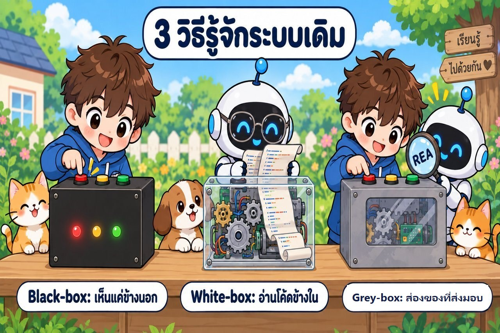 |  | 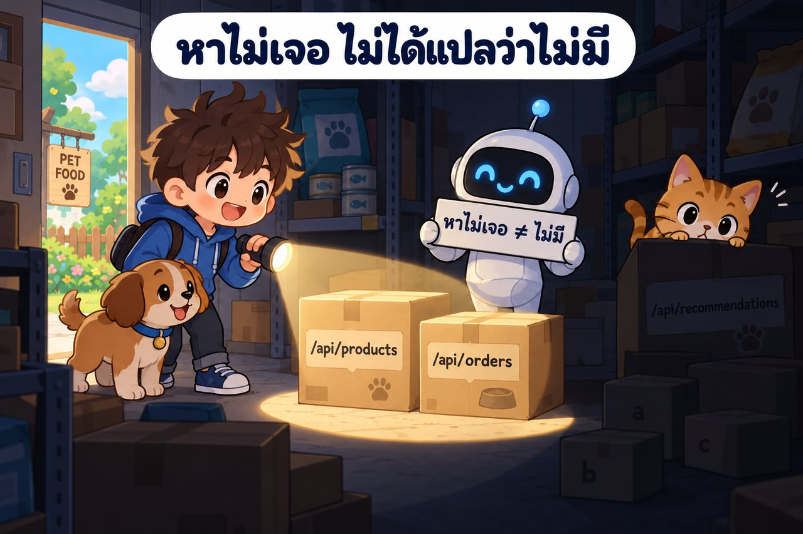 | ![ป้ายขาว ป้ายใหม่ [E] หลักฐานจากระบบ · ป้ายบอกทาง [D] ร้าน [R] กฎทั่วไป [E] หลักฐาน [A] AI [O] หน้าจอ · ตาชั่ง ควรทำ [D] กับ ทำอยู่ [E]](../05_rea-reverse-engineer-legacy-petshop/img/concept-12-evidence-badge-e.jpg) |

**ใหม่ในบทนี้:** ระบบมี **source ครบ** และ **PostgreSQL** ที่บังคับกฎเอง → มองเพิ่มอีก 1 ตา และต้องรู้ว่าแต่ละตามองไม่เห็นอะไร

| 🔦 มอง 3 ทาง + ฐานข้อมูล | 🌙 REA เห็นแค่หน้าร้าน | 📜 เอกสารเก่าไม่ตรงโค้ด |
|---|---|---|
|  |  |  |


| 🔦 REA (grey-box) | 📖 อ่าน repo (white-box) | 🗄️ อ่าน schema DB | 📜 เอกสารเก่า |
|---|---|---|---|
| หน้า · endpoint ที่หน้าเว็บเรียก · สัญญา API จาก HAR · **ไม่เห็นกฎฝั่งเซิร์ฟเวอร์** | ทุกบรรทัด · skill ของ REA เองบอกว่ามี source ครบให้อ่าน repo · ไม่บอกว่าเส้นทางไหนใช้จริง | `CHECK` · `EXCLUDE` (ห้องและนักบำบัดห้ามซ้อนเวลา) · **REA ไม่อ่าน Postgres** | `web/SPEC.md` อาจไม่ตรงโค้ด · **ห้าม AI ตัดสินเอง** → ถามร้าน |

> **ตรงกัน = มั่นใจ · ไม่ตรง = เจอเรื่องต้องถาม** ลองจริงตอนเตรียมบท: ขอ "รับกลุ่มได้ถึง 8 คน" แล้วแก้แค่ค่าในโค้ด → DB ปฏิเสธเพราะ `CHECK party_size <= 6` · REA และ HAR ไม่มีทางบอก ต้องอ่าน DB

ป้ายที่มาของค่าที่คาดหวังในบทนี้ (ต่อจากบท 04–05)

| ป้าย | มาจาก | บอกว่า | ใช้ทำอะไรในบทนี้ |
|---|---|---|---|
| **[D:CR-0N]** 🆕 | คำตอบร้านใน `CHANGE-REQUESTS/answers/CR-0N-ANSWERS.md` | ระบบ **ควร** ทำ | ค่าที่คาดหวังของเทสต์ CR ใหม่ · อ้างเลข CR |
| **[E …]** | `[E ev_xxxxxxxx]` Evidence ของ REA (8 ตัวแรก) · `[E golden/<ไฟล์>:<sha8>]` golden + SHA-256 ย่อ · `[E sql:<ชื่อคิวรี>]` ผล SQL บนฐานข้อมูล | ระบบ **ทำอยู่** | ล็อกพฤติกรรมเดิมก่อนแก้ (characterization / regression) เท่านั้น |
| **[D]** **[R]** | ร้าน · กฎทั่วไป | ระบบควรทำ | กฎธุรกิจทุกข้อต้องมี [D] หรือ [R] รองรับ |
| **[A]** | คำอ้างของผู้รับเหมา / AI | ยังไม่ได้ตรวจ | ชี้เป้าเท่านั้น · ยืนยันด้วย [E] หรือถาม [D] |
| **[O]** | ที่เห็นบนหน้าจอตอนสำรวจ | ระบบทำอยู่ (ตรวจซ้ำไม่ได้) | ล็อกด้วย [E] (HAR · golden · snapshot) ก่อนใช้ |

> **[E] ขัด [D:CR] = ผู้ต้องสงสัยบั๊ก · [D] ชนะ** เช่น CR-03: บันทึกได้ว่าระบบรับนัดซ้อนของคนเดิม [E] แต่ร้านยืนยันว่า "คนเดียวกันต้องไม่มีนัดทับกัน" [D:CR-03] → ต้องแก้ ห้ามล็อกเป็นค่าที่คาดหวัง

### 3) ตาข่ายก่อนแก้: ล็อกพฤติกรรมเดิม · seam · ทำพังเองเพื่อวัดตาข่าย

| 🕸️ ตาข่ายก่อนแก้ | 📸 characterization ล็อกทั้งบั๊ก |
|---|---|
|  |  |
| **🎛️ test seam** | **🧪 mutant** |
|  |  |

| 🕸️ ตาข่าย 3 ชั้น | 📸 characterization ≠ ความถูกต้อง | 🎛️ test seam | 🧪 mutant |
|---|---|---|---|
| ① `check-rules.mjs` 90 เคส ② `e2e-legacy/` 42 เคส (ส่งมอบทั้งคู่) ③ golden master ที่เราสร้าง | ล็อก "ระบบทำอะไรอยู่" รวมบั๊ก · บั๊กที่รู้แล้วล็อกคู่ `test.fail()` (known issue) | จุดที่ทดสอบได้โดยไม่แก้กฎ เช่น เลื่อนนาฬิกาโดยไม่ล้างข้อมูล · ปิดได้ในโหมดใช้งานจริง | แกล้งแก้โค้ดผิด 1 บรรทัด → ตาข่ายต้องแดง · **รอด = ตาข่ายมีรู** · คืนไฟล์ทุกครั้ง |

> 🔁 **ทบทวนบท 05 [ข้อ 15](../05_rea-reverse-engineer-legacy-petshop/README.md#15-characterization-test-ล็อกสิ่งที่ระบบทำอยู่):** characterization test (Michael Feathers) และ `test.fail()` สอนแล้ว · บทนี้ทำกับระบบที่มี DB และ API จริง
>
> **เทสต์เขียว ≠ ไม่มีบั๊ก** ชุดที่ส่งมอบอาจผ่านครบ แต่ระบบยังมีบั๊กจริงที่ชุดเดิมไม่จับหลายตัว (เรื่องร้องเรียน CR-03 คือหนึ่งในนั้น) · วัดตาข่ายด้วย mutant ก่อนเชื่อ

### 4) วงจรแก้อย่างปลอดภัย: impact → แผน → แดงก่อน → แก้ → regression → โยงกลับ

| 🌊 แก้ 1 จุด กระทบหลายที่ | 🔴 เทสต์แดงก่อนแก้ | 🏷️ เปลี่ยนตั้งใจ vs ไม่ตั้งใจ |
|---|---|---|
|  |  |  |

| 🌊 impact (ไฟล์ × เทสต์) | 🔴 แดงก่อน | 🟢 regression | 🏷️ ค่าที่คาดหวังเปลี่ยนได้เมื่อ… |
|---|---|---|---|
| ไฟล์ที่จะแตะ · ใครเรียก (grep) · หน้าจอ / API / **แชท** · ตาราง DB · ข้อความ 3 ภาษา · เทสต์ที่ต้องรันซ้ำ · **grep ไม่เจอ ≠ ไม่มีผู้เรียก** | เทสต์ตาม CR รันบนโค้ดเดิม **ต้องแดง** → commit ก่อนแก้ | ชุดเดิม + ชุดใหม่ · ระหว่างทำ `api + chromium` · ก่อนส่งมอบครบ 3 เบราว์เซอร์ | มี CR อนุญาต + จดใน `docs/ORACLE-CHANGES.md` · ไม่งั้น = เปลี่ยนโดยไม่ตั้งใจ (regression) |

วงจรแก้ 1 CR (LAB 6–10 ใช้ซ้ำทุก CR)


| ขั้น | ทำอะไร | หลักฐานที่ต้องได้ |
|---|---|---|
| ① ถามให้ชัด | เขียนคำถามถึงร้าน แล้วค่อยเปิด `answers/` | คำถาม + ค่าที่ร้านยืนยัน [D:CR-0N] |
| ② impact | อธิบายของเดิมด้วย `file:line` + ตาราง ไฟล์ × เทสต์ | `docs/impact/CR-0N.md` |
| ③ แผน | Plan mode (LAB 7 · 10 โหมดปกติห้ามแก้โค้ด) · เราอ่านแล้วอนุมัติ | แผนในแชท |
| ④ แดงก่อน | เทสต์ใหม่รันบนโค้ดเดิม | ผลแดง + commit เทสต์ |
| ⑤ แก้ | แตะเฉพาะไฟล์ใน impact · เล็กที่สุด | `git diff --stat` ตรงตาราง |
| ⑥ เขียว | เทสต์ใหม่ผ่าน | ผลเขียว + commit แก้ |
| ⑦ regression | รันชุดเดิมทั้งหมด + ชุดใหม่ | ตัวเลขผ่าน/ทั้งหมดทุกชุด |
| ⑧ โยงกลับ | traceability · รายงานการเปลี่ยน · ทะเบียน CR | `docs/TRACEABILITY.md` · `CHANGE-REPORT.md` · `REGISTER.md` |

> **ห้ามแก้เทสต์ให้ผ่าน** เทสต์เดิมแดงหลังแก้ → หยุด → จำแนก: **เว็บผิด** / **เทสต์เก่าล้าสมัย** (ต้องมี CR อนุญาต) / **เทสต์ใหม่เขียนผิด** · ไม่มีใครขอแต่ตัวเลขเปลี่ยน = regression (เปลี่ยนโดยไม่ตั้งใจ)

### 5) ฐานข้อมูลที่มีข้อมูลจริง: เพิ่มได้ ห้ามล้าง · รันซ้ำได้ · ถอยกลับได้

| 🗂️ เพิ่มได้ ห้ามล้าง | 🪂 ซ้อมถอยกลับก่อนใช้จริง |
|---|---|
|  |  |

| 🗂️ migration แยกไฟล์ | 🔁 รันซ้ำได้ (idempotent) | 🪂 แผนถอยกลับ | 🚫 ห้าม |
|---|---|---|---|
| ระบบมีข้อมูลลูกค้าแล้ว → เปลี่ยน schema ด้วย `db/migrations/NNN_*.sql` · ไม่ใช้การแก้ `db/init/` แทน deploy (ทำไม → หาคำตอบเองใน LAB 8) | `IF NOT EXISTS` · `ON CONFLICT DO NOTHING` → รัน 2 ครั้งไม่ error ข้อมูลอยู่ครบ | สำรอง · down migration · image เดิม · **ซ้อมจริง** บนฐานที่มีข้อมูล | `docker compose down -v` = ข้อมูลลูกค้าหาย (ขัด CR-04) |

> **ระบบเดิมมีของซ่อน** มักมี "รายการตายตัว" ที่ต้องอัปเดตตามเมื่อเพิ่มตารางหรือข้อมูล · หาให้เจอตอนทำ impact
>
> ⚠️ DB กับ **PowerShell 5.1 + ภาษาไทย** มีกับดัก encoding · ดูกติกาใน 🧰 ก่อน LAB 8

### 6) ส่งมอบแบบตรวจย้อนได้: CR → BR → TC · หลักฐานต่อ CR

| 🔗 โยง CR → กฎ → เทสต์ | ✍️ ตรวจรับด้วยหลักฐาน |
|---|---|
| 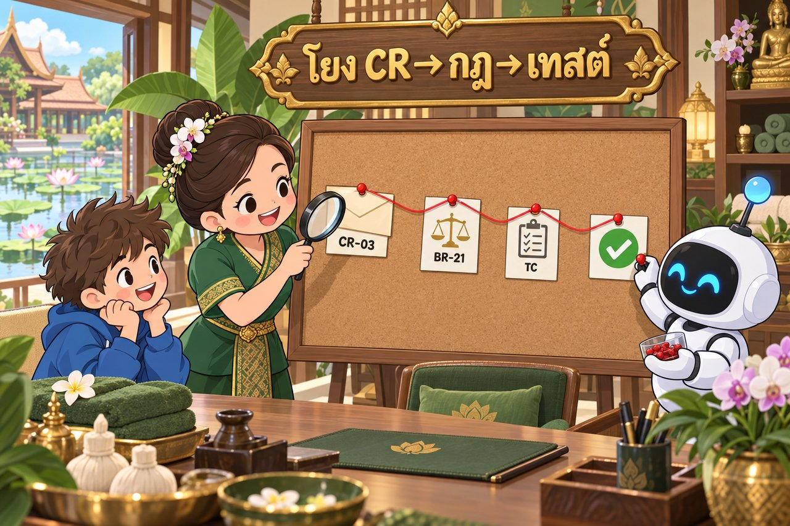 |  |

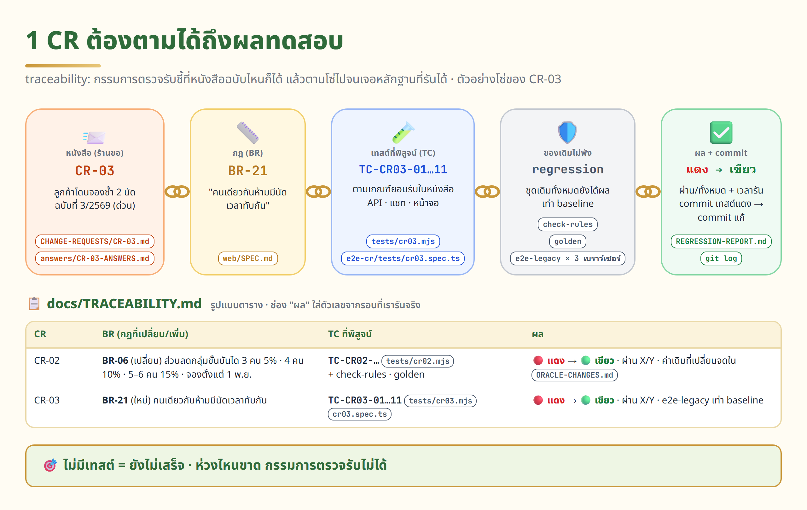

| 🔗 traceability | 🗃️ audit trail | 🔍 REA เทียบเวอร์ชัน | 🏷️ ป้าย [D:CR-0N] |
|---|---|---|---|
| CR → กฎ (BR) → เทสต์ (TC) → ผล | commit แดง → เขียวต่อ CR · ผลรันพร้อมเวลา · `CHANGE-REPORT.md` · `REGISTER.md` | bundle เปลี่ยนตรงหน้าที่ CR แตะไหม · กฎฝั่งเซิร์ฟเวอร์มองไม่เห็น → พิสูจน์ด้วยเทสต์ | ค่าที่ร้านยืนยัน = oracle ระดับ [D] · อ้างเลข CR |

> **ไม่มีเทสต์ = ยังไม่เสร็จ** CR ที่ไม่มีแถวใน traceability หรือไม่มีผลรัน ยังส่งตรวจรับไม่ได้
>
> 🔁 **ทบทวนบท 05 [ข้อ 7](../05_rea-reverse-engineer-legacy-petshop/README.md#7-เทียบเวอร์ชัน--หลักฐานว่าแก้ตรงไหน):** เทียบเวอร์ชัน = หลักฐานผลกระทบ แต่ **REA ไม่เห็น ≠ ไม่ได้เปลี่ยน** · ฝั่งเซิร์ฟเวอร์พิสูจน์ด้วยเทสต์

---

## 🧰 ก่อนเริ่ม ต้องมี

| ✅ | สิ่งที่ต้องมี | ตรวจยังไง |
|---|---|---|
| ☐ | Windows 10/11 + **Claude Code** | เปิด Claude Code ได้ |
| ☐ | **Docker Desktop** เปิดอยู่ | ไอคอนวาฬไม่หมุน · LAB 0 รัน `docker version` ให้ |
| ☐ | **Node.js 22.18 ขึ้นไป** | `node -v` · `check-rules.mjs` import ไฟล์ `.ts` ตรง |
| ☐ | **git** | `git --version` · baseline และ commit แดง → เขียวทุก CR |
| ☐ | image **`rea-lab:6.4.0`** จากบท 05 | `docker image inspect rea-lab:6.4.0` · ไม่มี → build จาก `05_rea-reverse-engineer-legacy-petshop\rea` **ก่อนเรียน** (~2.65 GB หลายนาที) |
| ☐ | พอร์ต **4000** (เว็บ) และ **5433** (DB) ว่างและ **ไม่อยู่ในช่วงที่ Windows จอง** | LAB 0 ตรวจด้วย `netsh interface ipv4 show excludedportrange protocol=tcp` |
| ☐ | ปิดระบบบท 04 ก่อน (`sabai-db` ใช้ 5433 เหมือนกัน) ด้วย `down` **ไม่ใส่ `-v`** | `docker ps --filter name=sabai` · LAB 0 บอกให้ |
| ☐ | เปิด Claude Code ใน **โฟลเดอร์บทนี้** ที่ **ไม่อยู่ใน git repo อื่น** | `git rev-parse --show-toplevel` ต้อง error · อยู่ใน repo คอร์ส → คัดลอกไป `C:\work\sabai06` |

ไม่ต้องใช้ Playwright MCP · เบราว์เซอร์ของ Playwright ติดตั้งใน LAB 1 · ไม่ต้องเปลี่ยน ExecutionPolicy (กติกาข้อ 2 ด้านล่าง)
**ยังไม่ได้ทำบท 05?** อ่านลิงก์ 🔁 ใน 🎓 ข้อ 2 ก่อน (~15 นาที) และต้องมี image `rea-lab:6.4.0` (LAB 0 ตรวจให้)

**ระบบที่รับมอบ = 2 กล่อง (2 compose project) + REA อีก 1 กล่อง**

| ① เครื่องของเรา | ② `sabai06-web` (Docker) | ③ `sabai06-db` (Docker **แยกอีกโปรเจกต์**) | ④ `rea-lab:6.4.0` (Docker ชั่วคราว) |
|---|---|---|---|
| เบราว์เซอร์ + Playwright ที่ `http://localhost:4000` · HAR ผ่าน `127.0.0.1:4000` | Next.js: หน้าเว็บ + API + กฎร้าน · 4000 บนเครื่อง → 3000 ในกล่อง | PostgreSQL 16 · 5433 บนเครื่อง · volume `sabai06-pgdata` | REA ต่อเว็บผ่าน `sabai06-net` ที่ `http://sabai06-web:3000` · เรียกผ่าน `tools\rea.ps1` |

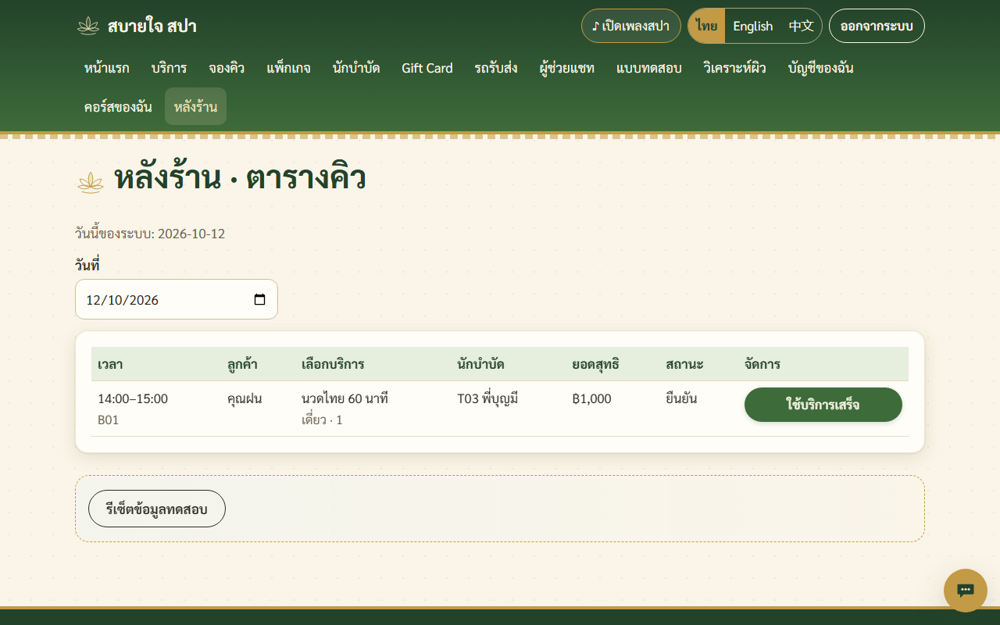

ชื่อทุกอย่างขึ้นต้น `sabai06-` ไม่ชนบท 04 (`sabai-web` `sabai-db` `sabai-net` `sabai-pgdata`) · ทำไมเว็บอยู่ที่ **4000** ไม่ใช่ 3000 → LAB 0

**PowerShell 5.1 กับภาษาไทย: 6 กติกาที่พรอมต์ทุก LAB ทำตาม**

| # | กติกา | ทำไม | เจอใน LAB |
|---|---|---|---|
| 1 | พรอมต์บอก "รันคำสั่งด้วย PowerShell" · path ตั้งจากโฟลเดอร์บท · ชุด Playwright ใช้ `Push-Location <ชุด>; …; Pop-Location` | เซสชันใหม่ไม่รู้ shell · `cd` หลายครั้งพาไปผิดโฟลเดอร์ | ทุก LAB |
| 2 | `.ps1` เรียกด้วย `powershell -NoProfile -ExecutionPolicy Bypass -File tools\rea.ps1 …` | ค่าเริ่ม `Restricted` → `running scripts is disabled` · `Bypass` มีผลเฉพาะคำสั่งนั้น | 2, 11 |
| 3 | ผลของ REA ให้ container เขียนเอง (`rea.ps1 -Out …`) ไม่ใช้ `>` | `>` ของ PS 5.1 ได้ UTF-16 / UTF-8 มี BOM → REA อ่านไม่ได้ | 2, 11 |
| 4 | รันไฟล์ SQL ด้วย `docker cp` แล้ว `psql -f` · **ห้าม** `Get-Content … \| docker exec -i …` | ส่งภาษาไทยผ่าน pipe ของ PowerShell 5.1 แล้วตัวอักษรกลายเป็น `?` **ในฐานข้อมูลจริง** | 8, 12 |
| 5 | ตรวจไทยใน DB ด้วยการเทียบใน SQL (ได้ `t`) หรืออ่านผ่าน API ด้วย node | ผล psql บนจออาจเพี้ยนทั้งที่ข้อมูลถูก · **ห้ามแก้ข้อมูลเพราะเห็นบนจอ** | 8, 10 |
| 6 | ยิง API ที่มีไทย/จีนด้วยสคริปต์ node (หรือ `curl.exe --data-binary '@file.json'` ต้องมี `'…'` ไม่งั้น `@` = splatting) · ไม่ใช้ `Invoke-RestMethod -Body '<ไทย>'` | encoding ของ PS 5.1 ทำ body เพี้ยน · `curl` ใน PS 5.1 = `Invoke-WebRequest` | 7–10 |

คำสั่งที่นานเกิน 2 นาที (build ครั้งแรก · Playwright 3 เบราว์เซอร์) พรอมต์สั่งให้ **รันแบบ background หรือตั้ง timeout ยาว** · ตั้งแต่ LAB 4 อยู่ใน `CLAUDE.md` ด้วย

**ตอนเริ่ม โฟลเดอร์นี้มี**

```text
06_sabai-spa-legacy-change-request/
├─ README.md              📖 บทเรียน + พรอมต์ทุก LAB
├─ EXAM.md                📝 ข้อสอบ (ชุด A ฝึก + กติกาชุด B)
├─ CHANGE-REQUESTS/       📨 เอกสารจากร้านและผู้รับเหมาเดิม
│  ├─ 00-HANDOVER-MEMO.md    บันทึกส่งมอบ = คำอ้างของผู้รับเหมา
│  ├─ REGISTER.md            ทะเบียน CR (เราอัปเดตสถานะ)
│  ├─ CR-01.md … CR-05.md    หนังสือขอเปลี่ยนแปลง 5 ฉบับ
│  └─ answers/               🔒 คำตอบข้อซักถาม (เปิดเมื่อพรอมต์สั่ง หลังเขียนคำถามเสร็จ)
├─ web/                   ระบบเดิม Next.js · compose.yaml · SPEC.md (เอกสารเก่า ฉบับ 1.0)
│  └─ scripts/check-rules.mjs   ชุดตรวจที่ส่งมอบ ชั้น 1 (90 เคส)
├─ db/                    PostgreSQL 16 · compose.yaml · init/01-schema.sql · init/02-seed.sql
├─ e2e-legacy/            ชุดทดสอบที่ส่งมอบ ชั้น 2 (Playwright 42 เคส · README-LEGACY.md)
├─ tools/                 🔦 rea.ps1 · rea-tools.mjs · record-har.mjs · scenario-book-quote.json · package.json
├─ img/                   🖼️ รูปประกอบบทเรียน (ไม่ได้ใช้เป็น input)
├─ fast_track/            ⚡ พรอมต์เดียวทำครบ (Agent ห้ามอ่าน)
└─ _solution/             🔑 เฉลย = ผลจากการรันพรอมต์ในหน้านี้จริงทุก LAB (ห้ามเปิดก่อนจบ)
```

**แนะนำเปิดเซสชันใหม่ทุก LAB** ไฟล์ที่แต่ละ LAB สร้างคือ "ความจำ" ส่งต่อ LAB ถัดไป · ตั้งแต่ LAB 4 มี `CLAUDE.md` ช่วยจำกติกา
แต่ละ LAB มี 🎯 เป้าหมาย · 💬 พรอมต์ · ✅ ผลจริง (รัน 12 ต.ค. 2026 · ของเราต่างได้) · 👀 สิ่งที่ควรสังเกต · ✔️ ไปต่อได้เมื่อ
ป้ายหัว LAB: **🔍 อ่าน/รัน/เขียนเอกสาร** (ไม่แตะโค้ด เทสต์ คอนฟิก) หรือ **✏️ แก้ repo เดิม** (โค้ด · schema · เทสต์ · คอนฟิก Agent)
LAB 6–10 มี 💬 2–3 กล่อง: **ส่วนที่ 1 วางใน Plan mode** (กด `Shift+Tab` จนขึ้น plan mode ก่อนวาง) · อ่านแผนแล้วสลับกลับโหมดปกติก่อนวางส่วนที่ 2 ในเซสชันเดียวกัน (LAB 7 และ 10 ส่วนที่ 1 ใช้โหมดปกติ ดูเหตุผลใน LAB 6)

> ผลของแต่ละคน **ไม่เหมือนกันเป๊ะ** ได้ (Claude แก้ต่างกันเล็กน้อย · REA ไม่นิ่ง 100% · เวลา build ขึ้นกับเครื่อง) · ✅ คือรอบจริง (รันคู่บท 05 จึงใช้พอร์ตสำรอง · แสดงเป็น 4000/5433) · ไฟล์เต็มที่ [`_solution/`](_solution/)

💡 **พรอมต์ที่ดีมี 4 อย่าง** (เหมือนบท 01–05): ชัดและอ้างไฟล์ · แบ่งข้อ · ไม่แน่ใจให้หยุดถาม · ขอผลเป็นตาราง

---

## 🗺️ เส้นทาง 12 LAB


| ช่วง | LAB | 🔍/✏️ | ทำอะไร | ได้ไฟล์ | ⏱️ รอบจริง |
|---|---|---|---|---|---|
| ⚙️ | [0](#lab-0--เช็กเครื่อง--พอร์ตที่-windows-จอง) | 🔍 | เช็กเครื่อง + พอร์ตที่ Windows จอง | (ตาราง) | ~3 นาที |
| 🟢 **รับมอบ** | [1](#lab-1--รับมอบระบบ) | 🔍 | เปิดระบบ · รันชุดส่งมอบ 2 ชั้น · ตรวจคำอ้าง · baseline git | `HANDOVER-CHECK.md` | ~9 นาที |
| | [2](#lab-2--มองแบบ-black-box-ด้วย-rea) | 🔍 | REA: static bundle + HAR + scenario → รายการ API ติดป้าย [E] | `docs/REA-INVENTORY.md` · `rea-out/` | ~4 นาที |
| 🟡 **เข้าใจ** | [3](#lab-3--agent-อ่าน-repo--db--แผนที่ระบบ) | 🔍 | Agent อ่าน repo + DB → แผนที่ระบบ · triangulation · เอกสารเก่าไม่ตรงตรงไหน | `SYSTEM-MAP.md` · `docs/SPEC-GAPS.md` | ~9 นาที |
| | [4](#lab-4--claudemd--รั้ว) | ✏️ | กติกาให้ Agent + รั้วห้ามแตะชุดเดิม | `CLAUDE.md` · `.claude/settings.json` · `docs/IMPACT-TEMPLATE.md` · `ORACLE-CHANGES.md` | ~3 นาที |
| 🔵 **ตาข่าย** | [5](#lab-5--ตาข่ายกันพลาด) | ✏️ | seam · golden · characterization · known issue · mutant | `tests/golden/` · `e2e-cr/` · `KNOWN-ISSUES.md` | ~18 นาที |
| 🟠 **Change Request** | [6](#lab-6--cr-02-เปลี่ยนกฎ-วันมีผล) | ✏️ | CR-02 เปลี่ยนกฎ มีวันมีผล | `docs/impact/CR-02.md` · `tests/cr02.mjs` | ~17 นาที |
| | [7](#lab-7--cr-03-แก้บั๊กจากเรื่องร้องเรียน) | ✏️ | CR-03 ทำซ้ำเรื่องร้องเรียนให้แดง → แก้ | `tests/cr03.mjs` · `e2e-cr/tests/cr03.spec.ts` | ~29 นาที |
| | [8](#lab-8--cr-04-migration-วันหยุดร้าน) | ✏️ | CR-04 migration บนฐานที่มีข้อมูล + runbook | `db/migrations/001_*.sql` · `tests/cr04.mjs` · `docs/MIGRATION-RUNBOOK.md` | ~17 นาที |
| | [9](#lab-9--cr-01-ฟีเจอร์ใหม่-เลื่อนนัด) | ✏️ | CR-01 ฟีเจอร์ใหม่ แตกงาน API → รอบ → หน้าเว็บ | `tests/cr01.mjs` · `e2e-cr/tests/cr01.spec.ts` | **~41 นาที** ☕ |
| | [10](#lab-10--cr-05-รายงาน--csv) | ✏️ | CR-05 รายงาน + CSV · ค่าคาดหวังจาก SQL | `tests/cr05.mjs` · `e2e-cr/tests/cr05.spec.ts` | ~19 นาที |
| 🟣 **ส่งมอบ** | [11](#lab-11--regression-เต็ม--rea-เทียบเวอร์ชัน) | 🔍 | regression ทุกชุด 3 เบราว์เซอร์ + REA เทียบเวอร์ชัน v1 ↔ v2 | `REGRESSION-REPORT.md` · `docs/TRACEABILITY.md` | ~24 นาที ☕ |
| | [12](#lab-12--ส่งมอบ--ซ้อมถอยกลับ) | ✏️ | smoke · release notes · UAT · ซ้อมถอยกลับ | `tests/smoke.mjs` · `RELEASE-NOTES.md` · `UAT-CHECKLIST.md` · `DEPLOY-RUNBOOK.md` · `CHANGE-REPORT.md` | ~18 นาที |

⏱️ = เวลาที่ Agent ใช้ในรอบจริง (ไม่รวมเวลาอ่านและตัดสินใจ) · **LAB 0–12 รวม ~211 นาที (≈ 3.5 ชม.)** · นานสุด LAB 9 (~41) · 7 (~29) · 11 (~24) · รวมเวลาของเราเอง → แบ่งเรียน 2 วัน (LAB 0–6 · LAB 7–12) หรือ 3 ครึ่งวัน

**นับ:** ✏️ แก้ repo เดิม **8 จาก 12 LAB (ไม่นับ LAB 0)** (4–10, 12) · ครบทุกแบบที่งานจริงเจอ: เปลี่ยนกฎ (LAB 6) · แก้บั๊กจากเรื่องร้องเรียน (LAB 7) · migration (LAB 8) · ฟีเจอร์ใหม่ (LAB 9) · รายงาน (LAB 10)

---

## LAB 0 · เช็กเครื่อง + พอร์ตที่ Windows จอง

🎯 🔍 เครื่องพร้อมไหม และ **ทำไมเว็บอยู่ที่พอร์ต 4000** ไม่ใช่ 3000 (อ่านอย่างเดียว ได้ตารางในแชท)


💬 **คัดลอกพรอมต์นี้** (กดปุ่ม Copy มุมขวาของกรอบ)

```text
ตรวจเครื่องให้พร้อมสำหรับงานแก้ระบบเดิม "สบายใจ สปา" (อ่านอย่างเดียว ห้ามติดตั้ง ห้ามแก้ไฟล์ ห้ามหยุด container ใด ๆ) ทุกค่าต้องมาจากคำสั่งที่รันจริงใน PowerShell
1. Docker Desktop: docker version และ docker compose version
2. Node.js: node -v (ต้อง 22.18 ขึ้นไป เพราะชุดตรวจ web/scripts/check-rules.mjs import ไฟล์ .ts ตรง) · npm -v · git --version
3. ช่วงพอร์ตที่ Windows จองไว้: netsh interface ipv4 show excludedportrange protocol=tcp
   - บอกว่าพอร์ต 3000, 4000, 5433 อยู่ในช่วงที่จองไหม (ถ้าอยู่ให้บอกช่วงที่ครอบ)
   - อธิบายสั้น ๆ ภาษาง่าย ๆ ว่าทำไมบทนี้เปิดเว็บที่พอร์ต 4000 แทน 3000
4. พอร์ต 4000 และ 5433 มีโปรแกรมใช้อยู่ไหม: Get-NetTCPConnection -LocalPort 4000,5433 -State Listen -ErrorAction SilentlyContinue (ไม่มีผล = ว่าง) และ docker ps --format "{{.Names}} {{.Ports}}" · ถ้าไม่ว่าง บอกด้วยว่าเป็น container ไหน (เช่น เว็บบท 05 ที่เปิดค้างไว้ที่ 4000)
5. มี container หรือ volume ชื่อขึ้นต้นด้วย sabai จากบทก่อนไหม: docker ps -a --filter name=sabai และ docker volume ls --filter name=sabai (บอกอย่างเดียว ยังไม่ต้องปิด)
6. REA: docker image inspect rea-lab:6.4.0 --format "{{.Id}}" · ถ้ามีให้รัน docker run --rm rea-lab:6.4.0 mcp doctor แล้วบอก exit code (0 = พร้อม) · ถ้าไม่มี image ให้บอกคำสั่ง build จากโฟลเดอร์ 05_rea-reverse-engineer-legacy-petshop\rea ใน repo คอร์สที่ clone ไว้ (ยังไม่ต้อง build · build นานหลายนาที)
7. สิทธิ์รันสคริปต์ PowerShell: Get-ExecutionPolicy -List (บอกอย่างเดียว ห้ามแก้ · บทนี้เรียก .ps1 ด้วย powershell -ExecutionPolicy Bypass -File จึงไม่ต้องเปลี่ยนค่าเครื่อง · แถว Process อาจเป็น Bypass เพราะเครื่องมือที่เปิด PowerShell ตั้งให้ชั่วคราว ไม่ใช่ค่าถาวรของเครื่อง)
8. โฟลเดอร์นี้มี web/ db/ e2e-legacy/ tools/ CHANGE-REQUESTS/ ครบไหม · และอยู่ข้างใน git repo อื่นหรือเปล่า: git rev-parse --show-toplevel · error = ยังไม่เป็น repo · ได้ path ของโฟลเดอร์นี้เอง = โฟลเดอร์บทเป็น repo ของตัวเองอยู่แล้ว (ใช้ได้) · ได้ path อื่นที่ไม่ใช่โฟลเดอร์นี้ = อยู่ใน repo อื่น
สรุปเป็นตาราง: รายการ | ผล | พร้อมไหม | ถ้าไม่พร้อมต้องทำอะไร
```

✅ **ผลจริง: พร้อม 9/10 รายการ** (⚠️ 1 = พอร์ต 4000 ถูกเว็บบท 05 ใช้อยู่) · Windows จอง TCP 23 ช่วง · 3000 อยู่ในช่วง **2970–3069** · 4000 และ 5433 ไม่อยู่ในช่วงใด · ~3 นาที

| รายการ | ผลจริง | พร้อมไหม |
|---|---|---|
| Docker · Node.js · git | Engine 29.5.2 · Compose v5.1.4 · Node v26.7.0 (≥ 22.18) · git 2.50.1 | ✅ |
| ช่วงพอร์ตที่ Windows จอง | 3000 อยู่ใน 2970–3069 · 4000 · 5433 ไม่อยู่ | ✅ |
| พอร์ต 4000 | container `pawpantry05` (เว็บบท 05) เปิดค้าง | ⚠️ ปิดก่อน LAB 1 |
| พอร์ต 5433 · volume `sabai*` | ว่าง · มี `sabai-pgdata` ของบท 04 (ไม่ชน บทนี้ใช้ `sabai06-pgdata`) | ✅ |
| REA | `rea-lab:6.4.0` · `mcp doctor` **exit 0** · tools 170/170 · 3.4 วิ | ✅ |
| ExecutionPolicy | CurrentUser `RemoteSigned` (Process `Bypass` = เครื่องมือตั้งชั่วคราว) | ✅ ไม่ต้องแก้ |
| โฟลเดอร์บท | ครบ · ไม่อยู่ใน repo อื่น | ✅ |

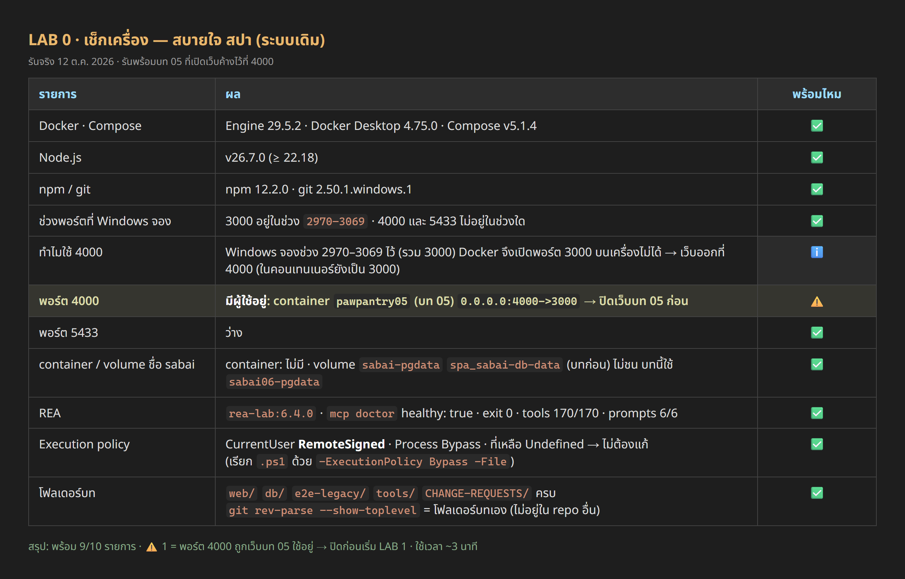

👀 **สังเกต**
- **ช่วงพอร์ตที่ Windows จองต่างกันแต่ละเครื่อง** และเปลี่ยนได้หลังรีบูต (Hyper-V / WSL / WinNAT) · 4000 ถูกจองให้ใช้แถว `bind` ใน [ถ้าเจอปัญหา](#ถ้าเจอปัญหา-คัดลอกพรอมต์นี้)
- **ExecutionPolicy `Restricted` ก็ได้** บทนี้เรียก `.ps1` ด้วย `-ExecutionPolicy Bypass -File` ทีละคำสั่ง · แถว `Process` = `Bypass` คือค่าชั่วคราวของเครื่องมือ ไม่ใช่ค่าถาวร
- **เช็ก REA ด้วย `mcp doctor`** (exit 0 = พร้อม) ไม่ใช่ `--version`
- ⚠️ **container บท 04–05 เปิดค้าง = พอร์ตชน** (DB บท 04 ที่ 5433 · รอบจริง `pawpantry05` ที่ 4000) → `docker stop` (ไม่ลบ volume) หรือย้ายพอร์ตด้วย `$env:WEB_PORT` + `$env:BASE_URL`
- **`Get-NetTCPConnection` บอกแค่ `com.docker.backend` / `wslrelay`** ต้องดู `docker ps` คู่กันจึงรู้ว่าเป็น container ไหน (รอบจริง)
- **โฟลเดอร์บทอยู่ใน repo คอร์สที่ clone มา?** คัดลอกไป `C:\work\sabai06` กัน repo ซ้อน repo ตอน `git init` · `--show-toplevel` ได้โฟลเดอร์บทเอง = ใช้ต่อได้

✔️ **ไปต่อได้เมื่อ:** Docker · Node ≥ 22.18 · git ✅ · 4000 และ 5433 ว่างและไม่อยู่ในช่วงจอง · `mcp doctor` exit 0 · โฟลเดอร์ไม่อยู่ใน repo อื่น

---

## LAB 1 · รับมอบระบบ

🎯 🔍 เปิดระบบเดิม 2 กล่อง · รันชุดตรวจที่ส่งมอบ 2 ชั้น · **เทียบคำอ้างในบันทึกส่งมอบกับผลจริง** · baseline git → `HANDOVER-CHECK.md` + commit แรก

💬 **คัดลอกพรอมต์นี้**

```text
รับมอบระบบเดิม "สบายใจ สปา" จากผู้รับเหมาเดิม แล้วเขียน HANDOVER-CHECK.md (รันคำสั่งด้วย PowerShell จากโฟลเดอร์นี้ · ห้ามแก้ไฟล์ใน web/ db/ e2e-legacy/ · ห้ามเปิด README.md ของบท fast_track/ _solution/ และ CHANGE-REQUESTS/answers/)
0. อ่าน CHANGE-REQUESTS/00-HANDOVER-MEMO.md ก่อน แล้วแยกคำอ้างของผู้รับเหมาเป็นข้อ ๆ (H1, H2, …) · อ่าน e2e-legacy/README-LEGACY.md ด้วย (เป็นคำอ้างของผู้รับเหมาเหมือนกัน ใช้เลข H ต่อจากบันทึกส่งมอบ)
1. เปิดระบบ: docker network create sabai06-net (ถ้ามีแล้วข้ามได้) → docker compose -f db/compose.yaml up -d --wait → docker compose -f web/compose.yaml up -d --build --wait (build ครั้งแรกอาจนานเกิน 2 นาที ให้รันแบบ background หรือตั้ง timeout ยาว แล้วรอจนเสร็จ) · จดเวลาที่ใช้ (เสร็จเร็วและขึ้น CACHED = เคย build แล้ว ไม่ใช่ปัญหา)
2. ตรวจ: GET http://localhost:4000/api/health ต้องได้ {"ok":true,"db":true} · POST http://localhost:4000/api/test/reset · จดเวอร์ชัน Next.js (web/package.json) PostgreSQL (SELECT version()) และ Node ใน container
3. ชุดตรวจที่ส่งมอบ ชั้น 1: node web/scripts/check-rules.mjs → ผ่านกี่ข้อจากกี่ข้อ ใช้เวลาเท่าไร
4. ชุดตรวจที่ส่งมอบ ชั้น 2: Push-Location e2e-legacy; npm install; npx playwright install chromium firefox webkit; npx playwright test; Pop-Location (ค่าเริ่ม = api + chromium · ไม่ต้องใส่ --reporter เพราะ config พิมพ์ผลรายข้อและเขียนรายงาน html ให้ npm run report ตามที่ README-LEGACY อ้างอยู่แล้ว) → แยก ผ่านจริง / คาดว่าล้ม (test.fail) / ล้ม / เวลา · Playwright นับข้อ "คาดว่าล้มแล้วล้มจริง" รวมไว้ใน passed ของบรรทัดสรุป และผลรายข้อแสดง ✘ เหมือนข้อที่ล้มจริง → ข้อ ✘ ที่ไม่อยู่ในรายชื่อ failed ท้ายผล = คาดว่าล้ม · ยืนยันด้วย Select-String -Path e2e-legacy\tests\*.ts -SimpleMatch -Pattern "test.fail("
5. ทุกข้อที่ล้มหรือติด test.fail: เปิดอ่านเทสต์ข้อนั้น (อ่านได้ ห้ามแก้) แล้วจำแนกเป็น บั๊กของระบบ / เทสต์ล้าสมัย / ยังไม่รู้ พร้อมหลักฐาน
6. เทียบคำอ้างทุกข้อในบันทึกส่งมอบกับผลที่รันได้จริง: ตรง ✅ / ไม่ตรง ❌ / ตรวจไม่ได้ตอนนี้ ⚠️ (ข้อไหนตรวจไม่ได้ให้บอกว่าต้องใช้วิธีไหนตรวจ)
7. ตั้ง baseline ด้วย git (เขียน HANDOVER-CHECK.md ให้เสร็จก่อน แล้วค่อย commit · commit id บอกในแชทแล้วเติมลงไฟล์ทีหลังได้):
   - ถ้า git rev-parse --show-toplevel ชี้ไปโฟลเดอร์อื่นที่ไม่ใช่โฟลเดอร์นี้ ให้หยุดแล้วบอกผมก่อน
   - ยังไม่เป็น repo → git init · เป็น repo ของโฟลเดอร์นี้อยู่แล้ว → ข้าม init
   - เพิ่มบรรทัดที่ยังไม่มีใน .git/info/exclude: /_solution/ /img/ /README.md /EXAM.md /fast_track/ rea-out/ backups/ tmp/ node_modules/ test-results/ test-report/ playwright-report/ (มี / นำหน้า = เฉพาะที่รากโฟลเดอร์บท ไม่กัน README.md ในโฟลเดอร์ย่อย)
   - git add -A → git status ต้องไม่เห็นไฟล์ที่ exclude → git commit -m "baseline: ระบบที่รับมอบ" (repo ที่มี commit อยู่แล้วและเปลี่ยนแค่ HANDOVER-CHECK.md ก็ commit ไฟล์นั้นเป็น baseline) → บอก commit id และจำนวนไฟล์
HANDOVER-CHECK.md มี: เวอร์ชัน · container และพอร์ต · เวลาเปิดระบบ · ผลชุดตรวจ 2 ชั้น · ตารางข้อที่ล้ม · ตารางคำอ้าง vs ผลจริง · commit baseline
ทุกตัวเลขต้องมาจากคำสั่งที่รันจริง ถ้าขั้นไหนไม่ผ่านให้หยุดแล้วบอกสาเหตุ ห้ามแก้เทสต์ให้ผ่าน
สรุปเป็นตาราง: ชุดตรวจ | ผ่าน | ล้ม | คาดว่าล้ม | เวลา
```

✅ **ผลจริง** `HANDOVER-CHECK.md` 9 หัวข้อ · e2e-legacy บรรทัดสรุปเขียน `41 passed · 1 failed` (= ผ่านจริง 38 + คาดว่าล้ม 3) · คำอ้าง 19 ข้อ (บันทึกส่งมอบ 12 + README-LEGACY 7): ✅ 12 · ❌ 2 · ⚠️ 5 · เปิดระบบ ~15 วิ (build มี cache) · baseline 1 commit · ~9 นาที

| ชุดตรวจ | ผ่าน | ล้ม | คาดว่าล้ม | เวลา |
|---|---|---|---|---|
| check-rules (ชั้น 1) | 90 | 0 | 0 | 19.8 วิ |
| e2e-legacy api + chromium (ชั้น 2) | 38 | 1 (TC-SEC-05) | 3 (TC-SEC-04 · TC-GC-04 · TC-TRN-03) | 4.1 นาที |

| คำอ้างของผู้รับเหมา [A] (คัด 6 จาก 19) | ผลจริง | |
|---|---|---|
| Next.js + PostgreSQL 16 | Next.js 15.5.27 · PostgreSQL 16.15 | ✅ |
| เปิดระบบได้ด้วย 3 คำสั่ง | health `{"ok":true,"db":true}` ใน ~15 วิ | ✅ |
| ระบบจริงปิด reset แล้ว | ค่าที่ส่งมอบยังเปิด · `POST /api/test/reset` ได้ 200 | ❌ |
| ผ่านทั้งหมดยกเว้น 3 KNOWN-ISSUE | ล้มเพิ่ม 1 · เอกสารผู้รับเหมา 2 ฉบับขัดกันเอง | ❌ |
| SPEC ตรงกับโค้ดทุกข้อ | ยังตรวจไม่ได้ (อ้างเอกสารที่ไม่ได้ส่งมอบ) | ⚠️ (LAB 3) |
| จองพร้อมกันหลายคนได้ถูกต้อง | เทสต์เดิมยิงแค่ 2 คำขอ 1 รอบ | ⚠️ |

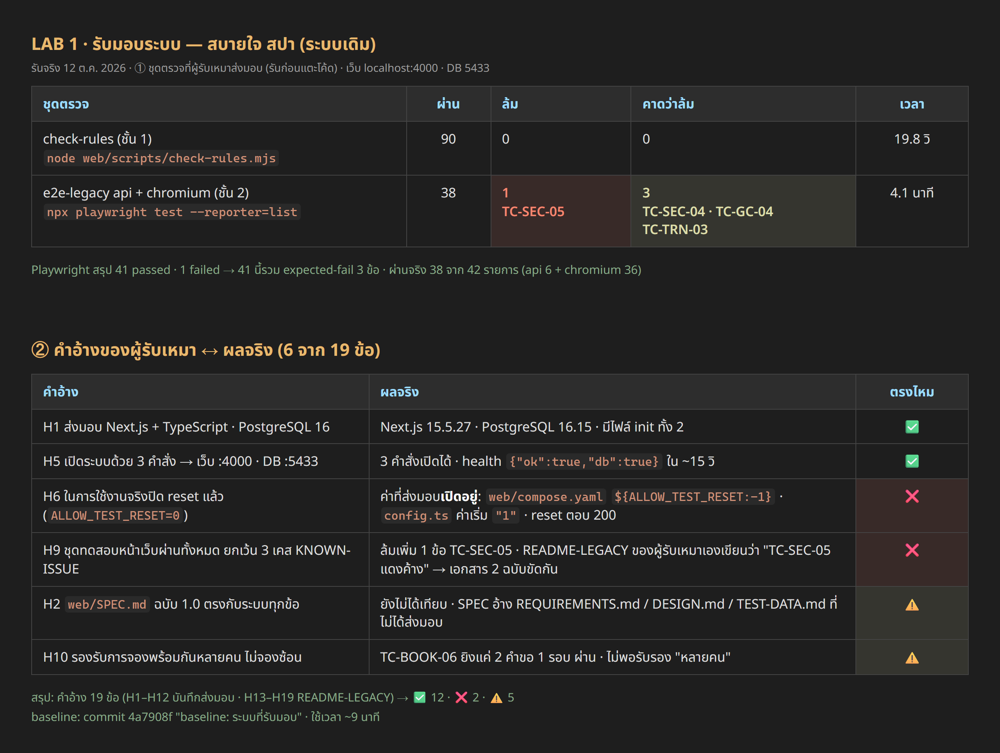

👀 **สังเกต**
- **Playwright นับ `test.fail()` ที่ล้มตามคาดเป็น passed** แต่รายข้อขึ้น ✘ → ✘ ที่ไม่อยู่ในรายชื่อ failed = คาดว่าล้ม (ยืนยันด้วย `test.fail(`) · ไม่ใส่ `--reporter` ให้ `npm run report` ยังใช้ได้
- **ข้อแดง ≠ ระบบผิดเสมอ** อ่านว่าเทสต์คาดอะไร ระบบตอบอะไร แล้วจำแนก บั๊กของระบบ / เทสต์ล้าสมัย / ยังไม่รู้ · ห้ามแก้ให้เขียว
- **บันทึกส่งมอบ = คำอ้าง [A]** เอกสารของผู้รับเหมาเองยังขัดกันได้ · เชื่อเฉพาะที่รันเองแล้วจด
- ⚠️ **build ครั้งแรกอาจนานเกิน 2 นาที** (รอบเตรียมบท 41 วิ เพราะมี base image แล้ว · เครื่องใหม่ต้องดาวน์โหลด) ถูกตัดกลางทางให้รันแบบ background แล้วรอผล
- **ไฟล์ใหญ่ห้ามเข้า git** `.git/info/exclude` กันตั้งแต่ commit แรก · ไฟล์ของบทมี `/` นำหน้า (`/README.md`) ไม่งั้น README ในโฟลเดอร์ย่อยหายจาก commit
- **หน้า `/admin` เปิดที่คิว "พรุ่งนี้"** (วันของระบบ + 1 · หลัง reset เห็น 11 ต.ค.) · เลือกวันหรือเปิด `/admin?date=2026-10-12` ก่อนสรุปว่า "นัดหาย"
- **`npm notice` ตัวแดง (`NativeCommandError`) ไม่ใช่ error** ดู exit code · `npx playwright install` เครื่องใหม่ดาวน์โหลดหลายร้อย MB (รอบจริง 1.4 วิ เพราะมีแคช)
- **เลข H ไม่ต้องตรงกับเพื่อน** บันทึกส่งมอบแตกได้หลายแบบ · เทียบกันด้วยเนื้อหาคำอ้าง

✔️ **ไปต่อได้เมื่อ:** health `db:true` · `HANDOVER-CHECK.md` มีตัวเลขชุดตรวจ 2 ชั้น · ข้อที่ล้ม/`test.fail` จำแนกครบพร้อมหลักฐาน · มี commit baseline

---

## LAB 2 · มองแบบ black-box ด้วย REA

🎯 🔍 ใช้ REA ดู **static bundle** + **HAR** + **ขับหน้าจองด้วยสคริปต์** แล้วติดป้าย static / runtime / inference / unknown + `[E ev_…]` ทุกแถว → `docs/REA-INVENTORY.md` + `rea-out/`

> 🔁 **ทบทวนบท 05 [ข้อ 9](../05_rea-reverse-engineer-legacy-petshop/README.md#9-3-วิธีดูเว็บที่รันอยู่-passive--driven--har):** 3 วิธีสังเกตเว็บที่รันอยู่ · LAB นี้ใช้ครบ static (bundle) · HAR (ย้อนหลัง) · driven (`capture-browser-scenario`)
>
> 

💬 **คัดลอกพรอมต์นี้**

```text
มองระบบที่รันอยู่แบบ black-box ด้วย REA แล้วเขียน docs/REA-INVENTORY.md (รันคำสั่งด้วย PowerShell · ขั้นนี้ห้ามเปิดอ่านโค้ดใน web/ db/ · ห้ามเปิด README.md ของบท fast_track/ และ _solution/ · ใช้เฉพาะคำสั่งข้างล่าง)
ทุกคำสั่งรันจากโฟลเดอร์บทใน PowerShell · เรียก REA ผ่าน powershell -NoProfile -ExecutionPolicy Bypass -File tools\rea.ps1 (ไม่ต้องแก้ execution policy ของเครื่อง) · ผลของ REA ใหญ่มาก ห้ามเปิดไฟล์ JSON ทั้งไฟล์ ให้ใช้ tools\rea-tools.mjs สรุป · REA พิมพ์ความคืบหน้าทาง stderr หลายร้อยบรรทัด จึงต่อท้ายคำสั่ง rea.ps1 ด้วย 2> rea-out\<ชื่อ>.log ตามข้างล่าง (เปิด log เฉพาะเมื่อคำสั่ง error)
0. เตรียม: Push-Location tools; npm install; Pop-Location · ระบบต้องเปิดอยู่ (GET http://localhost:4000/api/health ได้ db:true)
1. Static bundle = ของที่ส่งถึงเบราว์เซอร์:
   - ถ้า rea-out\v1\.next\static มีอยู่แล้ว ให้บอกผมก่อนลบแล้วคัดลอกใหม่ (คัดลอกทับจะได้ static\static)
   - New-Item -ItemType Directory -Force rea-out\v1\.next | Out-Null
   - docker cp sabai06-web:/app/.next/static rea-out\v1\.next\static
   - powershell -NoProfile -ExecutionPolicy Bypass -File tools\rea.ps1 -Out rea-out\static-v1.json analyze-javascript-application /work/rea-out/v1/.next/static --json 2> rea-out\static-v1.log
   - node tools\rea-tools.mjs endpoints rea-out\static-v1.json
   - node tools\rea-tools.mjs summary rea-out\static-v1.json (node ตามชนิด · endpoint · statistics · coverage · limitations)
   - node tools\rea-tools.mjs pages rea-out\static-v1.json (หน้า/route จากชื่อไฟล์ใน bundle)
   - node tools\rea-tools.mjs view rea-out\static-v1.json rea-out\view-v1.json แล้ว powershell -NoProfile -ExecutionPolicy Bypass -File tools\rea.ps1 -Out rea-out\summary-v1.json inspect-analysis-view /work/rea-out/view-v1.json --format json 2> rea-out\summary-v1.log · node tools\rea-tools.mjs summary rea-out\summary-v1.json (summary ที่ REA ทำเอง: statistics และ coverage ต้องตรงกับบรรทัดก่อน)
2. HAR ของเส้นทางใช้งานจริง (ต้องใช้ 127.0.0.1 ไม่ใช่ localhost):
   - ⚠️ record-har.mjs reset ข้อมูลก่อนเดิน แล้วจองนัดใหม่ (รอบรับมอบได้ B14) และยกเลิก B05 → ข้อมูลในระบบเปลี่ยน ถ้างานถัดไปต้องการข้อมูลตั้งต้นให้ reset ใหม่ (POST /api/test/reset)
   - node tools\record-har.mjs http://127.0.0.1:4000 rea-out\journeys.har
   - node tools\rea-tools.mjs har-records rea-out\journeys.har (ได้รายการ --record ของคำขอ /api/*)
   - powershell -NoProfile -ExecutionPolicy Bypass -File tools\rea.ps1 -Out rea-out\har-api.json inspect-web-network-capture /work/rea-out/journeys.har har <วาง --record ทั้งหมดที่ได้> --sensitive-value Nida@2026 --sensitive-value Owner@2026 --json 2> rea-out\har-api.log (body ของคำขอ login จะว่างเพราะ --sensitive-value = ตั้งใจ)
   - node tools\rea-tools.mjs har-api rea-out\har-api.json
3. ขับเบราว์เซอร์ด้วย REA (REA อยู่ใน docker network เดียวกับเว็บ จึงเปิด http://sabai06-web:3000 ได้): powershell -NoProfile -ExecutionPolicy Bypass -File tools\rea.ps1 -Network sabai06-net -Out rea-out\scenario.json capture-browser-scenario /work/tools/scenario-book-quote.json --json 2> rea-out\scenario.log · node tools\rea-tools.mjs scenario-sum rea-out\scenario.json (step completed x/y · URL สุดท้าย · API ที่เรียก · ยอดในหน้าสรุป) · ดึงภาพหน้าจอที่ REA ถ่าย: node tools\rea-tools.mjs shot rea-out\scenario.json rea-out\scenario-final.png
4. เขียน docs/REA-INVENTORY.md:
   - ตาราง endpoint | เห็นจาก static | เห็นจาก HAR (method, query, body keys, status) | ป้าย static / runtime / inference / unknown | แหล่ง [E ev_xxxxxxxx] (evidence_id 8 ตัวแรกของ Evidence ที่เห็นแถวนั้น · ได้จาก node tools\rea-tools.mjs ids rea-out)
   - ตาราง หน้า (route) ที่เห็นจากชื่อไฟล์ใน bundle (ผลของ pages)
   - หัวข้อ "สิ่งที่ REA ไม่เห็น": ห้ามเขียนว่า "ระบบไม่มี X" ถ้า coverage เป็น partial ให้เขียน "ไม่พบในหลักฐานนี้ เพราะ…"
   - หัวข้อ "คำถามที่ต้องไปหาคำตอบจากโค้ดหรือฐานข้อมูล" อย่างน้อย 5 ข้อ
   - ขนาดไฟล์ เวลา และ evidence_id ย่อ 8 ตัวแรกของ Evidence แต่ละก้อน (ขนาดและป้ายจาก node tools\rea-tools.mjs ids rea-out)
   - หัวข้อ "ค่าที่ล็อกได้เป็น [E]": ยอดหน้าสรุปจาก scenario และสถานะ/คีย์ของ API จาก HAR พร้อมป้าย [E ev_xxxxxxxx] · เขียนกำกับว่า [E] = "ระบบทำอยู่" ใช้ล็อกพฤติกรรมเดิมได้ แต่ไม่ใช่ "ควรทำ"
ถ้าคำสั่งไหน error ให้หยุดแล้วบอกข้อความ error จริง ห้ามเดาผล
สรุปเป็นตาราง: แหล่ง | endpoint ที่เห็น | เวลา | coverage | evidence_id ย่อ
```

✅ **ผลจริง** `docs/REA-INVENTORY.md` ตาราง endpoint 25 แถว ป้ายครบ · หน้า 14 · "สิ่งที่ REA ไม่เห็น" 8 ข้อ · คำถามถึงโค้ด/DB 8 ข้อ · coverage `partial` · ~4 นาที

| แหล่ง | endpoint ที่เห็น | เวลา | coverage | evidence |
|---|---|---|---|---|
| static bundle (79 ไฟล์ · 1.15 MB) | fetch **9** · ชื่อไฟล์ route **25** · หน้า 14 | 48.1 + 6.6 วิ | **partial** | `ev_11d475e1` |
| HAR (135 record → API 10) | **7 endpoint / 10 ครั้ง** | 10.1 + 2.1 วิ | เฉพาะเส้นทางที่เดิน | `ev_6fbeaec6` |
| REA scenario (`sabai06-net`) | 2 · **12/12 step** · ยอด ฿1,000 | 3.5 วิ | complete | `ev_8dc23d9f` |

static **ไม่เห็น** call ของ `/api/slots` `/api/admin/bookings` `/api/bookings/{id}/cancel` (URL ต่อ string) แต่ HAR เห็น · `/api/me/bookings` ไม่โผล่ใน HAR ทั้งที่ `/account` แสดง 8 นัด → ป้าย inference ไม่ใช่ "ไม่มี"

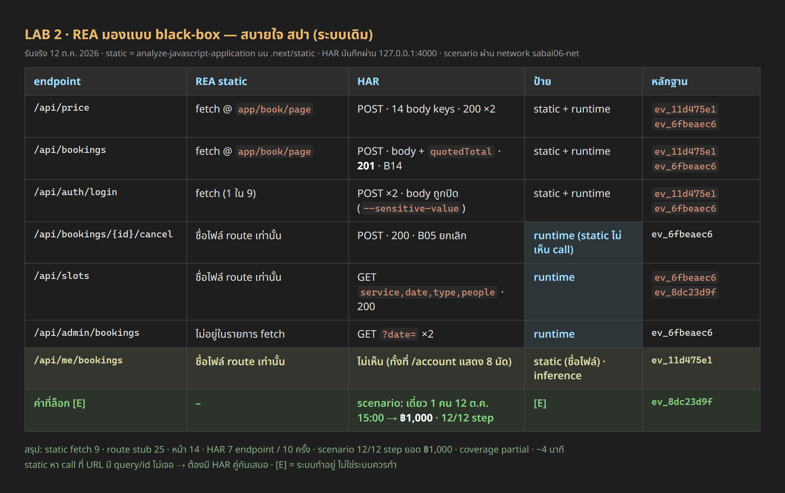

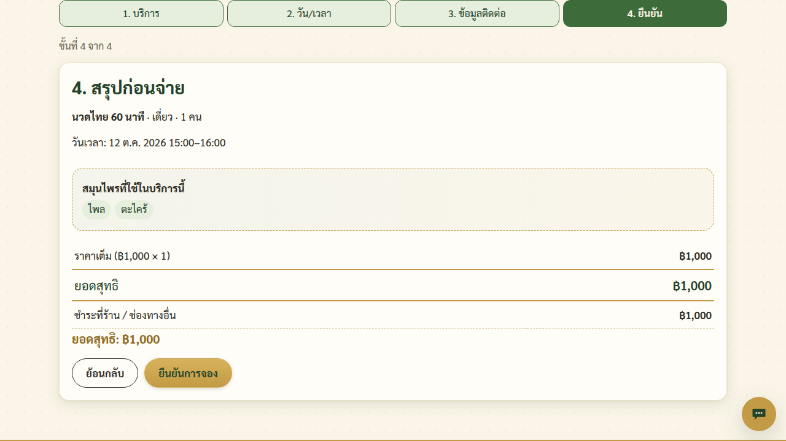

👀 **สังเกต**
- **อัด HAR ผ่าน `127.0.0.1`** · `localhost` อาจเป็น `[::1]` แล้ว REA ไม่รับไฟล์
- ⚠️ **รหัสผ่านใน HAR ไม่ถูกปิดเอง** ส่ง `--sensitive-value` ทุกค่าก่อนแชร์ (body login ว่าง = ตั้งใจ)
- **ไม่เจอ ≠ ไม่มี** Server Component อ่านข้อมูลตรง ไม่มีคำขอใน HAR · `/api/test/reset` ก็ไม่อยู่ใน HAR (สคริปต์เรียกตรง) · coverage `partial` ห้ามเขียน "ระบบไม่มี X"
- **`>` ของ PowerShell 5.1 เขียนไฟล์มี BOM** REA อ่านไม่ได้ → ใช้ `rea.ps1 -Out` เสมอ
- **[E] = "ระบบทำอยู่" ไม่ใช่ "ควรทำ"** และ REA เห็นแค่ฝั่งเบราว์เซอร์ · กฎราคา จองซ้ำ กฎ DB ช่อง REA ใน LAB 3 จึงเป็น "REA ไม่เห็น" + เหตุผล ไม่ใช่ `ev_` ที่แต่ง
- **limitation ของ REA นับได้ 2 แบบ** summary 14 · view 25 (รวมรายไฟล์) · เขียนว่านับจากไหน
- ⚠️ **`record-har.mjs` เปลี่ยนข้อมูล** (reset → จองใหม่ → ยกเลิก B05) · งานถัดไปที่ต้องการข้อมูลตั้งต้นให้ reset ก่อน

✔️ **ไปต่อได้เมื่อ:** endpoint ติดป้ายครบ (static / runtime / inference / unknown + `[E ev_…]`) · ไม่มี "ระบบไม่มี…" · คำถามถึงโค้ด/DB ≥ 5 · `git status` ไม่เห็น `rea-out/`

---

## LAB 3 · Agent อ่าน repo + DB → แผนที่ระบบ

🎯 🔍 ให้ Claude อ่าน repo และ schema ฐานข้อมูล แล้ว **เทียบหลายมุม (triangulation): 🔲 REA/HAR · ⬜ source · 🗄️ DB + 📜 เอกสารเก่า** → ได้ `SYSTEM-MAP.md` (ทุกแถวมี `file:line`) และ `docs/SPEC-GAPS.md` (เป็นคำถามถึงร้าน) จากนั้น **เราตรวจทานเอง 5 แถว**

💬 **คัดลอกพรอมต์นี้** (ส่วนที่ 1 · แผนที่ระบบ)

```text
อ่าน repo นี้แล้วเขียน SYSTEM-MAP.md = แผนที่ระบบเดิมสำหรับทีมใหม่ และ docs/SPEC-GAPS.md (รันคำสั่งด้วย PowerShell · ห้ามแก้โค้ด · ห้ามเปิด README.md ของบท fast_track/ _solution/ และ CHANGE-REQUESTS/answers/)
ใช้ Explore subagent ช่วยค้นได้ แต่ทุกแถวในไฟล์ต้องอ้าง ไฟล์:บรรทัด หรือชื่อฟังก์ชัน/ชื่อ constraint ที่เปิดดูจริง
1. สถาปัตยกรรม: compose 2 project · network · container · พอร์ต · env ที่มีผล (web/compose.yaml, db/compose.yaml, web/Dockerfile)
2. ชั้นของโค้ด หน้า → API route → lib/server → lib/rules · ตาราง route ทุกตัวใน web/app/api: method | path | ฟังก์ชันที่เรียก | component ไหนเรียก (หรือไม่มี) · นับ 2 แบบแล้วรายงานทั้งคู่: จำนวนไฟล์ route.ts และจำนวน handler (method + path)
3. กฎร้าน: ไล่ web/lib/rules ทุกไฟล์ → ตาราง กฎ (ภาษาคน) | ค่าคงที่ | ฟังก์ชัน | ถูกเรียกจาก | ข้อความที่พูดกฎเดียวกันซ้ำ (i18n, แชท, หน้าเว็บ)
4. ฐานข้อมูล: docker exec sabai06-db psql -U sabai -d sabai -c "\dt" แล้ว -c "\d booking" และ -c "\d booking_slot" → ตาราง: ตาราง | กฎที่ DB บังคับ (CHECK / EXCLUDE / UNIQUE) | กฎเดียวกันในโค้ดอยู่ไหน
   นับ constraint ทั้งระบบด้วยคำสั่ง (ไม่นับด้วยตา): docker exec sabai06-db psql -U sabai -d sabai -c "SELECT contype, count(*) FROM pg_constraint WHERE connamespace = 'public'::regnamespace GROUP BY 1 ORDER BY 1" (c = CHECK · f = FK · x = EXCLUDE · p = PK · u = UNIQUE) และแยกต่อตารางด้วย SELECT conrelid::regclass, contype, count(*) … GROUP BY 1, 2
5. Test hooks และ "วันนี้" ของระบบ: /api/test/* ทำอะไร · นาฬิกาอ่านจากไหน · reset ล้างตารางไหนและเอา seed มาจากไหน
6. กับดักถ้าจะแก้: ค่าที่เขียนตายตัว · กฎที่คิดซ้ำทั้งเซิร์ฟเวอร์และเบราว์เซอร์ · ไฟล์ db/init รันตอนไหน
7. Triangulation: เทียบกับ docs/REA-INVENTORY.md → ตาราง endpoint/กฎ | REA เห็น [E ev_xxxxxxxx] | source บอก [source ไฟล์:บรรทัด] | DB บอก [DB ชื่อ constraint] | SPEC บอก [SPEC §] | ตรงไหม ✅/⚠️/❌ | ถ้า REA ไม่เห็น เพราะอะไร · ทุกช่องต้องมีป้ายแหล่ง (ช่องที่ REA ไม่เห็นให้เขียน "REA ไม่เห็น" + เหตุผล ห้ามแต่ง ev_) · แถวที่ [E] หรือ [source] ขัดกับ [SPEC] ให้ส่งต่อเป็นคำถามใน SPEC-GAPS (ห้ามตัดสินเอง)
8. เอกสารเก่า: เทียบ web/SPEC.md กับโค้ดจริงแล้วเขียน docs/SPEC-GAPS.md: SPEC บอก | โค้ดทำ | หลักฐาน | คำถามถึงร้าน (ห้ามตัดสินเองว่าฝั่งไหนถูก)
ท้าย SYSTEM-MAP.md ใส่วันที่และ commit ที่ใช้ทำแผนที่ (git rev-parse --short HEAD) · ไม่แน่ใจข้อไหนให้เขียนในหัวข้อ "ยังไม่รู้" อย่าเดา
สรุปเป็นตาราง: หัวข้อ | จำนวนแถว | ข้อที่ยังไม่รู้
```

💬 **คัดลอกพรอมต์นี้** (ส่วนที่ 2 · เซสชันเดียวกัน · เราตรวจทานเอง)

```text
(รันคำสั่งด้วย PowerShell) ผมจะตรวจทาน SYSTEM-MAP.md ด้วยตาตัวเอง สุ่มมา 5 แถว: กฎร้าน 2 แถว · route 1 แถว · ฐานข้อมูล 1 แถว · กับดัก 1 แถว (สุ่มเลขแถวในแต่ละหัวข้อด้วย Get-Random ไม่เลือกแถวเอง)
แต่ละแถว เปิดไฟล์ตามที่อ้างแล้วคัดบรรทัดจริงมาให้ผมดู (ไม่เกิน 5 บรรทัดต่อข้อ) ฐานข้อมูลให้รัน psql ให้ดูผลจริง
ถ้าแถวไหนอ้างผิดหรือไม่ครบ ให้แก้ SYSTEM-MAP.md แถวนั้น แล้วบอกว่าผิดเพราะอะไร
เพิ่มหัวข้อ "ตรวจทานโดยคน" ท้าย SYSTEM-MAP.md
สรุปเป็นตาราง: แถวที่สุ่ม | ที่อ้าง | บรรทัดจริง | ตรงไหม ✅/❌ | แก้อะไร
```

✅ **ผลจริง** `SYSTEM-MAP.md` (~46 KB) + `docs/SPEC-GAPS.md` **13 คำถาม** · route **25 ไฟล์ / 26 handler** (8 handler ไม่มีหน้าเว็บเรียก) · กฎร้าน BR-01–20 · DB **19 ตาราง** CHECK 51 · FK 25 · PK 19 · UNIQUE 10 · EXCLUDE 2 · triangulation **23 แถว ✅ 17 ⚠️ 6 ❌ 0** · ตรวจทาน 5 แถว: ตรง 3 · อ้างไม่ครบ 2 (ไม่มีบรรทัดผิด) · ~9 นาที

| endpoint / กฎ (คัด 5 จาก 23) | REA | source | DB | ตรงไหม |
|---|---|---|---|---|
| `POST /api/price` | fetch ที่หน้า book · HAR 200 | `price/route.ts` → `booking.ts:105` | ไม่บันทึก | ✅ |
| `POST /api/bookings` | HAR 201 | `booking.ts:342-455` ตรวจ `quotedTotal` | EXCLUDE 2 ตัว + CHECK | ✅ |
| `GET /api/slots` | runtime อย่างเดียว (static ไม่เห็นเพราะต่อ string) | `BookingWizard.tsx:144` | — | ✅ |
| `/api/me` `/api/me/bookings` `/api/services` + อีก 4 | เห็นแค่ชื่อไฟล์ | หน้าเรียก lib ตรง ไม่ผ่าน route | — | ⚠️ ส่งต่อ SPEC-GAPS |
| BR-02 นักบำบัดห้ามเวลาซ้อน | REA ไม่เห็น (กฎฝั่งเซิร์ฟเวอร์) | `overlap.ts` | `booking_slot_no_overlap` | ✅ |

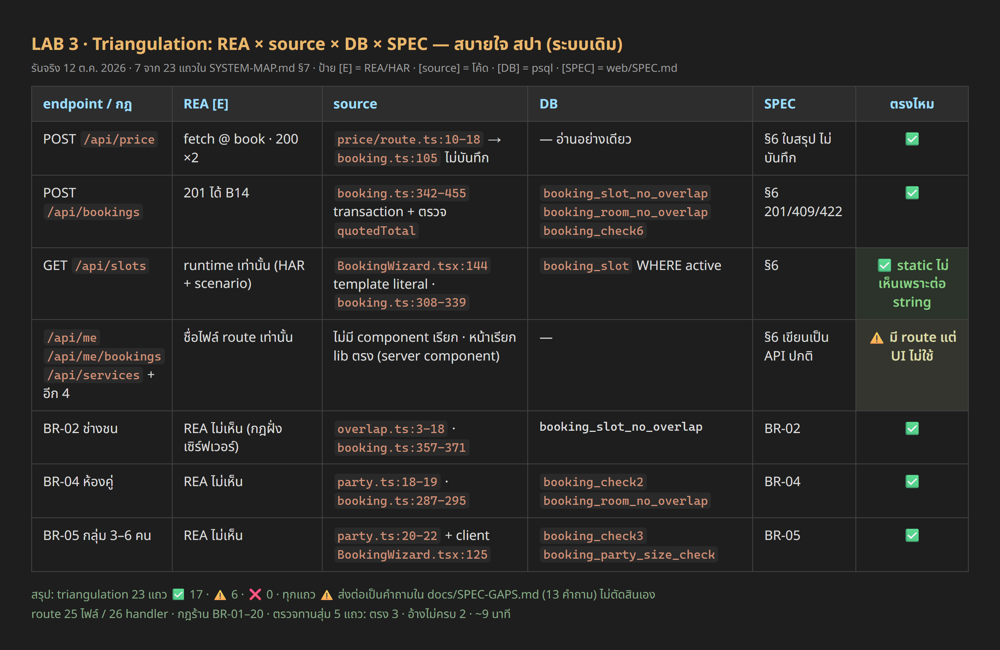

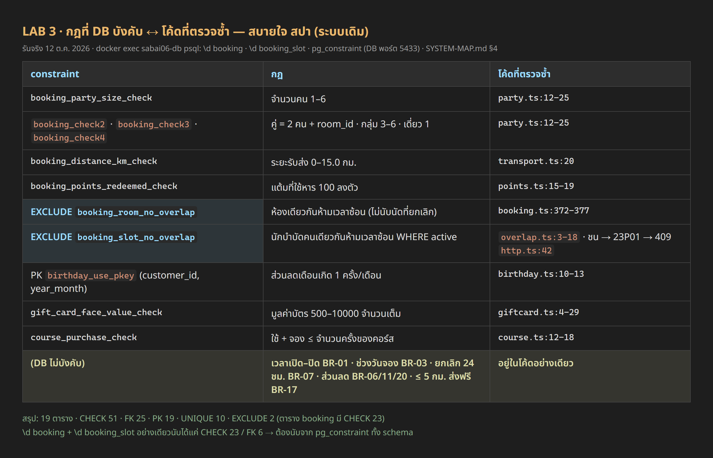

👀 **สังเกต**
- **AI ชอบเดาหน้าที่จากชื่อไฟล์** แถวไม่มี `file:line` = ยังไม่ได้เปิดจริง · Explore subagent ส่งแค่ข้อสรุป ต้องมีที่อ้างให้เปิดตามได้
- **SPEC ขัดโค้ด = คำถามถึงร้าน ไม่ใช่คำตัดสิน** เอกสารเก่าอาจถูกและโค้ดผิดก็ได้ · คนตัดสินคือเจ้าของงาน
- **คอมเมนต์ในโค้ดก็เป็นเอกสารเก่าได้** หัว `db/init/01-schema.sql` เขียน "ERD 17 ตาราง" แต่ `\dt` ได้ 19 · ตัวเลขต้องมาจากคำสั่งที่รัน
- **REA ไม่อ่าน Postgres** กฎ DB ดูด้วย `\d` และนับด้วยคิวรี `pg_constraint` (ไม่นับด้วยตา) · ช่อง DB สำคัญเวลาจะเปลี่ยนตัวเลขกฎ
- **route นับได้ 2 แบบ** ไฟล์ `route.ts` กับ handler ต่างกัน 1 · เขียนทั้งคู่
- **grep `"/api/` อย่างเดียวพลาดผู้เรียก** URL ต่อ string (`` `/api/slots?${q}` ``) 4 จุด = จุดบอดเดียวกับ REA static · ค้น `` `/api/ `` ด้วย ไม่งั้นสรุปผิดว่าไม่มีผู้เรียก
- **คำตอบข้อ 5–6 (test hooks · กับดัก) เก็บไว้ให้ดี** LAB ถัดไปต้องย้อนมาใช้

✔️ **ไปต่อได้เมื่อ:** ทุกแถวมี `file:line` หรือชื่อ constraint · มีตาราง triangulation REA · source · DB (+ SPEC) ป้ายครบทุกช่อง · SPEC-GAPS เป็นคำถาม · ตรวจทานครบ 5 แถว

---

## LAB 4 · CLAUDE.md + รั้ว

🎯 ✏️ กติกาให้ Agent ทำงานกับระบบเดิมอย่างปลอดภัย → `CLAUDE.md` · `.claude/settings.json` (รั้ว `Edit(e2e-legacy/**)` + กันอ่านเฉลย) · `docs/IMPACT-TEMPLATE.md` · `docs/ORACLE-CHANGES.md` แล้ว **ทดสอบรั้วในเซสชันใหม่**


💬 **คัดลอกพรอมต์นี้** (ส่วนที่ 1 · เขียนกติกา)

```text
เขียน CLAUDE.md สำหรับระบบเดิมนี้ + .claude/settings.json + docs/IMPACT-TEMPLATE.md + docs/ORACLE-CHANGES.md (รันคำสั่งด้วย PowerShell · ห้ามแก้โค้ดใน web/ db/ · ห้ามเปิด README.md ของบท fast_track/ และ _solution/)
อ่าน SYSTEM-MAP.md, docs/SPEC-GAPS.md และ HANDOVER-CHECK.md ก่อน
1. CLAUDE.md ไม่เกิน ~60 บรรทัด หัวข้อ: รันยังไง (PowerShell จากโฟลเดอร์บท: เปิดระบบ · reset · node web/scripts/check-rules.mjs · e2e ด้วย Push-Location/Pop-Location · ค่าเริ่ม api+chromium และคำสั่งครบ 3 เบราว์เซอร์ npm run test:all) · แผนที่: ลิงก์ไป SYSTEM-MAP.md แบบธรรมดา (ไม่ใช้ @ เพราะไฟล์ใหญ่ จะถูกโหลดเข้าทุกเซสชัน) · ห้ามแตะ · กติกาการแก้ · กับดัก (จาก SYSTEM-MAP) · เอกสารเก่า (@docs/SPEC-GAPS.md)
2. กติกาที่ต้องมี:
   - อธิบายและทำ impact ตาม docs/IMPACT-TEMPLATE.md ก่อนแก้ทุกครั้ง · เทสต์ใหม่ต้องแดงก่อนแก้ · แก้ให้เล็กที่สุด
   - ห้ามแก้ค่าที่คาดหวังเดิมใน web/scripts/check-rules.mjs, e2e-legacy/ และ tests/golden/ ถ้าไม่มี CR อนุญาต (ถ้าจำเป็นให้หยุดถาม แล้วจดใน docs/ORACLE-CHANGES.md)
   - ค่าที่คาดหวังติดป้ายแหล่งเสมอ: [D:CR-0N] จากคำตอบร้าน · [E ev_xxxxxxxx] จากหลักฐานระบบ (ใช้ได้เฉพาะล็อกพฤติกรรมเดิม) · [E] ขัด [D] = ผู้ต้องสงสัยบั๊ก ให้รายงาน ห้ามใช้ [E] นั้นเป็นค่าคาดหวัง
   - ห้าม docker compose down -v และห้ามลบ volume sabai06-pgdata (มีข้อมูลลูกค้าจริง)
   - เปลี่ยนโครงฐานข้อมูลด้วยไฟล์ migration แยก (db/migrations/) = ทางเดียวสำหรับฐานที่มีข้อมูลอยู่แล้ว · รันซ้ำได้ มีวิธีถอยกลับ · แก้ db/init ได้เฉพาะเพื่อให้เครื่องติดตั้งใหม่และ reset ตรงกับ migration ห้ามใช้ db/init เป็นวิธี deploy · รัน SQL ด้วย docker cp + psql -f (ห้าม pipe ไฟล์ภาษาไทยผ่าน PowerShell) · SQL ที่มีภาษาไทยหรือ quote ให้เขียนลงไฟล์แล้ว psql -f (ไม่ใช้ psql -c "<SQL>" ใน PowerShell)
   - ภาษาไทย/จีนกับ PowerShell 5.1: ยิง API ที่มีข้อความไทย/จีนด้วยสคริปต์ node หรือ curl.exe --data-binary '@ไฟล์.json' (ห้าม Invoke-RestMethod -Body '<ไทย>' · curl เฉย ๆ = Invoke-WebRequest) · ตรวจข้อความไทยใน DB ด้วยการเทียบใน SQL (เช่น SELECT name_th = '<ข้อความ>') หรืออ่านผ่าน API ด้วย node · ห้ามตัดสินจากตัวอักษรที่ PowerShell แสดง (อาจเพี้ยนทั้งที่ข้อมูลถูก) และห้ามแก้ข้อมูลเพราะเห็นตัวอักษรเพี้ยนบนจอ
   - build หรือชุดทดสอบที่นานเกิน 2 นาที (เช่น docker compose up --build ครั้งแรก · e2e 3 เบราว์เซอร์) ให้รันแบบ background หรือ timeout ยาว แล้วรอผลจริง
   - ข้อความใหม่ต้องครบ 3 ภาษา (th/en/zh) · error ใหม่ต้องตรวจผลในแชทบอทด้วย
   - เอกสารเก่าขัดกับโค้ด ให้รายงานแล้วถาม ห้ามเลือกเอง
   - ห้ามเปิดอ่าน README.md ที่รากโฟลเดอร์บท fast_track/ และ _solution/ (เอกสารผู้สอนและเฉลย) ทั้งด้วยเครื่องมืออ่านไฟล์และคำสั่ง shell
3. .claude/settings.json: permissions.deny = ["Edit(e2e-legacy/**)", "Read(/README.md)", "Read(./fast_track/**)", "Read(./_solution/**)"] (กฎ Edit(...) กันเครื่องมือแก้/เขียนไฟล์ของ Claude Code ทุกตัว · Read(/README.md) ขึ้นต้นด้วย / = เฉพาะ README.md ที่รากโฟลเดอร์บท ไม่กัน README ในโฟลเดอร์ย่อย · deny ไม่กันคำสั่ง shell จึงต้องเขียนห้ามใน CLAUDE.md ด้วย)
4. docs/IMPACT-TEMPLATE.md (แม่แบบของ docs/impact/CR-0N.md ทุก CR): คำถามถึงร้าน · ตาราง ไฟล์ที่จะแตะ | เหตุผล (CR) | ใครเรียกใช้ (หลักฐาน grep ไฟล์:บรรทัด) | หน้าจอ/API/แชทที่กระทบ | ตาราง DB | เทสต์ที่ต้องรันซ้ำ | ความเสี่ยง · ค่าที่คาดหวังใหม่พร้อมวิธีคิด · เทสต์ใหม่ที่จะเขียนก่อน (ต้องแดง) · วิธีถอยกลับ · หัวข้อ "ค้นแล้วไม่เจอ": คำค้นที่ใช้ + ที่อาจหลุด (ชื่อประกอบจาก string · key i18n แบบ template · SQL ใน string) · grep ไม่เจอ ≠ ไม่มีผู้เรียก ให้ยืนยันด้วยการรันเทสต์ หรือเขียนเป็นความเสี่ยง
5. docs/ORACLE-CHANGES.md: ตาราง วันที่ | ไฟล์เทสต์ | เคส | ค่าเดิม → ใหม่ | CR ที่อนุญาต | ผู้อนุมัติ (ตอนนี้ยังว่าง)
ไม่แน่ใจข้อไหนให้ถามผมก่อน · เสร็จแล้ว git add -A (รวม HANDOVER-CHECK.md docs/REA-INVENTORY.md SYSTEM-MAP.md docs/SPEC-GAPS.md ที่ยังไม่ได้ commit · rea-out/ ถูก exclude แล้ว) → git status ตรวจว่าไม่มีไฟล์ที่ไม่ควรเข้า → commit "docs: CLAUDE.md + รั้ว"
สรุปเป็นตาราง: ไฟล์ | หัวข้อ | จำนวนบรรทัด
```

💬 **คัดลอกพรอมต์นี้** (ส่วนที่ 2 · **ปิดแล้วเปิดเซสชันใหม่** ก่อนวาง เพื่อให้ settings ใหม่มีผล · เปิดด้วย `claude` ธรรมดา ห้ามใส่ `--dangerously-skip-permissions`)

```text
(รันคำสั่งด้วย PowerShell) ทดสอบรั้วของโปรเจกต์นี้: ลองเพิ่มคอมเมนต์ 1 บรรทัด "// test fence" ที่บรรทัดแรกของ e2e-legacy/playwright.config.ts ด้วยเครื่องมือแก้ไฟล์ปกติ
ห้ามใช้ PowerShell หรือคำสั่ง shell แก้แทน · ถ้าแก้ได้ ให้ลบบรรทัดนั้นคืนทันทีแล้วบอกผมว่ารั้วไม่ทำงาน
รายงานข้อความที่ได้รับจริง แล้วตรวจ git status ว่า e2e-legacy/ ไม่มีไฟล์เปลี่ยน
จากนั้นลองเปิดอ่าน README.md ที่รากโฟลเดอร์นี้ด้วยเครื่องมืออ่านไฟล์ปกติ (ห้ามใช้ shell) · ถ้าอ่านได้ ห้ามสรุปเนื้อหา ให้บอกแค่ว่า "อ่านได้ = รั้วอ่านไม่ทำงาน"
สรุปเป็นตาราง: ทดสอบ | ผล | ข้อความจริง | git status
```

✅ **ผลจริง** `CLAUDE.md` **45 บรรทัด** (6 หัวข้อ · กติกาการแก้ 9 ข้อ) · `docs/IMPACT-TEMPLATE.md` 60 · `docs/ORACLE-CHANGES.md` 11 · commit 8 ไฟล์ +553 (รวมไฟล์ LAB 1–3) · เซสชันใหม่: Edit ไฟล์ใน `e2e-legacy/` **ถูกปฏิเสธ** ทั้งโหมด `acceptEdits` และ `bypassPermissions` · ~3 นาที (ผู้เรียนจริงน่าจะ 10–15 นาที เพราะต้องอ่านทวนไฟล์)

> ℹ️ รอบจริงใช้พรอมต์ฉบับก่อน (deny ข้อเดียว · CLAUDE.md ใช้ `@SYSTEM-MAP.md`) · กฎ `Read(...)` 3 ข้อและลิงก์ธรรมดาเพิ่มทีหลัง (`Read(/README.md)` ทดสอบแยกแล้วว่ากันเฉพาะ README ที่รากบท)

| ทดสอบในเซสชันใหม่ | ผล | ข้อความจริง / หลักฐาน |
|---|---|---|
| Edit `// test fence` บรรทัด 1 ของ `e2e-legacy/playwright.config.ts` | ❌ ถูกปฏิเสธ | `File is in a directory that is denied by your permission settings.` |
| `git status --porcelain -- e2e-legacy/` | ว่าง | SHA-256 ไฟล์ก่อน/หลัง `595e9f56…` เท่ากัน |
| Read ไฟล์เดียวกัน | อ่านได้ | กฎ `Edit(...)` กันแค่การแก้ |
| แก้ผ่าน shell | ไม่ได้ทดสอบ | deny ไม่กัน shell → CLAUDE.md ห้ามไว้ |

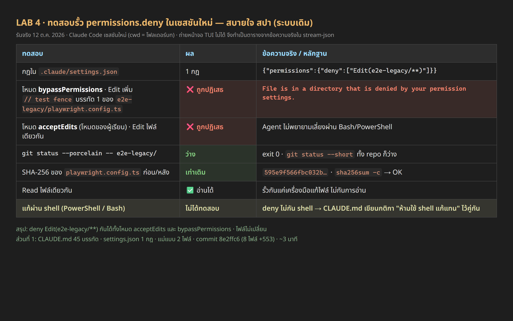

👀 **สังเกต**
- **`Edit(...)` กันเครื่องมือแก้/เขียนไฟล์ทุกตัว** ไม่ต้องมี `Write(...)` · `Read(/README.md)` มี `/` นำหน้า = เฉพาะ README ที่รากบท
- ⚠️ **deny ไม่กันคำสั่ง shell** (`Set-Content` `Get-Content` `sed`) → CLAUDE.md ต้องเขียนห้ามด้วย · รอบจริงรั้วปฏิเสธทั้ง acceptEdits และ bypass
- **รั้ว deny กันแค่ `e2e-legacy/**`** ค่าที่คาดหวังเดิมใน `check-rules.mjs` และ `tests/golden/` อาศัยกติกาใน CLAUDE.md → ตรวจ `git diff` ว่าว่างเองทุก CR
- **settings ใหม่มีผลในเซสชันใหม่** ทดสอบในเซสชันเดิมอาจได้ผลหลอก
- **CLAUDE.md สั้นดีกว่ายาว** ลิงก์ `SYSTEM-MAP.md` ธรรมดา ไม่ใช้ `@` (= โหลด ~46 KB ทุกเซสชัน) · นับบรรทัดด้วย `(Get-Content CLAUDE.md).Count` (`Measure-Object -Line` ไม่นับบรรทัดว่าง: 39 แทน 45)
- **commit นี้รวมไฟล์ LAB 1–3** ไม่งั้น CLAUDE.md ชี้ไฟล์ที่ไม่อยู่ใน repo · คำเตือน `LF will be replaced by CRLF` ไม่ใช่ error
- **ไม่ล้อมรั้ว `db/init/`** กติกาให้แก้ได้เฉพาะเพื่อเครื่องติดตั้งใหม่และ reset · รั้วแน่นเกินงานจริงเดินไม่ได้

✔️ **ไปต่อได้เมื่อ:** รั้วปฏิเสธจริงในเซสชันใหม่ · `e2e-legacy/` ไม่มีไฟล์เปลี่ยน · CLAUDE.md มีคำสั่งรันทุกชุด + ห้าม `down -v` + กติกาป้าย [D:CR-0N] / [E]

---

## LAB 5 · ตาข่ายกันพลาด

🎯 ✏️ ก่อนรับ CR สร้างตาข่ายชั้นที่ 3 ของเรา: **seam เลื่อนนาฬิกา** · **golden master ของ API** · **characterization + known issue** · **ทำพังเองเพื่อวัดตาข่าย** → `web/app/api/test/clock/` · `tests/golden/` · `e2e-cr/` · `KNOWN-ISSUES.md`


💬 **คัดลอกพรอมต์นี้** (ส่วนที่ 1 · seam + golden master)

```text
สร้างตาข่ายกันพลาดก่อนรับ Change Request (รันคำสั่งด้วย PowerShell · อ่าน CLAUDE.md ก่อน · ห้ามแก้ไฟล์ใน web/lib/rules/ และ web/lib/server/booking.ts · ห้ามแก้ e2e-legacy/ · ห้ามเปิด README.md ของบท fast_track/ และ _solution/)
0. อธิบายของเดิมก่อนแก้ (อ้างไฟล์:บรรทัด · ใช้หัวข้อ test hooks ใน SYSTEM-MAP.md ประกอบ): /api/test/reset และ /api/test/today อยู่ไฟล์ไหน · ตรวจ ALLOW_TEST_RESET ที่ไหน · "วันนี้" ของระบบเก็บที่ตาราง/คอลัมน์ไหน · ไฟล์ที่จะเพิ่ม/แก้มีอะไรบ้าง → แสดงในแชทก่อน แล้วจึงทำส่วน A
ส่วน A · test seam: เพิ่ม POST /api/test/clock {"now":"<ISO>"} = เปลี่ยน "วันนี้" ของระบบโดยไม่ล้างข้อมูล
   - ใช้เงื่อนไขเปิด/ปิดเดียวกับ /api/test/reset (ALLOW_TEST_RESET=0 → 404) · แก้แค่ค่า test_today ไม่แตะตารางอื่น
   - rebuild: docker compose -f web/compose.yaml up -d --build --wait (ถ้านานเกิน 2 นาทีให้รันแบบ background แล้วรอ)
   - พิสูจน์: reset → จองนัดใหม่ 1 นัดผ่าน API → เลื่อนนาฬิกา → GET /api/test/today เปลี่ยน · นัดยังอยู่ในตารางคิว
   - พิสูจน์ปิดได้: $env:ALLOW_TEST_RESET="0"; docker compose -f web/compose.yaml up -d --wait → clock ได้ 404 → ตั้งกลับ "1" แล้ว up อีกครั้ง
ส่วน B · golden master ของ API ที่ tests/golden/run.mjs (Node ≥ 22.18 ไม่ใช้ dependency · BASE_URL ค่าเริ่ม http://localhost:4000)
   - reset {"now":"2026-10-10T10:00:00+07:00"} ก่อนทุกกลุ่ม
   - POST /api/price: ผู้ใช้ seed (ไม่ล็อกอิน + U01–U08) × แบบจอง (เดี่ยว คู่ กลุ่ม 3–6 แพ็กเกจ คอร์ส) × แลกแต้ม/ไม่แลก × Gift Card/ไม่ใช้ × รถ (ไม่ใช้ H01 H04 H05) เลือกชุดที่ถูกกฎราว 40–60 เคส (นับเฉพาะ /api/price · slots และตารางคิวนับแยก)
   - GET /api/slots: S01 S02 P01 วันที่ 2026-10-22 และ 2026-10-24
   - ตารางคิวหลังร้าน (ล็อกอิน owner) วันที่ 2026-10-12 ถึง 2026-10-17
   - node tests/golden/run.mjs --update เขียน tests/golden/*.json · ไม่ใส่ --update = เทียบ แล้ว exit 1 ถ้าต่าง พร้อมบอกเคสและฟิลด์ที่ต่าง
   - ตัดฟิลด์ที่เปลี่ยนเองทุกรอบ (id ที่รัน, เวลาสร้าง, cookie) ก่อนเทียบ แล้วเขียนเหตุผลใน tests/golden/README.md
   - รัน --update 1 ครั้ง แล้วรันเทียบอีก 2 ครั้ง ต้องผ่านทั้ง 2 ครั้ง (นิ่ง)
   - tests/golden/README.md ระบุว่าค่าทั้งหมดเป็นป้าย [E] (หลักฐานจากระบบที่รับมอบ = ล็อกพฤติกรรมเดิม ไม่ใช่ตัดสินว่าถูก) พร้อมตาราง ไฟล์ golden | SHA-256 ย่อ 8 ตัว (Get-FileHash) | จำนวนเคส | เวลาที่รัน --update · ใน README อ้างค่าใดให้เขียน [E golden/<ไฟล์>:<sha8>]
ทุกค่าใน golden มาจากการรันระบบที่รับมอบ ห้ามเดาหรือแก้ให้ "ถูก" · เจอค่าที่ดูแปลกให้จดไว้ใน README อย่าแก้
สรุปเป็นตาราง: ส่วน | ไฟล์ | จำนวนเคส | ผล
```

💬 **คัดลอกพรอมต์นี้** (ส่วนที่ 2 · ล็อกหน้าจอ + known issue)

```text
ล็อกหน้าจอสำคัญ และบันทึกพฤติกรรมแปลกเป็น known issue (รันคำสั่งด้วย PowerShell · ห้ามแก้โค้ดใน web/ · ห้ามแก้ e2e-legacy/ · ห้ามเปิด README.md ของบท fast_track/ และ _solution/)
1. สร้างโฟลเดอร์ e2e-cr/ ข้าง web/ (ห้ามสร้างข้างใน web/) = ชุด Playwright ใหม่ของทีม: @playwright/test 1.63.0 · baseURL จาก BASE_URL ค่าเริ่ม http://localhost:4000 · chromium firefox webkit · workers 1 · locale th-TH · timezone Asia/Bangkok · reset ก่อนทุก test · รอ html[data-ready="true"]
   (ดูแนวทางจาก e2e-legacy/playwright.config.ts และ global-setup.ts ได้ แต่ห้ามแก้ของเดิม)
2. e2e-cr/tests/char-booking.spec.ts: ไม่ล็อกอิน จอง S01 วันที่ 12 ต.ค. 15:00 จนถึงหน้าสรุป → ล็อกยอดจาก data-amount และโครงหน้าสรุปด้วย toMatchAriaSnapshot ที่มี /children: equal · ใส่ annotation ป้ายแหล่งของยอด: [E ev_xxxxxxxx] จาก rea-out\scenario.json (ยอดหน้าสรุปที่ REA บันทึกไว้ใน docs/REA-INVENTORY.md) ถ้ายอดที่ล็อกได้ไม่ตรงกับ [E] นั้นให้หยุดบอกผม · เขียน template ของ aria snapshot เองเป็นข้อความตรง (เช่น ยอด "฿1,000") ห้ามใช้ regex ที่ Playwright สร้างให้ (ตัวเลขที่กลายเป็น regex = ไม่ได้ล็อกยอด)
3. ลองของแปลก 3 เรื่อง แล้วเขียน KNOWN-ISSUES.md (อาการ | วิธีทำซ้ำ | หลักฐาน | ผลกระทบ | สถานะ "ยังไม่แก้" | ต้องถามร้านไหม)
   - หน้าจอง: ใส่รหัส Gift Card ที่ไม่มีอยู่ ดูว่ามีข้อความเตือนไหม (เทียบกับคำตอบของ GET /api/giftcards/<รหัส>)
   - จองแบบไม่ล็อกอินด้วยเบอร์โทร "abc"
   - เจ้าของร้าน (owner) ยกเลิกนัดของลูกค้าผ่าน API
   ก่อนตัดสินว่าเป็นบั๊ก ให้เทียบกับ docs/SPEC-GAPS.md (ถ้าเรื่องนั้นยังเป็นคำถามค้างถึงร้าน = "ต้องถามร้าน" ล็อกพฤติกรรมอย่างเดียว ไม่ต้องมี test.fail)
   ข้อที่คิดว่าเป็นบั๊ก: เขียนเทสต์คู่ใน e2e-cr ① ล็อกพฤติกรรมปัจจุบัน ② test.fail() ที่ assert พฤติกรรมที่ควรเป็น + annotation อ้าง KNOWN-ISSUES.md
4. Push-Location e2e-cr; npm install; npx playwright test; Pop-Location (3 เบราว์เซอร์) รัน 2 รอบ ต้องได้ผลเท่ากันทั้ง 2 รอบ (บรรทัดสรุปนับ test.fail ที่ล้มตามคาดรวมใน passed ให้แยกนับในตาราง)
ห้ามแก้บั๊กที่เจอ (ยังไม่มี CR สั่ง) · ไม่แน่ใจว่าบั๊กหรือตั้งใจ ให้เขียน "ต้องถามร้าน"
สรุปเป็นตาราง: test | chromium | firefox | webkit | รอบ 1 = รอบ 2 ไหม | known issue
```

💬 **คัดลอกพรอมต์นี้** (ส่วนที่ 3 · ทำพังเองเพื่อวัดตาข่าย)

```text
วัดว่าตาข่ายจับการพังได้จริงไหม (mutation testing แบบมือ · รันคำสั่งด้วย PowerShell จากโฟลเดอร์บท) · ทำทีละตัว และต้องคืนไฟล์ทุกครั้ง (ห้าม commit โค้ดที่ทำพัง · ห้ามเปิด README.md ของบท fast_track/ และ _solution/)
ตัวทำพัง 3 ตัว แก้ตัวละ 1 บรรทัด:
  X1 web/lib/rules/tier.ts: spend >= GOLD_MIN → spend > GOLD_MIN
  X2 web/lib/rules/transport.ts: SEATS_PER_VEHICLE = 4 → 5
  X3 web/lib/rules/pricing.ts: GROUP_PCT = 10 → 15
ต่อ 1 ตัว: แก้ → docker compose -f web/compose.yaml up -d --build --wait (golden ยิง API จึงต้อง rebuild ทุกตัว) → node tests/golden/run.mjs → node web/scripts/check-rules.mjs → Push-Location e2e-cr; npx playwright test --project=chromium; Pop-Location (chromium อย่างเดียวพอ) → จดว่าชุดไหนจับได้ → คืนไฟล์ด้วย git checkout -- <ไฟล์> → git status ต้องสะอาดในไฟล์นั้น
จบครบ 3 ตัวแล้ว rebuild โค้ดปกติ แล้วรัน golden ต้องผ่าน
ตัวที่ไม่มีชุดไหนจับได้ (รอด): อธิบายว่าตาข่ายมีรูตรงไหน แล้วเสนอเคสที่จะอุดรู (ยังไม่ต้องเขียน) ลง tests/golden/README.md
ถ้าคืนไฟล์ไม่ได้หรือ rebuild ล้ม ให้หยุดแล้วบอกผม
เสร็จแล้ว git add tests e2e-cr KNOWN-ISSUES.md web → git status ตรวจว่าไฟล์ครบ (tests/golden/README.md และ tests/golden/*.json ต้องอยู่ในรายการที่จะ commit) → commit "safety-net: seam + golden + characterization"
สรุปเป็นตาราง: ตัวทำพัง | golden | check-rules | e2e-cr | ถูกจับ / รอด
```

✅ **ผลจริง** seam `/api/test/clock`: "วันนี้" 10 → 12 ต.ค. นัดที่เพิ่งจองยังอยู่ · `ALLOW_TEST_RESET=0` → **404** · e2e-cr 6 เทสต์ × 3 เบราว์เซอร์ = ผ่าน 12 + expected-fail 6 · **รอบ 1 = รอบ 2** · known issue 3 (2 ล็อกคู่ `test.fail` · 1 ต้องถามร้าน) · commit 16 ไฟล์ · ~18 นาที (ส่วน 1 ~7 · 2 ~6 · 3 ~5)

| golden | เคส | เทียบรอบ 1 | เทียบรอบ 2 | SHA-256 ย่อ |
|---|---|---|---|---|
| ราคา `price.json` | 50 | 50/50 | 50/50 | `a485c485` |
| ช่วงเวลา `slots.json` | 6 | 6/6 | 6/6 | `b5eb12a8` |
| คิวหลังร้าน `admin-queue.json` | 6 | 6/6 | 6/6 | `255ee583` |

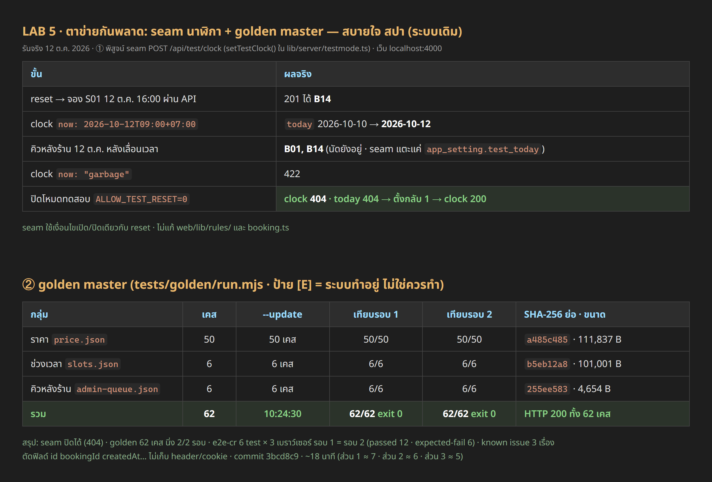

| ตัวทำพัง | golden | check-rules | e2e-cr (chromium) | ผล |
|---|---|---|---|---|
| X1 `tier.ts` `>=` → `>` | ต่าง 2/62 | 88/90 | ไม่จับ | ถูกจับ |
| X2 `transport.ts` ที่นั่งต่อคัน 4 → 5 | ต่าง 3/62 | 88/90 | ไม่จับ | ถูกจับ |
| X3 `pricing.ts` ส่วนลดกลุ่ม 10 → 15 | ต่าง 10/62 | 83/90 | ไม่จับ | ถูกจับ |

หลังคืนโค้ด: golden 62/62 · check-rules 90/90 · `git diff` ว่าง · rebuild ต่อตัว 38–43 วิ

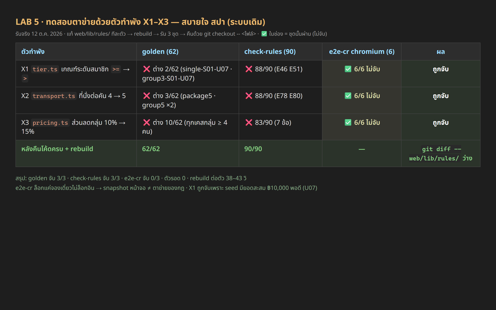

👀 **สังเกต**
- **characterization ล็อกรวมบั๊ก** ข้อที่คิดว่าบั๊กล็อกคู่ ค่าปัจจุบัน + `test.fail()` ค่าที่ควรเป็น · ยังไม่มี CR = ยังไม่แก้ · ยังเป็นคำถามค้างใน SPEC-GAPS = ต้องถามร้าน ล็อกอย่างเดียว
- **aria snapshot ที่ Playwright สร้างแปลงตัวเลขเป็น regex** (`/฿\d+,\d+/`) = ไม่ได้ล็อกยอด · เขียน template เองและอ่าน `data-amount` อีกชั้น
- **บั๊กแบบ "ข้อความวูบ"** บัตรปลอมขึ้น error ~250 ms แล้วล้างเอง · `test.fail()` ต้องรอคำตอบ 422 และคำตอบถัดไปก่อน assert ไม่งั้น "ผ่านโดยไม่คาด"
- **golden ต้องตัดฟิลด์ที่เปลี่ยนเอง** (id · เวลาสร้าง · cookie) · เทียบ 2 รอบติด = นิ่ง · ⚠️ `--update` โดยไม่อ่านว่าอะไรเปลี่ยน = อบพฤติกรรมใหม่ลง golden
- **จองตรงผ่าน API ต้องส่ง `quotedTotal`** (ยอดจาก `/api/price`) ไม่งั้น 422 `QUOTE_REQUIRED` (รอบจริงล้มครั้งแรกเพราะข้อนี้) · อ่าน body ของ error ก่อนแก้
- **mutant รอด = ตาข่ายมีรู** จดเคสอุดรู · คืนไฟล์ทุกตัว · รอบจริง e2e-cr ไม่จับเลย = ตาข่ายหน้าจอบาง · ก่อน commit ดู `git status` ว่า `tests/golden/` ครบ

✔️ **ไปต่อได้เมื่อ:** golden ผ่าน 2 รอบติด · e2e-cr เท่ากัน 2 รอบ × 3 เบราว์เซอร์ · `git status` สะอาดหลังคืน mutant · `KNOWN-ISSUES.md` 3 เรื่อง · มี commit "safety-net"

---

## LAB 6 · CR-02 เปลี่ยนกฎ (วันมีผล)

🎯 ✏️ CR แรก: **เปลี่ยนกฎส่วนลดกลุ่มที่มีวันมีผล** · อธิบายการคิดราคาเดิมก่อน · ทำ impact · คำนวณค่าที่คาดหวังเอง · เทสต์แดงก่อนแก้ · `check-rules.mjs` ต้อง **diff ว่าง** → ได้ `docs/impact/CR-02.md` · `tests/cr02.mjs` · commit แดง → แก้


LAB 6–10 จังหวะเดียวกัน: ส่วนที่ 1 วิเคราะห์ (ไม่แตะโค้ด) → อ่านแผน → อนุมัติ → ส่วนที่ 2 ลงมือในเซสชันเดียวกัน · **LAB 6 8 9 ส่วนที่ 1 ใช้ Plan mode** (`Shift+Tab` · เขียนไฟล์ไม่ได้ · อนุมัติ = ออกจาก Plan mode แล้ว Claude บันทึก `docs/impact/CR-0N.md` แล้วหยุด) · **LAB 7 และ 10 ใช้โหมดปกติ** เพราะต้องทำซ้ำเรื่องร้องเรียน/รัน SQL ที่เปลี่ยนข้อมูลและเขียนไฟล์ชั่วคราว (Plan mode ทำไม่ได้) · พรอมต์จึงห้ามแก้ `web/` `db/` `e2e-legacy/` และรอเราพิมพ์ "อนุมัติ"

💬 **คัดลอกพรอมต์นี้** (ส่วนที่ 1 · วิเคราะห์ใน Plan mode)

```text
วิเคราะห์ CHANGE-REQUESTS/CR-02.md ก่อนแก้ (รันคำสั่งด้วย PowerShell · ยังห้ามแก้โค้ด · อ่าน CLAUDE.md และ SYSTEM-MAP.md ก่อน · ห้ามเปิด README.md ของบท fast_track/ และ _solution/ · Plan mode เขียนไฟล์ไม่ได้ ทุกอย่างให้อยู่ในแชทและแผน)
1. สรุปคำขอเป็นภาษาคน 3–5 ข้อ แล้วแสดง "คำถามถึงร้าน" ทุกเรื่องที่ยังไม่ชัดในแชท
1.5 อธิบายของเดิมก่อนแก้ (อ้างไฟล์:บรรทัด): ระบบคิดส่วนลดกลุ่มและเลือกส่วนลดที่มากที่สุดอย่างไร (bestPercent / calcPrice / buildQuote) · ใครเรียกฟังก์ชันเหล่านี้บ้าง · "วันนี้ของระบบ" ที่ใช้ตอนคิดราคามาจากไหน
2. แสดงคำถามเสร็จแล้วค่อยเปิด CHANGE-REQUESTS/answers/CR-02-ANSWERS.md · บอกว่าคำถามไหนได้คำตอบ ข้อไหนยังค้าง (ข้อค้างให้ใช้สมมติฐานที่ระบุชัด ติด ⚠️)
3. เนื้อหา impact (จะบันทึกเป็น docs/impact/CR-02.md) ตาม docs/IMPACT-TEMPLATE.md · ทุกแถวมีหลักฐาน grep (ไฟล์:บรรทัด) · ต้องครอบ: ฟังก์ชันราคา · ผู้เรียกทุกตัว (รวมแชท) · unit test ใน web/scripts/check-rules.mjs ที่เรียกฟังก์ชันราคาตรง · ข้อความ i18n · หน้าจอ
4. คำนวณค่าที่คาดหวังเองจากกฎใหม่ (แสดงวิธีคิด ฿ − % =) อย่างน้อย 8 เคส: กลุ่ม 2/3/4/5/6/7 คน · ขอบวันมีผล (31 ต.ค. 23:59 กับ 1 พ.ย. 00:00) · ส่วนลดกลุ่มเท่ากับส่วนลดสมาชิก · แพ็กเกจ · นัดที่จองก่อนวันมีผลแต่วันนัดอยู่หลัง · เคสที่ยอดเท่าเดิมแต่ชนิดส่วนลดเปลี่ยน (เช่น Gold กลุ่ม 3) ต้องตรวจ discountKind ด้วย ไม่ใช่แค่ยอด · ทุกแถวติดป้ายแหล่ง: [D:CR-02] = ตรงกับตัวอย่าง/กฎที่ร้านยืนยัน · [E golden/<ไฟล์>:<sha8>] = ค่าเดิมที่ต้องไม่เปลี่ยน (ก่อนวันมีผล) · ถ้า [E] ขัดกับ [D:CR-02] ให้เขียนว่า "ผู้ต้องสงสัยบั๊ก" แล้วถามผม ห้ามใช้ [E] นั้นเป็นค่าคาดหวัง
5. เสนอแผนแก้ทีละขั้น + รายการเทสต์ใหม่ที่จะเขียนก่อน (ต้องแดงบนโค้ดเดิม) แล้วรอผมอนุมัติ · หลังผมอนุมัติ (ออกจาก Plan mode) ให้บันทึกเนื้อหา impact ทั้งหมดเป็น docs/impact/CR-02.md อย่างเดียวแล้วหยุด รอพรอมต์ถัดไป
สรุปเป็นตาราง: ไฟล์ที่จะแตะ | เหตุผล | เทสต์ที่ต้องรันซ้ำ | ความเสี่ยง
```

💬 **คัดลอกพรอมต์นี้** (ส่วนที่ 2 · ลงมือในโหมดปกติ)

```text
ทำ CR-02 ตามแผนใน docs/impact/CR-02.md (รันคำสั่งด้วย PowerShell · อ่าน CLAUDE.md ก่อน · ห้ามแก้ e2e-legacy/ · ห้ามแก้ค่าที่คาดหวังเดิมใน web/scripts/check-rules.mjs และ tests/golden/ · ห้ามเปิด README.md ของบท fast_track/ และ _solution/)
0. ถ้ายังไม่มี docs/impact/CR-02.md: ถ้าแผนที่ผมอนุมัติยังอยู่ในแชทนี้ ให้บันทึกจากแผนนั้น · ถ้าไม่มี (เซสชันใหม่) ให้หยุดแล้วบอกผมให้วางส่วนที่ 1 ใหม่ ห้ามเขียนแผนเองแล้วลงมือ
1. เทสต์ก่อน: tests/cr02.mjs (Node ไม่ใช้ dependency · reset เอง · คุม "วันที่จอง" ด้วย reset {now} หรือ POST /api/test/clock) ใส่ทุกเคสจากข้อ 4 ของ impact
   รันบนโค้ดเดิม → เคสอัตราใหม่ต้องแดง · บันทึกผลแดงลง docs/impact/CR-02.md → git add tests/cr02.mjs docs/impact/CR-02.md → git commit "CR-02 test: แดงก่อนแก้"
2. แก้โค้ดให้เล็กที่สุดตามแผน · อัตราส่วนลดอยู่จุดเดียว ไม่ hardcode ซ้ำ · ค่าเริ่มของพารามิเตอร์ใหม่ต้องให้ผลเหมือนเดิม · rebuild web
3. เขียว: node tests/cr02.mjs ผ่านทุกเคส
4. Regression (จากโฟลเดอร์บท): node web/scripts/check-rules.mjs (ต้องผ่านเท่าเดิม และ git diff web/scripts/check-rules.mjs ต้องว่าง) · node tests/golden/run.mjs · Push-Location e2e-cr; npx playwright test --project=chromium; Pop-Location · Push-Location e2e-legacy; npx playwright test; Pop-Location (ค่าเริ่ม api + chromium · 3 เบราว์เซอร์รอบเต็มทำตอนส่งมอบ)
5. ข้อไหนแดงที่ไม่ได้ตั้งใจ ให้หยุดแล้วบอกผมว่าเป็น เว็บผิด / เทสต์เก่าล้าสมัย / เทสต์ใหม่เขียนผิด · ห้ามแก้เทสต์ให้ผ่านเฉย ๆ
6. เอกสาร: อัปเดต web/SPEC.md เฉพาะกฎส่วนลดกลุ่ม + บรรทัดประวัติแก้ไข · docs/TRACEABILITY.md (สร้างถ้ายังไม่มี) แถว CR-02 → BR-06 (ข้อความกฎใหม่) → TC ทุกตัวที่พิสูจน์ (ใหม่ + regression) → ผล · CHANGE-REPORT.md ส่วน CR-02: ไฟล์ที่แก้ (git diff --stat) · แดง→เขียว · regression · พฤติกรรมที่เปลี่ยนโดยตั้งใจ · ความเสี่ยงคงค้าง · วิธีถอยกลับ
7. อัปเดตสถานะใน CHANGE-REQUESTS/REGISTER.md ก่อน (สถานะ + hash ของ commit แดง) → git add -A → git status ตรวจไฟล์ → git commit "CR-02: ส่วนลดกลุ่มขั้นบันได มีผล 1 พ.ย. 2026"
สรุปเป็นตาราง: ชุดทดสอบ | ก่อนแก้ | หลังแก้ | หมายเหตุ
```

✅ **ผลจริง** คำถามถึงร้าน 9 ข้อ (ตอบ 5 · บางส่วน 2 · ค้าง 2 → สมมติฐาน ⚠️) · คิดมือ 18 แถว · `tests/cr02.mjs` **19 เคส: 10/19 → 19/19** · แก้ `pricing.ts` +19 −2 · `booking.ts` +1 · rebuild 39 วิ · `git diff web/scripts/check-rules.mjs` **ว่าง** · check-rules 90/90 · golden 62/62 · e2e เท่าเดิม · commit แดง → แก้ · ~17 นาที

> ℹ️ รอบจริง Agent ไม่มี Plan mode จริง: ส่วนที่ 1 "วิเคราะห์โดยไม่แตะโค้ด" แล้วบันทึก impact หลังอนุมัติ (LAB 6–10) · LAB 6 ใช้พรอมต์ฉบับก่อน · โหมดปกติของ LAB 7/10 ปรับหลังรอบจริง ยังไม่ได้รันซ้ำ · ตัวเลขใน ✅ ไม่ขึ้นกับเรื่องนี้

| เคส (นัด 5 พ.ย.) | ค่าที่คาดหวัง [D:CR-02] | ก่อนแก้ | หลังแก้ |
|---|---|---|---|
| C2 กลุ่ม 3 จอง 1 พ.ย. | ฿3,000 − 5% = **฿2,850** | ฿3,000 | ✅ |
| C4 กลุ่ม 5 | ฿5,000 − 15% = **฿4,250** | ฿4,500 | ✅ |
| C7 / C8 กลุ่ม 3 จอง 31 ต.ค. 23:59 / 1 พ.ย. 00:00 | ฿3,000 / ฿2,850 | ฿3,000 / ฿3,000 | ✅ |
| C9 Gold กลุ่ม 3 | ฿2,850 · `discountKind` = group | ฿2,850 แต่ `tier` | ✅ |
| C17 สรุปราคา 31 ต.ค. 23:59 → ยืนยัน 1 พ.ย. 00:00 | 409 `PRICE_CHANGED` ยอดใหม่ ฿2,850 | 201 ฿3,000 | ✅ |

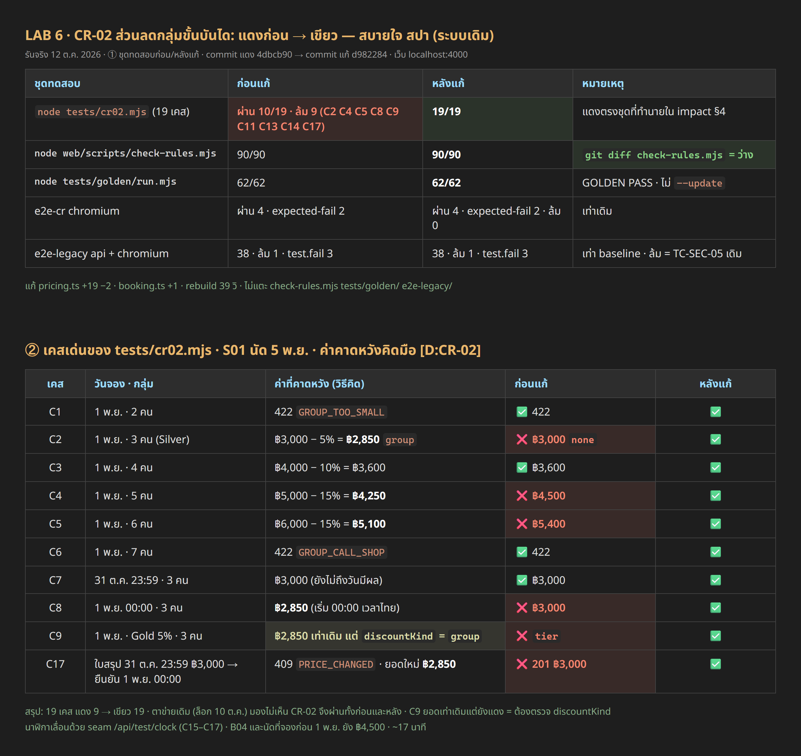

👀 **สังเกต**
- **"วันที่จอง" ≠ "วันนัด"** อ่านคำตอบร้านว่ากฎผูกกับวันไหน · ทดสอบขอบวันมีผลทั้งสองฝั่ง
- **ตาข่ายเดิมมองไม่เห็นวันมีผล** (ล็อกวันที่ 10 ต.ค.) เขียวทั้งก่อนและหลัง แม้เผลอใช้วันนัดแทนวันจอง · มีแค่เคส "จองก่อน–นัดหลัง" (C7 · C15 · C17) ที่จับได้
- **พารามิเตอร์ใหม่ต้องมีค่าเริ่มที่ให้ผลเหมือนเดิม** ชุดตรวจเดิมเรียกฟังก์ชันราคาตรง · ค่าเริ่มเปลี่ยน = พังเงียบ
- **ราคาตอนสรุปกับตอนยืนยันอาจคิดคนละวัน** (ข้ามเที่ยงคืน) ดูว่าระบบเดิมจัดการอย่างไรก่อนแก้
- **ค่าที่คาดหวังเดิมห้ามขยับ** ต้องเปลี่ยน = หยุดถาม + จด `ORACLE-CHANGES.md` · diff ว่าง = ไม่ได้แก้เทสต์ให้ผ่าน · [E] ขัด [D:CR-02] = ผู้ต้องสงสัยบั๊ก
- **ยอดเท่าเดิม ≠ ไม่เปลี่ยน** Gold กลุ่ม 3 ได้ ฿2,850 ทั้งก่อนและหลังแต่ชนิดส่วนลดเปลี่ยน → ตรวจ `discountKind` · เทสต์ใหม่เขียวก่อนแก้บางเคสเป็นปกติ (10/19 = เคสล็อกของเดิม) ที่ต้องแดงคือเคสอัตราใหม่

✔️ **ไปต่อได้เมื่อ:** `tests/cr02.mjs` เขียว · commit แดงก่อน commit แก้ · diff `check-rules.mjs` ว่าง · regression ไม่มีแดงใหม่ · มีแถว CR-02 ใน TRACEABILITY และ REGISTER

---

## LAB 7 · CR-03 แก้บั๊กจากเรื่องร้องเรียน

🎯 ✏️ **ทำซ้ำเรื่องร้องเรียนให้แดงก่อน** · หาต้นเหตุด้วย `file:line` · แก้ฝั่งเซิร์ฟเวอร์ให้ครอบทุกช่องทาง (หน้าเว็บ · API · แชท · กดพร้อมกัน) → ได้ `docs/impact/CR-03.md` · `tests/cr03.mjs` · `e2e-cr/tests/cr03.spec.ts`


💬 **คัดลอกพรอมต์นี้** (ส่วนที่ 1 · วิเคราะห์ในโหมดปกติ · ยังไม่แตะโค้ด)

```text
วิเคราะห์ CHANGE-REQUESTS/CR-03.md (เรื่องร้องเรียน) ก่อนแก้ (รันคำสั่งด้วย PowerShell · ยังห้ามแก้โค้ด · อ่าน CLAUDE.md และ SYSTEM-MAP.md ก่อน · ห้ามเปิด README.md ของบท fast_track/ และ _solution/ · วางในโหมดปกติ: รันคำสั่งได้ แต่ห้ามแก้ไฟล์ใน web/ db/ e2e-legacy/ · สคริปต์และไฟล์ SQL ชั่วคราวเขียนใน tmp/ เท่านั้น)
1. ทำซ้ำเรื่องร้องเรียนก่อน: reset แล้วยิง POST /api/bookings แบบไม่ล็อกอินด้วยข้อมูลเดียวกับนัดของคุณสมชาย (เบอร์ 081-000-0003 · 13 ต.ค. 10:00 · บริการเดียวกับนัดเดิม) ด้วยสคริปต์ node (ชื่อภาษาไทยใน body) · ลองเขียนเบอร์แบบไม่มีขีดด้วย · จดสถานะและรหัสนัดที่ได้
2. แสดง "คำถามถึงร้าน" ในแชทก่อน แล้วค่อยเปิด CHANGE-REQUESTS/answers/CR-03-ANSWERS.md · บอกข้อที่ได้คำตอบ/ยังค้าง
3. หาต้นเหตุ: ไล่การสร้างนัดตั้งแต่ API → service → DB constraint · อธิบายว่าทำไมชุดตรวจที่ส่งมอบไม่จับเรื่องนี้ และทำไมหน้าเว็บกดสองครั้งไม่ซ้ำแต่ API/แชทซ้ำได้ (อ้างไฟล์:บรรทัด)
4. เนื้อหา impact (จะบันทึกเป็น docs/impact/CR-03.md) ตาม docs/IMPACT-TEMPLATE.md · ต้องครอบ: ทุกช่องทางที่สร้างนัด (หน้าเว็บ แชท) · การกดพร้อมกัน 2 คำขอ (สมาชิก และไม่ล็อกอิน) · เทสต์เดิมที่ยิงคำขอพร้อมกันคนละคนต้องยังได้ผลเดิม · เทสต์เดิมที่จองทับนัด seed ด้วยบัญชีหรือเบอร์ของเจ้าของนัดเอง (ไล่ใน e2e-legacy/tests และ web/scripts/check-rules.mjs) → กำหนดลำดับ error เมื่อคำขอเข้าทั้ง "คิวเต็ม" และ "นัดซ้ำ" พร้อมกัน ให้เทสต์เดิมได้ผลเดิม · ข้อความ 3 ภาษา
5. ค่าที่คาดหวังใหม่อย่างน้อย 8 เคส (ซ้ำ · ต่อกันพอดี · คนละเบอร์ · สมาชิก · ยกเลิกแล้วจองใหม่ · คู่ทับเดี่ยว · พร้อมกัน · แชท) · ทุกแถวติดป้าย [D:CR-03] หรือ [E …] · ผลที่ได้จากข้อ 1 (201 ซ้ำได้) คือ [E] ที่ขัด [D:CR-03] = หลักฐานบั๊ก ห้ามนำไปเป็นค่าคาดหวัง · เสนอแผนแล้วรอผมอนุมัติ · หลังผมพิมพ์ "อนุมัติ" ให้บันทึกเนื้อหา impact ทั้งหมดเป็น docs/impact/CR-03.md อย่างเดียวแล้วหยุด รอพรอมต์ถัดไป
สรุปเป็นตาราง: ไฟล์ที่จะแตะ | เหตุผล | เทสต์ที่ต้องรันซ้ำ | ความเสี่ยง
```

💬 **คัดลอกพรอมต์นี้** (ส่วนที่ 2 · ลงมือในโหมดปกติ)

```text
แก้ CR-03 ตาม docs/impact/CR-03.md (รันคำสั่งด้วย PowerShell · อ่าน CLAUDE.md ก่อน · ห้ามแก้ e2e-legacy/ · ห้ามแก้ค่าที่คาดหวังเดิมใน web/scripts/check-rules.mjs และ tests/golden/ · ห้ามเปิด README.md ของบท fast_track/ และ _solution/)
0. ถ้ายังไม่มี docs/impact/CR-03.md: ถ้าแผนที่ผมอนุมัติยังอยู่ในแชทนี้ ให้บันทึกจากแผนนั้น · ถ้าไม่มี (เซสชันใหม่) ให้หยุดแล้วบอกผมให้วางส่วนที่ 1 ใหม่ ห้ามเขียนแผนเองแล้วลงมือ
1. เทสต์ที่ทำซ้ำเรื่องร้องเรียนก่อน: tests/cr03.mjs ทุกเคสจาก impact (กดพร้อมกันใช้ Promise.all 2 คำขอ) + e2e-cr/tests/cr03.spec.ts (ขั้นยืนยันในหน้าจองแสดง book-error ที่มี data-error-code="DUPLICATE_BOOKING" และรหัสนัดเดิม)
   รันบนโค้ดเดิม → ต้องแดง (เคสเรื่องร้องเรียนได้ 201) · เก็บ log ผลแดง → git add tests/cr03.mjs e2e-cr/tests/cr03.spec.ts docs/impact/CR-03.md → git commit "CR-03 test: ทำซ้ำเรื่องร้องเรียน (แดง)"
2. แก้ฝั่งเซิร์ฟเวอร์ให้เล็กที่สุด: ตรวจตอนสร้างนัด (ไม่ใช่แค่ปิดปุ่ม) · normalize เบอร์เหลือตัวเลข · กันคำขอพร้อมกันทั้งสมาชิกและไม่ล็อกอิน · ลำดับล็อกคงที่ (กัน deadlock) · ข้อความ 3 ภาษา · rebuild web
3. เขียว: node tests/cr03.mjs และ Push-Location e2e-cr; npx playwright test tests/cr03.spec.ts --project=chromium; Pop-Location (ระหว่างทำ CR รัน chromium อย่างเดียว · 3 เบราว์เซอร์รอบเต็มทำตอนส่งมอบ) · ถามแชทจองซ้ำด้วยภาษาไทยและจีนด้วยสคริปต์ node (POST /api/chat · ห้ามส่งข้อความไทย/จีนผ่าน Invoke-RestMethod · แชทต้องคุยครบ 5 ข้อความ ขอจอง → วัน → เวลา → ชื่อ+เบอร์ → ยืนยัน และส่ง state ที่ได้กลับไปทุกครั้ง) แล้วตรวจว่าคำตอบมีข้อความตามภาษาและรหัสนัดเดิม · ภาษาของ error จาก API มาจาก cookie lang ไม่ใช่ lang ใน body (เทสต์ข้อความ en/zh ของ API ต้องส่ง cookie)
4. Regression (จากโฟลเดอร์บท): node web/scripts/check-rules.mjs (diff ว่าง) · node tests/golden/run.mjs · node tests/cr02.mjs · Push-Location e2e-cr; npx playwright test --project=chromium; Pop-Location · Push-Location e2e-legacy; npx playwright test; Pop-Location (api + chromium) · ดูให้แน่ว่าเทสต์จองพร้อมกันคนละคนยังได้ SLOT_TAKEN
5. แดงที่ไม่ได้ตั้งใจ → หยุดบอกผม (เว็บผิด / เทสต์เก่าล้าสมัย / เทสต์ใหม่เขียนผิด) ห้ามแก้เทสต์ให้ผ่าน
6. เอกสาร: web/SPEC.md (กฎใหม่ BR-21 + error ใหม่) · docs/TRACEABILITY.md แถว CR-03 → BR-21 → TC → ผล · CHANGE-REPORT.md ส่วน CR-03 (ต้นเหตุ ไฟล์:บรรทัด · ทำไมชุดเดิมไม่จับ) · อัปเดต REGISTER.md (สถานะ + hash commit แดง) → git add -A → git status → git commit "CR-03: กันจองซ้ำของคนเดียวกัน"
สรุปเป็นตาราง: เคส | ก่อนแก้ | หลังแก้ | ช่องทาง
```

✅ **ผลจริง** ทำซ้ำเรื่องร้องเรียน: จองทับนัดคุณสมชายได้ **201 ทุกครั้ง** (B14 · B15 ไม่มีขีด · B16 · พร้อมกัน 201 × 2) = [E] ขัด [D:CR-03] · คำถาม 10 ข้อ · `tests/cr03.mjs` **5/16 → 18/18** (เพิ่ม 2 เคสระหว่างทาง · รันซ้ำ 5 รอบเขียว) · `cr03.spec.ts` แดง → เขียว · แก้ 4 ไฟล์ ~39 บรรทัด · e2e-legacy รอบแรก **แดงใหม่ 1** → แก้ลำดับการตรวจ → เท่า baseline · ~29 นาที

| เคส | ก่อนแก้ | หลังแก้ | ช่องทาง |
|---|---|---|---|
| C1 · C2 ซ้ำนัดคุณสมชาย (มีขีด / ไม่มีขีด) | 201 | **409 `DUPLICATE_BOOKING`** (B03) | API ไม่ล็อกอิน |
| C4 ต่อกันพอดี 11:30 | 201 | 201 | API ไม่ล็อกอิน |
| C10 กดพร้อมกัน 2 คำขอ | 201 + 201 | 201 + 409 · ฐานมี 1 นัด | API ไม่ล็อกอิน |
| C12 คนละคนแย่งนักบำบัดเดียวกัน | 201 + 409 `SLOT_TAKEN` | เหมือนเดิม | API สมาชิก |
| C15 · C16 แชทไทย / จีน | "จองสำเร็จ! รหัสการจอง B14" / "预约成功！预约号 B14" | "คุณมีนัดในช่วงเวลานี้อยู่แล้ว (รหัส B03)" / "您在该时段已有预约（预约号 B03）" | แชท |
| UI-1 หน้า `/book` ขั้นยืนยัน | จองสำเร็จ | `book-error` นัดซ้ำ B03 · ยังอยู่ขั้น 4 | หน้าเว็บ |

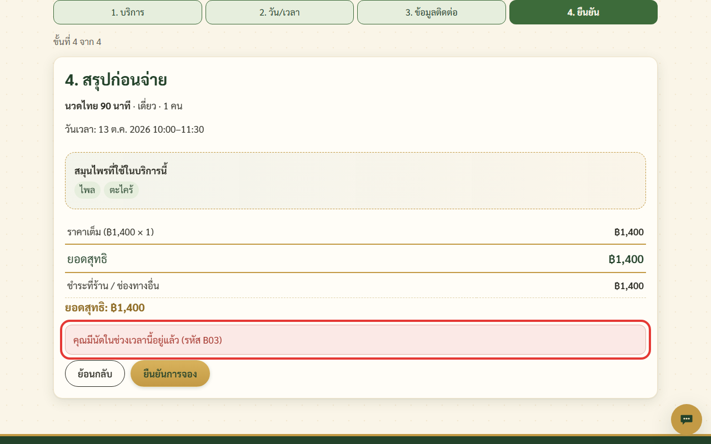

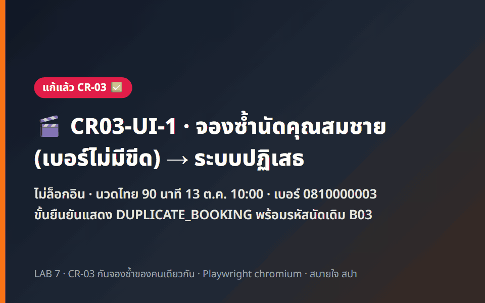

👀 **สังเกต**
- **ผลตอนทำซ้ำเรื่องร้องเรียน = [E] ขัด [D:CR-03]** หลักฐานบั๊ก · ห้ามเอาไปเป็นค่าที่คาดหวัง
- **ปิดปุ่มอย่างเดียวไม่พอ** API และแชทสร้างนัดได้ไม่ผ่านปุ่ม → กันที่เซิร์ฟเวอร์ · **ล็อกแถวอย่างเดียวก็ไม่กัน** (สมาชิกถูกล็อกแถวแต่ก่อนแก้ได้ 201 + 201 · คนไม่ล็อกอินไม่มีแถว) → ต้องมีเงื่อนไข + advisory lock ต่อคน
- **กดพร้อมกัน "คนละคน" ต้องยังได้ผลเดิม** และลำดับการล็อกต้องคงที่ ไม่งั้นสองคำขอรอกันเอง (deadlock)
- ⚠️ **ไทย/จีนผ่าน API ใช้สคริปต์ node** · ภาษาของ error มาจาก cookie `lang` · `errorBody()` เดิมไม่เติมตัวแปร → ต้องแก้ทั้ง `http.ts` และ `chat.ts` ไม่งั้นแชทตอบ "(รหัส {code})" ตรง ๆ
- **ชุดเทสต์เดิมจับ regression ได้จริง** TC-BOOK-07 แดงเพราะตรวจ "นัดซ้ำ" ก่อน "คิวเต็ม" → แก้ลำดับในโค้ด ไม่แก้เทสต์ · กฎปฏิเสธใหม่ต้องคิดลำดับ error
- **known issue เดิมเจาะรูกฎใหม่** KI-02 (เบอร์ "abc") ไม่มีตัวเลขให้เทียบ → คนไม่ล็อกอินจองซ้ำได้ไม่จำกัด · จดเป็นความเสี่ยงคงค้าง

✔️ **ไปต่อได้เมื่อ:** commit แดงก่อน commit แก้ · `cr03.mjs` และ `cr03.spec.ts` (chromium) เขียว · e2e-legacy เท่า baseline · มีแถว CR-03 ใน TRACEABILITY และ REGISTER

---

## LAB 8 · CR-04 migration วันหยุดร้าน

🎯 ✏️ เพิ่มตาราง **บนฐานที่มีข้อมูลลูกค้า**: migration แยกไฟล์รันซ้ำได้ + ไฟล์ถอยกลับ · ซ้อมบนฐานที่มีนัดจริง · เครื่องติดตั้งใหม่และ reset ต้องยังใช้ได้ → `db/migrations/001_shop_holiday.sql` (+ `.down.sql`) · `tests/cr04.mjs` · `docs/MIGRATION-RUNBOOK.md`


💬 **คัดลอกพรอมต์นี้** (ส่วนที่ 1 · วิเคราะห์ใน Plan mode)

```text
วิเคราะห์ CHANGE-REQUESTS/CR-04.md ก่อนแก้ (รันคำสั่งด้วย PowerShell · ยังห้ามแก้โค้ด · อ่าน CLAUDE.md และ SYSTEM-MAP.md ก่อน · ห้ามเปิด README.md ของบท fast_track/ และ _solution/ · Plan mode เขียนไฟล์ไม่ได้ ทุกอย่างให้อยู่ในแชทและแผน)
หนังสือบอกว่าระบบใช้งานจริงอยู่ ข้อมูลลูกค้าและนัดห้ามหาย
1. แสดง "คำถามถึงร้าน" ในแชทก่อน แล้วค่อยเปิด CHANGE-REQUESTS/answers/CR-04-ANSWERS.md · ตัดสินว่ารอบนี้ทำส่วน ข (หลังร้าน) ไหม ให้ถามผมก่อน
2. ตอบด้วยหลักฐานจาก repo (ไฟล์:บรรทัด): ถ้าเพิ่มตารางใน db/init/01-schema.sql อย่างเดียว ฐานข้อมูลที่รันอยู่จะได้ตารางไหม เพราะอะไร · ข้อมูลทดสอบของ reset มาจากไฟล์ไหน เข้าไปใน image ตอนไหน · reset ล้างตารางอะไรบ้าง ถ้ามีตารางใหม่ต้องแก้ที่ไหน
3. ออกแบบ: ตารางใหม่ · migration ไฟล์แยก db/migrations/001_shop_holiday.sql ที่รันซ้ำได้ + 001_shop_holiday.down.sql · สิ่งที่ต้องแก้สำหรับเครื่องที่ติดตั้งใหม่ · สิ่งที่ต้องแก้ให้ reset ยังผ่าน · ทุกช่องทางที่จองได้ (หน้าเว็บ ราคา จอง คอร์ส แชท) · ลำดับ error เมื่อวันที่เกินช่วงจองและเป็นวันหยุดพร้อมกัน
4. เนื้อหา impact (จะบันทึกเป็น docs/impact/CR-04.md) ตาม docs/IMPACT-TEMPLATE.md + ค่าที่คาดหวังใหม่อย่างน้อย 8 เคส (ติดป้าย [D:CR-04] หรือ [E …] ทุกแถว) + ขั้นตอนซ้อมบนฐานที่มีข้อมูล + ลำดับ deploy (migration ก่อน rebuild เว็บ) และลำดับถอย (เว็บก่อน down.sql) พร้อมเหตุผล + วิธีถอยกลับ (ข้อมูลอะไรหายบ้างถ้าถอย)
5. เสนอแผนแล้วรอผมอนุมัติ · หลังผมอนุมัติ (ออกจาก Plan mode) ให้บันทึกเนื้อหา impact ทั้งหมดเป็น docs/impact/CR-04.md อย่างเดียวแล้วหยุด รอพรอมต์ถัดไป
สรุปเป็นตาราง: ไฟล์/ตารางที่จะแตะ | เหตุผล | เทสต์ที่ต้องรันซ้ำ | ความเสี่ยง
```

💬 **คัดลอกพรอมต์นี้** (ส่วนที่ 2 · ลงมือส่วน ก ในโหมดปกติ) ☕

```text
ทำ CR-04 ส่วน ก ตาม docs/impact/CR-04.md (รันคำสั่งด้วย PowerShell · อ่าน CLAUDE.md ก่อน · ห้าม docker compose down -v · ห้ามลบ volume · ห้ามแก้ e2e-legacy/ · ห้ามแก้ค่าที่คาดหวังเดิม · ห้ามเปิด README.md ของบท fast_track/ และ _solution/)
0. ถ้ายังไม่มี docs/impact/CR-04.md: ถ้าแผนที่ผมอนุมัติยังอยู่ในแชทนี้ ให้บันทึกจากแผนนั้น · ถ้าไม่มี (เซสชันใหม่) ให้หยุดแล้วบอกผมให้วางส่วนที่ 1 ใหม่ ห้ามเขียนแผนเองแล้วลงมือ
1. เทสต์ก่อน: tests/cr04.mjs (ทุกเคสใน impact) → รันบนโค้ดเดิมต้องแดง → git add tests/cr04.mjs docs/impact/CR-04.md (+ e2e-cr/tests/cr04.spec.ts ถ้าเขียนแล้ว) → git commit "CR-04 test: แดงก่อนแก้"
2. เขียน db/migrations/001_shop_holiday.sql (รันซ้ำได้: บรรทัดแรก SET client_min_messages = warning; · CREATE TABLE IF NOT EXISTS · INSERT … ON CONFLICT DO NOTHING) และ 001_shop_holiday.down.sql
3. ซ้อมบนฐานที่มีข้อมูลแบบระบบจริง (เว็บตัวเดิมยังรันอยู่):
   - สำรอง: New-Item -ItemType Directory -Force backups | Out-Null · docker exec sabai06-db pg_dump -U sabai -d sabai -f /tmp/before-cr04.sql แล้ว docker cp sabai06-db:/tmp/before-cr04.sql backups\before-cr04.sql
   - reset แล้วจองนัดใหม่ 1 นัดผ่าน API ด้วยสคริปต์ node (ไม่ล็อกอิน S01 2026-10-20 14:00) จดรหัสนัด
   - รัน migration 2 ครั้ง: docker cp db\migrations\001_shop_holiday.sql sabai06-db:/tmp/001.sql แล้ว docker exec sabai06-db psql -U sabai -d sabai -v ON_ERROR_STOP=1 -f /tmp/001.sql (ห้าม pipe ไฟล์ผ่าน PowerShell เพราะภาษาไทยจะเพี้ยน) · ตัดสินผลจาก $LASTEXITCODE (ต้องเป็น 0) และบรรทัดผลของ psql (ครั้งแรก INSERT 0 3 · ครั้งที่ 2 INSERT 0 0) · ถ้าเห็น NOTICE "already exists, skipping" ที่ PowerShell 5.1 แสดงเป็นตัวแดง (NativeCommandError) = ข้อความแจ้ง ไม่ใช่ error
   - ตรวจ: ไม่ error ทั้ง 2 ครั้ง · นัดใหม่ยังอยู่ · SELECT count(*) FROM shop_holiday = 3 · ชื่อไทยถูกต้องตรวจด้วย SQL ไม่ใช่ด้วยตา: SELECT holiday_date, name_th = 'วันปิยมหาราช' AS th_ok FROM shop_holiday WHERE holiday_date = '2026-10-23' ต้องได้ t (ตัวอักษรไทยที่ PowerShell แสดงอาจเพี้ยนทั้งที่ข้อมูลถูก ห้ามแก้ข้อมูลเพราะเห็นบนจอ · ถ้าได้ f ให้รันคำสั่งเดียวกันจากไฟล์ .sql ด้วย docker cp + psql -f ก่อนสรุป)
4. แก้ให้เครื่องติดตั้งใหม่และ reset ใช้ได้ + โค้ดทุกช่องทาง + ข้อความ 3 ภาษา + แชท ตามแผน
5. ลำดับ deploy: migration (ข้อ 3) ต้องรันก่อน rebuild เว็บเสมอ (เว็บใหม่บน schema เก่า → reset/slots/price/bookings ตอบ 500) · เก็บ image เดิมไว้ถอยกลับ: docker tag sabai06-web:latest sabai06-web:before-cr04 · แล้ว rebuild web
6. พิสูจน์: node tests/cr04.mjs เขียว · reset 2 ครั้งติดได้ 200 ทั้งคู่ · หน้า /book เลือกวันที่ 23 ต.ค. เห็นข้อความร้านหยุด (เพิ่มเทสต์ใน e2e-cr/tests/cr04.spec.ts รัน --project=chromium) · ติดตั้งใหม่: docker run --rm -d --name sabai06-fresh -e POSTGRES_USER=sabai -e POSTGRES_PASSWORD=sabai -e POSTGRES_DB=sabai -v "${PWD}\db\init:/docker-entrypoint-initdb.d:ro" postgres:16-alpine → รอ init เสร็จก่อนตรวจ (pg_isready ผ่านได้ระหว่าง init ยังไม่จบ: วนถาม docker exec sabai06-fresh psql -U sabai -d sabai -tAc "SELECT count(*) FROM shop_holiday" ทุก 1 วินาที สูงสุด ~60 วินาที จนได้ตัวเลข) แล้วตรวจว่าได้ 3 แถว จากนั้น docker stop sabai06-fresh
7. Regression (จากโฟลเดอร์บท): node web/scripts/check-rules.mjs (diff ว่าง) · node tests/golden/run.mjs · node tests/cr02.mjs · node tests/cr03.mjs · Push-Location e2e-cr; npx playwright test --project=chromium; Pop-Location · Push-Location e2e-legacy; npx playwright test; Pop-Location (api + chromium) · แดงที่ไม่ได้ตั้งใจ → หยุดบอกผม
8. docs/MIGRATION-RUNBOOK.md (สำรอง · คำสั่งรัน · ตรวจ ($LASTEXITCODE + INSERT 0 n) · หัวข้อ "ลำดับ": deploy = สำรอง → migration → rebuild เว็บ · ถอย = เว็บกลับ image before-cr04 ก่อน แล้วค่อย down.sql (เว็บใหม่อ่าน/TRUNCATE ตารางนี้ ถ้า down ก่อน = 500) · ข้อมูลที่จะหาย) · TRACEABILITY แถว CR-04 → BR-01/BR-03 → TC · CHANGE-REPORT ส่วน CR-04 · SPEC.md · อัปเดต REGISTER.md (สถานะ + hash commit แดง) → git add -A (backups/ ถูก exclude) → git status → git commit "CR-04: วันหยุดร้าน + migration 001"
สรุปเป็นตาราง: ขั้น | คำสั่ง | ผล | เวลา
```

💬 **คัดลอกพรอมต์นี้** (ส่วนที่ 3 · ทางเลือก · ส่วน ข หลังร้าน ทำเมื่อเวลาเหลือ)

```text
ทำ CR-04 ส่วน ข: เจ้าของร้านเพิ่ม/ลบวันหยุดเองในหน้าหลังร้าน ตามที่ตกลงใน CHANGE-REQUESTS/answers/CR-04-ANSWERS.md (รันคำสั่งด้วย PowerShell · อ่าน CLAUDE.md ก่อน · ห้ามแก้ค่าที่คาดหวังเดิม · ห้ามเปิด README.md ของบท fast_track/ และ _solution/)
0. อธิบายของเดิมก่อนแก้ (ไฟล์:บรรทัด): หน้าและ API หลังร้านเดิม (AdminQueue · lib/server/admin.ts) ตรวจสิทธิ์ owner ที่ไหน · อัปเดต docs/impact/CR-04.md หัวข้อ "ส่วน ข" (ไฟล์ที่จะแตะ · เทสต์ที่ต้องรันซ้ำ · ความเสี่ยง) แล้วรอผมอนุมัติ
1. เพิ่มเคสใน tests/cr04.mjs ก่อน (เพิ่มวันที่มีนัดยืนยัน · วันว่าง · วันนี้ · อดีต · ลบ · สมาชิกเรียก · ไม่ล็อกอิน · ชื่อวันหยุดภาษาไทยส่งด้วย node แล้วอ่านกลับจาก GET /api/holidays ต้องตรงตัว) → แดง → commit
2. API + ส่วนหน้าหลังร้าน + ข้อความ 3 ภาษา → rebuild → เขียว
3. Regression ชุดเดียวกับส่วน ก · อัปเดต TRACEABILITY / CHANGE-REPORT / REGISTER · commit "CR-04b: หลังร้านจัดการวันหยุด"
แดงที่ไม่ได้ตั้งใจหรือไม่แน่ใจ ให้หยุดบอกผม ห้ามแก้เทสต์ให้ผ่าน
สรุปเป็นตาราง: เคส | ก่อนแก้ | หลังแก้
```

✅ **ผลจริง** วันหยุด 3 แถว `th_ok = t` · นัดใหม่ B14 ยังอยู่ (booking 14 · customer 9 เท่าเดิม) · `tests/cr04.mjs` **3/14 → 14/14** · UI 1/2 → 2/2 · เครื่องติดตั้งใหม่ 20 ตาราง + วันหยุด 3 แถว · ทำส่วน ก เท่านั้น · ~17 นาที

| ขั้น | คำสั่ง | ผล | เวลา |
|---|---|---|---|
| สำรอง | `pg_dump` → `docker cp` | `backups\before-cr04.sql` 52,535 ไบต์ | 0.6 วิ |
| จองนัดใหม่ | node · S01 20 ต.ค. 14:00 | 201 B14 | < 1 วิ |
| migration รอบ 1 | `docker cp` + `psql -v ON_ERROR_STOP=1 -f` | `CREATE TABLE` · `INSERT 0 3` · exit 0 | 0.28 วิ |
| migration รอบ 2 | คำสั่งเดิม | NOTICE `already exists, skipping` · `INSERT 0 0` · exit 0 | 0.27 วิ |
| ตรวจด้วย SQL | `psql -f` | 3 แถว · `th_ok` t · B14 อยู่ | < 1 วิ |
| tag + rebuild | `docker tag … before-cr04` · `up --build` | health ok | 41 วิ |
| พิสูจน์ | cr04 · reset × 2 · cr04.spec · ติดตั้งใหม่ | 14/14 · 200 · 200 · 2/2 · 20 ตาราง | 3.5 · 8.3 · 6 วิ |
| regression | check-rules · golden · cr02 · cr03 · e2e-cr · e2e-legacy | 90/90 · 62/62 · 19/19 · 18/18 · 7 + ef 2 · 38/1/3 = baseline | ~5 นาที |

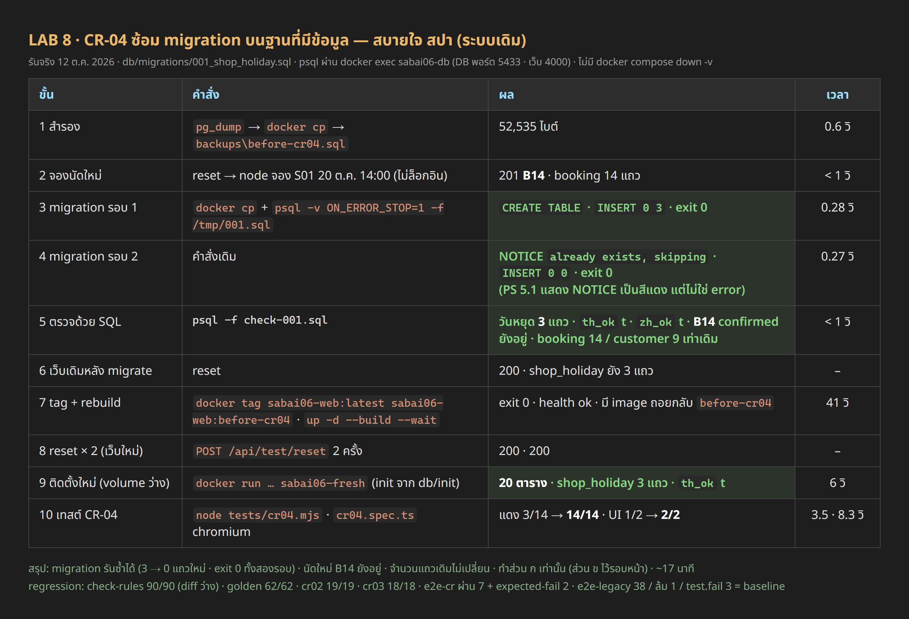

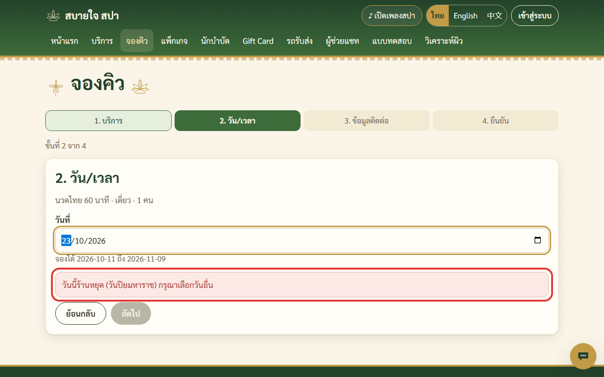

👀 **สังเกต**
- ⚠️ **รัน SQL ด้วย `docker cp` + `psql -f` เท่านั้น** pipe ผ่าน PS 5.1 ทำไทยเป็น `?` จริง · จอเพี้ยนได้ทั้งที่ข้อมูลถูก → ตรวจด้วย SQL (`name_th = '…'` ได้ `t`) ห้ามแก้ข้อมูลเพราะเห็นบนจอ
- **`db/init/` ไม่ใช่วิธี deploy** ฐานที่มีข้อมูลไม่รันซ้ำ แต่เครื่องใหม่และ reset ต้องได้ schema เดียวกัน · reset พังหลังเพิ่มตาราง? ย้อนดูคำตอบข้อ 2 ส่วนที่ 1 (รายการตายตัว)
- ⚠️ **`down -v` = ข้อมูลลูกค้าหาย = ผิดหนังสือ CR** สำรองก่อน (สร้าง `backups\` ก่อน `docker cp`) และ tag image เดิมไว้ถอยกลับ
- **รันซ้ำได้จริง = `INSERT 0 3` แล้ว `INSERT 0 0`** · NOTICE `already exists` ตัวแดงทั้งที่ exit 0 → ดู `$LASTEXITCODE` หรือใส่ `SET client_min_messages = warning;`
- ⚠️ **ลำดับ: migration ก่อน rebuild เว็บ · ถอย: เว็บก่อน `down.sql`** เว็บใหม่บน schema เก่าจะตอบ 500 (วิเคราะห์จากโค้ด รอบจริงไม่ได้ลองกลับลำดับ) · migration ก่อน เว็บเดิมยังทำงาน (reset 200) · เครื่องใหม่ต้องรอ init จบ (`pg_isready` ผ่านก่อนได้)
- **ปิดวันหยุดในฟังก์ชันหารอบอย่างเดียว แชทพัง** (แชทเรียกฟังก์ชันเดียวกัน `/api/chat` ตอบ 422) → เช็กวันหยุดในขั้นเลือกวันของแชทและทดสอบแชท
- **ข้อความจากร้านใช้คำต่อคำ** "วันนี้ร้านหยุด (…)" ขึ้นแม้เลือกวันอื่น · อย่าแก้เอง จดเป็นข้อเสนอแล้วถามร้าน

✔️ **ไปต่อได้เมื่อ:** migration รัน 2 ครั้งบนฐานที่มีนัดใหม่ผ่าน · reset ผ่าน 2 ครั้งติด · `cr04.mjs` เขียว · มี `MIGRATION-RUNBOOK.md` + `backups/before-cr04.sql` (ไม่ commit) + image `sabai06-web:before-cr04`

---

## LAB 9 · CR-01 ฟีเจอร์ใหม่ เลื่อนนัด

🎯 ✏️ ฟีเจอร์ใหม่ที่ใหญ่ที่สุด: **แตกงาน 3 ขั้น** (A API เลื่อนนัด → B รอบที่เลื่อนได้ → C หน้า `/account`) · เทสต์แดงก่อนทุกขั้น · ปิดท้ายด้วย **regression เต็ม 3 เบราว์เซอร์** → ได้ `tests/cr01.mjs` · `e2e-cr/tests/cr01.spec.ts`


💬 **คัดลอกพรอมต์นี้** (ส่วนที่ 1 · วิเคราะห์ + แตกงานใน Plan mode)

```text
วิเคราะห์ CHANGE-REQUESTS/CR-01.md (ฟีเจอร์ใหม่ ใหญ่ที่สุด) ก่อนแก้ (รันคำสั่งด้วย PowerShell · ยังห้ามแก้โค้ด · อ่าน CLAUDE.md และ SYSTEM-MAP.md ก่อน · ห้ามเปิด README.md ของบท fast_track/ และ _solution/ · Plan mode เขียนไฟล์ไม่ได้ ทุกอย่างให้อยู่ในแชทและแผน)
1. แสดง "คำถามถึงร้าน" ในแชทก่อน แล้วค่อยเปิด CHANGE-REQUESTS/answers/CR-01-ANSWERS.md · บอกข้อที่ได้คำตอบ/ยังค้าง
2. อธิบายด้วยหลักฐาน (ไฟล์:บรรทัด): เวลาของนัดเก็บที่ตารางไหนบ้าง คอลัมน์ไหนคำนวณเอง คอลัมน์ไหนต้องอัปเดตเอง · กฎห้ามซ้อนของนักบำบัดและห้องอยู่ที่ไหน (โค้ดและ DB) · ถ้าเลื่อนไปเวลาที่ทับเวลาเดิมของนัดตัวเองจะชนอะไร
3. ทำไมใช้ /api/slots เดิมหาเวลาว่างให้การเลื่อนไม่ได้ · ทำไม "ยกเลิกแล้วจองใหม่" ข้างในโค้ดอาจทำให้คอร์สหรือสิทธิ์เดือนเกิดเพี้ยน
4. เนื้อหา impact (จะบันทึกเป็น docs/impact/CR-01.md) ตาม docs/IMPACT-TEMPLATE.md · แตกงาน 3 ขั้น: ขั้น A API เลื่อนนัด · ขั้น B รอบที่เลื่อนได้ (เฉพาะนักบำบัด/ห้องเดิม ไม่นับนัดตัวเอง) · ขั้น C หน้า /account
5. ค่าที่คาดหวังอย่างน้อย 12 เคส ครอบ: ขอบ 24 ชม. · ช่วงวัน +30/+31 · รอบสุดท้าย · เวลาเดิม · คนเดิมไม่ว่าง · ทับเวลาเดิมของตัวเอง (นัดคู่) · สิทธิ์ (คนอื่น/ไม่ล็อกอิน/owner) · นัดที่ใช้บริการแล้ว · เดือนเกิด · คอร์สหมดอายุ · ราคาและแต้มไม่เปลี่ยน · รอบเดิมว่างให้คนอื่น · ทุกแถวติดป้าย [D:CR-01] (คำตอบร้าน) หรือ [E …] (ค่าเดิมที่ต้องคงไว้ เช่น ยอด/แต้มของนัดก่อนเลื่อน)
6. เสนอแผนทีละขั้น แล้วรอผมอนุมัติ · หลังผมอนุมัติ (ออกจาก Plan mode) ให้บันทึกเนื้อหา impact ทั้งหมดเป็น docs/impact/CR-01.md อย่างเดียวแล้วหยุด รอพรอมต์ถัดไป
สรุปเป็นตาราง: ขั้น | ไฟล์ที่จะแตะ | เทสต์ที่พิสูจน์ | ความเสี่ยง
```

💬 **คัดลอกพรอมต์นี้** (ส่วนที่ 2 · ขั้น A + B · API) ☕

```text
ทำ CR-01 ขั้น A และ B ตาม docs/impact/CR-01.md (รันคำสั่งด้วย PowerShell · อ่าน CLAUDE.md ก่อน · ห้ามแก้ e2e-legacy/ · ห้ามแก้ค่าที่คาดหวังเดิม · ยังไม่ทำหน้าเว็บ · ห้ามเปิด README.md ของบท fast_track/ และ _solution/)
0. ถ้ายังไม่มี docs/impact/CR-01.md: ถ้าแผนที่ผมอนุมัติยังอยู่ในแชทนี้ ให้บันทึกจากแผนนั้น · ถ้าไม่มี (เซสชันใหม่) ให้หยุดแล้วบอกผมให้วางส่วนที่ 1 ใหม่ ห้ามเขียนแผนเองแล้วลงมือ
1. เทสต์ก่อน: tests/cr01.mjs ทุกเคส API จาก impact (reset {now} คุมเวลา) → รันบนโค้ดเดิมต้องแดง (endpoint ยังไม่มี) → git add tests/cr01.mjs docs/impact/CR-01.md → git commit "CR-01 test: แดงก่อนแก้"
2. ขั้น A: POST /api/bookings/:id/reschedule ตามที่ตกลง · อัปเดตเวลาทุกตารางที่เก็บเวลา ใน transaction เดียว · ไม่คิดราคา/แต้ม/บัตร/คอร์สใหม่ · error ใหม่ครบ 3 ภาษา · rebuild → รันเฉพาะเคสขั้น A
3. ขั้น B: GET /api/bookings/:id/reschedule-slots?date= · ใช้กฎรอบเวลาเดิม แต่ตรวจเฉพาะนักบำบัด (และห้อง) เดิม และไม่นับนัดตัวเอง · rebuild → node tests/cr01.mjs ต้องเขียวทุกเคส (ถ้าเขียน A และ B เสร็จพร้อมกัน rebuild ครั้งเดียวได้ แต่รันเคสขั้น A ให้เขียวก่อน แล้วจึงรันทั้งหมด)
4. Regression ระหว่างทาง (จากโฟลเดอร์บท): node web/scripts/check-rules.mjs (diff ว่าง) · node tests/golden/run.mjs · node tests/cr02.mjs · node tests/cr03.mjs · node tests/cr04.mjs
5. แดงที่ไม่ได้ตั้งใจ → หยุดบอกผม ห้ามแก้เทสต์ให้ผ่าน · อัปเดต REGISTER.md (ขั้น A+B เสร็จ) → git add -A → git status → git commit "CR-01 A+B: API เลื่อนนัด"
สรุปเป็นตาราง: เคส | ก่อนแก้ | หลังแก้
```

💬 **คัดลอกพรอมต์นี้** (ส่วนที่ 3 · ขั้น C หน้าเว็บ + regression เต็ม)

```text
ทำ CR-01 ขั้น C หน้า /account ตาม testid ใน CHANGE-REQUESTS/answers/CR-01-ANSWERS.md (รันคำสั่งด้วย PowerShell · อ่าน CLAUDE.md ก่อน · ห้ามแก้ e2e-legacy/ · ห้ามแก้ค่าที่คาดหวังเดิม · ห้ามเปิด README.md ของบท fast_track/ และ _solution/)
1. เทสต์ก่อน: e2e-cr/tests/cr01.spec.ts = คุณนิดา (nida@sabai.test) เลื่อนนัด B05 ไป 12 ต.ค. 10:00 ผ่านหน้าเว็บ → รีโหลดแล้วเห็นเวลาใหม่ · ปุ่มเลื่อนของนัดวันนี้ (B06) กดไม่ได้ → รันต้องแดง → git add e2e-cr/tests/cr01.spec.ts → git commit -m "CR-01 C test: แดงก่อนแก้"
2. ทำปุ่ม กล่องเลือกวัน รอบ ยืนยัน ข้อความสำเร็จ/ผิดพลาด 3 ภาษา · rebuild → cr01.spec.ts เขียวทั้ง chromium firefox webkit
3. Regression เต็ม (จากโฟลเดอร์บท): node web/scripts/check-rules.mjs · node tests/golden/run.mjs · node tests/cr01.mjs ถึง cr04.mjs · Push-Location e2e-cr; npx playwright test; Pop-Location (3 เบราว์เซอร์) · Push-Location e2e-legacy; $env:PLAYWRIGHT_JSON_OUTPUT_NAME="test-report\legacy-all.json"; npx playwright test --project=api --project=chromium --project=firefox --project=webkit --reporter=list,json; Pop-Location (= npm run test:all + ไฟล์ JSON · 3 เบราว์เซอร์ ~13 นาที → รันแบบ background แล้วรอผล)
   แยก passed / expected-fail / failed ต่อ project จาก JSON ด้วยสคริปต์ node (tests[].status = expected และ expectedStatus = failed คือ expected-fail · status = unexpected คือ failed · flaky แยกไว้) · e2e-cr ก็แยกแบบเดียวกัน (บรรทัดสรุปนับ test.fail รวมใน passed)
   ข้อที่ล้มแต่ไม่เกี่ยวกับไฟล์ที่ CR แตะ (เช่น TC-UI-02 หน้า /skin บน webkit) ให้รันซ้ำเฉพาะข้อ (--project=webkit -g TC-UI-02 --repeat-each=3) · ถ้ายังผ่านบ้างล้มบ้าง ให้พิสูจน์บน image เดิม sabai06-web:before-cr04 (container ชั่วคราว sabai06-old พอร์ต 4001 ต่อ sabai06-net env เดียวกับ web/compose.yaml แล้วรันข้อนั้นด้วย BASE_URL พอร์ตนั้น · เสร็จแล้ว docker stop) ว่าล้มแบบเดียวกัน = flaky เดิม ไม่ใช่ regression · ห้ามแก้เทสต์
4. เอกสาร: web/SPEC.md (API และหน้าใหม่) · TRACEABILITY แถว CR-01 → BR-01/02/03/04/07/13/14 (+ กฎใหม่ "เลื่อนนัดเอง") → TC · CHANGE-REPORT ส่วน CR-01 · อัปเดต REGISTER.md → git add -A → git status → git commit "CR-01 C: หน้าเลื่อนนัด" · แดงที่ไม่ได้ตั้งใจหรือไม่แน่ใจ → หยุดบอกผม
สรุปเป็นตาราง: ชุดทดสอบ | chromium | firefox | webkit | หมายเหตุ
```

✅ **ผลจริง** คำถาม 14 ข้อ (ค้าง 4 → สมมติฐาน) · `tests/cr01.mjs` **22 เคส 0/22 → 22/22** (ขั้น A 20/20 ก่อน) · e2e-legacy `test:all` 114 รายการ 13.4 นาที: ผ่านจริง **105** · คาดว่าล้ม **7** · ล้ม **2** (TC-SEC-05 เดิม + TC-UI-02 webkit = flaky เดิม) · 4 commit · 14 ไฟล์ +933 −23 · **~41 นาที** ☕ (ส่วน 1 ~6 · 2 ~5 · 3 ~30)

| เคส | ก่อนแก้ | หลังแก้ |
|---|---|---|
| R1 คุณนิดาเลื่อน B05 → 12 ต.ค. 10:00 (เหลือ 24 ชม. พอดี) | 404 | 200 · รหัส B05 เดิม · ยอด ฿760 เดิม |
| R2 ขอเลื่อนตอน 10:01 | 404 | 422 `RESCHEDULE_TOO_LATE` |
| R8 B01 → 14 ต.ค. 16:00 (นักบำบัดคนเดิมไม่ว่าง) | 404 | 409 `SLOT_TAKEN` |
| R9 รอบที่เลื่อนได้ของ B01 วันเดียวกัน | 404 | 16:00 ไม่ว่าง ขณะ `/api/slots` เดิมบอกว่าง |
| R10 คู่ B02 19:00 → 19:30 (ทับเวลาเดิมของตัวเอง) | 404 | 200 |
| R12 คนอื่น / ไม่ล็อกอิน / owner | 404 × 3 | 403 / 401 / 403 |

| ชุดทดสอบ | chromium | firefox | webkit | หมายเหตุ |
|---|---|---|---|---|
| `cr01.spec.ts` ก่อน → หลัง | 0/2 → 2/2 | 0/2 → 2/2 | 0/2 → 2/2 | แดง 301 วิ (รอ timeout) · เขียว 14 วิ |
| e2e-cr ทั้งชุด | 9 + ef 2 | 9 + ef 2 | 9 + ef 2 | ล้ม 0 · 95.8 วิ |
| e2e-legacy `test:all` | 34 + ef 2 | 34 + ef 2 | 33 + ef 2 + ล้ม 1 | api 4 + ef 1 + ล้ม 1 (TC-SEC-05 เดิม) · webkit ล้ม TC-UI-02 |
| check-rules · golden · cr01–cr04 | 90/90 · 62/62 · 22 · 19 · 18 · 14 | | | ผ่านทั้งหมด (ef = expected-fail) |

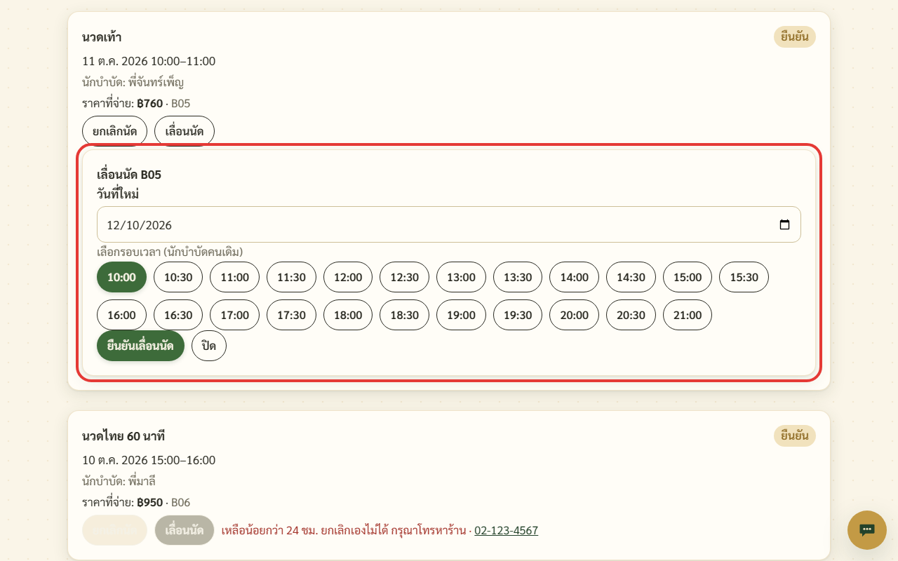

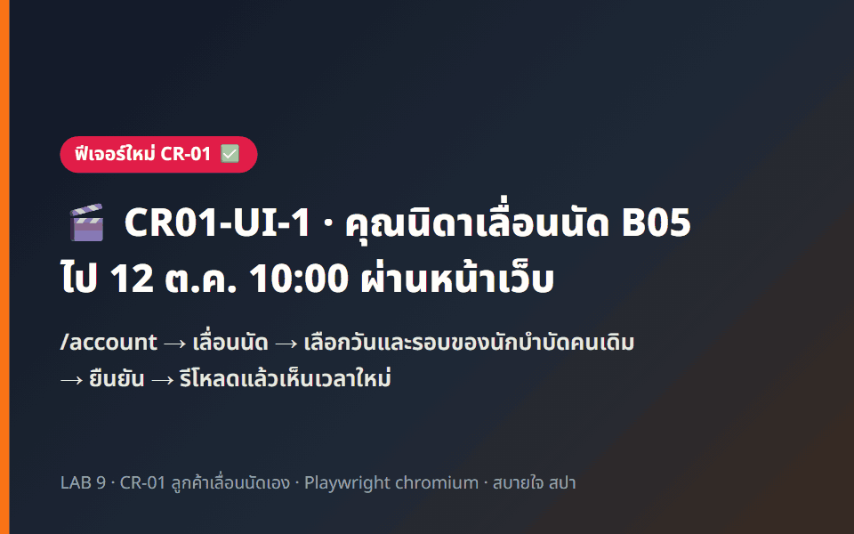

👀 **สังเกต**
- **หารอบว่างสำหรับ "เลื่อน" ≠ "จองใหม่"** (ใครทำนัด · ไม่นับนัดตัวเอง) ใช้ของเดิมตรง ๆ ได้คำตอบที่ดูถูกแต่ผิด
- **CR ก่อนหน้าเป็นกับดัก** โค้ดนับ "ชน" 3 จุด (นักบำบัด · ห้องคู่ · กันซ้ำ CR-03) · ยกเว้นนัดตัวเองแค่จุดเดียว เลื่อนทับเวลาเดิม (R10) จะได้ 409 `DUPLICATE_BOOKING` ปลอม
- **เวลาของนัดเก็บมากกว่า 1 ที่** บางคอลัมน์ DB คำนวณเอง บางคอลัมน์ต้องอัปเดต → transaction เดียว
- **"ยกเลิกแล้วจองใหม่" ≠ "เลื่อน"** คอร์ส แต้ม ราคาต้องไม่เปลี่ยน · ฟังก์ชันตรวจคอร์สเดิมต้องเหลือ ≥ 1 แต่นัดนี้กันครั้งไว้แล้ว → 422 ทุกครั้ง · ตอนเลื่อนตรวจแค่วันหมดอายุ
- **แตกงานแล้วรัน regression ระหว่างทาง** แดงตอนขั้น A แก้ง่ายกว่าตอนจบ · เทสต์หน้าเว็บตอนแดงนาน (301 วิ = รอ timeout × 3 เบราว์เซอร์ ไม่ได้ค้าง · เขียว 14 วิ)
- ⚠️ **e2e-legacy 3 เบราว์เซอร์ ~13 นาที** รันแบบ background แล้วรอผลจริง · นับ expected-fail แยกด้วยไฟล์ JSON (`--reporter=list,json`)
- **flaky ≠ regression แต่ต้องพิสูจน์** webkit ล้ม TC-UI-02 (`/skin` ที่ CR ไม่แตะ) ซ้ำล้ม 2/3 · บน image ก่อน CR ก็ล้ม 1/3 = ปัญหาเดิม · จดไว้ ห้ามแก้เทสต์

✔️ **ไปต่อได้เมื่อ:** `cr01.mjs` เขียว · `cr01.spec.ts` เขียว 3 เบราว์เซอร์ · e2e-legacy เท่า baseline · มีแถว CR-01 ใน TRACEABILITY และ REGISTER

---

## LAB 10 · CR-05 รายงาน + CSV

🎯 ✏️ หน้ารายงานยอดใหม่สำหรับเจ้าของร้าน · **ค่าที่คาดหวังมาจาก SQL ที่รันก่อนเขียนโค้ด** (oracle อิสระ) · CSV ภาษาไทยเปิด Excel ได้ → ได้ `docs/impact/CR-05.md` (SQL + ผล) · `tests/cr05.mjs` · `e2e-cr/tests/cr05.spec.ts`


💬 **คัดลอกพรอมต์นี้** (ส่วนที่ 1 · วิเคราะห์ + ค่าที่คาดหวังจาก SQL ในโหมดปกติ · ยังไม่แตะโค้ด)

```text
วิเคราะห์ CHANGE-REQUESTS/CR-05.md ก่อนแก้ (รันคำสั่งด้วย PowerShell · ยังห้ามแก้โค้ด · อ่าน CLAUDE.md และ SYSTEM-MAP.md ก่อน · ห้ามเปิด README.md ของบท fast_track/ และ _solution/ · วางในโหมดปกติ: รันคำสั่งได้ แต่ห้ามแก้ไฟล์ใน web/ db/ e2e-legacy/ · สคริปต์และไฟล์ SQL ชั่วคราวเขียนใน tmp/ เท่านั้น)
1. แสดง "คำถามถึงร้าน" ในแชทก่อน แล้วค่อยเปิด CHANGE-REQUESTS/answers/CR-05-ANSWERS.md · บอกข้อที่ได้คำตอบ/ยังค้าง
1.5 อธิบายของเดิมที่จะต่อยอด (อ้างไฟล์:บรรทัด): หน้าและ API หลังร้านเดิม (lib/server/admin.ts · component ตารางคิว AdminQueue · เมนู NavMenu) · ตรวจสิทธิ์ owner ที่ไหนและอย่างไร · เงินเก็บเป็นหน่วยอะไรในโค้ดและแปลงจาก NUMERIC ที่ไหน · ส่วนไหนใช้ซ้ำได้ ส่วนไหนต้องเขียนใหม่
2. ค่าที่คาดหวังต้องมาจากทางอื่น ไม่ใช่จากหน้ารายงานที่กำลังจะสร้าง: reset แล้วเขียน SQL ตรงกับตาราง booking / booking_slot / point_txn ฯลฯ (นับตามวันนัดเวลาไทย) สำหรับช่วง 2026-09-01 ถึง 2026-09-30 · 2026-10-01 ถึง 2026-10-31 · 2026-10-06 ถึง 2026-10-09
   รัน SQL จากไฟล์ตามกฎ CLAUDE.md (ไม่ใช้ psql -c "<SQL>" ใน PowerShell): เขียนคิวรีลงไฟล์ .sql ใน tmp/ → docker cp <ไฟล์> sabai06-db:/tmp/q.sql → docker exec sabai06-db psql -U sabai -d sabai -v ON_ERROR_STOP=1 -f /tmp/q.sql · ตรวจ $LASTEXITCODE = 0
   ทุกตัวเลขในรายงาน (จำนวนแยกสถานะ · ยอดขาย · บัตรของขวัญ · ช่องทางอื่น · ค่ารถ · ส่วนลด 3 แบบ · แต้ม · ครั้งคอร์ส · ยอดนัดที่ยังไม่มา · คิวต่อนักบำบัด) ต้องมี SQL และผลจริง · ป้าย: นิยามตัวเลขมาจาก [D:CR-05] · ค่ามาจาก [E sql:<ชื่อคิวรี>] · ถ้าค่าจาก SQL ไม่ตรงตัวอย่างในคำตอบร้าน = หยุดถามผม (ห้ามปรับ SQL ให้ตรง)
   โซนเวลา: นับด้วย SQL ว่าข้อมูลตั้งต้นมีนัดที่วันตามเวลา UTC ≠ วันตามเวลาไทยกี่นัด · ถ้าเป็น 0 ให้เขียนใน impact ว่า "ข้อมูลตั้งต้นพิสูจน์เรื่องโซนเวลาไม่ได้" (ข้อจำกัด) และเสนอว่าจะพิสูจน์ทางอื่นอย่างไร
3. เนื้อหา impact (จะบันทึกเป็น docs/impact/CR-05.md) ตาม docs/IMPACT-TEMPLATE.md + SQL ทั้งหมดพร้อมผล + เคสขอบ (92/93 วัน · from > to · สิทธิ์) + เรื่องโซนเวลาและหน่วยเงิน
4. เสนอแผนแล้วรอผมอนุมัติ · หลังผมพิมพ์ "อนุมัติ" ให้บันทึกเนื้อหา impact ทั้งหมดเป็น docs/impact/CR-05.md (รวม SQL และผล) อย่างเดียวแล้วหยุด รอพรอมต์ถัดไป
สรุปเป็นตาราง: ช่วงวัน | ตัวเลข | ค่าจาก SQL | SQL ที่ใช้ (ย่อ)
```

💬 **คัดลอกพรอมต์นี้** (ส่วนที่ 2 · ลงมือในโหมดปกติ)

```text
ทำ CR-05 ตาม docs/impact/CR-05.md (รันคำสั่งด้วย PowerShell · อ่าน CLAUDE.md ก่อน · ห้ามแก้ e2e-legacy/ · ห้ามแก้ค่าที่คาดหวังเดิม · ห้ามเปิด README.md ของบท fast_track/ และ _solution/)
0. ถ้ายังไม่มี docs/impact/CR-05.md: ถ้าแผนที่ผมอนุมัติยังอยู่ในแชทนี้ ให้บันทึกจากแผนนั้น · ถ้าไม่มี (เซสชันใหม่) ให้หยุดแล้วบอกผมให้วางส่วนที่ 1 ใหม่ ห้ามเขียนแผนเองแล้วลงมือ
1. เทสต์ก่อน: tests/cr05.mjs ใช้ค่าจาก SQL ใน impact เป็นค่าที่คาดหวัง (ห้ามรันหน้ารายงานแล้วลอกค่า) + เคส CSV (หัวคอลัมน์ · จำนวนแถว · ขึ้นต้นด้วย BOM) + สิทธิ์ → แดง (เคสที่ล็อกว่า "ไม่รั่ว" เช่นแชทไม่ตอบยอดขาย อาจผ่านตั้งแต่ก่อนแก้ = ปกติ ไม่ต้องทำให้แดง) → git add tests/cr05.mjs docs/impact/CR-05.md → git commit "CR-05 test: แดงก่อนแก้"
2. API + หน้า /admin/report + ลิงก์เมนู + CSV + ข้อความ 3 ภาษา · rebuild → node tests/cr05.mjs เขียว
3. e2e-cr/tests/cr05.spec.ts: owner เปิดหน้า เลือกช่วง ก.ย. กดดู ยอดตรงกับ SQL · กดโหลด CSV แล้วตรวจไฟล์ที่ดาวน์โหลดใน test ด้วย Node (3 ไบต์แรก EF BB BF + ชื่อบริการภาษาไทยตรงตัว · ไม่ตัดสินจากหน้าจอ PowerShell) · รันเฉพาะไฟล์นี้ 3 เบราว์เซอร์: Push-Location e2e-cr; npx playwright test tests/cr05.spec.ts --project=chromium --project=firefox --project=webkit --reporter=list,json; Pop-Location (การดาวน์โหลดไฟล์ต่างกันตามเบราว์เซอร์)
4. ตรวจเพิ่ม: ยอดขายในรายงาน = ผลรวมยอดในตารางคิวหลังร้านของนัดที่ใช้บริการแล้วทุกวันในช่วง · ถ้าเทสต์ต้อง "กดใช้บริการเสร็จ" นัดใด ให้ตั้งเวลาระบบ (reset {now} หรือ /api/test/clock) ให้ถึงเวลานัดนั้นก่อนกด
5. Regression (จากโฟลเดอร์บท): node web/scripts/check-rules.mjs · node tests/golden/run.mjs · node tests/cr01.mjs ถึง cr05.mjs · Push-Location e2e-cr; npx playwright test --project=chromium; Pop-Location · Push-Location e2e-legacy; npx playwright test; Pop-Location (api + chromium) · แดงที่ไม่ได้ตั้งใจ → หยุดบอกผม
6. เอกสาร: web/SPEC.md (API และหน้าใหม่) · TRACEABILITY แถว CR-05 · CHANGE-REPORT ส่วน CR-05 · อัปเดต REGISTER.md (สถานะ + hash commit แดง) → git add -A → git status → git commit "CR-05: รายงานยอด + CSV"
สรุปเป็นตาราง: ช่วงวัน | ตัวเลข | SQL | API | หน้าเว็บ | ตรงไหม
```

✅ **ผลจริง** คำถาม 12 ข้อ · SQL **9 คิวรี × 4 ช่วง** รันก่อนเขียนโค้ด ตรงตัวอย่างในคำตอบร้านทั้ง 2 ข้อ · `tests/cr05.mjs` **1/12 → 12/12** (ข้อที่ผ่านก่อนแก้ = แชทไม่หลุดตัวเลข) · `cr05.spec.ts` **6/6** · CSV ขึ้นต้น `EF BB BF` · ยอดรายงาน = ผลรวมคิวหลังร้าน **3/3 ช่วง** · regression เท่าเดิม · rebuild 39 วิ · ~19 นาที

| ช่วงวัน | ตัวเลข | SQL | API | หน้าเว็บ | ตรงไหม |
|---|---|---|---|---|---|
| 1–30 ก.ย. | ยืนยัน / ใช้บริการแล้ว / ยกเลิก | 0 / 3 / 1 | 0 / 3 / 1 | 0 / 3 / 1 | ✅ |
| 1–30 ก.ย. | ยอดขาย · ส่วนลดระดับ · แต้ม · ครั้งคอร์ส | ฿1,900 · ฿100 · 19 · 2 | ตรง | ฿1,900 · ฿100 · 19 · 2 | ✅ |
| 1–30 ก.ย. | CSV | 4 แถว | BOM + หัว 12 คอลัมน์ + 4 แถว | ไฟล์ที่ดาวน์โหลด ตรวจด้วย Node | ✅ |
| 1–31 ต.ค. | ยืนยัน/ใช้แล้ว/ยกเลิก · ยอดขาย · ส่วนลดเดือนเกิด · ยอดนัดยืนยัน | 6/1/0 · ฿1,440 · ฿360 · ฿11,130 | ตรง | — | ✅ |
| 1 ส.ค.–31 ต.ค. / 1 ส.ค.–1 พ.ย. | จำนวนวัน | 92 / 93 | 200 / 422 `REPORT_RANGE` | ข้อความ error | ✅ |

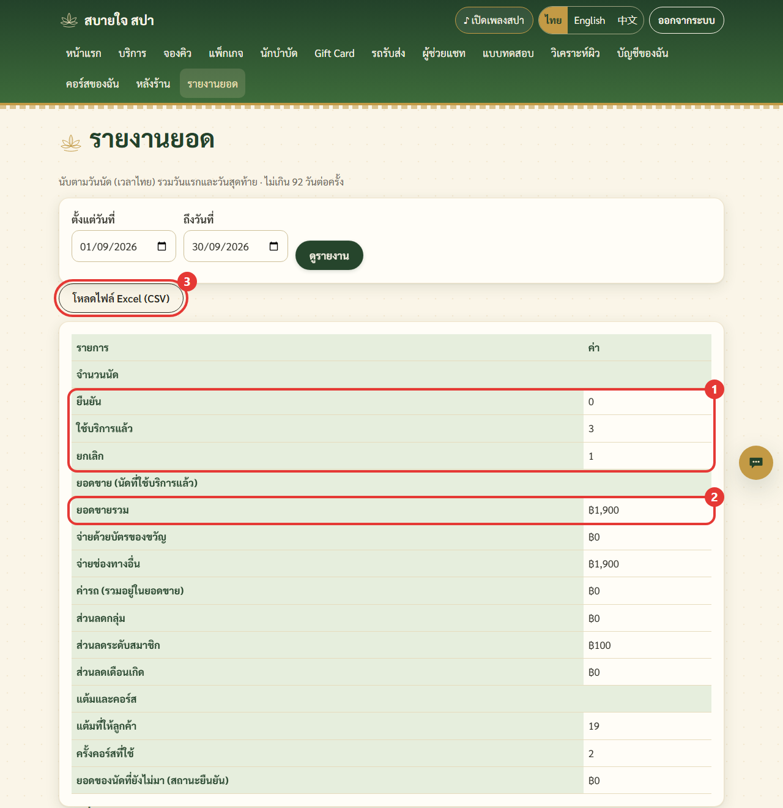

👀 **สังเกต**
- **ค่าที่คาดหวังห้ามลอกจากหน้ารายงานที่เพิ่งสร้าง** = อบบั๊ก · SQL ต้องรันและจดผลก่อน commit แก้ · รันจากไฟล์ ไม่ใช่ `-c "<SQL>"`
- **SQL ไม่ตรงตัวอย่างในคำตอบร้าน = หยุดถาม** ห้ามปรับ SQL ให้ตรง · รอบจริงตรงทั้ง 2 ข้อ หน้ารายงานเขียวตั้งแต่ rebuild แรก (oracle อิสระ)
- **นิยามมาจากคำตอบร้าน ไม่ใช่สามัญสำนึก** ยอดนัดยืนยัน ต.ค. ฿11,130 รวมนัดที่เลยเวลา (B05 · B06) เพราะร้านนิยามตามสถานะ · อย่าเติม `start_at > now` เอง · ก.ย. ใช้บริการแล้ว 3 นัดแต่ยอด ฿1,900 มาจาก B13 นัดเดียว (นัดคอร์ส B10 B12 ยอด ฿0 นับใน "ครั้งคอร์ส")
- **โซนเวลา: ข้อมูลตั้งต้นพิสูจน์ไม่ได้** seed ไม่มีนัดที่วัน UTC ≠ วันไทย → เขียว ≠ โซนเวลาถูก · จดเป็นข้อจำกัดหรือสร้างนัดพิเศษทดสอบ
- **เทสต์แดงไม่ครบทุกเคสเป็นเรื่องปกติ** เคส "ไม่รั่ว" (แชทไม่ตอบยอดขาย) ผ่านตั้งแต่ก่อนแก้ = ราวกันตก
- **หน่วยเงิน** DB เก็บ NUMERIC โค้ดอาจใช้หน่วยอื่น หาจุดแปลงก่อน · **CSV ไม่มี BOM → Excel ไทยเพี้ยน** ตรวจไบต์ด้วย node

✔️ **ไปต่อได้เมื่อ:** ค่าที่คาดหวังทุกตัวมี SQL + ผลจริงใน impact ก่อน commit แก้ · `cr05.mjs` เขียว · CSV ภาษาไทยไม่เพี้ยน · มีแถว CR-05 ใน TRACEABILITY และ REGISTER

---

## LAB 11 · Regression เต็ม + REA เทียบเวอร์ชัน

🎯 🔍 พิสูจน์ "ของเดิมไม่พัง" ทุกชุด 3 เบราว์เซอร์ · REA เทียบ **bundle · HAR · scenario ก่อน/หลัง** · ทุกไฟล์ที่เปลี่ยนโยง CR ได้ → `REGRESSION-REPORT.md` + `docs/TRACEABILITY.md` ฉบับสมบูรณ์


> 🔁 **ทบทวนบท 05 [ข้อ 7](../05_rea-reverse-engineer-legacy-petshop/README.md#7-เทียบเวอร์ชัน--หลักฐานว่าแก้ตรงไหน):** เทียบเวอร์ชัน = หลักฐานว่าแก้ตรงไหน · กล่องในหมอก = "ไม่รู้" ไม่ใช่ "เหมือนเดิม"
>
> 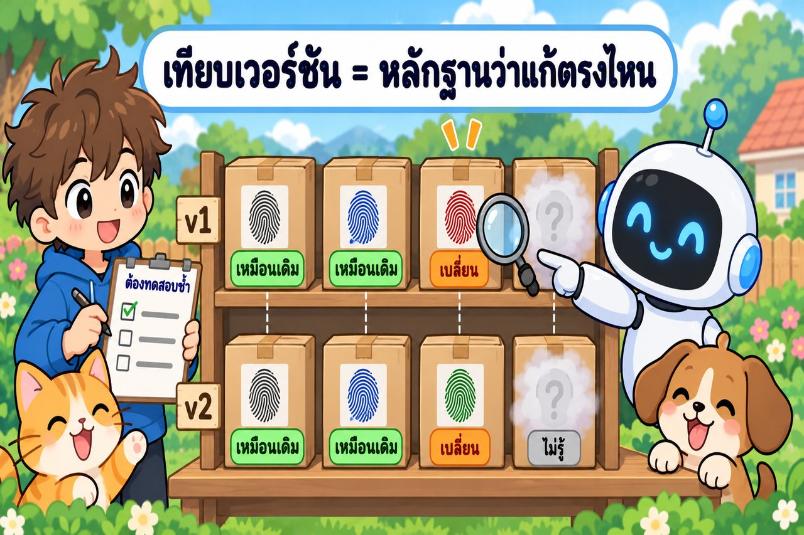

💬 **คัดลอกพรอมต์นี้** ☕

```text
พิสูจน์ว่าทุก CR "ทำตามที่ขอ" และ "ของเดิมไม่พัง" แล้วเขียน REGRESSION-REPORT.md (รันคำสั่งด้วย PowerShell จากโฟลเดอร์บท · ห้ามแก้โค้ด · ห้ามแก้เทสต์ · ห้ามเปิด README.md ของบท fast_track/ และ _solution/)
ลำดับ: ข้อ 2 (REA static ใช้ CPU หนัก) ห้ามรันขนานกับ e2e 3 เบราว์เซอร์ · ข้อ 2b/2c (reset ข้อมูล) ทำหลัง regression ข้อ 1 เสร็จ
1. reset แล้วรันทุกชุดบนโค้ดล่าสุด จดผ่าน/ทั้งหมด/เวลา: node web/scripts/check-rules.mjs · node tests/golden/run.mjs · node tests/cr01.mjs ถึง cr05.mjs · Push-Location e2e-cr; $env:PLAYWRIGHT_JSON_OUTPUT_NAME="test-results\cr-all.json"; npx playwright test --reporter=list,json; Pop-Location (3 เบราว์เซอร์) · Push-Location e2e-legacy; $env:PLAYWRIGHT_JSON_OUTPUT_NAME="test-report\legacy-all.json"; npx playwright test --project=api --project=chromium --project=firefox --project=webkit --reporter=list,json; Pop-Location (= npm run test:all + ไฟล์ JSON · 3 เบราว์เซอร์ ~13 นาที → รันแบบ background แล้วรอผล)
   แยก passed / expected-fail / failed ต่อ project จาก JSON ด้วยสคริปต์ node (status = expected และ expectedStatus = failed คือ expected-fail · status = unexpected คือ failed · flaky แยกไว้) เพราะบรรทัดสรุปนับ expected-fail รวมใน passed
   เทียบกับ HANDOVER-CHECK.md: ข้อที่ล้มตั้งแต่รับมอบ (เช่น TC-SEC-05) ไม่ใช่แดงใหม่ · ข้อที่ล้มแต่ไม่เกี่ยวกับไฟล์ที่ CR แตะ (เช่น TC-UI-02 /skin บน webkit) ให้รันซ้ำเฉพาะข้อ --repeat-each=3 ก่อนสรุป
2. REA เทียบของที่ส่งมอบ (bundle) ก่อน/หลัง: ใช้ rea-out\v1 เดิมเป็นฝั่งซ้าย
   - ถ้า rea-out\v2\.next\static มีอยู่แล้ว ให้บอกผมก่อนลบแล้วคัดลอกใหม่
   - New-Item -ItemType Directory -Force rea-out\v2\.next | Out-Null; docker cp sabai06-web:/app/.next/static rea-out\v2\.next\static
   - powershell -NoProfile -ExecutionPolicy Bypass -File tools\rea.ps1 -Out rea-out\static-v2.json analyze-javascript-application /work/rea-out/v2/.next/static --json 2> rea-out\static-v2.log
   - node tools\rea-tools.mjs pages rea-out\static-v1.json rea-out\static-v2.json (หน้าไหนไฟล์เปลี่ยน/ใหม่ จาก hash ในชื่อไฟล์ · hash ต่าง = ไฟล์ใน bundle เปลี่ยน แต่ไม่บอกว่าเปลี่ยนตรงไหน)
   - node tools\rea-tools.mjs cmp-input rea-out\static-v1.json rea-out\static-v2.json rea-out\cmp.json
   - powershell -NoProfile -ExecutionPolicy Bypass -File tools\rea.ps1 -Out rea-out\cmp-out.json compare-application-versions /work/rea-out/cmp.json --json 2> rea-out\cmp-out.log
   - node tools\rea-tools.mjs cmp-sum rea-out\cmp-out.json (หน้าใหม่ใน v2 มักขึ้นเป็น unknown ไม่ใช่ added เพราะ REA นับ added เฉพาะเมื่อ coverage ครบ · added 0 ≠ ไม่มีหน้าใหม่)
   - node tools\rea-tools.mjs endpoints rea-out\static-v1.json แล้ว node tools\rea-tools.mjs endpoints rea-out\static-v2.json → เทียบรายชื่อไฟล์ route API (route ใหม่ที่ compare ไม่บอก)
2b. REA ดูสัญญา API ของเส้นทางเดิมหลังแก้ (HAR ชุดเดียวกับตอนรับมอบ · ต้องใช้ 127.0.0.1):
   - ⚠️ record-har.mjs reset ข้อมูลก่อนเดิน แล้วจองนัดใหม่ (รอบรับมอบได้ B14) และยกเลิก B05 → ข้อมูลในระบบเปลี่ยน ถ้างานถัดไปต้องการข้อมูลตั้งต้นให้ reset ใหม่ (POST /api/test/reset)
   - node tools\record-har.mjs http://127.0.0.1:4000 rea-out\journeys-v2.har
   - node tools\rea-tools.mjs har-records rea-out\journeys-v2.har
   - powershell -NoProfile -ExecutionPolicy Bypass -File tools\rea.ps1 -Out rea-out\har-api-v2.json inspect-web-network-capture /work/rea-out/journeys-v2.har har <วาง --record ทั้งหมดที่ได้> --sensitive-value Nida@2026 --sensitive-value Owner@2026 --json 2> rea-out\har-api-v2.log
   - node tools\rea-tools.mjs har-api rea-out\har-api-v2.json แล้วเทียบกับ node tools\rea-tools.mjs har-api rea-out\har-api.json (ของตอนรับมอบ) → ตาราง endpoint | v1 (status · คีย์) [E ev_…] | v2 [E ev_…] | เหมือนเดิม/เปลี่ยน | CR ที่อนุญาตให้เปลี่ยน (ป้าย [E] ได้จาก node tools\rea-tools.mjs ids rea-out)
2c. REA ขับหน้าจองเดิมซ้ำบนโค้ดใหม่: powershell -NoProfile -ExecutionPolicy Bypass -File tools\rea.ps1 -Network sabai06-net -Out rea-out\scenario-v2.json capture-browser-scenario /work/tools/scenario-book-quote.json --json 2> rea-out\scenario-v2.log · node tools\rea-tools.mjs scenario-sum rea-out\scenario-v2.json · node tools\rea-tools.mjs shot rea-out\scenario-v2.json rea-out\scenario-v2-final.png · เทียบจำนวน step และยอดหน้าสรุป (จาก scenario-sum) กับ docs/REA-INVENTORY.md (ยอดเดิมคือ [E] ของตอนรับมอบ · ต่างได้เฉพาะเมื่อมี CR อนุญาต)
3. ตาราง: CR | ส่วนที่ควรเปลี่ยนใน bundle (หน้าไหน) | REA static เห็นไหม (changed / unknown / ไม่เห็น) | HAR/scenario เห็นไหม | ถ้าไม่เห็นเพราะอะไร | เทสต์ไหนพิสูจน์แทน · อ่านเฉพาะ changed ที่เป็นโค้ดหน้าเว็บ (chunks/app/...) ส่วน unknown ห้ามสรุปว่าไม่เปลี่ยน · "REA ไม่เห็น" ≠ "ไม่ได้เปลี่ยน"
4. หา commit baseline: git log --oneline --grep "baseline: ระบบที่รับมอบ" (ถ้าไม่เจอใช้ commit id ใน HANDOVER-CHECK.md) · git diff --stat <baseline>..HEAD → ทุกไฟล์ที่เปลี่ยนต้องโยงกับ CR ได้ (ตาราง ไฟล์ | CR) ไฟล์ที่โยงไม่ได้ติด ⚠️ พร้อมเหตุผล (เช่น เครื่องมือ/เอกสารของทีม ไม่อยู่ในระบบที่ส่งมอบ)
5. ค่าที่คาดหวังเดิม: git diff <baseline>..HEAD -- web/scripts/check-rules.mjs e2e-legacy ต้องว่าง หรือทุกจุดมีแถวใน docs/ORACLE-CHANGES.md · tests/golden สร้างหลัง baseline → หา commit ที่สร้าง (git log --diff-filter=A --oneline -- tests/golden) แล้ว git diff <commit นั้น>..HEAD -- tests/golden ต้องว่าง
6. docs/TRACEABILITY.md ฉบับสมบูรณ์: ทุก CR มี BR และ TC ที่ผ่าน · ทุก TC ใหม่มี CR
ตัวเลขทุกตัวต้องมาจากการรันรอบนี้ · แดงใหม่ที่ baseline ไม่มีให้หยุดแล้วบอกผม ห้ามแก้ให้ผ่าน
สรุปเป็นตาราง: ชุด | ผ่าน/ทั้งหมด | เบราว์เซอร์ | เวลา | หมายเหตุ
```

✅ **ผลจริง** ทุกชุดใหม่เขียว · e2e-legacy บรรทัดสรุป "113 passed · 1 failed" = **เท่า baseline ไม่มีแดงใหม่** · REA `changed 12 · unknown 711 · added 0` · route API 25 → 30 · `git diff` baseline..HEAD 66 ไฟล์ โยง CR ได้ทุกไฟล์ของระบบ (⚠️ 3 ไฟล์ `tools/rea-tools.mjs` `tools/.gitignore` `fast_track/README.md` = commit ของผู้ทำคอร์สระหว่างรอบจริง · ของเราจึงน้อยกว่า 3 ไฟล์) · ค่าที่คาดหวังเดิม diff ว่าง · **~24 นาที** ☕ (regression 15.2 นาที)

| ชุด | ผ่าน/ทั้งหมด | เบราว์เซอร์ | เวลา | หมายเหตุ |
|---|---|---|---|---|
| check-rules · golden | 90/90 · 62/62 | API | 19.0 · 1.2 วิ | ค่าคาดหวังเดิมไม่แตะ |
| cr01 / cr02 / cr03 / cr04 / cr05 | 22 · 19 · 18 · 14 · 12 (ผ่านหมด) | API | 2.9–5.3 วิ ต่อชุด | |
| e2e-cr | 39: ผ่านจริง 33 · คาดว่าล้ม 6 · ล้ม 0 | chromium · firefox · webkit | 104 วิ | คาดว่าล้ม = KI-01b KI-02b × 3 |
| e2e-legacy `test:all` | 114: ผ่านจริง 106 · คาดว่าล้ม 7 · ล้ม 1 | api + 3 เบราว์เซอร์ | 12.8 นาที | ล้ม TC-SEC-05 = baseline |
| TC-UI-02 webkit × 3 | 1/3 | webkit | 38 วิ | flaky เดิม (หน้า `/skin` ไม่มี CR แตะ) · ใน `test:all` รอบนี้ผ่าน |

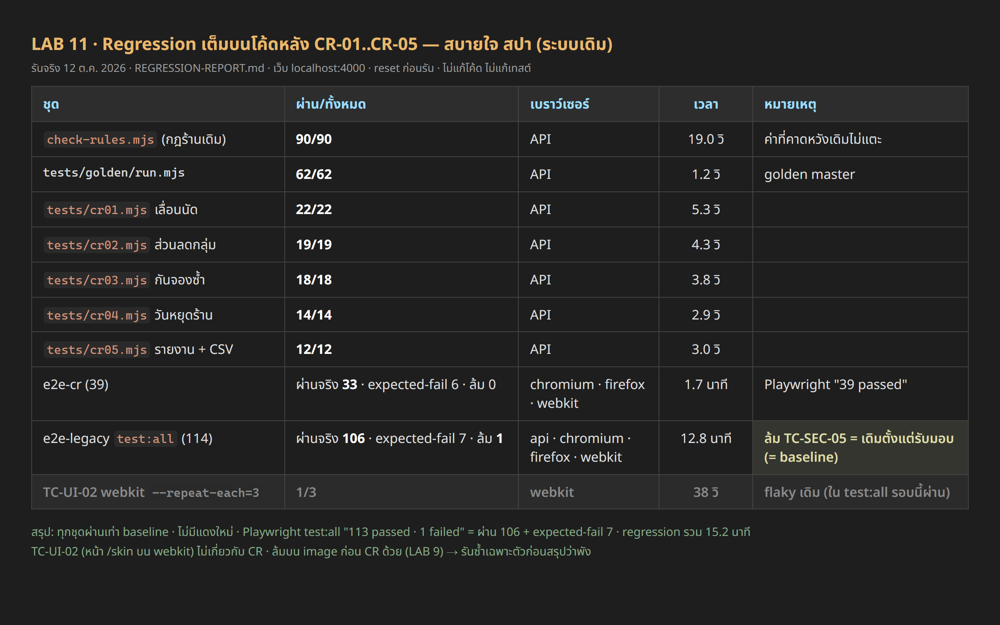

| CR | ควรเปลี่ยนใน bundle | REA static เห็นไหม | HAR/scenario เห็นไหม | พิสูจน์ด้วยเทสต์ |
|---|---|---|---|---|
| CR-01 เลื่อนนัด | `/account` + route reschedule | ✅ **changed** `account/page` · route ใหม่ 2 | ไม่เห็น (ไม่ได้กดเลื่อน) | cr01 22/22 · UI 6/6 |
| CR-02 ส่วนลดกลุ่ม | ไม่มี (กฎฝั่งเซิร์ฟเวอร์) | ❌ **ไม่เห็น** | ไม่เห็น (นัดเดี่ยว ฿1,000) | cr02 19/19 · golden 62/62 |
| CR-03 กันจองซ้ำ | ข้อความ i18n | chunk ร่วม i18n changed (ไม่บอกว่า CR ไหน) | ไม่เห็น | cr03 18/18 · UI 3/3 |
| CR-04 วันหยุดร้าน | i18n + `/api/holidays` | chunk i18n changed · route ใหม่ · `/book` hash **เดิม** | ไม่เห็น (12 ต.ค. ไม่ใช่วันหยุด) | cr04 14/14 · UI 6/6 |
| CR-05 รายงานยอด | หน้าใหม่ `/admin/report` + route | ⚠️ **unknown** (ไม่ขึ้น added) · `pages` = ใหม่ใน v2 | ไม่เห็น | cr05 12/12 · UI 6/6 |

| เส้นทางเดิม | v1 รับมอบ | v2 หลัง CR | ผล |
|---|---|---|---|
| HAR 7 endpoint (slots · price · bookings · login · cancel · logout · admin/bookings) | 200 · 200 · 201 · 200 · 200 · 200 · 200 [E ev_6fbeaec6] | status + คีย์เดียวกันทุกตัว (bookings body 15 คีย์) [E ev_ba70ee00] | เหมือนเดิม |
| scenario จองเดี่ยว | 12/12 ฿1,000 [E ev_8dc23d9f] | 12/12 ฿1,000 · ภาพเหมือนทุก byte [E ev_d627ab35] | เหมือนเดิม |

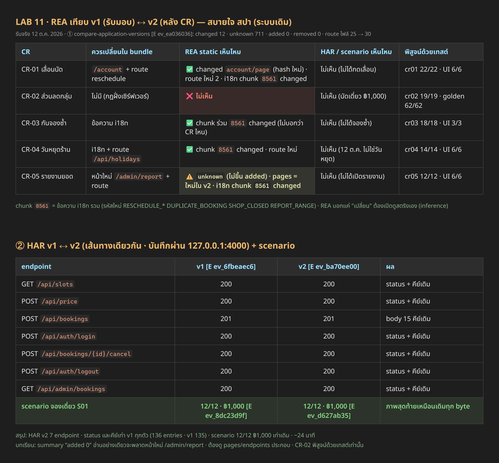

👀 **สังเกต**
- **"REA ไม่เห็น" ≠ "ไม่ได้เปลี่ยน"** CR-02 มองไม่เห็นจากทุกตา · `/book` hash เดิมทั้งที่ CR-04 ปิดวันหยุด · แก้ `layout.tsx` แล้ว hash ไม่เปลี่ยน (server component) → พิสูจน์ด้วย cr02 19/19 · cr04 14/14
- **หน้าใหม่ขึ้น `unknown` ไม่ใช่ `added`** (added นับเมื่อ coverage ครบ) · ใช้ `pages` และ `endpoints` (route 25 → 30) ช่วย · chunk i18n changed ต้องเปิดดูเองว่าของ CR ไหน
- **อ่านเฉพาะ `changed` ที่เป็น `chunks/app/...`** · `unknown` จำนวนมากปกติ ห้ามสรุปว่าเหมือนเดิม · `NativeCommandError` ใน `rea-out\*.log` = progress ทาง stderr
- **HAR และ scenario ซ้ำบน v2 = [E] ว่าเส้นทางเดิมไม่เปลี่ยน** ไม่ใช่หลักฐานว่า CR ทำงาน
- **expected-fail นับต่อ project** (`api` รันครั้งเดียว ไม่ใช่ baseline × 3) · **หยุดเฉพาะแดงใหม่ที่ baseline ไม่มี** TC-SEC-05 แดงตั้งแต่รับมอบ
- **รันซ้ำเฉพาะข้อเขียนทับรายงานเดิม** (`--repeat-each=3` ทับ `e2e-legacy/test-report/`) · นับ `legacy-all.json` ให้เสร็จก่อน
- **ไฟล์ที่โยง CR ไม่ได้ = ⚠️ ต้องอธิบาย** เปลี่ยนโดยไม่มีใครขอ = regression จนกว่าจะพิสูจน์ได้

✔️ **ไปต่อได้เมื่อ:** ตัวเลขทุกชุดมาจากรอบนี้ · ตาราง CR × REA 5 แถว · ตาราง HAR v1↔v2 ติด [E] · diff ค่าที่คาดหวังเดิมว่าง (หรือมีใน ORACLE-CHANGES) · ไม่มีไฟล์ ⚠️ ที่อธิบายไม่ได้

---

## LAB 12 · ส่งมอบ + ซ้อมถอยกลับ

🎯 ✏️ **smoke test อ่านอย่างเดียว** · **ซ้อมถอยกลับจริง** บนฐานที่มีข้อมูล · runbook วันขึ้นระบบ · เอกสารส่งมอบภาษาคน → `tests/smoke.mjs` · `docs/DEPLOY-RUNBOOK.md` · `RELEASE-NOTES.md` · `UAT-CHECKLIST.md` · `CHANGE-REPORT.md` ฉบับรวม


💬 **คัดลอกพรอมต์นี้** (ส่วนที่ 1 · ซ้อมถอยกลับ + runbook)

```text
ซ้อมถอยกลับ migration บนฐานที่มีข้อมูลจริง เขียน smoke test ให้ทีมใช้วันขึ้นระบบ แล้วเขียน docs/DEPLOY-RUNBOOK.md (รันคำสั่งด้วย PowerShell จากโฟลเดอร์บท · ห้าม docker compose down -v · ห้ามลบ volume · ห้ามแก้โค้ดระบบใน web/ db/ · ห้ามเปิด README.md ของบท fast_track/ และ _solution/)
0. เขียน tests/smoke.mjs (Node ≥ 22.18 ไม่ใช้ dependency · BASE_URL ค่าเริ่ม http://localhost:4000) = ตรวจหลังขึ้นระบบจริงแบบ **อ่านอย่างเดียว** (ห้าม reset · ห้ามสร้างหรือแก้ข้อมูล): health db:true · /api/services ตอบ 200 · /api/holidays มีวันหยุดที่ร้านแจ้ง · หน้า /book ตอบ 200 · API ใหม่ของ CR-01 และ CR-05 เมื่อไม่ล็อกอินต้องตอบ 401 (ไม่ใช่ 404 = มี endpoint จริง · POST แบบไม่ล็อกอินที่ถูกปฏิเสธก่อนแตะข้อมูลนับเป็นอ่านอย่างเดียว) · พิมพ์ตาราง ข้อ | ผล แล้ว exit 0 เมื่อผ่านทุกข้อ ไม่งั้น exit 1 · รันตอนนี้ต้อง exit 0
1. สำรอง: New-Item -ItemType Directory -Force backups | Out-Null · docker exec sabai06-db pg_dump -U sabai -d sabai -f /tmp/before-rollback.sql แล้ว docker cp sabai06-db:/tmp/before-rollback.sql backups\before-rollback.sql
2. reset แล้วจองนัดใหม่ 1 นัดผ่าน API ด้วยสคริปต์ node (ไม่ล็อกอิน S05 2026-10-21 11:00) จดรหัสนัด
3. หยุดเว็บชั่วคราว: docker compose -f web/compose.yaml stop → node tests/smoke.mjs ต้อง exit 1 (พิสูจน์ว่า smoke จับระบบล่มได้)
4. ถอย DB: docker cp db\migrations\001_shop_holiday.down.sql sabai06-db:/tmp/001down.sql แล้ว docker exec sabai06-db psql -U sabai -d sabai -v ON_ERROR_STOP=1 -f /tmp/001down.sql → ตรวจว่าตารางวันหยุดหายและนัดใหม่ยังอยู่
4b. ถอยเว็บ (ซ้อมสลับ image): เปิด image เดิม sabai06-web:before-cr04 เป็น container ชั่วคราว sabai06-old พอร์ต 4001 ต่อ sabai06-net env เดียวกับ web/compose.yaml → /api/health db:true · /book 200 · /api/holidays 404 (= เว็บรุ่นก่อน CR-04 ทำงานได้บนฐานที่ถอยแล้ว) · จดเวลา → docker stop sabai06-old
5. ไปข้างหน้าอีกครั้ง: รัน 001_shop_holiday.sql ด้วยวิธีเดียวกับข้อ 4 → วันหยุดกลับมา 3 แถว · นัดใหม่ยังอยู่
6. เปิดเว็บ: docker compose -f web/compose.yaml start → health db:true → node tests/smoke.mjs exit 0 → จดหลักฐานนัดใหม่ (รหัส · สถานะ) ให้ครบก่อน แล้วค่อย node tests/cr04.mjs เขียว (cr04 reset ข้อมูลทุกเคส นัดใหม่จะหายเพราะ reset ไม่ใช่เพราะถอย)
7. docs/DEPLOY-RUNBOOK.md ลำดับวันขึ้นระบบจริง: สำรอง → tag image เดิม → รัน migration → build/up เว็บ → node tests/smoke.mjs (ผลที่ต้องเห็น) → เงื่อนไขที่ต้องถอย → ขั้นถอย (เว็บกลับ image เดิมก่อน แล้วค่อย down.sql) · ใส่เวลาที่วัดได้จริงจากการซ้อม และข้อมูลที่จะหายถ้าถอย
8. เพิ่มแถว smoke ใน docs/TRACEABILITY.md (โยงทุก CR) → git add tests/smoke.mjs docs/DEPLOY-RUNBOOK.md docs/TRACEABILITY.md → git status → git commit "release: smoke test + deploy runbook" (ไฟล์อื่นที่ค้างจากงานก่อนเข้า commit ของส่วนที่ 2)
ทุกขั้นจดคำสั่งและผลจริง ขั้นไหนไม่ผ่านให้หยุดบอกผม
สรุปเป็นตาราง: ขั้น | คำสั่ง | ผล | เวลา
```

💬 **คัดลอกพรอมต์นี้** (ส่วนที่ 2 · เอกสารส่งมอบ)

```text
เขียนเอกสารส่งมอบให้คุณจันทร์และคณะกรรมการตรวจรับ (รันคำสั่งด้วย PowerShell · ห้ามแก้โค้ด · ห้ามเปิด README.md ของบท fast_track/ และ _solution/ · อ่าน CHANGE-REPORT.md, REGRESSION-REPORT.md, docs/TRACEABILITY.md, KNOWN-ISSUES.md, docs/SPEC-GAPS.md ก่อน)
1. RELEASE-NOTES.md ภาษาคน ไม่มีศัพท์โปรแกรม: ต่อ CR บอก อะไรเปลี่ยน · ลูกค้าเห็นอะไร · ร้านต้องทำอะไร · มีผลเมื่อไร · หัวข้อ "เรื่องที่ยังไม่ได้แก้" (จาก KNOWN-ISSUES.md และสิ่งที่เจอระหว่างทางแต่ไม่อยู่ใน CR) พร้อมผลกระทบและข้อเสนอ
2. UAT-CHECKLIST.md: ต่อ CR 3–6 ขั้นที่ร้านกดเองได้บนหน้าเว็บ · ผลที่ต้องเห็น (ตัวเลข/ข้อความ) · ช่อง ผ่าน/ไม่ผ่าน · ลงชื่อ · วันที่ · ผลที่ต้องเห็นทุกข้อให้ตรวจบนหน้าเว็บจริงก่อนส่ง (สคริปต์ Playwright headless · reset ก่อนและหลัง) ห้ามลอกจากเทสต์อย่างเดียว · ถ้าเจอพฤติกรรมแปลก ห้ามแก้โค้ด ให้จดไว้ · ข้อที่ร้านกดเองไม่ได้ เช่น ตรวจ CR-02 หลัง 1 พ.ย. ต้องให้ทีมเปลี่ยนวันที่ของเครื่องทดสอบก่อน ให้เขียนขั้นนั้นไว้ในใบ · ผลที่ต้องเห็นทุกแถวติดป้ายที่มา [D:CR-0N] (หนังสือหรือคำตอบร้าน) · ถ้าหน้าเว็บจริงไม่ตรง [D:CR-0N] ห้ามเขียนตามหน้าจอ ให้ติด ⚠️ ผู้ต้องสงสัยบั๊ก และใส่ใน RELEASE-NOTES หัวข้อเรื่องที่ยังไม่ได้แก้
3. CHANGE-REPORT.md ส่วนสรุปรวม: ตาราง CR | commit แดง | commit แก้ | ไฟล์ที่แก้ | เทสต์ใหม่ | regression | ความเสี่ยงคงค้าง | วิธีถอยกลับ
4. ตรวจความครบ: ทุกคำขอในหนังสือ CR-01–05 มีแถวใน UAT · ทุกแถว UAT โยงกับ TC ใน TRACEABILITY · ข้อไหนขาดให้บอก
5. อัปเดต CHANGE-REQUESTS/REGISTER.md เป็น "รอตรวจรับ (UAT)" → git add -A (รวมเอกสารที่ค้างจากงานก่อน เช่น REGRESSION-REPORT.md docs/TRACEABILITY.md docs/ORACLE-CHANGES.md) → git status ตรวจไฟล์ → git commit "release: พร้อมตรวจรับ CR-01–05"
ไม่แน่ใจว่าร้านจะเข้าใจคำไหน ให้เขียนแบบง่ายกว่า · สรุปเป็นตาราง: เอกสาร | ส่วน | จำนวนรายการ
```

✅ **ผลจริง** smoke 7 ข้อ: 7/7 → หยุดเว็บ **0/7 exit 1** (`ECONNREFUSED`) → 7/7 · ถอย DB แล้วขึ้นซ้ำ **B14 อยู่ทุกขั้น** · ซ้อมทั้งก้อน **~17 วิ** · RELEASE-NOTES 5 CR + รอร้านยืนยัน 7 + เรื่องที่ยังไม่แก้ · UAT **31 แถว** โยง TC 30/31 (ขาด CR-04 ส่วน ข ที่ยังไม่ทำ · แจ้งไว้) · REGISTER "รอตรวจรับ (UAT)" 5 CR · 2 commit · **~18 นาที**

| ขั้น | คำสั่ง | ผล | เวลา |
|---|---|---|---|
| 0 smoke ก่อนเริ่ม | `node tests/smoke.mjs` (อ่านอย่างเดียว) | 7/7 · exit 0 | 0.2 วิ |
| 1 สำรอง | `pg_dump` → `docker cp` | `backups\before-rollback.sql` 53,469 ไบต์ | 0.5 วิ |
| 2 reset + จองใหม่ | node ไม่ล็อกอิน S05 21 ต.ค. 11:00 | **B14** ฿800 confirmed | 0.9 วิ |
| 3 หยุดเว็บ | `docker compose -f web/compose.yaml stop` → smoke | **0/7** · **exit 1** | 1.0 วิ |
| 4 ถอย DB | `psql -f /tmp/001down.sql` | `DROP TABLE` · ตารางหาย · **B14 ยังอยู่** | 1.1 วิ |
| 5 ขึ้นซ้ำ | `psql -f /tmp/001.sql` | `INSERT 0 3` · ชื่อไทยตรง · **B14 ยังอยู่** | 1.3 วิ |
| 5b (เสริมของผู้ตรวจ) | `docker compose -f db/compose.yaml down` (ไม่มี `-v`) → `up -d --wait` | volume อยู่ · **B14 ยังอยู่** | 7.8 วิ |
| 6 เปิดเว็บ | `start` → health → smoke → `node tests/cr04.mjs` | `db:true` · 7/7 exit 0 · CR-04 14/14 | 4.4 วิ |

ขั้น 4b (สลับเว็บกลับ image `before-cr04`) เพิ่มหลังรอบจริง ยังไม่มีเวลาวัด

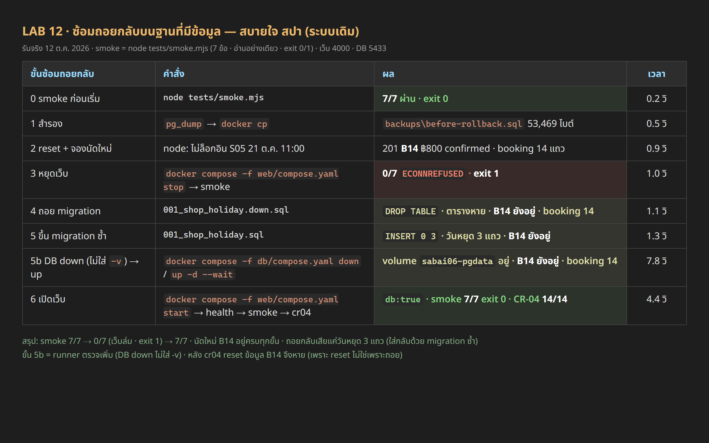

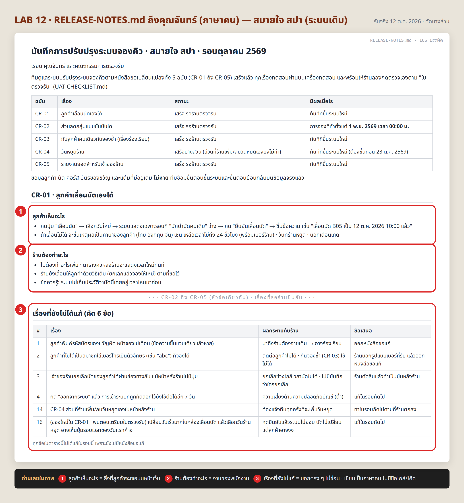

👀 **สังเกต**
- **smoke รันบนระบบจริง = อ่านอย่างเดียว** และต้องพิสูจน์ว่าจับได้ (exit 1 ตอนเว็บหยุด) · CR-02 / CR-03 ต้องจองจริง อยู่ใน smoke ไม่ได้ → ระบุใน TRACEABILITY ว่าใช้ UAT แทน
- **ถอยกลับมีราคา** ข้อมูลหลัง migration (วันหยุดที่ร้านเพิ่มเอง) อาจหายเมื่อ down · เขียนในแผน · เวลาใน runbook ต้องมาจากการซ้อม
- **เรื่องที่รู้แต่ยังไม่แก้ต้องอยู่ใน RELEASE-NOTES** (KNOWN-ISSUES + ที่เจอระหว่างทาง) ปิดไว้ = เจ้าของงานเจอเองทีหลัง
- **ภาษาคน** คุณจันทร์อ่านเข้าใจโดยไม่ถามว่า endpoint คืออะไร · ข้อที่ร้านกดเองไม่ได้ (CR-02 หลัง 1 พ.ย.) เขียนขั้นให้ทีมเปลี่ยนวันที่เครื่องทดสอบ · ปี ค.ศ./พ.ศ. (2026 = 2569) ใส่หมายเหตุใน UAT และ RELEASE-NOTES
- **ตรวจใบ UAT บนหน้าเว็บจริง เจอบั๊กใหม่** เปลี่ยนวันในกล่องเลื่อนนัดก่อนรอบโหลดเสร็จ → 2/4 รอบ ปุ่มรอบเก่าค้างคู่ "ร้านหยุด" (เซิร์ฟเวอร์ปฏิเสธ นัดไม่เปลี่ยน) · e2e-cr ไม่จับ · **known issue ยังไม่แก้** (LAB นี้ห้ามแก้โค้ด) → RELEASE-NOTES · รายงานแสดงรหัส T01… ไม่ใช่ชื่อ = ตามคำตอบร้าน [D:CR-05] · อยากเห็นชื่อ = CR ใหม่
- **เทสต์บางตัว reset ข้อมูล** `cr04.mjs` ล้างทุกเคส → B14 หายหลังขั้น 6 เพราะ reset ไม่ใช่เพราะถอย · จดหลักฐานก่อน · ถอยจริงต้องถอยเว็บก่อน down.sql
- ⚠️ **สคริปต์ `.ps1` ห้ามมีภาษาไทย** PS 5.1 อ่าน UTF-8 ไม่มี BOM เป็น ANSI → ไทยเพี้ยน · `.ps1` ใช้ ASCII แล้วตรวจไทยด้วยไฟล์ `.sql` หรือ node

✔️ **ไปต่อได้เมื่อ:** ซ้อมถอยกลับผ่านโดยนัดไม่หาย · smoke exit 1 ตอนเว็บหยุด / exit 0 ตอนปกติ · runbook เรียก smoke ไม่มี `down -v` · RELEASE-NOTES ไม่มีศัพท์โปรแกรม · REGISTER "รอตรวจรับ (UAT)" 5 CR · เราเปิด http://localhost:4000 กดตามใบ UAT ของ CR-03 เองอย่างน้อย 1 แถว แล้วติ๊กผล

---

## ✅ รูบริก: เช็กลิสต์ "รับงานแก้ระบบเดิมที่ดี"

ให้คะแนน 1 คะแนนต่อข้อที่ทำได้ · **ดีมาก ≥ 18/20 · ใช้ได้ 14–17 · ต้องแก้ < 14**

**A. รับมอบและเข้าใจ (LAB 1–3)**
- ☐ 1. `HANDOVER-CHECK.md` ตัวเลขจากคำสั่งที่รันจริง · คำอ้างทุกข้อ ✅ / ❌ / ⚠️ พร้อมหลักฐาน · ข้อแดงจำแนกโดยไม่แก้เทสต์
- ☐ 2. `REA-INVENTORY.md` แยก static / runtime / inference / unknown · ทุกแถวมี `[E ev_…]` · ไม่มี "ไม่มี X" จาก coverage partial
- ☐ 3. `SYSTEM-MAP.md` ทุกแถวอ้าง `file:line` / ฟังก์ชัน / constraint · ตรวจทานเองครบ 5 ข้อ
- ☐ 4. triangulation ครบ REA / source / DB + ✅ ⚠️ ❌ · `SPEC-GAPS.md` เป็นคำถามถึงร้าน ไม่ใช่ AI ตัดสิน

**B. รั้วและตาข่าย (LAB 4–5)**
- ☐ 5. CLAUDE.md สั้น มีวิธีรัน / ห้ามแตะ / กับดัก · รั้วถูกปฏิเสธจริงในเซสชันใหม่
- ☐ 6. golden เทียบ 2 รอบติดผ่าน (นิ่ง) · ตัดฟิลด์ที่เปลี่ยนเองพร้อมเหตุผล
- ☐ 7. known issue ล็อกคู่ (ค่าปัจจุบัน + `test.fail`) ไม่แอบแก้ · seam ปิดได้เมื่อ `ALLOW_TEST_RESET=0`
- ☐ 8. mutant 3 ตัวรันครบ คืนไฟล์ครบ · ตัวที่รอดอธิบายรูได้

**C. Change Request (LAB 6–10)**
- ☐ 9. ทุก CR มีคำถาม + อธิบายของเดิมด้วย `file:line` + `docs/impact/CR-0N.md` (ไฟล์ × เทสต์ · DB · i18n · แชท · grep) **ก่อน** diff · ค่าที่คาดหวังทุกแถวมี [D:CR-0N] หรือ [E]
- ☐ 10. ทุก CR มี commit เทสต์แดงก่อน commit แก้
- ☐ 11. `check-rules.mjs` `tests/golden/` `e2e-legacy/` ค่าที่คาดหวังไม่เปลี่ยน หรือมีแถวใน `ORACLE-CHANGES.md` ครบ
- ☐ 12. CR-02 ทดสอบ 2 ฝั่งของวันมีผล · นัดเก่าไม่เปลี่ยนยอด
- ☐ 13. CR-03 กดพร้อมกัน (สมาชิก + ไม่ล็อกอิน) + แชท · จองพร้อมกันคนละคนยังได้ `SLOT_TAKEN`
- ☐ 14. CR-04 migration รัน 2 ครั้งบนฐานที่มีนัดใหม่ ข้อมูลครบ · reset ผ่าน 2 ครั้งติด · ไม่ใช้ `down -v`
- ☐ 15. CR-01 มีเคสเลื่อนทับเวลาเดิมของตัวเอง + คนเดิมไม่ว่าง + Playwright 3 เบราว์เซอร์
- ☐ 16. CR-05 ค่าที่คาดหวังจาก SQL ที่รันก่อนเขียนโค้ด · CSV มี BOM ภาษาไทยไม่เพี้ยน

**D. Regression (LAB 11)**
- ☐ 17. ตัวเลขใน `REGRESSION-REPORT.md` ตรงกับการรันซ้ำ · ครบ 3 เบราว์เซอร์
- ☐ 18. ตาราง "CR × REA เห็นไหม" (static + HAR v1↔v2 + scenario) อธิบายสิ่งที่ REA มองไม่เห็นและเทสต์ที่พิสูจน์แทน · ไฟล์ที่เปลี่ยนโยง CR ได้ · TRACEABILITY ครบ

**E. ส่งมอบ (LAB 12)**
- ☐ 19. `RELEASE-NOTES.md` ภาษาคน มีเรื่องที่ยังไม่แก้ · `UAT-CHECKLIST.md` ต่อ CR มีช่องลงชื่อ
- ☐ 20. ซ้อมถอยกลับจริง (สำรอง → down → up) นัดอยู่ครบ · `tests/smoke.mjs` อ่านอย่างเดียว exit 1 ตอนเว็บหยุด / exit 0 ตอนปกติ · runbook เรียก smoke ไม่มี `down -v`

---

## 🔁 รันซ้ำ

| อยากทำ | 💬 พรอมต์ |
|---|---|
| ล้างข้อมูลทดสอบ | `(รันคำสั่งด้วย PowerShell) เรียก POST http://localhost:4000/api/test/reset แล้วเช็กว่าได้ {"ok":true}` |
| รันตาข่ายทั้งหมด | `(รันคำสั่งด้วย PowerShell) รันทุกชุดตามหัวข้อ "รันยังไง" ใน CLAUDE.md (e2e ครบ 3 เบราว์เซอร์ รันแบบ background แล้วรอ · แยก passed / expected-fail / failed) แล้วสรุปเป็นตาราง ชุด \| ผ่าน/ทั้งหมด \| เวลา ห้ามแก้อะไร` |
| ดูข้อมูลในฐานข้อมูล | `(รันคำสั่งด้วย PowerShell) ใช้ docker exec sabai06-db psql -U sabai -d sabai ดูจำนวนนัดแยกสถานะ (อ่านอย่างเดียว ห้ามแก้)` |
| ปิดระบบ (เก็บข้อมูล) | `(รันคำสั่งด้วย PowerShell) ปิดระบบ: docker compose -f web/compose.yaml down แล้ว docker compose -f db/compose.yaml down ห้ามใส่ -v` |
| เทียบงานกับเฉลย (หลังจบ LAB 12 · ลบ 3 กฎ `Read(...)` ออกจาก `.claude/settings.json` เองก่อน แล้วเปิดเซสชันใหม่) | `เทียบ docs/impact/CR-0N.md และ tests/ ของผมกับ _solution/ บอกเคสหรือไฟล์ที่ผมยังขาด และข้อที่ของผมดีกว่า` |

## ถ้าเจอปัญหา: คัดลอกพรอมต์นี้

| อาการ | 💬 พรอมต์ |
|---|---|
| `docker version` ไม่มี Server / `error during connect` | `Docker Desktop ยังไม่พร้อม ช่วยเช็กด้วย PowerShell ว่า docker version เห็น Server ไหม ถ้าไม่เห็นให้บอกผมเปิด Docker Desktop แล้วรอไอคอนวาฬหยุดหมุน ห้ามรีสตาร์ตบริการเอง` |
| `bind: An attempt was made to access a socket…` (Windows/WinNAT จองพอร์ต) | `เปิดเว็บไม่ได้ error bind forbidden ช่วยรัน netsh interface ipv4 show excludedportrange protocol=tcp ดูว่า 4000 หรือ 5433 อยู่ในช่วงจองไหม ถ้าอยู่ให้เสนอพอร์ตว่างนอกช่วง และบอกวิธีตั้ง $env:WEB_PORT / $env:DB_PORT / $env:BASE_URL ก่อนทำ` |
| container ชื่อชน / พอร์ต 4000 · 5433 ถูกใช้ (บท 04–05 เปิดค้าง) | `docker compose ขึ้นว่าชื่อ container ซ้ำหรือพอร์ตถูกใช้ ช่วยดู docker ps ว่าตัวไหนชน (เช่น pawpantry05 ที่ 4000 · sabai-db ที่ 5433) บอกผมก่อนแล้วหยุดด้วย docker stop (ห้ามลบ volume) หรือเสนอพอร์ตว่างผ่าน $env:WEB_PORT / $env:DB_PORT / $env:BASE_URL` |
| `running scripts is disabled` / `UnauthorizedAccess` ตอนเรียก `.ps1` | `PowerShell ไม่ยอมรัน tools\rea.ps1 ช่วยรันใหม่ด้วย powershell -NoProfile -ExecutionPolicy Bypass -File tools\rea.ps1 … (ไม่แก้ค่าเครื่อง) ถ้ายังติดเพราะไฟล์มาจาก zip ให้บอกผมก่อนรัน Unblock-File -Path tools\*` |
| Claude รันด้วย bash แล้วพัง (`/c/...` · `$env:` ไม่รู้จัก) | `คำสั่งในงานนี้ต้องรันด้วย PowerShell ห้ามแปลงเป็น bash · ถ้าเครื่องมือ PowerShell ใช้ไม่ได้ ให้เขียนคำสั่งเดิมลง tmp\run.ps1 แล้วรัน powershell -NoProfile -ExecutionPolicy Bypass -File tmp\run.ps1 · บอกสาเหตุก่อนรันใหม่` |
| check-rules error import `.ts` | `node web/scripts/check-rules.mjs error ตอน import .ts ช่วยเช็ก node -v ถ้าต่ำกว่า 22.18 ให้บอกวิธีอัปเดต หรือรันใน container node:22-alpine ใน network sabai06-net` |
| REA อ่าน JSON ไม่ได้ (BOM) / HAR schema validation failed | `REA อ่านไฟล์ input ไม่ได้ ช่วยบอกสาเหตุก่อน: JSON มี BOM = สร้างด้วย > ของ PowerShell ให้รันใหม่ด้วย powershell -NoProfile -ExecutionPolicy Bypass -File tools\rea.ps1 -Out <ไฟล์> · HAR ไม่ผ่าน = บันทึกจาก localhost ให้บันทึกใหม่ผ่าน http://127.0.0.1:4000 · ห้ามแก้ HAR ด้วยมือ` |
| คำสั่งถูกตัดเพราะ timeout (build · e2e 3 เบราว์เซอร์) | `คำสั่งนี้นานเกิน 2 นาทีแล้วถูกตัด ช่วยรันใหม่แบบ background หรือตั้ง timeout ยาว แล้วรอจนจบ รายงานผลจริงจาก log อย่าสรุปจากผลที่ยังไม่จบ` |
| ไทย/จีนเป็น `?` (หลัง migration หรือยิง API) | `ข้อความไทย/จีนในฐานข้อมูลเป็น ??? ช่วยเช็กก่อนด้วย SQL SELECT name_th = '<ข้อความไทย>' (จอ PowerShell อาจเพี้ยนทั้งที่ข้อมูลถูก) ถ้าเพี้ยนจริง ให้เช็กว่ารัน SQL ด้วย docker cp + psql -f และยิง API ด้วยสคริปต์ node หรือ curl.exe --data-binary '@ไฟล์.json' ไม่ใช่ Invoke-RestMethod -Body · แก้ข้อมูลด้วย migration ที่รันซ้ำได้` |
| migration รอบ 2 ตัวแดง `NOTICE … already exists` หรือ error | `migration รอบ 2 ขึ้นตัวแดง ช่วยเช็ก $LASTEXITCODE และบรรทัด INSERT 0 n ก่อน · exit 0 = แค่ NOTICE (อยากให้เงียบใส่ SET client_min_messages = warning;) · exit ไม่ใช่ 0 ให้บอกบรรทัดและสาเหตุ แก้ให้รันซ้ำได้ (IF NOT EXISTS · ON CONFLICT DO NOTHING) โดยไม่ลบข้อมูล แล้วซ้อม 2 ครั้งใหม่ ห้าม down -v` |
| reset ไม่ได้ 200 | `POST /api/test/reset ไม่ได้ 200 ช่วยอ่าน docker logs sabai06-web ช่วงนั้นแล้วบอกสาเหตุจาก error จริงก่อนแก้ ห้ามลบ volume ห้ามแก้ค่าที่คาดหวัง` |
| เทสต์เดิมแดงหลังแก้ | `เทสต์เดิมข้อนี้แดงหลังแก้ CR ช่วยบอกว่าเว็บผิด เทสต์เก่าล้าสมัย หรือเทสต์ใหม่เขียนผิด พร้อมหลักฐาน ห้ามแก้เทสต์ให้ผ่าน ถ้าต้องเปลี่ยนค่าที่คาดหวังให้บอกผมก่อนและจดใน docs/ORACLE-CHANGES.md` |
| Claude จะแก้ e2e-legacy หรือใช้ `down -v` | `หยุดก่อน e2e-legacy เป็นชุดที่ส่งมอบ ห้ามแก้ และห้าม docker compose down -v เพราะข้อมูลลูกค้าจะหาย เทสต์ข้อไหนล้าสมัยให้เขียนเหตุผลแล้วถามผม งานฐานข้อมูลให้หาวิธีที่ไม่ลบ volume` |
| e2e ผ่านบ้างล้มบ้าง (รอบ 1 ≠ รอบ 2) | `เทสต์ข้อนี้ผ่านบ้างล้มบ้าง ช่วยรันซ้ำ --repeat-each=5 บอกสาเหตุ (เช่น นาฬิกาหรือข้อมูลไม่ได้ reset) ถ้าเป็นเทสต์ที่ส่งมอบและไม่เกี่ยวกับไฟล์ที่ CR แตะ ให้พิสูจน์บน image เดิมก่อนสรุปว่า regression ห้ามแก้ e2e-legacy · เทสต์ของเราแก้ได้โดยไม่เปลี่ยนค่าที่คาดหวัง` |
| mutant ค้างอยู่ในโค้ด | `เช็ก git status และ git diff ใน web/lib/rules ว่ามีโค้ดที่ทำพังค้างไหม ถ้ามีให้คืนด้วย git checkout -- <ไฟล์> แล้ว rebuild และรัน golden` |

## 📝 ข้อสอบ: EXAM.md

จบบทแล้ว (อย่างน้อย LAB 0–8) ลองงานจริงย่อส่วนใน [`EXAM.md`](EXAM.md): ระบบเดิม 1 ชุด + หนังสือขอเปลี่ยนแปลง **8 ข้อ 100 คะแนน · ใช้ Claude Code ได้ทุกข้อ**

| เรื่อง | รายละเอียด |
|---|---|
| ชุด | **A · ฝึก** อยู่ใน `EXAM.md` · **B · สอบจริง** แจกวันสอบ รูปแบบ 8 ข้อและคะแนนรวมรายข้อเหมือน A แต่เรื่องและค่าขอบต่างกันหมด |
| แก้ repo เดิม | **6/8 ข้อ · 84 คะแนน** (โค้ด/schema 4 ข้อ · เทสต์ใน repo 2 ข้อ) |
| ทักษะที่ใช้ | ข้อ 1 อ่าน repo ≈ LAB 3 · ข้อ 2 ตาข่าย ≈ LAB 5 · ข้อ 3 impact ≈ ส่วนที่ 1 ของ LAB 6–10 · ข้อ 4–7 แก้กฎ / บั๊ก / migration / ฟีเจอร์ ≈ LAB 6–9 · ข้อ 8 regression + ส่งมอบ ≈ LAB 11–12 |
| ระบบข้อสอบ | แยกชื่อ `sabai06x-*` · **ปิดระบบ LAB ก่อน** (พอร์ต 4000/5433 ชนกัน) ด้วย `down` ที่**ไม่มี** `-v` |
| ส่งงาน | `git bundle` · 1 commit ต่อข้อ (`EX1:` … `EX8:`) · ข้อแก้บั๊กต้องมี commit เทสต์แดงก่อน · ข้อ 4 6 7 มี commit อธิบายของเดิมก่อนแก้ (`EXn-before:`) |
| เกณฑ์ผ่าน | **≥ 60 คะแนน และข้อ 4–7 รวม ≥ 30/58** |

> เฉลยชุด A ผู้สอนแจกหลังฝึก · ชุด B ไม่มีเฉลยเผยแพร่

## 🎉 จบบทแล้ว


ระบบเดิมไม่ได้เริ่มจากศูนย์: **รับมอบ → เข้าใจ → ตาข่าย → แก้ทีละ CR → ส่งมอบพร้อมหลักฐาน** แล้วหนังสือฉบับถัดไปก็จะมาอีก 🔁
**"ทำตามที่ขอ ≠ ของเดิมไม่พัง ≠ ส่งมอบได้"** ทุกช่วงต้องมีหลักฐานของตัวเอง

## 📖 คำศัพท์

คำจากบท 04–05 (Test oracle · [D] [R] [A] [O] [E] · REA · Evidence · HAR · characterization) ใช้ต่อได้ · ตารางนี้เฉพาะคำใหม่

| คำ | ความหมายง่าย ๆ |
|---|---|
| **ระบบเดิม (legacy)** | ใช้งานอยู่แล้ว คนสร้างไม่อยู่ เอกสารอาจเก่า |
| **บันทึกส่งมอบ** | ผู้รับเหมาเดิมบอกว่าส่งอะไร ผ่านอะไร = คำอ้าง ไม่ใช่หลักฐาน |
| **Change Request (CR)** | หนังสือขอเปลี่ยนระบบ 1 เรื่องจากเจ้าของงาน |
| **ทะเบียน CR (register)** | ตารางคุมสถานะทุก CR |
| **ตกลงขอบเขต** | คำตอบ + สิ่งที่ตกลงกันก่อนลงมือ |
| **UAT / ตรวจรับ** | เจ้าของงานลองเองตามรายการแล้วลงชื่อรับ |
| **Triangulation** | ยืนยันเรื่องเดียวด้วย ≥ 2 มุม (บทนี้: REA · โค้ด · DB · เอกสาร) ตรงกันจึงมั่นใจ · ไม่ตรง = คำถาม |
| **Constraint (CHECK / EXCLUDE)** | กฎที่ฐานข้อมูลบังคับเอง แม้โค้ดลืมตรวจ |
| **Golden master** | ผลจริงทั้งก้อนที่บันทึกไว้เทียบหลังแก้ |
| **Characterization test** | ล็อก "ระบบทำอะไรอยู่" ไม่ใช่ "ควรทำอะไร" |
| **ค่าที่คาดหวัง (expected value)** | ผลที่คาดหวังที่เป็นตัวเลข/ค่าในเทสต์ · ติดป้ายที่มาเหมือน "ผลที่คาดหวัง" ในบท 02–05 |
| **Known issue (KNOWN-ISSUE)** | บั๊กที่รู้แล้วยังไม่แก้ ล็อกด้วย `test.fail()` · วันที่ผ่าน = มีคนแก้แล้ว (บท 05 เรียก KNOWN-ISSUE) |
| **expected-fail** | `test.fail()` ที่ล้มตามคาด · Playwright นับรวมใน passed ต้องแยกนับเอง |
| **Flaky** | ผ่านบ้างล้มบ้างทั้งที่โค้ดไม่เปลี่ยน · พิสูจน์บน image เดิมก่อนสรุป |
| **Test seam** | จุดที่ทดสอบได้โดยไม่แก้กฎ เช่น เลื่อนนาฬิกา |
| **Mutant / ตัวทำพัง (mutation testing)** | โค้ดที่แกล้งทำผิด 1 จุด ดูว่าตาข่ายจับได้ไหม |
| **Impact analysis** | ตาราง "แก้ตรงนี้กระทบไฟล์ไหน เทสต์ไหน" ก่อนลงมือ |
| **Plan mode** | Claude วางแผนอย่างเดียว ยังไม่แก้ไฟล์ (`Shift+Tab`) |
| **เปลี่ยนตั้งใจ / ไม่ตั้งใจ** | ค่าเดิมเปลี่ยนเพราะ CR สั่ง (จดใน ORACLE-CHANGES) / เปลี่ยนเองโดยไม่มีใครขอ = regression |
| **Regression** | ของเดิมพังหลังแก้ · regression test = รันชุดเดิมซ้ำเพื่อจับ (ความหมายเดียวกับบท 05) |
| **ORACLE-CHANGES** | บันทึกค่าที่คาดหวังเดิมที่เปลี่ยน + CR ที่อนุญาต |
| **วันมีผล (effective date)** | วันที่กฎใหม่เริ่มใช้ ก่อนหน้านั้นใช้กฎเดิม |
| **Migration** | ไฟล์ SQL เปลี่ยนโครงฐานข้อมูลที่มีข้อมูลอยู่แล้ว |
| **Idempotent** | รันซ้ำกี่ครั้งผลเท่าครั้งแรก ไม่ error |
| **Rollback / แผนถอยกลับ** | วิธีย้อนกลับเวอร์ชันก่อนถ้าพัง |
| **Advisory lock** | กุญแจใน PostgreSQL กันคำขอพร้อมกันทำงานซ้อน |
| **Deadlock** | 2 คำขอรอกุญแจของกันและกันจนค้าง · กันด้วยลำดับล็อกคงที่ |
| **Self-overlap** | เวลาใหม่ทับเวลาเดิมของนัดตัวเอง ต้องไม่นับว่าชน |
| **Oracle อิสระ** | ค่าที่คาดหวังจากทางอื่น (SQL) ไม่ใช่จากหน้าจอที่เพิ่งสร้าง |
| **BOM** | ไบต์หัวไฟล์ที่ทำให้ Excel รู้ว่าเป็น UTF-8 |
| **Traceability matrix** | ตารางโยง CR → BR → TC → ผล |
| **Release notes** | สรุปการเปลี่ยนภาษาคนสำหรับเจ้าของงาน |
| **Smoke test** | เทสต์สั้นแบบอ่านอย่างเดียว รันทันทีหลังขึ้นระบบว่าระบบหลัก "ยังหายใจ" |
| **Excluded port range** | ช่วงพอร์ตที่ Windows จองไว้ โปรแกรมอื่นใช้ไม่ได้ |
| **[D:CR-0N]** | ค่าที่คาดหวังจากคำตอบที่ร้านยืนยันใน CR นั้น |
| **[E ev_…] · [E golden/…] · [E sql:…]** | ค่าจากหลักฐานของระบบ (REA / HAR / golden / SQL) = "ทำอยู่" ไม่ใช่ "ควรทำ" · ขัด [D] = ผู้ต้องสงสัยบั๊ก |

### ไฟล์ในบทนี้

**ก่อนเริ่ม** ดูผังใน [🧰 ก่อนเริ่ม ต้องมี](#-ก่อนเริ่ม-ต้องมี)

**หลังจบทุก LAB** (สร้าง/แก้จากพรอมต์ทั้งหมด · ✏️ = แก้ของเดิม)

```text
06_sabai-spa-legacy-change-request/
├─ HANDOVER-CHECK.md            # LAB 1  คำอ้าง vs ผลจริง · baseline
├─ rea-out/ · backups/          # LAB 2 8 11 12  REA · HAR · scenario · pg_dump (ไม่ commit)
├─ docs/                        # REA-INVENTORY (2) · SPEC-GAPS (3) · IMPACT-TEMPLATE · ORACLE-CHANGES (4–11)
│                               # impact/CR-0N (6–10) · TRACEABILITY (6–12) · MIGRATION-RUNBOOK (8) · DEPLOY-RUNBOOK (12)
├─ SYSTEM-MAP.md                # LAB 3
├─ CLAUDE.md · .claude/settings.json   # LAB 4  กติกา + รั้ว (ห้ามแก้ e2e-legacy · ห้ามอ่านเฉลย)
├─ KNOWN-ISSUES.md              # LAB 5
├─ tests/                       # golden/ (5) · cr01–cr05.mjs (6–10) · smoke.mjs อ่านอย่างเดียว (12)
├─ e2e-cr/                      # LAB 5–10  Playwright ชุดใหม่ (char-booking · cr01 · cr03 · cr04 · cr05)
├─ web/ · db/                   # ✏️ LAB 5–10  seam + โค้ด CR · SPEC.md · migrations/001 (+ .down) · init/ ตรง migration
├─ CHANGE-REPORT.md · REGRESSION-REPORT.md   # LAB 6–12 · LAB 11
├─ RELEASE-NOTES.md · UAT-CHECKLIST.md       # LAB 12
└─ CHANGE-REQUESTS/REGISTER.md  # ✏️ อัปเดตสถานะทุก CR
```
