# ทดสอบเว็บร้านอาหารสัตว์ด้วย Playwright (Copy & Paste)

บทนี้จำลองงานทดสอบระบบจริง โดยมี **ระบบที่ต้องทดสอบ** (เว็บร้านอาหารสัตว์ PawPantry) และ **แผนการทดสอบ** ([TEST-PLAN.md](TEST-PLAN.md)) ออกแบบไว้แล้ว
หน้าที่ของผู้เรียนคือ **ทดสอบระบบตามแผนการทดสอบด้วย Playwright แล้วสรุปผล** โดยสั่งงานผ่าน Claude Code ไม่ต้องเขียนโค้ดเอง

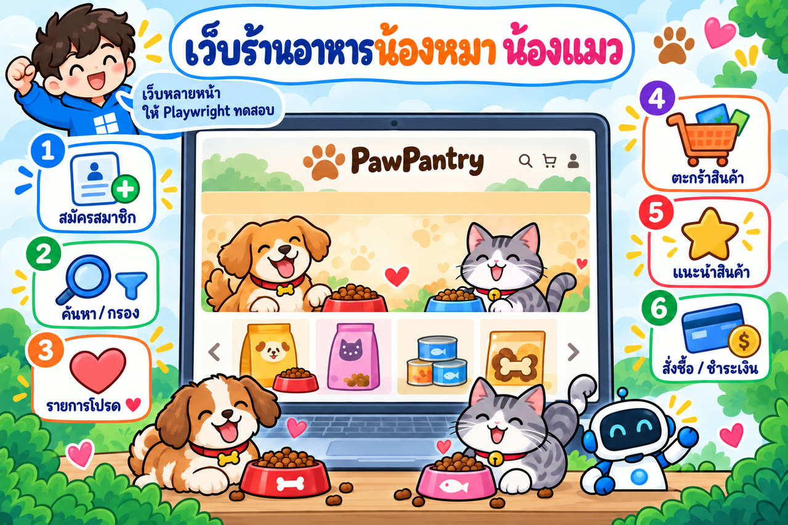

## 🧭 ภาพรวม: ทดสอบระบบตามแผนการทดสอบ

ในการทำงานจริง การทดสอบไม่ได้เริ่มจากการใช้งานเว็บไปเรื่อย ๆ แต่เริ่มจาก **แผนการทดสอบ (Test Plan)** ที่กำหนดไว้ล่วงหน้าว่าจะทดสอบอะไร คาดหวังผลอย่างไร และระบบผ่านเกณฑ์เมื่อใด บทเรียนนี้จัดเตรียมองค์ประกอบทั้งหมดไว้แล้ว

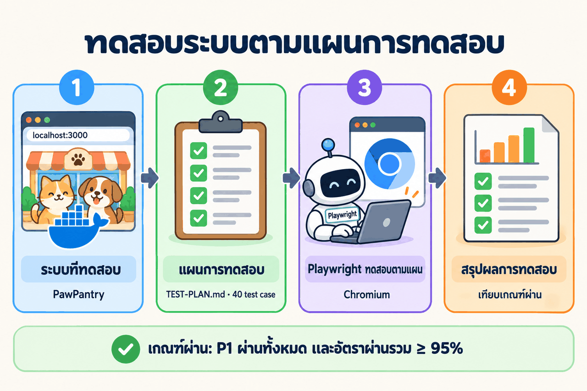

---

## 📋 แผนการทดสอบ (TEST-PLAN.md) กำหนดอะไรบ้าง

[TEST-PLAN.md](TEST-PLAN.md) เป็นเอกสารหลักของบทเรียนนี้ ทุก test case ที่ Playwright รันมาจากแผนนี้ และผลการทดสอบก็นำไปตัดสินด้วยเกณฑ์ในแผนนี้ แผนกำหนดเงื่อนไขไว้ 5 เรื่อง

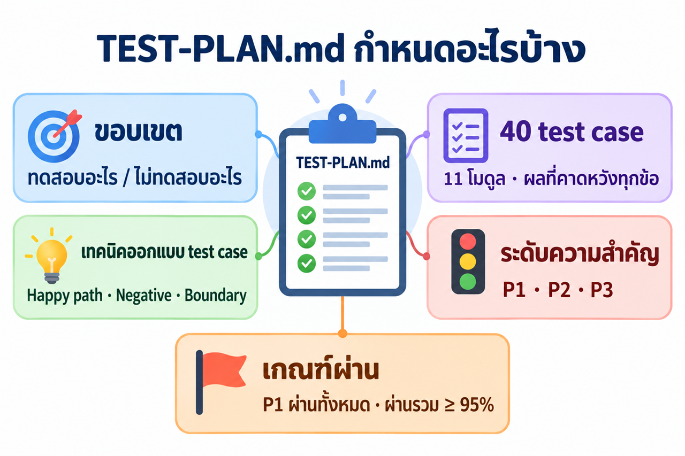

### 1) ระดับความสำคัญ P1 P2 P3 (Priority)

📄 **ข้อความจริงใน TEST-PLAN.md**

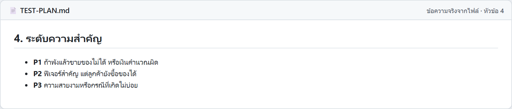

test case ทุกข้อในแผนถูกจัดระดับตาม **ผลกระทบหากข้อนั้นล้ม** ยิ่งกระทบผู้ใช้และธุรกิจมาก ระดับยิ่งสูง ระดับนี้ใช้ตัดสิน 2 เรื่อง คือ **ต้องแก้ข้อบกพร่องใดก่อน** และ **ระบบพร้อมปล่อยใช้งานหรือไม่**

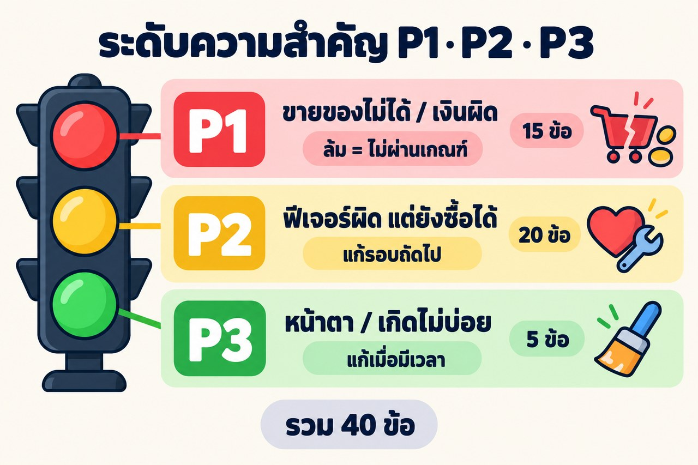

**วิธีจัดระดับ:** ถามคำถามตามลำดับ แล้วหยุดที่คำตอบ "ใช่" ข้อแรก

| ลำดับ | คำถาม: ถ้า test ข้อนี้ล้ม… | ใช่ → |
|---|---|---|
| 1 | ผู้ใช้สั่งซื้อไม่ได้ เงินคำนวณผิด หรือข้อมูล/สิทธิ์การเข้าถึงผิดพลาด ใช่ไหม? | 🔴 **P1** |
| 2 | ฟีเจอร์หลักทำงานผิด แต่ผู้ใช้ยังสั่งซื้อได้ ใช่ไหม? | 🟡 **P2** |
| 3 | เป็นเรื่องการแสดงผล หรือกรณีที่เกิดไม่บ่อย | 🟢 **P3** |

**เปรียบเทียบ 3 ระดับ**

| ประเด็น | 🔴 P1 · ร้ายแรง | 🟡 P2 · ปานกลาง | 🟢 P3 · เล็กน้อย |
|---|---|---|---|
| ผลกระทบ | ธุรกรรมหลักล้มเหลว หรือเกิดความเสียหายทางการเงิน | ฟีเจอร์ทำงานผิด ผู้ใช้ไม่สะดวก แต่ยังซื้อได้ | กระทบน้อย ไม่ขัดขวางการใช้งาน |
| ทางเลี่ยง (workaround) | ไม่มี | มี | ไม่จำเป็น |
| ถ้าล้ม | **ระบบไม่ผ่านเกณฑ์ทันที** ห้ามปล่อยใช้งาน | บันทึกข้อบกพร่อง แก้รอบถัดไป | แก้เมื่อมีเวลา |
| จำนวนในแผน | 15 ข้อ | 20 ข้อ | 5 ข้อ |
| ตัวอย่าง | TC-CART-01 ยอดรวมตะกร้า · TC-CPN-01 คูปอง PAW10 · TC-CHK-03 ซื้อของจนจบ · TC-API-02 สั่งซื้อโดยไม่ login ต้องได้ 401 | TC-WISH-02 ลบรายการโปรดแล้วตัวเลขต้องลด · TC-CART-03 ส่งฟรีเมื่อครบ ฿999 · TC-REC-02 ตัวช่วยเลือกอาหาร | TC-PRD-04 หน้า 404 · TC-MOB-01 เมนูมือถือ · TC-CAT-04 กรองเกรนฟรี |

**ทำไมระดับจึงสำคัญต่อผลการตัดสิน:** สมมติว่ามี test ล้ม 1 ข้อจาก 40 ข้อ (อัตราผ่าน 97.5% ซึ่งเกิน 95%)

| test ที่ล้ม | ผลการตัดสิน |
|---|---|
| TC-WISH-02 (P2) | ✅ ผ่านเกณฑ์ เพราะ P1 ผ่านทั้งหมด และอัตราผ่าน ≥ 95% |
| TC-CPN-01 (P1) | ❌ ไม่ผ่านเกณฑ์ เพราะ P1 ต้องผ่านทั้งหมด แม้อัตราผ่านจะสูงก็ตาม |

### 2) ขอบเขตการทดสอบ (Scope)

ขอบเขตกำหนดว่าการทดสอบครั้งนี้ **ครอบคลุมอะไร และไม่ครอบคลุมอะไร** เพื่อให้ทุกคนเข้าใจตรงกันว่าผลการทดสอบรับรองระบบในเรื่องใดบ้าง

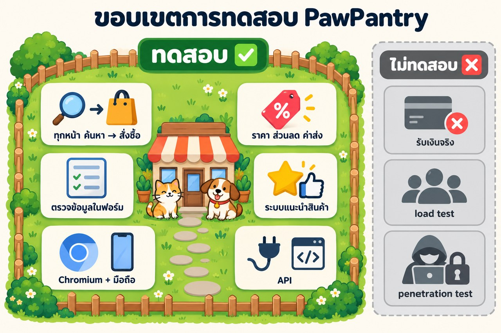

📄 **ข้อความจริงใน TEST-PLAN.md**

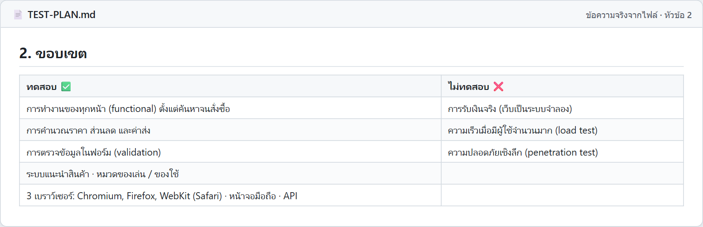

### 3) เทคนิคการออกแบบ test case

เทคนิคเหล่านี้ใช้คิด test case ให้ครอบคลุมทั้งกรณีปกติ กรณีผิดพลาด และค่าที่ขอบของเงื่อนไข

📄 **ข้อความจริงใน TEST-PLAN.md**

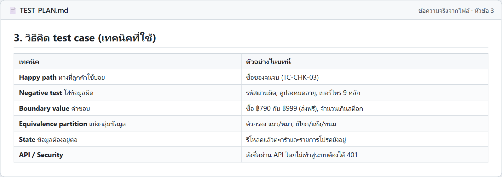

**ความหมายของแต่ละเทคนิค**

| เทคนิค | ความหมาย | ตัวอย่างในแผน |
|---|---|---|
| **Happy path** | เส้นทางที่ผู้ใช้ใช้งานตามปกติ | ซื้อสินค้าจนสั่งซื้อสำเร็จ (TC-CHK-03) |
| **Negative test** | ป้อนข้อมูลไม่ถูกต้อง ระบบต้องแจ้งเตือน | รหัสผ่านผิด, คูปองหมดอายุ, เบอร์โทร 9 หลัก |
| **Boundary value** | ทดสอบค่าที่ขอบของเงื่อนไข | ยอดซื้อ ฿790 กับ ฿999 (ส่งฟรี), จำนวนเกินสต็อก |
| **Equivalence partition** | แบ่งข้อมูลเป็นกลุ่ม ทดสอบตัวแทนกลุ่ม | ตัวกรอง แมว/หมา, เปียก/แห้ง/ขนม |
| **State** | ข้อมูลต้องคงอยู่หลังเปลี่ยนสถานะ | รีโหลดแล้วตะกร้าและรายการโปรดยังอยู่ |
| **API / Security** | ตรวจสิทธิ์การเข้าถึงผ่าน API | สั่งซื้อผ่าน API โดยไม่เข้าสู่ระบบต้องได้ 401 |

### 4) Test case 40 ข้อ ใน 11 โมดูล

| โมดูล | จำนวน | | โมดูล | จำนวน |
|---|---|---|---|---|
| หน้าแรก (HOME) | 2 | | สมาชิก (AUTH) | 6 |
| ค้นหา / กรอง (CAT) | 6 | | สั่งซื้อ (CHK) | 4 |
| หน้าสินค้า (PRD) | 4 | | ระบบแนะนำ (REC) | 4 |
| รายการโปรด (WISH) | 3 | | มือถือ (MOB) | 1 |
| ตะกร้า (CART) | 4 | | API | 3 |
| คูปอง (CPN) | 3 | | **รวม** | **40** |

แต่ละ test case ในแผนระบุ **รหัส · สิ่งที่ทดสอบ · ระดับความสำคัญ · ผลที่คาดหวัง**

📄 **ข้อความจริงใน TEST-PLAN.md** (ครบทั้ง 40 ข้อ)

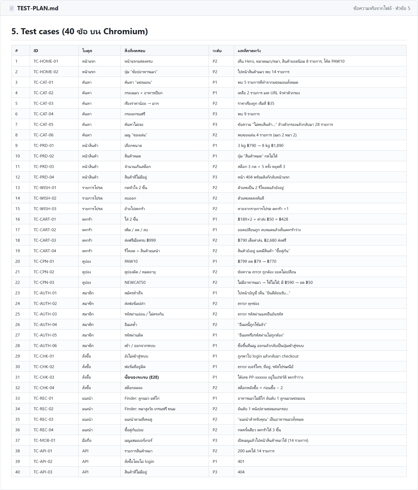

สคริปต์ใน `e2e/` ถูกเขียนให้ตรวจผลตามแผนทีละข้อ ตัวอย่างเช่น

| | ใน TEST-PLAN.md | ในสคริปต์ Playwright (`e2e/tests/05-cart.spec.ts`) |
|---|---|---|
| รหัส | TC-CART-01 | `test('TC-CART-01 …')` |
| สิ่งที่ทดสอบ | ใส่สินค้า 2 ชิ้น | เปิดหน้าสินค้า → กด + → กดเพิ่มลงตะกร้า |
| ผลที่คาดหวัง | ฿189×2 + ค่าส่ง ฿50 = ฿428 | ตรวจว่ายอดสินค้า = ฿378, ค่าส่ง = ฿50, ยอดรวม = ฿428 |
| ระดับ | P1 | `tag: ['@cart', '@P1']` |

### 5) เกณฑ์เริ่มและเกณฑ์ผ่าน (Entry / Exit criteria)

📄 **ข้อความจริงใน TEST-PLAN.md**

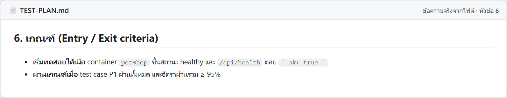

**อธิบายเพิ่มเติม**

| เกณฑ์ | เงื่อนไข |
|---|---|
| **เริ่มทดสอบได้เมื่อ** | container `petshop` อยู่ในสถานะ healthy และ `/api/health` ตอบ `{ ok: true }` |
| **ระบบผ่านเกณฑ์เมื่อ** | test case ระดับ P1 ผ่านทั้งหมด **และ** อัตราผ่านรวม ≥ 95% (ล้มได้ไม่เกิน 2 ข้อ และต้องไม่ใช่ P1) |

นอกจากนี้แผนยังกำหนด **ข้อมูลทดสอบ** (บัญชีตัวอย่าง, คูปอง, ค่าส่ง, สินค้าหมดสต็อก) และ **บั๊กที่ฝังไว้สำหรับฝึก** (LAB 8) ดูรายละเอียดทั้งหมดได้ใน [TEST-PLAN.md](TEST-PLAN.md)

---

## 🧰 ก่อนเริ่ม ต้องมี

| ✅ | สิ่งที่ต้องมี | ตรวจยังไง |
|---|---|---|
| ☐ | Windows 10/11 + **Claude Code** | เปิด Claude Code ได้ |
| ☐ | **Docker Desktop** เปิดอยู่ (ไอคอนวาฬมุมขวาล่าง) | ไอคอนวาฬไม่หมุน |
| ☐ | ทำ **บท 01** แล้ว (มี Node.js + เบราว์เซอร์ของ Playwright) | ดูบท `01_playwright-local-windows` |
| ☐ | เปิด Claude Code ใน **โฟลเดอร์นี้** | ชื่อโฟลเดอร์ขึ้นที่แถบด้านบน |

**เลือกเรียนได้ 2 แบบ:** วาง **LAB 1** พรอมต์เดียวจบ หรือทำ **ทีละขั้น** ตั้งแต่ LAB 2 → LAB 9
แต่ละ LAB มี 💬 พรอมต์ให้คัดลอก · ✅ ผลจริงที่ได้ · 👀 สิ่งที่ควรสังเกต

---

## LAB 1 · พรอมต์รวม: เปิดเว็บ ทดสอบ อัด GIF ทำรายงาน

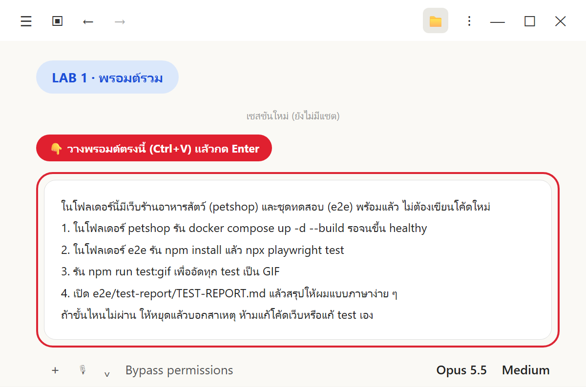

💬 **คัดลอกพรอมต์นี้** (กดปุ่ม Copy มุมขวาของกรอบ)

```text
ในโฟลเดอร์นี้มีเว็บร้านอาหารสัตว์ (petshop) และชุดทดสอบ (e2e) พร้อมแล้ว ไม่ต้องเขียนโค้ดใหม่
1. ในโฟลเดอร์ petshop รัน docker compose up -d --build รอจนขึ้น healthy
2. ในโฟลเดอร์ e2e รัน npm install แล้ว npx playwright test
3. รัน npm run test:gif เพื่ออัดทุก test เป็น GIF
4. เปิด e2e/test-report/TEST-REPORT.md แล้วสรุปให้ผมแบบภาษาง่าย ๆ
ถ้าขั้นไหนไม่ผ่าน ให้หยุดแล้วบอกสาเหตุ ห้ามแก้โค้ดเว็บหรือแก้ test เอง
```

✅ **ผลจริง**

| ขั้น | ผล |
|---|---|
| 1. เปิดเว็บด้วย Docker | ✅ `petshop` ขึ้น **healthy** ที่ http://localhost:3000 |
| 2. ทดสอบ 3 เบราว์เซอร์ | ✅ **120 passed** (40 test × 3 เบราว์เซอร์) ใน 1.1 นาที |
| 3. อัด GIF + MP4 | ✅ ได้ GIF 37 ไฟล์ + MP4 37 ไฟล์ |
| 4. รายงาน | ✅ ผ่าน 100% → **ผ่านเกณฑ์ พร้อมปล่อยใช้งาน** |

💡 **พรอมต์ที่ดีมี 4 อย่าง** (เหมือนบท 01)
1. 📋 **บอกให้ชัดว่าทำอะไร** → "เว็บและ test พร้อมแล้ว ไม่ต้องเขียนใหม่"
2. 🪜 **แบ่งเป็นขั้น** → AI ทำตามลำดับ
3. 🛑 **ทำไม่ได้ ให้หยุดแล้วบอก** → ไม่แอบแก้ test ให้ผ่าน
4. ✅ **ขอผลที่อ่านง่าย** → สรุปภาษาง่าย ๆ

---

## LAB 2 · เปิดเว็บด้วย Docker

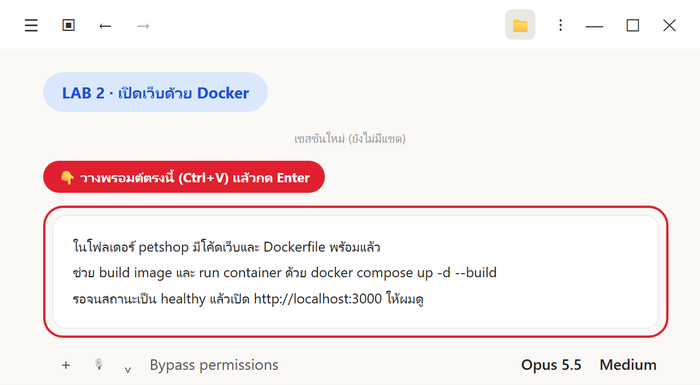

💬 **คัดลอกพรอมต์นี้**

```text
ในโฟลเดอร์ petshop มีโค้ดเว็บและ Dockerfile พร้อมแล้ว
ช่วย build image และ run container ด้วย docker compose up -d --build
รอจนสถานะเป็น healthy แล้วเปิด http://localhost:3000 ให้ผมดู
```

✅ **ผลจริง** container ชื่อ `petshop` ขึ้นสถานะ **healthy** (กรอบแดง)

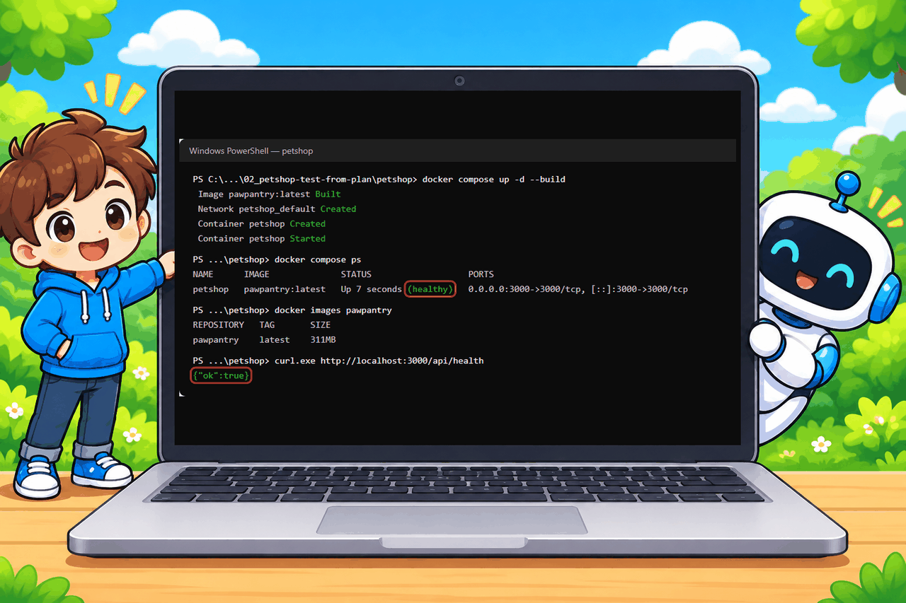

แล้วเปิด http://localhost:3000 ได้เว็บนี้ 🎉

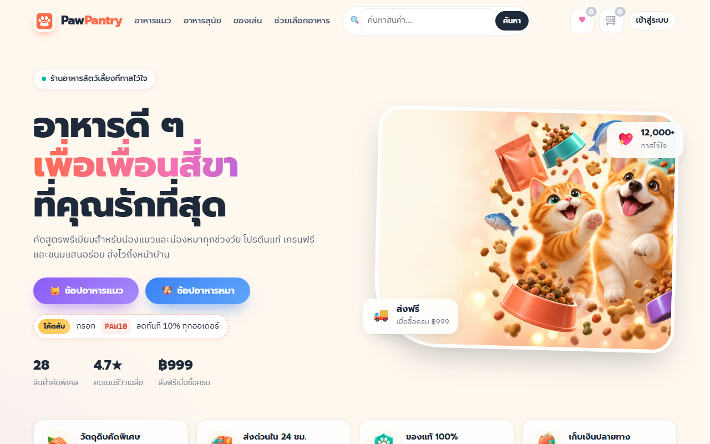

👀 **สังเกต**
- ครั้งแรกใช้เวลา build 1–3 นาที ครั้งต่อไปเร็วขึ้นมาก (Docker จำของเดิมไว้)
- **healthy** = เว็บพร้อมแล้วจริง ๆ (Docker คอยเช็ก `/api/health` ให้ทุก 10 วินาที)

---

## LAB 3 · เดินดูเว็บแบบลูกค้า

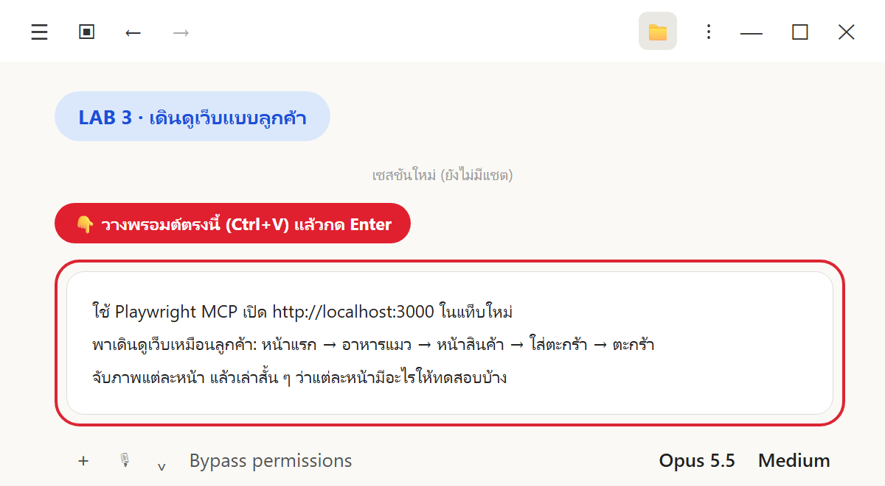

🎯 ก่อนทดสอบ ต้อง **รู้จักเว็บ** ก่อน ว่ามีหน้าอะไร ทำอะไรได้บ้าง

💬 **คัดลอกพรอมต์นี้**

```text
ใช้ Playwright MCP เปิด http://localhost:3000 ในแท็บใหม่
พาเดินดูเว็บเหมือนลูกค้า: หน้าแรก → อาหารแมว → หน้าสินค้า → ใส่ตะกร้า → ตะกร้า
จับภาพแต่ละหน้า แล้วเล่าสั้น ๆ ว่าแต่ละหน้ามีอะไรให้ทดสอบบ้าง
```

✅ **ผลจริง** เว็บมีหลายหน้า แต่ละหน้ามีเรื่องให้ทดสอบ

| 🐱 หน้ารวมสินค้า: ค้นหา กรอง เรียงราคา | 🛍️ หน้าสินค้า: เลือกขนาด จำนวน สต็อก |
|---|---|
| 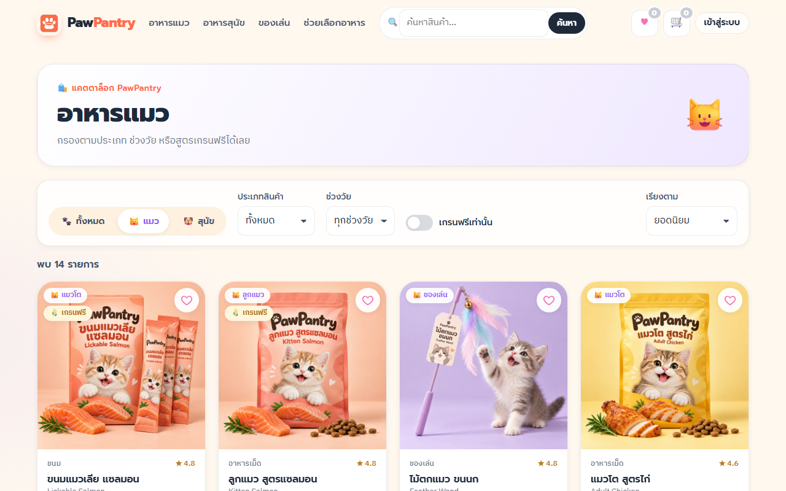 | 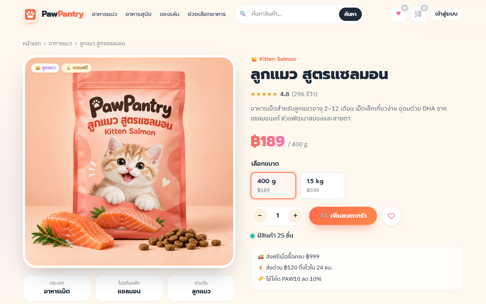 |
| 🛒 **ตะกร้า: คูปอง ค่าส่ง ยอดรวม** | ✨ **ตัวช่วยเลือกอาหาร: ระบบแนะนำ** |
| 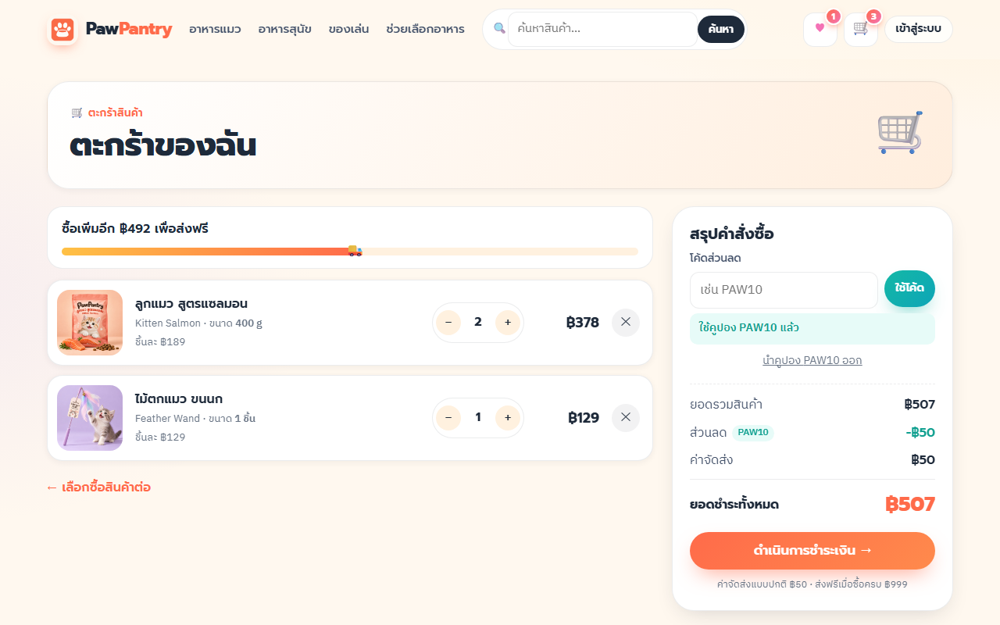 | 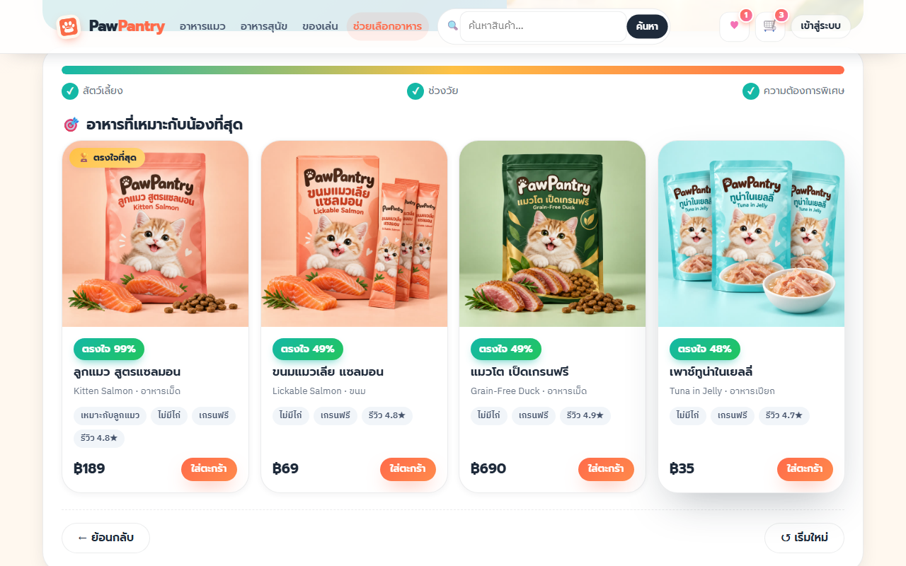 |
| 💳 **ชำระเงิน: ฟอร์มที่อยู่ ส่งด่วน PromptPay** | 🎉 **สั่งซื้อสำเร็จ: เลขคำสั่งซื้อ** |
| 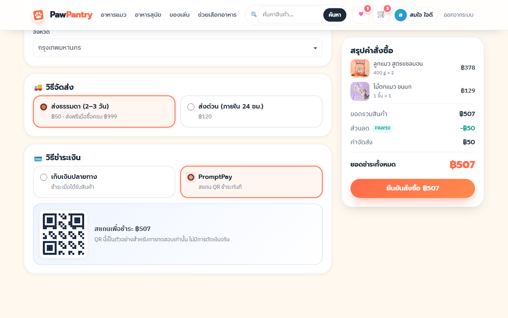 | 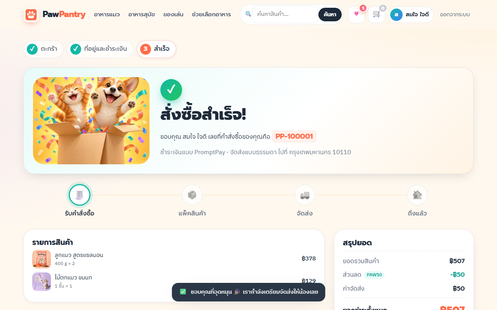 |
| 🧸 **ของเล่น: หมวดใหม่** | 📱 **มือถือ: เมนูแฮมเบอร์เกอร์** |
| 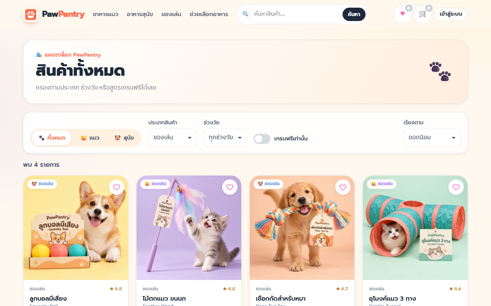 | 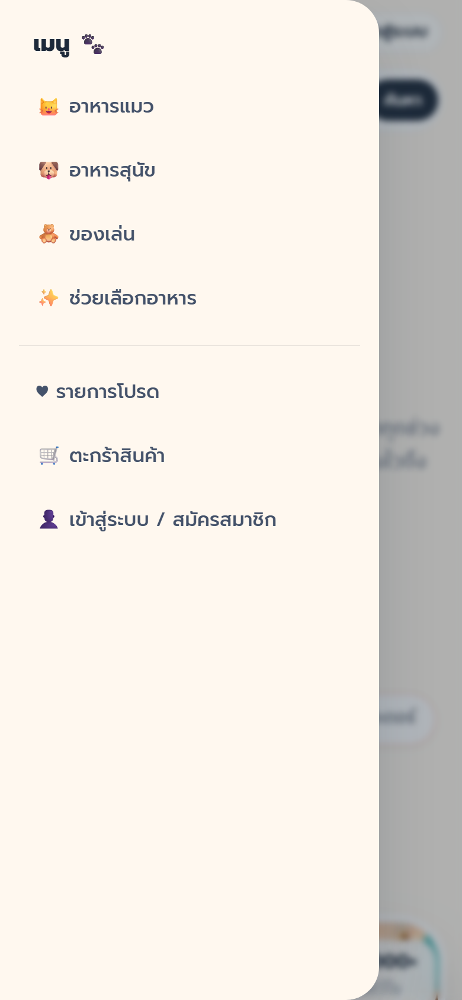 |

👀 **สังเกต**
- เว็บนี้ **ไม่ได้มีหน้าเดียว** มีทั้งสมัครสมาชิก ตะกร้า คูปอง แนะนำสินค้า สั่งซื้อ → เหมือนเว็บขายของจริง
- ทุกหน้าคือ "จุดที่อาจมีบั๊ก" → จดไว้ แล้วไปดูแผนการทดสอบใน LAB 4

---

## LAB 4 · อ่านแผนการทดสอบ

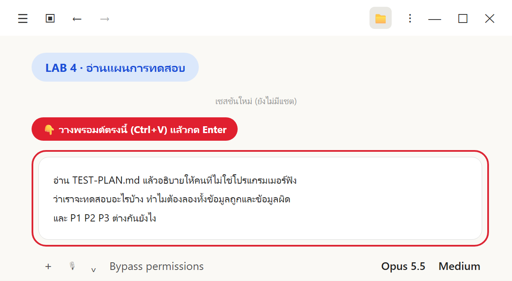

💬 **คัดลอกพรอมต์นี้**

```text
อ่าน TEST-PLAN.md แล้วอธิบายให้คนที่ไม่ใช่โปรแกรมเมอร์ฟัง
ว่าเราจะทดสอบอะไรบ้าง ทำไมต้องลองทั้งข้อมูลถูกและข้อมูลผิด
และ P1 P2 P3 ต่างกันยังไง
```

✅ **ผลจริง** แผนมี **40 test case** แบ่งเป็น 11 เรื่อง


| เรื่อง | จำนวน | ตัวอย่าง |
|---|---|---|
| หน้าแรก | 2 | หน้าแรกแสดงครบ |
| ค้นหา / กรอง | 6 | ค้นหา "แซลมอน" ต้องเจอ 5 รายการ |
| หน้าสินค้า | 4 | สินค้าหมด กดใส่ตะกร้าไม่ได้ |
| รายการโปรด | 3 | ลบแล้วตัวเลขต้องลดทันที |
| ตะกร้า | 4 | ซื้อครบ ฿999 ส่งฟรี |
| คูปอง | 3 | PAW10 ลด 10% |
| สมัคร / เข้าสู่ระบบ | 6 | รหัสผ่านผิดต้องเตือน |
| สั่งซื้อ | 4 | **ซื้อของจนจบ (End-to-End)** |
| ระบบแนะนำ | 4 | ลูกแมวแพ้ไก่ ต้องไม่แนะนำสูตรไก่ |
| มือถือ + API | 4 | สั่งซื้อผ่าน API โดยไม่ login ต้องถูกปฏิเสธ |

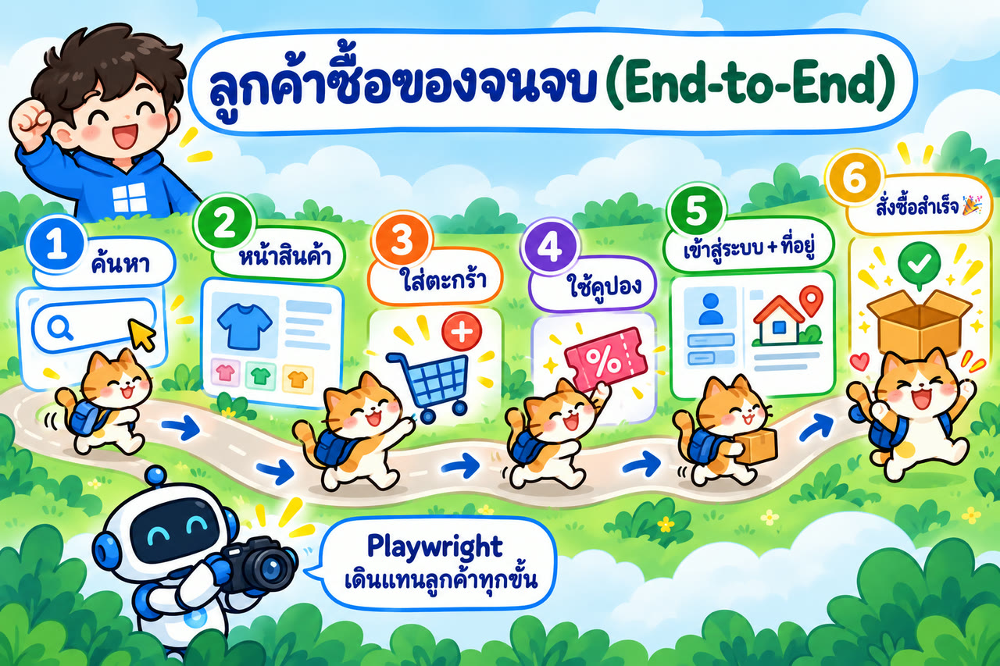

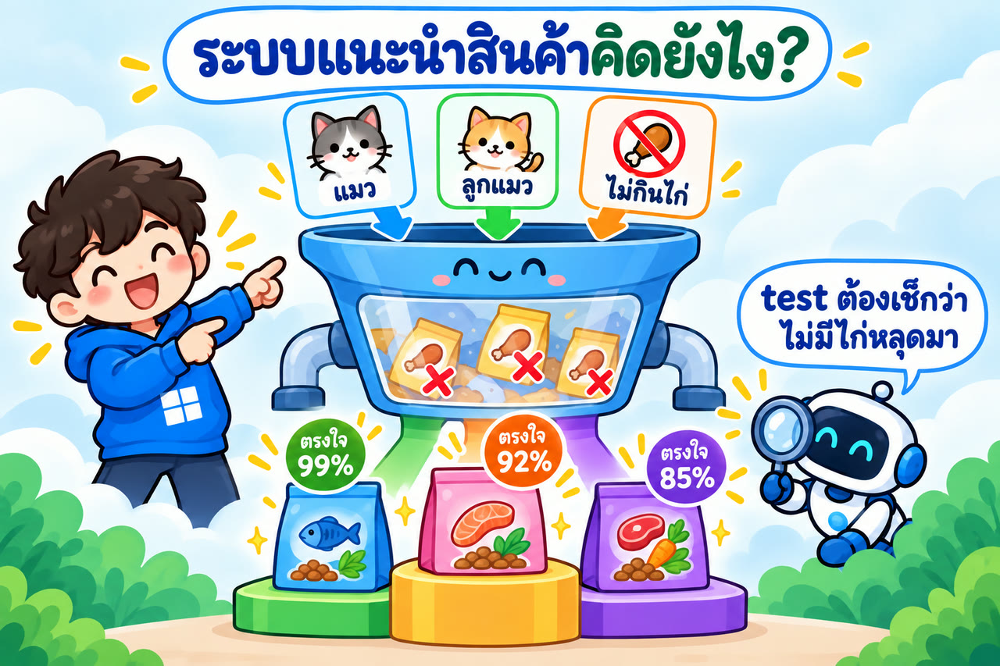

👀 **สังเกต**
- test ที่ยากที่สุดคือ **End-to-End** = เดินแทนลูกค้าตั้งแต่ค้นหาจนจ่ายเงิน
- ระบบแนะนำสินค้าต้องเช็กว่า **"ไม่มีไก่หลุดมา"** ไม่ใช่แค่ "มีผลออกมา"

---

## LAB 5 · รันทดสอบ 3 เบราว์เซอร์

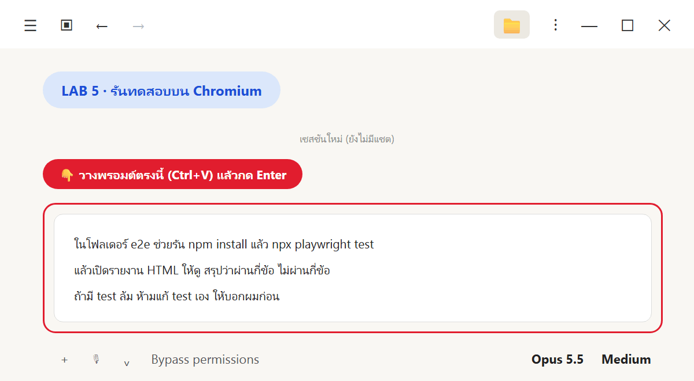

💬 **คัดลอกพรอมต์นี้**

```text
ในโฟลเดอร์ e2e ช่วยรัน npm install แล้ว npx playwright test
แล้วเปิดรายงาน HTML ให้ดู สรุปว่าผ่านกี่ข้อบนแต่ละเบราว์เซอร์
ถ้ามี test ล้ม ห้ามแก้ test เอง ให้บอกผมก่อน
```

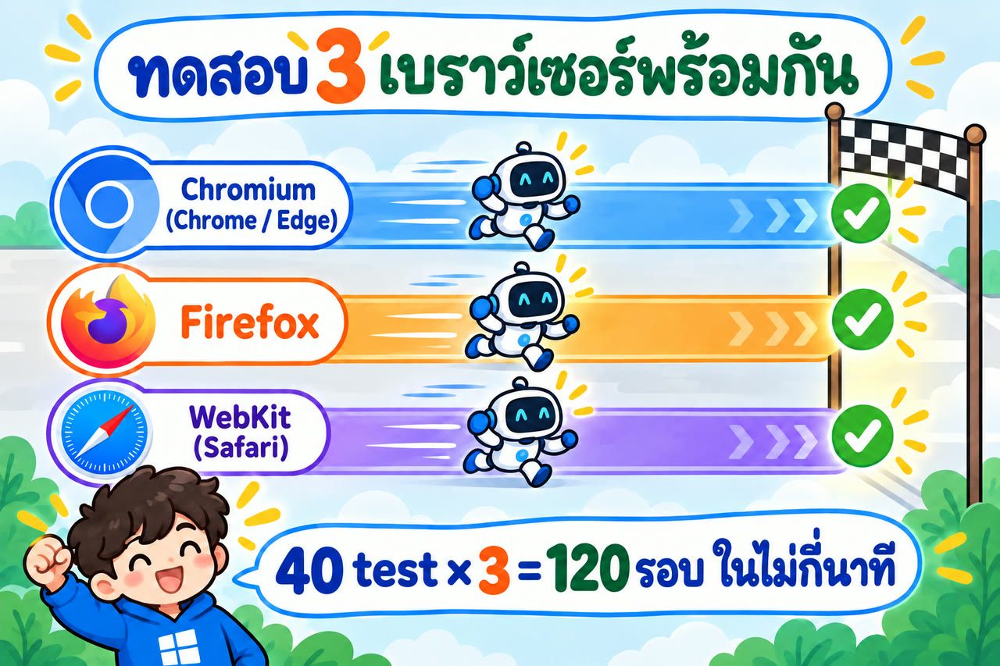

✅ **ผลจริง: 120 passed ใน 1.1 นาที**

| เบราว์เซอร์ | เหมือนกับ | ผ่าน |
|---|---|---|
| Chromium | Chrome, Edge | ✅ 40 / 40 |
| Firefox | Firefox | ✅ 40 / 40 |
| WebKit | Safari (iPhone, Mac) | ✅ 40 / 40 |

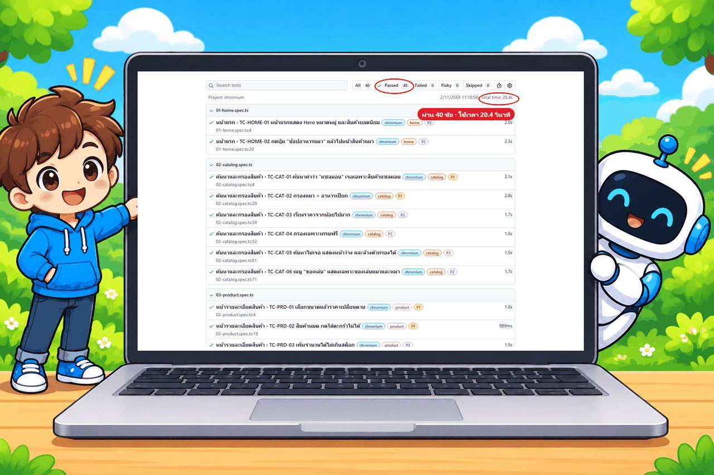

👀 **สังเกต**
- ป้ายสี **P1 / P2 / P3** โผล่ในรายงานด้วย กดกรองดูเฉพาะ P1 ได้
- คนทดสอบเอง 120 รอบ = ครึ่งวัน · Playwright = **1 นาที**

---

## LAB 6 · อัดผลทดสอบเป็น GIF + วิดีโอ

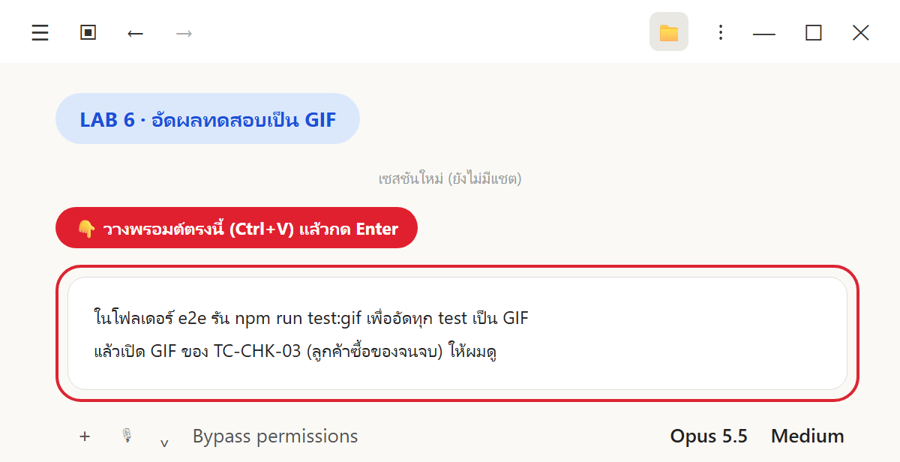

💬 **คัดลอกพรอมต์นี้**

```text
ในโฟลเดอร์ e2e รัน npm run test:gif เพื่ออัดทุก test เป็น GIF
แล้วเปิด GIF ของ TC-CHK-03 (ลูกค้าซื้อของจนจบ) ให้ผมดู
```


✅ **ผลจริง** ได้ GIF + MP4 อย่างละ 37 ไฟล์ ใน `e2e/test-report/gifs` และ `e2e/test-report/videos`

**🎬 TC-CHK-03 ลูกค้าซื้อของจนจบ** (วงแดง = จุดที่ Playwright คลิก · ป้ายมุมซ้ายล่าง = ชื่อ test)


▶️ ดูแบบวิดีโอ: [video-TC-CHK-03.mp4](img/video-TC-CHK-03.mp4)

| ✨ ระบบแนะนำ: ลูกแมวแพ้ไก่ | 🛒 เพิ่ม ลด ลบ ในตะกร้า | 📝 ส่งฟอร์มสมัครเปล่า |
|---|---|---|
| 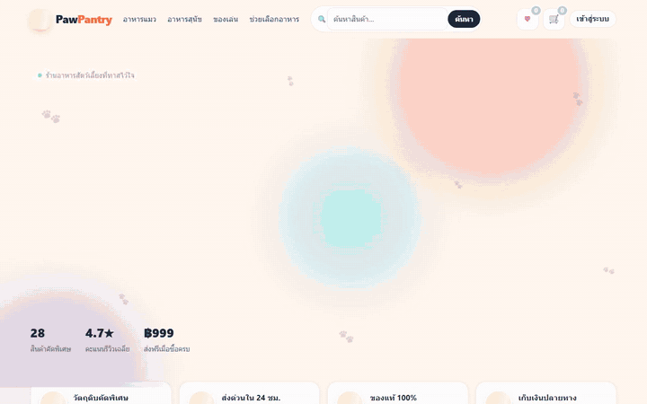 | 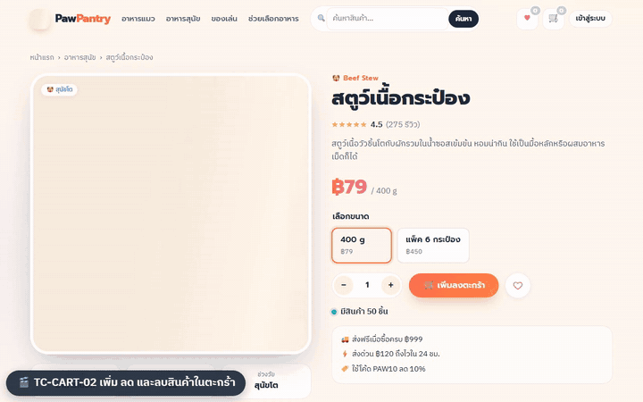 | 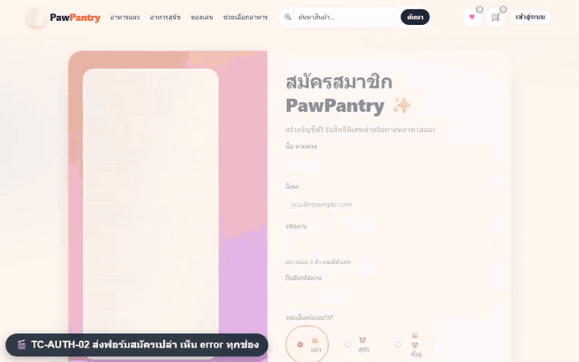 |

👀 **สังเกต**
- GIF ช้ากว่าปกติ (ตั้งใจให้คนดูทัน) ตอนรันจริงเร็วกว่านี้มาก
- **GIF** เปิดดูได้ทันทีใน GitHub / แชท · **MP4** ไฟล์เล็กกว่า ใส่ PowerPoint หรือส่ง LINE ได้
- API test 3 ข้อไม่มี GIF เพราะไม่ได้เปิดหน้าเว็บ

---

## LAB 7 · อ่านรายงานผลแบบ Tester

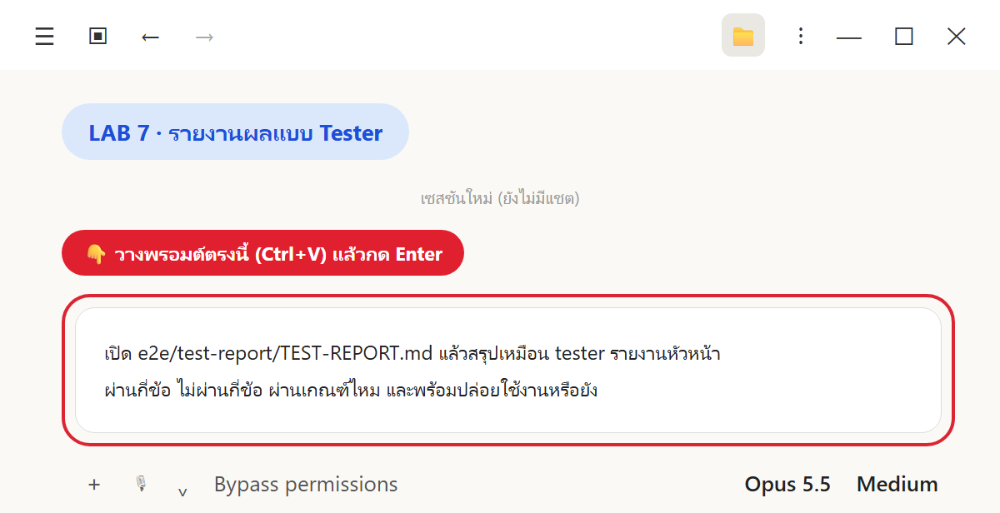

💬 **คัดลอกพรอมต์นี้**

```text
เปิด e2e/test-report/TEST-REPORT.md แล้วสรุปเหมือน tester รายงานหัวหน้า
ผ่านกี่ข้อ ไม่ผ่านกี่ข้อ ผ่านเกณฑ์ไหม และพร้อมปล่อยใช้งานหรือยัง
```

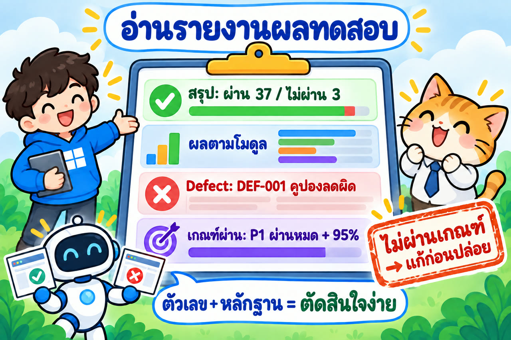

✅ **ผลจริง** รายงานมี 4 ส่วน แบบที่ tester ส่งหัวหน้า

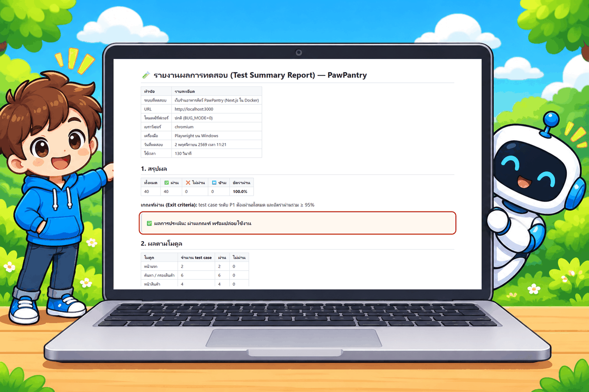

| ส่วน | บอกอะไร |
|---|---|
| 1. สรุปผล | ผ่าน / ไม่ผ่าน / อัตราผ่าน และ **ผ่านเกณฑ์ไหม** |
| 2. ผลตามโมดูล | เรื่องไหนมีปัญหา |
| 3. ผลราย test case | ทุกข้อ พร้อมลิงก์ GIF / MP4 |
| 4. ข้อบกพร่อง (Defects) | บั๊กที่เจอ (LAB 8) |

👀 **สังเกต**
- **เกณฑ์ผ่าน** ของบทนี้: P1 ต้องผ่านหมด + ผ่านรวม ≥ 95%
- รายงานนี้ **สร้างเองอัตโนมัติ** ทุกครั้งที่รัน test ไม่ต้องพิมพ์เอง

---

## LAB 8 · ฝึกจับบั๊ก 🐞

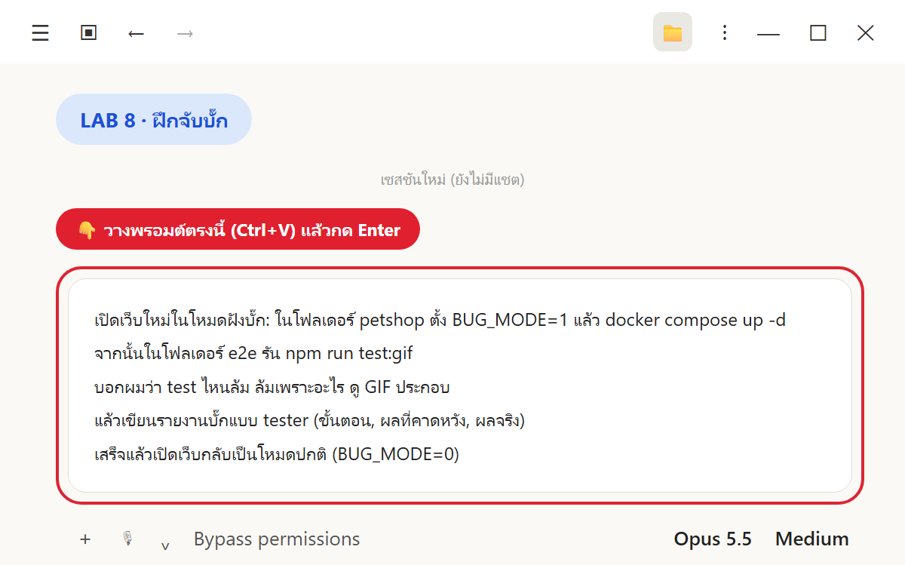

🎯 เว็บนี้มี **"โหมดฝังบั๊ก"** (`BUG_MODE=1`) ซ่อนบั๊กไว้ 3 จุด ดูซิว่า test จับได้ไหม

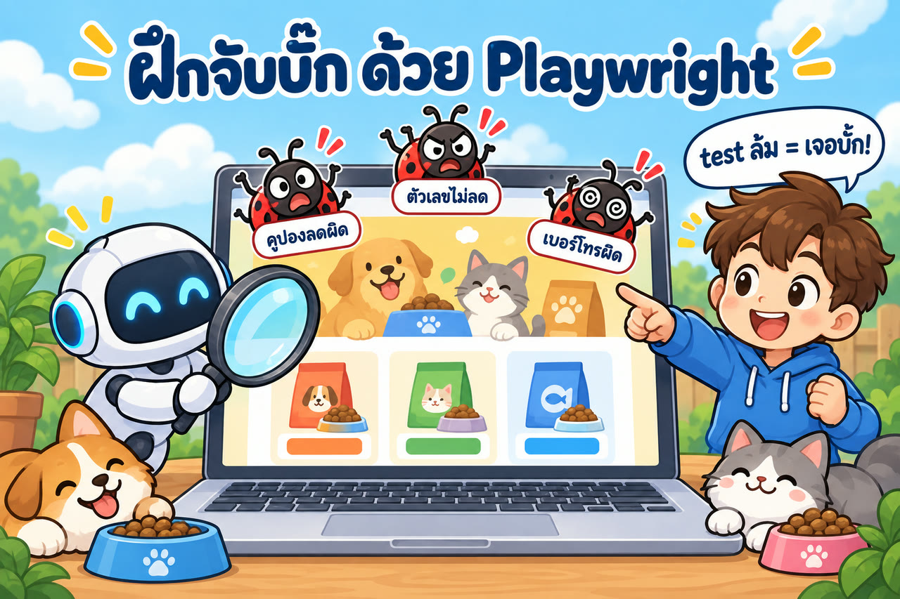

💬 **คัดลอกพรอมต์นี้**

```text
เปิดเว็บใหม่ในโหมดฝังบั๊ก: ในโฟลเดอร์ petshop ตั้ง BUG_MODE=1 แล้ว docker compose up -d
จากนั้นในโฟลเดอร์ e2e รัน npm run test:gif
บอกผมว่า test ไหนล้ม ล้มเพราะอะไร ดู GIF ประกอบ
แล้วเขียนรายงานบั๊กแบบ tester (ขั้นตอน, ผลที่คาดหวัง, ผลจริง)
เสร็จแล้วเปิดเว็บกลับเป็นโหมดปกติ (BUG_MODE=0)
```

✅ **ผลจริง: ผ่าน 37 · ล้ม 3** → test จับบั๊กได้ **ครบทั้ง 3 ตัว** และรายงานบอกว่า **ไม่ผ่านเกณฑ์**

| บั๊กที่ฝังไว้ | test ที่จับได้ | ผลที่คาดหวัง | ผลจริง |
|---|---|---|---|
| คูปอง PAW10 ลดแค่ 1% | TC-CPN-01 (P1) | ลด ฿79 | ลดแค่ ฿7 ❌ |
| ลบรายการโปรด ตัวเลขไม่ลด | TC-WISH-02 (P2) | ตัวเลข 1 | ยังเป็น 2 ❌ |
| เบอร์โทร 9 หลักผ่าน | TC-CHK-02 (P1) | ขึ้น error เบอร์โทร | ไม่ขึ้น error ❌ |

| 🐞 คูปองลดผิด | 🐞 ตัวเลขไม่ลด | 🐞 เบอร์โทรผิด |
|---|---|---|
|  | 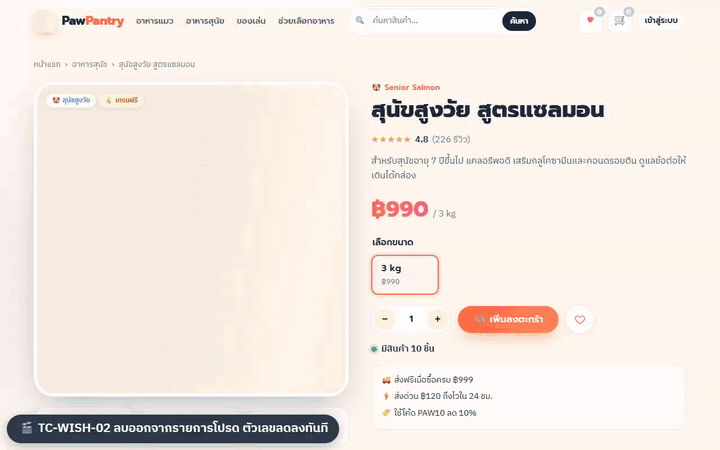 |  |

**รายงานบั๊กที่ได้** (สร้างอัตโนมัติ)

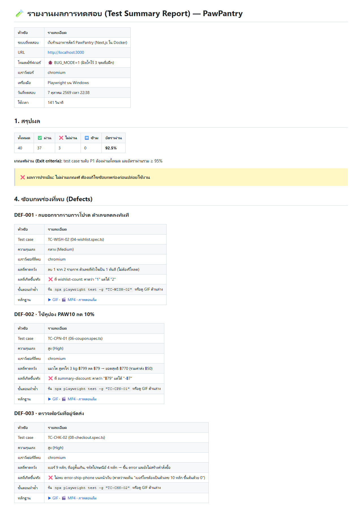

**รายงานบั๊กที่ดีต้องมี 5 อย่าง**

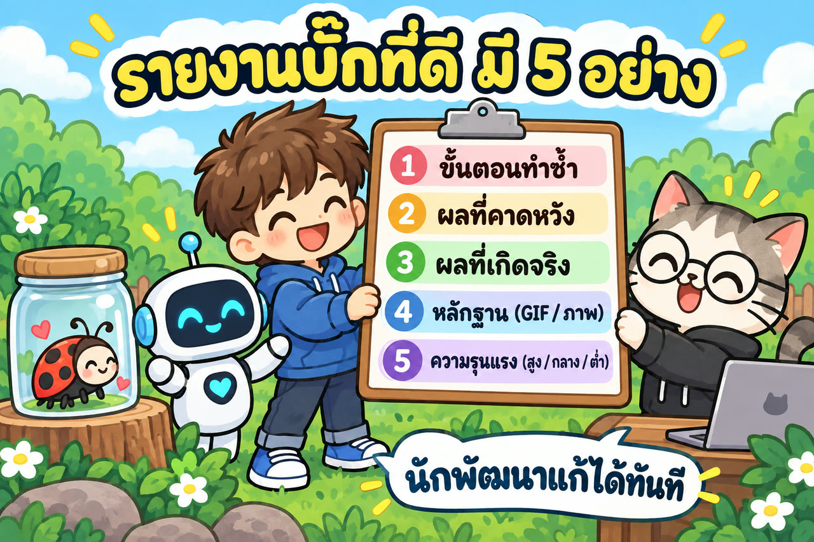

**test ล้ม = ผิดที่เว็บ หรือผิดที่ test?**

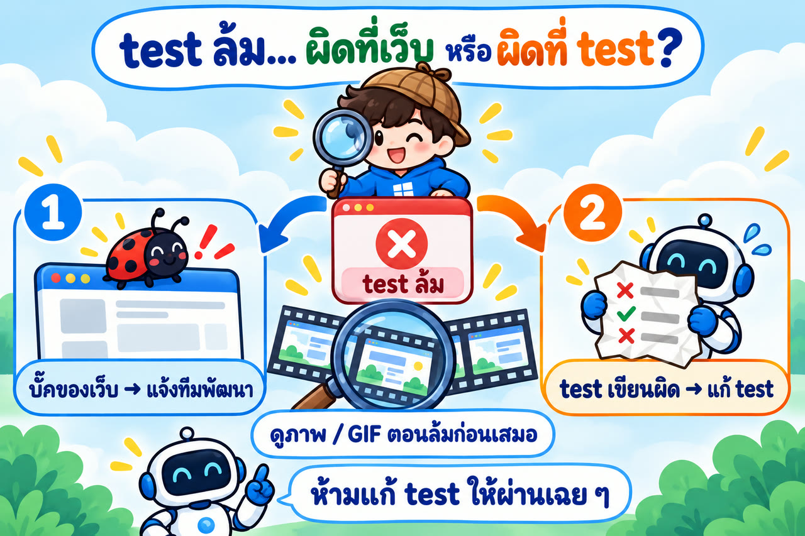

👀 **สังเกต**
- test ที่ล้มไม่ใช่เรื่องแย่ → **test ล้ม = เจอบั๊กก่อนลูกค้าเจอ** 🎉
- ห้ามแก้ test ให้ผ่านเฉย ๆ ต้องดู GIF ก่อนว่าผิดที่ไหน
- เรื่องจริงตอนทำบทนี้: test เจอ **บั๊กจริง** 2 ตัว (โลโก้ใหญ่เกินจนดันปุ่มออกจากระบบตกจอ, สวิตช์เกรนฟรีกดไม่ได้) และเจอ **test เขียนผิด** 1 ข้อ → ทุกฝ่ายพลาดได้

---

## LAB 9 · สร้าง test ใหม่จากพรอมต์ (ภาษาคน)

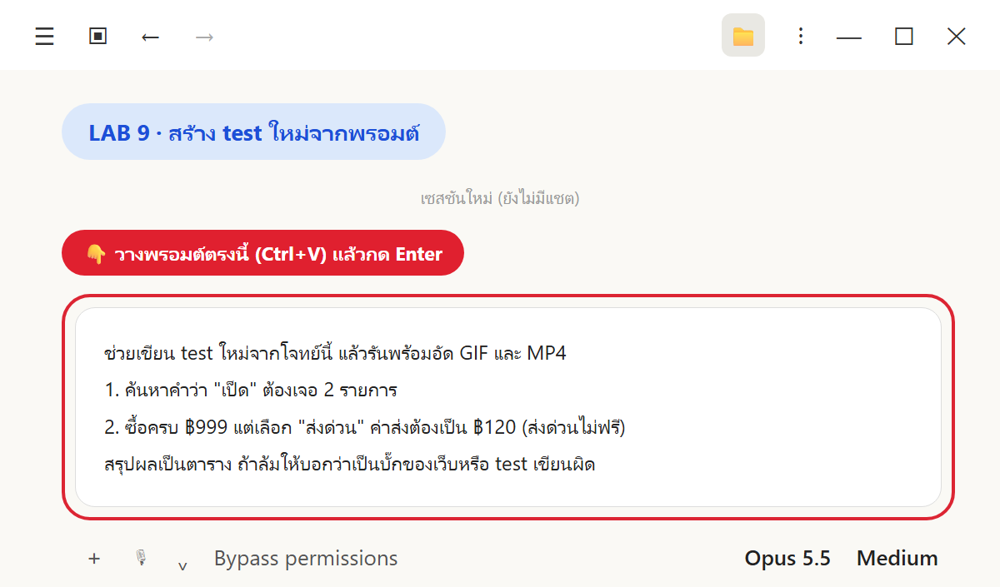

🎯 คิด test case เป็นภาษาไทย แล้วให้ Claude แปลงเป็น test ของ Playwright ให้

💬 **คัดลอกพรอมต์นี้** (เปลี่ยนโจทย์ข้อ 1–2 เป็นของตัวเองได้)

```text
ช่วยเขียน test ใหม่จากโจทย์นี้ แล้วรันพร้อมอัด GIF และ MP4
1. ค้นหาคำว่า "เป็ด" ต้องเจอ 2 รายการ
2. ซื้อครบ ฿999 แต่เลือก "ส่งด่วน" ค่าส่งต้องเป็น ฿120 (ส่งด่วนไม่ฟรี)
สรุปผลเป็นตาราง ถ้าล้มให้บอกว่าเป็นบั๊กของเว็บหรือ test เขียนผิด
```

✅ **ผลจริง** Claude สร้างไฟล์ `e2e/tests/11-my-tests.spec.ts` และรันผ่านทั้ง 2 ข้อ

| รหัส | สิ่งที่ทดสอบ | ผลที่คาดหวัง | ผล |
|---|---|---|---|
| TC-MY-01 | ค้นหา "เป็ด" | พบ 2 รายการ (เป็ดเกรนฟรี, เป็ดอบแห้ง) | ✅ ผ่าน |
| TC-MY-02 | ซื้อ ฿1,890 + ส่งด่วน | ค่าส่ง ฿120 ยอดรวม ฿2,010 | ✅ ผ่าน |


<details>
<summary>ดูโค้ดที่ Claude เขียนให้ (ไม่ต้องอ่านก็ได้)</summary>

```ts
test('TC-MY-02 ซื้อครบ ฿999 แต่เลือกส่งด่วน ค่าส่งต้องเป็น ฿120', async ({ page }) => {
  await registerByApi(page.request);
  await open(page, '/products/adult-lamb-dry');
  await page.locator('[data-testid="size-option"][data-size="8 kg"]').click(); // ฿1,890
  await page.getByTestId('add-to-cart').click();

  await open(page, '/checkout');
  await expect(page.getByTestId('summary-shipping')).toHaveText('ฟรี');
  await page.getByTestId('shipping-express').check();
  await expect(page.getByTestId('summary-shipping')).toHaveText('฿120');
  await expect(page.getByTestId('summary-total')).toHaveText('฿2,010');
});
```

</details>

👀 **สังเกต**
- Claude รู้วิธีเขียนให้เข้ากับ test เดิม เพราะอ่าน `CLAUDE.md` และ `petshop/SPEC.md` เอง
- ลองคิดโจทย์เอง เช่น "ใส่จำนวน 0 ได้ไหม", "รีโหลดหน้าชำระเงินแล้วที่อยู่หายไหม"

---

## ถ้าเจอปัญหา: คัดลอกพรอมต์นี้

| อาการ | 💬 พรอมต์ |
|---|---|
| Docker ไม่ทำงาน | `docker compose up ไม่ผ่าน ช่วยเช็กว่า Docker Desktop เปิดอยู่ไหม และพอร์ต 3000 ถูกใช้อยู่หรือเปล่า บอกผมว่าต้องทำอะไรเอง` |
| test ล้มทั้งหมด | `test ล้มทุกข้อ ช่วยเช็กว่าเว็บที่ http://localhost:3000 เปิดอยู่ไหม และ BUG_MODE เป็น 0 หรือยัง` |
| test ล้มบางข้อ | `test ข้อนี้ล้ม ช่วยดู GIF และภาพตอนล้มใน e2e/test-report แล้วบอกว่าเป็นบั๊กของเว็บหรือ test เขียนผิด ห้ามแก้ test เอง` |
| ไม่มีไฟล์ GIF | `รัน test:gif แล้วไม่มี GIF ช่วยเช็กว่ามี ffmpeg ในเครื่องไหม ถ้าไม่มีบอกวิธีติดตั้งให้ผม` |
| ยังเป็นโหมดบั๊กอยู่ | `ช่วยเปิดเว็บกลับเป็นโหมดปกติ BUG_MODE=0 แล้วเช็กว่า data-bug-mode เป็น 0` |
| เลิกใช้แล้ว | `ปิดเว็บด้วย docker compose down ในโฟลเดอร์ petshop` |

## 📖 คำศัพท์

| คำ | ความหมายง่าย ๆ |
|---|---|
| **Test case** | "ลองทำแบบนี้ ต้องได้ผลแบบนี้" 1 ข้อ |
| **Expected / Actual** | ผลที่คาดหวัง / ผลที่เกิดจริง |
| **Pass / Fail** | ผ่าน (ตรงกัน) / ล้ม (ไม่ตรง) |
| **Bug / Defect** | ข้อผิดพลาดของเว็บ |
| **P1 P2 P3** | ระดับความสำคัญ สูง กลาง ต่ำ |
| **E2E (End-to-End)** | ทดสอบตั้งแต่ต้นจนจบ เหมือนลูกค้าจริง |
| **Happy path / Negative** | ทางที่ใส่ข้อมูลถูก / ทางที่ใส่ข้อมูลผิด |
| **Boundary** | ค่าขอบ เช่น ฿998 / ฿999 |
| **Exit criteria** | เกณฑ์ว่า "ผ่านพอจะปล่อยใช้งานได้" |
| **Docker image / container** | สูตร / ร้านที่เปิดจริง |
| **Playwright** | หุ่นยนต์ที่ใช้เว็บแทนเรา |

### ไฟล์ในบทนี้

```text
02_petshop-test-from-plan/
├─ README.md                 # บทเรียน + พรอมต์ทุก LAB
├─ TEST-PLAN.md              # แผนการทดสอบ 40 test case
├─ CLAUDE.md                 # คู่มือให้ Claude
├─ img/                      # ภาพประกอบ GIF และวิดีโอตัวอย่าง
├─ petshop/                  # เว็บ PawPantry
│  ├─ Dockerfile, docker-compose.yml
│  ├─ SPEC.md                # ข้อกำหนดเว็บ (หน้า ราคา ข้อความ error)
│  └─ app/ components/ lib/ public/
└─ e2e/                      # ชุดทดสอบ Playwright
   ├─ playwright.config.ts
   ├─ tests/01-home … 10-mobile-api.spec.ts
   ├─ reporters/tester-report.ts   # สร้าง GIF + MP4 + TEST-REPORT.md
   └─ test-report/           # (สร้างตอนรัน) รายงาน GIF MP4
```
