# ทดสอบเว็บร้านอาหารสัตว์ตามแผนการทดสอบ ด้วย Playwright + AI

เรามี **เว็บที่ต้องทดสอบ** กับ **แผนการทดสอบ** ให้ AI อ่านแผน เขียนสคริปต์ Playwright ทีละข้อ แล้วรันทดสอบเว็บจริง
ส่วนเราเป็นคนคิด สั่งงาน ตรวจผล และตัดสินใจ

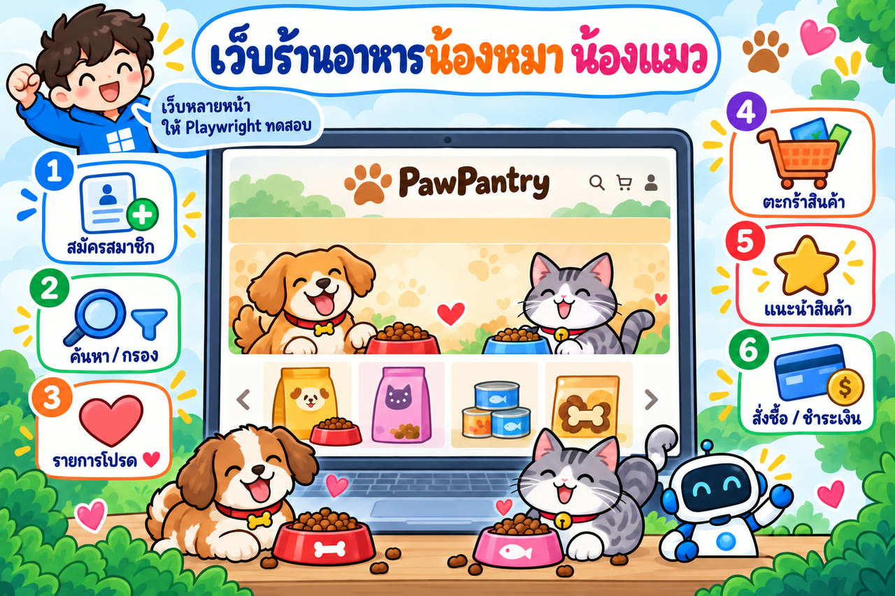

## 🧭 บทนี้เราทำอะไรบ้าง

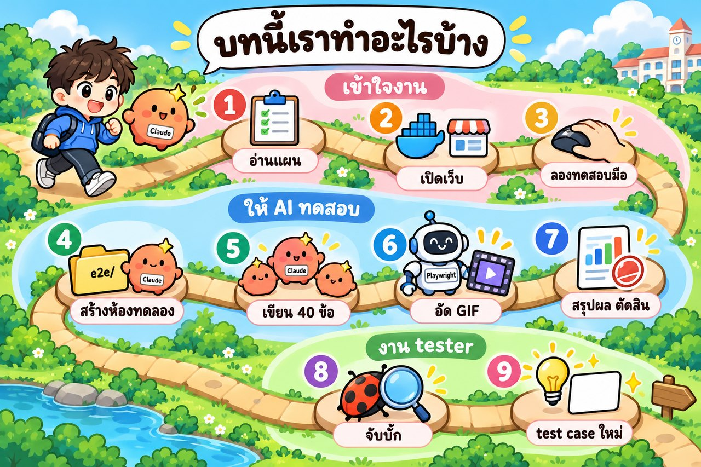

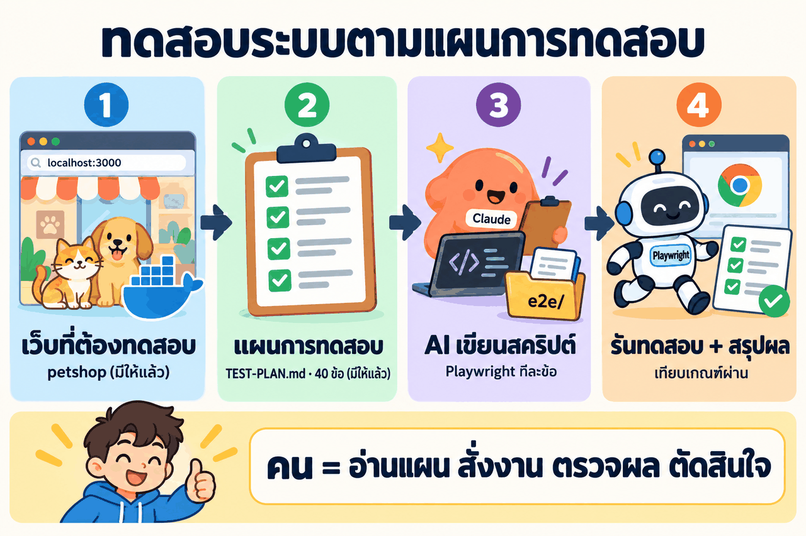

| มีให้ตอนเริ่ม | AI สร้างให้ระหว่างเรียน |
|---|---|
| `petshop/` เว็บ + `docker-compose.yml` (ใช้แค่เปิดเว็บ ไม่ต้องอ่านโค้ด) | `e2e/` ห้องทดลอง + สคริปต์ Playwright ทั้งหมด |
| `TEST-PLAN.md` แผนการทดสอบ 40 ข้อ | ผลการทดลอง: รายงาน, GIF, วิดีโอ |

## 🗂️ เว็บอยู่ที่ petshop · ทดลองที่ e2e

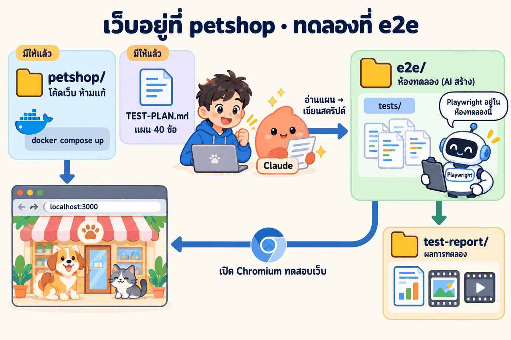

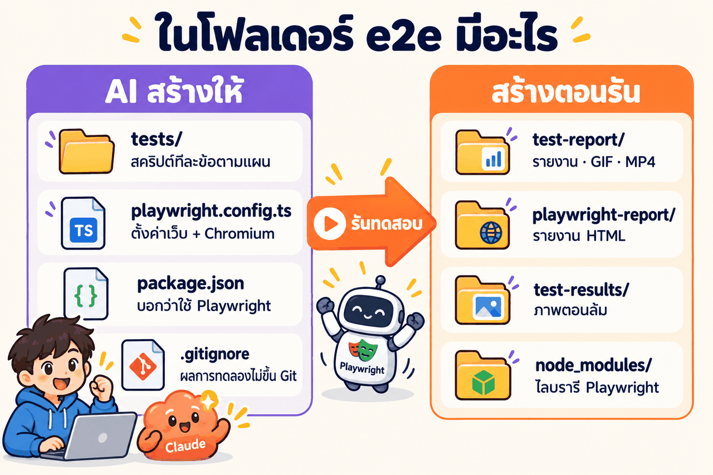

> `.gitignore` ใน e2e กันไม่ให้ผลการทดลองขึ้น Git เพราะสร้างใหม่ได้ทุกครั้งที่รัน และ GIF/วิดีโอไฟล์ใหญ่

## 🔒 AI ทดสอบแบบ tester จริง (black-box)

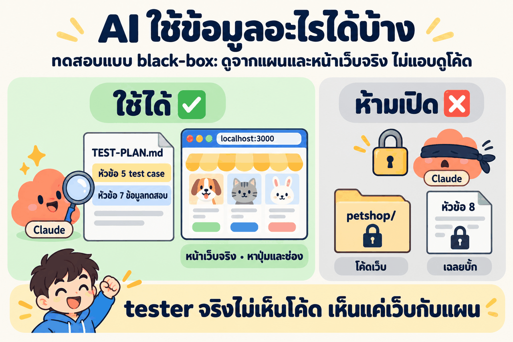

## 🔁 ทุก LAB มี 4 จังหวะ

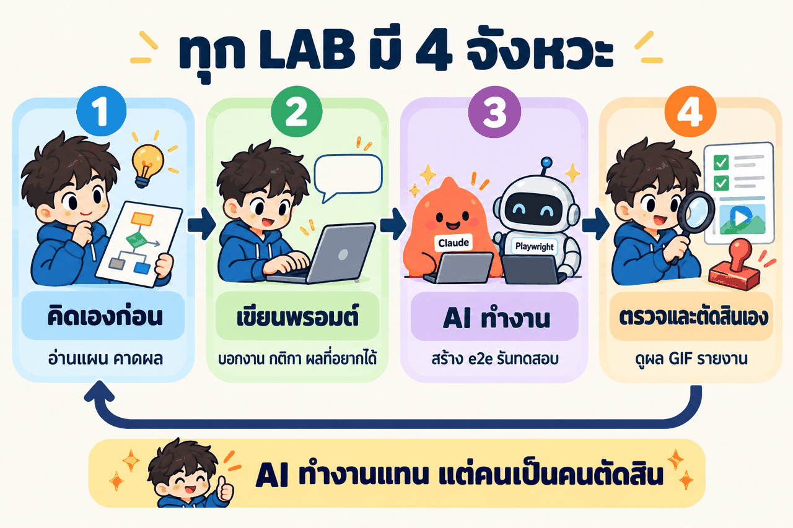

---

## 🧰 ก่อนเริ่ม

| ✅ | ต้องมี |
|---|---|
| ☐ | Windows 10/11 + **Claude Code** เปิดใน **โฟลเดอร์นี้** |
| ☐ | **Docker Desktop** เปิดอยู่ (ไอคอนวาฬไม่หมุน) |
| ☐ | ทำ **บท 01** แล้ว (มี Node.js + Playwright + Chromium) |

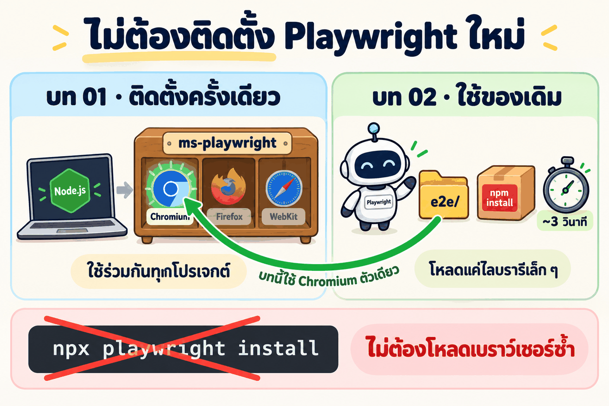

---

## LAB 1 · อ่านแผนก่อนลงมือ 🧑

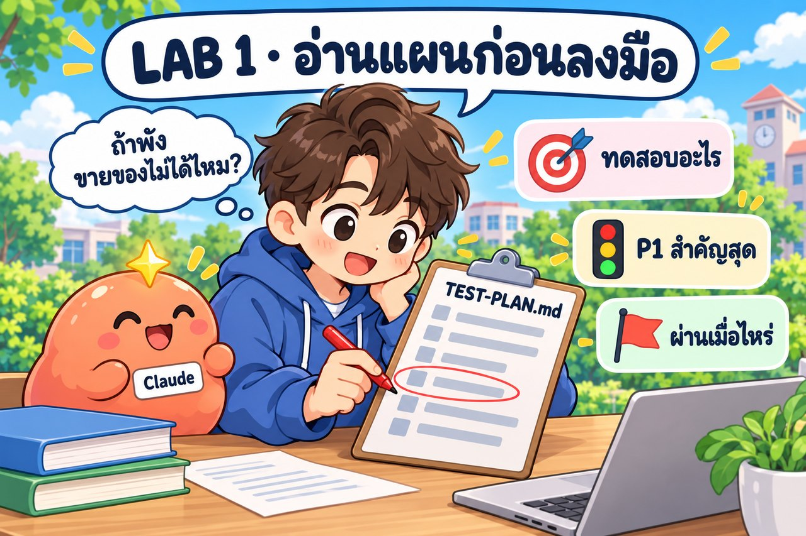

🧑 **ทำเอง** เปิด [TEST-PLAN.md](TEST-PLAN.md) แล้วตอบ 3 ข้อในกระดาษ

| คำถาม | ดูที่หัวข้อ |
|---|---|
| ทดสอบอะไร และ **ไม่** ทดสอบอะไร | 2 |
| ข้อไหนเป็น P1 (ถ้าพัง ขายของไม่ได้หรือเงินผิด) | 4 · 5 |
| ระบบ "ผ่าน" เมื่อไหร่ | 6 |


<details>
<summary>✅ เฉลย</summary>

- ทดสอบ: ทุกหน้า เงิน ฟอร์ม ระบบแนะนำ Chromium + มือถือ API · ไม่ทดสอบ: รับเงินจริง, load test, penetration test
- P1 มี 15 ข้อ เช่น TC-CART-01 ยอดรวมตะกร้า, TC-CPN-01 คูปอง PAW10, TC-CHK-03 ซื้อของจนจบ
- ผ่านเมื่อ **P1 ผ่านทั้งหมด** และ **อัตราผ่านรวม ≥ 95%**

</details>

---

## LAB 2 · เปิดเว็บด้วย Docker 🤖

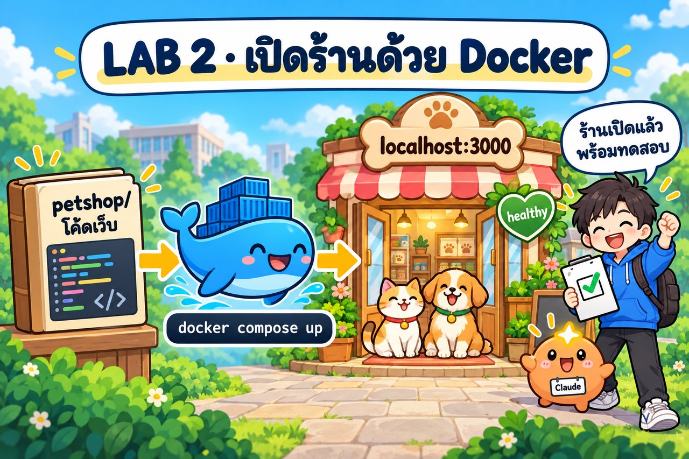

🧑 **คิดก่อน** "healthy" แปลว่าอะไร และเช็กยังไงว่าเว็บพร้อม

💬 **พรอมต์**

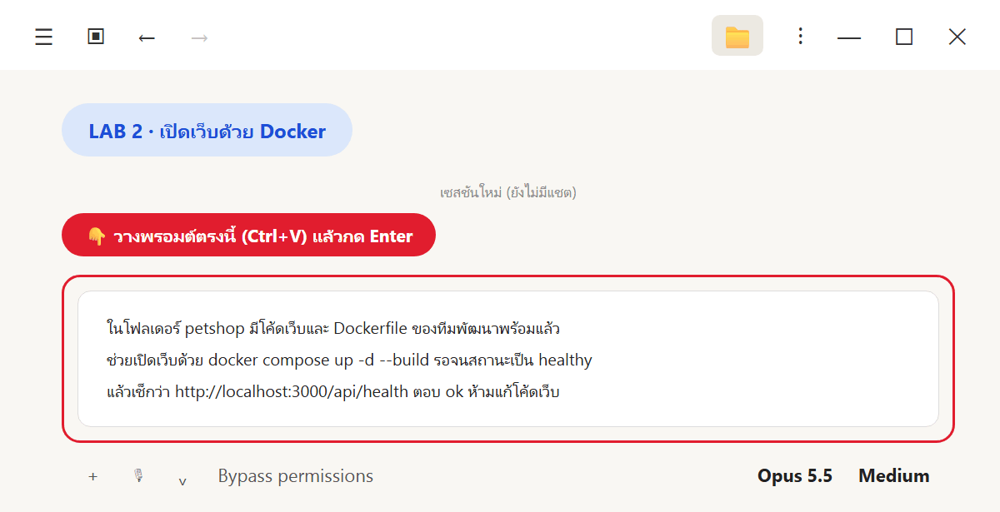

```text
ในโฟลเดอร์ petshop มีโค้ดเว็บและ Dockerfile ของทีมพัฒนาพร้อมแล้ว
ช่วยเปิดเว็บด้วย docker compose up -d --build รอจนสถานะเป็น healthy
แล้วเช็กว่า http://localhost:3000/api/health ตอบ ok ห้ามแก้โค้ดเว็บ
```

✅ **ผลจริง** `petshop` ขึ้น **healthy** ใน 7 วินาที และ `/api/health` ตอบ `{"ok":true}`

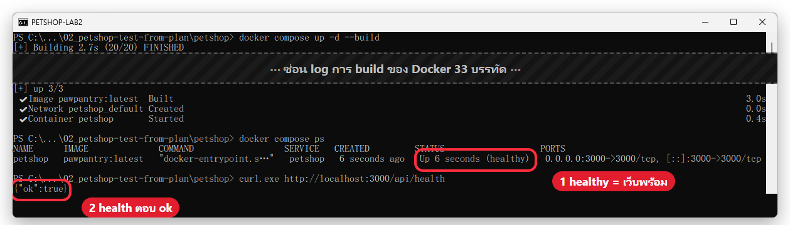

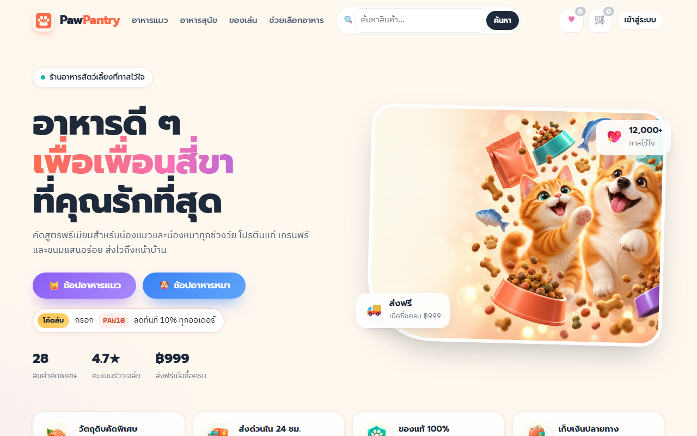

---

## LAB 3 · ลองทดสอบด้วยมือ 🧑

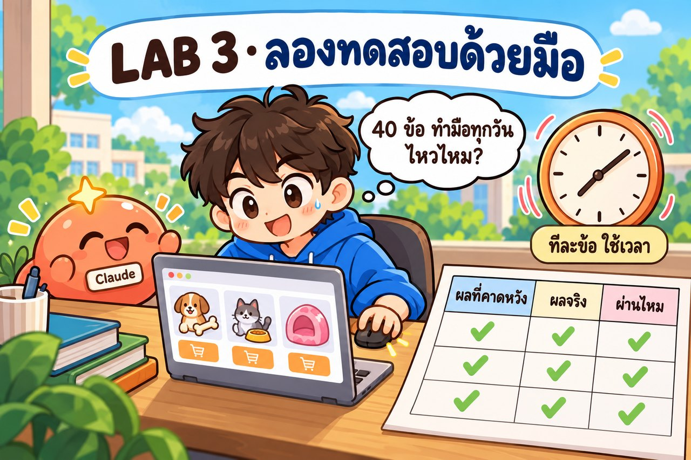

🧑 **ทำเอง** เปิด http://localhost:3000 ทดสอบ 3 ข้อตามแผน แล้วกรอกใบงาน (จับเวลาด้วย)

| รหัส | ทำอะไร | ผลที่คาดหวัง (จากแผน) | ผลจริง | ผ่านไหม |
|---|---|---|---|---|
| TC-CART-01 | ใส่ "ลูกแมว สูตรแซลมอน" 2 ชิ้น | ฿189×2 + ค่าส่ง ฿50 = ฿428 | | |
| TC-CPN-01 | ใส่ "แมวโต สูตรไก่ 3 kg" ใช้คูปอง PAW10 | ฿799 ลด ฿79 → ฿770 | | |
| TC-AUTH-05 | เข้าสู่ระบบด้วยรหัสผ่านผิด | "อีเมลหรือรหัสผ่านไม่ถูกต้อง" | | |

| หน้าสินค้า | ตะกร้า |
|---|---|
|  |  |

👀 3 ข้อใช้หลายนาที ถ้าต้องทำ 40 ข้อทุกครั้งที่เว็บแก้โค้ด → นี่คือเหตุผลที่ต้องให้ Playwright ทำแทน

---

## LAB 4 · ให้ AI สร้างห้องทดลอง e2e 🤖

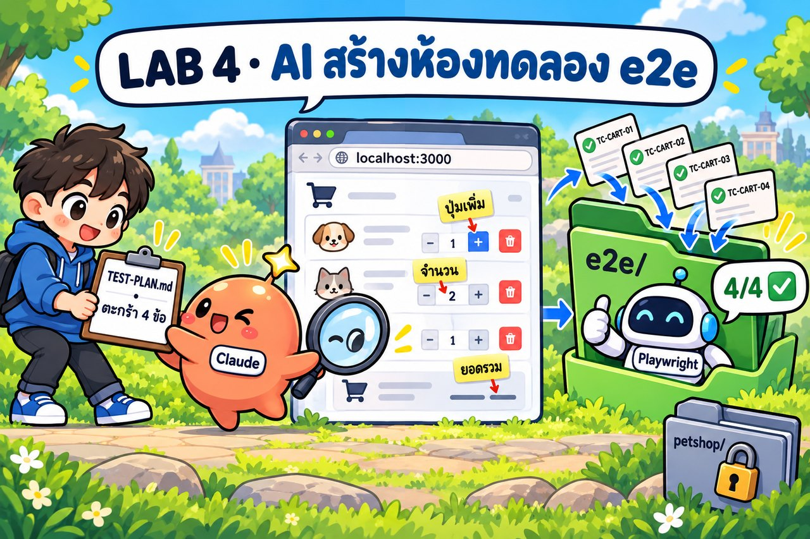

🧑 **คิดก่อน** เปิดแผนหัวข้อ 5 ลำดับ 16–19 (ตะกร้า) แล้วเดาว่า test แต่ละข้อต้องกดอะไรบ้าง

💬 **พรอมต์**

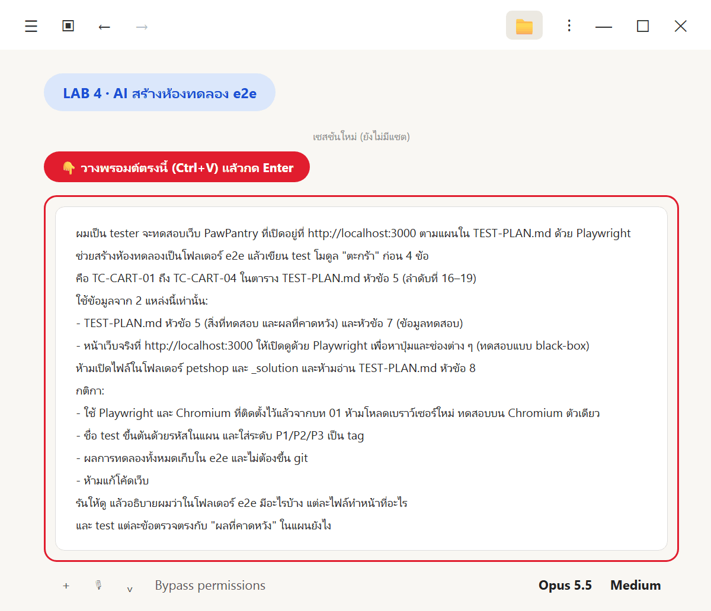

```text
ผมเป็น tester จะทดสอบเว็บ PawPantry ที่เปิดอยู่ที่ http://localhost:3000 ตามแผนใน TEST-PLAN.md ด้วย Playwright
ช่วยสร้างห้องทดลองเป็นโฟลเดอร์ e2e แล้วเขียน test โมดูล "ตะกร้า" ก่อน 4 ข้อ
คือ TC-CART-01 ถึง TC-CART-04 ในตาราง TEST-PLAN.md หัวข้อ 5 (ลำดับที่ 16–19)
ใช้ข้อมูลจาก 2 แหล่งนี้เท่านั้น:
- TEST-PLAN.md หัวข้อ 5 (สิ่งที่ทดสอบ และผลที่คาดหวัง) และหัวข้อ 7 (ข้อมูลทดสอบ)
- หน้าเว็บจริงที่ http://localhost:3000 ให้เปิดดูด้วย Playwright เพื่อหาปุ่มและช่องต่าง ๆ (ทดสอบแบบ black-box)
ห้ามเปิดไฟล์ในโฟลเดอร์ petshop และ _solution และห้ามอ่าน TEST-PLAN.md หัวข้อ 8
กติกา:
- ใช้ Playwright และ Chromium ที่ติดตั้งไว้แล้วจากบท 01 ห้ามโหลดเบราว์เซอร์ใหม่ ทดสอบบน Chromium ตัวเดียว
- ชื่อ test ขึ้นต้นด้วยรหัสในแผน และใส่ระดับ P1/P2/P3 เป็น tag
- ผลการทดลองทั้งหมดเก็บใน e2e และไม่ต้องขึ้น git
- ห้ามแก้โค้ดเว็บ
รันให้ดู แล้วอธิบายผมว่าในโฟลเดอร์ e2e มีอะไรบ้าง แต่ละไฟล์ทำหน้าที่อะไร
และ test แต่ละข้อตรวจตรงกับ "ผลที่คาดหวัง" ในแผนยังไง
```

| บรรทัดในพรอมต์ | ถ้าไม่บอก AI จะ… |
|---|---|
| ลำดับที่ 16–19 ในหัวข้อ 5 | หาไม่เจอว่าโมดูลตะกร้าอยู่ตรงไหนของแผน |
| เปิดเว็บจริงหาปุ่ม · ห้ามเปิด petshop | แอบอ่านโค้ดเว็บ ซึ่ง tester จริงไม่มี |
| ใช้ Chromium จากบท 01 | โหลดเบราว์เซอร์ใหม่หลายร้อย MB |
| ผลเก็บใน e2e ไม่ขึ้น git | ไฟล์ผลกระจัดกระจาย หรือหลุดขึ้น Git |

✅ **ผลจริง: 4 passed ใน 3.7 วินาที** (ทั้ง LAB ใช้ 3 นาที)

| สิ่งที่ AI ทำ | ผล |
|---|---|
| ติดตั้ง | `npm i -D @playwright/test` ใน e2e · **ไม่ได้โหลดเบราว์เซอร์** (ใช้ Chromium เดิม) |
| สำรวจเว็บ | เขียนสคริปต์ `explore/*.mjs` เปิดหน้าแรก หน้าสินค้า ตะกร้า เพื่อหาปุ่ม · ไม่ได้เปิดไฟล์ใน petshop |
| สร้าง | `package.json` · `playwright.config.ts` · `global-setup.ts` (ล้างข้อมูลก่อนรัน) · `tests/05-cart.spec.ts` · `.gitignore` |
| ตรวจ TC-CART-01 | ใส่ 2 ชิ้น → ยอดสินค้า ฿378 · ค่าส่ง ฿50 · ยอดชำระ **฿428** ✅ |

---

## LAB 5 · ให้ agent หลายตัวเขียนครบ 40 ข้อพร้อมกัน 🤖 + 🧑

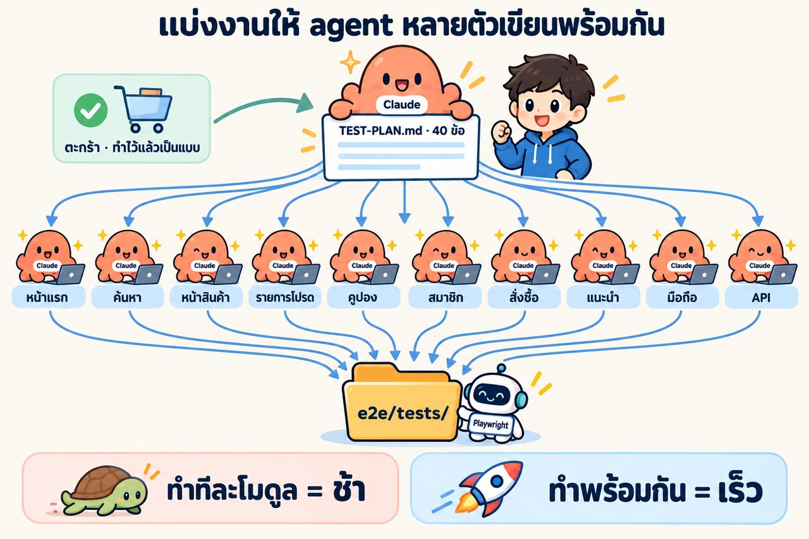

🧑 **คิดก่อน** AI ไม่เห็นโค้ดเว็บ อาจเขียน test ผิดได้ ถ้า test ล้ม เราจะรู้ได้ยังไงว่า "เว็บผิด" หรือ "test ผิด"

💬 **พรอมต์**

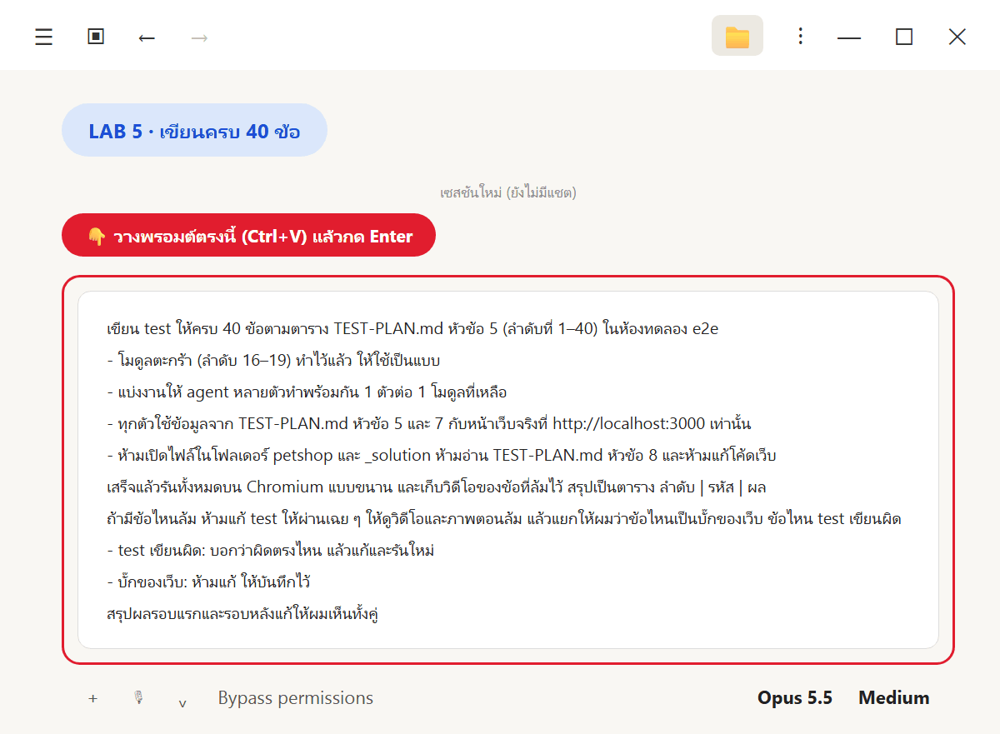

```text
เขียน test ให้ครบ 40 ข้อตามตาราง TEST-PLAN.md หัวข้อ 5 (ลำดับที่ 1–40) ในห้องทดลอง e2e
- โมดูลตะกร้า (ลำดับ 16–19) ทำไว้แล้ว ให้ใช้เป็นแบบ
- แบ่งงานให้ agent หลายตัวทำพร้อมกัน 1 ตัวต่อ 1 โมดูลที่เหลือ
- ทุกตัวใช้ข้อมูลจาก TEST-PLAN.md หัวข้อ 5 และ 7 กับหน้าเว็บจริงที่ http://localhost:3000 เท่านั้น
- ห้ามเปิดไฟล์ในโฟลเดอร์ petshop และ _solution ห้ามอ่าน TEST-PLAN.md หัวข้อ 8 และห้ามแก้โค้ดเว็บ
เสร็จแล้วรันทั้งหมดบน Chromium แบบขนาน และเก็บวิดีโอของข้อที่ล้มไว้ สรุปเป็นตาราง ลำดับ | รหัส | ผล
ถ้ามีข้อไหนล้ม ห้ามแก้ test ให้ผ่านเฉย ๆ ให้ดูวิดีโอและภาพตอนล้ม แล้วแยกให้ผมว่าข้อไหนเป็นบั๊กของเว็บ ข้อไหน test เขียนผิด
- test เขียนผิด: บอกว่าผิดตรงไหน แล้วแก้และรันใหม่
- บั๊กของเว็บ: ห้ามแก้ ให้บันทึกไว้
สรุปผลรอบแรกและรอบหลังแก้ให้ผมเห็นทั้งคู่
```

✅ **ผลจริง**

| | ผล |
|---|---|
| agent ทำงานพร้อมกัน | **10 ตัว** (หน้าแรก ค้นหา หน้าสินค้า รายการโปรด คูปอง สมาชิก สั่งซื้อ แนะนำ มือถือ API) |
| เวลาเขียน test | **ประมาณ 4 นาที** (ทั้ง LAB 8 นาที) |
| รันครบ 40 ข้อ | **30 วินาที · ผ่าน 39 · ล้ม 1** |
| test เขียนผิด | 0 ข้อ |
| บั๊กของเว็บ | **TC-AUTH-02** ส่งฟอร์มสมัครเปล่า ช่อง "ยืนยันรหัสผ่าน" ไม่ขึ้น error |

🐞 **AI เจอบั๊กจริง!** แผนบอกว่า "error ทุกช่อง" แต่ช่องยืนยันรหัสผ่านไม่ขึ้นอะไรเลย

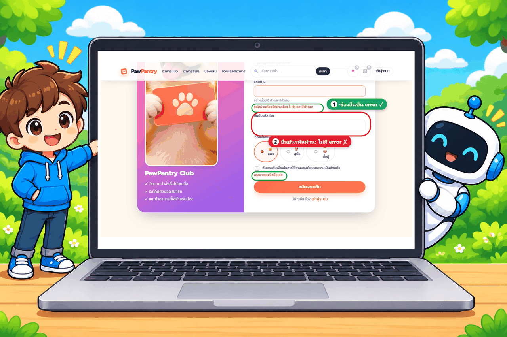

| 🎬 GIF ตอนล้ม TC-AUTH-02 |
|---|
| 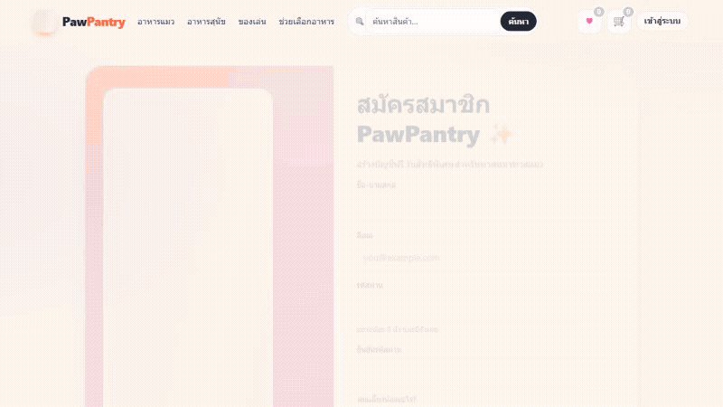 |

👀 **สังเกต**
- AI รู้ว่าไม่ใช่ test ผิด เพราะข้อ TC-AUTH-03 หาช่อง error เดียวกันเจอ (ตอนรหัสไม่ตรงกัน)
- เฉลยเดิมที่คนเคยเขียนไว้ตรวจแค่ 4 ช่อง จึงพลาดบั๊กนี้ → **เขียน test ให้ตรงตามแผนทุกคำ สำคัญมาก**

---

## LAB 6 · อัดหลักฐานเป็น GIF 🤖


💬 **พรอมต์**

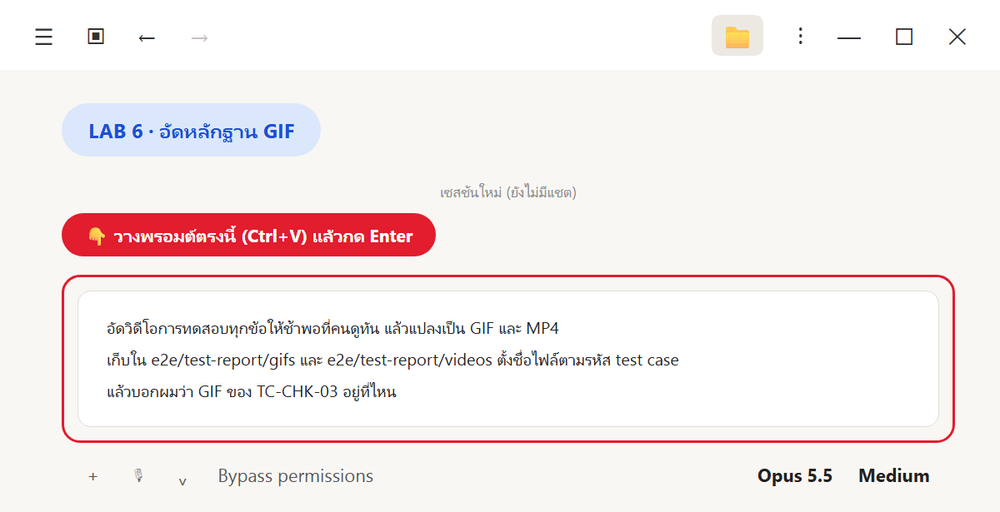

```text
อัดวิดีโอการทดสอบทุกข้อให้ช้าพอที่คนดูทัน แล้วแปลงเป็น GIF และ MP4
เก็บใน e2e/test-report/gifs และ e2e/test-report/videos ตั้งชื่อไฟล์ตามรหัส test case
แล้วบอกผมว่า GIF ของ TC-CHK-03 อยู่ที่ไหน
```

✅ **ผลจริง: ผ่าน 39 · ล้ม 1 ใน 56 วินาที** ได้ GIF + MP4 อย่างละ **37 ไฟล์** (API 3 ข้อไม่มีภาพ เพราะไม่ได้เปิดหน้าเว็บ)

**🎬 TC-CHK-03 ลูกค้าซื้อของจนจบ**

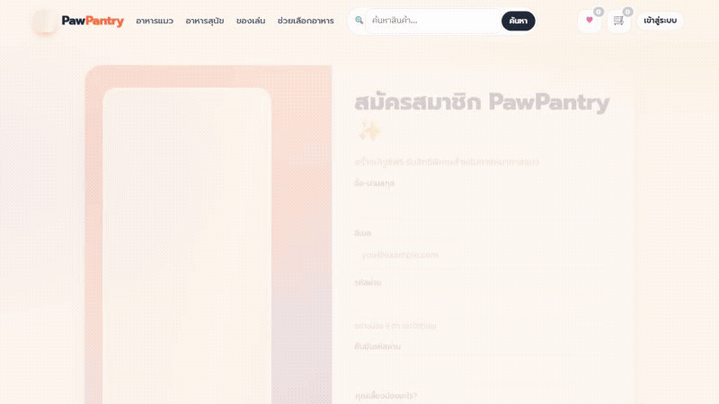

| ✨ ระบบแนะนำ: ลูกแมวแพ้ไก่ | 🛒 เพิ่ม ลด ลบ ในตะกร้า |
|---|---|
|  | 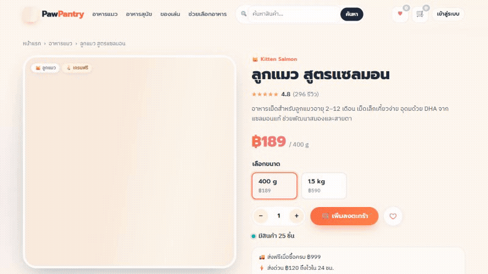 |

👀 AI เขียนตัวช่วยเพิ่มเอง 2 ไฟล์: `playwright.video.config.ts` (อัดช้า ๆ) และ `scripts/make-media.mjs` (แปลงเป็น GIF/MP4 ด้วย ffmpeg)

---

## LAB 7 · สรุปผลแล้วตัดสินใจ 🤖 + 🧑

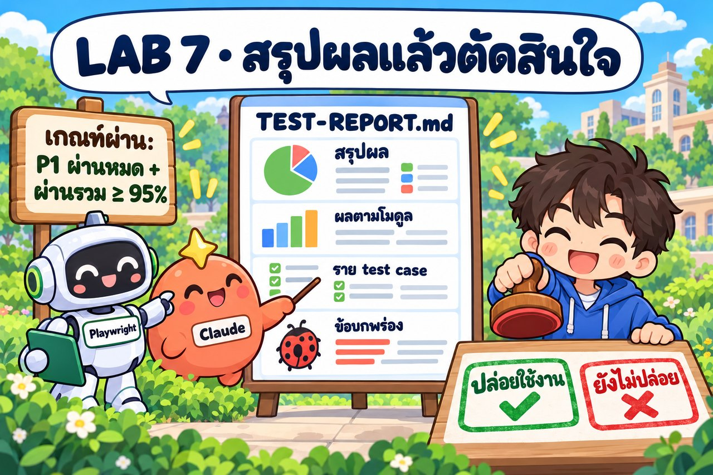

🧑 **ตัดสินเองก่อน** ผ่าน 39/40 · P1 ผ่าน 15/15 · ข้อที่ล้มเป็น P2 → ปล่อยได้ไหม?

💬 **พรอมต์**

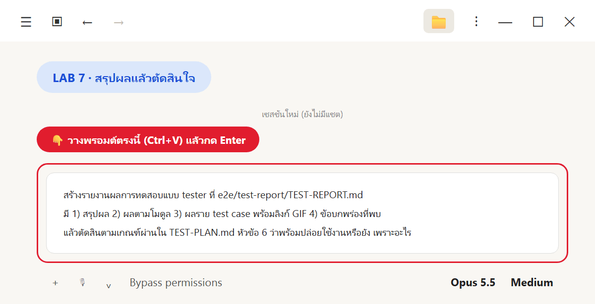

```text
สร้างรายงานผลการทดสอบแบบ tester ที่ e2e/test-report/TEST-REPORT.md
มี 1) สรุปผล 2) ผลตามโมดูล 3) ผลราย test case พร้อมลิงก์ GIF 4) ข้อบกพร่องที่พบ
แล้วตัดสินตามเกณฑ์ผ่านใน TEST-PLAN.md หัวข้อ 6 ว่าพร้อมปล่อยใช้งานหรือยัง เพราะอะไร
```

✅ **ผลจริง: ผ่านเกณฑ์ พร้อมปล่อยแบบมีเงื่อนไข**

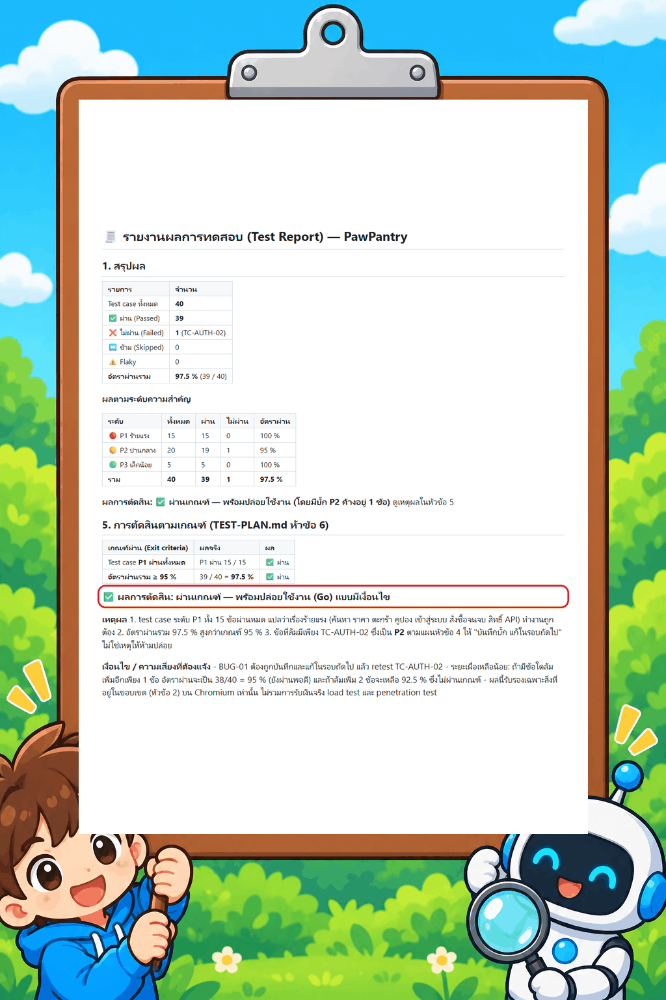

| เกณฑ์ (หัวข้อ 6) | ผลจริง | |
|---|---|---|
| P1 ผ่านทั้งหมด | 15 / 15 | ✅ |
| อัตราผ่านรวม ≥ 95% | 39 / 40 = 97.5% | ✅ |

👀 "มีเงื่อนไข" = ต้องบันทึกบั๊ก TC-AUTH-02 ไว้แก้รอบหน้า และถ้าล้มเพิ่มอีก 2 ข้อจะไม่ผ่านเกณฑ์ทันที

---

## LAB 8 · ฝึกจับบั๊ก 🐞


🧑 **คิดก่อน** เว็บนี้มี "โหมดฝังบั๊ก" (`BUG_MODE=1`) คิดว่า test ของเราจะจับได้กี่ตัว

💬 **พรอมต์**

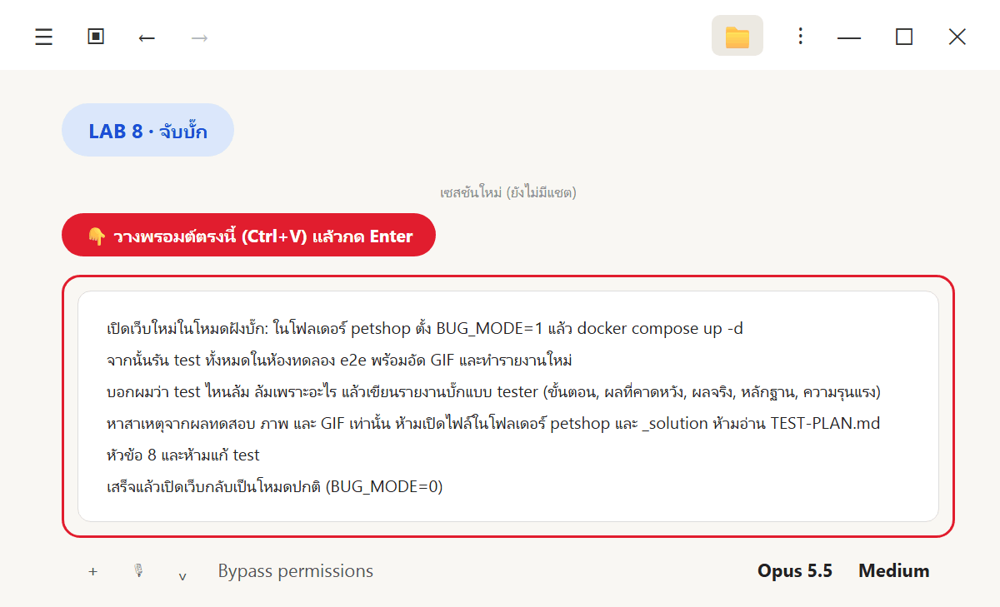

```text
เปิดเว็บใหม่ในโหมดฝังบั๊ก: ในโฟลเดอร์ petshop ตั้ง BUG_MODE=1 แล้ว docker compose up -d
จากนั้นรัน test ทั้งหมดในห้องทดลอง e2e พร้อมอัด GIF และทำรายงานใหม่
บอกผมว่า test ไหนล้ม ล้มเพราะอะไร แล้วเขียนรายงานบั๊กแบบ tester (ขั้นตอน, ผลที่คาดหวัง, ผลจริง, หลักฐาน, ความรุนแรง)
หาสาเหตุจากผลทดสอบ ภาพ และ GIF เท่านั้น ห้ามเปิดไฟล์ในโฟลเดอร์ petshop และ _solution ห้ามอ่าน TEST-PLAN.md หัวข้อ 8 และห้ามแก้ test
เสร็จแล้วเปิดเว็บกลับเป็นโหมดปกติ (BUG_MODE=0)
```

✅ **ผลจริง: ผ่าน 35 · ล้ม 5 (87.5%) → ไม่ผ่านเกณฑ์ ห้ามปล่อย** จับบั๊กที่ฝังได้ **ครบ 3 ตัว** + บั๊กจริงจาก LAB 5

| test ที่ล้ม | ระดับ | ผลที่คาดหวัง | ผลจริง | ประเภท |
|---|---|---|---|---|
| TC-CPN-01 | 🔴 P1 | PAW10 ลด ฿79 | ลดแค่ ฿7 | บั๊กฝัง |
| TC-CHK-02 | 🔴 P1 | เบอร์ 9 หลักขึ้น error | ไม่ขึ้น error | บั๊กฝัง |
| TC-WISH-02 | 🟡 P2 | ลบแล้วตัวเลขหัวใจเป็น 1 | ยังเป็น 2 | บั๊กฝัง |
| TC-WISH-03 | 🟡 P2 | ย้ายไปตะกร้าแล้วหัวใจลดลง | ยังเป็น 1 | บั๊กฝัง (ตัวเดียวกับข้อบน) |
| TC-AUTH-02 | 🟡 P2 | error ทุกช่อง | ยืนยันรหัสผ่านไม่มี error | บั๊กจริง (ล้มตั้งแต่ LAB 5) |

| 🐞 คูปองลดผิด | 🐞 ตัวเลขไม่ลด | 🐞 เบอร์โทรผิด |
|---|---|---|
| 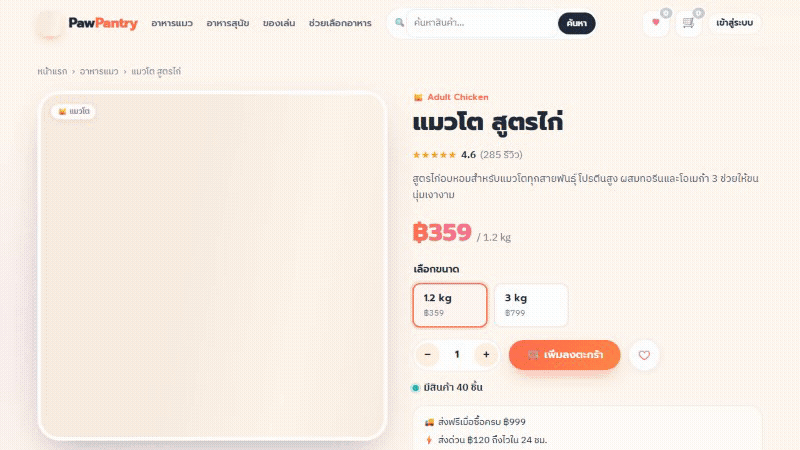 | 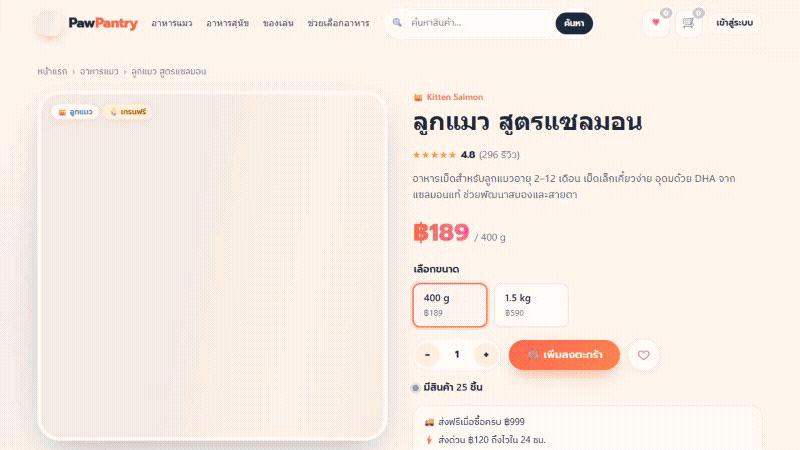 | 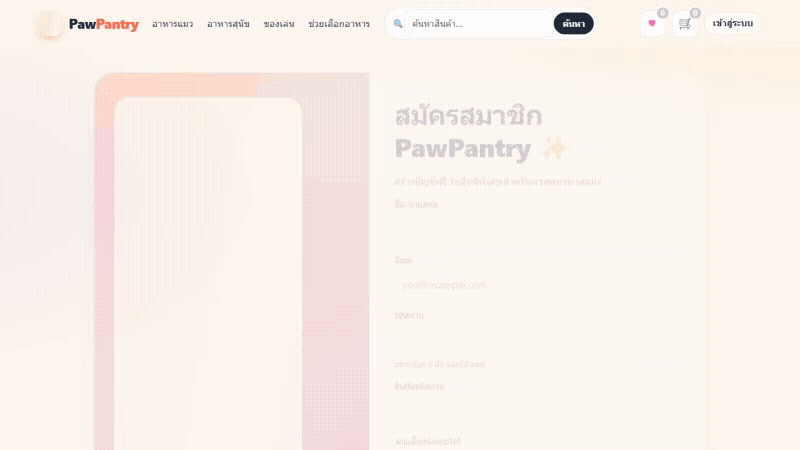 |

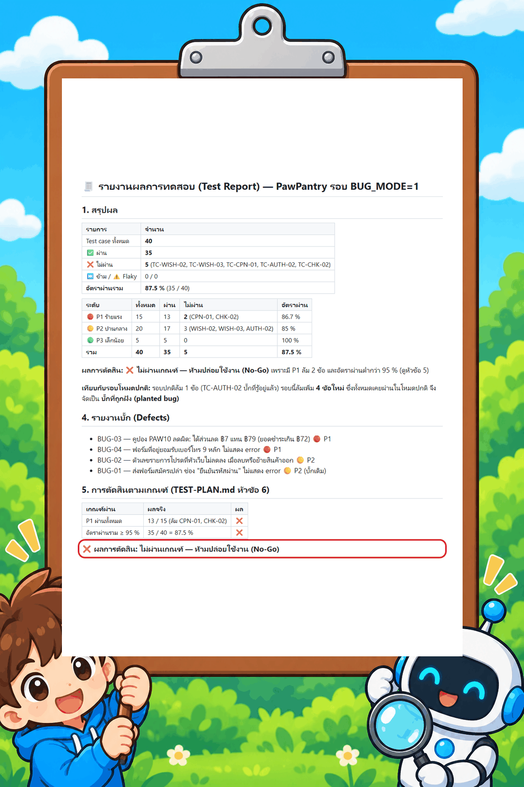

**รายงานบั๊กที่ดีมี 5 อย่าง** · **test ล้ม = ผิดที่เว็บ หรือผิดที่ test?**

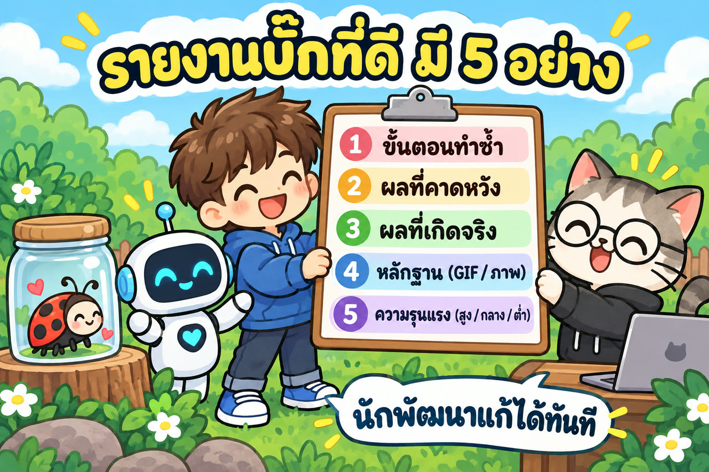

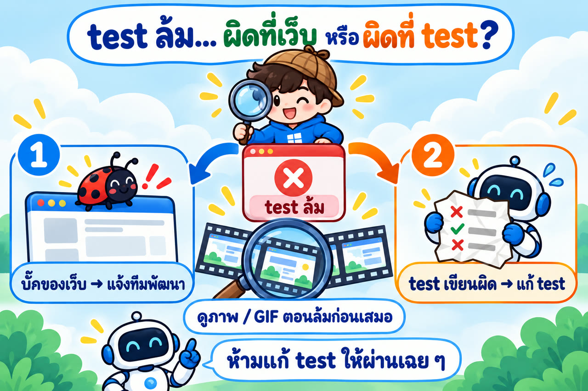

---

## LAB 9 · คิด test case เอง 🧑 + 🤖

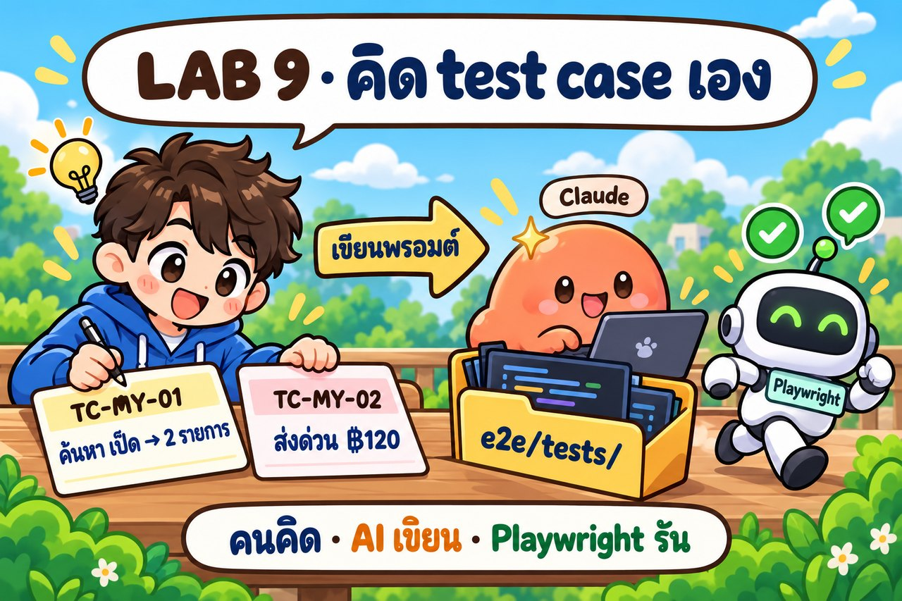

🧑 **ทำเอง** คิด test case ที่แผนยังไม่มี 2 ข้อ (ใช้เทคนิคจากแผนหัวข้อ 3 เช่น boundary, negative) ตัวอย่าง:

💬 **พรอมต์**

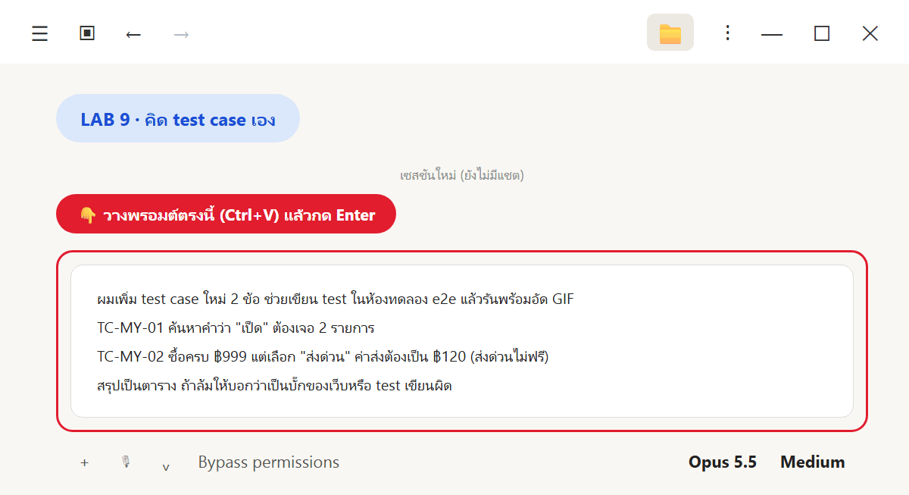

```text
ผมเพิ่ม test case ใหม่ 2 ข้อ ช่วยเขียน test ในห้องทดลอง e2e แล้วรันพร้อมอัด GIF
TC-MY-01 ค้นหาคำว่า "เป็ด" ต้องเจอ 2 รายการ
TC-MY-02 ซื้อครบ ฿999 แต่เลือก "ส่งด่วน" ค่าส่งต้องเป็น ฿120 (ส่งด่วนไม่ฟรี)
สรุปเป็นตาราง ถ้าล้มให้บอกว่าเป็นบั๊กของเว็บหรือ test เขียนผิด
```

✅ **ผลจริง: ผ่าน 2 / 2** (ทั้ง LAB 3 นาที)

| รหัส | ผลที่คาดหวัง | ผลจริงบนเว็บ | ผล |
|---|---|---|---|
| TC-MY-01 | ค้นหา "เป็ด" พบ 2 รายการ | "พบ 2 รายการ" (เป็ดอบแห้ง, แมวโต เป็ดเกรนฟรี) | ✅ |
| TC-MY-02 | ครบ ฿999 + ส่งด่วน = ค่าส่ง ฿120 | ซื้อ ฿999 **พอดี** ส่งธรรมดาฟรี → ส่งด่วน ฿120 ยอดรวม ฿1,119 | ✅ |

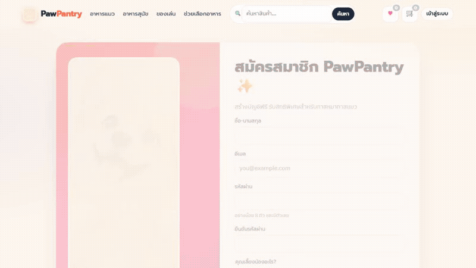

👀 AI เลือกซื้อให้ได้ **฿999 พอดี** เอง = ทดสอบค่าขอบ (boundary) ของส่งฟรี ตรงกับเทคนิคในแผนหัวข้อ 3

👀 ลองคิดโจทย์เอง เช่น "ใส่จำนวน 0 ได้ไหม", "รีโหลดหน้าชำระเงินแล้วที่อยู่หายไหม"

---

## ถ้าเจอปัญหา

| อาการ | 💬 พรอมต์ |
|---|---|
| Docker ไม่ทำงาน | `docker compose up ไม่ผ่าน ช่วยเช็กว่า Docker Desktop เปิดอยู่ไหม และพอร์ต 3000 ถูกใช้อยู่หรือเปล่า บอกผมว่าต้องทำอะไรเอง` |
| test ล้มทั้งหมด | `test ล้มทุกข้อ ช่วยเช็กว่าเว็บที่ http://localhost:3000 เปิดอยู่ไหม และ BUG_MODE เป็น 0 หรือยัง` |
| หาเบราว์เซอร์ไม่เจอ | `รัน test แล้วหาเบราว์เซอร์ไม่เจอ ช่วยเทียบว่า Playwright ใน e2e ต้องใช้ Chromium รุ่นไหน กับที่มีในโฟลเดอร์ ms-playwright จากบท 01 แล้วบอกผมก่อนว่าควรทำอย่างไร` |
| ไม่มีไฟล์ GIF | `อัด GIF แล้วไม่มีไฟล์ ช่วยเช็กว่ามี ffmpeg ในเครื่องไหม ถ้าไม่มีบอกวิธีติดตั้งให้ผม` |
| เลิกใช้แล้ว | `ปิดเว็บด้วย docker compose down ในโฟลเดอร์ petshop` |

## 📖 คำศัพท์

| คำ | ความหมายง่าย ๆ |
|---|---|
| **Test case** | "ลองทำแบบนี้ ต้องได้ผลแบบนี้" 1 ข้อ |
| **Black-box** | ทดสอบจากหน้าเว็บกับแผน โดยไม่ดูโค้ดข้างใน |
| **P1 P2 P3** | ระดับความสำคัญ สูง กลาง ต่ำ |
| **Exit criteria** | เกณฑ์ว่า "ผ่านพอจะปล่อยใช้งานได้" |
| **Agent** | AI ผู้ช่วยย่อยที่ทำงานพร้อมกันหลายตัว |
| **Playwright** | หุ่นยนต์ที่ใช้เว็บแทนเรา |

### ไฟล์ในบทนี้

```text
02_test-from-plan/01_petshop/
├─ README.md          # บทเรียน
├─ TEST-PLAN.md       # แผนการทดสอบ 40 ข้อ
├─ img/               # ภาพประกอบ
├─ petshop/           # เว็บ PawPantry + docker-compose.yml (ใช้แค่เปิดเว็บ)
├─ e2e/               # (AI สร้างใน LAB 4) ห้องทดลอง + ผลการทดลอง
└─ _solution/e2e/     # เฉลยสคริปต์ 40 ข้อ (ดูหลังทำเสร็จ)
```
