# ทดสอบเว็บร้านอาหารสัตว์ตามแผนการทดสอบ ด้วย Playwright + AI

เรามี **เว็บที่ต้องทดสอบ** กับ **แผนการทดสอบ** ให้ AI อ่านแผน เขียนสคริปต์ Playwright ทีละข้อ แล้วรันทดสอบเว็บจริง
ส่วนเราเป็นคนคิด สั่งงาน ตรวจผล และตัดสินใจ


## 🧭 บทนี้เราทำอะไรบ้าง


| มีให้ตอนเริ่ม | AI สร้างให้ระหว่างเรียน |
|---|---|
| `petshop/` เว็บ + `docker-compose.yml` (ใช้แค่เปิดเว็บ ไม่ต้องอ่านโค้ด) | `e2e/` ห้องทดลอง + สคริปต์ Playwright ทั้งหมด |
| `TEST-PLAN.md` แผนการทดสอบ 40 ข้อ | ผลการทดลอง: รายงาน และ GIF ทุกข้อ |

## 🗂️ เว็บอยู่ที่ petshop · ทดลองที่ e2e


> `.gitignore` ใน e2e กันไม่ให้ผลการทดลองขึ้น Git เพราะสร้างใหม่ได้ทุกครั้งที่รัน และ GIF ไฟล์ใหญ่

## 🔒 AI ทดสอบแบบ tester จริง (black-box)


> ⚠️ **ทุกพรอมต์ต้องมีบรรทัดกติกานี้** เพราะ Claude เริ่มแต่ละ LAB ใหม่และจำกติกาของ LAB ก่อนไม่ได้ ตอนทดลองจริง พรอมต์ที่ลืมใส่กติกาทำให้ AI แอบเปิดโค้ดใน `petshop/` ทันที

## 🔁 ทุก LAB มี 4 จังหวะ


---

## 🧰 ก่อนเริ่ม

| ✅ | ต้องมี |
|---|---|
| ☐ | Windows 10/11 + **Claude Code** เปิดใน **โฟลเดอร์นี้** |
| ☐ | **Docker Desktop** เปิดอยู่ (ไอคอนวาฬไม่หมุน) |
| ☐ | ทำ **บท 01** แล้ว (มี Node.js + Playwright + Chromium) |
| ☐ | **Google Chrome** (ใช้ใน LAB 2 ให้ AI เปิดเว็บใน Chrome ของเรา) |


---

## LAB 1 · อ่านแผนก่อนลงมือ 🧑


🧑 **ทำเอง** เปิด [TEST-PLAN.md](TEST-PLAN.md) แล้วตอบ 3 ข้อในกระดาษ

| คำถาม | ดูที่หัวข้อ |
|---|---|
| ทดสอบอะไร และ **ไม่** ทดสอบอะไร | 2 |
| ข้อไหนเป็น P1 (ถ้าพัง ขายของไม่ได้หรือเงินผิด) | 4 · 5 |
| ระบบ "ผ่าน" เมื่อไหร่ | 6 |

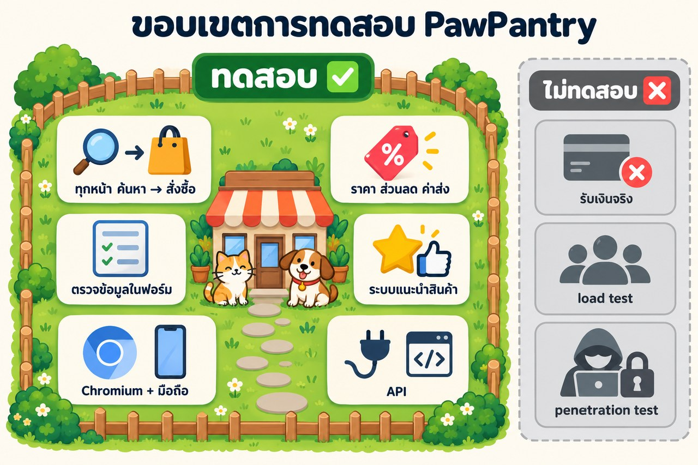

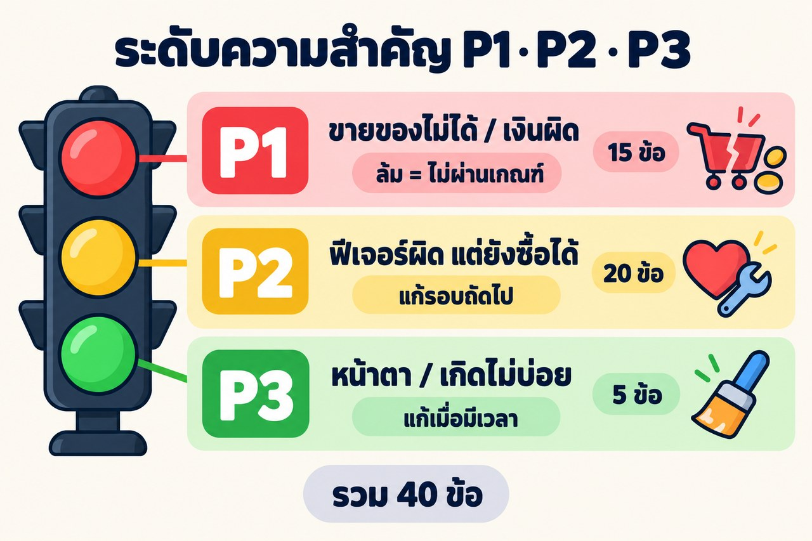

<details>
<summary>✅ เฉลย</summary>

- ทดสอบ: ทุกหน้า เงิน ฟอร์ม ระบบแนะนำ มือถือ API · ไม่ทดสอบ: รับเงินจริง, load test, penetration test
- P1 มี 15 ข้อ เช่น TC-CART-01 ยอดรวมตะกร้า, TC-CPN-01 คูปอง PAW10, TC-CHK-03 ซื้อของจนจบ
- ผ่านเมื่อ **P1 ผ่านทั้งหมด** และ **อัตราผ่านรวม ≥ 95%**

</details>

---

## LAB 2 · เปิดเว็บ แล้วเชื่อม Claude Code กับ Chrome 🤖

LAB นี้มี 3 ขั้น: **2A** เปิดเว็บด้วย Docker → **2B** ให้ Claude Code คุม Chrome ได้ → **2C** ลองให้ AI เปิดเว็บใน Chrome ของเรา

### 2A · เปิดเว็บด้วย Docker


🧑 **คิดก่อน** "healthy" แปลว่าอะไร และเช็กยังไงว่าเว็บพร้อม

💬 **พรอมต์**


```text
ในโฟลเดอร์ petshop มีโค้ดเว็บและ Dockerfile ของทีมพัฒนาพร้อมแล้ว
ช่วยเปิดเว็บด้วย docker compose up -d --build รอจนสถานะเป็น healthy
แล้วเช็กว่า http://localhost:3000/api/health ตอบ ok ห้ามแก้โค้ดเว็บ
```

✅ **ผลจริง** build ใหม่ทั้งหมด **14 วินาที** → `healthy` และ `/api/health` ตอบ `{"ok":true}`


### 2B · ให้ Claude Code คุม Chrome ได้ (Playwright MCP แบบ --extension)


| คำ | ความหมายง่าย ๆ |
|---|---|
| **MCP** | "ปลั๊ก" ที่ทำให้ Claude Code ใช้เครื่องมือภายนอกได้ |
| **Playwright MCP** | ปลั๊กที่ทำให้ Claude Code เปิดเว็บ คลิก และอ่านหน้าเว็บได้เอง |
| **--extension** | ใช้ **Chrome ตัวที่เราเปิดอยู่** (ผ่านส่วนขยาย) แทนการเปิดเบราว์เซอร์ใหม่ เราจึงเห็นทุกอย่างที่ AI ทำ |
| **ระดับ user** | ตั้งครั้งเดียว ใช้ได้ทุกโปรเจกต์ |

🧑 **ทำเอง** ติดตั้งส่วนขยายใน Chrome ก่อน (AI ติดตั้งส่วนขยายแทนเราไม่ได้)

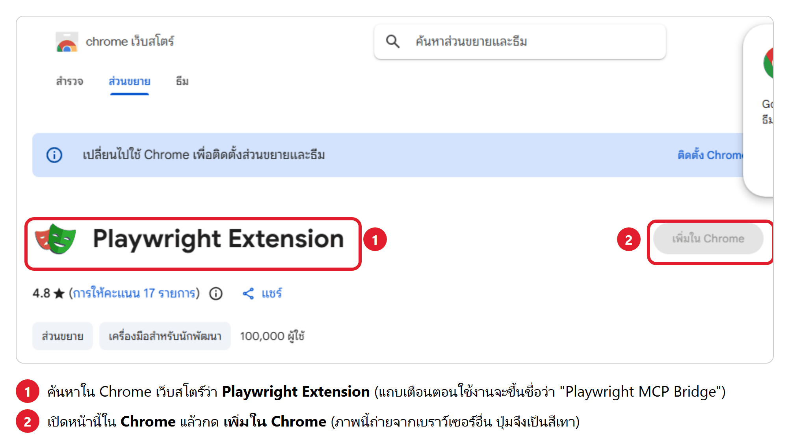

💬 **พรอมต์**

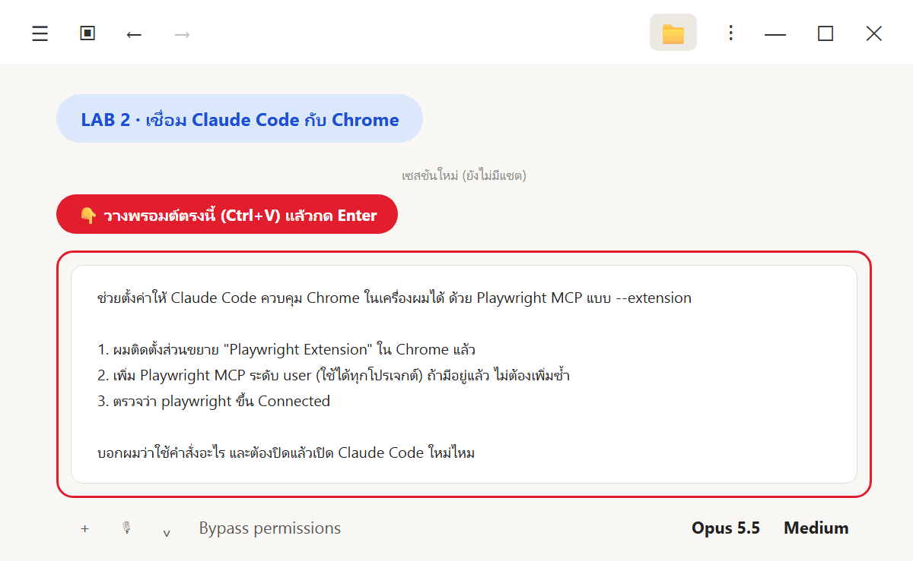

```text
ช่วยตั้งค่าให้ Claude Code ควบคุม Chrome ในเครื่องผมได้ ด้วย Playwright MCP แบบ --extension

1. ผมติดตั้งส่วนขยาย "Playwright Extension" ใน Chrome แล้ว
2. เพิ่ม Playwright MCP ระดับ user (ใช้ได้ทุกโปรเจกต์) ถ้ามีอยู่แล้ว ไม่ต้องเพิ่มซ้ำ
3. ตรวจว่า playwright ขึ้น Connected

บอกผมว่าใช้คำสั่งอะไร และต้องปิดแล้วเปิด Claude Code ใหม่ไหม
```

| บรรทัดในพรอมต์ | มีไว้ทำไม |
|---|---|
| ติดตั้งส่วนขยายแล้ว | บอก AI ว่าฝั่ง Chrome พร้อม เหลือแค่ตั้งฝั่ง Claude Code |
| ระดับ user · ถ้ามีแล้วไม่ต้องเพิ่มซ้ำ | ตั้งครั้งเดียวใช้ทุกบท และไม่ทับของเดิม |
| ไม่บอกเวอร์ชัน | ให้ AI เลือกคำสั่งที่ถูกเอง (ฝึกสั่งงานแบบบอกเป้าหมาย ไม่บอกวิธี) |
| ต้องเปิดใหม่ไหม | MCP ที่เพิ่งเพิ่มจะใช้ได้ใน session ใหม่ ให้ AI บอกเราตรง ๆ |

✅ **ผลจริง (32 วินาที)** AI ตรวจด้วย `claude mcp list` และ `claude mcp get playwright` แล้วบอกคำสั่งสำหรับเครื่องใหม่

```text
claude mcp add playwright -s user -- npx -y @playwright/mcp@latest --extension
```

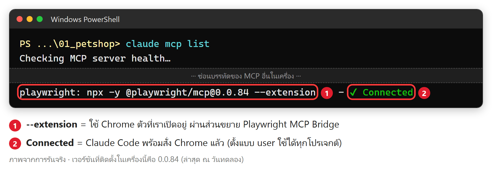

👀 ถ้าเพิ่ง `claude mcp add` ระหว่างที่ Claude Code เปิดอยู่ ให้ **ปิดแล้วเปิด Claude Code ใหม่** ครั้งแรกที่ AI ใช้ Chrome ส่วนขยายจะเด้งให้กดอนุญาต 1 ครั้ง

### 2C · ให้ AI เปิดเว็บใน Chrome ของเรา

💬 **พรอมต์**

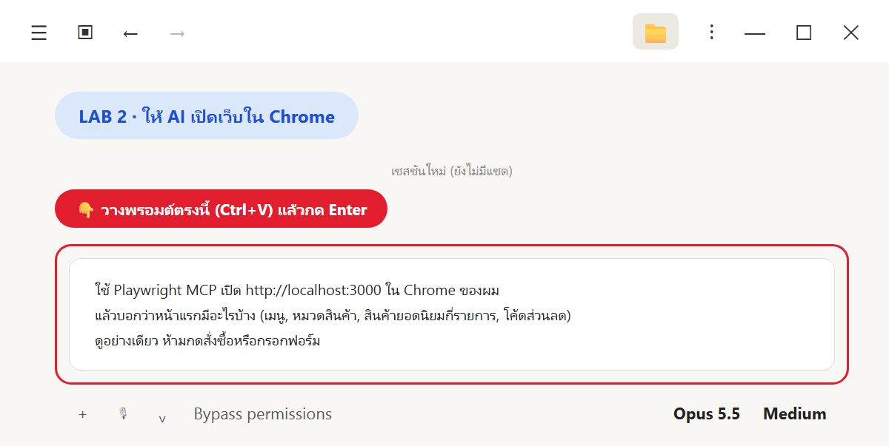

```text
ใช้ Playwright MCP เปิด http://localhost:3000 ใน Chrome ของผม
แล้วบอกว่าหน้าแรกมีอะไรบ้าง (เมนู, หมวดสินค้า, สินค้ายอดนิยมกี่รายการ, โค้ดส่วนลด)
ดูอย่างเดียว ห้ามกดสั่งซื้อหรือกรอกฟอร์ม
```

✅ **ผลจริง (31 วินาที)** Chrome เปิดหน้าร้านขึ้นมาเอง แล้ว AI สรุปสิ่งที่เห็น

| AI เห็นอะไร | ค่าจริง |
|---|---|
| เมนู | อาหารแมว · อาหารสุนัข · ของเล่น · ช่วยเลือกอาหาร |
| หมวดสินค้า | แมว 14 · หมา 14 · ของเล่น 4 |
| สินค้ายอดนิยม | **8 รายการ** |
| โค้ดส่วนลด | **PAW10** ลด 10% |


👀 ข้อมูลเหล่านี้ตรงกับ **TC-HOME-01** ในแผน = AI "มองเห็น" เว็บได้จริงแล้ว พร้อมใช้ใน LAB 4

---

## LAB 3 · ลองทดสอบด้วยมือ 🧑


🧑 **ทำเอง** เปิด http://localhost:3000 ทดสอบ 3 ข้อตามแผน แล้วกรอกใบงาน (จับเวลาด้วย)

| รหัส | ทำอะไร | ผลที่คาดหวัง (จากแผน) | ผลจริง | ผ่านไหม |
|---|---|---|---|---|
| TC-CART-01 | ใส่ "ลูกแมว สูตรแซลมอน" 2 ชิ้น | ฿189×2 + ค่าส่ง ฿50 = ฿428 | | |
| TC-CPN-01 | ใส่ "แมวโต สูตรไก่ 3 kg" ใช้คูปอง PAW10 | ฿799 ลด ฿79 → ฿770 | | |
| TC-AUTH-05 | เข้าสู่ระบบด้วยรหัสผ่านผิด | "อีเมลหรือรหัสผ่านไม่ถูกต้อง" | | |

| หน้าสินค้า | ตะกร้า |
|---|---|
| 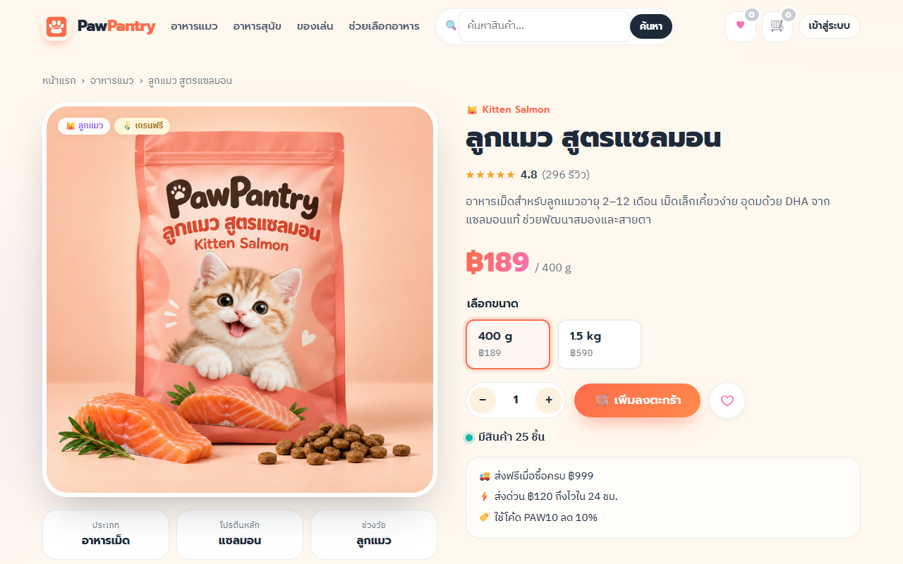 | 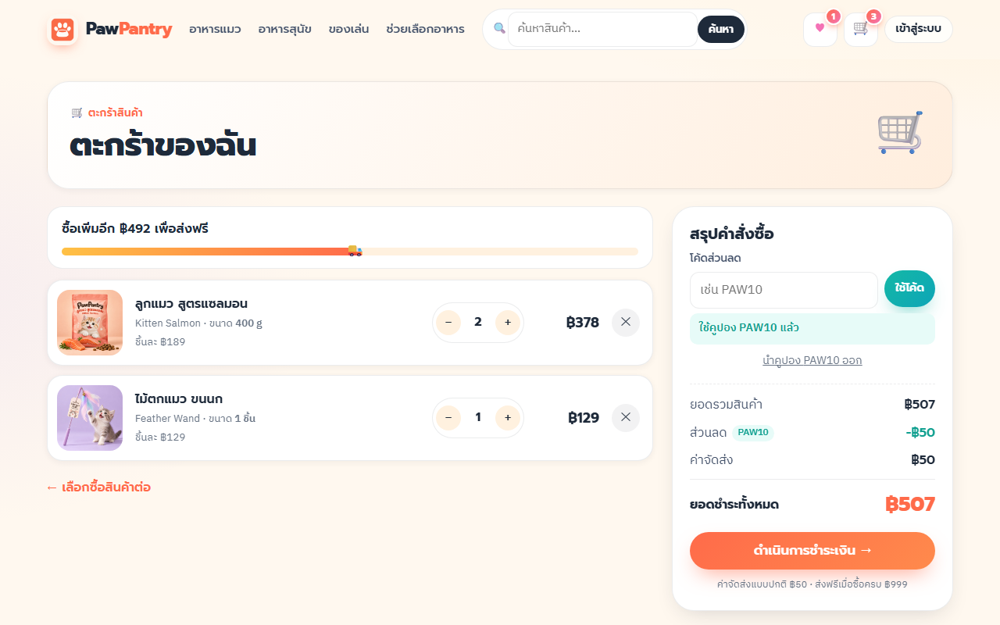 |

👀 3 ข้อใช้หลายนาที ถ้าต้องทำ 40 ข้อทุกครั้งที่เว็บแก้โค้ด → นี่คือเหตุผลที่ต้องให้ Playwright ทำแทน

---

## LAB 4 · ห้องทดลอง e2e + test 5 ข้อแรก 🤖


**แถวเดียวในแผน = test 1 ข้อ** AI แยกแต่ละแถวเป็น 3 ส่วน แล้วให้ Playwright ทำตาม

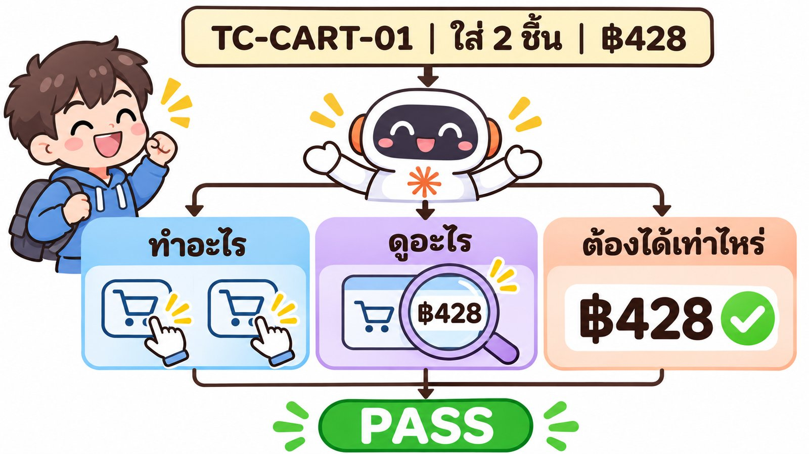

🧑 **คิดก่อน** ดู 5 แถวในพรอมต์ แล้วเดาว่าแต่ละข้อต้องกดอะไรบ้าง

💬 **พรอมต์**


```text
ผมเป็น tester จะทดสอบเว็บ PawPantry (http://localhost:3000) ตามแผนในไฟล์ TEST-PLAN.md

งาน: สร้างห้องทดลองชื่อโฟลเดอร์ e2e แล้วเขียน Playwright test 5 ข้อแรก
     ตามแผนในไฟล์ TEST-PLAN.md หัวข้อ 5 "Test cases" ลำดับที่ 16–20 คือ 5 แถวนี้

| #  | ID         | โมดูล | สิ่งที่ทดสอบ         | ระดับ | ผลที่คาดหวัง                          |
|----|------------|-------|---------------------|------|--------------------------------------|
| 16 | TC-CART-01 | ตะกร้า | ใส่ 2 ชิ้น           | P1   | ฿189×2 + ค่าส่ง ฿50 = ฿428            |
| 17 | TC-CART-02 | ตะกร้า | เพิ่ม / ลด / ลบ       | P1   | ยอดเปลี่ยนถูก ลบหมดแล้วเห็นตะกร้าว่าง    |
| 18 | TC-CART-03 | ตะกร้า | ส่งฟรีเมื่อครบ ฿999   | P2   | ฿790 เสียค่าส่ง, ฿2,680 ส่งฟรี          |
| 19 | TC-CART-04 | ตะกร้า | รีโหลด + สินค้าแนะนำ  | P2   | สินค้ายังอยู่ และมีสินค้า "ซื้อคู่กัน"     |
| 20 | TC-CPN-01  | คูปอง | PAW10               | P1   | ฿799 ลด ฿79 → ฿770                   |

ขั้นตอน
1. อ่าน 5 แถวข้างบน และ TEST-PLAN.md หัวข้อ 7 "ข้อมูลทดสอบ" (บัญชี คูปอง ค่าส่ง)
2. เปิดเว็บจริงด้วย Playwright MCP ลองทำตามทีละข้อ เพื่อดูว่าต้องกดปุ่มไหน
3. เขียน test ลง e2e/tests ชื่อ test ขึ้นต้นด้วย ID และติด tag ตามระดับ (@P1 / @P2)
4. รันด้วย Chromium ที่ติดตั้งไว้จากบท 01 (ห้ามโหลดเบราว์เซอร์ใหม่)
   อัดวิดีโอทุกข้อ แล้วแปลงเป็น GIF ไว้ที่ e2e/test-report/gifs ตั้งชื่อตาม ID
   ให้คนดูทัน: เดินช้าลง และค้างหน้าผลลัพธ์ไว้ จน GIF แต่ละไฟล์ยาวอย่างน้อย 5 วินาที

กติกา
- ห้ามเปิดโฟลเดอร์ petshop และ _solution
- ห้ามอ่าน TEST-PLAN.md หัวข้อ 8 และห้ามแก้โค้ดเว็บ
- ผลการทดลองเก็บใน e2e และไม่ขึ้น git

ตอบกลับเป็นตาราง  ID | ผลที่คาดหวัง | ผลจริง | ผ่าน/ล้ม
```

| ส่วนของพรอมต์ | มีไว้ทำไม |
|---|---|
| ตาราง 5 แถวจากแผน | AI (และเรา) เห็นตรงกันว่าทดสอบอะไร ต้องได้ผลเท่าไหร่ |
| หัวข้อ 7 ข้อมูลทดสอบ | บัญชี คูปอง ค่าส่ง อยู่ในหัวข้อนี้ |
| เปิดเว็บจริงด้วย Playwright MCP | ให้ AI หาปุ่มจากหน้าเว็บ (black-box) เราเห็นใน Chrome ว่ามันคลิกอะไร |
| Chromium จากบท 01 | ไม่ต้องโหลดเบราว์เซอร์ใหม่หลายร้อย MB |
| GIF ≥ 5 วินาที | test จริงเร็วมาก (1–2 วินาที) คนดูไม่ทัน |
| กติกา | ทดสอบแบบ tester จริง และผลไม่หลุดขึ้น Git |
| ตอบเป็นตาราง | เทียบ "คาดหวัง" กับ "ผลจริง" ได้ทันที |

✅ **ผลจริง: ผ่าน 5 / 5** (ทั้ง LAB 5.6 นาที · GIF ยาว 8.5–14.5 วินาที)

| ID | ผลจริงบนเว็บ | |
|---|---|---|
| TC-CART-01 | 2 ชิ้น ฿378 + ค่าส่ง ฿50 → ยอดชำระ **฿428** | ✅ |
| TC-CART-02 | ฿239 → กด + ฿428 → ฿617 → กด − ฿428 → ลบแล้วขึ้น "ตะกร้าของคุณยังว่างอยู่" | ✅ |
| TC-CART-03 | ฿790 ค่าส่ง ฿50 · เพิ่ม 8 kg รวม ฿2,680 ค่าส่ง **ฟรี** | ✅ |
| TC-CART-04 | รีโหลดแล้วสินค้ายังอยู่ · มี "ซื้อคู่กันคุ้มกว่า" | ✅ |
| TC-CPN-01 | ฿799 ใช้ PAW10 ลด **-฿79** → ยอดชำระ **฿770** | ✅ |

| 🎬 TC-CART-01 ใส่ 2 ชิ้น = ฿428 | 🎬 TC-CPN-01 คูปอง PAW10 = ฿770 |
|---|---|
| 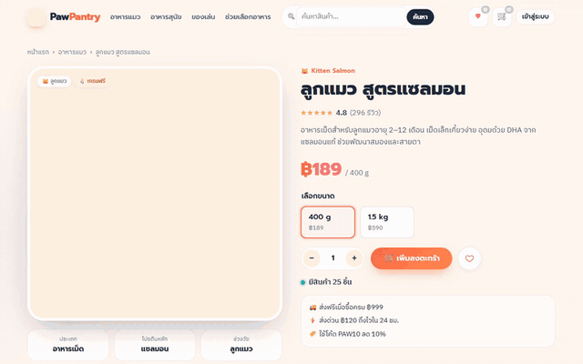 | 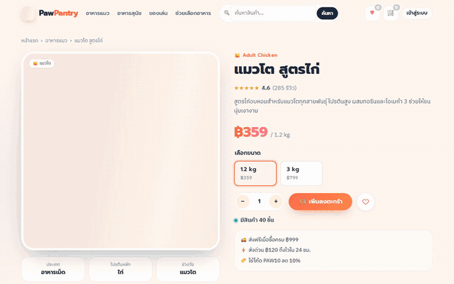 |

<details>
<summary>🎬 ดู GIF อีก 3 ข้อ</summary>

| TC-CART-02 เพิ่ม / ลด / ลบ | TC-CART-03 ส่งฟรี | TC-CART-04 รีโหลด |
|---|---|---|
| 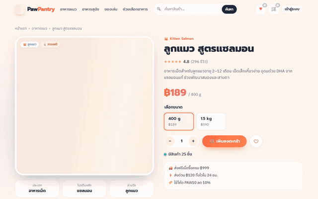 | 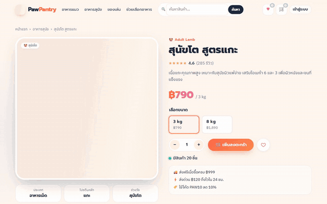 | 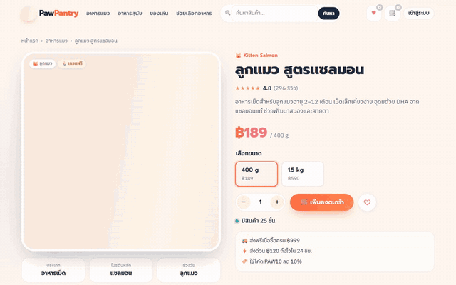 |

</details>

👀 **สังเกต** หน้าต่าง MCP ค้างตอนกดปุ่มหลายครั้ง AI จึงเปลี่ยนไปเขียนสคริปต์ Playwright สั้น ๆ ลองแทนเอง = AI แก้ปัญหาเองได้ แต่เราควรอ่านว่ามันทำอะไรไป

---

## LAB 5 · ครบ 40 ข้อ ด้วย agent 8 ตัวพร้อมกัน 🤖 + 🧑


| คำ | ความหมายง่าย ๆ |
|---|---|
| **agent** | Claude ผู้ช่วยย่อย 1 ตัว ทำงาน 1 โมดูล |
| **พร้อมกัน 8 ตัว** | เหมือนพ่อครัว 8 คน ทำคนละจาน เสร็จเร็วกว่าคนเดียวทำทีละจาน |
| **รับงานต่อ** | ตัวไหนเสร็จก่อน หัวหน้าส่งตัวใหม่ไปทำโมดูลที่เหลือทันที |
| **agents.html** | จอดูสด "ตอนนี้ทำอยู่กี่ตัว" เราจึงรู้ว่า 8 ตัวจริงหรือไม่ |

🧑 **คิดก่อน** AI ไม่เห็นโค้ดเว็บ อาจเขียน test ผิดได้ ถ้า test ล้ม เราจะรู้ได้ยังไงว่า "เว็บผิด" หรือ "test ผิด"

💬 **พรอมต์**


```text
เขียน test ให้ครบ 40 ข้อตามแผนในไฟล์ TEST-PLAN.md หัวข้อ 5 "Test cases" ลำดับที่ 1–40
ในห้องทดลอง e2e (ลำดับ 16–20 ทำไว้แล้วใน LAB 4 ให้ใช้เป็นแบบ)

แบ่งงาน
- แบ่งตามโมดูลในตาราง ใช้ agent ทำพร้อมกัน 8 ตัว ตัวละ 1 โมดูล
- ตัวไหนเสร็จ ให้ส่ง agent ตัวใหม่รับโมดูลที่เหลือทันที จนครบทุกโมดูล
- แต่ละ agent สำรวจเว็บด้วยสคริปต์ Playwright แบบ headless ของตัวเอง
  (ไม่ใช้ Chrome ของผม เพราะ 8 ตัวใช้หน้าต่างเดียวกันไม่ได้)

ให้ผมเห็นว่ามี agent ทำงานอยู่กี่ตัวจริง ๆ
1. ทุก agent จดเวลาเริ่มและเวลาเสร็จ พร้อมชื่อโมดูล ลง e2e/test-report/agents.log
2. ทำหน้า e2e/test-report/agents.html ที่รีเฟรชตัวเองทุก 2 วินาที แสดง
   - ตัวเลขใหญ่ "กำลังทำงาน x / 8"
   - แถบเวลาของแต่ละ agent (เริ่มเมื่อไหร่ เสร็จเมื่อไหร่ ทำโมดูลอะไร)
3. เปิดหน้านี้ใน Chrome ของผมด้วย Playwright MCP ก่อนเริ่มแจกงาน
4. จบแล้วบอกว่ามี agent ทำพร้อมกันสูงสุดกี่ตัว และใช้ทั้งหมดกี่ตัว

กติกาเดิม
- ข้อมูลมาจาก TEST-PLAN.md หัวข้อ 5, 7 และหน้าเว็บจริงเท่านั้น
- ห้ามเปิด petshop และ _solution ห้ามอ่านหัวข้อ 8 ห้ามแก้โค้ดเว็บ

เขียนเสร็จแล้ว
1. รันครบ 40 ข้อแบบขนาน อัด GIF ทุกข้อไว้ที่ e2e/test-report/gifs
   (แบบเดียวกับ LAB 4: GIF แต่ละไฟล์ยาวอย่างน้อย 5 วินาที)
2. ข้อที่ล้ม ให้ดู GIF ก่อน แล้วแยกว่า "เว็บผิด" หรือ "test ผิด"
   - test ผิด → แก้ test แล้วรันใหม่
   - เว็บผิด → ห้ามแก้ จดไว้เป็นบั๊ก
3. สรุปตาราง  ลำดับ | รหัส | รอบแรก | รอบหลังแก้
```

| ส่วนของพรอมต์ | มีไว้ทำไม |
|---|---|
| 8 ตัว ตัวละ 1 โมดูล · เสร็จแล้วรับงานต่อ | เร็วขึ้น และไม่มี agent ว่างงาน |
| headless ของตัวเอง | Chrome ของเรามีหน้าต่างเดียว 8 ตัวแย่งกันใช้ไม่ได้ |
| agents.log + agents.html | **พิสูจน์** ว่าทำพร้อมกันจริงกี่ตัว ไม่ใช่เชื่อคำพูด AI |
| กติกาเดิม | agent ใหม่ทุกตัวไม่รู้กติกา ต้องส่งไปให้ทุกตัว |
| แยก "เว็บผิด / test ผิด" | ห้ามแก้ test ให้ผ่านเฉย ๆ |

✅ **ผลจริง**

| | ผล |
|---|---|
| agent ทำพร้อมกันสูงสุด | **8 ตัว** (A01–A08 ตั้งแต่ 16:45:40) |
| agent ที่ใช้ทั้งหมด | **11 ตัว** (10 โมดูล + ทำโมดูลค้นหาใหม่ 1 ตัว) |
| เวลาเขียน test | **ประมาณ 4 นาที** (16:44:28 → 16:48:36) |
| รันครบ 40 ข้อ | **58 วินาที · ผ่าน 39 · ล้ม 1** · GIF ทุกไฟล์ ≥ 5.5 วินาที |
| test เขียนผิด | 0 ข้อ |
| บั๊กของเว็บ | **TC-AUTH-02** ส่งฟอร์มสมัครเปล่า ช่อง "ยืนยันรหัสผ่าน" ไม่ขึ้น error |

| ⏱️ 16:45:45 · กำลังทำงาน 8 / 8 | ⏱️ 16:48:40 · เสร็จครบ 11 ตัว |
|---|---|
| 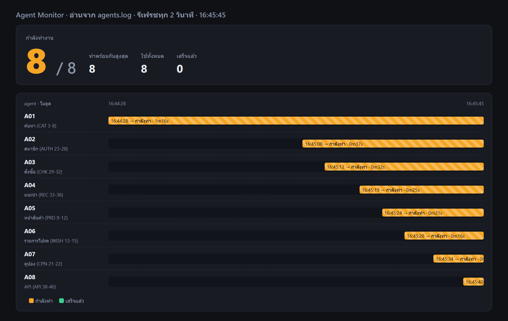 | 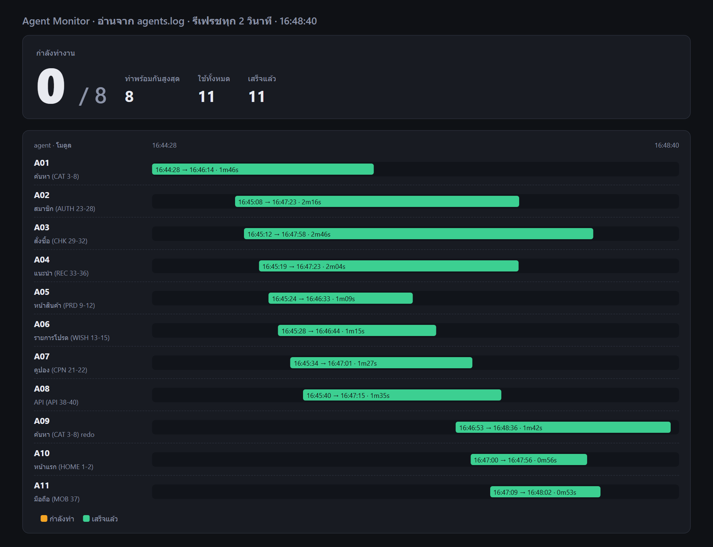 |

> ภาพจาก `agents.log` จริงของรอบนี้ ตรึงเวลาไว้ 2 ช่วง

🐞 **AI เจอบั๊กจริง!** แผนบอกว่า "error ทุกช่อง" แต่ช่องยืนยันรหัสผ่านไม่ขึ้นอะไรเลย

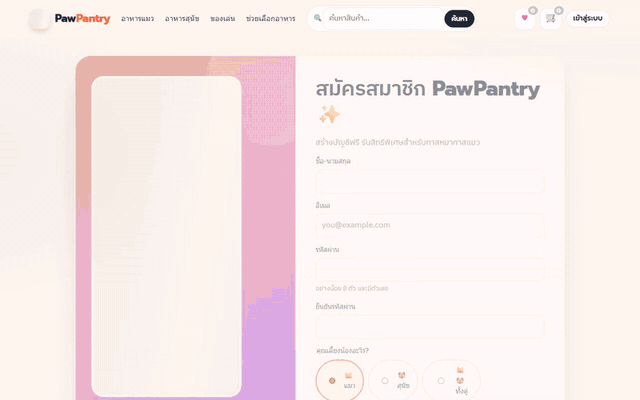


👀 **สังเกต**
- AI รู้ว่าไม่ใช่ test ผิด เพราะ TC-AUTH-03 ใช้ช่อง error เดียวกันแล้วเจอ (ตอนรหัสไม่ตรงกัน)
- ⚠️ agent ตัวแรก (A01) ได้คำสั่งงานโดย **ไม่มีกติกา** จึงแอบเปิดโค้ดใน `petshop/` ตัวหลักจับได้ ลบงานทิ้ง แล้วให้ A09 เขียนใหม่ = **กติกาต้องส่งให้ agent ทุกตัว**

---

## LAB 6 · หลักฐาน GIF ให้หัวหน้าดู 🤖


| ทำไมต้องเป็น GIF | ทำไม ≥ 5 วินาที | ทำไมต้องมีหน้ารวม |
|---|---|---|
| เปิดดูได้ทันทีในเว็บ / แชต ไม่ต้องมีโปรแกรม | test จริงเร็วมาก คนดูไม่ทัน | หัวหน้าเห็นภาพรวม 40 ข้อในหน้าเดียว กดดูเฉพาะข้อที่ล้มได้ |

💬 **พรอมต์**


```text
ทำหลักฐานการทดสอบให้หัวหน้าดูได้ง่าย

1. เช็ก GIF ทุกไฟล์ ถ้าไฟล์ไหนยาวไม่ถึง 5 วินาที ให้อัดข้อนั้นใหม่ให้ช้าลง
   และค้างหน้าผลลัพธ์ไว้ จนยาวอย่างน้อย 5 วินาที
2. เก็บ GIF ไว้ที่ e2e/test-report/gifs ตั้งชื่อไฟล์ตามรหัส test case
3. ทำหน้า e2e/test-report/index.html แสดง GIF ทุกข้อเรียงตามรหัส พร้อมป้ายผ่าน/ล้ม

แล้วบอกผมว่า GIF ของ TC-CHK-03 อยู่ที่ไหน

กติกาเดิม: ห้ามเปิดโฟลเดอร์ petshop และ _solution ห้ามอ่าน TEST-PLAN.md หัวข้อ 8
```

✅ **ผลจริง (2 นาที)** GIF ครบ 40 ไฟล์ ยาว **5.8–18.9 วินาที** (ทุกไฟล์ยาวพอแล้วจาก LAB 5 จึงไม่ต้องอัดใหม่) และได้หน้ารวม `index.html`

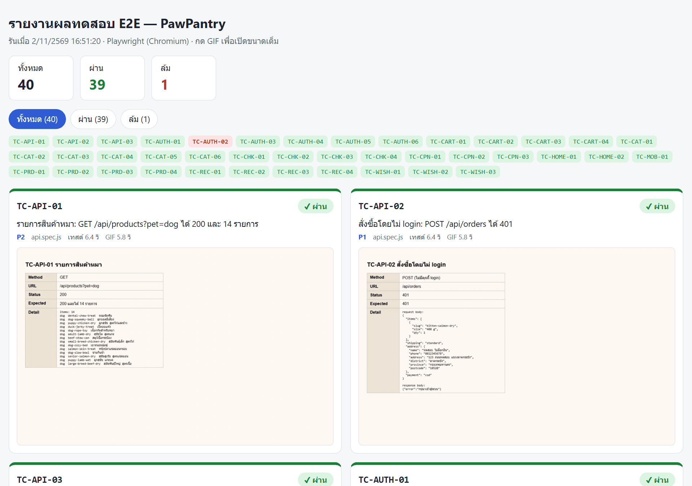

**🎬 TC-CHK-03 ลูกค้าซื้อของจนจบ** (16.3 วินาที · `e2e/test-report/gifs/TC-CHK-03.gif`)


| ✨ ระบบแนะนำ: ลูกแมวแพ้ไก่ | 🛒 เพิ่ม ลด ลบ ในตะกร้า |
|---|---|
|  | 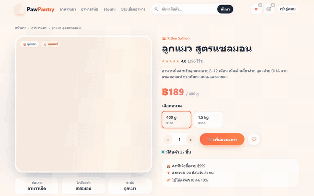 |

---

## LAB 7 · รายงานตามฟอร์แมต แล้วตัดสินใจ 🤖 + 🧑

**รายงานที่ดีมี 6 ส่วน** เรียงจาก "รอบนี้คืออะไร" ไปถึง "ปล่อยได้ไหม"

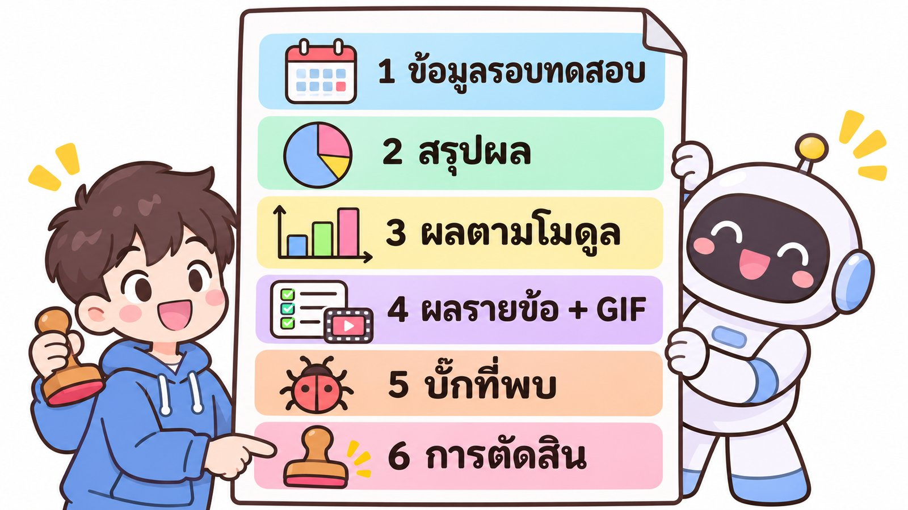

| ส่วน | มีอะไร | คนอ่านได้คำตอบว่า |
|---|---|---|
| 1. ข้อมูลรอบทดสอบ | วันที่ · เว็บ · เบราว์เซอร์ · จำนวน test | ทดสอบอะไร เมื่อไหร่ |
| 2. สรุปผล | ผ่าน / ล้ม / อัตราผ่าน แยก P1 P2 P3 | ภาพรวมดีไหม |
| 3. ผลตามโมดูล | โมดูล · ทั้งหมด · ผ่าน · ล้ม | ส่วนไหนของเว็บมีปัญหา |
| 4. ผลราย test case | รหัส · ระดับ · ผล · ลิงก์ GIF | ข้อไหนล้ม ดูหลักฐานที่ไหน |
| 5. ข้อบกพร่อง | รหัสบั๊ก · test · ความรุนแรง · อาการ · หลักฐาน | ทีมพัฒนาต้องแก้อะไร |
| 6. การตัดสิน | เทียบเกณฑ์หัวข้อ 6 ทีละข้อ + เหตุผล | **ปล่อยได้หรือยัง** |


🧑 **ตัดสินเองก่อน** ผ่าน 39/40 · P1 ผ่าน 15/15 · ข้อที่ล้มเป็น P2 → ปล่อยได้ไหม?

💬 **พรอมต์**


```text
สร้างรายงานผลการทดสอบที่ e2e/test-report/TEST-REPORT.md ตามฟอร์แมตนี้

1. ข้อมูลรอบทดสอบ   วันที่ · เว็บ · เบราว์เซอร์ · จำนวน test
2. สรุปผล           ผ่าน / ล้ม / อัตราผ่าน และแยกตาม P1 P2 P3
3. ผลตามโมดูล       โมดูล | ทั้งหมด | ผ่าน | ล้ม
4. ผลราย test case  รหัส | ระดับ | ผล | ลิงก์ GIF
5. ข้อบกพร่อง       รหัสบั๊ก | test | ความรุนแรง | อาการ | หลักฐาน
6. การตัดสิน        เทียบเกณฑ์ TEST-PLAN.md หัวข้อ 6 ทีละข้อ
                    แล้วสรุป "ปล่อยได้" หรือ "ยังไม่ปล่อย" พร้อมเหตุผล

ใช้ผลจากการรันล่าสุดเท่านั้น ห้ามรันใหม่หรือแก้ test

กติกาเดิม: ห้ามเปิดโฟลเดอร์ petshop และ _solution ห้ามอ่าน TEST-PLAN.md หัวข้อ 8
```

✅ **ผลจริง (1.7 นาที): ผ่านเกณฑ์ ปล่อยได้**


| เกณฑ์ (หัวข้อ 6) | ผลจริง | |
|---|---|---|
| P1 ผ่านทั้งหมด | 15 / 15 | ✅ |
| อัตราผ่านรวม ≥ 95% | 39 / 40 = 97.5% | ✅ |

👀 "ปล่อยได้" แต่ต้องบันทึกบั๊ก TC-AUTH-02 ไว้แก้รอบหน้า และถ้าล้มเพิ่มอีก 2 ข้อจะไม่ผ่านเกณฑ์ทันที

---

## LAB 8 · ฝึกจับบั๊ก (โหมดฝังบั๊ก) 🐞

เว็บ PawPantry มี **สวิตช์ `BUG_MODE`** สำหรับฝึก tester โดยเฉพาะ

| `BUG_MODE=0` (ปกติ) | `BUG_MODE=1` (ฝังบั๊ก) |
|---|---|
| เว็บทำงานถูก test ของเราผ่าน 39/40 | ทีมพัฒนาแอบใส่บั๊กไว้หลายจุด (เราไม่รู้ว่ากี่จุด อยู่ตรงไหน) |

เราใช้ **test ชุดเดิม 40 ข้อ** รันกับเว็บโหมดบั๊ก ถ้า test ดีจริง ต้องล้มตรงจุดที่มีบั๊ก = **test เป็นตาข่ายดักบั๊ก**

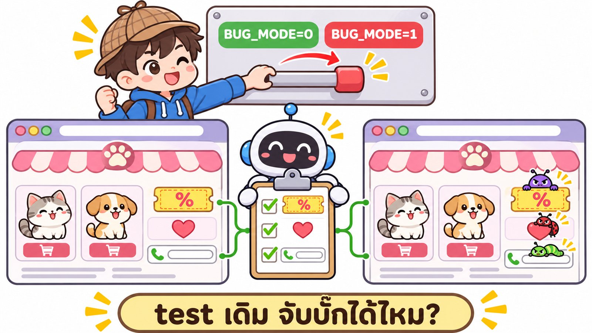

🧑 **คิดก่อน** test ของเราจะจับบั๊กได้กี่ตัว

💬 **พรอมต์**


```text
เว็บนี้มีโหมดฝังบั๊กไว้ให้ฝึก (BUG_MODE=1) มาดูว่า test ของเราจับได้กี่ตัว

1. ในโฟลเดอร์ petshop เปิดเว็บใหม่ด้วย BUG_MODE=1 แล้ว docker compose up -d รอจน healthy
2. รัน test ทั้ง 40 ข้อใน e2e พร้อม GIF (แต่ละไฟล์ยาวอย่างน้อย 5 วินาที)
3. ข้อที่ล้ม เขียนรายงานบั๊กลง e2e/test-report/BUG-REPORT.md ข้อละ 1 ใบ
   ขั้นตอนทำซ้ำ | ผลที่คาดหวัง | ผลจริง | หลักฐาน GIF | ความรุนแรง
4. ตัดสินตามเกณฑ์ TEST-PLAN.md หัวข้อ 6 ว่าปล่อยได้ไหม
5. เสร็จแล้วเปิดเว็บกลับเป็นโหมดปกติ (BUG_MODE=0)

กติกา
- หาสาเหตุจากผลทดสอบ ภาพ และ GIF เท่านั้น
- ในโฟลเดอร์ petshop สั่งได้แค่ docker compose ห้ามเปิดไฟล์
- ห้ามเปิด _solution ห้ามอ่านหัวข้อ 8 และห้ามแก้ test
```

| บรรทัดในพรอมต์ | มีไว้ทำไม |
|---|---|
| ข้อ 5 กลับโหมดปกติ | ลืมแล้ว LAB ถัดไปจะล้มทั้งที่ test ถูก |
| สั่งได้แค่ docker compose | ต้องเข้าโฟลเดอร์ petshop เพื่อเปิดเว็บ แต่ห้ามแอบดูโค้ด |
| ห้ามแก้ test | test ล้ม = เจอบั๊ก ไม่ใช่สิ่งที่ต้องซ่อม |

✅ **ผลจริง (4.5 นาที): ผ่าน 35 · ล้ม 5 (87.5%) → ไม่ผ่านเกณฑ์ ห้ามปล่อย** จับบั๊กที่ฝังได้ **ครบ 3 ตัว** + บั๊กจริงจาก LAB 5

| test ที่ล้ม | ระดับ | ผลที่คาดหวัง | ผลจริง | ประเภท |
|---|---|---|---|---|
| TC-CPN-01 | 🔴 P1 | PAW10 ลด ฿79 → ฿770 | ลดแค่ ฿7 → ฿842 | บั๊กฝัง |
| TC-CHK-02 | 🔴 P1 | เบอร์ 9 หลักขึ้น error | ไม่ขึ้น error | บั๊กฝัง |
| TC-WISH-02 | 🟡 P2 | ลบแล้วตัวเลขหัวใจลด | ยังเป็น 2 | บั๊กฝัง |
| TC-WISH-03 | 🟡 P2 | ย้ายไปตะกร้าแล้วหัวใจลด | ยังเป็น 2 | บั๊กฝัง (ต้นเหตุเดียวกับข้อบน) |
| TC-AUTH-02 | 🟡 P2 | error ทุกช่อง | ยืนยันรหัสผ่านไม่มี error | บั๊กจริง (ล้มตั้งแต่ LAB 5) |

👀 AI แยก "บั๊กฝัง" กับ "บั๊กเดิม" ได้เอง โดย **เทียบกับผลโหมดปกติ** ไม่ได้เปิดเฉลย

| 🐞 คูปองลดผิด | 🐞 ตัวเลขหัวใจไม่ลด | 🐞 เบอร์โทร 9 หลักผ่าน |
|---|---|---|
|  |  |  |

**รายงานบั๊กที่ดีมี 5 อย่าง**


---

## LAB 9 · คิด test case เอง 🧑 + 🤖


🧑 **ทำเอง** คิด test case ที่แผนยังไม่มี 2 ข้อ (ใช้เทคนิคจากแผนหัวข้อ 3 เช่น boundary, negative) ตัวอย่าง:

💬 **พรอมต์**


```text
ผมคิด test case ใหม่ 2 ข้อ ช่วยเขียน test ในห้องทดลอง e2e แล้วรันพร้อม GIF
(GIF แต่ละไฟล์ยาวอย่างน้อย 5 วินาที)

TC-MY-01  ค้นหาคำว่า "เป็ด" ต้องเจอ 2 รายการ
TC-MY-02  ซื้อครบ ฿999 แต่เลือก "ส่งด่วน" ค่าส่งต้องเป็น ฿120 (ส่งด่วนไม่ฟรี)

สรุปเป็นตาราง  รหัส | ผลที่คาดหวัง | ผลจริง | ผล
ถ้าล้ม บอกว่าเป็นบั๊กของเว็บ หรือ test เขียนผิด

กติกาเดิม: ห้ามเปิดโฟลเดอร์ petshop และ _solution ห้ามอ่าน TEST-PLAN.md หัวข้อ 8
```

✅ **ผลจริง: ผ่าน 2 / 2** (ทั้ง LAB 1.9 นาที)

| รหัส | ผลที่คาดหวัง | ผลจริงบนเว็บ | ผล |
|---|---|---|---|
| TC-MY-01 | ค้นหา "เป็ด" พบ 2 รายการ | "พบ 2 รายการ" (เป็ดอบแห้ง ฿189, แมวโต เป็ดเกรนฟรี ฿690) | ✅ |
| TC-MY-02 | ครบ ฿999 + ส่งด่วน = ค่าส่ง ฿120 | ซื้อ ฿999 **พอดี** ส่งธรรมดาฟรี → ส่งด่วน ฿120 ยอดรวม ฿1,119 | ✅ |

| 🎬 TC-MY-01 ค้นหา "เป็ด" | 🎬 TC-MY-02 ส่งด่วน ฿120 |
|---|---|
| 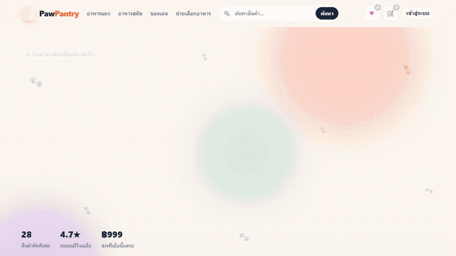 | 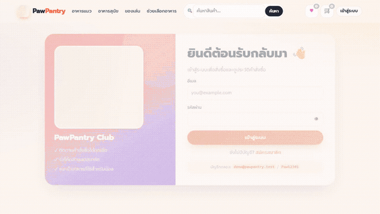 |

👀 AI เลือกซื้อให้ได้ **฿999 พอดี** เอง (ไม้ตกแมว ฿129 + ชามกินช้า ฿290×3) = ทดสอบค่าขอบ (boundary) ของส่งฟรี ตรงกับเทคนิคในแผนหัวข้อ 3

👀 ลองคิดโจทย์เอง เช่น "ใส่จำนวน 0 ได้ไหม", "รีโหลดหน้าชำระเงินแล้วที่อยู่หายไหม"

---

## ถ้าเจอปัญหา

| อาการ | 💬 พรอมต์ |
|---|---|
| Docker ไม่ทำงาน | `docker compose up ไม่ผ่าน ช่วยเช็กว่า Docker Desktop เปิดอยู่ไหม และพอร์ต 3000 ถูกใช้อยู่หรือเปล่า บอกผมว่าต้องทำอะไรเอง` |
| AI ใช้ Chrome ไม่ได้ | `Playwright MCP เชื่อม Chrome ไม่ได้ ช่วยเช็กว่า playwright ขึ้น Connected ไหม และบอกผมว่าต้องกดอนุญาตในส่วนขยาย Chrome ตรงไหน` |
| test ล้มทั้งหมด | `test ล้มทุกข้อ ช่วยเช็กว่าเว็บที่ http://localhost:3000 เปิดอยู่ไหม และ BUG_MODE เป็น 0 หรือยัง` |
| หาเบราว์เซอร์ไม่เจอ | `รัน test แล้วหาเบราว์เซอร์ไม่เจอ ช่วยเทียบว่า Playwright ใน e2e ต้องใช้ Chromium รุ่นไหน กับที่มีในโฟลเดอร์ ms-playwright จากบท 01 แล้วบอกผมก่อนว่าควรทำอย่างไร` |
| ไม่มีไฟล์ GIF | `อัด GIF แล้วไม่มีไฟล์ ช่วยเช็กว่ามี ffmpeg ในเครื่องไหม ถ้าไม่มีบอกวิธีติดตั้งให้ผม` |
| เลิกใช้แล้ว | `ปิดเว็บด้วย docker compose down ในโฟลเดอร์ petshop` |

## 📖 คำศัพท์

| คำ | ความหมายง่าย ๆ |
|---|---|
| **Test case** | "ลองทำแบบนี้ ต้องได้ผลแบบนี้" 1 ข้อ |
| **Black-box** | ทดสอบจากหน้าเว็บกับแผน โดยไม่ดูโค้ดข้างใน |
| **P1 P2 P3** | ระดับความสำคัญ สูง กลาง ต่ำ |
| **Exit criteria** | เกณฑ์ว่า "ผ่านพอจะปล่อยใช้งานได้" |
| **Playwright** | หุ่นยนต์ที่ใช้เว็บแทนเรา |
| **Playwright MCP** | ปลั๊กให้ Claude Code สั่ง Playwright ได้เอง |
| **Agent** | AI ผู้ช่วยย่อยที่ทำงานพร้อมกันหลายตัว |
| **BUG_MODE** | สวิตช์ของเว็บฝึกนี้ เปิดแล้วมีบั๊กซ่อนไว้ให้ test จับ |

### ไฟล์ในบทนี้

```text
02_test-from-plan/01_petshop/
├─ README.md          # บทเรียน
├─ TEST-PLAN.md       # แผนการทดสอบ 40 ข้อ
├─ img/               # ภาพประกอบ + GIF จากการรันจริง
├─ petshop/           # เว็บ PawPantry + docker-compose.yml (ใช้แค่เปิดเว็บ)
├─ e2e/               # (AI สร้างใน LAB 4) ห้องทดลอง + ผลการทดลอง
└─ _solution/e2e/     # เฉลยสคริปต์ 42 ข้อจากการรันจริง (ดูหลังทำเสร็จ)
```
