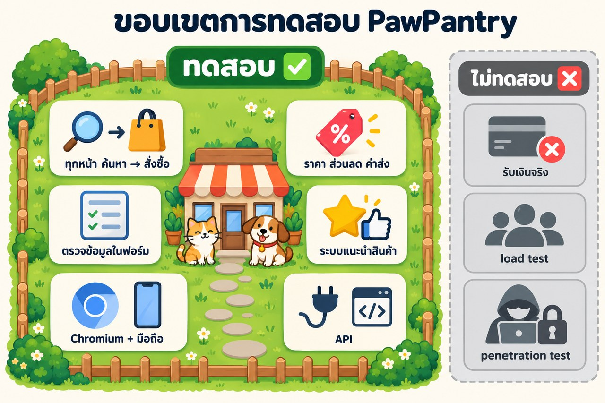
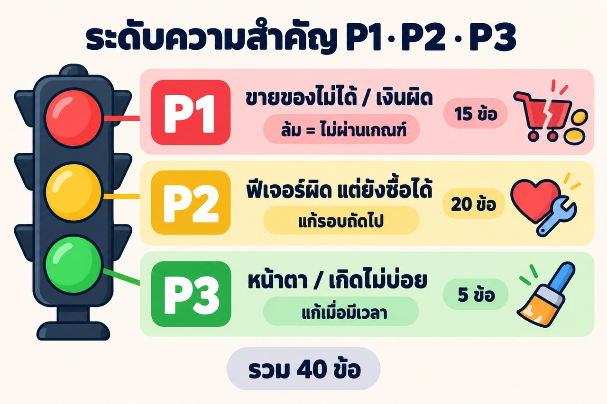

# 📋 แผนการทดสอบ (Test Plan) — PawPantry

## 1. ระบบที่ทดสอบ
เว็บร้าน **PawPantry** ที่ `http://localhost:3000` (รันใน Docker) ทดสอบด้วย **Playwright + Chromium** บน Windows

## 2. ขอบเขต

| ✅ ทดสอบ | ❌ ไม่ทดสอบ |
|---|---|
| ทุกหน้า ตั้งแต่หน้าแรกจนสั่งซื้อสำเร็จ | รับเงินจริง (เว็บจำลอง) |
| เงิน: ราคา ส่วนลด ค่าส่ง ยอดรวม | load test (ผู้ใช้จำนวนมาก) |
| ฟอร์มต้องแจ้ง error เมื่อกรอกผิด | penetration test (ความปลอดภัยเชิงลึก) |
| ระบบแนะนำสินค้า · หน้าจอมือถือ · API | |

## 3. เทคนิคคิด test case
| เทคนิค | ตัวอย่าง |
|---|---|
| **Happy path** | ซื้อของจนจบ (TC-CHK-03) |
| **Negative** | รหัสผ่านผิด, คูปองหมดอายุ, เบอร์โทร 9 หลัก |
| **Boundary** | ซื้อ ฿790 กับ ฿999 (ส่งฟรี), จำนวนเกินสต็อก |
| **State** | รีโหลดแล้วตะกร้ายังอยู่ |
| **API** | สั่งซื้อโดยไม่ login ต้องได้ 401 |

## 4. ระดับความสำคัญ
test case ทุกข้อถูกจัดระดับตาม **ความเสียหายถ้าข้อนั้นล้ม** ระดับนี้ใช้ตัดสินว่าต้องแก้บั๊กไหนก่อน และระบบพร้อมปล่อยใช้งานหรือยัง

| ระดับ | ความหมาย | ถ้าล้ม | จำนวน | ตัวอย่าง |
|---|---|---|---|---|
| 🔴 **P1** ร้ายแรง | ลูกค้าซื้อของไม่ได้ เงินคำนวณผิด หรือสิทธิ์การเข้าถึงผิด | ระบบ **ไม่ผ่านเกณฑ์ทันที** ห้ามปล่อยใช้งาน | 15 ข้อ | ยอดรวมตะกร้า (TC-CART-01), คูปอง PAW10 (TC-CPN-01) |
| 🟡 **P2** ปานกลาง | ฟีเจอร์สำคัญทำงานผิด แต่ลูกค้ายังซื้อของได้ | บันทึกบั๊ก แก้ในรอบถัดไป | 20 ข้อ | ลบรายการโปรดแล้วตัวเลขต้องลด (TC-WISH-02) |
| 🟢 **P3** เล็กน้อย | เรื่องหน้าตา หรือกรณีที่เกิดไม่บ่อย | แก้เมื่อมีเวลา | 5 ข้อ | หน้า 404 (TC-PRD-04), เมนูมือถือ (TC-MOB-01) |

**วิธีจัดระดับ:** ถามทีละข้อ แล้วหยุดที่ข้อแรกที่ตอบว่า "ใช่"

1. ถ้าข้อนี้ล้ม ลูกค้าซื้อของไม่ได้ เงินผิด หรือสิทธิ์ผิดใช่ไหม → **P1**
2. ถ้าข้อนี้ล้ม ฟีเจอร์สำคัญทำงานผิด แต่ลูกค้ายังซื้อได้ใช่ไหม → **P2**
3. นอกนั้น (หน้าตา หรือกรณีที่เกิดไม่บ่อย) → **P3**

## 5. Test cases (40 ข้อ บน Chromium)
| # | ID | โมดูล | สิ่งที่ทดสอบ | ระดับ | ผลที่คาดหวัง |
|---|---|---|---|---|---|
| 1 | TC-HOME-01 | หน้าแรก | หน้าแรกแสดงครบ | P2 | เห็น Hero, หมวดแมว/หมา, สินค้ายอดนิยม 8 รายการ, โค้ด PAW10 |
| 2 | TC-HOME-02 | หน้าแรก | ปุ่ม "ช้อปอาหารแมว" | P2 | ไปหน้าสินค้าแมว พบ 14 รายการ |
| 3 | TC-CAT-01 | ค้นหา | ค้นหา "แซลมอน" | P1 | พบ 5 รายการที่ทำจากแซลมอนทั้งหมด |
| 4 | TC-CAT-02 | ค้นหา | กรองแมว + อาหารเปียก | P1 | เหลือ 2 รายการ และ URL จำค่าตัวกรอง |
| 5 | TC-CAT-03 | ค้นหา | เรียงราคาน้อย → มาก | P2 | ราคาเรียงถูก เริ่มที่ ฿35 |
| 6 | TC-CAT-04 | ค้นหา | กรองเกรนฟรี | P3 | พบ 9 รายการ |
| 7 | TC-CAT-05 | ค้นหา | ค้นหาไม่เจอ | P3 | ข้อความ "ไม่พบสินค้า…" ล้างตัวกรองแล้วกลับมา 28 รายการ |
| 8 | TC-CAT-06 | ค้นหา | เมนู "ของเล่น" | P2 | พบของเล่น 4 รายการ (แมว 2 หมา 2) |
| 9 | TC-PRD-01 | หน้าสินค้า | เลือกขนาด | P1 | 3 kg ฿790 → 8 kg ฿1,890 |
| 10 | TC-PRD-02 | หน้าสินค้า | สินค้าหมด | P1 | ปุ่ม "สินค้าหมด" กดไม่ได้ |
| 11 | TC-PRD-03 | หน้าสินค้า | จำนวนเกินสต็อก | P2 | สต็อก 3 กด + 5 ครั้ง หยุดที่ 3 |
| 12 | TC-PRD-04 | หน้าสินค้า | สินค้าที่ไม่มีอยู่ | P3 | หน้า 404 พร้อมลิงก์กลับหน้าแรก |
| 13 | TC-WISH-01 | รายการโปรด | กดหัวใจ 2 ชิ้น | P2 | ตัวเลขเป็น 2 รีโหลดแล้วยังอยู่ |
| 14 | TC-WISH-02 | รายการโปรด | ลบออก | P2 | ตัวเลขลดลงทันที |
| 15 | TC-WISH-03 | รายการโปรด | ย้ายไปตะกร้า | P2 | หายจากรายการโปรด ตะกร้า +1 |
| 16 | TC-CART-01 | ตะกร้า | ใส่ 2 ชิ้น | P1 | ฿189×2 + ค่าส่ง ฿50 = ฿428 |
| 17 | TC-CART-02 | ตะกร้า | เพิ่ม / ลด / ลบ | P1 | ยอดเปลี่ยนถูก ลบหมดแล้วเห็นตะกร้าว่าง |
| 18 | TC-CART-03 | ตะกร้า | ส่งฟรีเมื่อครบ ฿999 | P2 | ฿790 เสียค่าส่ง, ฿2,680 ส่งฟรี |
| 19 | TC-CART-04 | ตะกร้า | รีโหลด + สินค้าแนะนำ | P2 | สินค้ายังอยู่ และมีสินค้า "ซื้อคู่กัน" |
| 20 | TC-CPN-01 | คูปอง | PAW10 | P1 | ฿799 ลด ฿79 → ฿770 |
| 21 | TC-CPN-02 | คูปอง | คูปองผิด / หมดอายุ | P2 | ข้อความ error ถูกต้อง ยอดไม่เปลี่ยน |
| 22 | TC-CPN-03 | คูปอง | NEWCAT50 | P2 | ไม่มีอาหารแมว → ใช้ไม่ได้; มี ฿590 → ลด ฿50 |
| 23 | TC-AUTH-01 | สมาชิก | สมัครสำเร็จ | P1 | ไปหน้าบัญชี เห็น "ยินดีต้อนรับ…" |
| 24 | TC-AUTH-02 | สมาชิก | ส่งฟอร์มเปล่า | P2 | error ทุกช่อง |
| 25 | TC-AUTH-03 | สมาชิก | รหัสผ่านอ่อน / ไม่ตรงกัน | P2 | error รหัสผ่านและยืนยันรหัส |
| 26 | TC-AUTH-04 | สมาชิก | อีเมลซ้ำ | P2 | "อีเมลนี้ถูกใช้แล้ว" |
| 27 | TC-AUTH-05 | สมาชิก | รหัสผ่านผิด | P1 | "อีเมลหรือรหัสผ่านไม่ถูกต้อง" |
| 28 | TC-AUTH-06 | สมาชิก | เข้า / ออกจากระบบ | P1 | ชื่อขึ้นที่เมนู ออกแล้วกลับเป็นปุ่มเข้าสู่ระบบ |
| 29 | TC-CHK-01 | สั่งซื้อ | ยังไม่เข้าสู่ระบบ | P1 | ถูกพาไป login แล้วกลับมา checkout |
| 30 | TC-CHK-02 | สั่งซื้อ | ฟอร์มที่อยู่ผิด | P1 | error เบอร์โทร, ที่อยู่, รหัสไปรษณีย์ |
| 31 | TC-CHK-03 | สั่งซื้อ | **ซื้อของจนจบ (E2E)** | P1 | ได้เลข PP-xxxxxx อยู่ในประวัติ ตะกร้าว่าง |
| 32 | TC-CHK-04 | สั่งซื้อ | สต็อกลดลง | P2 | สต็อกหลังซื้อ = ก่อนซื้อ − 2 |
| 33 | TC-REC-01 | แนะนำ | Finder: ลูกแมว แพ้ไก่ | P1 | อาหารแมวไม่มีไก่ อันดับ 1 ลูกแมวแซลมอน |
| 34 | TC-REC-02 | แนะนำ | Finder: หมาสูงวัย เกรนฟรี ขนม | P2 | อันดับ 1 หนังปลาแซลมอนกรอบ |
| 35 | TC-REC-03 | แนะนำ | แนะนำตามที่เคยดู | P2 | "แนะนำสำหรับคุณ" เป็นอาหารแมวทั้งหมด |
| 36 | TC-REC-04 | แนะนำ | ซื้อคู่กันบ่อย | P2 | กดครั้งเดียว ตะกร้าได้ 3 ชิ้น |
| 37 | TC-MOB-01 | มือถือ | เมนูแฮมเบอร์เกอร์ | P3 | เปิดเมนูแล้วไปหน้าสินค้าหมาได้ (14 รายการ) |
| 38 | TC-API-01 | API | รายการสินค้าหมา | P2 | 200 และได้ 14 รายการ |
| 39 | TC-API-02 | API | สั่งซื้อโดยไม่ login | P1 | 401 |
| 40 | TC-API-03 | API | สินค้าที่ไม่มีอยู่ | P3 | 404 |

## 6. เกณฑ์ (Entry / Exit criteria)
- **เริ่มทดสอบได้เมื่อ** container `petshop` ขึ้นสถานะ healthy และ `/api/health` ตอบ `{ ok: true }`
- **ผ่านเกณฑ์เมื่อ** test case P1 ผ่านทั้งหมด และอัตราผ่านรวม ≥ 95%

## 7. ข้อมูลทดสอบ
| ข้อมูล | ค่า |
|---|---|
| บัญชีตัวอย่าง | `demo@pawpantry.test` / `Paw12345` |
| คูปอง | `PAW10` ลด 10% · `FREESHIP` ส่งฟรี · `NEWCAT50` ลด ฿50 (อาหารแมว ≥ ฿500) · `SUMMER20` หมดอายุ |
| ค่าส่ง | ปกติ ฿50 (ฟรีเมื่อซื้อครบ ฿999) · ด่วน ฿120 |
| สินค้าหมด / ใกล้หมด | ไก่ฟรีซดราย (0) · สูตรลดก้อนขน (3) |
| ล้างข้อมูลก่อนทดสอบ | `POST /api/test/reset` (Playwright เรียกให้อัตโนมัติ) |

## 8. เฉลยบั๊กฝัง (BUG_MODE=1) — สำหรับผู้สอน
| บั๊ก | test ที่ควรล้ม |
|---|---|
| คูปอง PAW10 ลดแค่ 1% | TC-CPN-01 |
| ลบ / ย้ายรายการโปรดแล้วตัวเลขหัวใจไม่ลด | TC-WISH-02, TC-WISH-03 |
| เบอร์โทร 9 หลักผ่านการตรวจ | TC-CHK-02 |
