# บท 02 · งานที่ 2: ทดสอบเว็บที่ต้อง login (Shopee) ด้วย Playwright ใน Chrome ของเรา (Copy & Paste)

งานที่ 1 ([01_petshop](../01_petshop/README.md)) ทดสอบเว็บที่เราเปิดเองด้วย Docker งานนี้ขยับไปทดสอบ **เว็บจริงที่ต้องเข้าสู่ระบบ** คือ Shopee ประเทศไทย
หน้าที่ของผู้เรียนเหมือนเดิม คือ **ทดสอบตามแผน ([TEST-PLAN.md](TEST-PLAN.md)) แล้วสรุปผล** โดยสั่งงานผ่าน Claude Code
ที่ต่างไปคือ **คนกับ Playwright ต้องทำงานคู่กัน** คนเป็นผู้ login และยืนยันว่าเป็นคน ส่วน Playwright ทดสอบต่อใน Chrome หน้าต่างเดียวกัน

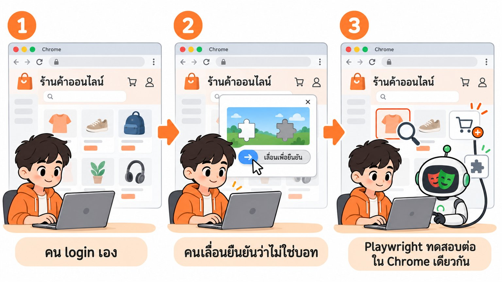

---

## ⚠️ อ่านก่อนเริ่ม: Shopee จะถามว่า "เป็นคนหรือเปล่า" และคุณต้องเลื่อนเอง

เมื่อ Playwright เปิด Shopee ครั้งแรก Shopee มักพาไปหน้า **ตรวจสอบการใช้งาน (CAPTCHA)** ที่ให้ **เลื่อนชิ้นส่วนภาพให้เข้าที่** ก่อนจะเข้าเว็บได้
ในรอบทดสอบจริงของบทนี้ ขึ้นทันทีตั้งแต่การเปิดหน้าแรกครั้งแรก

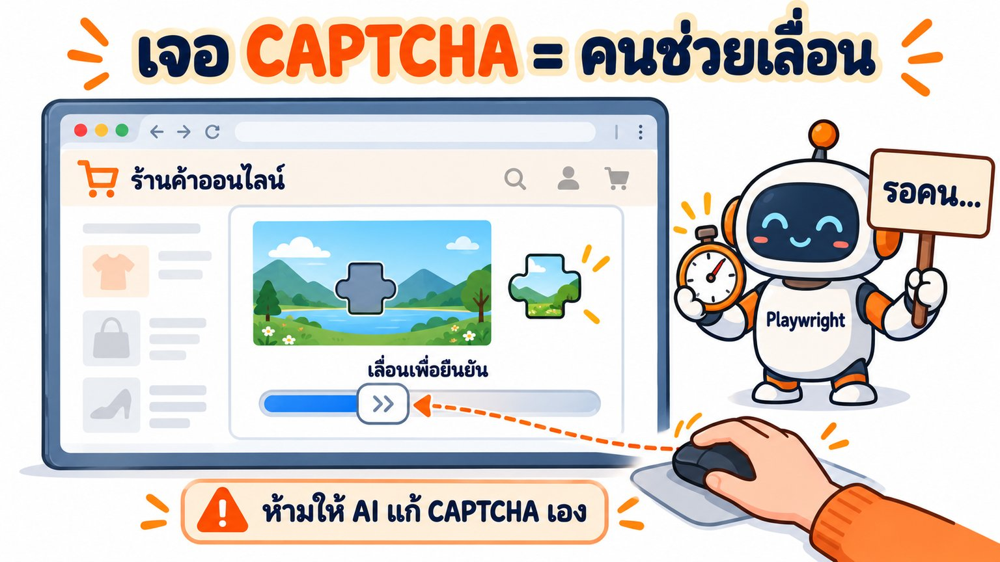

| ✅ ต้องทำ | ❌ ห้ามทำ |
|---|---|
| **นั่งอยู่หน้าจอตลอดการทดสอบ** (ใช้เวลาประมาณ 5 นาที) | สั่งงานแล้วเดินไปทำอย่างอื่น ถ้าไม่มีคนเลื่อน Playwright จะทำงานต่อไม่ได้ |
| เห็นหน้าเลื่อนยืนยันขึ้นใน Chrome → **เลื่อนเองให้ผ่าน** (รอบจริงใช้ประมาณ 9 วินาที) | ขอให้ AI เลื่อนหรือแก้ CAPTCHA แทน |
| เลื่อนเสร็จแล้วบอก Claude ว่า "ผ่านแล้ว ทำต่อได้" | ล้าง cookie หรือ login ใหม่ซ้ำ ๆ |
| ถ้าขึ้นซ้ำหลายรอบหรือผ่านไม่ได้ → หยุด แล้วบันทึกผลเป็น **Blocked** | กดรันซ้ำถี่ ๆ ให้ผ่าน (ยิ่งถี่ยิ่งโดนตรวจ) |

> 💡 CAPTCHA ไม่ใช่ข้อผิดพลาดของ test มันคือระบบป้องกันบอทของ Shopee ที่ทำงานตามปกติ หน้าที่ของ tester คือ **ไม่พยายามผ่านมันแบบอัตโนมัติ**

---

## 🧭 ภาพรวม: ต่างจากงานที่ 1 (PawPantry) อย่างไร

| เรื่อง | งานที่ 1 PawPantry | งานที่ 2 Shopee (งานนี้) |
|---|---|---|
| เว็บ | เปิดเองด้วย Docker ข้อมูลคงที่ | **เว็บจริง** ราคา จำนวนสินค้า และโฆษณาเปลี่ยนตลอด |
| เบราว์เซอร์ | Chromium ของ Playwright หน้าต่างใหม่ | **Chrome ที่เราใช้ทุกวัน** ซึ่ง login Shopee ไว้แล้ว |
| ใครทำอะไร | Playwright ทำเองทั้งหมด | **คน** login + เลื่อน CAPTCHA · **Playwright** ค้นหา ใส่รถเข็น ตรวจผล |
| จำนวน test | 40 ข้อ เร็วที่สุด | **3 ข้อ ช้า ๆ แบบคน** |
| ผลข้างเคียง | ล้างข้อมูลได้ | ทำกับบัญชีจริง ต้อง **เก็บกวาดให้เหมือนเดิม** และ **ห้ามซื้อ** |

### Playwright เข้าไปอยู่ใน Chrome ของเราได้อย่างไร

ปกติ Playwright เปิดเบราว์เซอร์ใหม่ที่ว่างเปล่า ยังไม่ได้ login อะไรไว้ ถ้าจะทดสอบเว็บที่ต้อง login ด้วยวิธีนี้ ต้องให้ test พิมพ์รหัสผ่านเอง ซึ่งไม่ปลอดภัยและติด OTP
บทนี้จึงใช้ **Playwright Extension** ส่วนเสริมใน Chrome ที่เปิดประตูให้ Claude Code สั่ง Playwright ทำงานใน **แท็บของ Chrome ที่เราใช้อยู่** ซึ่ง login ไว้แล้ว

| ส่วน | หน้าที่ |
|---|---|
| **Chrome ของเรา** | มีบัญชี Shopee ที่ login ไว้ (คนทำเอง) |
| **Playwright Extension** | ประตูให้ Playwright เข้ามาคุมแท็บ เราเลือกเองว่าให้คุมแท็บไหน (กด Connect) |
| **Claude Code + Playwright MCP** | อ่านแผน สั่ง Playwright ทีละขั้น และสรุปผล |

### ทำไมต้องช้า ๆ

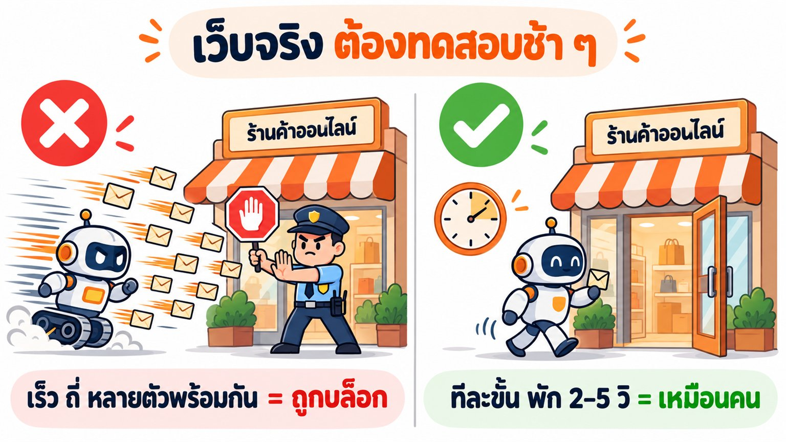

Shopee เฝ้าดูว่าใครใช้เว็บเร็วผิดปกติ (คลิกถี่ ๆ เปิดหลายหน้าพร้อมกัน พิมพ์ทั้งคำในพริบตา) ถ้าเราทดสอบแบบบท 02 บัญชีของเราอาจโดน CAPTCHA ถี่ขึ้นหรือถูกจำกัดการใช้งาน
บทนี้จึงให้ Playwright **ทำทีละข้อ พักทุกขั้น 2–5 วินาที พิมพ์ทีละตัวอักษร เลื่อนหน้าทีละนิด** และไม่รันซ้ำถี่ ๆ

---

## 📋 แผนการทดสอบ (TEST-PLAN.md) กำหนดอะไรบ้าง

| ID | สิ่งที่ทดสอบ | ผลที่คาดหวัง |
|---|---|---|
| TC-AUTH-01 | เปิดหน้าแรกด้วย session ที่คน login ไว้ | มุมขวาบนเห็นชื่อบัญชี ไม่เห็นปุ่ม "เข้าสู่ระบบ" / "สมัครใหม่" |
| TC-SRCH-01 | ค้นหา "อาหารแมว" | ≥ 20 รายการ และ 20 ชื่อแรก ≥ 80% มีคำว่า "แมว" หรือ "cat" |
| TC-CART-01 | ใส่ของเล่นแมวลงรถเข็น แล้วลบออก | สินค้าอยู่ในรถเข็น และหลังลบ รถเข็นกลับเหมือนก่อนทดสอบ |

ทั้ง 3 ข้อเป็น 🔴 **P1** · **ผ่านเกณฑ์เมื่อ** ผ่านครบ 3 ข้อ · **Blocked** เมื่อเจอ CAPTCHA ที่คนผ่านไม่ได้ หรือ session หมดอายุ

**ตรวจแบบ "กฎ" ไม่ใช่ "ตัวเลขตายตัว"** เว็บจริงเปลี่ยนทุกนาที วันนี้เจอ 58 รายการ พรุ่งนี้อาจเจอ 60 แผนจึงไม่เขียนว่า "ต้องเจอ 58" แต่เขียนเป็นกฎที่จริงเสมอถ้าระบบทำงานถูก เช่น "อย่างน้อย 20" และ "ส่วนใหญ่มีคำว่าแมว" ส่วนรถเข็นใช้วิธี **จดตัวเลขก่อน แล้วเทียบหลัง**

---

## 🧰 ก่อนเริ่ม ต้องมี

| ✅ | สิ่งที่ต้องมี | ตรวจยังไง |
|---|---|---|
| ☐ | **Claude Code** (บท 01) | เปิด Claude Code ได้ |
| ☐ | **Google Chrome** ของเครื่องเรา ที่ **คน login Shopee เองแล้ว** | ทำตาม LAB 0 แล้วมุมขวาบนเป็นชื่อบัญชีเรา |
| ☐ | ส่วนเสริม **Playwright Extension** ใน Chrome | มีไอคอนรูปหน้ากากละครที่แถบส่วนเสริม |
| ☐ | **Playwright MCP แบบ extension** ใน Claude Code | ทำตาม LAB 1 |
| ☐ | **ว่างนั่งหน้าจอ ~5 นาที** เพื่อเลื่อน CAPTCHA | — |
| ☐ | รถเข็น Shopee ไม่จำเป็นต้องว่าง | test จะจดตัวเลขก่อนและเทียบหลัง ลบเฉพาะของที่ test ใส่ |

**ลำดับการเรียน:** ทำ **LAB 0** (คน login เอง) และ **LAB 1** (ต่อ Claude Code เข้ากับ Chrome) ก่อน แล้วเลือกได้ 2 แบบ: วาง **LAB 2** พรอมต์เดียวจบ หรือทำ **ทีละขั้น** LAB 3 → LAB 6
แต่ละ LAB มี 💬 พรอมต์ให้คัดลอก · ✅ ผลจริงที่ได้ (รอบทดสอบวันที่ 2 พ.ย. 2569) · 👀 สิ่งที่ควรสังเกต

---

## LAB 0 · คน login Shopee เองใน Chrome ของเครื่องเรา (ทำก่อนทุกอย่าง)

🎯 **Playwright ไม่ได้ login ให้เรา** มันแค่มาใช้ Chrome ที่ **เรา login ไว้แล้ว** ต่อ ถ้าข้ามขั้นนี้ ทุก LAB ถัดไปจะเจอหน้า "เข้าสู่ระบบ" และทดสอบไม่ได้

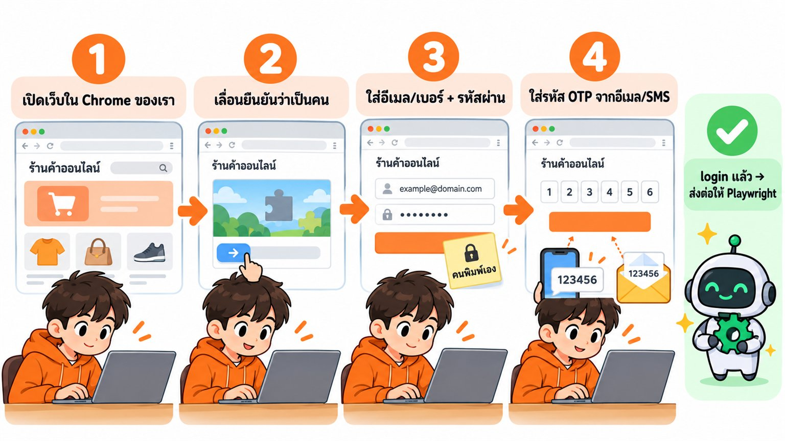

LAB นี้ **ไม่มีพรอมต์** เพราะคนทำเองทั้งหมด (รหัสผ่านและ OTP ห้ามส่งให้ AI)
ทำใน **Google Chrome ตัวที่ใช้ทุกวัน** (ตัวเดียวกับที่จะติดตั้ง Playwright Extension ใน LAB 1) ไม่ใช่หน้าต่างที่ Playwright เปิด

**ขั้น 1 · เปิด https://shopee.co.th ใน Chrome** ถ้าขึ้นให้เลือกภาษา เลือก "ไทย" แล้วถ้าเจอหน้า "ยืนยันตัวตนเพื่อดำเนินการต่อ" ให้ **ลากแถบเลื่อนให้ชิ้นภาพเข้าที่**

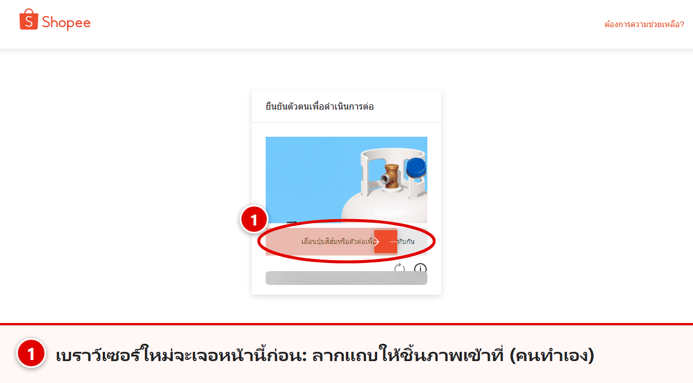

**ขั้น 2 · หน้าแรกตอนยังไม่ login** มุมขวาบนเป็น "สมัครใหม่ | เข้าสู่ระบบ" ให้คลิก **เข้าสู่ระบบ**

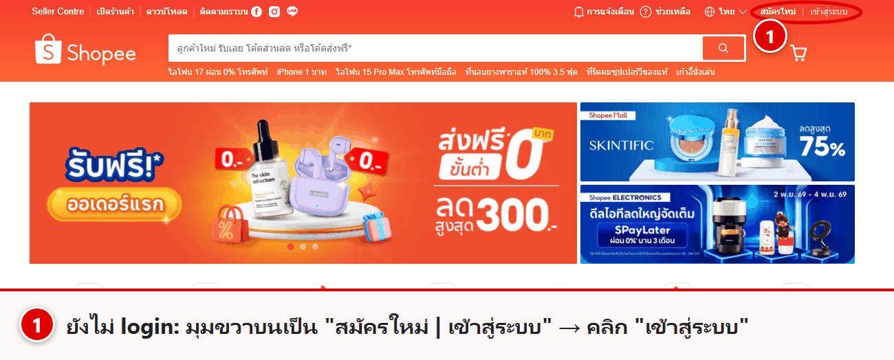

**ขั้น 3 · หน้าเข้าสู่ระบบ** เลือกได้ 2 ทาง
- สแกน **QR code** ด้วยแอป Shopee ในมือถือ (หน้านี้เปิดมาเป็น QR ก่อน) หรือ
- คลิก **"เข้าสู่ระบบด้วยรหัสผ่าน"** แล้ว **พิมพ์อีเมล / เบอร์โทร / ชื่อผู้ใช้ และรหัสผ่านเอง**
- ติ๊ก **"จดจำการเข้าสู่ระบบ"** ไว้ Chrome จะจำไว้ ไม่ต้อง login ใหม่บ่อย ๆ

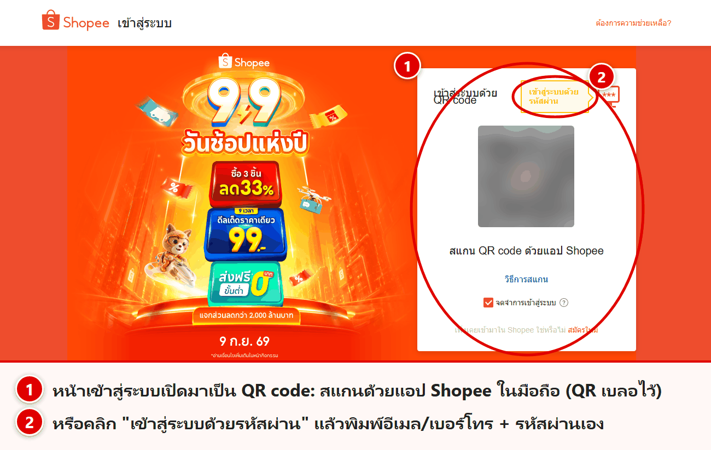

**ขั้น 4 · Shopee ขอยืนยันตัวตนอีกชั้น** (เจอเมื่อ login จากเบราว์เซอร์หรือเครื่องที่ไม่เคยใช้) เลือกวิธีที่สะดวก

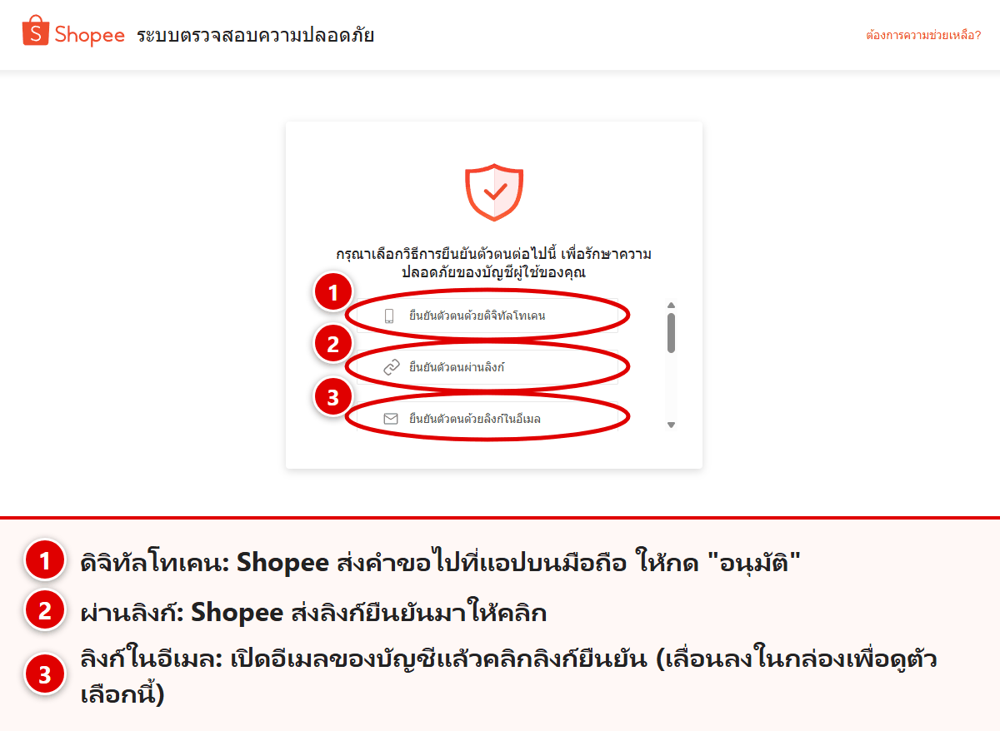

**ขั้น 5 · ทำตามวิธีที่เลือก** เช่น ดิจิทัลโทเคน: เปิดแอป Shopee ในมือถือแล้วกด **"อนุมัติ"** · ลิงก์ในอีเมล: เปิดกล่องอีเมลของบัญชีแล้วคลิกลิงก์ยืนยัน

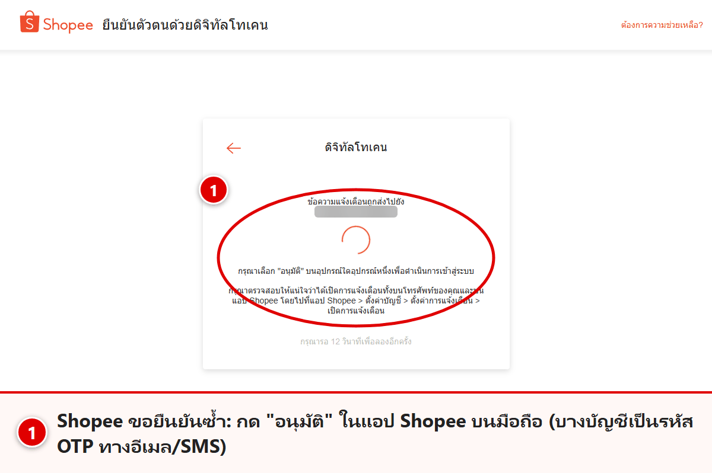

**ขั้น 6 · เสร็จแล้ว** กลับหน้าแรก มุมขวาบนเปลี่ยนจาก "เข้าสู่ระบบ" เป็น **ชื่อบัญชีของเรา** (ดูภาพใน LAB 3) แล้ว **เปิด Chrome ค้างไว้** ไปทำ LAB 1 ต่อ

✅ **ผลจริง** (2 พ.ย. 2569) ภาพในขั้น 1–5 ถ่ายจากหน้าต่างเบราว์เซอร์ใหม่ที่ยังไม่เคย login เพื่อให้เห็นทุกหน้าโดยไม่ต้อง logout บัญชีจริง

| ขั้น | ที่เจอจริง |
|---|---|
| เปิดเว็บครั้งแรก | ต้องเลือกภาษา แล้วเจอแถบเลื่อนยืนยันทันที คนเลื่อนผ่านในประมาณ 10 วินาที |
| หน้าเข้าสู่ระบบ | เปิดมาเป็น QR code มีปุ่ม "เข้าสู่ระบบด้วยรหัสผ่าน" มุมขวาบนของกล่อง |
| ยืนยันอีกชั้น | Shopee ให้เลือก ดิจิทัลโทเคน / ผ่านลิงก์ / ลิงก์ในอีเมล |
| ดิจิทัลโทเคนในหน้าต่างที่ Playwright เปิด | **ค้าง** หมุนรออยู่หน้าเดิม ไม่ไปต่อ |
| Chrome ที่ใช้ทุกวัน | login ไว้แล้ว และยังอยู่ตลอดการทดสอบทั้ง 3 ข้อ |

👀 **สังเกต**
- **ทำไมต้อง login ใน Chrome ของเรา ไม่ให้ Playwright เปิดหน้าต่างใหม่แล้ว login?** รอบจริงเราลอง login ในหน้าต่างที่ Playwright เปิด ผลคือ **ค้างที่ขั้นยืนยันตัวตน** (น่าจะเพราะ Shopee ระวังเบราว์เซอร์ที่ถูกโปรแกรมควบคุม) ส่วน Chrome ที่เราใช้ทุกวัน login ได้ตามปกติและอยู่ได้นาน
- login **ครั้งเดียว** ใช้ได้หลายวัน (ถ้าติ๊ก "จดจำการเข้าสู่ระบบ") ไม่ต้องทำทุกครั้งที่ทดสอบ
- ถ้ามือถือเด้งขอ "อนุมัติ" ทั้งที่เราไม่ได้กำลัง login อยู่ **ให้กดปฏิเสธ**
- ห้ามพิมพ์รหัสผ่านหรือ OTP ลงในพรอมต์ของ Claude ไม่ว่ากรณีใด

---

## LAB 1 · ต่อ Claude Code เข้ากับ Chrome ของเรา (ทำครั้งเดียว)

💬 **คัดลอกพรอมต์นี้**

```text
ช่วยตั้งค่า Playwright MCP แบบ --extension ให้ Claude Code (ระดับ user)
เพื่อให้สั่ง Playwright ทำงานใน Google Chrome ที่ผมใช้อยู่ได้
บอกผมด้วยว่าต้องติดตั้ง Playwright Extension ใน Chrome ตรงไหน
และหลังตั้งค่าเสร็จ ต้องปิดแล้วเปิด Claude Code ใหม่ไหม
```

✅ **ผลจริง**

| ขั้น | ผล |
|---|---|
| ลงทะเบียน MCP | ได้ server ชื่อ `playwright` ที่รันด้วยโหมด `--extension` |
| ส่วนเสริมใน Chrome | ติดตั้ง **Playwright Extension** จาก Chrome Web Store |
| เริ่มใช้ | ต้องเปิด **เซสชัน Claude Code ใหม่** เครื่องมือ Playwright จึงขึ้นมาให้ใช้ |
| ครั้งแรกที่สั่ง | Chrome เปิดแท็บของ extension ให้ **กด Connect** (หรือเลือกแท็บ Shopee) แล้วจึงเริ่มทำงาน |

👀 **สังเกต**
- ทำไมไม่ใช้วิธีของงานที่ 1? Chrome รุ่นใหม่ **ไม่ยอมให้โปรแกรมอื่นเข้าคุมโปรไฟล์หลัก** ผ่านพอร์ตดีบัก จึงต้องใช้ extension ที่เราอนุญาตเองทีละครั้ง
- Playwright คุมได้เฉพาะแท็บที่เรากด Connect ให้ แท็บอื่นของเราปลอดภัย

---

## LAB 2 · พรอมต์รวม: ทดสอบ 3 ข้อแบบช้า ๆ แล้วทำรายงาน

> ⚠️ ก่อนวาง: เปิด Chrome ไว้ login Shopee ไว้ และ **นั่งรอหน้าจอ** เพื่อเลื่อน CAPTCHA

💬 **คัดลอกพรอมต์นี้**

```text
ใช้ Playwright MCP (แบบ extension) ทดสอบ Shopee ใน Chrome ของผม ตาม TEST-PLAN.md ทั้ง 3 ข้อ
ทำช้า ๆ เหมือนคน: ทีละข้อ พักทุกขั้น 2–5 วินาที พิมพ์ช่องค้นหาทีละตัวอักษร
ถ้าเจอหน้า CAPTCHA หรือ "ตรวจสอบการใช้งาน" ให้หยุดรอผมเลื่อนยืนยันเอง ห้ามแก้เอง
ใส่รถเข็นได้ 1 ชิ้นแล้วต้องลบออก ห้ามกดซื้อ ห้ามแชท ห้ามแก้ข้อมูลบัญชี
ถ่ายภาพทุกขั้น เบลอชื่อบัญชีของผม และอย่าพิมพ์ชื่อบัญชีลงในรายงาน
สรุปผลเป็น TEST-REPORT: ผ่าน / ไม่ผ่าน / Blocked เทียบเกณฑ์ใน TEST-PLAN.md
```

✅ **ผลจริง**

| ขั้น | ผล |
|---|---|
| เปิด Shopee | ⚠️ ขึ้นหน้า CAPTCHA ทันที → **ผู้เรียนเลื่อนเอง** ~9 วินาที → กลับหน้าแรกแบบ login อยู่ |
| TC-AUTH-01 | ✅ เห็นชื่อบัญชีมุมขวาบน ไม่มีปุ่มเข้าสู่ระบบ (รถเข็น 138) |
| TC-SRCH-01 | ✅ 58 รายการ · 20 ชื่อแรกมีคำว่าแมว/cat **20/20 (100%)** |
| TC-CART-01 | ✅ รถเข็น 138 → 139 → 138 · ไม่ได้กดซื้อ |
| รายงาน | ✅ ผ่าน 3/3 → **ผ่านเกณฑ์** ใช้เวลารวมประมาณ 5 นาที |

💡 **พรอมต์งานนี้มีอะไรเพิ่มจากงานที่ 1**
1. 🐢 **บอกจังหวะ** → "ช้า ๆ ทีละข้อ พัก 2–5 วินาที"
2. 🙋 **บอกว่าตรงไหนเป็นหน้าที่คน** → "เจอ CAPTCHA ให้หยุดรอผม"
3. 🚫 **บอกขอบเขตผลข้างเคียง** → "ใส่ได้ 1 ชิ้นแล้วลบ ห้ามซื้อ"
4. 🔒 **บอกเรื่องข้อมูลส่วนตัว** → "เบลอชื่อบัญชี อย่าพิมพ์ลงรายงาน"

---

## LAB 3 · TC-AUTH-01 เข้าเว็บแบบ login อยู่

💬 **คัดลอกพรอมต์นี้**

```text
ใช้ Playwright MCP เปิด https://shopee.co.th ใน Chrome ของผม
ถ้าเจอ CAPTCHA ให้หยุดรอผมเลื่อนเอง แล้วผมจะบอกให้ทำต่อ
จากนั้นตรวจ TC-AUTH-01: มุมขวาบนต้องเป็นชื่อบัญชี และไม่มีปุ่ม "เข้าสู่ระบบ" / "สมัครใหม่"
จดตัวเลขบนไอคอนรถเข็นไว้ด้วย ถ่ายภาพแล้วเบลอชื่อบัญชี
```

✅ **ผลจริง**

1. เปิดหน้าแรกครั้งแรก Shopee พาไปหน้า `/verify/captcha` ทันที → Claude หยุดรอ → ผู้เรียนเลื่อนยืนยันใน Chrome → กลับหน้าแรก
2. ตรวจหน้าแรก: ✅ **ผ่าน**

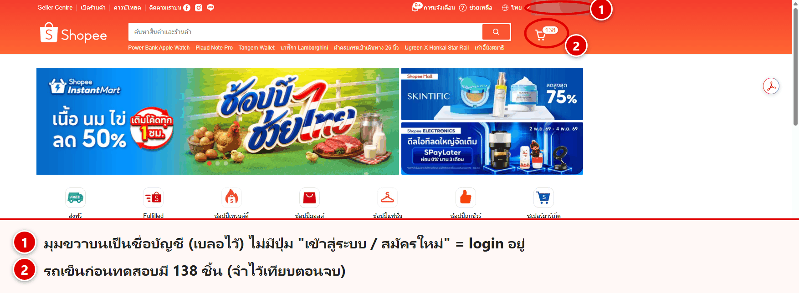

👀 **สังเกต**
- Playwright **ไม่ได้ login เอง** มันแค่เปิดแท็บใน Chrome ที่เรา login ไว้ จึงเห็นชื่อบัญชีทันที
- ตัวเลขบนรถเข็น (138) คือ "สภาพก่อนทดสอบ" ที่ TC-CART-01 จะใช้เทียบตอนจบ

---

## LAB 4 · TC-SRCH-01 ค้นหา "อาหารแมว"

💬 **คัดลอกพรอมต์นี้**

```text
ทำ TC-SRCH-01 ช้า ๆ แบบคน: คลิกช่องค้นหา พิมพ์ "อาหารแมว" ทีละตัวอักษร รอ 2 วินาที แล้วกด Enter
รอผลขึ้น แล้วเลื่อนหน้าลงช้า ๆ ทีละนิดให้สินค้าโหลดครบ
นับว่ามีกี่รายการ และ 20 ชื่อแรกมีคำว่า "แมว" หรือ "cat" กี่ชื่อ (เกณฑ์ ≥ 20 รายการ และ ≥ 80%)
แสดงชื่อที่ไม่มีคำว่าแมวให้ผมดูด้วย ถ้ามี
```

✅ **ผลจริง**

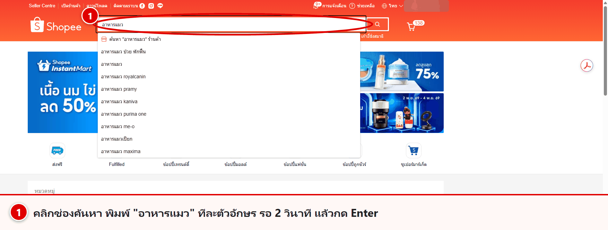

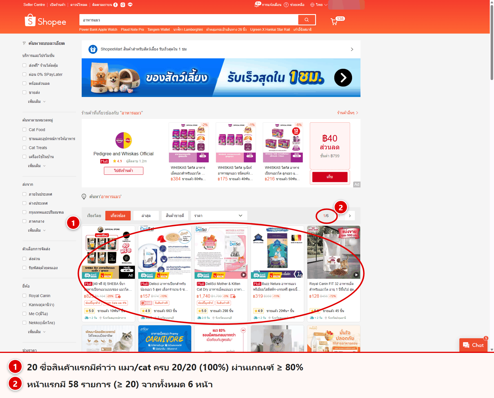

| ตรวจ | เกณฑ์ | ผลจริง | |
|---|---|---|---|
| จำนวนผลลัพธ์หน้าแรก | ≥ 20 | **58** (ทั้งหมด 6 หน้า) | ✅ |
| 20 ชื่อแรกมี "แมว"/"cat" | ≥ 80% | **20/20 = 100%** | ✅ |

ตัวอย่างชื่อจริง: "SHEBA ชีบา อาหารเปียกแมวแบบซอง…", "Royal Canin FIT 32 อาหารเม็ดสำหรับแมวโต…", "Purina One อาหารแมว เพียวริน่า วัน 2.7 กิโล…"

👀 **สังเกต**
- รอบแรกนับได้ชื่อแค่ 15 ชื่อ เพราะ Shopee **โหลดสินค้าเมื่อเลื่อนถึง** (lazy load) ต้องเลื่อนลงช้า ๆ ก่อนนับ เหมือนคนไล่ดู
- บางรายการเป็น **โฆษณา (Ad)** แต่ก็ยังเป็นอาหารแมว จึงนับรวมได้

---

## LAB 5 · TC-CART-01 ใส่ของเล่นแมวลงรถเข็น แล้วลบออก

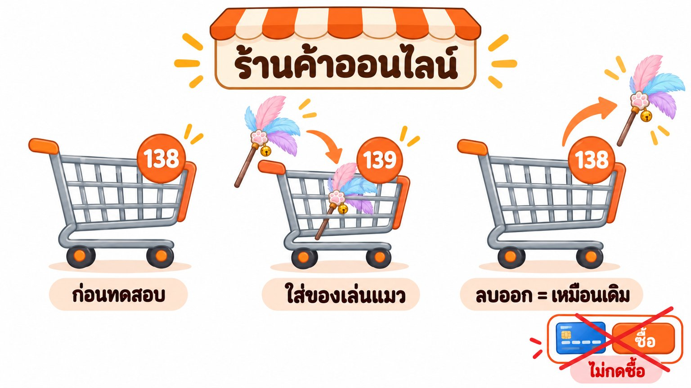

💬 **คัดลอกพรอมต์นี้**

```text
ทำ TC-CART-01 ช้า ๆ: ค้นหา "ของเล่นแมว" แล้วเปิดสินค้ารายการแรก
ถ้ามีตัวเลือก (สี/แบบ) ให้เลือกอันแรก แล้วกด "เพิ่มไปยังรถเข็น" ห้ามกดปุ่มซื้อ
เช็กว่าตัวเลขรถเข็นเพิ่ม 1 แล้วไปหน้ารถเข็น ตรวจว่าสินค้านี้อยู่ในรถเข็น
จากนั้นกด "ลบ" เฉพาะแถวของสินค้านี้ แล้วกลับหน้าแรกเช็กว่าตัวเลขรถเข็นเท่าก่อนทดสอบ
ถ่ายภาพทุกขั้น เบลอชื่อบัญชีและสินค้าอื่นในรถเข็นของผม
```

✅ **ผลจริง** ทีละขั้น

**① ค้นหาแล้วเปิดสินค้ารายการแรก**

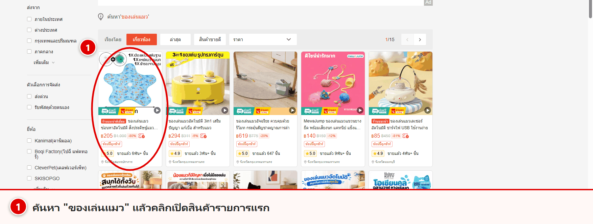

**② หน้าสินค้า: สินค้านี้มีตัวเลือกเดียว (สีฟ้า) จึงกด "เพิ่มไปยังรถเข็น" ได้เลย**

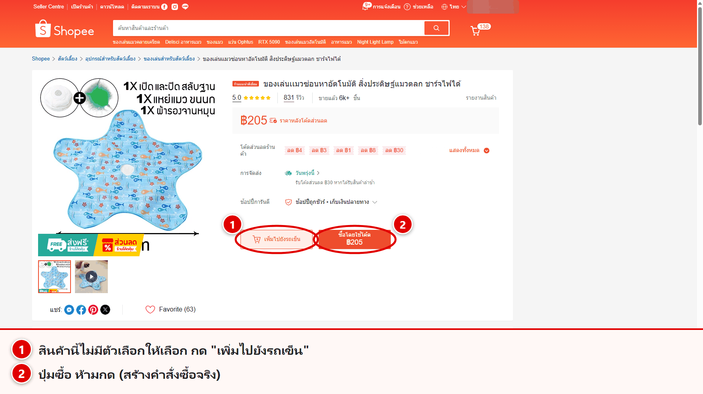

**③ ตัวเลขรถเข็นเปลี่ยน 138 → 139**

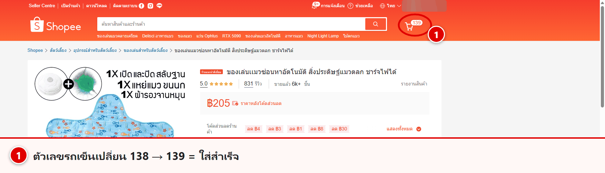

**④ หน้ารถเข็นมีของเล่นแมว แล้วกด "ลบ" เฉพาะแถวนี้**

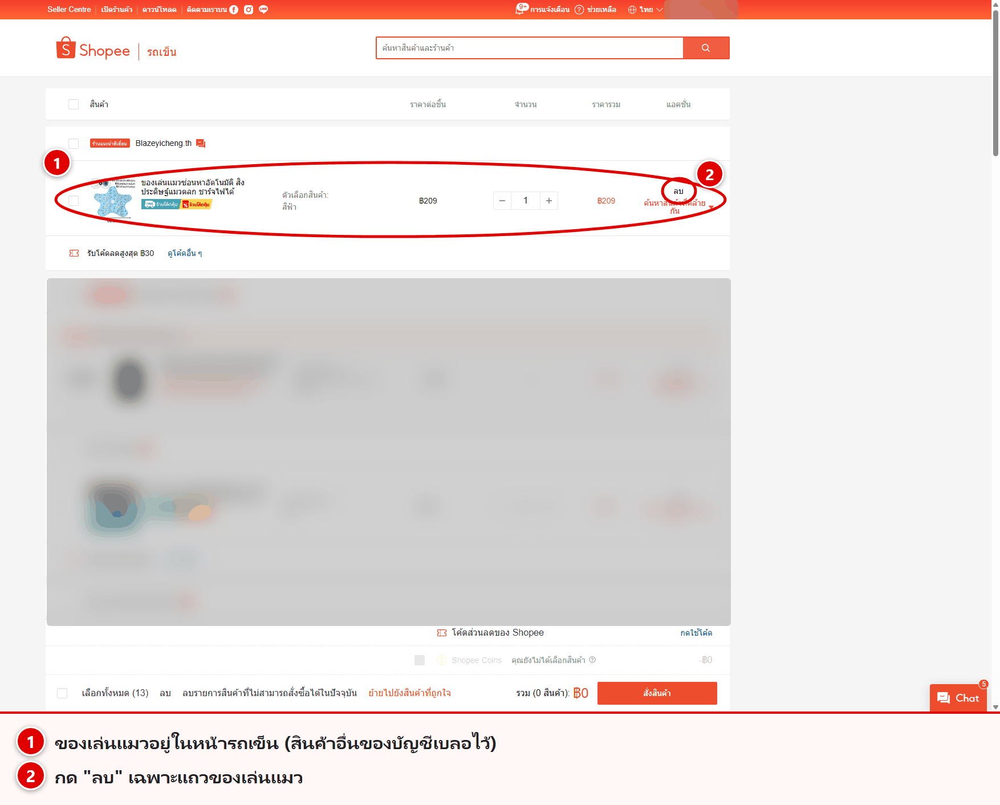

**⑤ หลังลบ "เลือกทั้งหมด" ลดจาก 13 → 12**

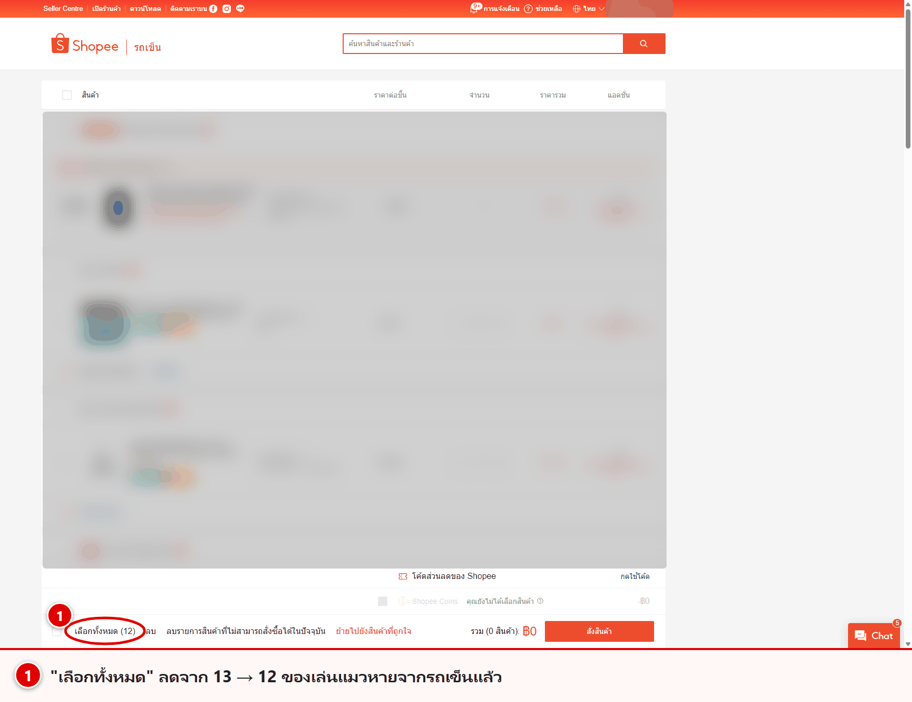

**⑥ กลับหน้าแรก รถเข็นเป็น 138 เท่าก่อนทดสอบ**

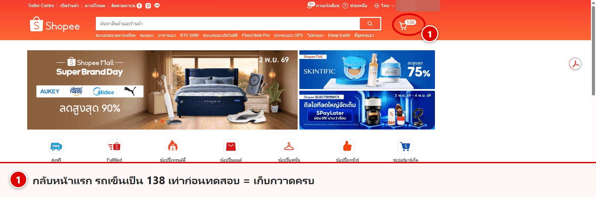

| ตรวจ | ผลจริง | |
|---|---|---|
| ตัวเลขรถเข็นหลังเพิ่ม | 138 → **139** | ✅ |
| สินค้าอยู่ในหน้ารถเข็น | "ของเล่นเเมวซ่อนหาอัตโนมัติ…" ตัวเลือก สีฟ้า | ✅ |
| หลังลบ | "เลือกทั้งหมด" 13 → 12 · รถเข็นกลับเป็น **138** | ✅ |
| ซื้อ / ชำระเงิน | ไม่ได้กด | ✅ |

👀 **สังเกต**
- รถเข็นของบัญชีจริง **มีของเดิมอยู่แล้ว** test จึงต้องลบ **เฉพาะแถวที่ตัวเองใส่** ห้ามกด "เลือกทั้งหมด → ลบ"
- ราคาในหน้าสินค้า (฿205 ราคาหลังโค้ด) กับในรถเข็น (฿209) **ไม่เท่ากัน** เพราะเป็นคนละแบบราคา ไม่ใช่บั๊ก แผนนี้ไม่ได้ตรวจราคา
- กลับหน้าแรกแล้วอาจมี **ป๊อปอัปโปรโมชัน** ขึ้นทับ รอให้ปิดก่อนถ่ายภาพหลักฐาน

---

## LAB 6 · ทำรายงานผลแบบ Tester

💬 **คัดลอกพรอมต์นี้**

```text
สรุปผลการทดสอบ Shopee ทั้ง 3 ข้อเป็น TEST-REPORT.md แบบ tester รายงานหัวหน้า
มีสรุปผ่าน / ไม่ผ่าน / Blocked, ผลราย test case (คาดหวัง vs ผลจริง),
เหตุการณ์ระหว่างทดสอบ (เช่น CAPTCHA ใครจัดการ ใช้เวลาเท่าไร) และตัดสินว่าผ่านเกณฑ์ไหม
ห้ามใส่ชื่อบัญชีของผมในรายงาน
```

✅ **ผลจริง** ([_solution/e2e/TEST-REPORT.md](_solution/e2e/TEST-REPORT.md))

| ทั้งหมด | ✅ ผ่าน | ❌ ไม่ผ่าน | ⛔ Blocked | อัตราผ่าน | ผลการประเมิน |
|---|---|---|---|---|---|
| 3 | 3 | 0 | 0 | 100% | ✅ **ผ่านเกณฑ์** |

| เหตุการณ์ระหว่างทดสอบ | จัดการอย่างไร |
|---|---|
| เปิดหน้าแรกครั้งแรก ขึ้น CAPTCHA (`/verify/captcha`) | ผู้เรียนเลื่อนเอง ~9 วินาที AI ไม่ได้แตะ |
| ป๊อปอัปโปรโมชันทับหน้าแรก | ไม่กระทบผล รอให้ปิดแล้วถ่ายภาพใหม่ |

👀 **สังเกต**
- **Blocked ≠ Failed** ถ้า CAPTCHA ผ่านไม่ได้ แปลว่า "ทดสอบไม่ได้" ไม่ได้แปลว่า "Shopee พัง"
- รายงานบอก **ใครทำอะไร** (คนเลื่อน CAPTCHA, Playwright ทดสอบ) เพราะงานนี้คนกับเครื่องทำงานร่วมกัน

---

## ถ้าเจอปัญหา: คัดลอกพรอมต์นี้

| อาการ | 💬 พรอมต์ |
|---|---|
| Claude บอกว่าไม่มีเครื่องมือ Playwright | `ไม่เห็นเครื่องมือ Playwright MCP ช่วยเช็กว่าตั้งค่าแบบ --extension แล้วหรือยัง และบอกผมว่าต้องเปิดเซสชันใหม่ไหม` |
| Chrome ขึ้นหน้า extension ให้กด Connect | กด **Connect** (หรือเลือกแท็บ Shopee) ใน Chrome แล้วพิมพ์ `ต่อแล้ว ทำต่อได้` |
| เจอหน้าเลื่อนยืนยัน / CAPTCHA | เลื่อนเองใน Chrome แล้วพิมพ์ `ผ่าน CAPTCHA แล้ว ทำขั้นต่อไปช้า ๆ` |
| CAPTCHA ขึ้นซ้ำหลายรอบ | `CAPTCHA ขึ้นซ้ำ หยุดทดสอบตอนนี้ บันทึกข้อที่เหลือเป็น Blocked แล้วสรุปผลให้ผม` (แล้วเว้นหลายชั่วโมงก่อนลองใหม่) |
| เห็นปุ่มเข้าสู่ระบบแทนชื่อบัญชี | login Shopee เองใน Chrome แล้วพิมพ์ `login แล้ว เริ่ม TC-AUTH-01 ใหม่` |
| สงสัยว่าของในรถเข็นค้าง | `ช่วยเปิดหน้ารถเข็นแล้วบอกว่ายังมีสินค้าที่ test ใส่ไว้ไหม ถ้ามีให้ลบเฉพาะแถวนั้น` |

## 📖 คำศัพท์

| คำ | ความหมายง่าย ๆ |
|---|---|
| **Production** | เว็บจริงที่ลูกค้าใช้อยู่ ไม่ใช่เว็บทดลอง |
| **Session** | สถานะ "login อยู่" ที่ Chrome จำไว้ |
| **Playwright Extension** | ส่วนเสริมใน Chrome ที่ให้ Playwright คุมแท็บที่เราอนุญาต |
| **MCP** | ช่องทางที่ Claude Code ใช้สั่งเครื่องมืออื่น เช่น Playwright |
| **CAPTCHA** | ด่านตรวจว่าเป็นคนหรือบอท เช่น "เลื่อนเพื่อยืนยัน" |
| **Blocked** | ทดสอบต่อไม่ได้เพราะติดอะไรบางอย่าง (ไม่ใช่ระบบผิด) |
| **Lazy load** | เว็บโหลดสินค้าเพิ่มเมื่อเราเลื่อนลงไปถึง |
| **เก็บกวาด (Clean up)** | ทำให้ข้อมูลกลับเหมือนก่อนทดสอบ |

### ไฟล์ในงานนี้

```text
02_test-from-plan/02_shopee-login/
├─ README.md            # บทเรียน + พรอมต์ทุก LAB
├─ TEST-PLAN.md         # แผนการทดสอบ 3 test case (P1)
├─ CLAUDE.md            # กติกาให้ Claude (ช้า ๆ, รอคนเลื่อน CAPTCHA, ห้ามซื้อ, เบลอชื่อบัญชี)
├─ img/                 # ภาพแนวคิด + ภาพหน้าจอจริงทุกขั้น (เบลอแล้ว)
└─ _solution/e2e/       # เฉลยจากรอบทดสอบจริง
   ├─ TEST-REPORT.md    # รายงานผล 3/3 ผ่าน
   ├─ results.json      # ตัวเลขดิบ (จำนวนผลลัพธ์ ตัวเลขรถเข็นก่อน/หลัง)
   └─ checks.js         # โค้ดตรวจหน้าเว็บที่ Playwright ใช้ (อ่านอย่างเดียว ไม่คลิก)
```
