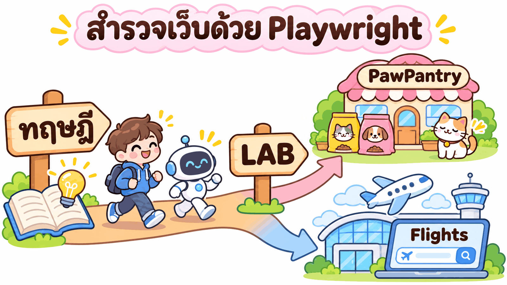
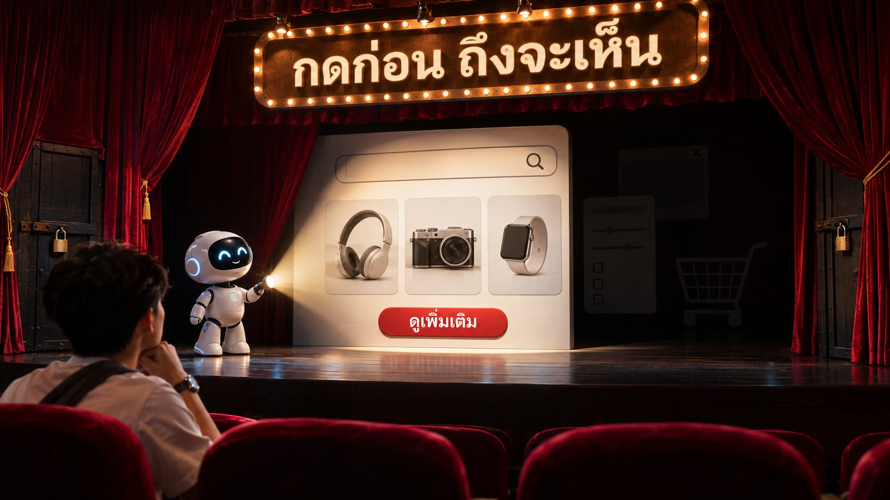
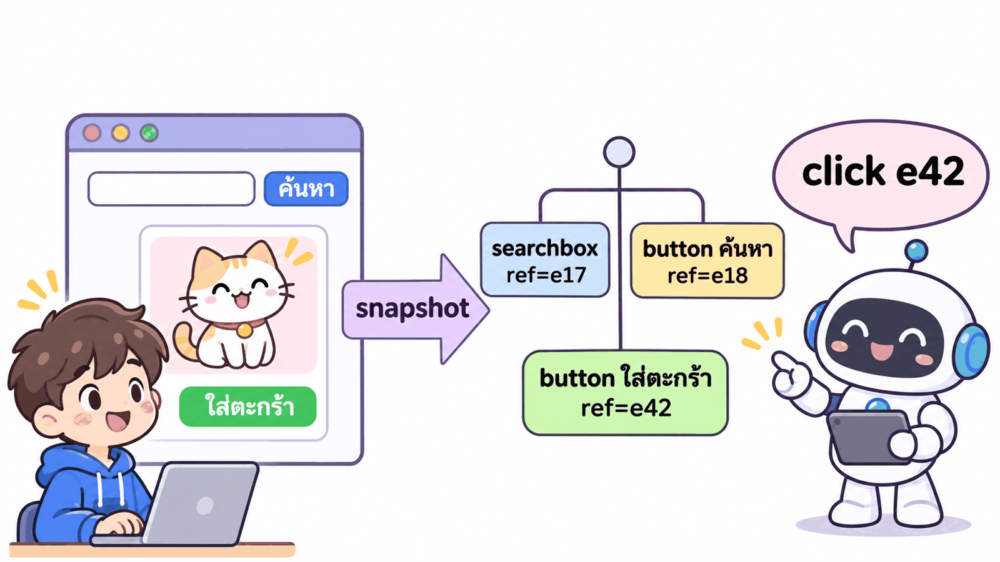
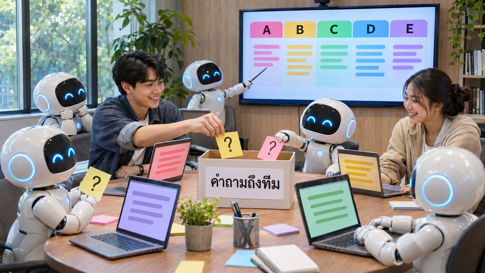
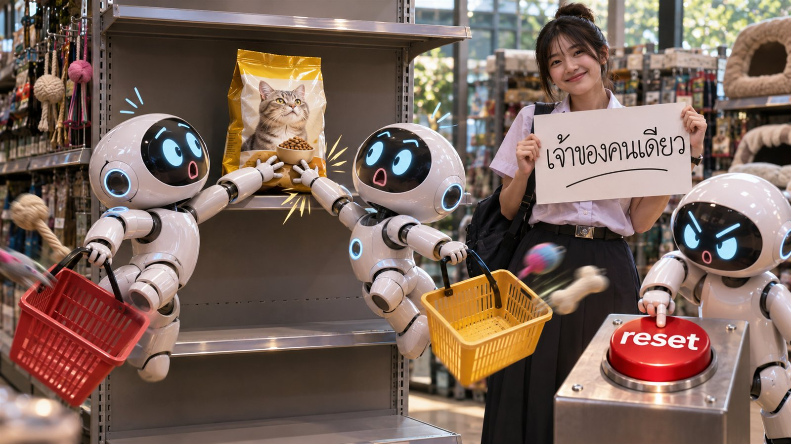
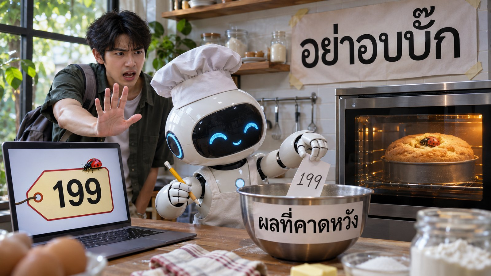
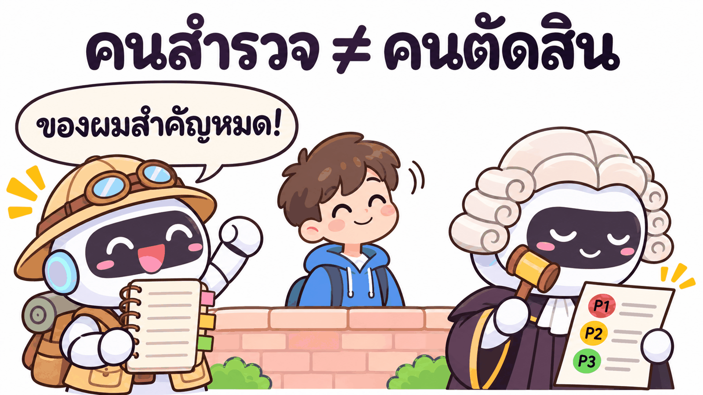
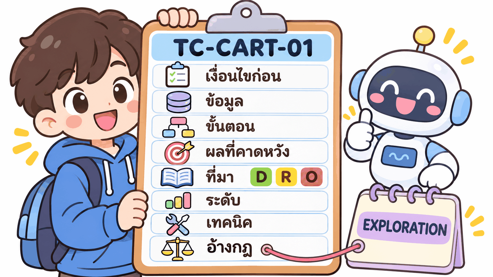
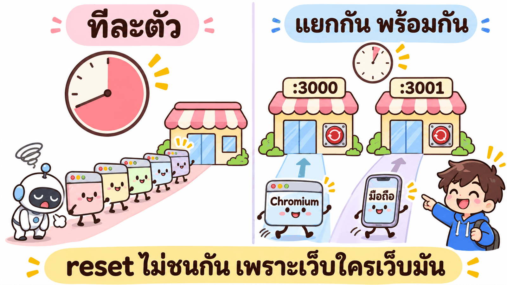

# บท 03 · ทฤษฎี: ใช้ Playwright + AI สำรวจเว็บ แล้วเขียนแผนทดสอบเอง

งานจริงส่วนใหญ่ไม่มีสเปกครบ tester ต้องเรียนรู้เว็บจากการใช้งานจริง แล้วตัดสินเองว่าควรทดสอบอะไร และผลแบบไหนถึงนับว่าถูก
บทนี้ให้ AI (Claude Code) เป็นมือและตาช่วยเราสำรวจ โดยแบ่ง AI เป็นหลายตัวทำงานพร้อมกัน ตัวละหนึ่งส่วนของเว็บ ตัวละหนึ่งเบราว์เซอร์
จากนั้นรวมบันทึก จัดระดับความเสี่ยง เขียน `TEST-PLAN.md` แบบละเอียด แล้วแปลงแผนเป็น Playwright test ที่มีหลักฐาน GIF
หน้านี้อธิบาย "ทำไม" และ "คิดอย่างไร" ส่วน "ลงมือทำ" อยู่ใน [LAB PawPantry](../02_lab/01_pawpantry/README.md) และ [LAB Google Flights](../02_lab/02_google-flights/README.md)


*เรียนทฤษฎีก่อน แล้วไปลองจริงกับเว็บสองแบบ: PawPantry (เว็บของเราเอง) และ Google Flights (เว็บจริงของคนอื่น)*

| สิ่งที่ได้จากหน้านี้ | อยู่หัวข้อ |
|---|---|
| เข้าใจว่า AI "เห็น" เว็บได้แค่ไหน และทำไมต้องคลิกสำรวจ | T1 · T3 |
| เลือกเครื่องมือ Playwright ให้ถูกงาน (MCP / playwright-cli / Playwright Test) | T2 |
| เขียน charter และบันทึกการสำรวจแบบมืออาชีพ | T4 · T5 |
| แบ่ง AI หลายตัวสำรวจพร้อมกันโดยไม่ชนกัน | T6 · T7 |
| รวมบันทึกหลายไฟล์ให้เป็นฉบับเดียวที่เชื่อได้ | T8 |
| ตัดสินว่า "ผลที่ถูก" มาจากไหน และไม่อบบั๊กลงในแผน | T9 |
| จัดระดับความเสี่ยง P1/P2/P3 และเขียน `TEST-PLAN.md` ที่ตรวจย้อนได้ | T10 · T11 |
| อ่านรายงานผลทดสอบที่มี GIF และ % ต่อหัวข้อ | T12 |

> 🧪 **ทุกตัวอย่างในหน้านี้เป็นของจริง** จากรอบที่เรารันเมื่อ **3 พ.ย. 2569** (Claude Code + playwright-cli · ทุก LAB เปิดเซสชันใหม่แล้ววางพรอมต์ครั้งเดียว) ตัวเลขทุกตัวมาจากไฟล์ผลลัพธ์ของรอบนั้น ไม่ได้แต่งขึ้น
> ภาพชื่อ `t*.png` และ `flow-*.png` เป็นภาพวาดอธิบายแนวคิด ภาพชื่อ `real-*.jpg` เป็นภาพประกอบสไตล์ภาพถ่าย จำนวนหุ่นยนต์หรือตัวเลขในภาพอาจไม่ตรงกับรอบจริง ใต้ภาพจะบอกไว้ทุกครั้ง

## 📑 สารบัญ

| กลุ่ม | หัวข้อ |
|---|---|
| 👀 AI มองเว็บอย่างไร | [T1 AI "เห็น" เว็บแค่ไหน](#t1-ai-เห็น-เว็บแค่ไหน) · [T2 Playwright 3 แบบ](#t2-playwright-3-แบบสำหรับงาน-ai) · [T3 อ่าน snapshot + ref](#t3-อ่าน-snapshot--ref) |
| 🧭 สำรวจให้เป็นระบบ | [T4 charter · session · จดระหว่างทาง · debrief](#t4-สำรวจแบบมืออาชีพ-charter--session--จดระหว่างทาง--debrief) · [T5 ความรู้เดิม A หรือ B](#t5-ก่อนสำรวจ-มีความรู้เดิม-a-หรือไม่มี-b) |
| 🤖 หลาย agent พร้อมกัน | [T6 แบ่ง agent สำรวจพร้อมกัน](#t6-แบ่ง-agent-สำรวจพร้อมกัน) · [T7 กับดักของงานขนาน](#t7-กับดักของงานขนาน) · [T8 รวมบันทึก](#t8-รวมบันทึก-ตัดซ้ำ--ขัดกัน--เก็บคำถาม) |
| ⚖️ ตัดสินว่าอะไรถูกและอะไรสำคัญ | [T9 oracle + อย่าอบบั๊ก](#t9-ผลที่คาดหวังมาจากไหน-oracle--อย่าอบบั๊ก--เว็บที่ข้อมูลเปลี่ยนทุกวัน) · [T10 จัดระดับความเสี่ยง](#t10-จัดระดับความเสี่ยงโดยผู้ตัดสินแยก) |
| 📋 จากแผนสู่หลักฐาน | [T11 TEST-PLAN.md แบบละเอียด](#t11-test-planmd-แบบละเอียด) · [T12 test + GIF + รายงาน %](#t12-จากแผนสู่-test--หลักฐาน-gif--รายงาน--ต่อหัวข้อ) |
| 🧠 ปิดท้าย | [ทบทวน 10 ข้อ](#-ทบทวน-10-ข้อ-ลองตอบก่อนเปิดเฉลย) · [คำศัพท์](#-คำศัพท์) |

**สองเว็บที่ใช้ในบทนี้**

| | 🐾 PawPantry | ✈️ Google Flights |
|---|---|---|
| เป็นของใคร | ของเราเอง รันใน Docker ที่ `localhost:3000` | เว็บจริงของ Google |
| ข้อมูลจากทีม | มี `TEST-DATA.md` หน้าเดียว (= ป้าย **[D]**) | ไม่มีเลย |
| ทดสอบหนักได้ไหม | ได้ เพราะเป็นของเรา ล้างข้อมูลได้ด้วย reset | ไม่ได้ ใช้แบบเบาที่สุด (robots.txt และ ToS ของ Google) |
| บั๊ก | มีโหมดฝังบั๊ก `BUG_MODE` | ไม่รู้ล่วงหน้า และข้อมูลเปลี่ยนทุกวัน |
| โจทย์ | ร้านอาหารแมว/สุนัข | กรุงเทพ → โตเกียว เที่ยวเดียว 15 ธ.ค. 2026 ผู้ใหญ่ 1 คน |

---

### T1) AI "เห็น" เว็บแค่ไหน

**คำถาม:** ถ้าสั่ง AI ว่า "เปิดเว็บนี้แล้วบอกว่ามีฟีเจอร์อะไรบ้าง" มันจะรู้ครบไหม?

**คำตอบสั้น:** ไม่ครบ AI เห็นแค่สิ่งที่ **โหลดอยู่บนหน้าตอนนั้น** (โครงสร้างหน้า ปุ่ม ข้อความ) อะไรที่ซ่อนอยู่หลังการคลิก การล็อกอิน หรือการเลือกค่า จะไม่ปรากฏจนกว่าจะมีคนกด ดังนั้น AI ต้อง **สำรวจด้วยการคลิก** เหมือนลูกค้าจริง


*AI เหมือนไฟฉายบนเวที ส่องได้แค่ส่วนที่เปิดอยู่ ส่วนที่อยู่หลังปุ่มต้องกดก่อนถึงจะเห็น*

**สิ่งที่ซ่อนอยู่ แบ่งได้ 4 แบบ**

| แบบ | ความหมาย | ตัวอย่างจริง (รันจริงของเรา) |
|---|---|---|
| หลังการล็อกอิน | หน้าที่ต้องเข้าสู่ระบบก่อน | PawPantry: เปิด `/checkout` หรือ `/account` ตอนยังไม่ล็อกอิน เว็บพาไป `/login?next=/checkout` ตอนลาดตระเวนจึง "ยังไม่ได้เห็นเนื้อหาจริง" |
| หลังปุ่ม | ข้อมูลที่โหลดเพิ่มเมื่อกด | Google: ผลค้นหาแรก 24 แถว ต้องกด "ดูเที่ยวบินเพิ่มเติม" ก่อน C2 ถึงตรวจได้ครบ 300 แถว |
| ในป๊อปอัป | หน้าต่างที่เปิดเมื่อกด | Google: ตัวกรองทุกตัว (สายการบิน สัมภาระ เวลา ฯลฯ) อยู่ในป๊อปอัปที่เปิดจากชิป ตอนยังไม่กดไม่เห็นตัวเลือกข้างใน |
| หลังการกระทำหลายขั้น | สถานะที่เกิดเมื่อทำต่อกัน | PawPantry: ใส่คูปองแล้วลบสินค้าจนยอดต่ำกว่าเกณฑ์ ส่วนลดหายไปเอง (และกลับมาเองเมื่อเพิ่มของ) เห็นได้ต่อเมื่อลองทำจริงเท่านั้น |

**ลองดูว่าการ "เปิดอย่างเดียว" พลาดอะไร (รันจริงของเรา)**

1. **การลาดตระเวน PawPantry** ไม่กรอกฟอร์ม ไม่ใส่ตะกร้า ได้แผนผัง ~16 หน้า แต่หน้า `/cart` เห็นแค่ "ตะกร้าของคุณยังว่างอยู่" และหน้า checkout ยังไม่เคยเห็นเลย
2. พอให้ C3 **ลงมือใส่ของจริง** จึงเจอกฎ 47 ข้อเฉพาะเรื่องตะกร้า คูปอง และค่าส่ง เช่น ส่งฟรีคิดจากยอดก่อนส่วนลด
3. ลาดตระเวน Google ด้วยการค้นหา 1 ครั้ง เห็น "ผล 24 รายการ แต่ตัวกรองมีสายการบิน ~60" ซึ่งเป็นเบาะแสว่ามีข้อมูลซ่อนอยู่อีกมาก

> **ตัวอย่าง (รันจริงของเรา · PawPantry LAB 1 แบบ B):** แผนผังหน้าที่ได้จากการลาดตระเวนเขียนตรง ๆ ว่ายังไม่รู้
>
> ```text
> | ชำระเงิน | /checkout | (ไม่มีลิงก์ตรง น่าจะมาจากตะกร้า) | ถ้าไม่ล็อกอินจะเด้งไป /login?next=/checkout (ยังไม่ได้เห็นเนื้อหาจริง) |
> ```
>
> การเขียนว่า "ยังไม่ได้เห็น" ดีกว่าการเดา เพราะทำให้รู้ว่าต้องส่ง charter ไปสำรวจส่วนนี้ต่อ

**ข้อควรรู้:** บทนี้ **ห้าม AI อ่านโค้ดใน `petshop/`** เพราะ tester ส่วนใหญ่ไม่ได้เห็นโค้ด และโค้ดบอกได้แค่ว่าเว็บ **ทำ** อะไร ไม่ได้บอกว่าเว็บ **ควร** ทำอะไร

**สรุปสั้น:** AI เห็นแค่สิ่งที่โหลดอยู่ · ของหลังล็อกอิน หลังปุ่ม ในป๊อปอัป ต้องคลิกถึงเห็น · สิ่งที่ยังไม่เห็นให้เขียนว่า "ยังไม่ได้เห็น" ไม่ใช่เดา

---

### T2) Playwright 3 แบบสำหรับงาน AI

**คำถาม:** Playwright มีหลายแบบ แล้วงานสำรวจกับงานทดสอบควรใช้แบบไหน?

**คำตอบสั้น:** ใช้ **playwright-cli** สำรวจ เพราะให้ AI แต่ละตัวมีเบราว์เซอร์ของตัวเองได้ ใช้ **Playwright Test** ตรวจผลขั้นสุดท้าย เพราะรันซ้ำได้เหมือนเดิมทุกครั้ง ส่วน **Playwright MCP** เหมาะกับ AI ตัวเดียวที่คุยกับเราไปทีละหน้า


*MCP = มือเดียว · playwright-cli = หลายมือ เบราว์เซอร์ใครของมัน · Playwright Test = สคริปต์ที่รันซ้ำได้ (จำนวนหุ่นยนต์ในภาพเป็นตัวอย่าง)*

| | 🟦 Playwright MCP | 🟪 playwright-cli | 🟩 Playwright Test |
|---|---|---|---|
| คืออะไร | Playwright ที่ห่อเป็น tool ให้ AI เรียกใช้ | คำสั่งบรรทัดเดียวที่ AI สั่งผ่าน shell | ไฟล์ test `.spec.ts` ที่รันด้วยคำสั่งเดียว |
| เบราว์เซอร์ | ตัวเดียวต่อการเชื่อมต่อ | ตั้งชื่อแยกได้ด้วย `-s=<ชื่อ>` ชื่อละตัว | เปิดใหม่ทุก test |
| เหมาะกับ | AI ตัวเดียว คุยต่อเนื่อง ดูทีละหน้า | **สำรวจพร้อมกันหลาย agent** (LAB 0–3 ของเรา) | **ตรวจผลซ้ำได้ + เก็บหลักฐาน** (LAB 6) |
| ผลลัพธ์ | บันทึกที่ AI เขียน | บันทึกต่อ charter + ภาพหลักฐาน | ผ่าน/ไม่ผ่าน + วิดีโอ/GIF + รายงาน |
| ข้อควรระวัง | หลาย subagent ใช้ตัวเดียวกัน = แย่งเบราว์เซอร์กัน | ต้องปิดเมื่อเลิกใช้ ไม่งั้นค้าง (T7) | ผลที่คาดหวังต้องมาจากแผน ไม่ใช่จากหน้าจอ (T9) |

**ทำไม subagent ที่ทำงานพร้อมกันห้ามใช้ Playwright MCP ตัวเดียวกัน**


*ซ้าย: MCP ตัวเดียว ทุกตัวกดแท็บเดียวกัน ผลปนกัน · ขวา: playwright-cli แยกชื่อ ทุกตัวมีเบราว์เซอร์ของตัวเอง (ภาพวาด 3 ตัว รอบจริง PawPantry ใช้ 7 · Google ใช้ 6)*

1. subagent ที่อ้าง MCP ด้วยชื่อเดียวกัน จะใช้การเชื่อมต่อของตัวหลัก จึงได้ **เบราว์เซอร์เดียวและแท็บชุดเดียวกัน**
2. ตัวหนึ่งกำลังกรอกฟอร์มล็อกอิน อีกตัวกดไปหน้าตะกร้า หน้าจอจึงเปลี่ยนใต้มือกันตลอด ผลที่จดได้ **เชื่อไม่ได้**
3. ทีม Playwright ตอบปัญหานี้ว่าให้ใช้ **CLI session แยก** (สองเบราว์เซอร์) แทนการแบ่งแท็บ ([งานค้นคว้า](RESEARCH.md) หัวข้อ 2)

**Playwright MCP แบบ `--extension` = Chrome จริงของคุณ**

| | Playwright MCP `--extension` | playwright-cli ค่าเริ่มต้น |
|---|---|---|
| เปิดเบราว์เซอร์ไหน | Chrome ที่คุณใช้อยู่จริง (มีบัญชี มี cookie) | เบราว์เซอร์ใหม่ โปรไฟล์อยู่ในหน่วยความจำ = **โหมดไม่ระบุตัวตน** |
| กี่แท็บ | 1 แท็บ | ตามจำนวน session ที่ตั้งชื่อ |
| ต้องอนุมัติไหม | ต้องกดอนุมัติในส่วนขยาย **ทุกครั้งที่เซสชันใหม่เริ่ม** | ไม่ต้อง |
| ปิดแล้วเหลืออะไร | ข้อมูลอยู่ในโปรไฟล์จริงของคุณ | หายหมด ไม่มีอะไรค้าง |
| ใช้ในบทนี้ไหม | ❌ ไม่ใช้กับ Google (กติกา R6 ห้าม เพราะใช้บัญชีจริง) | ✅ ใช้ทั้งสองเว็บ |

**เรื่อง token:** มีคนอ้างว่า CLI ประหยัด token กว่ามาก แต่การวัดซ้ำในปี 2026 พบว่าแทบไม่ต่างกันแล้ว จึง **เลือกตามงาน** (ต้องการเบราว์เซอร์แยกไหม) ไม่ใช่ตาม token ([งานค้นคว้า](RESEARCH.md) หัวข้อ 2)

> **ตัวอย่าง (รันจริงของเรา · LAB 0):** PawPantry ใช้เวลา 48 วินาที ติดตั้ง playwright-cli แล้วเปิด 2 session ชื่อ `a` และ `b` พร้อมกันได้ · Google ใช้เวลา 44 วินาที เปิดหน้าแรกได้ ไม่เจอ CAPTCHA ไม่มีป๊อปอัปคุกกี้ เห็นปุ่มสลับต้นทาง-ปลายทางเป็น disabled จนกว่าจะใส่ปลายทาง

**สรุปสั้น:** สำรวจหลายตัวพร้อมกัน = playwright-cli `-s=<ชื่อ>` · ตรวจผลซ้ำได้ = Playwright Test · MCP ตัวเดียวห้ามแชร์ให้หลาย subagent · `--extension` = Chrome จริง 1 แท็บ ต้องอนุมัติทุกเซสชัน

---

### T3) อ่าน snapshot + ref

**คำถาม:** AI ไม่มีตา แล้วรู้ได้อย่างไรว่าช่องค้นหาอยู่ตรงไหน และจะกดให้ถูกปุ่มได้อย่างไร?

**คำตอบสั้น:** AI ขอ **snapshot** คือหน้าเว็บในรูปข้อความแบบต้นไม้ (ได้จาก accessibility tree ที่ screen reader ใช้) ทุกชิ้นบอก **role** (เป็นอะไร) **name** (ชื่อที่อ่านได้) และมี **ref** (ป้ายอ้างอิง) ให้ AI สั่ง "คลิก ref นี้" ได้ตรงตัว


*หน้าเว็บ → snapshot → ต้นไม้ role + name + ref → AI สั่งคลิกด้วย ref (เลข ref ในภาพเป็นตัวอย่าง ของจริงดูด้านล่าง)*

> **ตัวอย่าง (รันจริงของเรา · snapshot หัวเว็บ PawPantry ที่ C2 ได้จากหน้าตะกร้า):**
>
> ```yaml
> - link "อาหารแมว" [ref=f6e10] [cursor=pointer]:
>   - /url: /products?pet=cat
> - searchbox "ค้นหาสินค้า" [ref=f6e17]
> - button "ค้นหา" [ref=f6e18] [cursor=pointer]
> - link "ตะกร้าสินค้า" [ref=f6e23] [cursor=pointer]:
>   - generic [ref=f6e25]: "9"
> - heading "ตะกร้าของฉัน" [level=1] [ref=f6e32]
> ```
>
> อ่านทีละบรรทัด
> 1. มีลิงก์ชื่อ "อาหารแมว" ไปที่ `/products?pet=cat`
> 2. มีช่องค้นหา (`searchbox`) ชื่อ "ค้นหาสินค้า" ref `f6e17` และปุ่ม "ค้นหา" ref `f6e18`
> 3. ลิงก์ "ตะกร้าสินค้า" มีตัวเลข "9" = ตอนนั้นมีของในตะกร้า 9 ชิ้น
> 4. หัวข้อใหญ่ของหน้า (`level=1`) คือ "ตะกร้าของฉัน" → รู้ว่าอยู่หน้าตะกร้าจริง
>
> ถ้าจะค้นหา AI สั่ง "พิมพ์ลง `f6e17`" แล้ว "คลิก `f6e18`" ไม่ต้องเดาพิกัดบนจอ

**3 ส่วนที่ต้องอ่านเป็น**

| ส่วน | ความหมาย | ตัวอย่าง |
|---|---|---|
| **role** | ชิ้นนี้คืออะไร | `link`, `button`, `searchbox`, `heading`, `combobox` |
| **name** | ข้อความที่ screen reader จะอ่าน | `"ค้นหาสินค้า"`, `"ตะกร้าสินค้า"` |
| **ref** | ป้ายชั่วคราวให้ AI อ้างถึง (เปลี่ยนได้เมื่อหน้าเปลี่ยน) | `f6e17` |

**ทำไม snapshot ดีกว่าดูภาพหน้าจออย่างเดียว**

| | screenshot (ภาพ) | snapshot (ต้นไม้) |
|---|---|---|
| อ่านข้อความ | ต้องอ่านจากพิกเซล อาจผิด | ได้ข้อความตรง ๆ |
| รู้สถานะ | เดาจากสี | มีป้าย เช่น `[disabled]`, `[selected]`, `level=1` |
| กดให้ถูก | ต้องคำนวณพิกัด | ใช้ ref |
| ข้อเสีย | — | ไม่เห็นสี ตำแหน่ง layout → จึงถ่ายภาพคู่ไว้เป็น **หลักฐาน** |

**เชื่อมกับ T12:** role + name คือสิ่งเดียวกับที่ Playwright Test ใช้หาปุ่ม (เช่น หาปุ่มชื่อ "ค้นหา") เว็บที่ตั้งชื่อปุ่มดีจึงทั้ง **ทดสอบง่าย** และ **เข้าถึงได้ดี** สำหรับผู้พิการทางสายตา ตรงกันข้าม ถ้าเจอปุ่มที่ไม่มี name ก็เป็นข้อสังเกตด้านการเข้าถึง (เช่น F24 ใน `EXPLORATION.md` ของ PawPantry จดว่าตัวนับ ♥/🛒 ไม่ถูกโปรแกรมอ่านจออ่าน)

**สรุปสั้น:** snapshot = หน้าเว็บเป็นข้อความต้นไม้ · role บอกชนิด · name บอกชื่อ · ref ให้กดตรงตัว · ภาพหน้าจอเก็บคู่ไว้เป็นหลักฐาน

---

### T4) สำรวจแบบมืออาชีพ: charter · session · จดระหว่างทาง · debrief

**คำถาม:** "ให้ AI ลองกดทุกอย่าง" ฟังดูมั่ว แล้วจะสำรวจอย่างไรให้เป็นระบบ และตรวจย้อนได้?

**คำตอบสั้น:** ใช้ **SBTM (Session-Based Test Management)** ของ Jonathan และ James Bach: มี **charter** (ภารกิจ) · ทำใน **session** ที่มีเวลาจำกัด · **จดลงใบบันทึกระหว่างทาง** · จบแล้ว **debrief** (สรุปผล) ทุกขั้นเป็นไฟล์ที่คนอื่นอ่านต่อได้


*charter หนึ่งใบ = ภารกิจชัด + เวลาจำกัด + ต้องจดทุกอย่าง (ภาพวาด 3 ตัวให้อ่านง่าย รอบจริง PawPantry ใช้ 7 charter · Google ใช้ 6)*

**4 ส่วนของ SBTM**

| ส่วน | ความหมาย | ในบทนี้คือ |
|---|---|---|
| **charter** | ภารกิจของรอบสำรวจ บอกว่าดูอะไร ด้วยอะไร เพื่อหาอะไร | หัวข้อ C1–C7 ใน `CHARTERS.md` |
| **session** | ช่วงเวลาทำงานต่อเนื่องที่มีเวลาจำกัด (ตำราแนะนำ 1–2 ชม.) | subagent 1 ตัว + เบราว์เซอร์ 1 ตัว + งบเวลาต่อ charter |
| **session sheet** (ใบบันทึก) | บันทึกในรูปแบบคงที่ | ไฟล์ `exploration/C<N>.md` ส่วน A–E |
| **debrief** | สรุปหลังจบ แบบ PROOF | ขั้นรวมไฟล์ใน T8 |

**แม่แบบ charter (จากหนังสือ *Explore It!* ของ Elisabeth Hendrickson)**

> **สำรวจ** \<ส่วนของเว็บ\> **ด้วย** \<ข้อมูล/เครื่องมือ\> **เพื่อหา** \<กฎ ความเสี่ยง\>

> **ตัวอย่าง (รันจริงของเรา · `CHARTERS.md` ของ PawPantry):**
>
> ```text
> C3 · ตะกร้า คูปอง และค่าส่ง (ก่อนกดยืนยันคำสั่งซื้อ) — P1 · 60 นาที
> สำรวจ /cart และหน้าสรุปยอดใน /checkout ไปจนถึงก่อนกดยืนยันสั่งซื้อ
> ด้วย คูปองทั้ง 4 ตัว (PAW10, FREESHIP, NEWCAT50, SUMMER20), ยอดรอบ ๆ ฿999 และ ฿500, ส่งปกติ ฿50 / ด่วน ฿120 และบัญชีที่สมัครเอง
> เพื่อหา ยอดรวม ส่วนลด หรือค่าส่งที่คำนวณผิด, เงื่อนไขคูปองที่บังคับใช้ไม่ครบ, ยอดติดลบหรือการปัดเศษผิด
> ❌ ห้ามกดยืนยันคำสั่งซื้อ · ห้ามใช้บัญชี demo
> ```
>
> สังเกต 4 อย่าง: **ขอบเขตชัด** (ถึงก่อนกดยืนยัน) · **ข้อมูลที่ใช้มาจาก TEST-DATA** (คูปอง 4 ตัว ค่าส่ง ฿50/฿120) · **ค่าขอบ** (รอบ ๆ ฿999 และ ฿500) · **ข้อห้าม** ที่กันไม่ให้ชนกับ charter อื่น (การสั่งซื้อจริงเป็นของ C4)

**charter ที่ดีมีอะไรบ้าง**

| ต้องมี | ทำไม | ตัวอย่างจากรอบจริง |
|---|---|---|
| ส่วนของเว็บ 1 ส่วน ไม่ทับกัน | agent จะได้ไม่ทำซ้ำกัน | C1 แคตตาล็อก · C3 ตะกร้า · C5 ล็อกอิน |
| "สิ่งที่ต้องลองอย่างน้อย" เป็นข้อ ๆ | กัน AI ลองแค่ทางปกติ | C3 ข้อ 1: ยอด ฿998 / ฿999 / ฿1000 ก่อนและหลังลด PAW10 |
| ระดับความเสี่ยงที่เดาไว้ | รู้ว่าอันไหนต้องลงลึก | C3 P1 · C7 P3 |
| งบเวลา | ไม่ให้จมอยู่จุดเดียว | 30–60 นาทีต่อ charter |
| ข้อห้ามและเจ้าของข้อมูลกลาง | กันชนกัน (T7) | "C4 เป็นคนเดียวที่สั่งซื้อจริง" |
| ช่อง "ส่งต่อ" | เจอเรื่องของคนอื่นให้จดแล้วส่ง ไม่ลงไปเอง | C3 ส่งต่อ C4 เรื่องตะกร้า 500 ชิ้น |

**จดระหว่างทาง ไม่ใช่จดตอนจบ**


*ถ้างานถูกหยุดกลางทาง สิ่งที่อยู่ในหัว AI หายหมด สิ่งที่เขียนลงไฟล์แล้วยังอยู่*

> **ตัวอย่าง (รันจริงของเรา · PawPantry LAB 2 รอบแรก ล้มเหลว เป็นบทเรียน):**
> - orchestrator (agent หลักที่แจกงาน) ส่ง subagent 7 ตัวไปทำงาน "เบื้องหลัง" แล้ว **จบเทิร์นทันที**
> - เมื่อเซสชันปิด subagent ถูกหยุดก่อนเขียนบันทึก ได้ไฟล์สมบูรณ์แค่ `C1.md` ไฟล์เดียว (ภาพหลักฐานยังอยู่ 97 ภาพ แต่ไม่มีคำอธิบาย)
> - เบราว์เซอร์ 7 ตัวยังค้างเปิดอยู่ จนรอบใหม่ปิดให้
>
> **แก้พรอมต์ 2 จุด:** (1) สั่ง subagent ทุกตัวในข้อความเดียว ไม่ใช้โหมดเบื้องหลัง และรอจนครบ (2) **เขียนไฟล์ตั้งแต่เริ่ม แล้วเพิ่มทีละข้อระหว่างทาง** · รอบสองได้ครบ 7 ไฟล์

**ใบบันทึกหนึ่งไฟล์มีอะไร** (ตัวอย่าง `exploration/C3.md` รอบจริง เริ่ม 07:35:20 จบ 07:48:07 ประมาณ 13 นาที)

| ส่วน | จดอะไร |
|---|---|
| หัวไฟล์ | เวลาเริ่ม-จบ · ชื่อ session · บัญชีทดสอบที่สมัครเอง |
| A หน้า/สถานะที่เจอ | หน้าและข้อความที่เห็น เช่น error "คูปองนี้หมดอายุแล้ว" |
| B ฟีเจอร์ | สิ่งที่ลูกค้าทำได้ |
| C กฎ | ตาราง: กฎ · ตัวอย่างที่ลอง (พร้อม **ค่าที่คาดไว้ก่อน**) · ผลที่เห็น · ที่มา |
| D ความเสี่ยง | ถ้าพังจะเกิดอะไร ระดับเท่าไร |
| E คำถามถึงทีม | สิ่งที่ไม่แน่ใจว่าถูก + เรื่องที่ส่งต่อ charter อื่น |

> **ตัวอย่าง (รันจริงของเรา · แถวหนึ่งในตาราง C ของ `C3.md`):**
>
> ```text
> | 6 | PAW10 ปัดเศษ 10% | ยอด ฿998 + PAW10 คาดว่า = 99.8 → ปัดปกติ ฿100 (ยอด 998−100+50 = ฿948) |
>   ⚠️ ส่วนลด -฿99 ยอดชำระ ฿949 → ปัดลง (floor) ลูกค้าเสียเปรียบ ฿1 · ภาพ 02-998-paw10.png | [R] |
> ```
>
> จุดสำคัญคือ C3 **เขียนค่าที่คาดไว้ก่อน** (฿948) แล้วจึงเทียบกับที่เว็บให้ (฿949) และแนบชื่อภาพหลักฐาน

**Debrief แบบ PROOF** (ใช้ตอนรวมผล T8)


*ทุก charter มารวมกัน เทผลลง A–E กลาง และเรื่องที่ยังไม่แน่ใจหย่อนลงกล่อง "คำถามถึงทีม" (จำนวนหุ่นยนต์ในภาพเป็นตัวอย่าง)*

| ตัวอักษร | ถาม | ตัวอย่างคำตอบจากรอบจริง |
|---|---|---|
| **P**ast | ทำอะไรไป | 7 charter สำรวจพร้อมกัน 24 นาที |
| **R**esults | เจออะไร | กฎ 287 · ⚠️ 80 · คำถาม 81 · ภาพ 100 |
| **O**bstacles | ติดอะไร | C3 เขียนทับสคริปต์ของ C2 ในโฟลเดอร์ชั่วคราว (T7) |
| **O**utlook | ต่อไปควรทำอะไร | ลองซ้ำ 3 เรื่องที่ผลขัดกัน · ช่องโหว่ IDOR ที่ยังไม่มีใครลอง (T8) |
| **F**eelings | รู้สึกอย่างไร / มั่นใจแค่ไหน | AI ไม่มีความรู้สึก แต่บอก "ความมั่นใจ" ได้ ผ่านป้ายที่มาและ ⚠️ |

**สรุปสั้น:** charter = สำรวจ \<ส่วน\> ด้วย \<ข้อมูล\> เพื่อหา \<กฎ ความเสี่ยง\> · session มีเวลาจำกัด · จดลงไฟล์ทีละข้อระหว่างทาง · เขียนค่าที่คาดก่อนเทียบกับเว็บ · debrief แบบ PROOF

---

### T5) ก่อนสำรวจ: มีความรู้เดิม (A) หรือไม่มี (B)

**คำถาม:** ก่อนแจก charter ควรให้ AI วางแผนจากสิ่งที่รู้อยู่แล้ว หรือให้เปิดเว็บดูก่อน?

**คำตอบสั้น:** ได้ทั้งสองแบบ **แบบ A** วางแผนจากความรู้เดิมโดยไม่เปิดเว็บ (เร็ว แต่หลายข้อเป็นการเดา) **แบบ B** ลาดตระเวนเว็บเบา ๆ ก่อน (ช้ากว่านิด แต่ได้เบาะแสจริง) เลือกตามว่ามีความรู้เดิมดีแค่ไหน และเว็บยอมให้เข้าบ่อยแค่ไหน


*A = วางแผนจากแผนที่ที่มีอยู่ · B = ออกไปดูพื้นที่จริงก่อน · ทั้งสองทางจบที่ `CHARTERS.md`*

**ความรู้เดิมคืออะไร**
- PawPantry: `TEST-DATA.md` (ข้อมูลจากทีม) + ความรู้ทั่วไปเรื่องร้านออนไลน์
- Google: `KNOWN-FEATURES.md` = ชื่อฟีเจอร์ 35 ข้อจาก Week 03 (มีแค่ชื่อและตำแหน่ง **ไม่มีกฎ**) + ความรู้ทั่วไปเรื่องเว็บค้นหาเที่ยวบิน

> **ตัวอย่าง (รันจริงของเรา · LAB 1 ทั้งสองเว็บ ทำทั้ง A และ B แล้วเลือกแบบเดียวไปต่อ):**
>
> | | PawPantry A | PawPantry B | Google A | Google B |
> |---|---|---|---|---|
> | เปิดเว็บไหม | ไม่เปิด | ลาดตระเวน 1 รอบ | ไม่เปิด | ค้นหา 1 ครั้ง |
> | เวลา | 2.6 นาที | 3.7 นาที | 2.9 นาที | 7.3 นาที |
> | charter | 7 | 7 | 6 | 6 |
> | ได้อะไร | คาดฟีเจอร์ 18 ข้อ · ข้อสมมติที่ต้องยืนยัน 5 ข้อ (ใหญ่สุด: เว็บมีหน้าสมัครไหม) | เดินลิงก์หัว 8 ท้าย 9 · เจอ ~16 หน้า · เบาะแสจริง 5 เรื่อง · กติกากันชนกัน | กติกา R1–R7 · จังหวะแบบคน · จัดคิวเบราว์เซอร์ 2 รอบ | เบาะแสตัวเลขไม่ตรงกัน 5 เรื่อง |
> | ใช้ต่อ | — | ✅ | ✅ | — |

**B เจออะไรที่ A ได้แค่เดา**

| เว็บ | A เดาไว้ว่า | B เห็นจริงว่า |
|---|---|---|
| PawPantry | "เว็บมีหน้าสมัครไหม" (ข้อสมมติใหญ่สุด) | มี `/register` พร้อมคำใบ้ "อย่างน้อย 8 ตัว และมีตัวเลข" |
| PawPantry | — | title หน้า 404 ไม่บอกว่าเป็น 404 · favicon ตอบ 404 · `?type=toy` หัวข้อยังเขียน "สินค้าทั้งหมด" · หมวดแมวมีของเล่นปน (กระทบเงื่อนไข NEWCAT50 "อาหารแมว ≥ ฿500") · หน้าสินค้าหมดยังมีปุ่ม −/+ |
| Google | ปฏิทินน่าจะแสดงราคา | ปฏิทิน label บอก 7956 บาท แต่จอแสดง ฿7,960 |
| Google | — | ช่วงราคาปกติต่างกันระหว่างหน้า · "รวมค่าธรรมเนียมเพิ่มเติม ฿150" แต่ราคาไม่เปลี่ยน · ผล 24 รายการแต่ตัวกรองมีสายการบิน ~60 · CO2 81+329 = 410 แต่การ์ดเขียน 409 |

**ทำไมสองเว็บเลือกต่างกัน**

| | PawPantry → เลือก B | Google → เลือก A |
|---|---|---|
| เหตุผลหลัก | เว็บของเราเอง เข้ากี่ครั้งก็ได้ และ B ได้ **กติกากันชนกัน** ที่ละเอียดกว่า (เช่น C2 ต้องเช็กก่อนว่าใส่ตะกร้าแล้วจองสต็อกไหม) | เว็บจริงของคนอื่น ทุกการค้นหามีต้นทุน (เสี่ยง CAPTCHA) แผน A มีกติกาความปลอดภัยครบและจัดคิวเบราว์เซอร์ไว้แล้ว |
| ข้อเสียที่ยอมรับ | ช้ากว่า A ราว 1 นาที | หลายข้อในแผนยังเป็น "สมมติฐาน" ต้องยืนยันตอนสำรวจจริง |

**สรุปสั้น:** A = วางแผนจากความรู้เดิม เร็วแต่เดา · B = ลาดตระเวนก่อน ได้เบาะแสจริง · เว็บของเราใช้ B ได้สบาย · เว็บคนอื่นที่ต้องประหยัดการเข้าใช้ A ก็พอ ถ้ามีรายชื่อฟีเจอร์อยู่แล้ว

---

### T6) แบ่ง agent สำรวจพร้อมกัน

**คำถาม:** ถ้ามีงานสำรวจรวม 345 นาที (ผลรวมงบเวลาของ 7 charter PawPantry) จะทำให้เสร็จเร็วได้อย่างไร?

**คำตอบสั้น:** ให้ **orchestrator** (agent หลัก) แจก charter ให้ **subagent** หลายตัว **ตัวละ charter ตัวละเบราว์เซอร์** ทำพร้อมกัน แต่ละตัวเขียนไฟล์ของตัวเอง แล้วค่อยรวมทีหลัง รอบจริงของเราใช้เวลา 24 นาที


*หนึ่ง subagent ต่อหนึ่ง charter ต่อหนึ่งเบราว์เซอร์ (ภาพวาด 5 ตัวให้อ่านง่าย รอบจริง PawPantry ใช้ 7 · Google ใช้ 6)*


*วางแผน → แจกภารกิจ → สำรวจพร้อมกัน → จดแยกไฟล์ → รวม + จัดระดับ (ภาพวาด 5 ตัวให้อ่านง่าย รอบจริง PawPantry ใช้ 7 · Google ใช้ 6)*

**สายพานทีละขั้น**

| ขั้น | ใครทำ | ทำอะไร | ได้ไฟล์ | LAB |
|---|---|---|---|---|
| **1 วางแผน** | orchestrator | แบ่งเว็บเป็นส่วนที่ไม่ทับกัน เขียน charter + กติกากันชน (แบบ A หรือ B ใน T5) | `CHARTERS.md` | 1 |
| **2 แจกภารกิจ** | orchestrator | สั่ง subagent **ทุกตัวในข้อความเดียว** แต่ละตัวได้ charter ของตัวเอง + ชื่อเบราว์เซอร์ `-s=c<N>` + ชื่อไฟล์ที่ต้องเขียน แล้ว **รอจนครบ** | — | 2 |
| **3 สำรวจพร้อมกัน** | subagent แต่ละตัว | เปิดเบราว์เซอร์ของตัวเอง คลิกตาม charter ถ่ายภาพหลักฐาน | ภาพใน `exploration/C<N>/` | 2 |
| **4 จดแยกไฟล์** | subagent แต่ละตัว | เขียนไฟล์ตั้งแต่เริ่ม เพิ่มทีละข้อ (T4) · ปิดเบราว์เซอร์เมื่อจบ | `exploration/C<N>.md` | 2 |
| **5 รวม + จัดระดับ** | orchestrator + ผู้ตัดสินแยก | รวม ตัดซ้ำ ลองซ้ำข้อที่ขัดกัน (T8) แล้วให้ agent ใหม่จัดระดับความเสี่ยง (T10) | `EXPLORATION.md` | 3 |

**ทำไมแบ่ง "ตามส่วนของเว็บ" ไม่ใช่สุ่มแบ่ง**
1. แต่ละตัวลงลึกในส่วนของตัวเองได้ เช่น C3 ลองคูปองครบ 4 ตัว × ยอดขอบหลายค่า
2. ไม่ทำซ้ำกัน ถ้าเจอเรื่องของคนอื่นให้ "ส่งต่อ"
3. ส่วนที่เสี่ยงสูง (P1) ได้งบเวลามากกว่า (PawPantry: P1 60 นาที · P2 45 · P3 30)

> **ตัวอย่าง (รันจริงของเรา · PawPantry LAB 2 รอบสอง):** 24 นาที (07:33:27–07:57:26) · 7 subagent พร้อมกัน · เบราว์เซอร์เปิดพร้อมกันสูงสุด 7 ตัว · reset ข้อมูลครั้งเดียวตอน 07:33:55 · รวมได้ **กฎ 287 · ⚠️ 80 · คำถาม 81 · ภาพหลักฐาน 100**
>
> | charter | นาที | กฎ | ⚠️ | คำถาม |
> |---|---|---|---|---|
> | C1 แคตตาล็อก | 14 | 34 | 8 | 11 |
> | C2 หน้าสินค้า/สต็อก | 16 | 43 | 12 | 13 |
> | C3 ตะกร้า/คูปอง/ค่าส่ง | 13 | 47 | 9 | 10 |
> | C4 สั่งซื้อจริง | 19 | 39 | 10 | 13 |
> | C5 สมัคร/ล็อกอิน | 21 | 35 | 7 | 12 |
> | C6 Finder/แนะนำ/รายการโปรด | 19 | 45 | 10 | 12 |
> | C7 หัว/ท้าย/404/มือถือ/a11y | 15 | 44 | 24 | 10 |
>
> ประเด็นเด่นที่เจอ: กดยืนยัน 3 ครั้งในคำสั่งเดียว → ได้ 3 คำสั่งซื้อ PP-100014–016 ฿650 เท่ากัน และ NEWCAT50 ถูกใช้ 3 ครั้ง · พิมพ์ "05" ในช่องจำนวนได้ 15 · open redirect ผ่าน `next=` · ล็อกอินผิดได้ไม่จำกัด (ลอง 13 ครั้ง) · Finder ให้ลูกสุนัขได้อาหารสุนัขสูงวัยเป็น "ตรงใจที่สุด"


*PawPantry LAB 2 (รันจริง): เบราว์เซอร์เปิดพร้อมกันสูงสุด 7 ตัว = 1 ตัวต่อ 1 charter แล้วลดลงเมื่อแต่ละ charter จบและปิดเบราว์เซอร์ของตัวเอง*

> **ตัวอย่าง (รันจริงของเรา · Google Flights LAB 2):** 30 นาที (07:35:46–08:06:13) · 6 subagent · เปิดพร้อมกันสูงสุด **5** ตามกติกา (C6 รอคิว 13 นาทีจน C2 ปิด) · ไม่เจอ CAPTCHA · **กฎ 165 · ⚠️ 36 · คำถาม 44 · ภาพหลักฐาน 171**
>
> | charter | นาที | กฎ | ⚠️ | คำถาม |
> |---|---|---|---|---|
> | C1 ฟอร์มค้นหา | 18 | 39 | 9 | 7 |
> | C2 ผลลัพธ์/จัดอันดับ | 12 | 26 | 3 | 7 |
> | C3 ตัวกรอง | 14 | 32 | 10 | 8 |
> | C4 เครื่องมือราคา/วันที่ | 14 | 23 | 3 | 7 |
> | C5 เลือกเที่ยวบิน/booking | 15 | 20 | 5 | 8 |
> | C6 หน้าแรก/ภาษา/สกุลเงิน | 12 | 25 | 6 | 7 |
>
> ประเด็นเด่น P1: กรองสายการบิน ANA ในชั้นประหยัด แต่ได้เที่ยวบินการบินไทย **ชั้นธุรกิจ** ฿68,445 (ชั้นประหยัดเที่ยวเดียวกัน ฿15,330) · เปลี่ยนเป็น 2 คนแล้วกด Back จอแสดง 2 คน แต่ URL เป็น 1 คน · แท็บ "ถูกที่สุด" ไม่เรียงราคา


*Google Flights LAB 2 (รันจริง): ไม่เคยเกินเพดาน 5 ตัว · ช่วงที่เต็ม 5 ตัว charter ที่ 6 ต้องรอคิว*

**สรุปสั้น:** 1 วางแผน → 2 แจกภารกิจในข้อความเดียว → 3 สำรวจพร้อมกัน → 4 จดแยกไฟล์ → 5 รวม + จัดระดับ · แบ่งตามส่วนของเว็บ · PawPantry 7 ตัว 24 นาที · Google 6 ตัว แต่เปิดพร้อมกันไม่เกิน 5

---

### T7) กับดักของงานขนาน

**คำถาม:** หลาย agent ใช้เว็บเดียวกันพร้อมกัน จะพังตรงไหนได้บ้าง?

**คำตอบสั้น:** พังตรง **ของที่ใช้ร่วมกัน** (shared state) เช่น ข้อมูลในฐานข้อมูล บัญชี สต็อก ไฟล์ชั่วคราว และกำลังของเว็บปลายทาง ทางแก้หลักคือ **ของกลางแต่ละชิ้นมีเจ้าของคนเดียว** ที่เหลือแยกให้ขาด


*สองตัวแย่งสต็อกชิ้นสุดท้าย อีกตัวกำลังกด reset ล้างทั้งร้าน ทางแก้คือของกลางแต่ละชิ้นมีเจ้าของคนเดียว (จำนวนหุ่นยนต์ในภาพเป็นตัวอย่าง)*

**กับดักที่เจอจริงหรือกันไว้ล่วงหน้า (รันจริงของเรา)**

| # | กับดัก | ถ้าไม่กันจะเกิดอะไร | วิธีที่ใช้ในรอบจริง |
|---|---|---|---|
| 1 | **reset ล้างทั้งเว็บ** (`POST /api/test/reset`) | agent หนึ่งกด reset ตะกร้า บัญชี และคำสั่งซื้อของทุกตัวหายกลางทาง | ผู้ประสานงานเป็นเจ้าของคนเดียว · reset ครั้งเดียวก่อนเริ่ม (07:33:55) · ห้ามรัน Playwright test ระหว่างสำรวจ เพราะ test เรียก reset เอง |
| 2 | **สต็อกและคำสั่งซื้อใช้ร่วมกัน** | C2 เห็นสต็อกลดเองแล้วรายงานเป็นบั๊ก ทั้งที่เป็นเพราะ C4 สั่งซื้อ | C4 เป็นเจ้าของการสั่งซื้อ บัญชี demo และสต็อก คนเดียว · C2 ต้องเช็กก่อนว่าใส่ตะกร้าแล้วจองสต็อกไหม · C4 รอคำตอบ C2 ก่อนสั่งซื้อ (07:36) · "เห็นข้อมูลเปลี่ยนเอง ให้เทียบกับบันทึกของ C4 ก่อน" |
| 3 | **บัญชีใช้ร่วมกัน** | ตัวหนึ่งล็อกอินผิดจนบัญชีถูกล็อก อีกตัวใช้ต่อไม่ได้ | แต่ละ charter สมัครบัญชีของตัวเอง `qa-c<N>-<เวลา>@pawpantry.test` · ห้ามกรอกรหัสผิดกับบัญชี demo |
| 4 | **โฟลเดอร์ไฟล์ชั่วคราวเดียวกัน** | ไฟล์ทับกัน | **เกิดจริง 1 ครั้ง:** C3 เขียนทับสคริปต์ `h.sh` ของ C2 · ข้อมูลเว็บไม่เสีย C2 ย้ายไปโฟลเดอร์แยก · บทเรียน: บอกให้แต่ละตัวใช้โฟลเดอร์ชื่อของตัวเอง |
| 5 | **subagent ทำงานเบื้องหลัง** | เซสชันปิด subagent ถูกหยุดก่อนเขียนบันทึก | **เกิดจริงรอบแรก:** ได้ไฟล์สมบูรณ์ 1 จาก 7 · แก้โดยสั่งทุกตัวในข้อความเดียวและรอจนครบ (T4) |
| 6 | **เบราว์เซอร์ค้าง** | กินเครื่อง และนับเกินโควตาโดยไม่รู้ตัว | **เกิดจริงรอบแรก:** 7 ตัวค้างจนรอบใหม่ปิดให้ · กติกา: ปิดของตัวเองทันทีเมื่อจบ charter |
| 7 | **เว็บจริง: IP เดียวกันหลายเบราว์เซอร์** | Google เห็นการเข้าถึงผิดปกติ → CAPTCHA | เพดาน **5 เบราว์เซอร์** ทั้งทีม · เริ่มห่างกันตัวละ ~1 นาที · ทำช้าแบบคน 3–5 วินาทีระหว่างคลิก · ≥ 10 วินาทีหลังค้นหา · เจอ CAPTCHA ให้หยุดให้คนแก้ |
| 8 | **งบการค้นหา** | ค้นหาถี่ = ภาระเว็บและเสี่ยงโดนบล็อก | ≤ 15 การค้นหาต่อ charter · รอบจริงรวม 58 ครั้ง (C1 10 · C2 9 · C3 15 · C4 4 · C5 6 · C6 14) · CAPTCHA 0 |

**กติกาเว็บจริงของคนอื่น (Google)** robots.txt ของ Google มี `Disallow: /travel/flights/search` และ ToS ห้ามเข้าถึงอัตโนมัติที่ขัด robots.txt ผู้สอนจึงเลือก "เบาที่สุด": สำรวจรอบเดียว · โหมดไม่ระบุตัวตน · เปิดพร้อมกันไม่เกิน 5 · ช้าแบบคน · รัน test ชุดเดียว 1 รอบ · ห้ามล็อกอิน จ่ายเงิน หรือกรอกข้อมูลส่วนตัว · หยุดก่อนไปเว็บสายการบิน ([งานค้นคว้า](RESEARCH.md) หัวข้อ 7)

> **ตัวอย่าง (รันจริงของเรา · Google LAB 2 เหตุการณ์ "เกือบผิดกติกา" ที่ agent จดไว้เอง):**
> - C4 กดสวิตช์ติดตามราคา → ขึ้นป๊อปอัปให้ลงชื่อเข้าใช้ → **ปิดทันที** จดว่า "ต้องล็อกอิน"
> - C5 เปิดกล่องค่าสัมภาระที่มีลิงก์ไป thaiairways.com → **ไม่กดลิงก์**
> - C1 อ่านที่อยู่หน้าเว็บด้วยการสั่งรันโค้ดในหน้า 2 ครั้ง · C4 เขียนไฟล์ชั่วคราวนอกโฟลเดอร์งาน
>
> การให้ agent **รายงานเรื่องที่เกือบผิดเอง** ทำให้เราตรวจได้ว่ากติกาถูกเคารพจริง และปรับพรอมต์รอบหน้าได้

**สรุปสั้น:** ของกลาง (reset สต็อก บัญชี คำสั่งซื้อ) มีเจ้าของคนเดียว · ที่เหลือแยกให้ขาด (เบราว์เซอร์ บัญชี โฟลเดอร์) · ปิดเบราว์เซอร์เมื่อจบ · เว็บคนอื่นใช้เพดาน 5 ตัว ช้าแบบคน มีงบการค้นหา

---

### T8) รวมบันทึก: ตัดซ้ำ · ขัดกัน · เก็บคำถาม

**คำถาม:** ได้บันทึก 7 ไฟล์ กฎรวม 287 แถว จะรวมให้เป็นฉบับเดียวที่เชื่อได้อย่างไร?

**คำตอบสั้น:** รวมเป็น `EXPLORATION.md` 5 ส่วน (A หน้า · B ฟีเจอร์ · C กฎ · D ความเสี่ยง · E คำถาม) โดย **ตัดกฎซ้ำ** (หลาย charter เจอเรื่องเดียวกัน) **ลองซ้ำข้อที่ขัดกัน** และ **เก็บข้อที่ยังไม่แน่ใจเป็นคำถาม** ไม่ตัดสินเอง ทุกกฎยังโยงกลับไปยัง charter ต้นทางได้


*หลายบันทึก → หนึ่ง `EXPLORATION.md` · ข้อที่ขัดกันหรือยังไม่รู้ ลงกล่อง "คำถามถึงทีม"*

**ขั้นตอนรวม (LAB 3)**

1. **reset ก่อน 1 ครั้ง** แล้วเช็กว่าสต็อกกลับเป็นค่าตั้งต้น (เพราะจะลองซ้ำบางข้อ)
2. **ทำส่วน A + B** รวมหน้าและฟีเจอร์ ให้รหัสใหม่ไม่ซ้ำ (F01–F28)
3. **ทำส่วน C** จัดกฎตามฟีเจอร์ กฎเดียวกันจากหลาย charter รวมเป็นแถวเดียว แล้วจดทุก charter ที่เจอในคอลัมน์ "charter ที่เจอ"
4. **ผลขัดกัน** ลองซ้ำด้วยเบราว์เซอร์ใหม่ข้อละ 1 ครั้ง ถ้ายังสรุปไม่ได้ ย้ายไปส่วน E
5. **ส่วน E** รวมคำถามและตัดซ้ำ จัดเป็นหมวด
6. **ส่วน D** ส่งให้ผู้ตัดสินแยก (T10)
7. **หารู** ไล่ดูเรื่องที่ "ส่งต่อ" กันว่ามีใครรับไปลองจริงไหม

> **ตัวอย่าง (รันจริงของเรา · PawPantry LAB 3 ใช้ 16 นาที):**
>
> | ก่อนรวม | หลังรวม |
> |---|---|
> | กฎ 287 แถวจาก 7 ไฟล์ | **218 กฎ** (R01–R218) · 37 ข้อรวมมาจาก ≥ 2 charter |
> | ⚠️ 80 แถว | ⚠️ 59 |
> | คำถาม 81 | **48 คำถาม** |
> | หน้า/ฟีเจอร์กระจายตาม charter | A 12 หน้า · B 28 ฟีเจอร์ (F01–F28) |
>
> **ลองซ้ำ 3 เรื่องที่ผลขัดกัน**
>
> | เรื่อง | ผลที่ขัดกัน | ผลลองซ้ำ | สรุป |
> |---|---|---|---|
> | title หน้า 404 | C2 ว่า "ไม่พบสินค้า · PawPantry" · C7 ว่าเป็นชื่อหน้าแรก | ในเบราว์เซอร์ได้แบบ C2 แต่ HTML ที่ server ส่งมาได้แบบ C7 | **ถูกทั้งคู่ คนละจังหวะ** (ก่อนและหลังหน้าโหลดเสร็จ) |
> | "4.7★" หน้าแรก | C1 ว่าคิดแล้วได้ 4.6 · C7 ว่าตรงถ้าถ่วงน้ำหนัก | เฉลี่ยธรรมดา 4.6429 → 4.6 · ถ่วงตามจำนวนรีวิว 4.6612 → 4.7 | ตัวเลขตรงแล้ว แต่ไม่รู้ว่าสเปกใช้วิธีไหน → **ย้ายเป็นคำถาม** |
> | ชุดสินค้าเมื่อของหมด | C2 กับ C4 เห็นป้ายต่างกัน | ข้อ "ไม่ใส่ชิ้นที่หมด" ตรงกัน แต่ป้ายตอนของเพิ่งหมดต้องสั่งซื้อจนหมดก่อน ซึ่งจะเปลี่ยนข้อมูลกลาง | **ย้ายเป็นคำถาม** |

**รูที่เห็นได้ต่อเมื่อรวมแล้ว**

> **ตัวอย่าง (รันจริงของเรา · คำถาม Q28 ใน `EXPLORATION.md`):**
>
> ```text
> | Q28 | บัญชีอื่นเปิด /orders/PP-100001 หรือ GET /api/orders/PP-100001 ของ demo ได้ไหม (IDOR)?
>         — C4 ส่งต่อให้ C5 แต่ใน C5.md ยังไม่มีผลทดสอบข้อนี้ | R123, R125 | C4 E-9 |
> ```
>
> **IDOR** (Insecure Direct Object Reference) คือการเปลี่ยนเลขใน URL แล้วเห็นข้อมูลของคนอื่น C4 สงสัยแต่ไม่ใช่งานของตัวเองจึง "ส่งต่อ" ให้ C5 ส่วน C5 ไม่ได้ลอง ไม่มีใครผิดกติกา แต่ **ช่องโหว่ด้านความปลอดภัยหลุดไปทั้งคู่** เราเห็นรูนี้ได้เพราะขั้นรวมไล่ตรวจเรื่องที่ส่งต่อทุกข้อ แผนทดสอบ (T11) จึงต้องมี test ข้อนี้

> **ตัวอย่าง (รันจริงของเรา · Google Flights LAB 3 ใช้ 20 นาที):** กฎ 165 → **134** · A 36 หน้า/สถานะ · B 53 ฟีเจอร์ (เจอจริง 49 ไม่พบ 4) · ⚠️ 32 · E 37 คำถาม + ผลขัดกัน 1 เรื่อง · ไม่ได้เปิด Google เพิ่มระหว่างรวม (ประหยัดการเข้าใช้)

**สรุปสั้น:** รวมเป็น A–E · ตัดซ้ำแต่จด charter ต้นทางทุกตัว · ผลขัดกันลองซ้ำ ยังไม่ชัดย้ายเป็นคำถาม · ไล่เรื่อง "ส่งต่อ" หารู · PawPantry 287 → 218 · Google 165 → 134

---

### T9) ผลที่คาดหวังมาจากไหน (oracle) + อย่าอบบั๊ก + เว็บที่ข้อมูลเปลี่ยนทุกวัน

**คำถาม:** ไม่มีสเปก แล้วจะรู้ได้อย่างไรว่าผลไหน "ถูก"?

**คำตอบสั้น:** ทุกผลที่คาดหวังต้องบอก **ที่มา (oracle)** 1 ใน 3 แบบ: **[D] ข้อมูลทีม** · **[R] กฎทั่วไป/คำนวณเอง** · **[O] เห็นจากเว็บ** และห้ามลอกค่าจากหน้าจอไปเป็นคำตอบเฉย ๆ (อบบั๊ก) ส่วนเว็บที่ข้อมูลเปลี่ยนทุกวัน ให้ตรวจ **กฎที่ต้องจริงเสมอ** แทนค่าตายตัว


*สามแหล่งของผลที่คาดหวัง น้ำหนักไม่เท่ากัน: [D] หนักสุด · [R] ต้องมีเหตุผลกำกับ · [O] เบาสุด เพราะเว็บอาจผิดอยู่แล้ว*

**3 ป้ายที่มา**

| ป้าย | ที่มา | ตัวอย่างจริงจากรอบของเรา | เชื่อได้แค่ไหน |
|---|---|---|---|
| **[D] ข้อมูลทีม** | `TEST-DATA.md` | ส่งปกติ ฿50 ฟรีเมื่อยอด ≥ ฿999 → ยอด ฿999 ได้ส่งฟรีจริง · SUMMER20 หมดอายุ → "คูปองนี้หมดอายุแล้ว" | 🟢 สูงสุด ทีมยืนยันแล้ว |
| **[R] กฎทั่วไป** | คณิตศาสตร์ มาตรฐาน ความปลอดภัย ประสบการณ์ใช้เว็บ | ยอดรวมย่อย ฿359×2 + ฿35×8 = ฿998 · ออกจากระบบแล้วตะกร้าไม่ควรค้างให้คนถัดไป · ล็อกอินผิดซ้ำ ๆ ควรถูกจำกัด | 🟡 ดี แต่ต้องเขียนเหตุผล |
| **[O] เห็นจากเว็บ** | สิ่งที่เห็นตอนสำรวจ ยังไม่มีใครยืนยัน | FREESHIP แทนที่ PAW10 เงียบ ๆ · ขนมแมวนับเป็น "อาหารแมว" ของ NEWCAT50 | 🔴 ต่ำสุด เว็บอาจผิดอยู่แล้ว |

> **ตัวอย่าง (รันจริงของเรา · ที่มาของกฎ 218 ข้อใน `EXPLORATION.md` PawPantry):** [D] 15 · [R] 99 · [O] 81 · ผสม 23
> สังเกตว่า [D] มีแค่ 15 ข้อ เพราะ `TEST-DATA.md` มีหน้าเดียว ที่เหลือต้องพึ่ง [R] ที่คิดเอง และ [O] ที่ต้องถามทีมต่อ

**กับดัก "อบบั๊ก" (baking the bug in)**


*ลอกตัวเลขจากหน้าจอ (ที่อาจมีบั๊ก) ไปใส่ในผลที่คาดหวัง = อบบั๊กลงในแผน test จะผ่านตลอดไปแม้เว็บผิด (ตัวเลขในภาพเป็นตัวอย่าง)*

ถ้าลอกค่าจากหน้าจอไปเป็นผลที่คาดหวัง แล้ววันนั้นเว็บผิดอยู่แล้ว test จะ **ผ่านตลอดไป** แม้ระบบผิด เพราะเราเอาความผิดไปใส่ในแผนเอง

**กฎ 3 ข้อกันอบบั๊ก**
1. **คำนวณก่อน เปิดเว็บทีหลัง** ตัวเลขเงินคิดจาก [D] + [R] แล้วค่อยเทียบ ถ้าไม่ตรง = **อาจเป็นบั๊ก** ไม่ใช่แก้แผนตามเว็บ
2. **[O] ต้องตรวจด้วย [D] หรือ [R]** ถ้าตรวจไม่ได้ ให้ติดป้าย `[O-ยังไม่ยืนยัน]` และเขียนคำถามถึงทีมคู่กัน
3. **ข้อความ error** จดจากหน้าจอได้ แต่ต้องดูว่าสมเหตุสมผล (บอกปัญหาถูกช่อง)

> **ตัวอย่าง (รันจริงของเรา · PAW10 ที่ยอด ฿998):**
>
> | | ค่า |
> |---|---|
> | [D] จาก TEST-DATA | PAW10 ลด 10% · ส่งปกติ ฿50 เมื่อยอด < ฿999 |
> | [R] คิดเอง | 10% ของ ฿998 = 99.8 → ปัดปกติได้ **฿100** → ยอดชำระ 998 − 100 + 50 = **฿948** |
> | [O] เว็บให้ | ลด **−฿99** ยอดชำระ **฿949** (ปัดลงเสมอ เช่น ฿189 → ลด ฿18) |
> | ทำอย่างไร | **ห้ามลอก ฿949 ไปเป็นผลที่คาดหวัง** · TEST-DATA ไม่ได้บอกวิธีปัดเศษ → ถามทีม (Q20) · แผนเลือกสมมติฐาน "ปัดครึ่งขึ้น" และเขียนไว้ชัดว่าตอนนี้ test ข้อนี้จะล้ม (T11) |

**เว็บที่ข้อมูลเปลี่ยนทุกวัน (Google Flights)**

Google ไม่มี [D] เลย ราคาและที่นั่งเปลี่ยนทุกชั่วโมง ถ้าเขียนว่า "ราคาต้องเป็น ฿5,900" พรุ่งนี้ test ก็ล้มทั้งที่เว็บไม่ผิด ทางออกคือเขียนผลที่คาดหวังเป็น **กฎที่ต้องจริงเสมอ**


*จดราคาวันนี้ = ล้มพรุ่งนี้ · ตรวจกฎ "เรียงแล้วไม่ลดลง" และ "กรองแล้วเป็นส่วนหนึ่งของเดิม" = ใช้ได้ทุกวัน (ตัวเลขในภาพเป็นตัวอย่าง)*

| ชนิด | ความหมาย | ตัวอย่างจริงจากรอบของเรา (Google) |
|---|---|---|
| **invariant** | กฎที่ต้องจริงเสมอ ไม่ว่าข้อมูลวันนั้นเป็นอะไร | เวลาถึง (โตเกียว) = เวลาออก (ไทย) + ระยะเวลารวม + 2 ชม. → C2 ตรวจ 300 แถว ตรงทุกแถว · "จัดเรียงตาม: ราคา" ได้ราคาไม่ลดลงตลอดรายการ · ราคาบนแท็บ "ถูกที่สุด เริ่มต้น" = ราคาต่ำสุดในรายการ = ราคาในปฏิทินวันนั้น |
| **metamorphic** | เปลี่ยน input แบบหนึ่ง แล้วผลต้องสัมพันธ์กับผลเดิมแบบที่รู้ | ใส่ตัวกรองเพิ่ม → ผลต้องเป็นสับเซตของเดิม (ตัวกรองซ้อนกันแบบ AND) · ล้างตัวกรองด้วย 4 วิธี → กลับครบ 24 แถวเหมือนเดิม · เปลี่ยนสกุลเงิน → ราคาแปลงด้วยอัตราเดียวกันทุกแถว |
| ขึ้นกับวัน | ค่าที่เห็นวันนั้นเท่านั้น | ราคาต่ำสุดวันนั้น ฿5,900 (ใช้เป็นข้อมูลประกอบ ไม่ใช่ผลที่คาดหวัง) |

**กฎแบบนี้จับบั๊กได้จริง:** แท็บ "ถูกที่สุด" ควรเรียงราคาน้อยไปมาก (invariant) แต่รอบจริงได้ 5,900 → 7,635 → 8,755 → 5,900 · ตัวกรองสายการบิน ANA + ชั้นประหยัด ควรได้แค่ ANA ชั้นประหยัด (invariant: ทุกแถวหลังกรองต้องตรงเงื่อนไขที่เลือก) แต่ได้การบินไทยชั้นธุรกิจ ฿68,445

> **ตัวอย่าง (รันจริงของเรา · สถิติ `EXPLORATION.md` Google 134 กฎ):**
>
> | ที่มา | จำนวน |
> |---|---|
> | [O] เห็นจริง | 111 |
> | [O]+[R] คาดหวังกับผลจริงไม่ตรงกัน | 23 |
> | [R] ล้วน (ยังไม่ได้ลอง) | **0** |
> | ไม่ขึ้นกับวัน (invariant) | **127** จาก 134 |
> | ขึ้นกับวัน | 7 |
>
> [R] ล้วนเป็น 0 เพราะทุกกฎที่คิดไว้ถูกลองบนเว็บจริงแล้ว และ 127 จาก 134 ข้อเป็น invariant จึงเอาไปเขียน test ที่ใช้ได้ทุกวัน

**สรุปสั้น:** ผลที่คาดหวังต้องมีป้าย [D]/[R]/[O] · คำนวณเองก่อนเทียบกับเว็บ · ห้ามลอกจอ (อบบั๊ก) · [O] ที่ตรวจไม่ได้ = `[O-ยังไม่ยืนยัน]` + คำถาม · เว็บที่ข้อมูลเปลี่ยนใช้ invariant/metamorphic แทนค่าตายตัว

---

### T10) จัดระดับความเสี่ยงโดยผู้ตัดสินแยก

**คำถาม:** มี 28 ฟีเจอร์ เวลาไม่พอทดสอบทุกอย่างเท่ากัน จะเลือกอย่างไรว่าอะไรต้องทดสอบหนัก?

**คำตอบสั้น:** ให้คะแนน **ความเสี่ยง = โอกาสพัง × ความเสียหาย** แล้วจัดเป็น P1/P2/P3 โดยให้ **ผู้ตัดสินแยก** (agent ใหม่ที่ไม่ได้สำรวจเอง) เป็นคนจัด เพราะคนที่สำรวจมักคิดว่าเรื่องของตัวเองสำคัญที่สุด


*ยิ่งโอกาสพังสูงและเสียหายมาก ยิ่งไปทางขวาบน (P1) · ไอคอนในภาพ: เงิน/ตะกร้า = P1 · หัวใจ (รายการโปรด) = P2 · จานสี (การแสดงผล) = P3*

**ตารางโอกาส × ความเสียหาย** (เกณฑ์ที่ผู้ตัดสินใช้ใน `EXPLORATION.md` PawPantry)

| โอกาสพัง \\ ความเสียหาย | ต่ำ | กลาง | สูง |
|---|---|---|---|
| **สูง** | P3 (F24 หัว/ท้ายเว็บ) | P2 (F03 ตัวกรอง) หรือ P3 (F25 drawer มือถือ) | **P1** (F16 ยืนยันสั่งซื้อ · F12 คูปอง) |
| **กลาง** | P3 (F27 หน้า 404) | P2 (F19 สมัครสมาชิก) | **P1** (F21 session · F17 หน้ายืนยัน) |
| **ต่ำ** | P3 (F04 เรียงลำดับ) | P2 (F06 การ์ดสินค้า) | P2 (F07 ขนาด/ราคา/สต็อก) |

ตัวอย่างในตารางมาจากคอลัมน์ "โอกาสพัง" และ "ความเสียหาย" ของรอบจริง สังเกตว่าเกณฑ์ไม่ใช่สูตรตายตัว ผู้ตัดสินต้อง **เขียนเหตุผล** ทุกแถว เช่น F07 เสียหายสูงถ้าพัง แต่หลักฐานผ่านเกือบหมด จึงให้ P2

**ความหมายของ P1/P2/P3 ที่ใช้ในรอบจริง**

| ระดับ | PawPantry (มุมร้านค้า) | Google Flights (มุมลูกค้า) |
|---|---|---|
| **P1** | ขายของไม่ได้ เงินผิด หรือสิทธิ์/ข้อมูลผิด (รวมความปลอดภัยบัญชี ข้อมูลส่วนตัวค้างเครื่อง ที่อยู่ส่งผิด) | ลูกค้าจองผิด เสียเงิน หรือพลาดเที่ยวบิน |
| **P2** | ฟีเจอร์สำคัญผิด แต่ยังซื้อได้ | ลูกค้าเสียเวลา ตัดสินใจพลาด หรือไม่เห็นตัวเลือกที่ดีกว่า |
| **P3** | การแสดงผล หรือกรณีที่เกิดไม่บ่อย | ไม่สะดวก สับสน หรือดูไม่ดี |

**ทำไมต้องเป็น "ผู้ตัดสินแยก"**


*คนสำรวจมักว่า "ของผมสำคัญหมด" ผู้ตัดสินอยู่หลังกำแพง อ่านแค่หลักฐาน แล้วจัดลำดับอย่างเป็นกลาง*

1. **ลดความลำเอียง:** charter ที่เจอ ⚠️ เยอะ (C7 มี 24 ข้อ) อาจดูน่ากลัวกว่าความจริง
2. **อ่านแค่หลักฐาน:** ผู้ตัดสินในรอบจริงเป็น **subagent ใหม่** ที่อ่านแค่ไฟล์ส่วน B–C ที่แยกออกมา ไม่เห็นความเห็นของคนสำรวจ
3. **สอดคล้องกับงานวิจัย:** งานวิจัยปี 2026 เช่น GUITester แยก agent "เดินสำรวจ" ออกจาก "ตรวจ/ตัดสิน" แล้วได้ผลดีกว่า ([งานค้นคว้า](RESEARCH.md) หัวข้อ 5)

> **ตัวอย่าง (รันจริงของเรา · ผลจัดระดับ LAB 3):**
>
> | เว็บ | P1 | P2 | P3 | รวมฟีเจอร์ |
> |---|---|---|---|---|
> | PawPantry | 9 | 11 | 8 | 28 |
> | Google Flights | 16 | 26 | 11 | 53 |
>
> **ตัวอย่างเหตุผล P1 ของ PawPantry**
> - **F16 ยืนยันสั่งซื้อ** (โอกาสสูง × เสียหายสูง): คลิกซ้ำในจังหวะเดียวได้ 3 คำสั่งซื้อ ฿650 เพราะ server ไม่กันการส่งซ้ำ → คำสั่งซื้อซ้ำ เก็บเงินซ้ำ
> - **F20 เข้าสู่ระบบ (+next)** (สูง × สูง): open redirect ผ่าน `next=` ยืนยันแล้ว และล็อกอินผิด 13 ครั้งไม่มีการจำกัด → บัญชีเสี่ยงถูกเดารหัส ผู้ใช้ถูกพาไปเว็บหลอก
>
> P1 ทั้ง 9 ฟีเจอร์: F16 ยืนยันสั่งซื้อ · F12 คูปอง · F11 ตะกร้า · F08 ช่องจำนวน · F15 ฟอร์ม checkout · F20 ล็อกอิน · F21 session · F17 หน้ายืนยัน · F13 ค่าส่ง

**ผู้ตัดสินเปลี่ยนระดับที่เดาไว้ได้:** ตอนวางแผน (T5) C7 "หัว/ท้าย/404/มือถือ/a11y" ถูกเดาเป็น P3 แต่หลังเห็นหลักฐาน ผู้ตัดสินให้ **F28 การเข้าถึง เป็น P2** เพราะในโหมด High Contrast ปุ่มขนาดที่เลือกกับไม่เลือกหน้าตาเหมือนกัน (เสี่ยงซื้อผิดขนาด) ส่วน F25 drawer มือถือ กับ F27 หน้า 404 ยังเป็น P3 ระดับจึงควรตัดสินจาก **หลักฐาน** ไม่ใช่จากชื่อ charter

**สรุปสั้น:** ความเสี่ยง = โอกาสพัง × ความเสียหาย · P1 เงิน/สิทธิ์/ขายไม่ได้ · ทุกระดับต้องมีเหตุผล · ผู้ตัดสินเป็น agent ใหม่ที่อ่านแค่หลักฐาน · PawPantry 9/11/8 · Google 16/26/11

---

### T11) TEST-PLAN.md แบบละเอียด

**คำถาม:** มี `EXPLORATION.md` แล้ว จะเขียนแผนทดสอบให้ละเอียดพอที่คนอื่น (หรือ AI ตัวถัดไป) รันตามได้โดยไม่ต้องเดาอย่างไร?

**คำตอบสั้น:** ใช้แผน **8 หัวข้อ** ส่วนหัวข้อ 5 (test cases) แบ่งตามกลุ่มฟีเจอร์ให้ **writer subagent หลายตัวเขียนพร้อมกัน** ตัวละหัวข้อย่อย ทุก test case มี **10 ช่อง** รวม **ที่มาของผลที่คาดหวัง** และ **กฎที่อ้าง** ท้ายหัวข้อย่อยมี **เช็กลิสต์** แล้วตรวจด้วยสคริปต์ + ผู้รีวิวก่อนใช้งาน


*อ่านบันทึก → แบ่งตามฟีเจอร์ → เขียน test case → รวมเป็นแผน → รีวิวหารู (ภาพวาด writer 5 ตัวให้อ่านง่าย รอบจริง PawPantry ใช้ 8 ตัว ตามหัวข้อย่อย 5.1–5.8)*

**8 หัวข้อของแผน และเขียนจากส่วนไหน**

| หัวข้อ | มีอะไร | เขียนจาก |
|---|---|---|
| 1 ภาพรวม | เป้าหมาย ระบบที่ทดสอบ หน้า ฟีเจอร์ API แหล่งของผลที่คาดหวัง | A + B + TEST-DATA |
| 2 ขอบเขต | ✅ ทดสอบ / ❌ ไม่ทดสอบ (พร้อมเหตุผล) · เบราว์เซอร์และจอมือถือ | A + B |
| 3 วิธีคิด test case | เทคนิคที่ใช้ เช่น Boundary, Equivalence partition, Negative, State | ตัวอย่างจริงจาก C |
| 4 ระดับความสำคัญ | P1/P2/P3 และกติกาให้ระดับ TC | D |
| 5 Test cases | ตาราง 10 ช่องต่อฟีเจอร์ + เช็กลิสต์ท้ายหัวข้อย่อย | C + TEST-DATA |
| 6 เกณฑ์ Entry/Exit | เมื่อไรเริ่มได้ เมื่อไรนับว่าผ่าน (ต่อเบราว์เซอร์) | ผล LAB 0 + D |
| 7 ข้อมูลทดสอบ | ข้อมูลจาก TEST-DATA (ใช้ครบทุกแถว) + ข้อมูลที่ตั้งเอง | TEST-DATA + C |
| 8 คุณภาพของแผน | ผลตรวจแผน · "ถ้าเว็บพังแบบนี้ test ข้อไหนต้องล้ม" · จุดกำกวมและสมมติฐาน | D + E |

**10 ช่องของ test case**


*ทุก test case มีช่องครบ และช่อง "อ้างกฎ" โยงกลับไปที่ `EXPLORATION.md` (ภาพย่อ ID เป็น TC-CART-01 · ของจริงใช้เลข 3 หลัก เช่น TC-CART-001)*

| ช่อง | ความหมาย | ทำไมสำคัญ |
|---|---|---|
| **ID** | `TC-<โมดูล>-<เลข>` เช่น `TC-CPN-003` | อ้างถึงได้ ไม่ซ้ำ ไม่เปลี่ยน |
| **สิ่งที่ทดสอบ** | ประโยคสั้น บอกเป้าหมาย | ใช้เป็นชื่อ test |
| **เงื่อนไขก่อนเริ่ม** | สภาพที่ต้องพร้อม เช่น reset แล้ว · ล็อกอิน · ตะกร้าว่าง | test รันซ้ำแล้วได้ผลเหมือนเดิม |
| **ข้อมูลทดสอบ** | สินค้า ขนาด จำนวน โค้ด แบบเป๊ะ | ไม่ต้องเดาค่า |
| **ขั้นตอน** | เป็นข้อ ๆ ใช้ชื่อปุ่มที่ผู้ใช้เห็น | แปลงเป็น Playwright ได้ตรงตัว |
| **ผลที่คาดหวัง** | ค่าเป๊ะ + **วิธีคิด** ในวงเล็บ | ตรวจได้ ไม่ใช้คำกว้าง ๆ อย่าง "แสดงถูกต้อง" |
| **ที่มา** | [D] / [R] / [O-ยังไม่ยืนยัน] (T9) | รู้ว่าเชื่อได้แค่ไหน |
| **ระดับ** | P1 / P2 / P3 (T10) | รู้ว่ารันอะไรก่อน |
| **เทคนิค** | Happy path · Boundary · Negative ฯลฯ | รู้ว่าข้อนี้ครอบคลุมแบบไหน |
| **อ้างกฎ/ความเสี่ยง** | R.. · Q.. · ความเสี่ยงที่กัน | traceability |

> **ตัวอย่าง (รันจริงของเรา · test case จริง 1 แถว จากหัวข้อ 5.4 คูปองและค่าส่ง ของ `TEST-PLAN.md` PawPantry):**
>
> | ID | สิ่งที่ทดสอบ | เงื่อนไขก่อนเริ่ม | ข้อมูลทดสอบ | ขั้นตอน | ผลที่คาดหวัง | ที่มา | ระดับ | เทคนิค | อ้างกฎ / ความเสี่ยง |
> |---|---|---|---|---|---|---|---|---|---|
> | TC-CPN-003 | PAW10 ที่ส่วนลดมีเศษ 0.7 ต้องปัดครึ่งขึ้น | reset แล้ว · ล็อกอิน demo · ตะกร้าว่าง · `pp-coupon` ไม่มีค่า | ลูกแมว สูตรแซลมอน 400 g ฿189 ×3 = ฿567 · โค้ด `PAW10` | 1. เปิด `/products/kitten-salmon-dry` เลือก 400 g กด + ให้เป็น 3 แล้วเพิ่มลงตะกร้า<br>2. เปิด `/cart` ใส่ `PAW10` กด "ใช้โค้ด"<br>3. ไป `/checkout` (ส่งธรรมดา) อ่านปุ่มยืนยัน | ตะกร้า: ยอดรวมสินค้า ฿567 · ส่วนลด −฿57 · ค่าส่ง ฿50 · ยอดชำระ ฿560 (฿189×3 = ฿567 − PAW10 ฿57 [56.7 ปัดครึ่งขึ้น] + ส่ง ฿50 = ฿560) · checkout ปุ่ม "ยืนยันสั่งซื้อ ฿560" (ตอนนี้ล้ม: ส่วนลด −฿56 ยอด ฿561 เพราะปัดลงเสมอ) | [D]+[O-ยังไม่ยืนยัน] | P1 | Boundary | R73 · Q20 · ความเสี่ยง: ลูกค้าได้ส่วนลดไม่ถึง 10% ทุกออเดอร์ที่มีเศษ |
>
> อ่านให้เป็น: ผลที่คาดหวัง **คิดเองจากกฎ** (ไม่ลอกจอ) · เขียน **วิธีคิด** ไว้ในวงเล็บ · บอกตรง ๆ ว่า "ตอนนี้ล้ม" เพราะอะไร · ที่มาเป็น `[O-ยังไม่ยืนยัน]` เพราะวิธีปัดยังรอทีมตอบ (Q20)

**เช็กลิสต์ท้ายหัวข้อย่อย** บอกคนรันว่าต้องตรวจอะไรทุกครั้ง

> **ตัวอย่าง (รันจริงของเรา · ตัดบางข้อจาก "เช็กลิสต์สิ่งที่ต้องตรวจ — 5.4"):**
>
> ```text
> - [ ] เติมจำนวนด้วยปุ่ม + เท่านั้น (ไม่พิมพ์ในช่องจำนวน เพราะ "05" กลายเป็น 15)
> - [ ] ตรวจยอดเงินครบ 4 บรรทัดในตะกร้า: ยอดรวมสินค้า · ส่วนลด · ค่าส่ง · ยอดชำระ
>       และพิสูจน์ว่า ยอดสินค้า − ส่วนลด + ค่าส่ง = ยอดชำระ
> - [ ] ส่วนลด PAW10 ปัดครึ่งขึ้น (56.7→57, 18.9→19, 99.8→100, 111.4→111)
>       — ถ้าเห็นปัดลง ให้บันทึกเป็น defect ของ Q20 ไม่ใช่ test ผิด
> - [ ] ทุกยอดเงินแสดงเป็นบาทเต็ม รูปแบบ "฿1,048" ไม่มีทศนิยม ไม่มีค่าติดลบ
> ```

**Traceability: ทุกกฎต้องมี test โยงถึง**


*traceability = เส้นโยงกฎ ↔ test · กฎที่ไม่มีเส้น (R04 ในภาพ) คือรูที่ต้องเพิ่ม test (รหัสในภาพเป็นตัวอย่าง)*

**coverage matrix** คือตารางที่แถวเป็นกฎ คอลัมน์เป็น test ใช้ดูว่ากฎไหนยังไม่มีใครทดสอบ

> **ตัวอย่าง (รันจริงของเรา · ตัดจากคอลัมน์ "อ้างกฎ" ของ TC-CPN-001…008):**
>
> | กฎ | CPN-001 | CPN-002 | CPN-003 | CPN-004 | CPN-006 | CPN-007 | CPN-008 |
> |---|---|---|---|---|---|---|---|
> | R73 PAW10 ลด 10% ปัดเศษ | ✔ | ✔ | ✔ | ✔ | | | |
> | R74 PAW10 ที่ยอดลงตัว | ✔ | ✔ | | | | | |
> | R80 NEWCAT50 อาหารแมว ≥ ฿500 | | | | | ✔ | ✔ | ✔ |
>
> และสคริปต์ตรวจทั้งแผนแล้วว่า **กฎ P1/P2 ถูกอ้างครบ 187 ข้อ** (นับ P3 ด้วยครบ 218) · ฟีเจอร์ P1 ทั้ง 9 มีทั้ง Happy path และ Negative/Boundary · ใช้ TEST-DATA ครบทุกแถว

> **ตัวอย่าง (รันจริงของเรา · PawPantry LAB 4 ใช้ 25 นาที):** 8 writer subagent เขียนพร้อมกัน ตัวละหัวข้อย่อย (ไฟล์ `plan/5.x-*.md` ของตัวเอง) แล้วรวม ได้ **344 test case**
>
> | หัวข้อย่อย | TC | หัวข้อย่อย | TC |
> |---|---|---|---|
> | 5.1 แคตตาล็อกและการค้นหา | 49 | 5.5 ชำระเงิน/คำสั่งซื้อ/บัญชี | 47 |
> | 5.2 หน้ารายละเอียดสินค้า | 43 | 5.6 สมัคร/ล็อกอิน/session | 52 |
> | 5.3 ตะกร้าสินค้า | 28 | 5.7 Finder/คำแนะนำ/รายการโปรด | 43 |
> | 5.4 คูปองและค่าส่ง | 40 | 5.8 โครงเว็บ/มือถือ/a11y | 42 |
>
> ระดับ: P1 170 · P2 131 · P3 43 · ป้ายที่มา (นับซ้ำได้): [D] 137 · [R] 275 · [O-ยังไม่ยืนยัน] 87
> ตรวจด้วยสคริปต์: ID ไม่ซ้ำ · ทุกแถวครบ 10 ช่อง · ตรวจเลขเงินอัตโนมัติ 83 จุด · หัวข้อ 8 มี "ถ้าเว็บพังแบบนี้" 19 แบบ

**สมมติฐานของแผน (ตาราง 8.3) และทำไมคาดว่าจะล้ม 87 ข้อ**

เมื่อ `EXPLORATION.md` มีคำถามที่ทีมยังไม่ตอบ แผนต้อง **เลือกสมมติฐาน 1 ทาง** แล้วเขียนไว้ชัด เพื่อให้ test มีผลที่คาดหวังแน่นอน ถ้าทีมตอบต่าง ก็แก้ TC ที่ระบุไว้ก่อนรัน

| คำถาม | เว็บตอนนี้ทำ | สมมติฐานที่แผนเลือก |
|---|---|---|
| Q19 ส่งฟรีคิดจากยอดก่อนหรือหลังส่วนลด | ก่อนส่วนลด | **หลัง**หักส่วนลด |
| Q20 PAW10 ปัดเศษแบบไหน | ปัดลงเสมอ | **ปัดครึ่งขึ้น** |
| Q22 FREESHIP ครอบส่งด่วนไหม | ฟรีทั้งส่งปกติและด่วน | ส่งด่วนฟรีด้วย (ตรงกับเว็บ) |
| Q24 ออกจากระบบแล้วตะกร้า | ยังค้างอยู่ | **ล้าง**เมื่อออกจากระบบ |
| Q31 ล็อกอินผิดซ้ำ | ไม่จำกัด (ลอง 13 ครั้ง) | ผิด 5 ครั้ง **ต้องถูกจำกัด** |

ผลคือ แผนมี **87 TC ที่เขียนว่า "(ตอนนี้ล้ม: …)"** และ 37 ข้อในนั้นเป็น P1 จึงคาดไว้ล่วงหน้าว่าเว็บตอนนี้ **ยังไม่ผ่าน** เกณฑ์ Exit นี่ไม่ใช่แผนผิด แต่เป็นแผนที่ **กล้าบอกว่าเว็บควรเป็นอย่างไร** แทนการลอกพฤติกรรมเว็บ (ไม่อบบั๊ก)

**เกณฑ์ Exit (ตัดสินทีละเบราว์เซอร์)** ผ่านเมื่อ P1 ผ่าน 100% และผ่านรวม ≥ 90% และไม่มีบั๊กร้ายแรงค้าง

| Project | ต้องผ่านอย่างน้อย |
|---|---|
| chromium (จอคอม) | 297 / 329 · P1 170 / 170 |
| mobile-chrome (Pixel 7 จอสัมผัส) | 18 / 20 · smoke P1 5 / 5 |

**ขั้นรีวิว (reviewers):** หลังรวมแผน ให้ agent ที่ไม่ได้เขียนแผนอ่านหารู เช่น กฎที่ไม่มี test · ผลที่คาดหวังที่ลอกจากจอ · ขั้นตอนที่คลุมเครือ · ตัวเลขเงินที่คิดผิด หลักเดียวกับ T10: **คนเขียน ≠ คนตรวจ**

**Google Flights ต่างอย่างไร**

| | PawPantry | Google Flights |
|---|---|---|
| จำนวน test | ละเอียดได้ (344) | **งบการค้นหา: test รวม ≤ 40 ข้อ** เพราะทุก test ต้องค้นหาจริง |
| ผลที่คาดหวัง | ค่าเงินเป๊ะ คิดจาก [D] + [R] | **เป็นกฎ ไม่ใช่ราคา** (invariant/metamorphic) เช่น "เรียงตามราคาแล้วไม่ลดลง" ไม่ใช่ "ถูกสุด ฿5,900" |
| test หนึ่งข้อ | ตรวจเรื่องเดียว | รวมหลายกฎได้เพื่อประหยัดการค้นหา |
| ถ้างบไม่พอ | — | ตัด P3 ก่อน แล้วจึง P2 · ห้ามตัด P1 |

**สรุปสั้น:** แผน 8 หัวข้อ · writer หลายตัวเขียนพร้อมกันตามหัวข้อย่อย · TC 10 ช่อง มีที่มาและกฎที่อ้าง · เช็กลิสต์ท้ายหัวข้อ · traceability ครบทุกกฎ · สมมติฐานเขียนชัด (PawPantry คาดล้ม 87 ข้อ) · Google ≤ 40 test ผลที่คาดหวังเป็นกฎ

---

### T12) จากแผนสู่ test + หลักฐาน GIF + รายงาน % ต่อหัวข้อ

**คำถาม:** แปลงแผน 344 ข้อเป็น test แล้ว จะรู้ได้อย่างไรว่า test ตรวจถูกจุด และจะสรุปผลให้คนอ่านเข้าใจในไม่กี่นาทีอย่างไร?

**คำตอบสั้น:** แบ่งแผนให้ agent หลายตัวเขียน Playwright test ตามหัวข้อย่อย · ทุก test ใช้ **ชื่อขั้นตอน (test.step)** และ **กรอบแดง** ตรงจุดที่ตรวจ · แปลงวิดีโอเป็น **GIF ยาวราว 5 วินาที** · รวมเป็นรายงาน **`index.html` ที่กดดูได้** พร้อม **% ผ่านต่อหัวข้อ** แล้วไล่ดูข้อที่ล้มว่าเป็นความผิดของใคร


*แบ่งแผน → เขียน test → รันจริง → GIF หลักฐาน → % ต่อหัวข้อ (จำนวนหุ่นยนต์ในภาพเป็นตัวอย่าง)*


*กดแถวที่ล้มในรายงาน แล้วดูคลิปหลักฐานราว 5 วินาทีว่า test ตรวจตรงไหน (ภาพประกอบ ไม่ใช่ภาพหน้าจอจริง)*

**ส่วนประกอบของ test ที่ดีในบทนี้**

| ส่วน | คืออะไร | ช่วยอย่างไร |
|---|---|---|
| **ชื่อ test = ID + สิ่งที่ทดสอบ** | เช่น `TC-CPN-003 PAW10 ที่ส่วนลดมีเศษ 0.7 …` และติด tag ระดับ/หัวข้อ | โยงกลับไปแผนได้ทันที และนับ % ต่อหัวข้อได้ |
| **test.step** | แบ่ง test เป็นขั้นตามช่อง "ขั้นตอน" ในแผน | ชื่อขั้นขึ้นในรายงานและวิดีโอ รู้ว่าล้มที่ขั้นไหน |
| **expect.soft** | การตรวจแบบ "ล้มแล้วยังตรวจข้อถัดไปต่อ" | test เดียวเก็บผลได้หลายกฎ เหมาะกับ Google ที่รวมหลาย invariant ในการค้นหาครั้งเดียว |
| **กรอบแดงก่อน assert** | ไฮไลต์ element ที่กำลังตรวจ | ดู GIF แล้วรู้ว่าตรวจถูกจุด ไม่ใช่ไปเจอคำเดียวกันที่อื่น |
| **GIF ≈ 5 วินาที** | แปลงวิดีโอของแต่ละ test เป็น GIF สั้น ค้างภาพตอนผล | คนดูเชื่อผลได้โดยไม่ต้องรันเอง |
| **ผลที่คาดหวังจากแผน** | ค่าในโค้ดต้องตรงกับช่อง "ผลที่คาดหวัง" | กันการแก้ test ให้ผ่านตามเว็บ (อบบั๊กรอบสอง) |

**ทำไมต้องมี GIF ทั้งที่มีผ่าน/ไม่ผ่านแล้ว** ตัวเลขผิดได้ 2 แบบ

| ผิดแบบ | ตัวอย่าง | GIF ช่วยอย่างไร |
|---|---|---|
| test ล้ม แต่เว็บถูก | test หาปุ่มผิดชื่อ หรือรอหน้าโหลดไม่พอ | เห็นว่าปุ่มมีอยู่ → แก้ test |
| test ผ่าน แต่ตรวจผิดที่ | เจอ "฿560" ในกล่องแนะนำ ไม่ใช่ในยอดชำระ | กรอบแดงบอกว่าตรวจตรงไหน |

**รายงาน `index.html` และ % ต่อหัวข้อ**

1. แถวบนสุดเป็น **% ผ่านต่อหัวข้อย่อย** (5.1–5.8 ของ PawPantry) ไม่ใช่แค่ % รวม เพราะ % รวมสูงอาจซ่อนหัวข้อ P1 ที่พังทั้งหัวข้อ
2. แต่ละแถวเป็น test หนึ่งข้อ: ID · ระดับ · ผล · **กดแล้วเปิด GIF**
3. วิธีคิด: **% ผ่านของหัวข้อ = จำนวนที่ผ่าน ÷ (ทั้งหมด − ที่ข้าม) × 100**
4. เทียบกับ **เกณฑ์ Exit ทีละเบราว์เซอร์** (T11) เช่น chromium ต้อง P1 ผ่าน 170/170 และผ่านรวม ≥ 297/329
5. test ที่ผ่านในรอบลองซ้ำแต่ล้มรอบแรก = **flaky** ต้องจดแยก ไม่นับรวมกับ "ผ่านจริง"

**เลือกเบราว์เซอร์ และรันพร้อมกันแบบแยกเว็บ**



test ของ PawPantry ทุกข้อ **reset ทั้งเว็บ** ก่อนเริ่ม ในเว็บเดียวกันจึงต้องรันทีละข้อ (`workers: 1`) ถ้าจะรันหลายเบราว์เซอร์พร้อมกัน ต้องให้แต่ละเบราว์เซอร์มีเว็บของตัวเอง

| ทางเลือก | เวลา (321 test) | ปัญหา |
|---|---|---|
| 5 เบราว์เซอร์ (chromium · firefox · webkit · mobile-chrome · mobile-safari) รันทีละตัว | ราว 4 ชม. · วัดจริงรอบแรก: chromium 49.5 นาที · firefox 48 นาที | ช้า รอนาน |
| 2 เบราว์เซอร์ใช้เว็บเดียวกัน รันพร้อมกัน | ดูเหมือนเร็ว | reset ของฝั่งหนึ่งล้างตะกร้าของอีกฝั่งกลาง test → ล้มมั่ว แยกไม่ออกว่าเว็บผิดหรือชนกัน |
| **2 เบราว์เซอร์ แยกเว็บ รันพร้อมกัน** · `chromium` → `:3000` · `mobile-chrome` → `:3001` | เท่ากับตัวที่นานที่สุด | ต้องเปิด container เพิ่ม 1 ตัวจาก image เดียวกัน |

- **แยกอิสระ** = ข้อมูลคนละเว็บ เบราว์เซอร์คนละตัว และผลคนละไฟล์ (`main-chromium.json` / `main-mobile-chrome.json`) ฝั่งหนึ่งล้มหรือค้างก็ไม่กระทบอีกฝั่ง
- ใน `playwright.config.ts` ตั้ง `baseURL` แยกต่อ project แล้วให้ health check และ reset ยิงไปเว็บของ project นั้น
- ทำไม 2 ตัวพอสำหรับบทนี้: `chromium` ครอบคลุมจอคอม · `mobile-chrome` ครอบคลุมจอมือถือแบบจอสัมผัส · ติดตั้งแค่ `chromium` ตัวเดียว ส่วน Firefox และ Safari ใช้ engine ต่างกัน ควรเพิ่มเมื่อผู้ใช้จริงใช้เยอะหรือก่อนปล่อยงานใหญ่ (เป็นการเลือกแลกเวลา ต้องเขียนไว้ในหัวข้อ 2 ของแผน)
- Google Flights ใช้ Chromium ตัวเดียวและรัน 1 รอบ เพราะเป็นเว็บของคนอื่น ยิ่งรันมากยิ่งเพิ่มภาระให้เขา

**ไล่ดูข้อที่ล้ม (triage): เป็นความผิดของใคร**

| ประเภท | ความหมาย | ทำอะไรต่อ | ตัวอย่างที่คาดไว้ |
|---|---|---|---|
| **เว็บผิด** | เว็บไม่ตรงกับผลที่คาดหวังที่มาจาก [D] หรือ [R] | รายงานบั๊ก แนบ GIF | ยืนยันซ้ำได้หลายคำสั่งซื้อ (F16) |
| **แผนผิด** | สมมติฐานในแผนไม่ตรงกับคำตอบของทีม หรือคิดผลที่คาดหวังผิด | แก้แผนก่อน แล้วแก้ test ตาม | ถ้าทีมตอบว่า PAW10 ตั้งใจปัดลง → แก้ TC ของ Q20 |
| **test เขียนผิด** | หาปุ่มผิด รอไม่พอ ตรวจผิดที่ | แก้ test **ห้ามแก้ผลที่คาดหวังให้ตรงเว็บ** | GIF เห็นกรอบแดงอยู่ผิดกล่อง |
| **เว็บเปลี่ยน** (Google) | ข้อมูลหรือหน้าตาเปลี่ยนจากวันสำรวจ | บันทึกวันเวลา ปรับ locator หรือย้ายข้อนั้นเป็น "ขึ้นกับวัน" | ราคาวันรันต่างจากวันสำรวจ แต่ invariant ยังต้องจริง |

**ข้อควรระวังกับ Google:** รันชุดเดียว **1 รอบ** ตามข้อตกลง ถ้าล้มเพราะเว็บเปลี่ยนหรือเจอ CAPTCHA ให้หยุดและจดไว้ **ห้ามรันซ้ำเพื่อให้ผ่าน**

<!-- REAL-RESULTS-T12 -->

**สรุปสั้น:** แผน → test ตามหัวข้อย่อย · ชื่อ test = ID · test.step + กรอบแดง + GIF ≈ 5 วินาที · expect.soft เก็บหลายกฎในข้อเดียว · รายงาน index.html กดดู GIF ได้ มี % ต่อหัวข้อ · ตัดสินตามเกณฑ์ Exit ทีละเบราว์เซอร์ · หลายเบราว์เซอร์รันพร้อมกันได้เมื่อแยกเว็บ · ข้อที่ล้มแยกเป็น เว็บผิด / แผนผิด / test เขียนผิด / เว็บเปลี่ยน

---

### 🧠 ทบทวน 10 ข้อ (ลองตอบก่อนเปิดเฉลย)

1. ทำไมการเปิดหน้า `/checkout` ของ PawPantry ตอนลาดตระเวน จึงยังไม่ได้เห็นเนื้อหาของหน้า checkout?
2. ทำไม subagent 7 ตัวที่สำรวจพร้อมกันไม่ควรใช้ Playwright MCP ตัวเดียวกัน และบทนี้ใช้อะไรแทน?
3. ในบรรทัด `- button "ค้นหา" [ref=f6e18] [cursor=pointer]` อะไรคือ role, name และ ref?
4. เติมแม่แบบ charter ให้ครบ: สำรวจ ___ ด้วย ___ เพื่อหา ___ และบอกว่า charter ที่ดีควรมีอะไรอีกอย่างน้อย 2 อย่าง
5. LAB 2 รอบแรกของ PawPantry ได้ไฟล์บันทึกสมบูรณ์แค่ไฟล์เดียวเพราะอะไร และแก้พรอมต์อย่างไร?
6. แบบ A กับแบบ B ต่างกันอย่างไร และทำไม PawPantry เลือก B แต่ Google เลือก A?
7. ยกตัวอย่างกับดักของงานขนาน 3 อย่าง พร้อมวิธีกัน
8. ขั้นรวมบันทึกของ PawPantry ลดกฎจาก 287 เหลือ 218 ได้อย่างไร และรู IDOR ถูกเจอได้อย่างไร?
9. เว็บให้ส่วนลด PAW10 ที่ยอด ฿998 เป็น −฿99 ทำไมห้ามเขียนผลที่คาดหวังเป็น −฿99 และแผนจัดการเรื่องนี้อย่างไร?
10. ทำไมผลที่คาดหวังของ Google Flights เขียนเป็นราคาเป๊ะไม่ได้ ให้ยกตัวอย่าง invariant 1 ข้อ และบอกว่าแผน Google มีข้อจำกัดอะไรเรื่องจำนวน test

<details>
<summary>เฉลย</summary>

1. หน้านี้อยู่ **หลังการล็อกอิน** ตอนยังไม่ล็อกอินเว็บพาไป `/login?next=/checkout` AI เห็นแค่สิ่งที่โหลดอยู่ จึงต้องสำรวจด้วยการล็อกอินและใส่ของจริง (งานของ C3/C4) ไม่ใช่เดาเอา
2. subagent ที่ใช้ MCP ตัวเดียวกันได้ **เบราว์เซอร์เดียวและแท็บชุดเดียวกัน** ต่างตัวต่างกดจนหน้าจอเปลี่ยนใต้มือกัน ผลเชื่อไม่ได้ · บทนี้ใช้ **playwright-cli `-s=<ชื่อ>`** ให้แต่ละตัวมีเบราว์เซอร์ของตัวเอง (ค่าเริ่มต้นเป็นโหมดไม่ระบุตัวตน)
3. role = `button` · name = "ค้นหา" · ref = `f6e18`
4. สำรวจ **\<ส่วนของเว็บ\>** ด้วย **\<ข้อมูล/เครื่องมือ\>** เพื่อหา **\<กฎ ความเสี่ยง\>** · ควรมีเพิ่ม เช่น สิ่งที่ต้องลองอย่างน้อยเป็นข้อ ๆ · ระดับความเสี่ยงที่เดา · งบเวลา · ข้อห้าม/เจ้าของข้อมูลกลาง · ช่อง "ส่งต่อ"
5. orchestrator ส่ง subagent ไปทำงาน **เบื้องหลัง** แล้วจบเทิร์นทันที เซสชันปิด subagent ถูกหยุดก่อนเขียนบันทึก (ได้ `C1.md` ไฟล์เดียว เบราว์เซอร์ 7 ตัวค้าง) · แก้โดย (1) สั่งทุกตัวในข้อความเดียว ไม่ใช้โหมดเบื้องหลัง รอจนครบ (2) เขียนไฟล์ตั้งแต่เริ่ม เพิ่มทีละข้อระหว่างทาง
6. A วางแผนจากความรู้เดิมโดยไม่เปิดเว็บ (เร็ว แต่เดา) · B ลาดตระเวนก่อน (ได้เบาะแสจริง) · PawPantry เป็นเว็บของเรา เข้าได้ไม่จำกัด และ B ได้กติกากันชนกันละเอียดกว่า · Google เป็นเว็บของคนอื่น ทุกการค้นหามีต้นทุน แผน A มีรายชื่อฟีเจอร์ 35 ข้อ กติกาความปลอดภัย และคิวเบราว์เซอร์ครบแล้ว
7. ตัวอย่าง: reset ล้างทั้งเว็บ → ผู้ประสานงานเป็นเจ้าของคนเดียว · สต็อก/คำสั่งซื้อร่วมกัน → C4 เป็นเจ้าของคนเดียว · โฟลเดอร์ชั่วคราวร่วมกัน (C3 ทับ `h.sh` ของ C2) → แยกโฟลเดอร์ · เบราว์เซอร์ค้าง → ปิดเมื่อจบ · เว็บจริง IP เดียว → เพดาน 5 ตัว ช้าแบบคน ≤ 15 การค้นหาต่อ charter
8. รวมกฎเดียวกันที่หลาย charter เจอเป็นแถวเดียว (37 ข้อรวมจาก ≥ 2 charter) แต่จด charter ต้นทางทุกตัว · ข้อขัดกันลองซ้ำ 3 เรื่อง ยังไม่ชัดย้ายเป็นคำถาม · รู IDOR เจอเพราะขั้นรวมไล่ตรวจเรื่องที่ "ส่งต่อ" C4 ส่งให้ C5 แต่ไม่มีใครลอง
9. เพราะจะเป็นการ **อบบั๊ก** ลอกค่าที่อาจผิดลงในแผน test จะผ่านตลอดไป · คิดเองได้ 99.8 → ปัดปกติ ฿100 แต่ TEST-DATA ไม่ได้บอกวิธีปัด จึงถามทีม (Q20) แผนเลือกสมมติฐาน "ปัดครึ่งขึ้น" ติดป้าย `[O-ยังไม่ยืนยัน]` และเขียนว่า "ตอนนี้ล้ม"
10. เพราะ **ราคาและที่นั่งเปลี่ยนทุกวัน** และไม่มี [D] · invariant เช่น เวลาถึง (โตเกียว) = เวลาออก (ไทย) + ระยะเวลารวม + 2 ชม. ทุกแถว · หรือเรียงตามราคาแล้วราคาไม่ลดลง · แผน Google มีงบการค้นหา **test รวม ≤ 40 ข้อ** (ถ้าไม่พอตัด P3 ก่อน ห้ามตัด P1)

</details>

---

### 📖 คำศัพท์

| คำ | ความหมายสั้น ๆ |
|---|---|
| **charter** | ภารกิจของรอบสำรวจ: สำรวจ \<ส่วน\> ด้วย \<ข้อมูล\> เพื่อหา \<กฎ ความเสี่ยง\> |
| **session** | ช่วงเวลาสำรวจต่อเนื่องที่มีเวลาจำกัด 1 รอบ ตาม 1 charter |
| **SBTM** | Session-Based Test Management: จัดการสำรวจด้วย charter + session + ใบบันทึก + debrief |
| **debrief / PROOF** | การสรุปหลังสำรวจ: Past · Results · Obstacles · Outlook · Feelings |
| **subagent** | agent ลูกที่ agent หลักสั่งงาน มี context ของตัวเอง ส่งกลับแค่ผลสรุป/ไฟล์ |
| **orchestrator** | agent หลักที่วางแผน แจกงาน รอผล และรวมผล |
| **snapshot** | หน้าเว็บในรูปข้อความต้นไม้ (จาก accessibility tree) บอก role + name ของทุกชิ้น |
| **ref** | ป้ายอ้างอิงในต้นไม้ snapshot เช่น `f6e17` ให้ AI สั่งคลิก/พิมพ์ได้ตรงตัว |
| **playwright-cli session** | เบราว์เซอร์หนึ่งตัวที่ตั้งชื่อด้วย `-s=<ชื่อ>` แยก cookie ตะกร้า แท็บ ออกจากตัวอื่น |
| **โหมดไม่ระบุตัวตน** | โปรไฟล์ใหม่ในหน่วยความจำ ไม่มีบัญชีหรือ cookie เดิม ปิดแล้วหายหมด (ค่าเริ่มต้นของ playwright-cli) |
| **shared state** | ข้อมูลที่หลาย agent ใช้ร่วมกัน เช่น สต็อก บัญชี reset ต้องมีเจ้าของคนเดียว |
| **oracle** | สิ่งที่ใช้ตัดสินว่าผลถูกหรือผิด |
| **[D] / [R] / [O]** | ที่มาของผลที่คาดหวัง: ข้อมูลทีม / กฎทั่วไปหรือคำนวณเอง / เห็นจากเว็บ (`[O-ยังไม่ยืนยัน]` = ยังรอทีมตอบ) |
| **invariant** | กฎที่ต้องจริงเสมอไม่ว่าข้อมูลวันนั้นเป็นอะไร เช่น เรียงตามราคาแล้วไม่ลดลง |
| **metamorphic** | กฎความสัมพันธ์ระหว่างสองการรัน เช่น ใส่ตัวกรองเพิ่มแล้วผลต้องเป็นส่วนหนึ่งของผลเดิม |
| **อบบั๊ก** (baking the bug in) | ลอกค่าจากหน้าจอที่อาจผิดไปเป็นผลที่คาดหวัง ทำให้ test ผ่านทั้งที่เว็บผิด |
| **IDOR** | เปลี่ยนเลขใน URL แล้วเห็นข้อมูลของคนอื่นได้ |
| **P1 / P2 / P3** | ระดับความเสี่ยงจาก โอกาสพัง × ความเสียหาย · P1 ทดสอบก่อนและละเอียดที่สุด |
| **traceability** | การโยงกฎ/ความเสี่ยง ↔ test case ให้ตรวจย้อนได้ทั้งสองทาง |
| **coverage matrix** | ตารางกฎ × test ใช้หากฎที่ยังไม่มี test |
| **exit criteria** | เกณฑ์ว่าเมื่อไรนับว่าผ่าน เช่น P1 ผ่าน 100% และผ่านรวม ≥ 90% ต่อเบราว์เซอร์ |
| **flaky** | test ที่บางรอบผ่านบางรอบล้มโดยเว็บไม่ได้เปลี่ยน |
| **triage** | การไล่ดูข้อที่ล้มว่าเป็น เว็บผิด / แผนผิด / test เขียนผิด / เว็บเปลี่ยน |

---

📚 แหล่งอ้างอิงทั้งหมดของหน้านี้ (SBTM, charter template, ISO/IEC/IEEE 29119-3, metamorphic testing, robots.txt/ToS ของ Google, Playwright MCP/CLI, งานวิจัย 2025–2026) อยู่ใน → [งานค้นคว้า](RESEARCH.md)
