# PawPantry · สำรวจเว็บของเราเอง → เขียนแผน → ทดสอบจริง (LAB 0–7)

เว็บร้านอาหารสัตว์ **PawPantry** รันบนเครื่องเราเอง (`localhost:3000`) เรามีแค่ **ตัวเว็บ** กับ **[TEST-DATA.md](TEST-DATA.md)** (บัญชีตัวอย่าง คูปอง ค่าส่ง) **ไม่มีสเปก ไม่มีแผน**
LAB นี้ให้ AI หลายตัวช่วยกันสำรวจพร้อมกัน แล้วเปลี่ยนสิ่งที่เจอเป็นแผนทดสอบละเอียด และทดสอบจริงทุกข้อ

> 📘 อ่านทฤษฎีก่อน: [01_theory/README.md](../../01_theory/README.md) (T1–T12) · ทุกผลในหน้านี้มาจาก **การรันจริงวันที่ 3 พ.ย. 2569** ด้วยพรอมต์เดียวกับที่ให้ผู้เรียนวาง

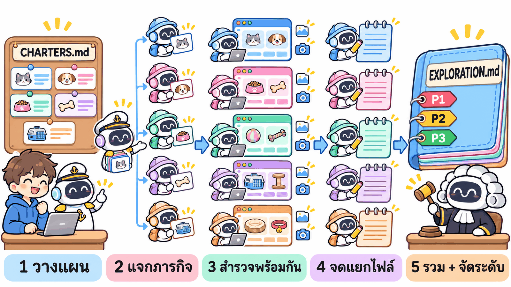

## 🗺️ 8 LAB ในหน้านี้

| LAB | ทำอะไร | ใครทำ | เวลาจริง | ได้ไฟล์ |
|---|---|---|---|---|
| 0 | ติดตั้ง playwright-cli + เปิดเว็บ | AI 1 ตัว | 48 วิ | - |
| 1 | วางแผนสำรวจ แบบ A (มีความรู้เดิม) / B (ลาดตระเวนก่อน) | AI 1 ตัว | 2.6 / 3.7 นาที | `CHARTERS.md` |
| 2 | สำรวจพร้อมกัน 1 subagent ต่อ 1 charter | 7 subagent | 24 นาที | `exploration/C1–C7.md` |
| 3 | รวมไฟล์ + ผู้ตัดสินจัดระดับ P1/P2/P3 | AI + ผู้ตัดสิน 1 ตัว | 16 นาที | `EXPLORATION.md` |
| 4 | เขียนแผนทดสอบละเอียด แบ่งเขียนตามหัวข้อ | 8 subagent | 25 นาที | `TEST-PLAN.md` |
| 5 | รีวิวแผนโดยคนที่ไม่ได้เขียน แล้วแก้ | 8 + 8 subagent | 35 นาที | `PLAN-REVIEW.md` |
| 6 | เขียน test Playwright + รันจริง + GIF + รายงานกดดูได้ | 8 subagent | <!-- LAB6-TIME --> | `e2e/index.html` |
| 7 | เปิดโหมดฝังบั๊ก แล้วดูว่าแผนจับได้ไหม | AI 1 ตัว | <!-- LAB7-TIME --> | `BUG-HUNT.md` |

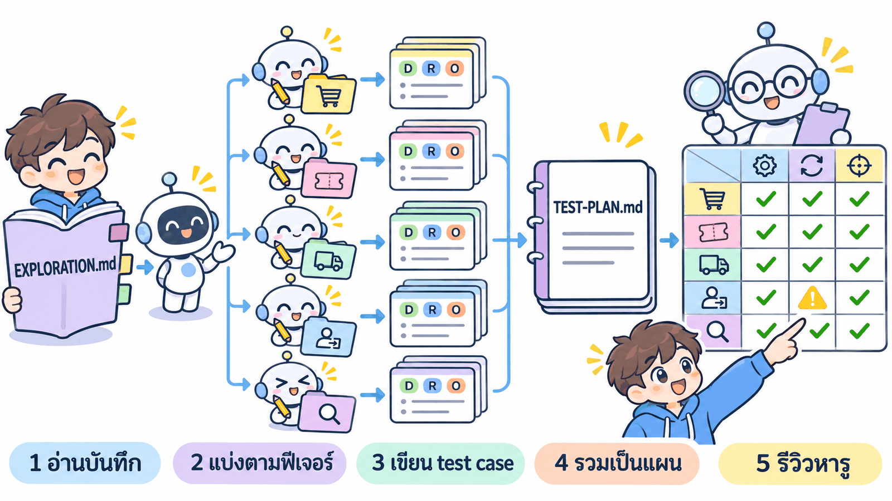

## 🔒 กติกาที่อยู่ในทุกพรอมต์

| กติกา | ทำไม |
|---|---|
| **ห้ามเปิดอ่านโค้ดใน `petshop/`** | tester จริงไม่เห็นโค้ด ถ้า AI อ่านโค้ดจะ "ลอก" กฎจากโค้ด รวมทั้งบั๊กด้วย |
| **ห้ามเปิด `_solution/`** | เป็นผลรันจริงของผู้สอน ใช้เทียบหลังทำเสร็จเท่านั้น |
| reset มี **เจ้าของคนเดียว** | `POST /api/test/reset` ล้างข้อมูลทั้งเว็บ ถ้า agent ตัวหนึ่งกด ตะกร้า/คำสั่งซื้อของตัวอื่นหายหมด (T7) |
| 1 agent = 1 session `-s=<ชื่อ>` | เบราว์เซอร์ cookie และ localStorage แยกกัน ไม่แย่งแท็บกัน (T2, T6) |

> ⚠️ Claude เริ่มแต่ละ LAB ด้วยเซสชันใหม่และจำกติกาของ LAB ก่อนไม่ได้ จึงต้องใส่กติกาซ้ำทุกพรอมต์

## 🧰 ก่อนเริ่ม

| ✅ | ต้องมี |
|---|---|
| ☐ | Windows 10/11 หรือ macOS + **Claude Code** เปิดใน **โฟลเดอร์นี้** (`02_lab/01_pawpantry`) |
| ☐ | **Docker Desktop** เปิดอยู่ |
| ☐ | **Node.js 18+** (มีแล้วจากบท 01–02) |
| ☐ | แต่ละ LAB เริ่ม **เซสชันใหม่** (`/clear`) แล้ววางพรอมต์ **1 ครั้ง** |

> 💡 ทุก LAB ผู้สอนรันด้วย Claude Opus (effort high) ถ้าใช้รุ่นอื่น จำนวนกฎหรือ test อาจต่างไปบ้าง แต่ขั้นตอนเหมือนกัน

---

## LAB 0 · เตรียมเครื่องมือสำรวจแบบขนาน 🤖

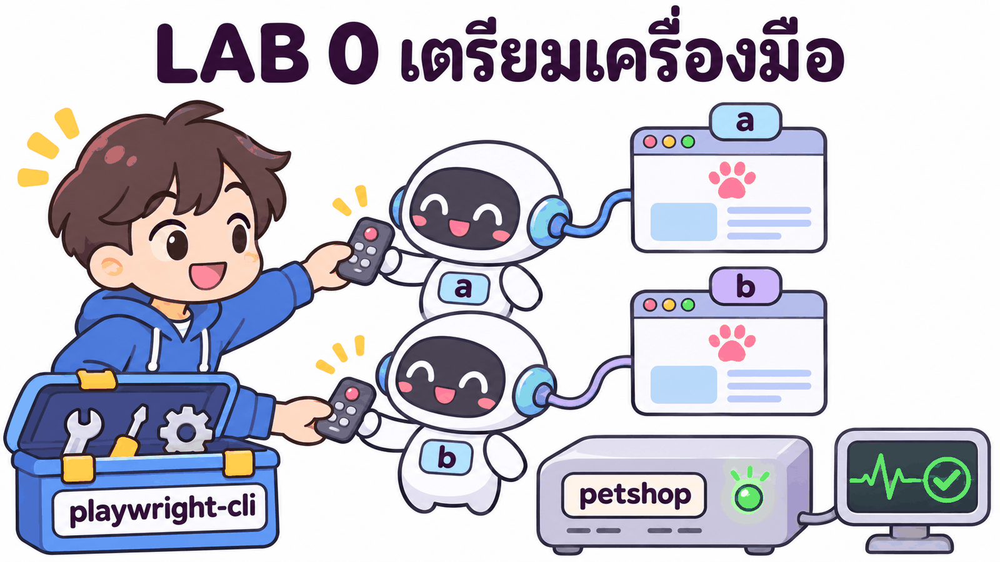

🧑 **คิดก่อน** ถ้า AI 7 ตัวต้องเปิดเว็บพร้อมกัน ใช้ Playwright MCP ตัวเดียวได้ไหม (ดู T2)

💬 **พรอมต์**

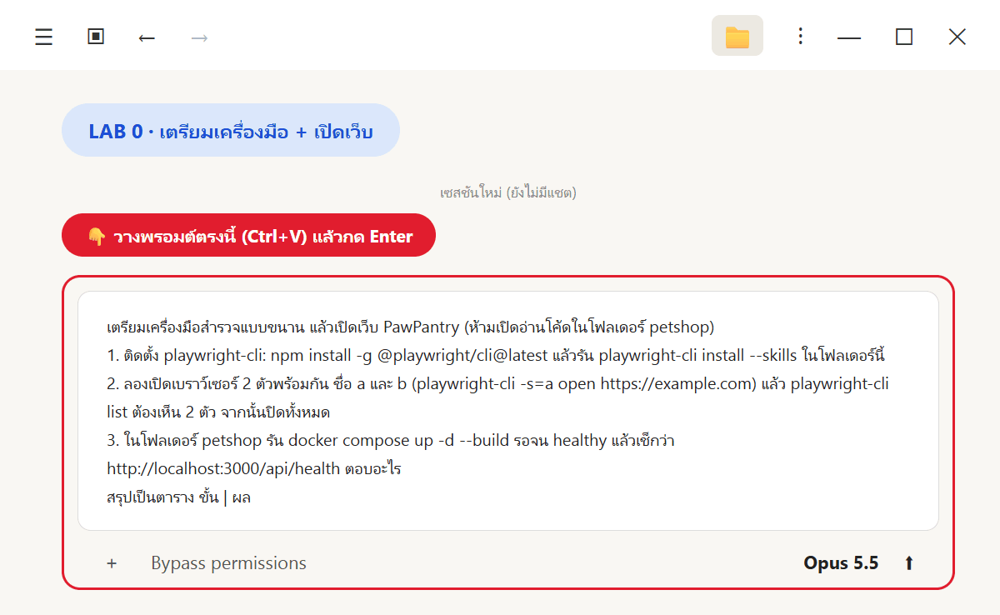

```text
เตรียมเครื่องมือสำรวจแบบขนาน แล้วเปิดเว็บ PawPantry (ห้ามเปิดอ่านโค้ดในโฟลเดอร์ petshop)
1. ติดตั้ง playwright-cli: npm install -g @playwright/cli@latest แล้วรัน playwright-cli install --skills ในโฟลเดอร์นี้
2. ลองเปิดเบราว์เซอร์ 2 ตัวพร้อมกัน ชื่อ a และ b (playwright-cli -s=a open https://example.com) แล้ว playwright-cli list ต้องเห็น 2 ตัว จากนั้นปิดทั้งหมด
3. ในโฟลเดอร์ petshop รัน docker compose up -d --build รอจน healthy แล้วเช็กว่า http://localhost:3000/api/health ตอบอะไร
สรุปเป็นตาราง ขั้น | ผล
```

| ส่วนของพรอมต์ | มีไว้ทำไม |
|---|---|
| `npm install -g @playwright/cli` + `install --skills` | ได้คำสั่ง `playwright-cli` และ skill ที่สอน Claude ว่าใช้ยังไง (อยู่ใน `.claude/skills/playwright-cli`) |
| เปิด `a` และ `b` พร้อมกัน แล้ว `list` | พิสูจน์ก่อนว่า **เปิดหลายเบราว์เซอร์แยกกันได้จริง** ก่อนจะแบ่ง 7 agent |
| `docker compose up -d --build` + `/api/health` | เกณฑ์ "เริ่มทดสอบได้" ที่จะใช้ใน TEST-PLAN หัวข้อ 6 |
| สรุปเป็นตาราง ขั้น \| ผล | ตรวจง่าย เห็นทันทีว่าขั้นไหนพลาด |

✅ **ผลจริง (48 วินาที)** ติดตั้ง playwright-cli 0.1.23 + skill · `list` เห็น 2 session · container `healthy` · `/api/health` ตอบ `{"ok":true}`

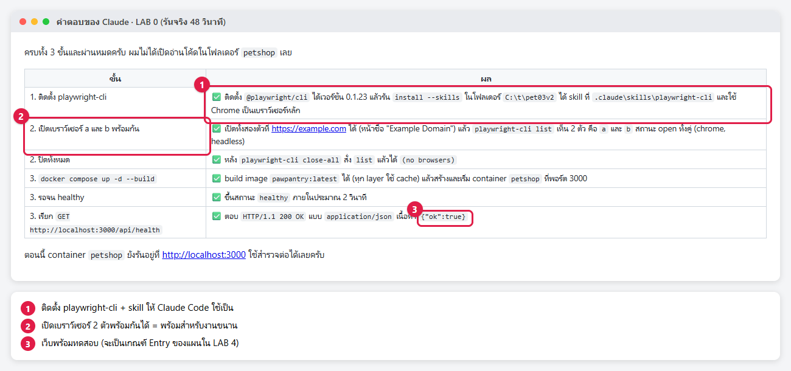

👀 **สังเกต** ค่าเริ่มต้นของ playwright-cli คือ `user-data-dir: <in-memory>` = โปรไฟล์ใหม่ในหน่วยความจำ ปิดแล้วหายหมด (เหมือนโหมดไม่ระบุตัวตน) แต่ละ session จึงไม่มี cookie ค้างจากกัน

---

## LAB 1 · วางแผนสำรวจ (charter) แบบ A หรือ B 🤖

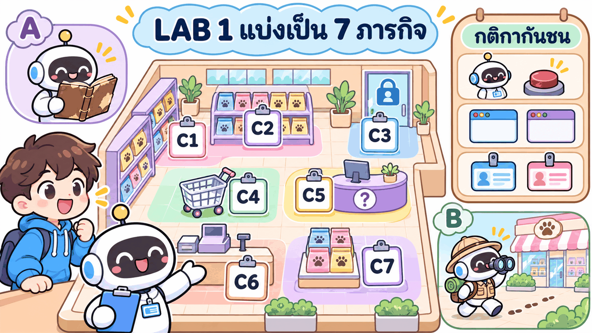

🧑 **คิดก่อน** เรามีความรู้อะไรเกี่ยวกับเว็บนี้อยู่แล้วบ้าง พอจะวางแผนโดยไม่เปิดเว็บได้ไหม (ดู T5)

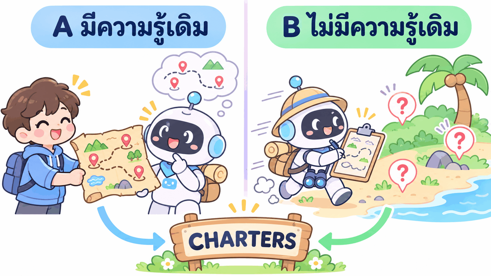

### 1A · ใช้ความรู้ที่มี (ไม่เปิดเว็บ)

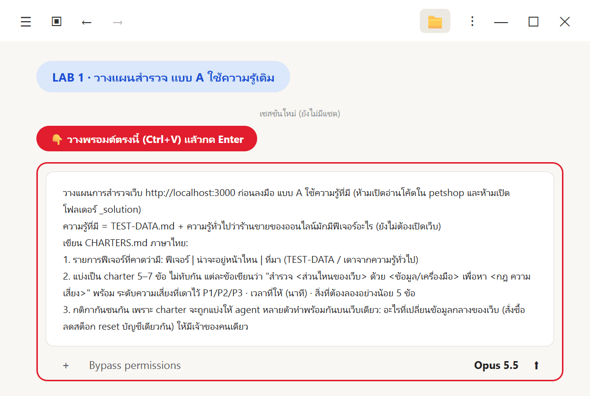

```text
วางแผนการสำรวจเว็บ http://localhost:3000 ก่อนลงมือ แบบ A ใช้ความรู้ที่มี (ห้ามเปิดอ่านโค้ดใน petshop และห้ามเปิดโฟลเดอร์ _solution)
ความรู้ที่มี = TEST-DATA.md + ความรู้ทั่วไปว่าร้านขายของออนไลน์มักมีฟีเจอร์อะไร (ยังไม่ต้องเปิดเว็บ)
เขียน CHARTERS.md ภาษาไทย:
1. รายการฟีเจอร์ที่คาดว่ามี: ฟีเจอร์ | น่าจะอยู่หน้าไหน | ที่มา (TEST-DATA / เดาจากความรู้ทั่วไป)
2. แบ่งเป็น charter 5–7 ข้อ ไม่ทับกัน แต่ละข้อเขียนว่า "สำรวจ <ส่วนไหนของเว็บ> ด้วย <ข้อมูล/เครื่องมือ> เพื่อหา <กฎ ความเสี่ยง>" พร้อม ระดับความเสี่ยงที่เดาไว้ P1/P2/P3 · เวลาที่ให้ (นาที) · สิ่งที่ต้องลองอย่างน้อย 5 ข้อ
3. กติกากันชนกัน เพราะ charter จะถูกแบ่งให้ agent หลายตัวทำพร้อมกันบนเว็บเดียว: อะไรที่เปลี่ยนข้อมูลกลางของเว็บ (สั่งซื้อ ลดสต็อก reset บัญชีเดียวกัน) ให้มีเจ้าของคนเดียว
```

### 1B · ลาดตระเวนก่อน แล้วค่อยวางแผน

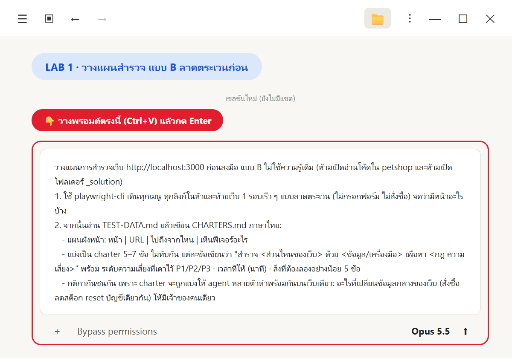

```text
วางแผนการสำรวจเว็บ http://localhost:3000 ก่อนลงมือ แบบ B ไม่ใช้ความรู้เดิม (ห้ามเปิดอ่านโค้ดใน petshop และห้ามเปิดโฟลเดอร์ _solution)
1. ใช้ playwright-cli เดินทุกเมนู ทุกลิงก์ในหัวและท้ายเว็บ 1 รอบเร็ว ๆ แบบลาดตระเวน (ไม่กรอกฟอร์ม ไม่สั่งซื้อ) จดว่ามีหน้าอะไรบ้าง
2. จากนั้นอ่าน TEST-DATA.md แล้วเขียน CHARTERS.md ภาษาไทย:
   - แผนผังหน้า: หน้า | URL | ไปถึงจากไหน | เห็นฟีเจอร์อะไร
   - แบ่งเป็น charter 5–7 ข้อ ไม่ทับกัน แต่ละข้อเขียนว่า "สำรวจ <ส่วนไหนของเว็บ> ด้วย <ข้อมูล/เครื่องมือ> เพื่อหา <กฎ ความเสี่ยง>" พร้อม ระดับความเสี่ยงที่เดาไว้ P1/P2/P3 · เวลาที่ให้ (นาที) · สิ่งที่ต้องลองอย่างน้อย 5 ข้อ
   - กติกากันชนกัน เพราะ charter จะถูกแบ่งให้ agent หลายตัวทำพร้อมกันบนเว็บเดียว: อะไรที่เปลี่ยนข้อมูลกลางของเว็บ (สั่งซื้อ ลดสต็อก reset บัญชีเดียวกัน) ให้มีเจ้าของคนเดียว
```

| ส่วนของพรอมต์ | มีไว้ทำไม |
|---|---|
| A: "ยังไม่ต้องเปิดเว็บ" · ที่มา TEST-DATA / เดา | แยกให้เห็นว่าอะไรรู้จริง อะไรเดา ข้อที่เดาต้องไปยืนยันตอนสำรวจ |
| B: "ลาดตระเวน ไม่กรอกฟอร์ม ไม่สั่งซื้อ" | ดูแค่ว่ามีหน้าอะไร ยังไม่เปลี่ยนข้อมูลเว็บ ใช้เวลาน้อย |
| "สำรวจ <ส่วน> ด้วย <ข้อมูล> เพื่อหา <กฎ ความเสี่ยง>" | รูปแบบ charter ของ SBTM (T4) ทำให้ภารกิจไม่กว้างเกินไป |
| P1/P2/P3 ที่เดาไว้ · เวลา · ลองอย่างน้อย 5 ข้อ | กำหนดขอบเขตงานให้ agent รู้ว่าเมื่อไหร่ "พอแล้ว" |
| ไม่ทับกัน + **กติกากันชนกัน** | เตรียมสำหรับ LAB 2 ที่ agent หลายตัวใช้เว็บเดียวกันพร้อมกัน |

✅ **ผลจริง**

| | แบบ A (ความรู้เดิม) | แบบ B (ลาดตระเวน) |
|---|---|---|
| เวลา | 2.6 นาที | 3.7 นาที |
| สิ่งที่ได้ | คาดฟีเจอร์ 18 ข้อ + ข้อสมมติที่ต้องยืนยัน 5 ข้อ (ใหญ่สุด: เว็บมีหน้าสมัครไหม) | เจอจริง ~16 หน้า (ลิงก์หัว 8 ท้าย 9) + เบาะแสแปลก ๆ |
| charter | 7 ข้อ | 7 ข้อ |

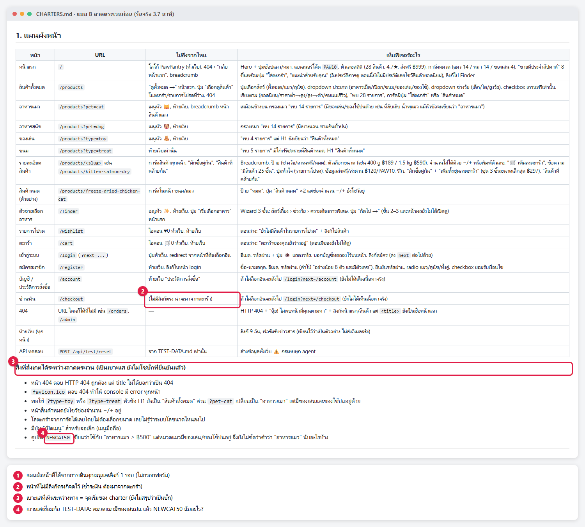

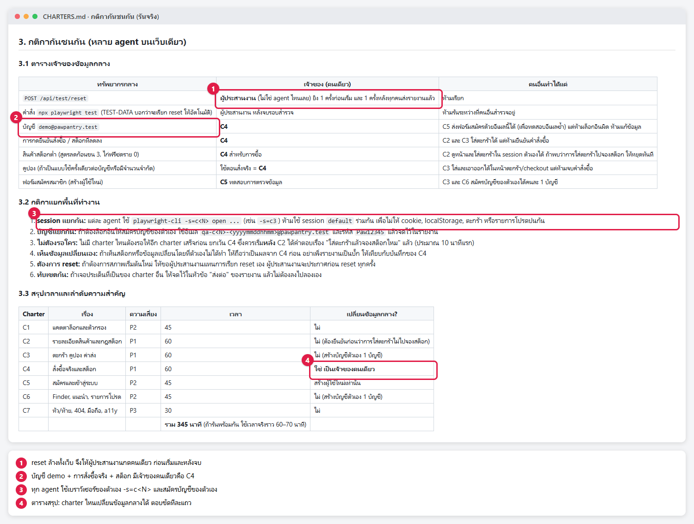

👀 **สังเกต**
- แบบ B เจอเบาะแสที่แบบ A ไม่มีทางรู้: title หน้า 404 ไม่บอกว่า 404 · `?type=toy` หัวข้อยังเป็น "สินค้าทั้งหมด" · หมวดแมวมีของเล่นปน (เกี่ยวกับคูปอง NEWCAT50) · หน้าสินค้าหมดยังมีปุ่ม −/+
- กติกาที่ AI คิดเอง: `C4` เป็นเจ้าของบัญชี demo การสั่งซื้อ และสต็อก · ตัวอื่นใช้บัญชีของตัวเอง `qa-c<N>-<เวลา>@pawpantry.test`
- 📂 ผู้สอนเลือก **แบบ B** ใช้ต่อใน LAB 2 ([_solution/CHARTERS.md](_solution/CHARTERS.md)) · แบบ A เก็บไว้เทียบ ([_solution/CHARTERS-A.md](_solution/CHARTERS-A.md))

---

## LAB 2 · แบ่ง subagent สำรวจพร้อมกัน 🤖🤖🤖

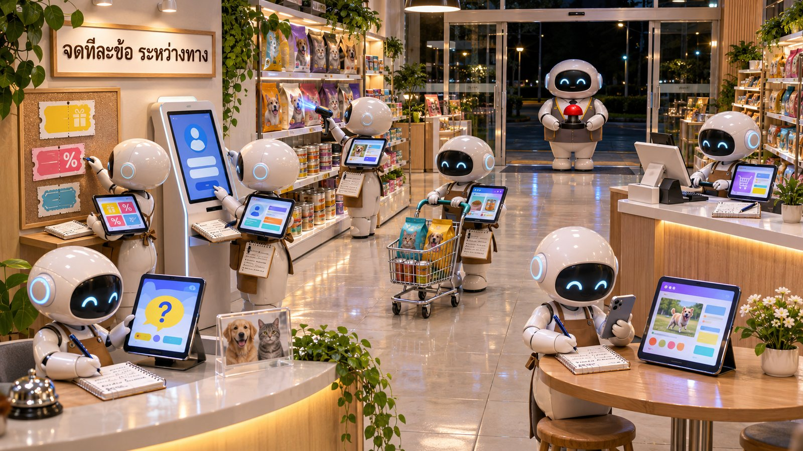


🧑 **คิดก่อน** ถ้า agent ตัวหนึ่งกด reset ระหว่างที่อีกตัวกำลังกรอกตะกร้าอยู่ จะเกิดอะไร (ดู T7)

💬 **พรอมต์**

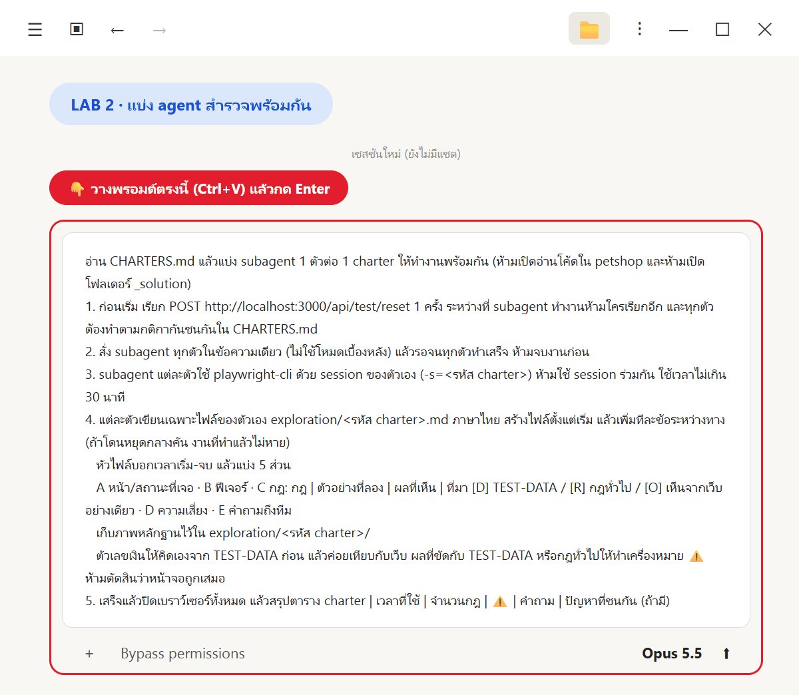

```text
อ่าน CHARTERS.md แล้วแบ่ง subagent 1 ตัวต่อ 1 charter ให้ทำงานพร้อมกัน (ห้ามเปิดอ่านโค้ดใน petshop และห้ามเปิดโฟลเดอร์ _solution)
1. ก่อนเริ่ม เรียก POST http://localhost:3000/api/test/reset 1 ครั้ง ระหว่างที่ subagent ทำงานห้ามใครเรียกอีก และทุกตัวต้องทำตามกติกากันชนกันใน CHARTERS.md
2. สั่ง subagent ทุกตัวในข้อความเดียว (ไม่ใช้โหมดเบื้องหลัง) แล้วรอจนทุกตัวทำเสร็จ ห้ามจบงานก่อน
3. subagent แต่ละตัวใช้ playwright-cli ด้วย session ของตัวเอง (-s=<รหัส charter>) ห้ามใช้ session ร่วมกัน ใช้เวลาไม่เกิน 30 นาที
4. แต่ละตัวเขียนเฉพาะไฟล์ของตัวเอง exploration/<รหัส charter>.md ภาษาไทย สร้างไฟล์ตั้งแต่เริ่ม แล้วเพิ่มทีละข้อระหว่างทาง (ถ้าโดนหยุดกลางคัน งานที่ทำแล้วไม่หาย)
   หัวไฟล์บอกเวลาเริ่ม-จบ แล้วแบ่ง 5 ส่วน
   A หน้า/สถานะที่เจอ · B ฟีเจอร์ · C กฎ: กฎ | ตัวอย่างที่ลอง | ผลที่เห็น | ที่มา [D] TEST-DATA / [R] กฎทั่วไป / [O] เห็นจากเว็บอย่างเดียว · D ความเสี่ยง · E คำถามถึงทีม
   เก็บภาพหลักฐานไว้ใน exploration/<รหัส charter>/
   ตัวเลขเงินให้คิดเองจาก TEST-DATA ก่อน แล้วค่อยเทียบกับเว็บ ผลที่ขัดกับ TEST-DATA หรือกฎทั่วไปให้ทำเครื่องหมาย ⚠️ ห้ามตัดสินว่าหน้าจอถูกเสมอ
5. เสร็จแล้วปิดเบราว์เซอร์ทั้งหมด แล้วสรุปตาราง charter | เวลาที่ใช้ | จำนวนกฎ | ⚠️ | คำถาม | ปัญหาที่ชนกัน (ถ้ามี)
```

| ส่วนของพรอมต์ | มีไว้ทำไม |
|---|---|
| reset **1 ครั้งก่อนเริ่ม** · ห้ามใครเรียกอีก | ทุกตัวเริ่มจากข้อมูลเดียวกัน และไม่มีใครล้างงานของคนอื่นกลางทาง |
| **สั่งทุกตัวในข้อความเดียว ไม่ใช้โหมดเบื้องหลัง รอจนครบ** | รอบแรกที่ไม่ได้สั่งบรรทัดนี้ AI ส่งงานไปเบื้องหลังแล้วจบเทิร์น subagent ถูกหยุดหมด (ดูด้านล่าง) |
| `-s=<รหัส charter>` ห้ามใช้ร่วม | เบราว์เซอร์ใครของมัน ตะกร้าใน localStorage ไม่ปนกัน |
| เขียน **เฉพาะไฟล์ของตัวเอง** ทีละข้อระหว่างทาง | ไม่เขียนทับกัน และถ้าโดนหยุด งานที่ทำแล้วไม่หาย (T4b) |
| A–E + ที่มา [D]/[R]/[O] | โครงเดียวกันทุกไฟล์ รวมใน LAB 3 ได้ง่าย |
| คิดตัวเลขเงินเองก่อน · ⚠️ · **ห้ามตัดสินว่าหน้าจอถูกเสมอ** | กันการ "อบบั๊ก" เป็นผลที่คาดหวัง (T9) |

### ❌ รอบแรก: ลืมบอกว่า "รอจนครบ"

พรอมต์รอบแรกไม่มีข้อ 2 และข้อ 4 ไม่ได้บอกให้เขียนทีละข้อ ผลจริงคือ AI ส่ง subagent 7 ตัวไปทำงาน **เบื้องหลัง** แล้วจบเทิร์นทันที เมื่อเซสชันปิด subagent ถูกหยุดก่อนเขียนบันทึก ได้ไฟล์สมบูรณ์แค่ `C1.md` (ภาพหลักฐานยังอยู่ 97 ภาพ) และ **เบราว์เซอร์ 7 ตัวยังค้างเปิด** จนรอบใหม่ปิดให้

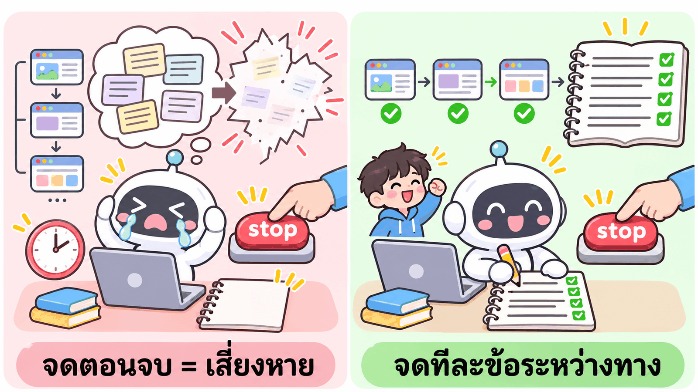

> 💡 บทเรียน: ใน Claude Code แบบไม่โต้ตอบ (`-p`) และตอนที่เรากด Esc งานเบื้องหลังหยุดตามเซสชัน ให้สั่ง **ทุกตัวพร้อมกันในข้อความเดียว** (ยังทำงานขนานกันอยู่) แล้วรอให้ครบ

### ✅ รอบสอง (พรอมต์ด้านบน): 24 นาที

| charter | เวลา (นาที) | กฎ | ⚠️ | คำถาม |
|---|---|---|---|---|
| C1 แคตตาล็อก | 14 | 34 | 8 | 11 |
| C2 หน้าสินค้า/สต็อก | 16 | 43 | 12 | 13 |
| C3 ตะกร้า/คูปอง/ค่าส่ง | 13 | 47 | 9 | 10 |
| C4 สั่งซื้อจริง (เจ้าของข้อมูลกลาง) | 19 | 39 | 10 | 13 |
| C5 สมัคร/ล็อกอิน | 21 | 35 | 7 | 12 |
| C6 Finder/แนะนำ/รายการโปรด | 19 | 45 | 10 | 12 |
| C7 หัว/ท้าย/404/มือถือ/a11y | 15 | 44 | 24 | 10 |
| **รวม** | **24 (พร้อมกัน)** | **287** | **80** | **81** |

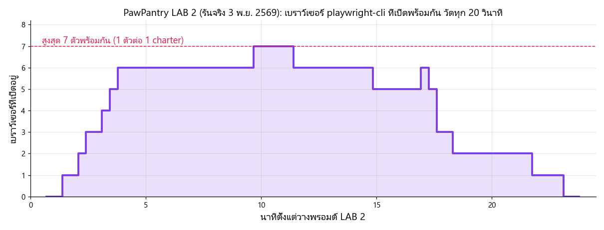

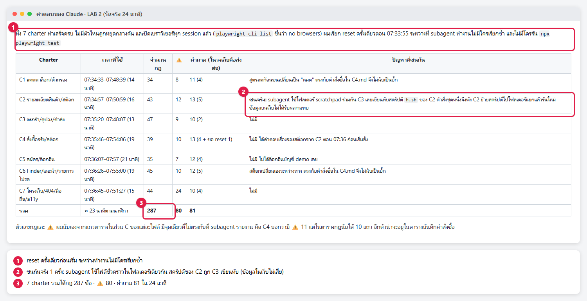

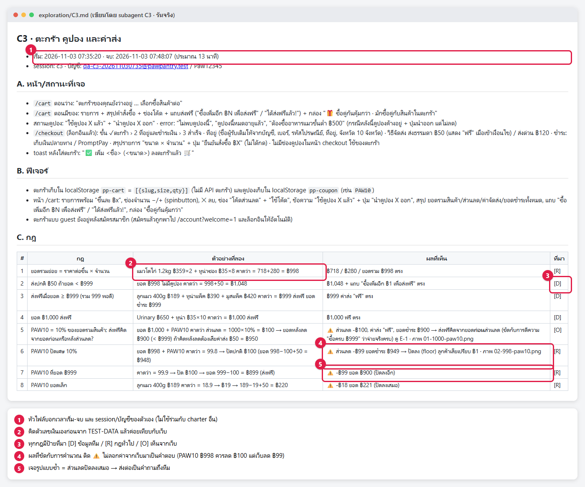

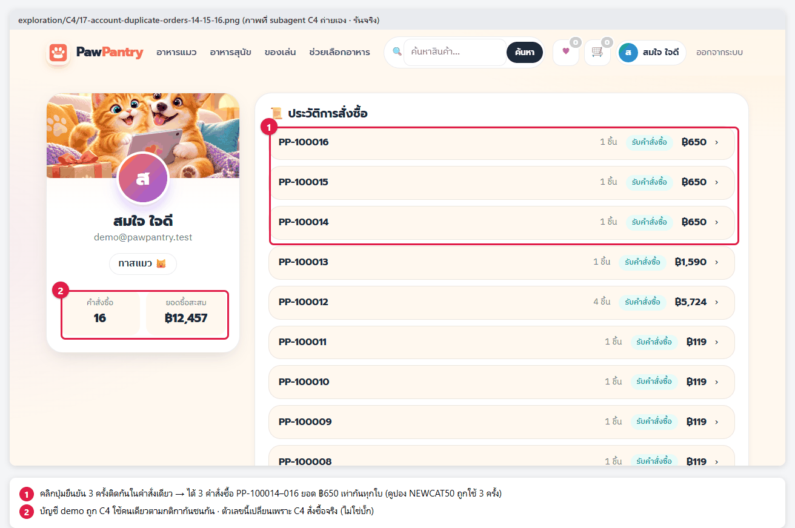

👀 **สังเกต**
- **ชนกันจริง 1 ครั้ง** แม้เบราว์เซอร์จะแยกกัน: subagent ใช้โฟลเดอร์ไฟล์ชั่วคราว (scratchpad) ร่วมกัน C3 เขียนทับสคริปต์ `h.sh` ของ C2 (ข้อมูลเว็บไม่เสีย C2 ย้ายไปโฟลเดอร์แยกเอง) → ของที่ใช้ร่วมกันไม่ได้มีแค่เว็บ (T7)
- C4 รอคำตอบจาก C2 เรื่อง "ใส่ตะกร้าแล้วจองสต็อกไหม" ก่อนจะสั่งซื้อจริง = ทำตามกติกากันชนที่เขียนใน LAB 1
- ตัวอย่างสิ่งที่เจอ (ยังไม่ใช่ "บั๊ก" จนกว่าจะทดสอบตามแผน):

| เรื่อง | สิ่งที่เห็น |
|---|---|
| กดยืนยันซ้ำ | 3 คลิก = 3 คำสั่งซื้อ NEWCAT50 ใช้ได้ 3 ครั้ง |
| PAW10 | ฿998 ลด ฿99 (ไม่ใช่ ฿100) · ฿189 ลด ฿18 = ปัดลงเสมอ |
| ส่งฟรี | คิดจากยอด **ก่อน** หักส่วนลด · FREESHIP ทำให้ส่งด่วนฟรีด้วย |
| API สั่งซื้อ | รับคูปองหมดอายุ จังหวัดที่ไม่มี จำนวน 1.5 แล้วตอบ 201 |
| ความปลอดภัย | open redirect `next=/%5Cevil.example` · ล็อกอินผิดได้ไม่จำกัด (ลอง 13 ครั้ง) |
| Finder | 96 ชุดคำตอบ ลูกสุนัขได้ "อาหารสุนัขสูงวัย" ตรงใจที่สุด 49% |
| เก็บในเบราว์เซอร์ | แก้ localStorage ใส่สินค้าหมดลงตะกร้าได้ · เปิด 2 แท็บแล้วเขียนทับกัน |

📂 ไฟล์จริง: [_solution/exploration/](_solution/exploration/) (C1–C7.md + ภาพหลักฐาน 100 ภาพ)

---

## LAB 3 · รวมเป็นไฟล์เดียว + ผู้ตัดสินจัดระดับความเสี่ยง 🤖⚖️

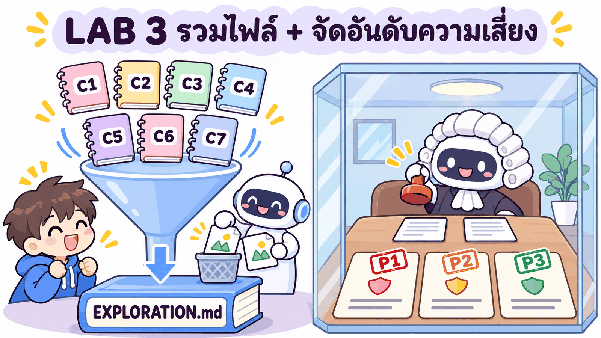

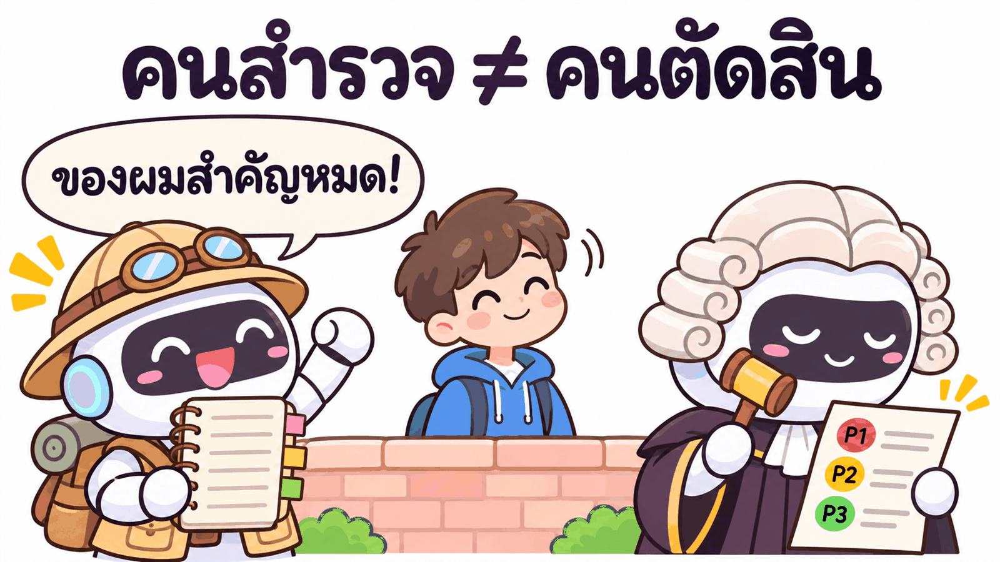

🧑 **คิดก่อน** ถ้า C3 บอกว่า PAW10 ปัดลง แต่ C4 บอกว่าปัดขึ้น จะเชื่อใคร (ดู T8)

💬 **พรอมต์**

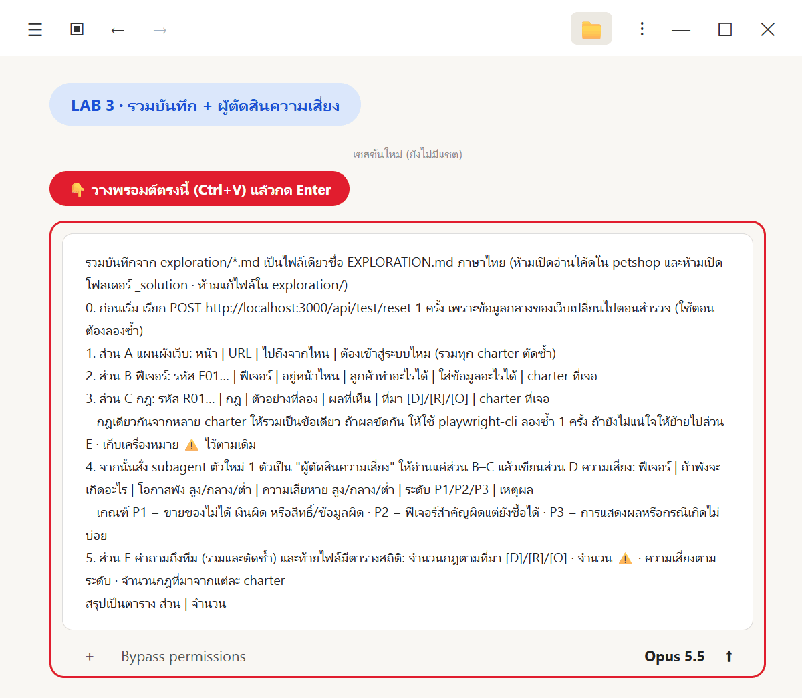

```text
รวมบันทึกจาก exploration/*.md เป็นไฟล์เดียวชื่อ EXPLORATION.md ภาษาไทย (ห้ามเปิดอ่านโค้ดใน petshop และห้ามเปิดโฟลเดอร์ _solution · ห้ามแก้ไฟล์ใน exploration/)
0. ก่อนเริ่ม เรียก POST http://localhost:3000/api/test/reset 1 ครั้ง เพราะข้อมูลกลางของเว็บเปลี่ยนไปตอนสำรวจ (ใช้ตอนต้องลองซ้ำ)
1. ส่วน A แผนผังเว็บ: หน้า | URL | ไปถึงจากไหน | ต้องเข้าสู่ระบบไหม (รวมทุก charter ตัดซ้ำ)
2. ส่วน B ฟีเจอร์: รหัส F01… | ฟีเจอร์ | อยู่หน้าไหน | ลูกค้าทำอะไรได้ | ใส่ข้อมูลอะไรได้ | charter ที่เจอ
3. ส่วน C กฎ: รหัส R01… | กฎ | ตัวอย่างที่ลอง | ผลที่เห็น | ที่มา [D]/[R]/[O] | charter ที่เจอ
   กฎเดียวกันจากหลาย charter ให้รวมเป็นข้อเดียว ถ้าผลขัดกัน ให้ใช้ playwright-cli ลองซ้ำ 1 ครั้ง ถ้ายังไม่แน่ใจให้ย้ายไปส่วน E · เก็บเครื่องหมาย ⚠️ ไว้ตามเดิม
4. จากนั้นสั่ง subagent ตัวใหม่ 1 ตัวเป็น "ผู้ตัดสินความเสี่ยง" ให้อ่านแค่ส่วน B–C แล้วเขียนส่วน D ความเสี่ยง: ฟีเจอร์ | ถ้าพังจะเกิดอะไร | โอกาสพัง สูง/กลาง/ต่ำ | ความเสียหาย สูง/กลาง/ต่ำ | ระดับ P1/P2/P3 | เหตุผล
   เกณฑ์ P1 = ขายของไม่ได้ เงินผิด หรือสิทธิ์/ข้อมูลผิด · P2 = ฟีเจอร์สำคัญผิดแต่ยังซื้อได้ · P3 = การแสดงผลหรือกรณีเกิดไม่บ่อย
5. ส่วน E คำถามถึงทีม (รวมและตัดซ้ำ) และท้ายไฟล์มีตารางสถิติ: จำนวนกฎตามที่มา [D]/[R]/[O] · จำนวน ⚠️ · ความเสี่ยงตามระดับ · จำนวนกฎที่มาจากแต่ละ charter
สรุปเป็นตาราง ส่วน | จำนวน
```

| ส่วนของพรอมต์ | มีไว้ทำไม |
|---|---|
| reset ก่อน 1 ครั้ง | ตอนสำรวจข้อมูลเว็บเปลี่ยนไปแล้ว ถ้าต้องลองซ้ำจะได้เริ่มจากค่าตั้งต้น |
| ห้ามแก้ `exploration/` | เก็บบันทึกดิบไว้เป็นหลักฐาน ย้อนดูได้ว่ากฎมาจากไหน |
| รวมกฎซ้ำ · **ขัดกันให้ลองซ้ำ 1 ครั้ง** · ไม่แน่ใจย้ายไป E | ไม่เลือกข้างเอง ให้เว็บเป็นคนตอบ ถ้ายังไม่ชัดให้ทีมตอบ |
| **ผู้ตัดสินเป็น subagent ตัวใหม่ อ่านแค่ B–C** | คนสำรวจมักให้ความสำคัญกับสิ่งที่ตัวเองเจอ ผู้ตัดสินที่ไม่เห็นบันทึกดิบจะใช้เกณฑ์เดียวกันทุกฟีเจอร์ (T10) |
| เกณฑ์ P1/P2/P3 เขียนไว้ในพรอมต์ | ให้ "เงินผิด/ขายไม่ได้/สิทธิ์ผิด" เป็น P1 เสมอ ไม่ขึ้นกับความรู้สึก |
| ตารางสถิติท้ายไฟล์ | ตรวจได้ทันทีว่ามีกฎ [O] (เห็นจากจออย่างเดียว) มากแค่ไหน |

✅ **ผลจริง (16 นาที)**

| ส่วน | จำนวน |
|---|---|
| A หน้า | 12 |
| B ฟีเจอร์ | 28 (F01–F28) |
| C กฎ | 218 (จาก 287 · 37 ข้อรวมจาก ≥ 2 charter) |
| ⚠️ | 59 (จาก 80) |
| D ความเสี่ยง | P1 9 · P2 11 · P3 8 |
| E คำถามถึงทีม | 48 |

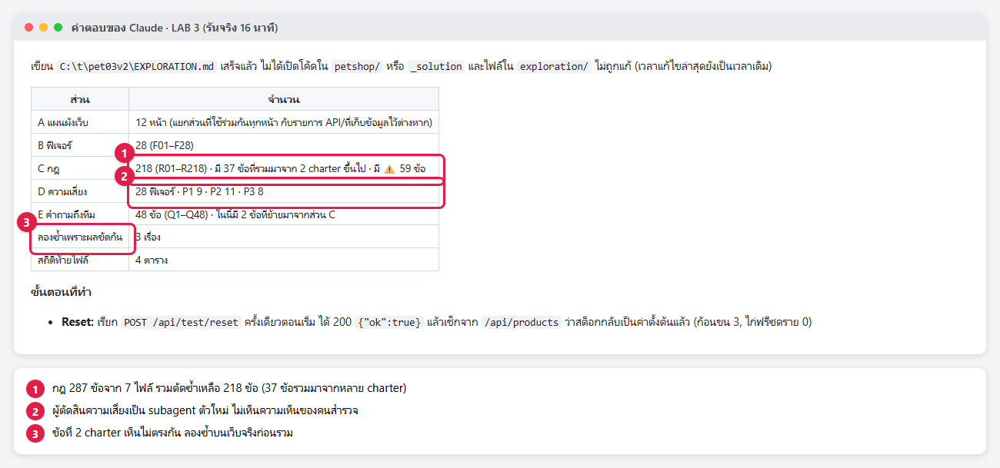

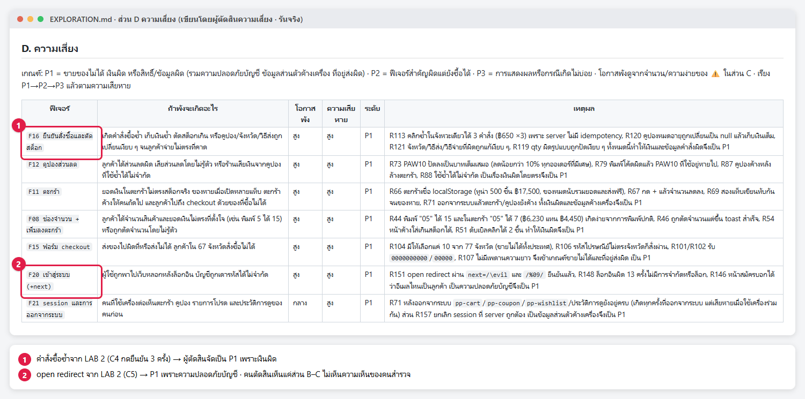

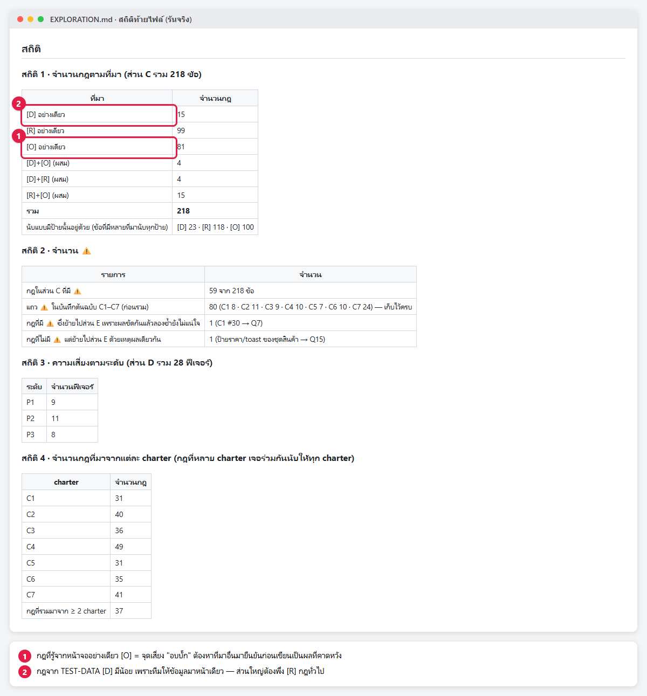

👀 **สังเกต**
- ลองซ้ำ 3 เรื่องที่ขัดกัน: title หน้า 404 **ถูกทั้งคู่** (คนละจังหวะของการโหลด) · คะแนน 4.7★ คิดแบบถ่วงน้ำหนัก · ชุดสินค้าเมื่อของหมด ยังไม่ชัด → ย้ายเป็นคำถาม
- **เจอรูตอนรวม**: เรื่องดูคำสั่งซื้อของคนอื่น (IDOR) ถูก C4 ส่งต่อให้ C5 แต่ไม่มีใครทดสอบเลย → การรวมไฟล์ไม่ใช่แค่ต่อกัน แต่ต้องหาช่องว่างระหว่าง charter ด้วย
- กฎ [D] มีแค่ 15 ข้อ ที่เหลือมาจากกฎทั่วไปและหน้าจอ → แผนใน LAB 4 ต้องระวังกฎ [O] เป็นพิเศษ

📂 [_solution/EXPLORATION.md](_solution/EXPLORATION.md)

---

## LAB 4 · เขียน TEST-PLAN.md แบบละเอียด (แบ่งเขียนตามหัวข้อ) 🤖✍️

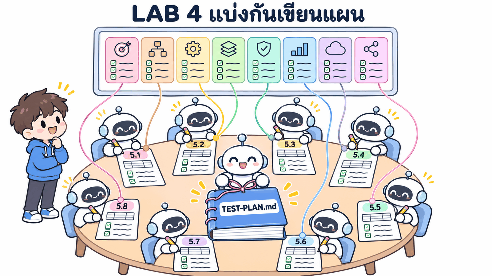

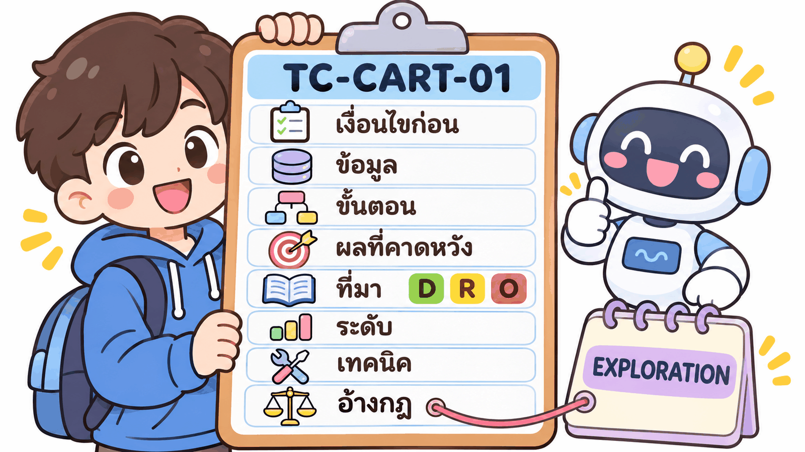

🧑 **คิดก่อน** "ผลที่คาดหวัง: แสดงราคาถูกต้อง" ตรวจได้ไหม ควรเขียนว่าอะไรแทน (ดู T11)

💬 **พรอมต์**

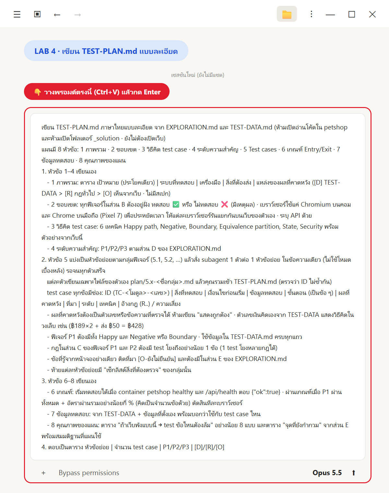

```text
เขียน TEST-PLAN.md ภาษาไทยแบบละเอียด จาก EXPLORATION.md และ TEST-DATA.md (ห้ามเปิดอ่านโค้ดใน petshop และห้ามเปิดโฟลเดอร์ _solution · ยังไม่ต้องเปิดเว็บ)
แผนมี 8 หัวข้อ: 1 ภาพรวม · 2 ขอบเขต · 3 วิธีคิด test case · 4 ระดับความสำคัญ · 5 Test cases · 6 เกณฑ์ Entry/Exit · 7 ข้อมูลทดสอบ · 8 คุณภาพของแผน
1. หัวข้อ 1–4 เขียนเอง
   - 1 ภาพรวม: ตาราง เป้าหมาย (ประโยคเดียว) | ระบบที่ทดสอบ | เครื่องมือ | สิ่งที่ต้องส่ง | แหล่งของผลที่คาดหวัง ([D] TEST-DATA > [R] กฎทั่วไป > [O] เห็นจากเว็บ · ไม่มีสเปก)
   - 2 ขอบเขต: ทุกฟีเจอร์ในส่วน B ต้องอยู่ฝั่ง ทดสอบ ✅ หรือ ไม่ทดสอบ ❌ (มีเหตุผล) · เบราว์เซอร์ใช้แค่ Chromium บนคอม และ Chrome บนมือถือ (Pixel 7) เพื่อประหยัดเวลา ให้แต่ละเบราว์เซอร์รันแยกกันบนเว็บของตัวเอง · ระบุ API ด้วย
   - 3 วิธีคิด test case: 6 เทคนิค Happy path, Negative, Boundary, Equivalence partition, State, Security พร้อมตัวอย่างจากเว็บนี้
   - 4 ระดับความสำคัญ: P1/P2/P3 ตามส่วน D ของ EXPLORATION.md
2. หัวข้อ 5 แบ่งเป็นหัวข้อย่อยตามกลุ่มฟีเจอร์ (5.1, 5.2, …) แล้วสั่ง subagent 1 ตัวต่อ 1 หัวข้อย่อย ในข้อความเดียว (ไม่ใช้โหมดเบื้องหลัง) รอจนทุกตัวเสร็จ
   แต่ละตัวเขียนเฉพาะไฟล์ของตัวเอง plan/5.x-<ชื่อกลุ่ม>.md แล้วคุณรวมเข้า TEST-PLAN.md (ตรวจว่า ID ไม่ซ้ำกัน)
   test case ทุกข้อมีช่อง: ID (TC-<โมดูล>-<เลข>) | สิ่งที่ทดสอบ | เงื่อนไขก่อนเริ่ม | ข้อมูลทดสอบ | ขั้นตอน (เป็นข้อ ๆ) | ผลที่คาดหวัง | ที่มา | ระดับ | เทคนิค | อ้างกฎ (R..) / ความเสี่ยง
   - ผลที่คาดหวังต้องเป็นตัวเลขหรือข้อความที่ตรวจได้ ห้ามเขียน "แสดงถูกต้อง" · ตัวเลขเงินคิดเองจาก TEST-DATA แสดงวิธีคิดในวงเล็บ เช่น (฿189×2 + ส่ง ฿50 = ฿428)
   - ฟีเจอร์ P1 ต้องมีทั้ง Happy และ Negative หรือ Boundary · ใช้ข้อมูลใน TEST-DATA.md ครบทุกแถว
   - กฎในส่วน C ของฟีเจอร์ P1 และ P2 ต้องมี test โยงถึงอย่างน้อย 1 ข้อ (1 test โยงหลายกฎได้)
   - ข้อที่รู้จากหน้าจออย่างเดียว ติดที่มา [O-ยังไม่ยืนยัน] และต้องมีในส่วน E ของ EXPLORATION.md
   - ท้ายแต่ละหัวข้อย่อยมี "เช็กลิสต์สิ่งที่ต้องตรวจ" ของกลุ่มนั้น
3. หัวข้อ 6–8 เขียนเอง
   - 6 เกณฑ์: เริ่มทดสอบได้เมื่อ container petshop healthy และ /api/health ตอบ {"ok":true} · ผ่านเกณฑ์เมื่อ P1 ผ่านทั้งหมด + อัตราผ่านรวมอย่างน้อยกี่ % (คิดเป็นจำนวนข้อด้วย) ตัดสินทีละเบราว์เซอร์
   - 7 ข้อมูลทดสอบ: จาก TEST-DATA + ข้อมูลที่ตั้งเอง พร้อมบอกว่าใช้กับ test case ไหน
   - 8 คุณภาพของแผน: ตาราง "ถ้าเว็บพังแบบนี้ → test ข้อไหนต้องล้ม" อย่างน้อย 8 แบบ และตาราง "จุดที่ยังกำกวม" จากส่วน E พร้อมสมมติฐานที่แผนใช้
4. ตอบเป็นตาราง หัวข้อย่อย | จำนวน test case | P1/P2/P3 | [D]/[R]/[O]
```

| ส่วนของพรอมต์ | มีไว้ทำไม |
|---|---|
| 8 หัวข้อ · หัวหน้าเขียน 1–4 และ 6–8 เอง | ส่วนที่ต้องเห็นภาพรวม (ขอบเขต เกณฑ์ ข้อมูล) ควรมีคนเขียนคนเดียว |
| หัวข้อ 5 แบ่ง writer 1 ตัวต่อ 1 หัวข้อย่อย · ไฟล์ของตัวเอง | เขียนพร้อมกันได้ ไม่ทับกัน แล้วรวม + ตรวจ ID ซ้ำ |
| เบราว์เซอร์แค่ Chromium + Chrome มือถือ · แยกเว็บต่อเบราว์เซอร์ | ประหยัดเวลา และวางไว้ตั้งแต่ในแผนว่า LAB 6 จะรัน 2 ตัวพร้อมกันได้ (T12) |
| 10 ช่องต่อ test case | ตามโครงของ ISO/IEC/IEEE 29119-3 ใครมารันก็ได้ผลเหมือนกัน |
| ผลที่คาดหวังตรวจได้ · **คิดเงินเองแสดงวิธีคิด** | ตรวจได้จริงและเห็นว่าตัวเลขมาจาก TEST-DATA ไม่ได้ลอกจากจอ |
| P1 ต้องมี Happy + Negative/Boundary · ใช้ TEST-DATA ครบ | กันแผนที่ทดสอบแต่ทางที่ถูก |
| กฎ P1/P2 ต้องมี test โยง | traceability: ไม่มีกฎสำคัญที่หลุด (T11b) |
| `[O-ยังไม่ยืนยัน]` + ต้องอยู่ในส่วน E | เตือนว่าข้อนี้อาจเป็นบั๊กที่อบเป็นผลที่คาดหวัง |
| หัวข้อ 8 "ถ้าเว็บพังแบบนี้ → test ไหนล้ม" | ทดสอบตัวแผนเองว่าจับบั๊กได้จริง (จะใช้เทียบใน LAB 7) |

✅ **ผลจริง (25 นาที)** **344 test case** · P1 170 · P2 131 · P3 43

| หัวข้อย่อย | test case |
|---|---|
| 5.1 แคตตาล็อก | 49 |
| 5.2 หน้าสินค้า | 43 |
| 5.3 ตะกร้า | 28 |
| 5.4 คูปอง/ค่าส่ง | 40 |
| 5.5 ชำระเงิน/คำสั่งซื้อ/บัญชี | 47 |
| 5.6 สมัคร/ล็อกอิน/session | 52 |
| 5.7 Finder/คำแนะนำ/รายการโปรด | 43 |
| 5.8 โครงเว็บ/มือถือ/a11y | 42 |

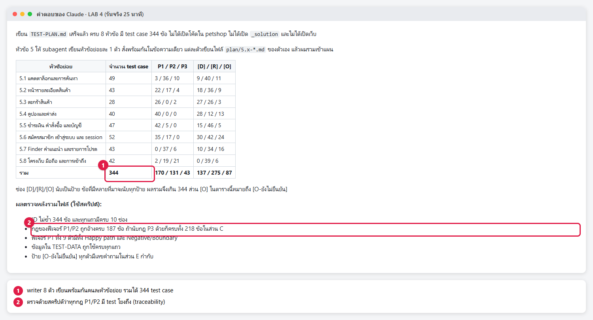

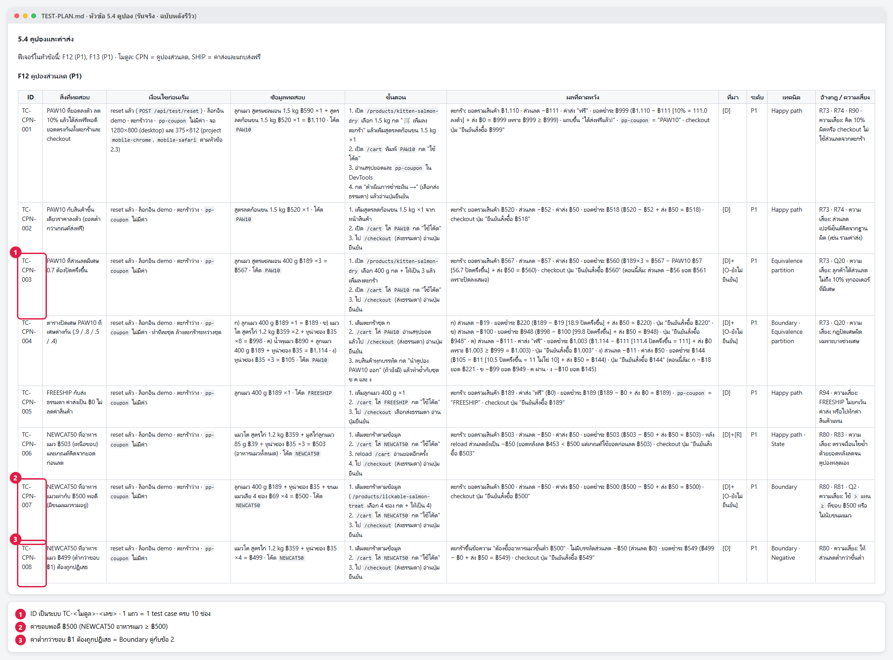

👀 **สังเกต**
- หัวหน้าตรวจด้วยสคริปต์เอง: ID ไม่ซ้ำ · ทุกแถวครบ 10 ช่อง · กฎ P1/P2 ถูกอ้างครบ 187 ข้อ · ตรวจตัวเลขเงิน 83 จุด
- แผนต้อง **เลือกสมมติฐาน** ให้เรื่องที่ยังไม่มีคำตอบ (ตาราง 8.3) เช่น ส่งฟรีคิดหลังหักส่วนลด · PAW10 ปัดครึ่งขึ้น · ล็อกอินผิด 5 ครั้งต้องถูกจำกัด → แผนจึงคาดไว้ล่วงหน้าว่า **87 ข้อจะล้ม** กับเว็บตอนนี้ (เพราะเว็บทำตามที่สำรวจเจอ ไม่ใช่ตามสมมติฐาน)
- เกณฑ์ผ่าน (หัวข้อ 6): P1 ผ่าน 100% และผ่านรวม ≥ 90% ตัดสินทีละเบราว์เซอร์

---

## LAB 5 · รีวิวแผนก่อนทดสอบจริง 🤖🔍

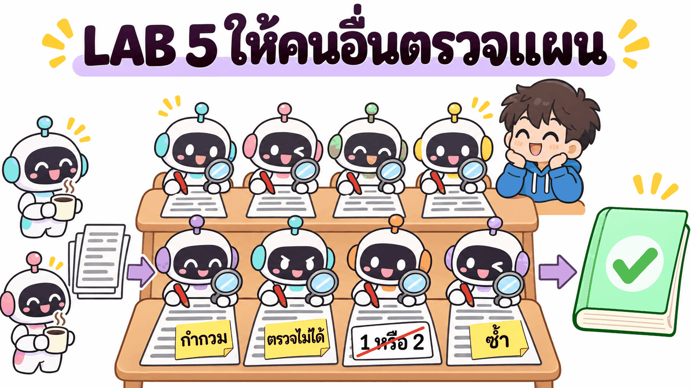

🧑 **คิดก่อน** ทำไมคนเขียนแผนถึงหาข้อผิดของแผนตัวเองได้ยาก

💬 **พรอมต์**

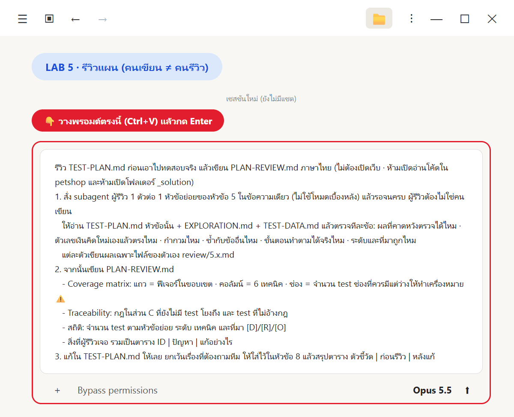

```text
รีวิว TEST-PLAN.md ก่อนเอาไปทดสอบจริง แล้วเขียน PLAN-REVIEW.md ภาษาไทย (ไม่ต้องเปิดเว็บ · ห้ามเปิดอ่านโค้ดใน petshop และห้ามเปิดโฟลเดอร์ _solution)
1. สั่ง subagent ผู้รีวิว 1 ตัวต่อ 1 หัวข้อย่อยของหัวข้อ 5 ในข้อความเดียว (ไม่ใช้โหมดเบื้องหลัง) แล้วรอจนครบ ผู้รีวิวต้องไม่ใช่คนเขียน
   ให้อ่าน TEST-PLAN.md หัวข้อนั้น + EXPLORATION.md + TEST-DATA.md แล้วตรวจทีละข้อ: ผลที่คาดหวังตรวจได้ไหม · ตัวเลขเงินคิดใหม่เองแล้วตรงไหม · กำกวมไหม · ซ้ำกับข้ออื่นไหม · ขั้นตอนทำตามได้จริงไหม · ระดับและที่มาถูกไหม
   แต่ละตัวเขียนผลเฉพาะไฟล์ของตัวเอง review/5.x.md
2. จากนั้นเขียน PLAN-REVIEW.md
   - Coverage matrix: แถว = ฟีเจอร์ในขอบเขต · คอลัมน์ = 6 เทคนิค · ช่อง = จำนวน test ช่องที่ควรมีแต่ว่างให้ทำเครื่องหมาย ⚠️
   - Traceability: กฎในส่วน C ที่ยังไม่มี test โยงถึง และ test ที่ไม่อ้างกฎ
   - สถิติ: จำนวน test ตามหัวข้อย่อย ระดับ เทคนิค และที่มา [D]/[R]/[O]
   - สิ่งที่ผู้รีวิวเจอ รวมเป็นตาราง ID | ปัญหา | แก้อย่างไร
3. แก้ใน TEST-PLAN.md ให้เลย ยกเว้นเรื่องที่ต้องถามทีม ให้ใส่ไว้ในหัวข้อ 8 แล้วสรุปตาราง ตัวชี้วัด | ก่อนรีวิว | หลังแก้
```

| ส่วนของพรอมต์ | มีไว้ทำไม |
|---|---|
| ผู้รีวิว **ต้องไม่ใช่คนเขียน** · subagent ใหม่ | ไม่มีความลำเอียงกับงานตัวเอง เหมือนทีมจริงที่ให้เพื่อนรีวิว |
| ตรวจ 6 เรื่องต่อข้อ · คิดเงินใหม่เอง | ใช้เกณฑ์เดียวกันทุกหัวข้อ เจอเลขผิดก่อนไปเขียน test |
| Coverage matrix ฟีเจอร์ × 6 เทคนิค | เห็นช่องที่ขาด ⚠️ เช่น ฟีเจอร์ P1 ที่ไม่มี Negative |
| Traceability ทั้งสองทาง | กฎที่ไม่มี test และ test ที่ไม่มีที่มา |
| แก้ให้เลย ยกเว้นเรื่องที่ต้องถามทีม | ได้แผนที่ใช้ต่อได้ทันที ไม่ใช่แค่รายการปัญหา |

✅ **ผลจริง (35 นาที)** ผู้รีวิว 8 ตัวตรวจครบ 344 ข้อ เจอปัญหา **156 เรื่อง** (สูง 14 · กลาง 52 · ต่ำ 90)

| ประเภทปัญหา | จำนวน |
|---|---|
| กำกวม | 49 |
| อีเมลบัญชีใหม่ตายตัว (รันซ้ำแล้วซ้ำ) | 30 |
| ซ้ำกับข้ออื่น | 23 |
| ตรวจไม่ได้ | 20 |
| ทำตามไม่ได้ | 20 |
| อ้างกฎผิด | 7 |
| ระดับผิด | 4 |

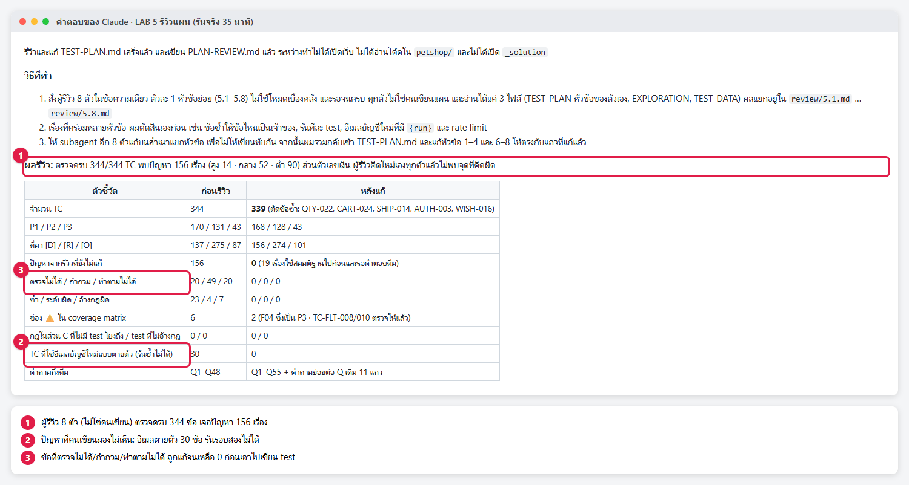

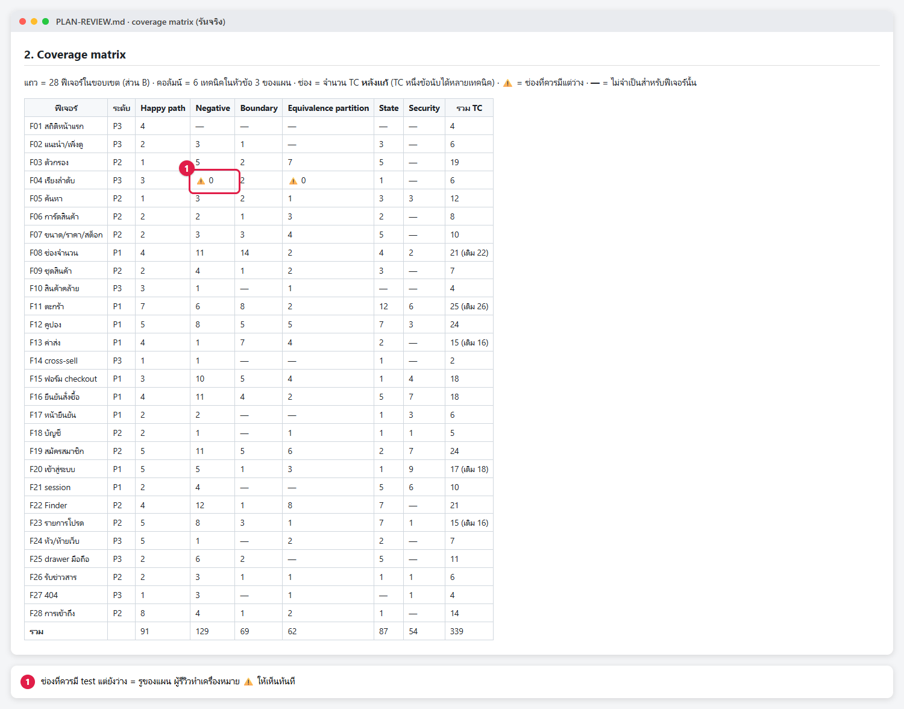

👀 **สังเกต**
- ตัวอย่างร้ายแรง: `TC-QTY-017` ยอมรับ "qty 1 **หรือ** 2" ซึ่งรวมกรณีบั๊กดับเบิลคลิกไว้ด้วย = **test ที่ไม่มีวันล้ม** ผู้รีวิวเปลี่ยนให้ต้องได้ 1 เท่านั้น
- 30 ข้อใช้อีเมลตายตัว รันครั้งที่สองจะเจอ "อีเมลนี้ถูกใช้แล้ว" → แก้เป็นอีเมลที่มีเวลาต่อท้าย
- หลังแก้ **339 test case** (ตัดซ้ำ 5) · P1 168 · P2 128 · P3 43 · คำถามถึงทีม Q1–Q55 อยู่ในหัวข้อ 8
- ผู้สอนใช้แผนหลังรีวิวนี้ใน LAB 6 · 📂 [_solution/TEST-PLAN.md](_solution/TEST-PLAN.md) · [_solution/PLAN-REVIEW.md](_solution/PLAN-REVIEW.md)

---

## LAB 6 · เขียน test Playwright แล้วรันจริงทุกข้อ + GIF + รายงานกดดูได้ 🤖▶️

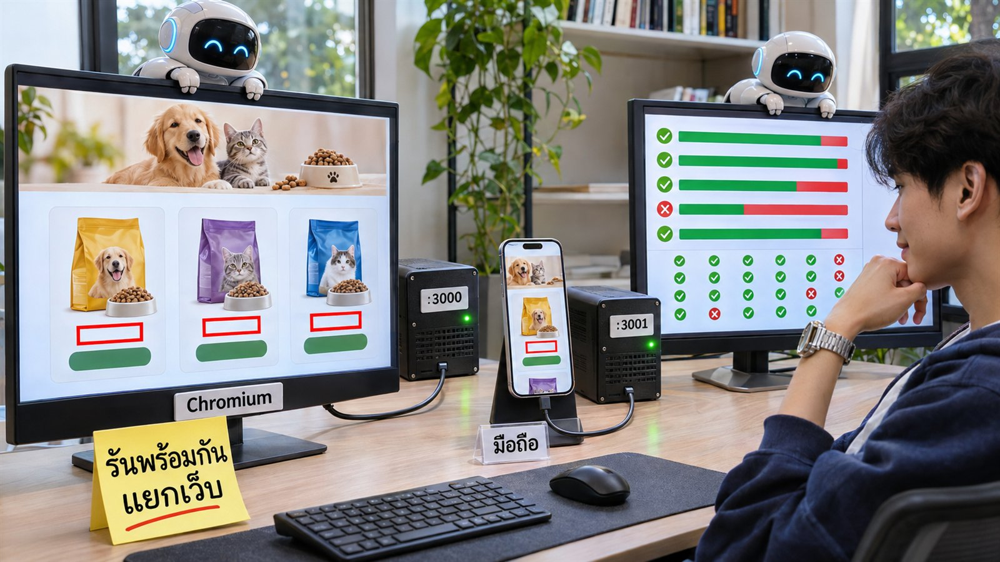

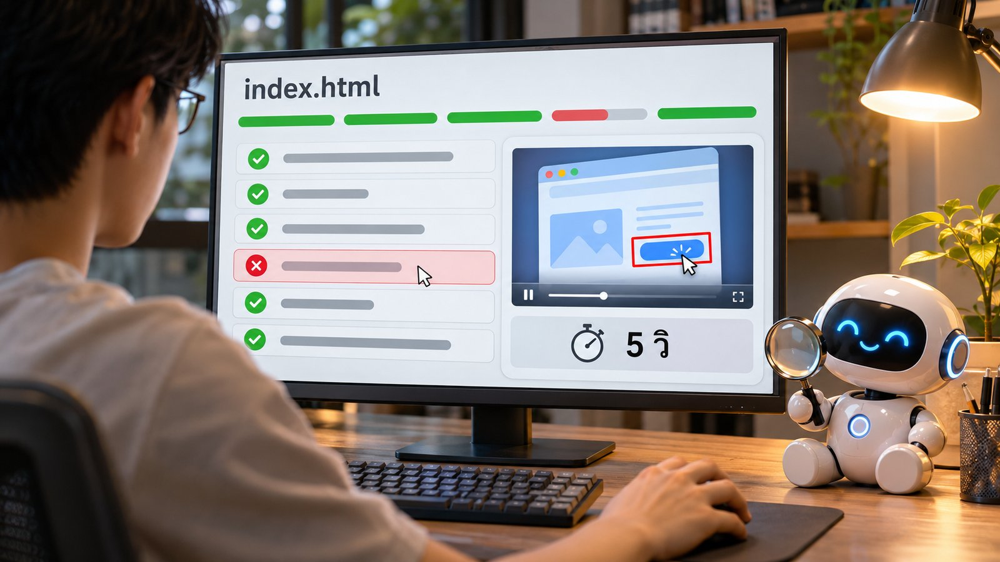

🧑 **คิดก่อน** ถ้า test ล้ม มีได้ 3 สาเหตุ: เว็บผิด / แผนผิด / test เขียนผิด จะแยกยังไง

💬 **พรอมต์**

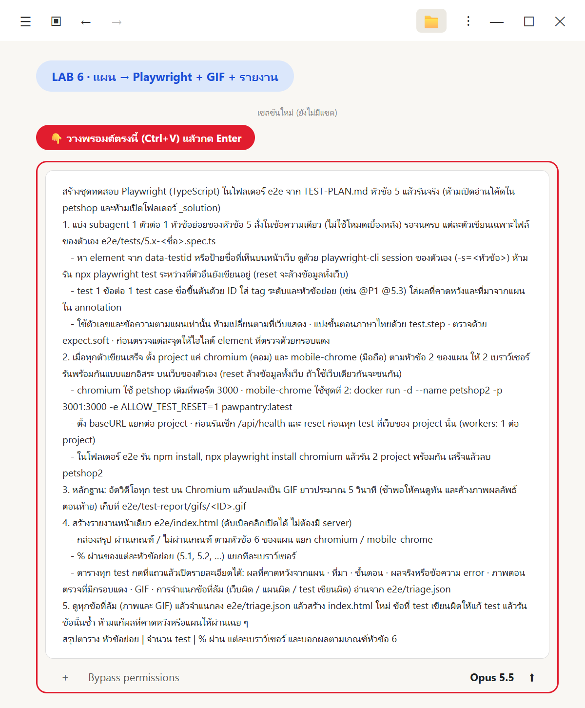

```text
สร้างชุดทดสอบ Playwright (TypeScript) ในโฟลเดอร์ e2e จาก TEST-PLAN.md หัวข้อ 5 แล้วรันจริง (ห้ามเปิดอ่านโค้ดใน petshop และห้ามเปิดโฟลเดอร์ _solution)
1. แบ่ง subagent 1 ตัวต่อ 1 หัวข้อย่อยของหัวข้อ 5 สั่งในข้อความเดียว (ไม่ใช้โหมดเบื้องหลัง) รอจนครบ แต่ละตัวเขียนเฉพาะไฟล์ของตัวเอง e2e/tests/5.x-<ชื่อ>.spec.ts
   - หา element จาก data-testid หรือป้ายชื่อที่เห็นบนหน้าเว็บ ดูด้วย playwright-cli session ของตัวเอง (-s=<หัวข้อ>) ห้ามรัน npx playwright test ระหว่างที่ตัวอื่นยังเขียนอยู่ (reset จะล้างข้อมูลทั้งเว็บ)
   - test 1 ข้อต่อ 1 test case ชื่อขึ้นต้นด้วย ID ใส่ tag ระดับและหัวข้อย่อย (เช่น @P1 @5.3) ใส่ผลที่คาดหวังและที่มาจากแผนใน annotation
   - ใช้ตัวเลขและข้อความตามแผนเท่านั้น ห้ามเปลี่ยนตามที่เว็บแสดง · แบ่งขั้นตอนภาษาไทยด้วย test.step · ตรวจด้วย expect.soft · ก่อนตรวจแต่ละจุดให้ไฮไลต์ element ที่ตรวจด้วยกรอบแดง
2. เมื่อทุกตัวเขียนเสร็จ ตั้ง project แค่ chromium (คอม) และ mobile-chrome (มือถือ) ตามหัวข้อ 2 ของแผน ให้ 2 เบราว์เซอร์รันพร้อมกันแบบแยกอิสระ บนเว็บของตัวเอง (reset ล้างข้อมูลทั้งเว็บ ถ้าใช้เว็บเดียวกันจะชนกัน)
   - chromium ใช้ petshop เดิมที่พอร์ต 3000 · mobile-chrome ใช้ชุดที่ 2: docker run -d --name petshop2 -p 3001:3000 -e ALLOW_TEST_RESET=1 pawpantry:latest
   - ตั้ง baseURL แยกต่อ project · ก่อนรันเช็ก /api/health และ reset ก่อนทุก test ที่เว็บของ project นั้น (workers: 1 ต่อ project)
   - ในโฟลเดอร์ e2e รัน npm install, npx playwright install chromium แล้วรัน 2 project พร้อมกัน เสร็จแล้วลบ petshop2
3. หลักฐาน: อัดวิดีโอทุก test บน Chromium แล้วแปลงเป็น GIF ยาวประมาณ 5 วินาที (ช้าพอให้คนดูทัน และค้างภาพผลลัพธ์ตอนท้าย) เก็บที่ e2e/test-report/gifs/<ID>.gif
4. สร้างรายงานหน้าเดียว e2e/index.html (ดับเบิลคลิกเปิดได้ ไม่ต้องมี server)
   - กล่องสรุป ผ่านเกณฑ์ / ไม่ผ่านเกณฑ์ ตามหัวข้อ 6 ของแผน แยก chromium / mobile-chrome
   - % ผ่านของแต่ละหัวข้อย่อย (5.1, 5.2, …) แยกทีละเบราว์เซอร์
   - ตารางทุก test กดที่แถวแล้วเปิดรายละเอียดได้: ผลที่คาดหวังจากแผน · ที่มา · ขั้นตอน · ผลจริงหรือข้อความ error · ภาพตอนตรวจที่มีกรอบแดง · GIF · การจำแนกข้อที่ล้ม (เว็บผิด / แผนผิด / test เขียนผิด) อ่านจาก e2e/triage.json
5. ดูทุกข้อที่ล้ม (ภาพและ GIF) แล้วจำแนกลง e2e/triage.json แล้วสร้าง index.html ใหม่ ข้อที่ test เขียนผิดให้แก้ test แล้วรันข้อนั้นซ้ำ ห้ามแก้ผลที่คาดหวังหรือแผนให้ผ่านเฉย ๆ
สรุปตาราง หัวข้อย่อย | จำนวน test | % ผ่าน แต่ละเบราว์เซอร์ และบอกผลตามเกณฑ์หัวข้อ 6
```

| ส่วนของพรอมต์ | มีไว้ทำไม |
|---|---|
| writer 1 ตัวต่อหัวข้อย่อย · ไฟล์ spec ของตัวเอง | เขียนพร้อมกันได้ ไม่ชนไฟล์ |
| **ห้ามรัน `npx playwright test` ระหว่างที่ตัวอื่นยังเขียน** | test ทุกข้อ reset ก่อนเริ่ม ถ้ารันระหว่างนั้นจะล้างเว็บใต้เท้า agent ตัวอื่น |
| tag `@P1 @5.3` · annotation ผลที่คาดหวัง/ที่มา | รายงานคิด % ต่อหัวข้อและตามระดับได้ และย้อนกลับไปหาแผนได้ |
| **ใช้ตัวเลขตามแผนเท่านั้น ห้ามเปลี่ยนตามเว็บ** | กัน AI แก้ expected ให้ผ่าน (อบบั๊ก) |
| `test.step` ภาษาไทย · `expect.soft` · กรอบแดง | อ่านขั้นตอนในรายงานได้ ข้อเดียวตรวจหลายจุดไม่หยุดที่จุดแรก และเห็นใน GIF ว่าตรวจตรงไหน |
| **แค่ `chromium` + `mobile-chrome`** | 5 เบราว์เซอร์รันทีละตัวใช้ราว 4 ชม. (ตัวละเกือบ 50 นาที) · 2 ตัวนี้ครอบคลุมจอคอมและจอมือถือ และติดตั้งแค่ `chromium` ตัวเดียว |
| **รันพร้อมกัน แต่ละเบราว์เซอร์มีเว็บของตัวเอง** (`:3000` / `:3001`) | reset ล้างข้อมูลทั้งเว็บ ถ้า 2 เบราว์เซอร์ใช้เว็บเดียวกัน reset ของฝั่งหนึ่งจะล้างตะกร้าของอีกฝั่งกลาง test · แยกเว็บแล้วรันพร้อมกันได้โดยไม่ชน (T12) |
| health check + reset ก่อนทุก test · `workers: 1` ต่อ project | ในเว็บเดียวกัน test ยังต้องรันทีละข้อ ด้วยเหตุผลเดียวกัน |
| ลบ `petshop2` ตอนจบ | ไม่ทิ้ง container ที่ไม่ใช้ไว้กินเครื่อง |
| GIF ~5 วินาที ค้างภาพท้าย | คนดูทัน และเห็นผลตอนจบ |
| `index.html` เปิดได้โดยไม่มี server · กดแถวดูรายละเอียด | ส่งให้คนอื่นตรวจย้อน (back-check) ได้ทุกข้อ |
| triage.json · **ห้ามแก้ expected ให้ผ่านเฉย ๆ** | ข้อที่ล้มต้องมีคำอธิบาย แก้ได้เฉพาะ test ที่เขียนผิด |

<!-- LAB6-RESULTS -->

---

## LAB 7 · เปิดโหมดฝังบั๊ก แล้วดูว่าแผนจับได้ไหม 🐞

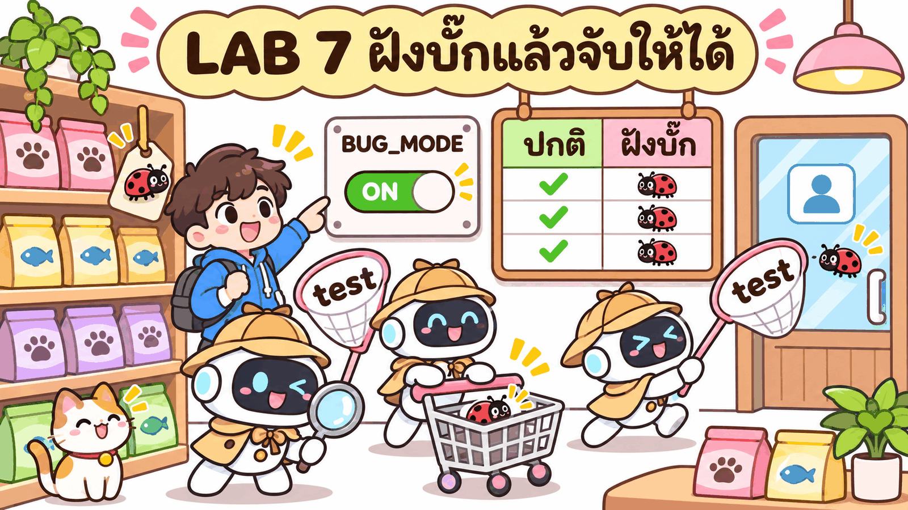

🧑 **คิดก่อน** ถ้าใน LAB 4 เราลอกราคาจากหน้าจอมาเป็นผลที่คาดหวัง test จะจับบั๊กราคาได้ไหม (ดู T9)

💬 **พรอมต์**

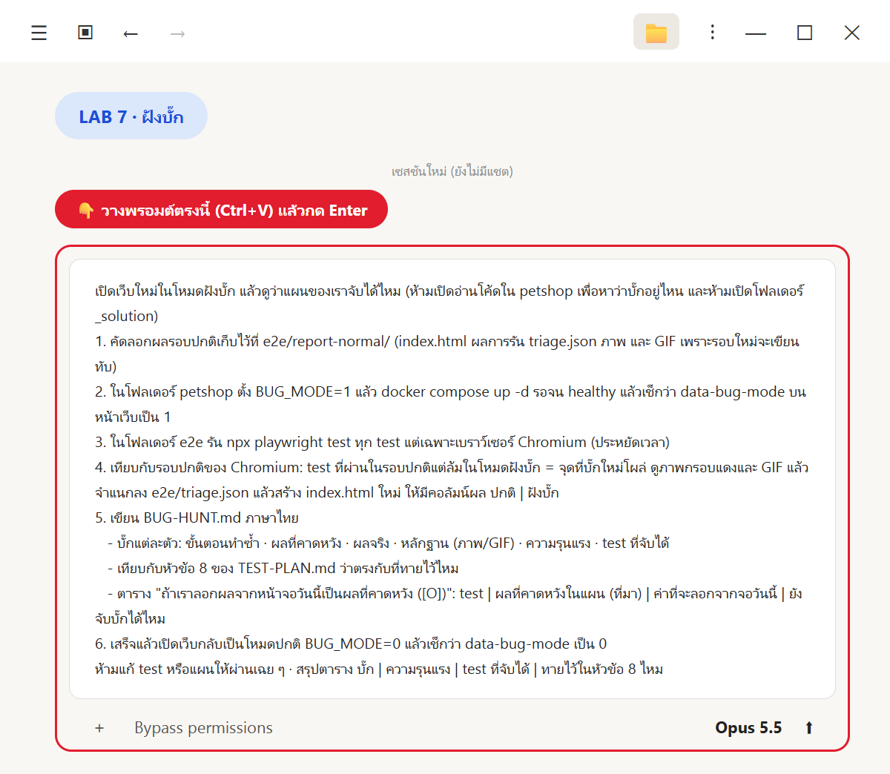

```text
เปิดเว็บใหม่ในโหมดฝังบั๊ก แล้วดูว่าแผนของเราจับได้ไหม (ห้ามเปิดอ่านโค้ดใน petshop เพื่อหาว่าบั๊กอยู่ไหน และห้ามเปิดโฟลเดอร์ _solution)
1. คัดลอกผลรอบปกติเก็บไว้ที่ e2e/report-normal/ (index.html ผลการรัน triage.json ภาพ และ GIF เพราะรอบใหม่จะเขียนทับ)
2. ในโฟลเดอร์ petshop ตั้ง BUG_MODE=1 แล้ว docker compose up -d รอจน healthy แล้วเช็กว่า data-bug-mode บนหน้าเว็บเป็น 1
3. ในโฟลเดอร์ e2e รัน npx playwright test ทุก test แต่เฉพาะเบราว์เซอร์ Chromium (ประหยัดเวลา)
4. เทียบกับรอบปกติของ Chromium: test ที่ผ่านในรอบปกติแต่ล้มในโหมดฝังบั๊ก = จุดที่บั๊กใหม่โผล่ ดูภาพกรอบแดงและ GIF แล้วจำแนกลง e2e/triage.json แล้วสร้าง index.html ใหม่ ให้มีคอลัมน์ผล ปกติ | ฝังบั๊ก
5. เขียน BUG-HUNT.md ภาษาไทย
   - บั๊กแต่ละตัว: ขั้นตอนทำซ้ำ · ผลที่คาดหวัง · ผลจริง · หลักฐาน (ภาพ/GIF) · ความรุนแรง · test ที่จับได้
   - เทียบกับหัวข้อ 8 ของ TEST-PLAN.md ว่าตรงกับที่ทายไว้ไหม
   - ตาราง "ถ้าเราลอกผลจากหน้าจอวันนี้เป็นผลที่คาดหวัง ([O])": test | ผลที่คาดหวังในแผน (ที่มา) | ค่าที่จะลอกจากจอวันนี้ | ยังจับบั๊กได้ไหม
6. เสร็จแล้วเปิดเว็บกลับเป็นโหมดปกติ BUG_MODE=0 แล้วเช็กว่า data-bug-mode เป็น 0
ห้ามแก้ test หรือแผนให้ผ่านเฉย ๆ · สรุปตาราง บั๊ก | ความรุนแรง | test ที่จับได้ | ทายไว้ในหัวข้อ 8 ไหม
```

| ส่วนของพรอมต์ | มีไว้ทำไม |
|---|---|
| เก็บผลรอบปกติก่อน (รวมภาพและ GIF) | ต้องมีของเทียบ จึงจะรู้ว่าข้อไหน "เพิ่งล้ม" เพราะบั๊กใหม่ และรอบใหม่จะเขียน GIF ทับไฟล์เดิม |
| `BUG_MODE=1` + เช็ก `data-bug-mode` | ยืนยันว่าเว็บอยู่ในโหมดที่ถูก ก่อนสรุปผล |
| ทุก test แต่ **เฉพาะ Chromium** | Chromium รันครบทุก test อยู่แล้ว (มือถือรันเฉพาะข้อจอมือถือ) และบั๊กส่วนใหญ่เป็นเรื่องเงินและสถานะ ไม่ขึ้นกับเบราว์เซอร์ จึงเทียบแค่ Chromium ก็พอ |
| ห้ามเปิดโค้ดเพื่อหาบั๊ก | ต้องจับจากพฤติกรรมเว็บเท่านั้น เหมือนทดสอบจริง |
| เทียบกับหัวข้อ 8 ของแผน | ดูว่าที่ "ทาย" ไว้ตอนเขียนแผนแม่นแค่ไหน |
| ตาราง "ถ้าลอกจากจอ [O]" | เห็นชัด ๆ ว่าการอบบั๊กทำให้พลาดบั๊กตัวไหน |
| กลับเป็น `BUG_MODE=0` | ไม่ทิ้งเว็บไว้ในโหมดฝังบั๊ก |

<!-- LAB7-RESULTS -->

---

## 🧹 เก็บกวาด

```bash
playwright-cli close-all
```

```bash
docker compose -f petshop/docker-compose.yml down
```

## 📂 ไฟล์ในโฟลเดอร์นี้

| ไฟล์ | คืออะไร |
|---|---|
| `petshop/` | โค้ดเว็บ + Docker (ใช้แค่เปิดเว็บ ห้ามให้ AI อ่าน) |
| `TEST-DATA.md` | ข้อมูลเดียวที่ทีมพัฒนาให้มา ([D]) |
| `img/` | ภาพประกอบทุก LAB (ภาพผลลัพธ์มาจากการรันจริง) |
| `_solution/` | ผลรันจริงของผู้สอน: CHARTERS · exploration · EXPLORATION · TEST-PLAN · PLAN-REVIEW · e2e |
