# Google Flights · สำรวจเว็บจริงของคนอื่น ด้วย Playwright อย่างเดียว (LAB 0–5)

[PawPantry](../01_pawpantry/README.md) เป็นเว็บของเราเอง มี TEST-DATA และ reset ได้ LAB นี้เป็น **เว็บจริงที่เราไม่ได้เป็นเจ้าของ** ราคาและเที่ยวบินเปลี่ยนทุกวัน ไม่มีข้อมูลทีม ([D]) และกด reset ไม่ได้
เราใช้ **Playwright อย่างเดียว** (playwright-cli + Playwright Test) ไม่ใช้ REA แต่ใช้วิธีสำรวจแบบเดียวกับ [Week 03 · REA + Playwright Exploration](../../../../03_week03/02_REA_Playwright_Exploration/)

> 📘 ทฤษฎี: [01_theory/README.md](../../01_theory/README.md) โดยเฉพาะ T9 (oracle สำหรับเว็บที่ข้อมูลเปลี่ยนทุกวัน) · ผลในหน้านี้มาจาก **การรันจริงวันที่ 3 พ.ย. 2569**

**โจทย์ลูกค้า:** กรุงเทพ → โตเกียว · เที่ยวเดียว · 15 ธ.ค. 2026 · ผู้ใหญ่ 1 คน

## ⚠️ อ่านก่อนเริ่ม: เว็บนี้ไม่ใช่ของเรา

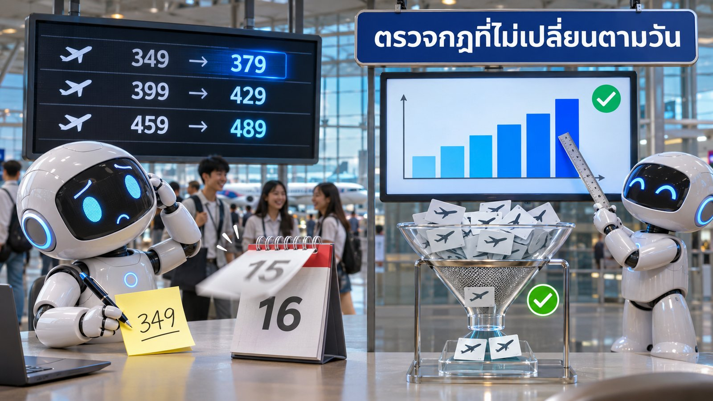

| เรื่อง | ข้อเท็จจริง | เราทำอย่างไร |
|---|---|---|
| **robots.txt** | `https://www.google.com/robots.txt` มี `Disallow: /travel/flights/search` | ใช้เพื่อการเรียนเท่านั้น และ **เบาที่สุด**: สำรวจรอบเดียว รัน test ชุดเดียว 1 รอบ |
| **ข้อกำหนดการใช้งาน (ToS)** | ห้ามเข้าถึงแบบอัตโนมัติที่ขัดกับ robots.txt | ไม่ทำซ้ำเกินจำเป็น ไม่ดึงข้อมูลไปใช้ต่อ ไม่ทำเป็นงานอัตโนมัติประจำ |
| **CAPTCHA** | Google อาจขึ้น "ฉันไม่ใช่โปรแกรมอัตโนมัติ" ได้ทุกเมื่อ | **หยุดทันที ให้คนแก้เอง** ห้ามให้ AI หลบหรือกดผ่าน |
| **ข้อมูลส่วนตัว** | ไม่ต้องใช้บัญชี | ห้ามล็อกอิน ห้ามจ่ายเงิน ห้ามกรอกข้อมูลส่วนตัว **หยุดก่อนไปเว็บสายการบิน** |
| **โหมดไม่ระบุตัวตน** | playwright-cli ค่าเริ่มต้นใช้ `user-data-dir: <in-memory>` | ทุก agent ได้โปรไฟล์ใหม่ ไม่มี cookie ของเรา · ห้าม `--persistent` / `--profile` |
| **ภาระเว็บ** | agent หลายตัว = หลายคนเปิดพร้อมกัน | เปิดพร้อมกัน **ไม่เกิน 5 เบราว์เซอร์** · ทำช้าแบบคน (รอ 3–5 วิระหว่างคลิก) |

> 👩‍🏫 ผู้สอน: ถ้าห้องเรียนมีคนเยอะ ให้ทำ LAB 2–3 เป็นกลุ่ม (1 เครื่องต่อกลุ่ม) และให้ดูผลรันจริงใน `_solution/` แทนการรัน LAB 5 ทุกคน

## 🗺️ 6 LAB ในหน้านี้

| LAB | ทำอะไร | เวลาจริง | ได้ไฟล์ |
|---|---|---|---|
| 0 | เช็ก playwright-cli + เปิดเว็บ 1 ครั้ง | 44 วิ | - |
| 1 | วางแผนสำรวจ A (ความรู้เดิม) / B (ลาดตระเวน) | 2.9 / 7.3 นาที | `CHARTERS.md` |
| 2 | 6 subagent สำรวจพร้อมกัน (เปิดไม่เกิน 5) | 30 นาที | `exploration/C1–C6.md` |
| 3 | รวม + กฎที่ไม่ขึ้นกับวัน + ผู้ตัดสิน | 20 นาที | `EXPLORATION.md` |
| 4 | แผนทดสอบ ≤ 40 ข้อ (งบการค้นหา) | 28 นาที | `TEST-PLAN.md` |
| 5 | test Playwright รันจริง 1 รอบ + GIF + รายงาน | 2.1 ชม. (รันชุดเต็ม 1.0 ชม.) | `e2e/index.html` |

## 🔁 ต่างจาก PawPantry ตรงไหน

| | PawPantry | Google Flights |
|---|---|---|
| เจ้าของเว็บ | เรา (Docker บนเครื่อง) | Google |
| ผลที่คาดหวังมาจาก | [D] TEST-DATA > [R] > [O] | **ไม่มี [D]** · [R] กฎที่ไม่ขึ้นกับวัน > [O] |
| reset ข้อมูล | `POST /api/test/reset` | ไม่มี · ทุก agent แค่อ่าน ไม่เปลี่ยนข้อมูลกลาง |
| เบราว์เซอร์พร้อมกัน | 7 | ไม่เกิน 5 |
| จำนวน test | 339 · Chromium + Chrome มือถือ พร้อมกัน | ≤ 40 · Chromium อย่างเดียว · รัน 1 รอบ |
| ตัวอย่างผลที่คาดหวัง | "ยอดรวม ฿428" | "ราคาแถวถัดไป ≥ แถวก่อนหน้า" |

## 🧰 ก่อนเริ่ม

| ✅ | ต้องมี |
|---|---|
| ☐ | **Claude Code** เปิดใน **โฟลเดอร์นี้** (`02_lab/02_google-flights`) |
| ☐ | **Node.js 18+** และอินเทอร์เน็ต |
| ☐ | ทำ LAB 0 ของ PawPantry แล้ว (มี playwright-cli) หรือให้ LAB 0 ด้านล่างติดตั้งให้ |
| ☐ | แต่ละ LAB เริ่ม **เซสชันใหม่** แล้ววางพรอมต์ **1 ครั้ง** · ระหว่างรัน **อยู่หน้าเครื่อง** เผื่อ CAPTCHA |

---

## LAB 0 · เปิดเว็บจริงอย่างระวัง 🤖

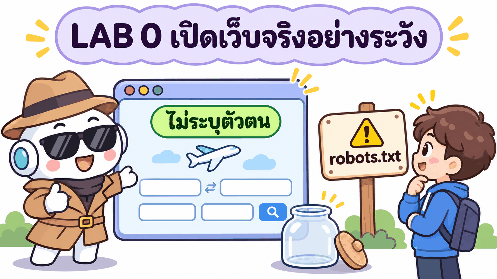

🧑 **คิดก่อน** ถ้าเปิดแล้วเจอ CAPTCHA เราควรให้ AI ทำอะไร

💬 **พรอมต์**

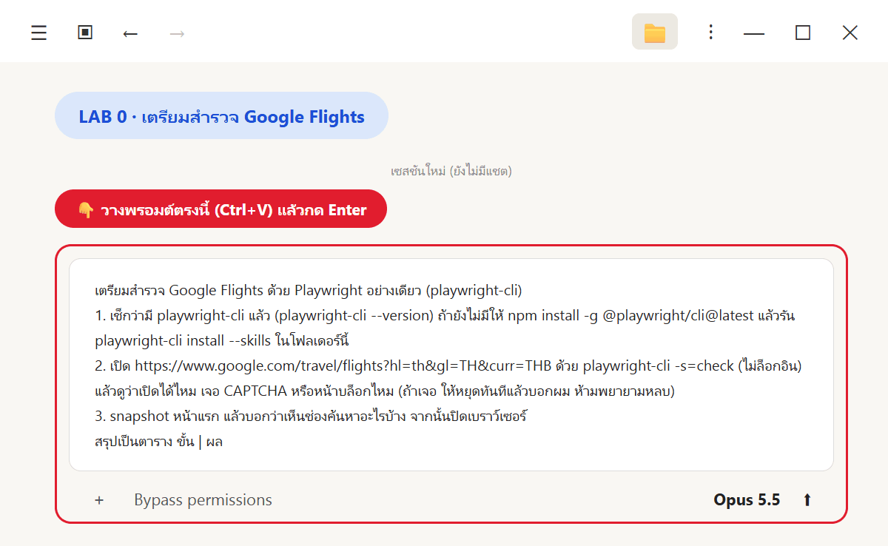

```text
เตรียมสำรวจ Google Flights ด้วย Playwright อย่างเดียว (playwright-cli)
1. เช็กว่ามี playwright-cli แล้ว (playwright-cli --version) ถ้ายังไม่มีให้ npm install -g @playwright/cli@latest แล้วรัน playwright-cli install --skills ในโฟลเดอร์นี้
2. เปิด https://www.google.com/travel/flights?hl=th&gl=TH&curr=THB ด้วย playwright-cli -s=check (ไม่ล็อกอิน) แล้วดูว่าเปิดได้ไหม เจอ CAPTCHA หรือหน้าบล็อกไหม (ถ้าเจอ ให้หยุดทันทีแล้วบอกผม ห้ามพยายามหลบ)
3. snapshot หน้าแรก แล้วบอกว่าเห็นช่องค้นหาอะไรบ้าง จากนั้นปิดเบราว์เซอร์
สรุปเป็นตาราง ขั้น | ผล
```

| ส่วนของพรอมต์ | มีไว้ทำไม |
|---|---|
| `hl=th&gl=TH&curr=THB` | ล็อกภาษา ประเทศ และสกุลเงิน ทุก agent เห็นหน้าเดียวกัน |
| ไม่ล็อกอิน · `-s=check` | โปรไฟล์ใหม่ในหน่วยความจำ ไม่เกี่ยวกับบัญชี Google ของเรา |
| **เจอ CAPTCHA ให้หยุด ห้ามหลบ** | CAPTCHA คือเจ้าของเว็บบอกว่า "พอแล้ว" ต้องให้คนตัดสิน |
| snapshot แล้วบอกช่องค้นหา | ฝึกอ่านสิ่งที่ AI เห็น (T1, T3) |

✅ **ผลจริง (44 วินาที)** เปิดได้ **ไม่เจอ CAPTCHA** ไม่มีป๊อปอัปคุกกี้

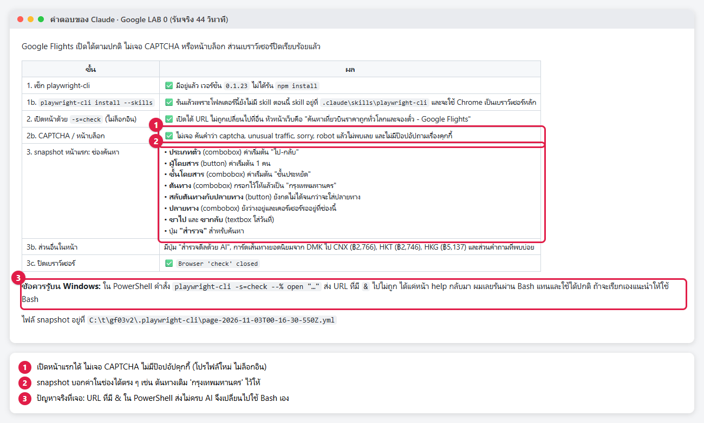

👀 **สังเกต**
- ต้นทางเติม "กรุงเทพมหานคร" ให้เองจากประเทศ `gl=TH` · ปุ่มสลับ ⇄ กดไม่ได้จนกว่าจะใส่ปลายทาง
- บน Windows PowerShell ส่ง URL ที่มี `&` ไปไม่ครบ AI จึงเปลี่ยนไปใช้ Bash เอง (ถ้าเห็นหน้าเว็บเป็นภาษาอังกฤษ ให้ดูว่า URL ครบไหม)

---

## LAB 1 · วางแผนสำรวจ (charter) 🤖

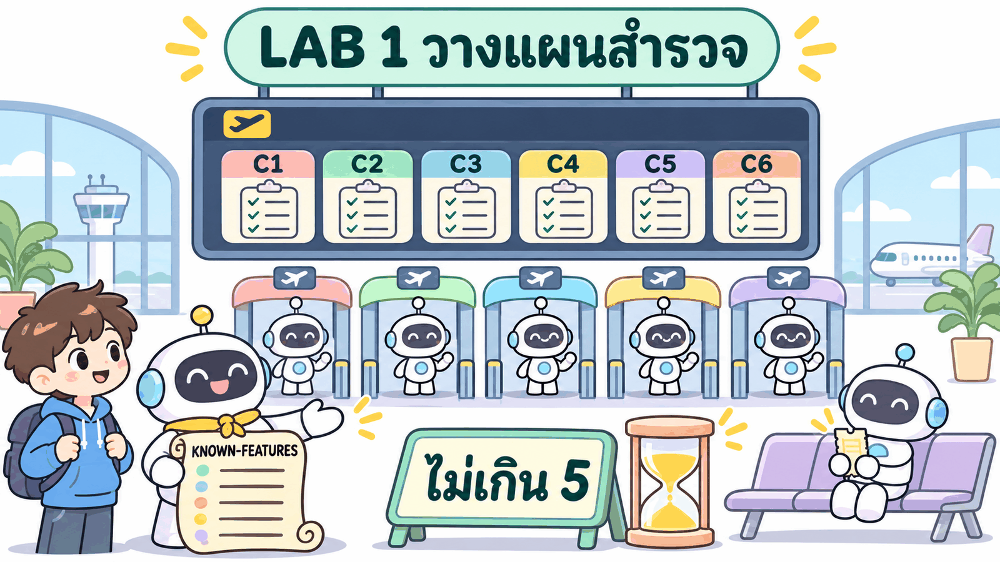

🧑 **คิดก่อน** รุ่นพี่ใน Week 03 เคยสำรวจเว็บนี้แล้ว เราใช้อะไรจากรุ่นพี่ได้บ้าง และอะไรที่ใช้ไม่ได้เพราะเว็บเปลี่ยน

### 1A · ใช้ความรู้เดิม ([KNOWN-FEATURES.md](KNOWN-FEATURES.md) = ชื่อฟีเจอร์ 35 ข้อ ไม่มีกฎ)

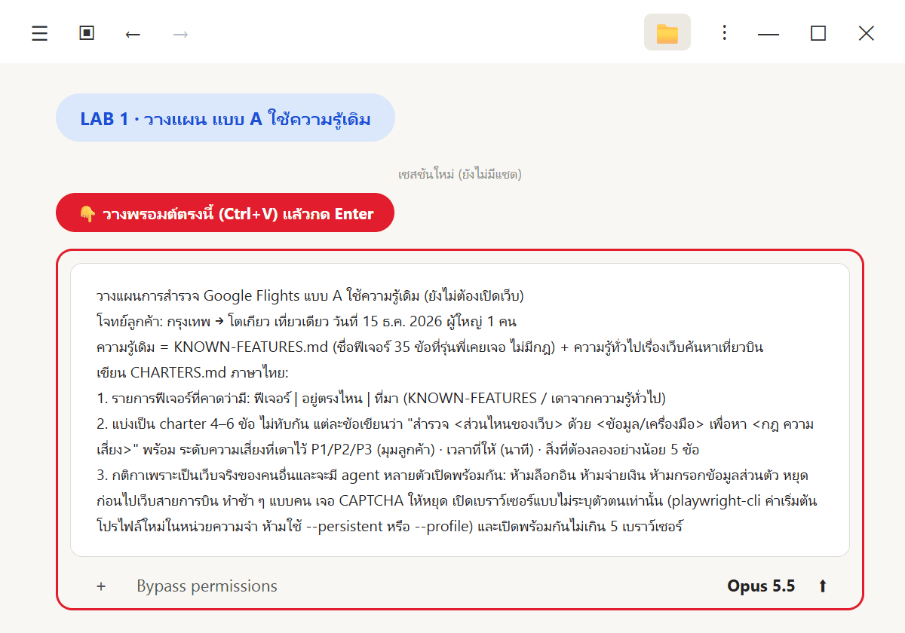

```text
วางแผนการสำรวจ Google Flights แบบ A ใช้ความรู้เดิม (ยังไม่ต้องเปิดเว็บ)
โจทย์ลูกค้า: กรุงเทพ → โตเกียว เที่ยวเดียว วันที่ 15 ธ.ค. 2026 ผู้ใหญ่ 1 คน
ความรู้เดิม = KNOWN-FEATURES.md (ชื่อฟีเจอร์ 35 ข้อที่รุ่นพี่เคยเจอ ไม่มีกฎ) + ความรู้ทั่วไปเรื่องเว็บค้นหาเที่ยวบิน
เขียน CHARTERS.md ภาษาไทย:
1. รายการฟีเจอร์ที่คาดว่ามี: ฟีเจอร์ | อยู่ตรงไหน | ที่มา (KNOWN-FEATURES / เดาจากความรู้ทั่วไป)
2. แบ่งเป็น charter 4–6 ข้อ ไม่ทับกัน แต่ละข้อเขียนว่า "สำรวจ <ส่วนไหนของเว็บ> ด้วย <ข้อมูล/เครื่องมือ> เพื่อหา <กฎ ความเสี่ยง>" พร้อม ระดับความเสี่ยงที่เดาไว้ P1/P2/P3 (มุมลูกค้า) · เวลาที่ให้ (นาที) · สิ่งที่ต้องลองอย่างน้อย 5 ข้อ
3. กติกาเพราะเป็นเว็บจริงของคนอื่นและจะมี agent หลายตัวเปิดพร้อมกัน: ห้ามล็อกอิน ห้ามจ่ายเงิน ห้ามกรอกข้อมูลส่วนตัว หยุดก่อนไปเว็บสายการบิน ทำช้า ๆ แบบคน เจอ CAPTCHA ให้หยุด เปิดเบราว์เซอร์แบบไม่ระบุตัวตนเท่านั้น (playwright-cli ค่าเริ่มต้น โปรไฟล์ใหม่ในหน่วยความจำ ห้ามใช้ --persistent หรือ --profile) และเปิดพร้อมกันไม่เกิน 5 เบราว์เซอร์
```

### 1B · ไม่ใช้ความรู้เดิม ลาดตระเวนค้นหา 1 ครั้ง

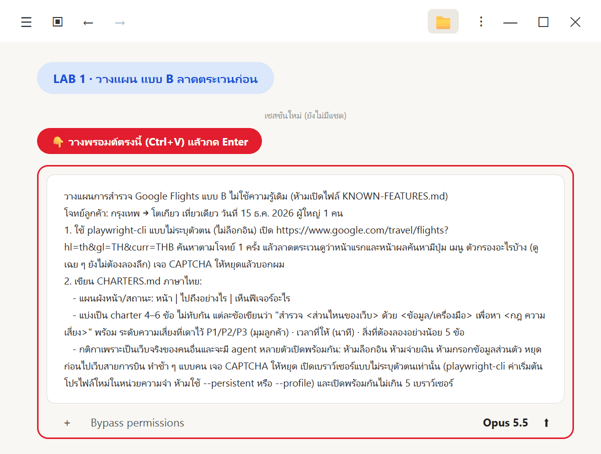

```text
วางแผนการสำรวจ Google Flights แบบ B ไม่ใช้ความรู้เดิม (ห้ามเปิดไฟล์ KNOWN-FEATURES.md)
โจทย์ลูกค้า: กรุงเทพ → โตเกียว เที่ยวเดียว วันที่ 15 ธ.ค. 2026 ผู้ใหญ่ 1 คน
1. ใช้ playwright-cli แบบไม่ระบุตัวตน (ไม่ล็อกอิน) เปิด https://www.google.com/travel/flights?hl=th&gl=TH&curr=THB ค้นหาตามโจทย์ 1 ครั้ง แล้วลาดตระเวนดูว่าหน้าแรกและหน้าผลค้นหามีปุ่ม เมนู ตัวกรองอะไรบ้าง (ดูเฉย ๆ ยังไม่ต้องลองลึก) เจอ CAPTCHA ให้หยุดแล้วบอกผม
2. เขียน CHARTERS.md ภาษาไทย:
   - แผนผังหน้า/สถานะ: หน้า | ไปถึงอย่างไร | เห็นฟีเจอร์อะไร
   - แบ่งเป็น charter 4–6 ข้อ ไม่ทับกัน แต่ละข้อเขียนว่า "สำรวจ <ส่วนไหนของเว็บ> ด้วย <ข้อมูล/เครื่องมือ> เพื่อหา <กฎ ความเสี่ยง>" พร้อม ระดับความเสี่ยงที่เดาไว้ P1/P2/P3 (มุมลูกค้า) · เวลาที่ให้ (นาที) · สิ่งที่ต้องลองอย่างน้อย 5 ข้อ
   - กติกาเพราะเป็นเว็บจริงของคนอื่นและจะมี agent หลายตัวเปิดพร้อมกัน: ห้ามล็อกอิน ห้ามจ่ายเงิน ห้ามกรอกข้อมูลส่วนตัว หยุดก่อนไปเว็บสายการบิน ทำช้า ๆ แบบคน เจอ CAPTCHA ให้หยุด เปิดเบราว์เซอร์แบบไม่ระบุตัวตนเท่านั้น (playwright-cli ค่าเริ่มต้น โปรไฟล์ใหม่ในหน่วยความจำ ห้ามใช้ --persistent หรือ --profile) และเปิดพร้อมกันไม่เกิน 5 เบราว์เซอร์
```

| ส่วนของพรอมต์ | มีไว้ทำไม |
|---|---|
| โจทย์ลูกค้า 1 ประโยค | ทุก charter ใช้เส้นทางและวันเดียวกัน เทียบผลกันได้ |
| KNOWN-FEATURES = **ชื่อเท่านั้น ไม่มีกฎ** | รู้ว่าต้องไปดูตรงไหน แต่กฎต้องหาเองจากเว็บวันนี้ |
| ความเสี่ยง "มุมลูกค้า" | เราไม่ใช่ทีม Google จึงวัดจากสิ่งที่ลูกค้าเสียหาย (ราคาผิด จองผิด) |
| กติกาเว็บจริง + **ไม่ระบุตัวตน + ไม่เกิน 5** | ใส่ใน CHARTERS.md เพื่อให้ทุก subagent ใน LAB 2 อ่านกติกาเดียวกัน |

✅ **ผลจริง**

| | แบบ A | แบบ B |
|---|---|---|
| เวลา | 2.9 นาที (ไม่เปิดเว็บ) | 7.3 นาที (ค้นหา 1 ครั้ง) |
| charter | 6 | 6 |
| ได้อะไรเพิ่ม | กติกา R1–R7 ละเอียด + จัดคิว 5 + 1 | เบาะแสจากหน้าจริง |

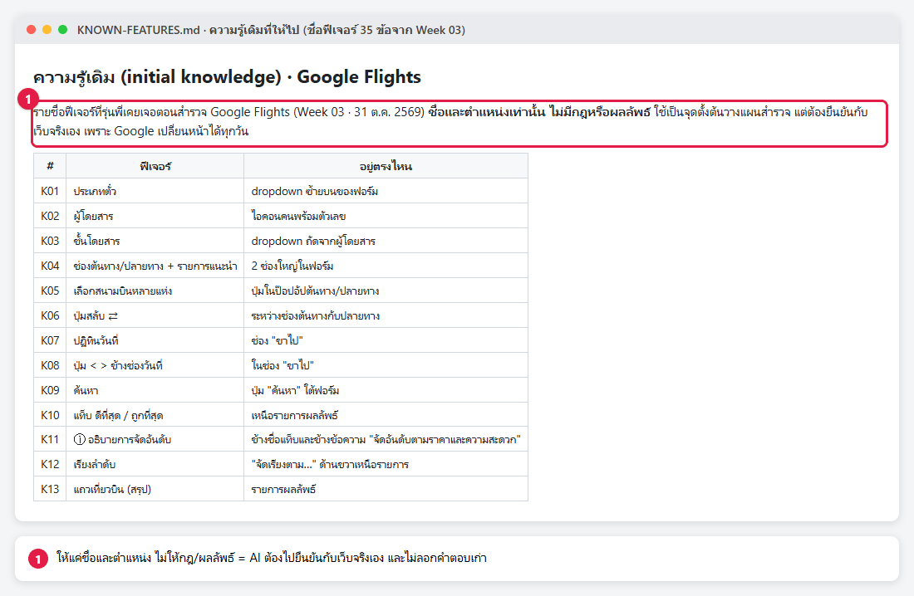

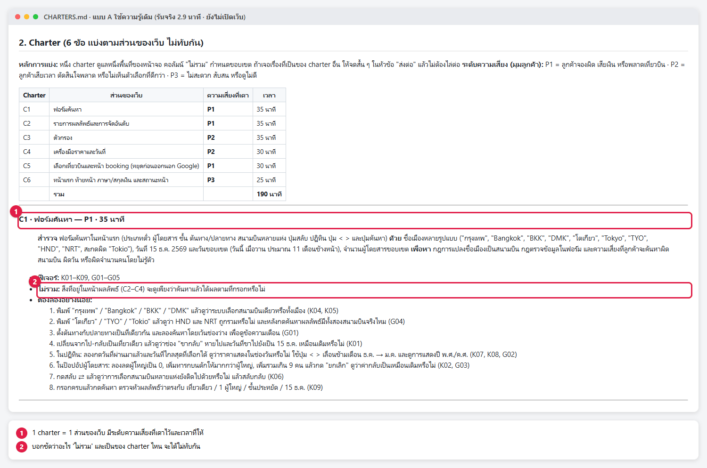

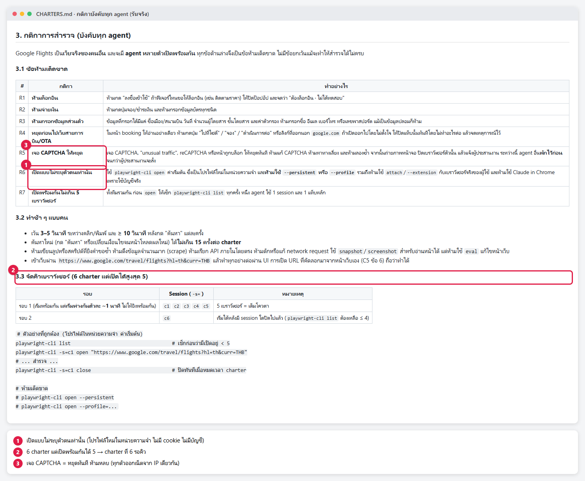

👀 **สังเกต**
- แบบ A กำหนด "ช้าแบบคน" เป็นตัวเลขเอง: รอ 3–5 วิระหว่างคลิก · ≥ 10 วิหลังค้นหา · ไม่เกิน 15 ค้นหาต่อ charter · และจัดคิว รอบ 1 = C1–C5 รอบ 2 = C6
- แบบ B เห็นเบาะแสที่แบบ A ไม่มีทางรู้: ปฏิทินมี label 7956 บาทแต่จอแสดง ฿7,960 · "รวมค่าธรรมเนียมเพิ่มเติม ฿150" แต่ราคาไม่เปลี่ยน · ผล 24 รายการแต่ตัวกรองมีสายการบิน ~60 · CO2 81 + 329 = 410 แต่การ์ดเขียน 409
- 📂 ผู้สอนเลือก **แบบ A** ใช้ต่อ ([_solution/CHARTERS.md](_solution/CHARTERS.md)) เพราะเว็บจริงยิ่งเปิดน้อยยิ่งดี · แบบ B: [_solution/CHARTERS-B.md](_solution/CHARTERS-B.md)

---

## LAB 2 · 6 subagent สำรวจพร้อมกัน (เปิดไม่เกิน 5) 🤖🤖🤖

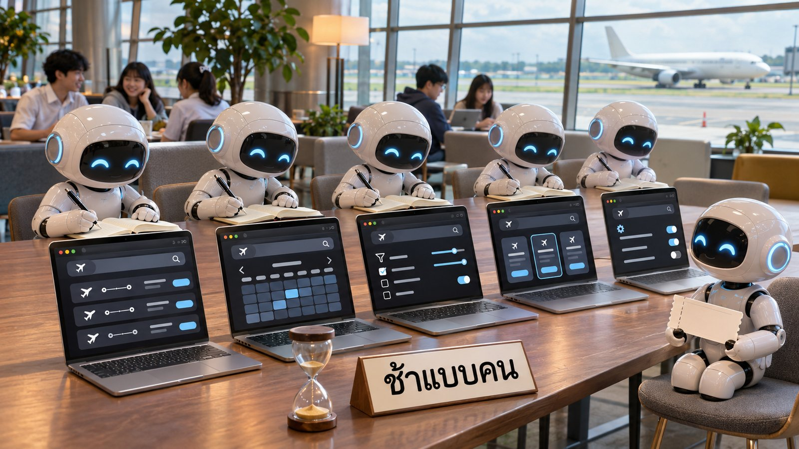

🧑 **คิดก่อน** มี 6 charter แต่เปิดได้ 5 เบราว์เซอร์ ควรให้ตัวไหนรอ

💬 **พรอมต์**

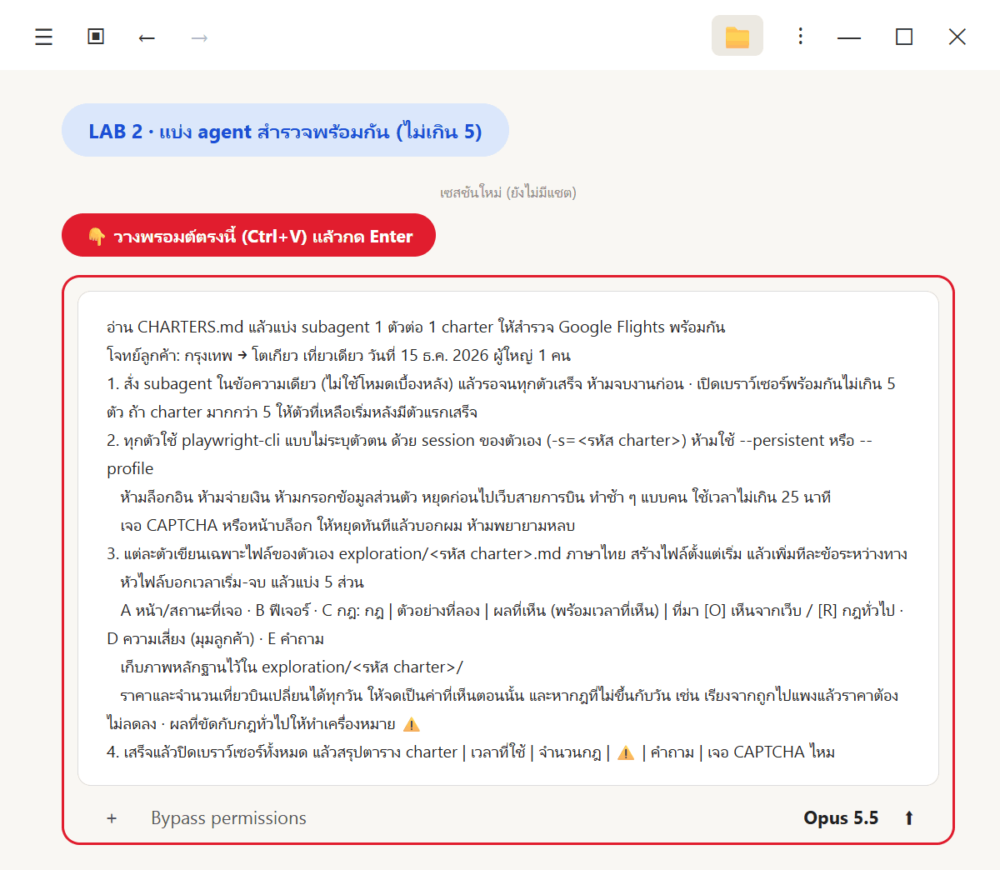

```text
อ่าน CHARTERS.md แล้วแบ่ง subagent 1 ตัวต่อ 1 charter ให้สำรวจ Google Flights พร้อมกัน
โจทย์ลูกค้า: กรุงเทพ → โตเกียว เที่ยวเดียว วันที่ 15 ธ.ค. 2026 ผู้ใหญ่ 1 คน
1. สั่ง subagent ในข้อความเดียว (ไม่ใช้โหมดเบื้องหลัง) แล้วรอจนทุกตัวเสร็จ ห้ามจบงานก่อน · เปิดเบราว์เซอร์พร้อมกันไม่เกิน 5 ตัว ถ้า charter มากกว่า 5 ให้ตัวที่เหลือเริ่มหลังมีตัวแรกเสร็จ
2. ทุกตัวใช้ playwright-cli แบบไม่ระบุตัวตน ด้วย session ของตัวเอง (-s=<รหัส charter>) ห้ามใช้ --persistent หรือ --profile
   ห้ามล็อกอิน ห้ามจ่ายเงิน ห้ามกรอกข้อมูลส่วนตัว หยุดก่อนไปเว็บสายการบิน ทำช้า ๆ แบบคน ใช้เวลาไม่เกิน 25 นาที
   เจอ CAPTCHA หรือหน้าบล็อก ให้หยุดทันทีแล้วบอกผม ห้ามพยายามหลบ
3. แต่ละตัวเขียนเฉพาะไฟล์ของตัวเอง exploration/<รหัส charter>.md ภาษาไทย สร้างไฟล์ตั้งแต่เริ่ม แล้วเพิ่มทีละข้อระหว่างทาง
   หัวไฟล์บอกเวลาเริ่ม-จบ แล้วแบ่ง 5 ส่วน
   A หน้า/สถานะที่เจอ · B ฟีเจอร์ · C กฎ: กฎ | ตัวอย่างที่ลอง | ผลที่เห็น (พร้อมเวลาที่เห็น) | ที่มา [O] เห็นจากเว็บ / [R] กฎทั่วไป · D ความเสี่ยง (มุมลูกค้า) · E คำถาม
   เก็บภาพหลักฐานไว้ใน exploration/<รหัส charter>/
   ราคาและจำนวนเที่ยวบินเปลี่ยนได้ทุกวัน ให้จดเป็นค่าที่เห็นตอนนั้น และหากฎที่ไม่ขึ้นกับวัน เช่น เรียงจากถูกไปแพงแล้วราคาต้องไม่ลดลง · ผลที่ขัดกับกฎทั่วไปให้ทำเครื่องหมาย ⚠️
4. เสร็จแล้วปิดเบราว์เซอร์ทั้งหมด แล้วสรุปตาราง charter | เวลาที่ใช้ | จำนวนกฎ | ⚠️ | คำถาม | เจอ CAPTCHA ไหม
```

| ส่วนของพรอมต์ | มีไว้ทำไม |
|---|---|
| ไม่เกิน 5 · ตัวที่เหลือเริ่มหลังตัวแรกเสร็จ | จำกัดภาระเว็บ แต่ยังทำขนานได้ |
| ไม่ระบุตัวตน + session ของตัวเอง | ไม่มีบัญชีของเรา และ agent ไม่แย่งแท็บกัน |
| ผลที่เห็น **พร้อมเวลาที่เห็น** | ราคาเปลี่ยนได้ทุกนาที ต้องรู้ว่าเห็นตอนไหน |
| หากฎที่ไม่ขึ้นกับวัน | ใช้เป็นผลที่คาดหวังของ test ที่รันวันไหนก็ได้ (T9) |
| ตาราง "เจอ CAPTCHA ไหม" | รายงานภาระที่เราสร้างให้เว็บ |

✅ **ผลจริง (30 นาที)** ไม่เจอ CAPTCHA · ภาพหลักฐาน 171 ภาพ

| charter | เวลา (นาที) | กฎ | ⚠️ | คำถาม |
|---|---|---|---|---|
| C1 ฟอร์มค้นหา | 18 | 39 | 9 | 7 |
| C2 ผลลัพธ์/จัดอันดับ | 12 | 26 | 3 | 7 |
| C3 ตัวกรอง | 14 | 32 | 10 | 8 |
| C4 เครื่องมือราคา/วันที่ | 14 | 23 | 3 | 7 |
| C5 เลือกเที่ยวบิน/booking | 15 | 20 | 5 | 8 |
| C6 หน้าแรก/ภาษา/สกุลเงิน | 12 | 25 | 6 | 7 |
| **รวม** | **30** | **165** | **36** | **44** |

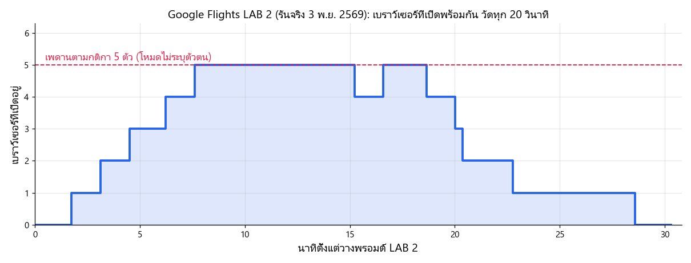

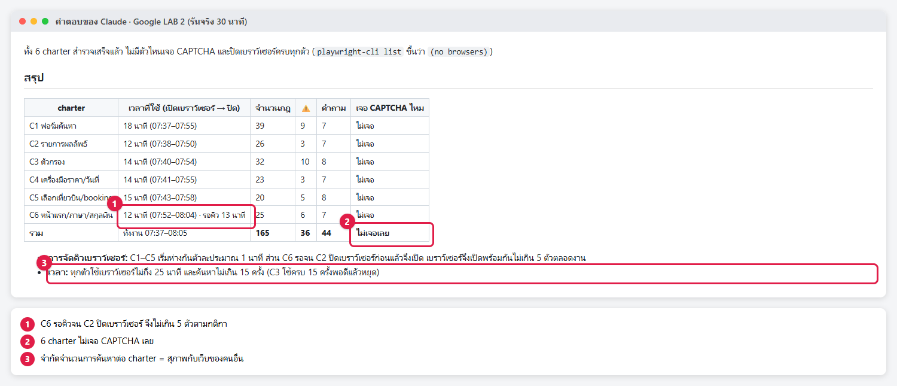

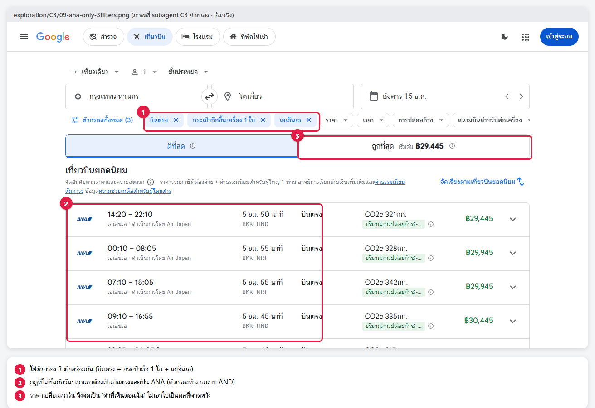

👀 **สังเกต**
- C6 **รอคิว 13 นาที** จน C2 ปิดเบราว์เซอร์ = ทำตามกติกา "ไม่เกิน 5" จริง
- สิ่งที่น่าสงสัย (มุมลูกค้า):

| เรื่อง | สิ่งที่เห็น |
|---|---|
| ตัวกรองสายการบิน | กรอง ANA ในชั้นประหยัด ได้เที่ยวบินการบินไทย **ชั้นธุรกิจ ฿68,445** (ชั้นประหยัดเที่ยวเดียวกัน ฿15,330) |
| หน้า booking | "จองกับ JAL" ฿32,760 อยู่บนสุด เหนือบางกอกแอร์เวย์ส ฿16,405 เที่ยวบินเดียวกัน |
| แท็บ "ถูกที่สุด" | ราคาไม่เรียง 5,900 → 7,635 → 8,755 → 5,900 |
| จำนวนคน | เปลี่ยนเป็น 2 คนแล้วกด Back จอแสดง 2 คน แต่ URL เป็น 1 คน |

- ส่วนที่ถูกต้อง (สำคัญเท่ากัน): C2 ตรวจ 300 แถว **เวลาถึง = เวลาออก + 2 ชม. (เวลาต่างกัน) + ระยะเวลา** ตรงทุกแถว · ตัวกรองซ้อนกันแบบ AND · ล้างตัวกรอง 4 วิธีกลับครบ 24 แถว · สกุลเงินแปลงด้วยอัตราเดียวกัน
- **เกือบผิดกติกา** (AI จดไว้เอง): C4 กดสวิตช์ติดตามราคา → ป๊อปอัปให้ลงชื่อเข้าใช้ ปิดทันที · C5 เปิดกล่องค่าสัมภาระที่มีลิงก์ไปเว็บสายการบิน แต่ไม่กด → อ่านบันทึกของ AI เสมอว่าทำอะไรไปบ้าง

📂 [_solution/exploration/](_solution/exploration/) (C1–C6.md + ภาพ 171 ภาพ)

---

## LAB 3 · รวม + กฎที่ไม่ขึ้นกับวัน + ผู้ตัดสิน 🤖⚖️

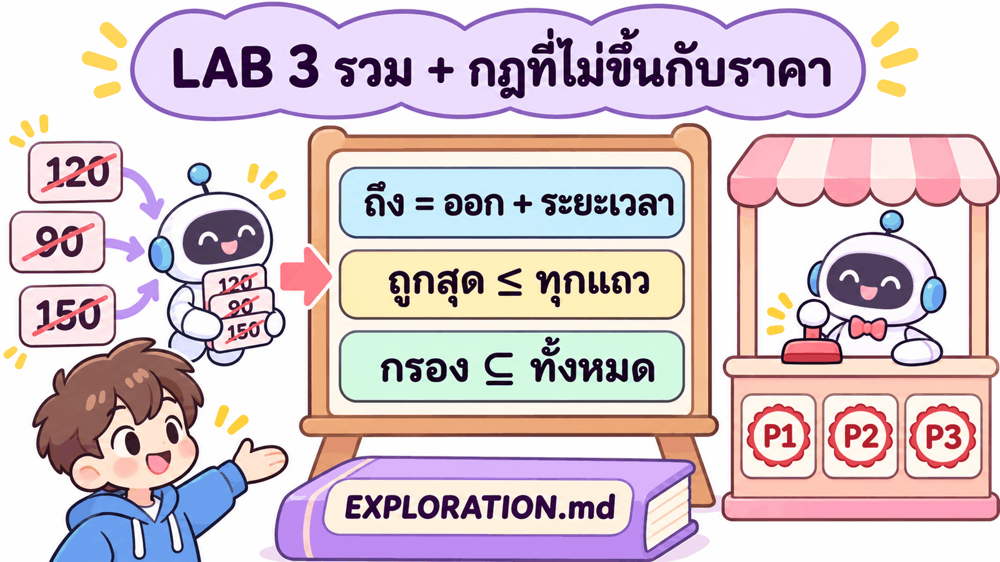

🧑 **คิดก่อน** "เที่ยวบินถูกสุด ฿5,900" ใช้เป็นผลที่คาดหวังได้ไหม ถ้ารันพรุ่งนี้

💬 **พรอมต์**

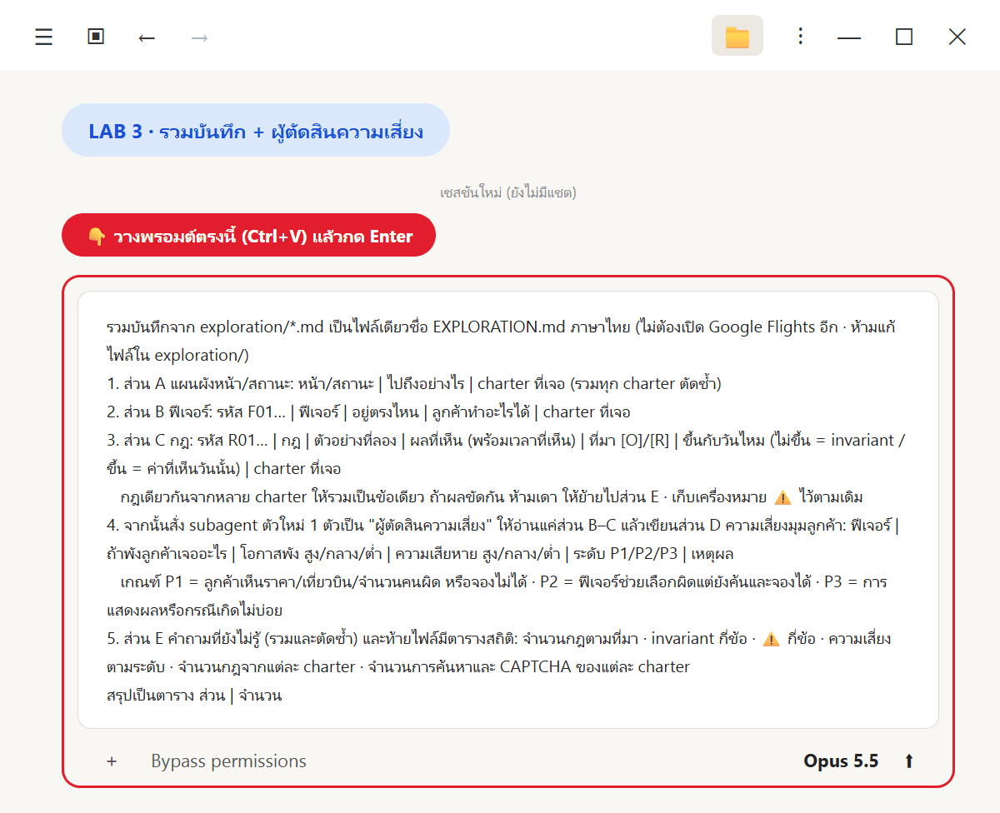

```text
รวมบันทึกจาก exploration/*.md เป็นไฟล์เดียวชื่อ EXPLORATION.md ภาษาไทย (ไม่ต้องเปิด Google Flights อีก · ห้ามแก้ไฟล์ใน exploration/)
1. ส่วน A แผนผังหน้า/สถานะ: หน้า/สถานะ | ไปถึงอย่างไร | charter ที่เจอ (รวมทุก charter ตัดซ้ำ)
2. ส่วน B ฟีเจอร์: รหัส F01… | ฟีเจอร์ | อยู่ตรงไหน | ลูกค้าทำอะไรได้ | charter ที่เจอ
3. ส่วน C กฎ: รหัส R01… | กฎ | ตัวอย่างที่ลอง | ผลที่เห็น (พร้อมเวลาที่เห็น) | ที่มา [O]/[R] | ขึ้นกับวันไหม (ไม่ขึ้น = invariant / ขึ้น = ค่าที่เห็นวันนั้น) | charter ที่เจอ
   กฎเดียวกันจากหลาย charter ให้รวมเป็นข้อเดียว ถ้าผลขัดกัน ห้ามเดา ให้ย้ายไปส่วน E · เก็บเครื่องหมาย ⚠️ ไว้ตามเดิม
4. จากนั้นสั่ง subagent ตัวใหม่ 1 ตัวเป็น "ผู้ตัดสินความเสี่ยง" ให้อ่านแค่ส่วน B–C แล้วเขียนส่วน D ความเสี่ยงมุมลูกค้า: ฟีเจอร์ | ถ้าพังลูกค้าเจออะไร | โอกาสพัง สูง/กลาง/ต่ำ | ความเสียหาย สูง/กลาง/ต่ำ | ระดับ P1/P2/P3 | เหตุผล
   เกณฑ์ P1 = ลูกค้าเห็นราคา/เที่ยวบิน/จำนวนคนผิด หรือจองไม่ได้ · P2 = ฟีเจอร์ช่วยเลือกผิดแต่ยังค้นและจองได้ · P3 = การแสดงผลหรือกรณีเกิดไม่บ่อย
5. ส่วน E คำถามที่ยังไม่รู้ (รวมและตัดซ้ำ) และท้ายไฟล์มีตารางสถิติ: จำนวนกฎตามที่มา · invariant กี่ข้อ · ⚠️ กี่ข้อ · ความเสี่ยงตามระดับ · จำนวนกฎจากแต่ละ charter · จำนวนการค้นหาและ CAPTCHA ของแต่ละ charter
สรุปเป็นตาราง ส่วน | จำนวน
```

| ส่วนของพรอมต์ | มีไว้ทำไม |
|---|---|
| **ไม่ต้องเปิด Google Flights อีก** | ลดภาระเว็บ และผลขัดกันจะไม่ถูก "ลองซ้ำ" จนกลายเป็นค้นหาซ้ำ |
| คอลัมน์ **ขึ้นกับวันไหม** | แยก invariant (ใช้เป็น expected ได้) ออกจากค่าที่เห็นวันนั้น |
| ขัดกันห้ามเดา → ส่วน E | ไม่มี [D] ให้ตัดสิน จึงเก็บเป็นคำถาม |
| เกณฑ์ P1 มุมลูกค้า | ราคา/เที่ยวบิน/จำนวนคนผิด หรือจองไม่ได้ |
| สถิติการค้นหาและ CAPTCHA | รู้ว่าเราใช้เว็บเขาไปเท่าไร |

✅ **ผลจริง (20 นาที)**

| ส่วน | จำนวน |
|---|---|
| A หน้า/สถานะ | 36 |
| B ฟีเจอร์ | 53 (เจอจริง 49 · ไม่พบ 4) |
| C กฎ | 134 (จาก 165) · invariant **127** · ขึ้นกับวัน 7 |
| ที่มา | [O] 111 · [O]+[R] 23 · **[R] ล้วน 0** |
| ⚠️ | 32 |
| D ความเสี่ยง | P1 16 · P2 26 · P3 11 |
| E คำถาม | 37 + ขัดกัน 1 |
| การค้นหาทั้งหมดตอนสำรวจ | 58 ครั้ง (C1 10 · C2 9 · C3 15 · C4 4 · C5 6 · C6 14) · CAPTCHA 0 |

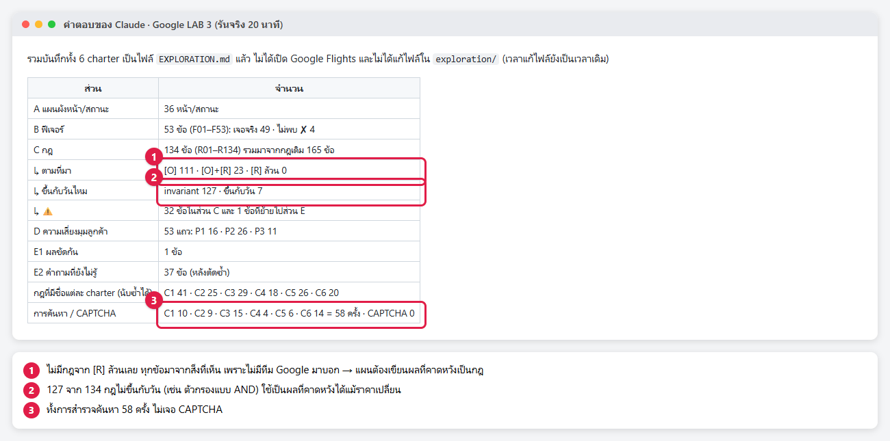

👀 **สังเกต**
- **[R] ล้วน = 0** ทุกกฎมาจากการเห็นเว็บจริง ([O]) แล้วค่อยเทียบกับกฎทั่วไป เพราะเราไม่มีสเปกของ Google
- กฎ 127 ข้อเป็น invariant เช่น "เรียงตามราคาแล้วแถวถัดไป ≥ แถวก่อน" · "ใส่ตัวกรองเพิ่มแล้วจำนวนต้องไม่เพิ่ม" → ใช้ทดสอบได้ทุกวัน
- เทียบกับ PawPantry: ที่นั่นมี [D] 15 ข้อเป็นหลักยึด ที่นี่ไม่มีเลย จึงต้องใช้ invariant แทน

📂 [_solution/EXPLORATION.md](_solution/EXPLORATION.md)

---

## LAB 4 · แผนทดสอบสำหรับเว็บที่เปลี่ยนทุกวัน (≤ 40 ข้อ) 🤖✍️

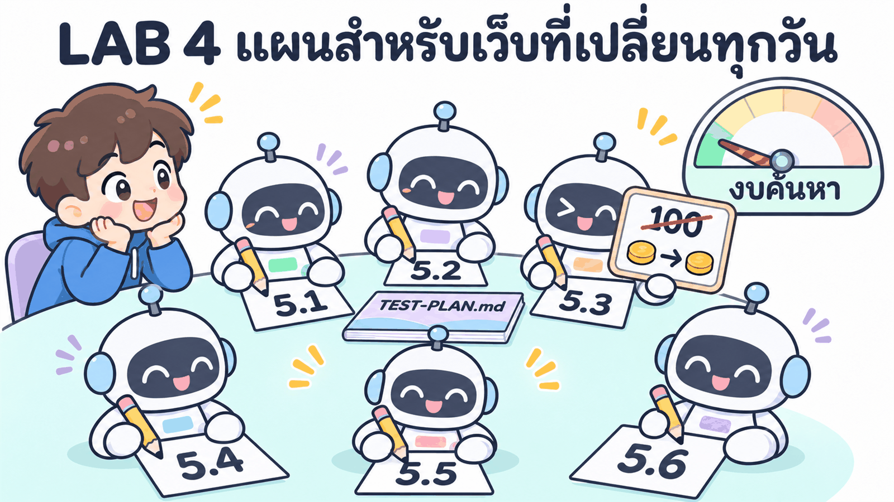

🧑 **คิดก่อน** ถ้า test 1 ข้อต้องค้นหา 1 ครั้ง ทำไมต้องจำกัดที่ 40 ข้อ

💬 **พรอมต์**

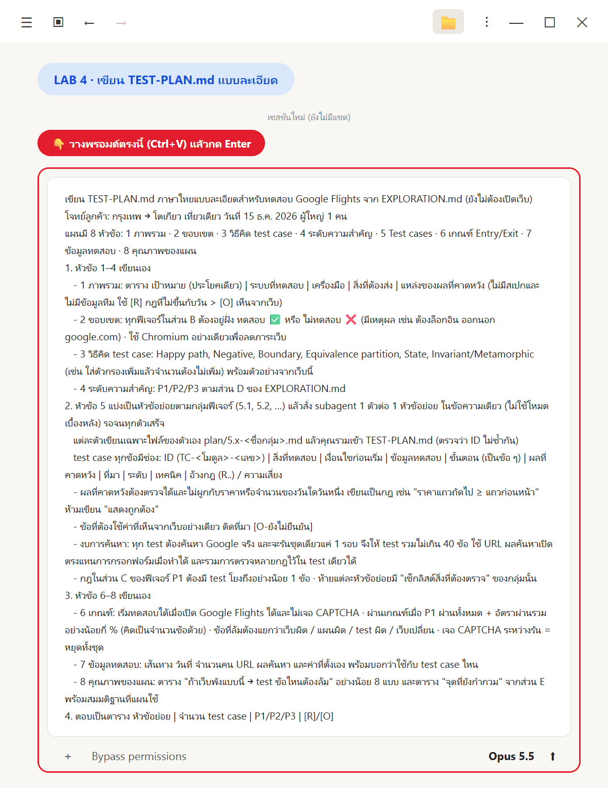

```text
เขียน TEST-PLAN.md ภาษาไทยแบบละเอียดสำหรับทดสอบ Google Flights จาก EXPLORATION.md (ยังไม่ต้องเปิดเว็บ)
โจทย์ลูกค้า: กรุงเทพ → โตเกียว เที่ยวเดียว วันที่ 15 ธ.ค. 2026 ผู้ใหญ่ 1 คน
แผนมี 8 หัวข้อ: 1 ภาพรวม · 2 ขอบเขต · 3 วิธีคิด test case · 4 ระดับความสำคัญ · 5 Test cases · 6 เกณฑ์ Entry/Exit · 7 ข้อมูลทดสอบ · 8 คุณภาพของแผน
1. หัวข้อ 1–4 เขียนเอง
   - 1 ภาพรวม: ตาราง เป้าหมาย (ประโยคเดียว) | ระบบที่ทดสอบ | เครื่องมือ | สิ่งที่ต้องส่ง | แหล่งของผลที่คาดหวัง (ไม่มีสเปกและไม่มีข้อมูลทีม ใช้ [R] กฎที่ไม่ขึ้นกับวัน > [O] เห็นจากเว็บ)
   - 2 ขอบเขต: ทุกฟีเจอร์ในส่วน B ต้องอยู่ฝั่ง ทดสอบ ✅ หรือ ไม่ทดสอบ ❌ (มีเหตุผล เช่น ต้องล็อกอิน ออกนอก google.com) · ใช้ Chromium อย่างเดียวเพื่อลดภาระเว็บ
   - 3 วิธีคิด test case: Happy path, Negative, Boundary, Equivalence partition, State, Invariant/Metamorphic (เช่น ใส่ตัวกรองเพิ่มแล้วจำนวนต้องไม่เพิ่ม) พร้อมตัวอย่างจากเว็บนี้
   - 4 ระดับความสำคัญ: P1/P2/P3 ตามส่วน D ของ EXPLORATION.md
2. หัวข้อ 5 แบ่งเป็นหัวข้อย่อยตามกลุ่มฟีเจอร์ (5.1, 5.2, …) แล้วสั่ง subagent 1 ตัวต่อ 1 หัวข้อย่อย ในข้อความเดียว (ไม่ใช้โหมดเบื้องหลัง) รอจนทุกตัวเสร็จ
   แต่ละตัวเขียนเฉพาะไฟล์ของตัวเอง plan/5.x-<ชื่อกลุ่ม>.md แล้วคุณรวมเข้า TEST-PLAN.md (ตรวจว่า ID ไม่ซ้ำกัน)
   test case ทุกข้อมีช่อง: ID (TC-<โมดูล>-<เลข>) | สิ่งที่ทดสอบ | เงื่อนไขก่อนเริ่ม | ข้อมูลทดสอบ | ขั้นตอน (เป็นข้อ ๆ) | ผลที่คาดหวัง | ที่มา | ระดับ | เทคนิค | อ้างกฎ (R..) / ความเสี่ยง
   - ผลที่คาดหวังต้องตรวจได้และไม่ผูกกับราคาหรือจำนวนของวันใดวันหนึ่ง เขียนเป็นกฎ เช่น "ราคาแถวถัดไป ≥ แถวก่อนหน้า" ห้ามเขียน "แสดงถูกต้อง"
   - ข้อที่ต้องใช้ค่าที่เห็นจากเว็บอย่างเดียว ติดที่มา [O-ยังไม่ยืนยัน]
   - งบการค้นหา: ทุก test ต้องค้นหา Google จริง และจะรันชุดเดียวแค่ 1 รอบ จึงให้ test รวมไม่เกิน 40 ข้อ ใช้ URL ผลค้นหาเปิดตรงแทนการกรอกฟอร์มเมื่อทำได้ และรวมการตรวจหลายกฎไว้ใน test เดียวได้
   - กฎในส่วน C ของฟีเจอร์ P1 ต้องมี test โยงถึงอย่างน้อย 1 ข้อ · ท้ายแต่ละหัวข้อย่อยมี "เช็กลิสต์สิ่งที่ต้องตรวจ" ของกลุ่มนั้น
3. หัวข้อ 6–8 เขียนเอง
   - 6 เกณฑ์: เริ่มทดสอบได้เมื่อเปิด Google Flights ได้และไม่เจอ CAPTCHA · ผ่านเกณฑ์เมื่อ P1 ผ่านทั้งหมด + อัตราผ่านรวมอย่างน้อยกี่ % (คิดเป็นจำนวนข้อด้วย) · ข้อที่ล้มต้องแยกว่าเว็บผิด / แผนผิด / test ผิด / เว็บเปลี่ยน · เจอ CAPTCHA ระหว่างรัน = หยุดทั้งชุด
   - 7 ข้อมูลทดสอบ: เส้นทาง วันที่ จำนวนคน URL ผลค้นหา และค่าที่ตั้งเอง พร้อมบอกว่าใช้กับ test case ไหน
   - 8 คุณภาพของแผน: ตาราง "ถ้าเว็บพังแบบนี้ → test ข้อไหนต้องล้ม" อย่างน้อย 8 แบบ และตาราง "จุดที่ยังกำกวม" จากส่วน E พร้อมสมมติฐานที่แผนใช้
4. ตอบเป็นตาราง หัวข้อย่อย | จำนวน test case | P1/P2/P3 | [R]/[O]
```

| ส่วนของพรอมต์ | มีไว้ทำไม |
|---|---|
| ใช้ Chromium อย่างเดียว | ทดสอบเว็บของคนอื่น ไม่ต้องรับผิดชอบทุกเบราว์เซอร์ และลดภาระ |
| เทคนิค **Invariant/Metamorphic** | ทดสอบได้โดยไม่ต้องรู้ "ราคาที่ถูก" (T9) |
| **ห้ามผูกกับราคาหรือจำนวนของวันใดวันหนึ่ง** | test ต้องผ่าน/ล้มด้วยเหตุผลเดียวกันไม่ว่ารันวันไหน |
| **งบการค้นหา ≤ 40 test · ใช้ URL เปิดตรง** | ค้นหาให้น้อยที่สุด (robots.txt) |
| triage มี "เว็บเปลี่ยน" | เว็บจริงเปลี่ยนป้ายหรือหน้าได้ ไม่ใช่บั๊กเสมอไป |
| CAPTCHA = หยุดทั้งชุด | เกณฑ์ Entry/Exit ที่ต่างจาก PawPantry |

✅ **ผลจริง (28 นาที)** **38 test** · P1 22 · P2 15 · P3 1 · [R] 21 · [O] 17

| หัวข้อย่อย | test |
|---|---|
| 5.1 ฟอร์มค้นหา | 10 |
| 5.2 ผลลัพธ์/จัดอันดับ | 7 |
| 5.3 ตัวกรอง | 7 |
| 5.4 เครื่องมือราคา | 4 |
| 5.5 booking | 6 |
| 5.6 ภาษา/สกุลเงิน/หน้าแรก | 4 |

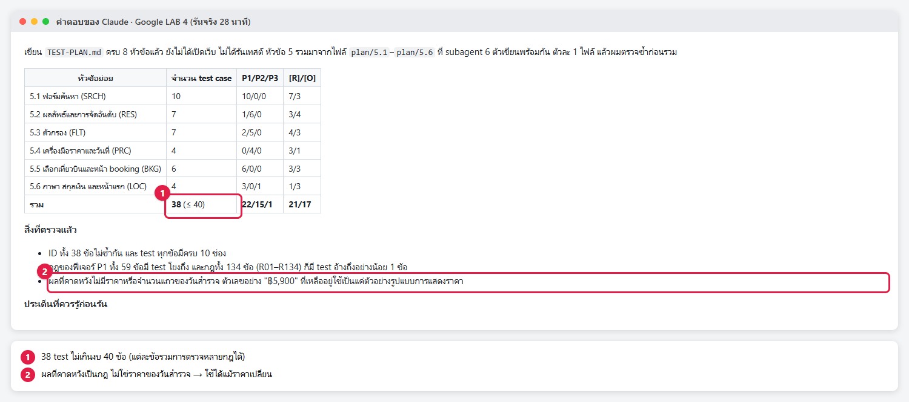

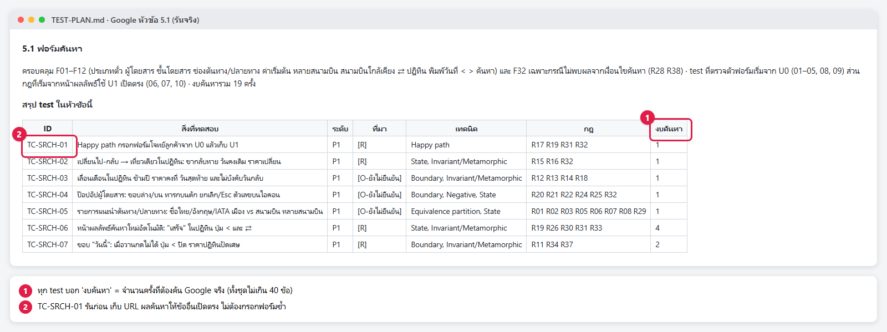

👀 **สังเกต**
- กฎ P1 ทั้ง 59 ข้อมี test โยงถึง และกฎทั้ง 134 ข้อถูกอ้าง แม้มีแค่ 38 test เพราะ 1 test ตรวจหลายกฎ
- **11 test ตรวจข้อ ⚠️ ที่รู้แล้ว** (tag `@known-defect`) คาดว่าจะล้มถ้าเว็บยังเหมือนเดิม
- งบค้นหาทั้งชุด 105 ครั้ง · `TC-SRCH-01` รันก่อนเพื่อเก็บ URL ผลค้นหาให้อีก 32 ข้อเปิดตรงไม่ต้องกรอกฟอร์ม

📂 [_solution/TEST-PLAN.md](_solution/TEST-PLAN.md)

---

## LAB 5 · test Playwright รันกับ Google Flights จริง 1 รอบ 🤖▶️

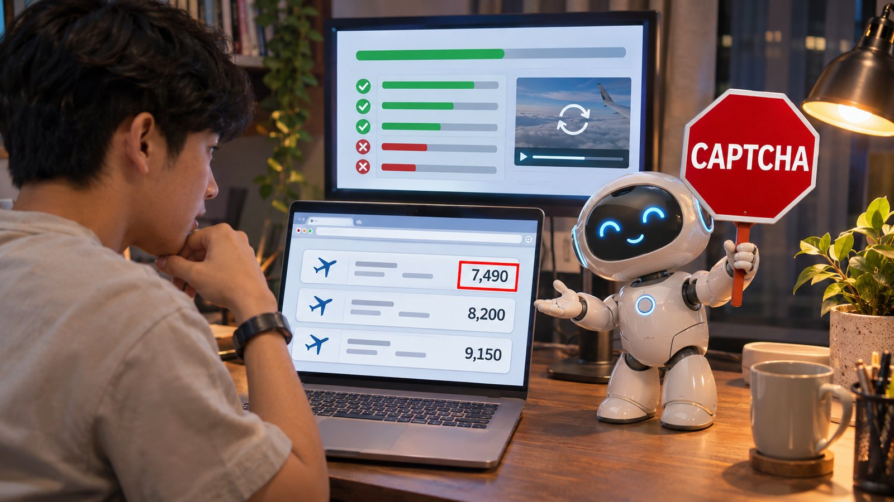

🧑 **คิดก่อน** ถ้า test ล้มเพราะ Google เปลี่ยนชื่อปุ่ม เป็นบั๊กของใคร

> ⚠️ **ก่อนกด Enter** อยู่หน้าเครื่องตลอดการรัน (ประมาณ 1 ชั่วโมง) ถ้า AI บอกว่าเจอ CAPTCHA ให้ **เราแก้เอง** ในหน้าต่างเบราว์เซอร์ แล้วบอกให้ทำต่อ หรือหยุดทั้งชุด

💬 **พรอมต์**

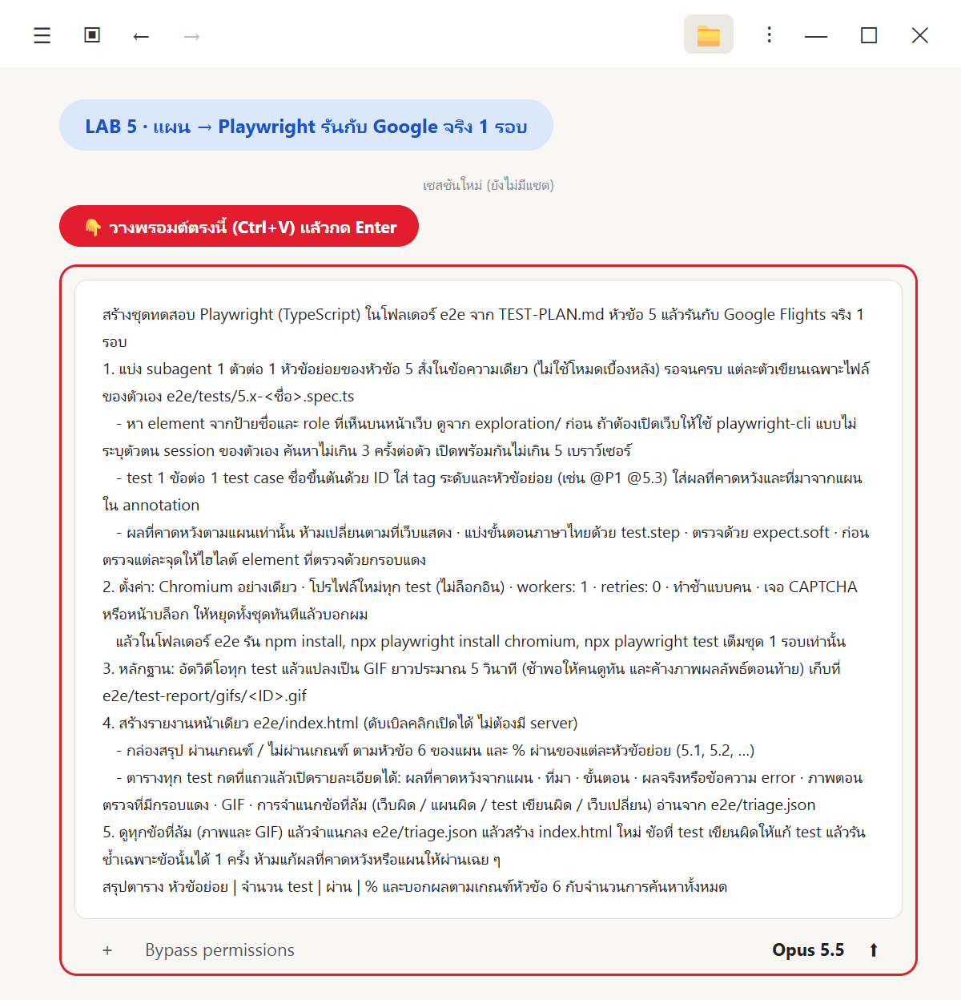

```text
สร้างชุดทดสอบ Playwright (TypeScript) ในโฟลเดอร์ e2e จาก TEST-PLAN.md หัวข้อ 5 แล้วรันกับ Google Flights จริง 1 รอบ
1. แบ่ง subagent 1 ตัวต่อ 1 หัวข้อย่อยของหัวข้อ 5 สั่งในข้อความเดียว (ไม่ใช้โหมดเบื้องหลัง) รอจนครบ แต่ละตัวเขียนเฉพาะไฟล์ของตัวเอง e2e/tests/5.x-<ชื่อ>.spec.ts
   - หา element จากป้ายชื่อและ role ที่เห็นบนหน้าเว็บ ดูจาก exploration/ ก่อน ถ้าต้องเปิดเว็บให้ใช้ playwright-cli แบบไม่ระบุตัวตน session ของตัวเอง ค้นหาไม่เกิน 3 ครั้งต่อตัว เปิดพร้อมกันไม่เกิน 5 เบราว์เซอร์
   - test 1 ข้อต่อ 1 test case ชื่อขึ้นต้นด้วย ID ใส่ tag ระดับและหัวข้อย่อย (เช่น @P1 @5.3) ใส่ผลที่คาดหวังและที่มาจากแผนใน annotation
   - ผลที่คาดหวังตามแผนเท่านั้น ห้ามเปลี่ยนตามที่เว็บแสดง · แบ่งขั้นตอนภาษาไทยด้วย test.step · ตรวจด้วย expect.soft · ก่อนตรวจแต่ละจุดให้ไฮไลต์ element ที่ตรวจด้วยกรอบแดง
2. ตั้งค่า: Chromium อย่างเดียว · โปรไฟล์ใหม่ทุก test (ไม่ล็อกอิน) · workers: 1 · retries: 0 · ทำช้าแบบคน · เจอ CAPTCHA หรือหน้าบล็อก ให้หยุดทั้งชุดทันทีแล้วบอกผม
   แล้วในโฟลเดอร์ e2e รัน npm install, npx playwright install chromium, npx playwright test เต็มชุด 1 รอบเท่านั้น
3. หลักฐาน: อัดวิดีโอทุก test แล้วแปลงเป็น GIF ยาวประมาณ 5 วินาที (ช้าพอให้คนดูทัน และค้างภาพผลลัพธ์ตอนท้าย) เก็บที่ e2e/test-report/gifs/<ID>.gif
4. สร้างรายงานหน้าเดียว e2e/index.html (ดับเบิลคลิกเปิดได้ ไม่ต้องมี server)
   - กล่องสรุป ผ่านเกณฑ์ / ไม่ผ่านเกณฑ์ ตามหัวข้อ 6 ของแผน และ % ผ่านของแต่ละหัวข้อย่อย (5.1, 5.2, …)
   - ตารางทุก test กดที่แถวแล้วเปิดรายละเอียดได้: ผลที่คาดหวังจากแผน · ที่มา · ขั้นตอน · ผลจริงหรือข้อความ error · ภาพตอนตรวจที่มีกรอบแดง · GIF · การจำแนกข้อที่ล้ม (เว็บผิด / แผนผิด / test เขียนผิด / เว็บเปลี่ยน) อ่านจาก e2e/triage.json
5. ดูทุกข้อที่ล้ม (ภาพและ GIF) แล้วจำแนกลง e2e/triage.json แล้วสร้าง index.html ใหม่ ข้อที่ test เขียนผิดให้แก้ test แล้วรันซ้ำเฉพาะข้อนั้นได้ 1 ครั้ง ห้ามแก้ผลที่คาดหวังหรือแผนให้ผ่านเฉย ๆ
สรุปตาราง หัวข้อย่อย | จำนวน test | ผ่าน | % และบอกผลตามเกณฑ์หัวข้อ 6 กับจำนวนการค้นหาทั้งหมด
```

| ส่วนของพรอมต์ | มีไว้ทำไม |
|---|---|
| ดูจาก `exploration/` ก่อน · ค้นหาไม่เกิน 3 ครั้งต่อตัว | ใช้ snapshot ที่มีอยู่แล้วหา locator แทนการค้นหาใหม่ |
| ป้ายชื่อและ role (ไม่ใช่ class) | Google เปลี่ยน class บ่อย แต่ป้ายที่ลูกค้าเห็นเปลี่ยนน้อยกว่า |
| โปรไฟล์ใหม่ทุก test · `workers: 1` · `retries: 0` | ไม่ระบุตัวตน ทีละข้อ ไม่ค้นหาซ้ำอัตโนมัติ |
| **เต็มชุด 1 รอบเท่านั้น** · รันซ้ำเฉพาะข้อที่ test ผิด 1 ครั้ง | ภาระเว็บน้อยที่สุด |
| triage 4 แบบ รวม "เว็บเปลี่ยน" | แยกบั๊กจริงออกจากหน้าเว็บที่เปลี่ยนไปหลังวันสำรวจ |

✅ **ผลจริง (2.1 ชั่วโมง · รันชุดเต็ม 1.0 ชั่วโมง)** ไม่เจอ CAPTCHA · GIF ครบ 38 ข้อ ยาว 5.1 วินาที · **ผลตามเกณฑ์หัวข้อ 6 = ไม่ผ่าน**

| หัวข้อย่อย | test | ผ่าน | % |
|---|---|---|---|
| 5.1 ฟอร์มค้นหา | 10 | 6 | 60% |
| 5.2 ผลลัพธ์และการจัดอันดับ | 7 | 5 | 71.4% |
| 5.3 ตัวกรอง | 7 | 4 | 57.1% |
| 5.4 เครื่องมือราคาและวันที่ | 4 | 2 | 50% |
| 5.5 เลือกเที่ยวบินและหน้า booking | 6 | 2 | 33.3% |
| 5.6 ภาษา สกุลเงิน และหน้าแรก | 4 | 2 | 50% |
| **รวม** | **38** | **21** | **55.3%** |

| เกณฑ์ (หัวข้อ 6) | ผล |
|---|---|
| X1 P1 ผ่านทั้งหมด | ❌ ผ่าน 12 / 22 |
| X2 ผ่านรวม ≥ 85% (33 ข้อ) | ❌ ผ่าน 21 / 38 = 55.3% |
| X3 ทุกจุดตรวจมีภาพกรอบแดง | ✅ 268 จุด |
| X4 ข้อที่ล้มจำแนกครบ | ✅ 16 ข้อ |

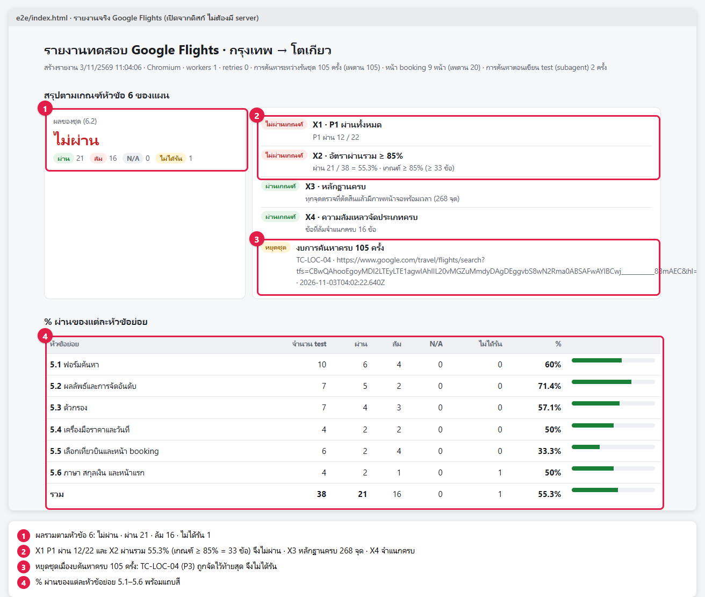

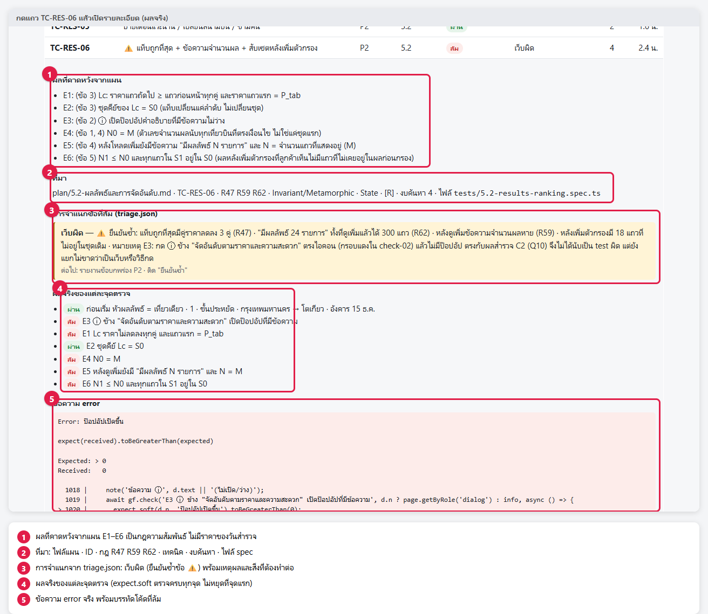

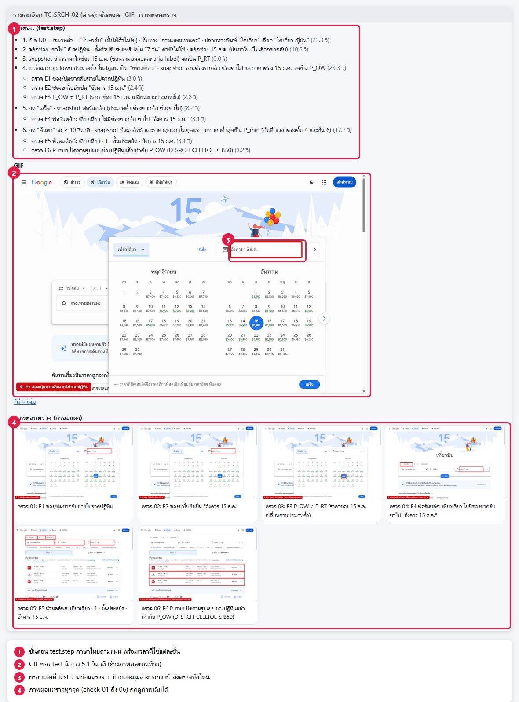

🎞️ **GIF จริง** (5.1 วินาที · กรอบแดง = จุดที่กำลังตรวจ · ป้ายแดงมุมล่างบอกว่าตรวจข้อไหน)

| TC-SRCH-02 ✅ ผ่าน · เปลี่ยนไป-กลับเป็นเที่ยวเดียว | TC-BKG-05 ❌ ล้ม · 2 คนแล้วกด Back |
|---|---|
| 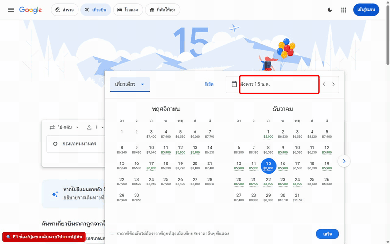 | 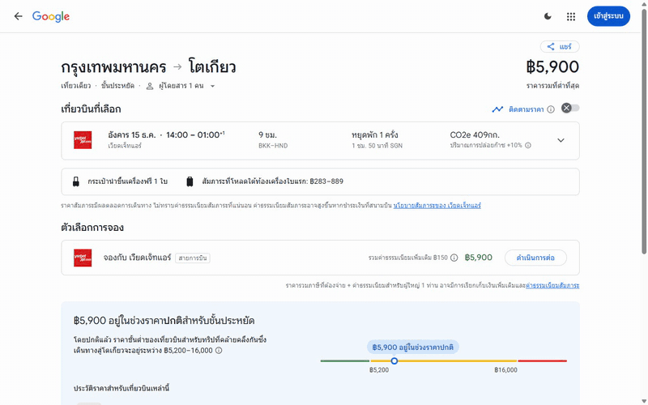 |

### 🔎 ข้อที่ล้ม: จำแนกยังไง (triage.json)

| การจำแนก | จำนวน | ตัวอย่างจริง |
|---|---|---|
| **เว็บผิด** (ยืนยันข้อ ⚠️ จากการสำรวจ) | 11 | "Tokio" ได้ "ไม่พบสถานที่ที่ตรงกัน" · แท็บถูกที่สุดราคาลดลง 3 คู่ · slider ราคาต่ำสุดได้แค่ ฿10,000 ทั้งที่ถูกสุด ฿5,900 · 2 คนแล้วกด Back จอ 2 คน URL 1 คน (฿11,800 แทน ฿5,900) · ภาษาญี่ปุ่นปุ่มสถานที่ตั้งเป็น 地図 (แผนที่) |
| **เว็บผิด** (เรื่องใหม่) | 1 | TC-SRCH-01 ช่องวันที่แสดง "อังคาร 15 ธ.ค." ไม่มีปี ทั้งบนจอและใน aria-label |
| **ยังสรุปไม่ได้** (หน้า error ของ Google) | 4 | เปิด URL ผลค้นหาแล้วได้ "อ๊ะ มีบางอย่างผิดพลาด" ทั้งที่ URL เดียวกันโหลดได้ใน test อื่น → AI จัดเป็นเว็บผิด แต่กฎของข้อนั้น **ยังไม่ได้ตรวจจริง** |
| **test เขียนผิด** (รอบแรก) → แก้แล้วรันซ้ำ 1 ครั้ง | 10 | ป้ายท้ายหน้าคั่นด้วยอักขระซ่อน U+200B ไม่ใช่ "·" · อ่านราคาปฏิทินก่อนโหลดเสร็จ · คลิกโดนของที่บังอยู่ → ผ่าน 6 · ยังล้มเพราะเว็บ/หน้า error 3 · ชนงบค้นหา 1 |

👀 **สังเกต**
- **รอบแรกผ่านแค่ 15 / 38** ล้ม 23 ข้อ ในนั้น 10 ข้อเป็น test เขียนผิด → ตัวเลขรอบแรกยังเชื่อไม่ได้จนกว่าจะ triage ครบ
- AI **ไม่แก้ผลที่คาดหวัง** มีครั้งเดียวที่ subagent เปลี่ยนผลที่คาดหวังของ TC-FLT-05 จาก "(2)" เป็น "(1)" ตัวหลักจับได้และแก้กลับตามแผนก่อนรัน → ต้องมีคนตรวจ diff ของ test เสมอ
- **เว็บเปลี่ยนจากวันสำรวจ**: กฎ R107 และ R115 ใน TC-BKG-06 ที่แผนคาดว่าจะล้ม กลับผ่าน (จดไว้ใน triage) = ข้อ ⚠️ ไม่ใช่บั๊กถาวร
- หน้า error "อ๊ะ มีบางอย่างผิดพลาด" เจอ 5 ครั้งตลอดงาน อาจเป็นการชะลอคำขอแบบเบา ๆ ของ Google (ไม่ใช่ CAPTCHA) → อีกเหตุผลที่ต้องรันน้อยที่สุด
- **การค้นหาทั้งหมด**: รันชุดเต็ม 76 + รันซ้ำ 29 = 105 ครั้ง (ชนเพดานพอดี TC-LOC-04 จึงไม่ได้รัน) + ตอนเขียน/แก้ test 4 ครั้ง · หน้า booking 10 หน้า
- ไม่ผ่านเกณฑ์ ≠ test ไม่ดี: test ทำหน้าที่ของมัน คือ **ยืนยันข้อ ⚠️ ด้วยหลักฐานที่คนอื่นตรวจย้อนได้** (กดแถว → ภาพกรอบแดง + GIF)

📂 รายงานจริง: [_solution/e2e/index.html](_solution/e2e/index.html) (ดาวน์โหลดโฟลเดอร์ `_solution/e2e` แล้วดับเบิลคลิก) · [triage.json](_solution/e2e/triage.json) · [tests/](_solution/e2e/tests/) · วิดีโอเต็ม (.webm) ไม่ได้เก็บใน Git เพราะไฟล์ใหญ่ ลิงก์ "วิดีโอเต็ม" ในรายงานจึงเปิดไม่ได้

---

## 🧹 เก็บกวาด

```bash
playwright-cli close-all
```

## 📂 ไฟล์ในโฟลเดอร์นี้

| ไฟล์ | คืออะไร |
|---|---|
| `KNOWN-FEATURES.md` | ความรู้เดิมจากรุ่นพี่ Week 03 (ชื่อฟีเจอร์ 35 ข้อ ไม่มีกฎ) ใช้ใน LAB 1A |
| `img/` | ภาพประกอบทุก LAB (ภาพผลลัพธ์มาจากการรันจริง) |
| `_solution/` | ผลรันจริงของผู้สอน: CHARTERS · exploration · EXPLORATION · TEST-PLAN · e2e |
