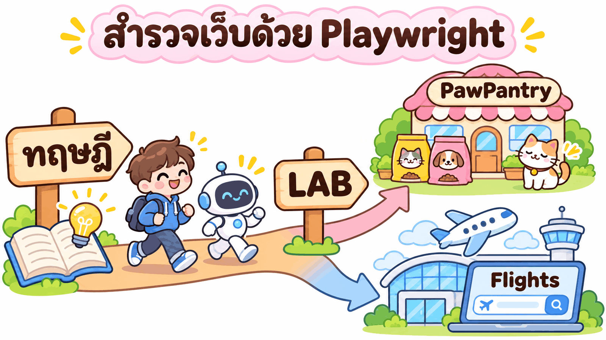
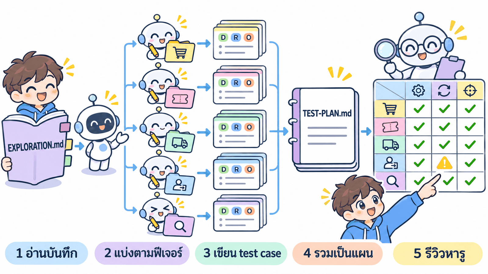
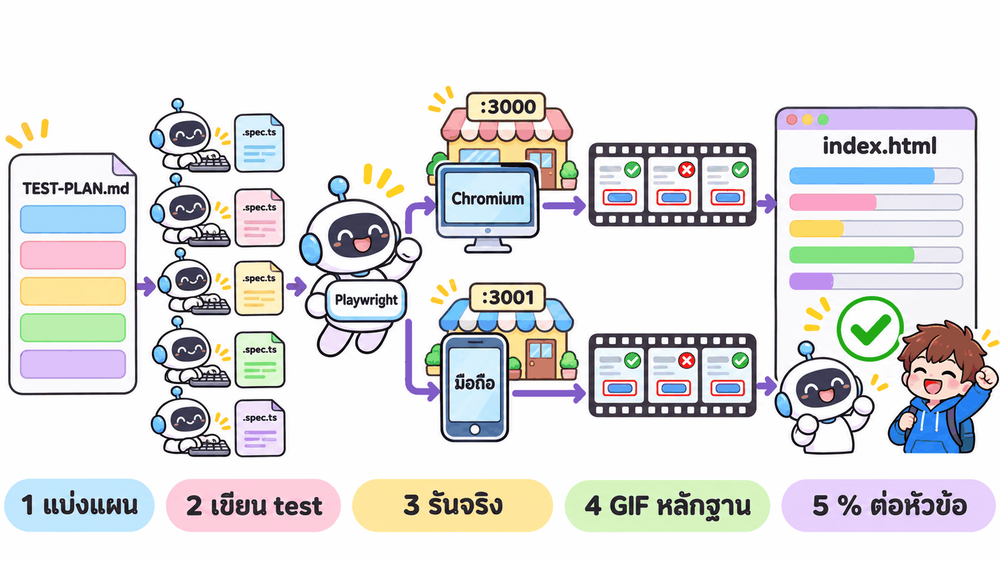

# บท 03 · สำรวจเว็บด้วย Playwright + AI แล้วเขียนแผนทดสอบเอง

งานจริงส่วนใหญ่ **ไม่มีสเปก** tester ต้องเรียนรู้เว็บจากการใช้งาน แล้วตัดสินเองว่าควรทดสอบอะไร และผลแบบไหนถึงนับว่าถูก
บทนี้ให้ AI หลายตัวช่วยกันสำรวจเว็บ **พร้อมกัน คนละส่วน คนละเบราว์เซอร์** แล้วรวมเป็นบันทึกเดียว จัดระดับความเสี่ยง เขียน `TEST-PLAN.md` แบบละเอียด และทดสอบจริงด้วย Playwright พร้อม GIF และรายงานที่กดตรวจย้อนได้ทุกข้อ

## 📚 บทนี้มี 2 ส่วน

| ส่วน | เนื้อหา | เวลาโดยประมาณ |
|---|---|---|
| [**01 ทฤษฎี**](01_theory/README.md) | T1–T12: AI เห็นเว็บแค่ไหน · Playwright 3 แบบ · charter · แบ่ง agent ขนาน · รวมไฟล์ · oracle และการอบบั๊ก · ความเสี่ยง P1/P2/P3 · TEST-PLAN ละเอียด · จากแผนสู่รายงาน | 1.5–2 ชม. |
| [**02 LAB · PawPantry**](02_lab/01_pawpantry/README.md) | เว็บของเราเอง (Docker บนเครื่อง) · LAB 0–7 สำรวจ → รวม → แผน → รีวิว → test จริง Chromium + มือถือ พร้อมกัน → ล่าบั๊ก | ราว 5 ชม. (AI รันจริงรวม ~4.9 ชม. · LAB 6 อย่างเดียว ~2.2 ชม.) |
| [**02 LAB · Google Flights**](02_lab/02_google-flights/README.md) | เว็บจริงของคนอื่น · Playwright อย่างเดียว · ไม่ระบุตัวตน · เปิดพร้อมกันไม่เกิน 5 session · test Chromium อย่างเดียว · LAB 0–5 | ราว 3.5 ชม. (LAB 5 อย่างเดียว 2.1 ชม.) |

## 🤖 agent กระจายงานกันยังไง

| ช่วง | หัวหน้า (เซสชันที่เราวางพรอมต์) | subagent |
|---|---|---|
| สำรวจ | เขียน charter · reset ข้อมูล 1 ครั้ง · รอจนครบ | 1 ตัวต่อ 1 charter · เบราว์เซอร์ของตัวเอง (`playwright-cli -s=<ชื่อ>`) · เขียนไฟล์ของตัวเองทีละข้อ |
| รวม | รวม + ตัดซ้ำ + ลองซ้ำข้อที่ขัดกัน | ผู้ตัดสินความเสี่ยง 1 ตัว อ่านแค่ฟีเจอร์และกฎ |
| เขียนแผน | หัวข้อ 1–4 และ 6–8 · รวม + ตรวจ ID | writer 1 ตัวต่อ 1 หัวข้อย่อยของหัวข้อ 5 |
| รีวิวแผน | รวมผลรีวิว + แก้แผน | ผู้รีวิว 1 ตัวต่อ 1 หัวข้อย่อย (ไม่ใช่คนเขียน) |
| ทดสอบ | ตั้งค่า รัน จำแนกข้อที่ล้ม สร้างรายงาน | writer 1 ตัวต่อ 1 หัวข้อย่อย เขียน spec ของตัวเอง |

## 🧰 เครื่องมือ

| เครื่องมือ | ใช้ทำอะไร | ติดตั้ง |
|---|---|---|
| Claude Code | สั่งงาน AI และ subagent | มีแล้วจากบทก่อน |
| **playwright-cli** (`@playwright/cli`) | AI เปิดเว็บ คลิก อ่าน snapshot · หลาย session พร้อมกัน แยกเบราว์เซอร์ | LAB 0 ติดตั้งให้ |
| Playwright Test | test ที่รันซ้ำได้ + วิดีโอ + รายงาน | LAB 6 (PawPantry) / LAB 5 (Google) |
| Docker Desktop | เปิดเว็บ PawPantry | มีแล้วจากบทก่อน |

> 💡 Playwright MCP แบบ `--extension` (บท 02) ใช้ Chrome ของเรา **1 แท็บ** เหมาะกับให้ AI ดูทีละหน้า แต่ถ้า subagent หลายตัวใช้พร้อมกันจะแย่งแท็บเดียวกัน บทนี้จึงใช้ playwright-cli แทน (ทฤษฎี T2)

## ⚡ ทางลัด

[fast_track/](fast_track/README.md) วางพรอมต์เดียวให้ PawPantry ทำ LAB 0–7 ต่อกันเอง (สำหรับคนที่เข้าใจทฤษฎีแล้ว)

---

*ผลทุกตัวเลขในบทนี้มาจากการรันจริงวันที่ 3 พ.ย. 2569 · แหล่งอ้างอิงทั้งหมดอยู่ใน [01_theory/RESEARCH.md](01_theory/RESEARCH.md)*
