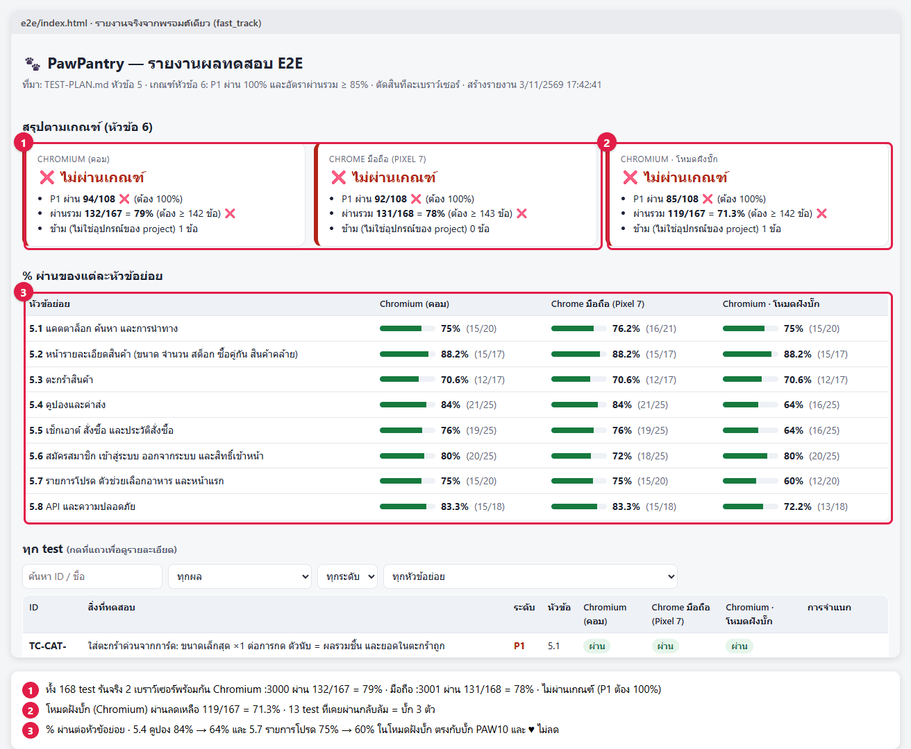

# ⚡ Fast Track · PawPantry LAB 0–7 ในพรอมต์เดียว

งานเดียวกับ [LAB PawPantry](../02_lab/01_pawpantry/README.md) ทั้ง 8 LAB แต่วางพรอมต์ **ครั้งเดียว** แล้ว Claude ทำต่อกันเองจนจบ เหมาะกับคนที่อ่าน[ทฤษฎี](../01_theory/README.md)แล้ว และอยากเห็นภาพรวมทั้งเส้นทางก่อนลงรายละเอียด


## 🧭 พรอมต์ทำอะไรบ้าง

พรอมต์นี้คือพรอมต์ของ LAB 0–7 (LAB 1 ใช้แบบ B) **ตัวเดียวกับในบทเรียน** นำมาต่อกันเป็นขั้น 0–7 แล้วย้ายกติกาที่ซ้ำกัน (ห้ามอ่านโค้ด `petshop/` · ห้ามเปิด `_solution/`) ไปไว้บนสุดครั้งเดียว · ข้อห้ามย่อยเฉพาะ LAB เช่น ห้ามแก้ไฟล์ใน `exploration/` หรือ ขั้น 4–5 ไม่ต้องเปิดเว็บ ตัดออก · Claude ทำทีละขั้น แต่ละขั้นสร้างไฟล์ แล้ว **อ่านไฟล์นั้นก่อนทำขั้นถัดไป** ถ้าสะดุดกลางทาง วางพรอมต์เดิมซ้ำได้ Claude จะข้ามขั้นที่มีไฟล์ครบแล้ว


| ขั้น | = LAB | ใครทำ | ไฟล์ที่ได้ |
|---|---|---|---|
| 0 | เตรียมเครื่องมือ | หัวหน้า | playwright-cli · เว็บ petshop ที่ `:3000` |
| 1 | วางแผนสำรวจ (ลาดตระเวนก่อน) | หัวหน้า | `CHARTERS.md` |
| 2 | สำรวจพร้อมกัน | subagent 1 ตัวต่อ 1 charter · เบราว์เซอร์ของตัวเอง | `exploration/C*.md` |
| 3 | รวม + ผู้ตัดสินความเสี่ยง | หัวหน้า + ผู้ตัดสิน 1 ตัว | `EXPLORATION.md` |
| 4 | เขียนแผนละเอียด | writer 1 ตัวต่อหัวข้อย่อย | `TEST-PLAN.md` · `plan/` |
| 5 | รีวิวแผน | ผู้รีวิว (ไม่ใช่คนเขียน) | `PLAN-REVIEW.md` |
| 6 | test จริง + GIF + รายงาน | writer 1 ตัวต่อหัวข้อย่อย · **Chromium `:3000` + มือถือ `:3001` รันพร้อมกัน** | `e2e/index.html` · `e2e/triage.json` |
| 7 | โหมดฝังบั๊ก | หัวหน้า · Chromium | `BUG-HUNT.md` · `e2e/report-normal/` |

## 🏷️ หัวใจที่พรอมต์บังคับไว้

ไม่มีสเปก จึงต้องบอกที่มาของ "ผลที่คาดหวัง" ทุกข้อ และ **ห้ามลอกค่าจากหน้าจอ** เพราะถ้าเว็บผิดอยู่แล้ว test จะผ่านทั้งที่ผิด (อบบั๊ก · [ทฤษฎี T9](../01_theory/README.md)) ยอดเงินทุกข้อจึงต้องคิดเองจาก `TEST-DATA.md` และแสดงวิธีคิด


| ป้าย | มาจาก | ใช้ได้เมื่อ |
|---|---|---|
| **[D]** | ข้อมูลของทีม (`TEST-DATA.md`) | เชื่อได้มากสุด ใช้ก่อนเสมอ |
| **[R]** | กฎทั่วไปของเว็บขายของ เช่น ยอดเงินต้องตรงกันทุกหน้า | ต้องเขียนเหตุผลกำกับ |
| **[O]** | เห็นจากหน้าเว็บตอนสำรวจ | ต้องติด `[O-ยังไม่ยืนยัน]` และส่งคำถามถึงทีม |

## 🚀 วิธีใช้

1. เตรียมให้พร้อม: Node.js 20+ · **Docker Desktop** เปิดอยู่ · Claude Code (ไม่ต้องใช้ Playwright MCP เพราะขั้น 0 ติดตั้ง playwright-cli ให้)
2. เปิด Claude Code **เซสชันใหม่** ที่โฟลเดอร์ `02_lab/01_pawpantry` (ที่มี `petshop/` และ `TEST-DATA.md`) · พอร์ต 3000 และ 3001 ต้องว่าง
3. คัดลอกพรอมต์ข้างล่างไปวาง แล้วรอ (ตั้งเครื่องไม่ให้หลับ ใช้เวลาหลายชั่วโมง)
4. จบแล้วตรวจผลตามหัวข้อ ✅

> 🔁 จะรันซ้ำ ให้ย้ายไฟล์ผลเดิม (`CHARTERS.md` `exploration/` `EXPLORATION.md` `plan/` `TEST-PLAN.md` `review/` `PLAN-REVIEW.md` `e2e/` `BUG-HUNT.md`) ไปเก็บที่อื่นก่อน ไม่อย่างนั้น Claude จะคิดว่าทำเสร็จแล้วและข้ามไป

## 💬 พรอมต์

```text
ทำงานทดสอบเว็บ PawPantry (http://localhost:3000) ให้จบในครั้งเดียว ตั้งแต่สำรวจจนทดสอบจริง ทำ 8 ขั้นตามลำดับ
กติกาทุกขั้น: ห้ามเปิดอ่านโค้ดใน petshop และห้ามเปิดโฟลเดอร์ _solution หรือ fast_track · ห้ามแก้ผลที่คาดหวังให้ test ผ่านเฉย ๆ
แต่ละขั้นสร้างไฟล์ไว้ อ่านไฟล์นั้นก่อนเริ่มขั้นถัดไป ถ้าไฟล์ของขั้นไหนมีครบแล้ว ให้ข้ามไปทำขั้นถัดไปเลย
งานที่แบ่ง subagent ให้สั่งทุกตัวในข้อความเดียว (ไม่ใช้โหมดเบื้องหลัง) แล้วรอจนครบทุกครั้ง

=== ขั้น 0 เตรียมเครื่องมือ ===
เตรียมเครื่องมือสำรวจแบบขนาน แล้วเปิดเว็บ PawPantry
1. ติดตั้ง playwright-cli: npm install -g @playwright/cli@latest แล้วรัน playwright-cli install --skills ในโฟลเดอร์นี้
2. ลองเปิดเบราว์เซอร์ 2 ตัวพร้อมกัน ชื่อ a และ b (playwright-cli -s=a open https://example.com) แล้ว playwright-cli list ต้องเห็น 2 ตัว จากนั้นปิดทั้งหมด
3. ในโฟลเดอร์ petshop รัน docker compose up -d --build รอจน healthy แล้วเช็กว่า http://localhost:3000/api/health ตอบอะไร
สรุปเป็นตาราง ขั้น | ผล

=== ขั้น 1 วางแผนสำรวจ (ลาดตระเวนก่อน) ===
วางแผนการสำรวจเว็บ http://localhost:3000 ก่อนลงมือ แบบ B ไม่ใช้ความรู้เดิม
1. ใช้ playwright-cli เดินทุกเมนู ทุกลิงก์ในหัวและท้ายเว็บ 1 รอบเร็ว ๆ แบบลาดตระเวน (ไม่กรอกฟอร์ม ไม่สั่งซื้อ) จดว่ามีหน้าอะไรบ้าง
2. จากนั้นอ่าน TEST-DATA.md แล้วเขียน CHARTERS.md ภาษาไทย:
   - แผนผังหน้า: หน้า | URL | ไปถึงจากไหน | เห็นฟีเจอร์อะไร
   - แบ่งเป็น charter 5–7 ข้อ ไม่ทับกัน แต่ละข้อเขียนว่า "สำรวจ <ส่วนไหนของเว็บ> ด้วย <ข้อมูล/เครื่องมือ> เพื่อหา <กฎ ความเสี่ยง>" พร้อม ระดับความเสี่ยงที่เดาไว้ P1/P2/P3 · เวลาที่ให้ (นาที) · สิ่งที่ต้องลองอย่างน้อย 5 ข้อ
   - กติกากันชนกัน เพราะ charter จะถูกแบ่งให้ agent หลายตัวทำพร้อมกันบนเว็บเดียว: อะไรที่เปลี่ยนข้อมูลกลางของเว็บ (สั่งซื้อ ลดสต็อก reset บัญชีเดียวกัน) ให้มีเจ้าของคนเดียว

=== ขั้น 2 สำรวจพร้อมกัน ===
อ่าน CHARTERS.md แล้วแบ่ง subagent 1 ตัวต่อ 1 charter ให้ทำงานพร้อมกัน
1. ก่อนเริ่ม เรียก POST http://localhost:3000/api/test/reset 1 ครั้ง ระหว่างที่ subagent ทำงานห้ามใครเรียกอีก และทุกตัวต้องทำตามกติกากันชนกันใน CHARTERS.md
2. สั่ง subagent ทุกตัวในข้อความเดียว (ไม่ใช้โหมดเบื้องหลัง) แล้วรอจนทุกตัวทำเสร็จ ห้ามจบงานก่อน
3. subagent แต่ละตัวใช้ playwright-cli ด้วย session ของตัวเอง (-s=<รหัส charter>) ห้ามใช้ session ร่วมกัน ใช้เวลาไม่เกิน 30 นาที
4. แต่ละตัวเขียนเฉพาะไฟล์ของตัวเอง exploration/<รหัส charter>.md ภาษาไทย สร้างไฟล์ตั้งแต่เริ่ม แล้วเพิ่มทีละข้อระหว่างทาง (ถ้าโดนหยุดกลางคัน งานที่ทำแล้วไม่หาย)
   หัวไฟล์บอกเวลาเริ่ม-จบ แล้วแบ่ง 5 ส่วน
   A หน้า/สถานะที่เจอ · B ฟีเจอร์ · C กฎ: กฎ | ตัวอย่างที่ลอง | ผลที่เห็น | ที่มา [D] TEST-DATA / [R] กฎทั่วไป / [O] เห็นจากเว็บอย่างเดียว · D ความเสี่ยง · E คำถามถึงทีม
   เก็บภาพหลักฐานไว้ใน exploration/<รหัส charter>/
   ตัวเลขเงินให้คิดเองจาก TEST-DATA ก่อน แล้วค่อยเทียบกับเว็บ ผลที่ขัดกับ TEST-DATA หรือกฎทั่วไปให้ทำเครื่องหมาย ⚠️ ห้ามตัดสินว่าหน้าจอถูกเสมอ
5. เสร็จแล้วปิดเบราว์เซอร์ทั้งหมด แล้วสรุปตาราง charter | เวลาที่ใช้ | จำนวนกฎ | ⚠️ | คำถาม | ปัญหาที่ชนกัน (ถ้ามี)

=== ขั้น 3 รวม + ผู้ตัดสินความเสี่ยง ===
รวมบันทึกจาก exploration/*.md เป็นไฟล์เดียวชื่อ EXPLORATION.md ภาษาไทย
0. ก่อนเริ่ม เรียก POST http://localhost:3000/api/test/reset 1 ครั้ง เพราะข้อมูลกลางของเว็บเปลี่ยนไปตอนสำรวจ (ใช้ตอนต้องลองซ้ำ)
1. ส่วน A แผนผังเว็บ: หน้า | URL | ไปถึงจากไหน | ต้องเข้าสู่ระบบไหม (รวมทุก charter ตัดซ้ำ)
2. ส่วน B ฟีเจอร์: รหัส F01… | ฟีเจอร์ | อยู่หน้าไหน | ลูกค้าทำอะไรได้ | ใส่ข้อมูลอะไรได้ | charter ที่เจอ
3. ส่วน C กฎ: รหัส R01… | กฎ | ตัวอย่างที่ลอง | ผลที่เห็น | ที่มา [D]/[R]/[O] | charter ที่เจอ
   กฎเดียวกันจากหลาย charter ให้รวมเป็นข้อเดียว ถ้าผลขัดกัน ให้ใช้ playwright-cli ลองซ้ำ 1 ครั้ง ถ้ายังไม่แน่ใจให้ย้ายไปส่วน E · เก็บเครื่องหมาย ⚠️ ไว้ตามเดิม
4. จากนั้นสั่ง subagent ตัวใหม่ 1 ตัวเป็น "ผู้ตัดสินความเสี่ยง" ให้อ่านแค่ส่วน B–C แล้วเขียนส่วน D ความเสี่ยง: ฟีเจอร์ | ถ้าพังจะเกิดอะไร | โอกาสพัง สูง/กลาง/ต่ำ | ความเสียหาย สูง/กลาง/ต่ำ | ระดับ P1/P2/P3 | เหตุผล
   เกณฑ์ P1 = ขายของไม่ได้ เงินผิด หรือสิทธิ์/ข้อมูลผิด · P2 = ฟีเจอร์สำคัญผิดแต่ยังซื้อได้ · P3 = การแสดงผลหรือกรณีเกิดไม่บ่อย
5. ส่วน E คำถามถึงทีม (รวมและตัดซ้ำ) และท้ายไฟล์มีตารางสถิติ: จำนวนกฎตามที่มา [D]/[R]/[O] · จำนวน ⚠️ · ความเสี่ยงตามระดับ · จำนวนกฎที่มาจากแต่ละ charter
สรุปเป็นตาราง ส่วน | จำนวน

=== ขั้น 4 เขียน TEST-PLAN.md ===
เขียน TEST-PLAN.md ภาษาไทยแบบละเอียด จาก EXPLORATION.md และ TEST-DATA.md
แผนมี 8 หัวข้อ: 1 ภาพรวม · 2 ขอบเขต · 3 วิธีคิด test case · 4 ระดับความสำคัญ · 5 Test cases · 6 เกณฑ์ Entry/Exit · 7 ข้อมูลทดสอบ · 8 คุณภาพของแผน
1. หัวข้อ 1–4 เขียนเอง
   - 1 ภาพรวม: ตาราง เป้าหมาย (ประโยคเดียว) | ระบบที่ทดสอบ | เครื่องมือ | สิ่งที่ต้องส่ง | แหล่งของผลที่คาดหวัง ([D] TEST-DATA > [R] กฎทั่วไป > [O] เห็นจากเว็บ · ไม่มีสเปก)
   - 2 ขอบเขต: ทุกฟีเจอร์ในส่วน B ต้องอยู่ฝั่ง ทดสอบ ✅ หรือ ไม่ทดสอบ ❌ (มีเหตุผล) · เบราว์เซอร์ใช้แค่ Chromium บนคอม และ Chrome บนมือถือ (Pixel 7) เพื่อประหยัดเวลา ให้แต่ละเบราว์เซอร์รันแยกกันบนเว็บของตัวเอง · ระบุ API ด้วย
   - 3 วิธีคิด test case: 6 เทคนิค Happy path, Negative, Boundary, Equivalence partition, State, Security พร้อมตัวอย่างจากเว็บนี้
   - 4 ระดับความสำคัญ: P1/P2/P3 ตามส่วน D ของ EXPLORATION.md
2. หัวข้อ 5 แบ่งเป็นหัวข้อย่อยตามกลุ่มฟีเจอร์ (5.1, 5.2, …) แล้วสั่ง subagent 1 ตัวต่อ 1 หัวข้อย่อย ในข้อความเดียว (ไม่ใช้โหมดเบื้องหลัง) รอจนทุกตัวเสร็จ
   แต่ละตัวเขียนเฉพาะไฟล์ของตัวเอง plan/5.x-<ชื่อกลุ่ม>.md แล้วคุณรวมเข้า TEST-PLAN.md (ตรวจว่า ID ไม่ซ้ำกัน)
   test case ทุกข้อมีช่อง: ID (TC-<โมดูล>-<เลข>) | สิ่งที่ทดสอบ | เงื่อนไขก่อนเริ่ม | ข้อมูลทดสอบ | ขั้นตอน (เป็นข้อ ๆ) | ผลที่คาดหวัง | ที่มา | ระดับ | เทคนิค | อ้างกฎ (R..) / ความเสี่ยง
   - ผลที่คาดหวังต้องเป็นตัวเลขหรือข้อความที่ตรวจได้ ห้ามเขียน "แสดงถูกต้อง" · ตัวเลขเงินคิดเองจาก TEST-DATA แสดงวิธีคิดในวงเล็บ เช่น (฿189×2 + ส่ง ฿50 = ฿428)
   - ฟีเจอร์ P1 ต้องมีทั้ง Happy และ Negative หรือ Boundary · ใช้ข้อมูลใน TEST-DATA.md ครบทุกแถว
   - กฎในส่วน C ของฟีเจอร์ P1 และ P2 ต้องมี test โยงถึงอย่างน้อย 1 ข้อ (1 test โยงหลายกฎได้)
   - ข้อที่รู้จากหน้าจออย่างเดียว ติดที่มา [O-ยังไม่ยืนยัน] และต้องมีในส่วน E ของ EXPLORATION.md
   - ท้ายแต่ละหัวข้อย่อยมี "เช็กลิสต์สิ่งที่ต้องตรวจ" ของกลุ่มนั้น
3. หัวข้อ 6–8 เขียนเอง
   - 6 เกณฑ์: เริ่มทดสอบได้เมื่อ container petshop healthy และ /api/health ตอบ {"ok":true} · ผ่านเกณฑ์เมื่อ P1 ผ่านทั้งหมด + อัตราผ่านรวมอย่างน้อยกี่ % (คิดเป็นจำนวนข้อด้วย) ตัดสินทีละเบราว์เซอร์
   - 7 ข้อมูลทดสอบ: จาก TEST-DATA + ข้อมูลที่ตั้งเอง พร้อมบอกว่าใช้กับ test case ไหน
   - 8 คุณภาพของแผน: ตาราง "ถ้าเว็บพังแบบนี้ → test ข้อไหนต้องล้ม" อย่างน้อย 8 แบบ และตาราง "จุดที่ยังกำกวม" จากส่วน E พร้อมสมมติฐานที่แผนใช้
4. ตอบเป็นตาราง หัวข้อย่อย | จำนวน test case | P1/P2/P3 | [D]/[R]/[O]

=== ขั้น 5 รีวิวแผน ===
รีวิว TEST-PLAN.md ก่อนเอาไปทดสอบจริง แล้วเขียน PLAN-REVIEW.md ภาษาไทย
1. สั่ง subagent ผู้รีวิว 1 ตัวต่อ 1 หัวข้อย่อยของหัวข้อ 5 ในข้อความเดียว (ไม่ใช้โหมดเบื้องหลัง) แล้วรอจนครบ ผู้รีวิวต้องไม่ใช่คนเขียน
   ให้อ่าน TEST-PLAN.md หัวข้อนั้น + EXPLORATION.md + TEST-DATA.md แล้วตรวจทีละข้อ: ผลที่คาดหวังตรวจได้ไหม · ตัวเลขเงินคิดใหม่เองแล้วตรงไหม · กำกวมไหม · ซ้ำกับข้ออื่นไหม · ขั้นตอนทำตามได้จริงไหม · ระดับและที่มาถูกไหม
   แต่ละตัวเขียนผลเฉพาะไฟล์ของตัวเอง review/5.x.md
2. จากนั้นเขียน PLAN-REVIEW.md
   - Coverage matrix: แถว = ฟีเจอร์ในขอบเขต · คอลัมน์ = 6 เทคนิค · ช่อง = จำนวน test ช่องที่ควรมีแต่ว่างให้ทำเครื่องหมาย ⚠️
   - Traceability: กฎในส่วน C ที่ยังไม่มี test โยงถึง และ test ที่ไม่อ้างกฎ
   - สถิติ: จำนวน test ตามหัวข้อย่อย ระดับ เทคนิค และที่มา [D]/[R]/[O]
   - สิ่งที่ผู้รีวิวเจอ รวมเป็นตาราง ID | ปัญหา | แก้อย่างไร
3. แก้ใน TEST-PLAN.md ให้เลย ยกเว้นเรื่องที่ต้องถามทีม ให้ใส่ไว้ในหัวข้อ 8 แล้วสรุปตาราง ตัวชี้วัด | ก่อนรีวิว | หลังแก้

=== ขั้น 6 test Playwright รันจริง (Chromium + มือถือ พร้อมกัน) + GIF + รายงาน ===
สร้างชุดทดสอบ Playwright (TypeScript) ในโฟลเดอร์ e2e จาก TEST-PLAN.md หัวข้อ 5 แล้วรันจริง
1. แบ่ง subagent 1 ตัวต่อ 1 หัวข้อย่อยของหัวข้อ 5 สั่งในข้อความเดียว (ไม่ใช้โหมดเบื้องหลัง) รอจนครบ แต่ละตัวเขียนเฉพาะไฟล์ของตัวเอง e2e/tests/5.x-<ชื่อ>.spec.ts
   - หา element จาก data-testid หรือป้ายชื่อที่เห็นบนหน้าเว็บ ดูด้วย playwright-cli session ของตัวเอง (-s=<หัวข้อ>) ห้ามรัน npx playwright test ระหว่างที่ตัวอื่นยังเขียนอยู่ (reset จะล้างข้อมูลทั้งเว็บ)
   - test 1 ข้อต่อ 1 test case ชื่อขึ้นต้นด้วย ID ใส่ tag ระดับและหัวข้อย่อย (เช่น @P1 @5.3) ใส่ผลที่คาดหวังและที่มาจากแผนใน annotation
   - ใช้ตัวเลขและข้อความตามแผนเท่านั้น ห้ามเปลี่ยนตามที่เว็บแสดง · แบ่งขั้นตอนภาษาไทยด้วย test.step · ตรวจด้วย expect.soft · ก่อนตรวจแต่ละจุดให้ไฮไลต์ element ที่ตรวจด้วยกรอบแดง
2. เมื่อทุกตัวเขียนเสร็จ ตั้ง project แค่ chromium (คอม) และ mobile-chrome (มือถือ) ตามหัวข้อ 2 ของแผน ให้ 2 เบราว์เซอร์รันพร้อมกันแบบแยกอิสระ บนเว็บของตัวเอง (reset ล้างข้อมูลทั้งเว็บ ถ้าใช้เว็บเดียวกันจะชนกัน)
   - chromium ใช้ petshop เดิมที่พอร์ต 3000 · mobile-chrome ใช้ชุดที่ 2: docker run -d --name petshop2 -p 3001:3000 -e ALLOW_TEST_RESET=1 pawpantry:latest
   - ตั้ง baseURL แยกต่อ project · ก่อนรันเช็ก /api/health และ reset ก่อนทุก test ที่เว็บของ project นั้น (workers: 1 ต่อ project)
   - ในโฟลเดอร์ e2e รัน npm install, npx playwright install chromium แล้วรัน 2 project พร้อมกัน เสร็จแล้วลบ petshop2
3. หลักฐาน: อัดวิดีโอทุก test บน Chromium แล้วแปลงเป็น GIF ยาวประมาณ 5 วินาที (ช้าพอให้คนดูทัน และค้างภาพผลลัพธ์ตอนท้าย) เก็บที่ e2e/test-report/gifs/<ID>.gif
4. สร้างรายงานหน้าเดียว e2e/index.html (ดับเบิลคลิกเปิดได้ ไม่ต้องมี server)
   - กล่องสรุป ผ่านเกณฑ์ / ไม่ผ่านเกณฑ์ ตามหัวข้อ 6 ของแผน แยก chromium / mobile-chrome
   - % ผ่านของแต่ละหัวข้อย่อย (5.1, 5.2, …) แยกทีละเบราว์เซอร์
   - ตารางทุก test กดที่แถวแล้วเปิดรายละเอียดได้: ผลที่คาดหวังจากแผน · ที่มา · ขั้นตอน · ผลจริงหรือข้อความ error · ภาพตอนตรวจที่มีกรอบแดง · GIF · การจำแนกข้อที่ล้ม (เว็บผิด / แผนผิด / test เขียนผิด) อ่านจาก e2e/triage.json
5. ดูทุกข้อที่ล้ม (ภาพและ GIF) แล้วจำแนกลง e2e/triage.json แล้วสร้าง index.html ใหม่ ข้อที่ test เขียนผิดให้แก้ test แล้วรันข้อนั้นซ้ำ ห้ามแก้ผลที่คาดหวังหรือแผนให้ผ่านเฉย ๆ
สรุปตาราง หัวข้อย่อย | จำนวน test | % ผ่าน แต่ละเบราว์เซอร์ และบอกผลตามเกณฑ์หัวข้อ 6

=== ขั้น 7 โหมดฝังบั๊ก (Chromium) ===
เปิดเว็บใหม่ในโหมดฝังบั๊ก แล้วดูว่าแผนของเราจับได้ไหม
1. คัดลอกผลรอบปกติเก็บไว้ที่ e2e/report-normal/ (index.html ผลการรัน triage.json ภาพ และ GIF เพราะรอบใหม่จะเขียนทับ)
2. ในโฟลเดอร์ petshop ตั้ง BUG_MODE=1 แล้ว docker compose up -d รอจน healthy แล้วเช็กว่า data-bug-mode บนหน้าเว็บเป็น 1
3. ในโฟลเดอร์ e2e รัน npx playwright test ทุก test แต่เฉพาะเบราว์เซอร์ Chromium (ประหยัดเวลา)
4. เทียบกับรอบปกติของ Chromium: test ที่ผ่านในรอบปกติแต่ล้มในโหมดฝังบั๊ก = จุดที่บั๊กใหม่โผล่ ดูภาพกรอบแดงและ GIF แล้วจำแนกลง e2e/triage.json แล้วสร้าง index.html ใหม่ ให้มีคอลัมน์ผล ปกติ | ฝังบั๊ก
5. เขียน BUG-HUNT.md ภาษาไทย
   - บั๊กแต่ละตัว: ขั้นตอนทำซ้ำ · ผลที่คาดหวัง · ผลจริง · หลักฐาน (ภาพ/GIF) · ความรุนแรง · test ที่จับได้
   - เทียบกับหัวข้อ 8 ของ TEST-PLAN.md ว่าตรงกับที่ทายไว้ไหม
   - ตาราง "ถ้าเราลอกผลจากหน้าจอวันนี้เป็นผลที่คาดหวัง ([O])": test | ผลที่คาดหวังในแผน (ที่มา) | ค่าที่จะลอกจากจอวันนี้ | ยังจับบั๊กได้ไหม
6. เสร็จแล้วเปิดเว็บกลับเป็นโหมดปกติ BUG_MODE=0 แล้วเช็กว่า data-bug-mode เป็น 0
ห้ามแก้ test หรือแผนให้ผ่านเฉย ๆ · สรุปตาราง บั๊ก | ความรุนแรง | test ที่จับได้ | ทายไว้ในหัวข้อ 8 ไหม

จบแล้วสรุปตารางเดียว: ขั้น | ไฟล์ที่ได้ | ตัวเลขสำคัญ | จุดที่ผู้เรียนควรตรวจเอง
```

## 📊 ผลจริงเมื่อวางพรอมต์นี้ (3 พ.ย. 2569)

รันในโฟลเดอร์ใหม่ที่มีแค่ `petshop/` กับ `TEST-DATA.md` · วางพรอมต์ครั้งเดียว ไม่ได้พิมพ์อะไรเพิ่ม · **ใช้เวลารวม 3.0 ชม.** (14:41 → 17:41)



| ขั้น | ไฟล์ที่ได้ | ตัวเลขสำคัญ |
|---|---|---|
| 0 เตรียมเครื่องมือ | playwright-cli · petshop `:3000` | เปิด 2 session พร้อมกันได้ · `/api/health` → `{"ok":true}` |
| 1 วางแผนสำรวจ | `CHARTERS.md` · `recon/` | 16 หน้า · charter 7 ข้อ · C4 คนเดียวที่สั่งซื้อ |
| 2 สำรวจพร้อมกัน | `exploration/C1–C7.md` + ภาพ | ตัวละ 11–20 นาที · กฎ 194 · ⚠️ 77 · คำถาม 60 |
| 3 รวม + ความเสี่ยง | `EXPLORATION.md` | 40 ฟีเจอร์ · กฎ 165 ([D] 25 · [R] 59 · [O] 81) · ⚠️ 35 · P1 29 · P2 21 · P3 18 · คำถาม 47 |
| 4 เขียนแผน | `TEST-PLAN.md` · `plan/` | 159 test case (P1 99) · ครอบคลุม 38 จาก 40 ฟีเจอร์ |
| 5 รีวิวแผน | `PLAN-REVIEW.md` · `review/` | ปัญหา 119 เรื่อง (สูง 8) · ยอดเงินผิด 0 · แก้แล้วเป็น 168 test case · ฟีเจอร์ที่ไม่มี test 10 → 0 |
| 6 test จริง | `e2e/index.html` · `triage.json` · GIF | 168 test × 2 เบราว์เซอร์พร้อมกัน · Chromium 79% · มือถือ 78% · ไม่ผ่านเกณฑ์ทั้งคู่ |
| 7 โหมดฝังบั๊ก | `BUG-HUNT.md` · `e2e/report-normal/` | 13 test ที่เคยผ่านกลับล้ม → **บั๊ก 3 ตัว ครบ** · แผนหัวข้อ 8 ทายไว้ถูกทั้ง 3 |

- **ขั้น 0–5 ใช้ 1 ชม. 17 นาที · ขั้น 6–7 ใช้ 1 ชม. 43 นาที** ส่วนที่นานคือการรัน test จริง เพราะต้องรันทีละ test ต่อเว็บ
- **ข้อที่ล้ม → triage:** Chromium เว็บผิด 33 · แผนผิด 2 · test เขียนผิด 1 · มือถือ เว็บผิด 33 · แผนผิด 4 · test เขียนผิด 6 (จอมือถือทำให้หาปุ่มไม่เจอ) · test เขียนผิดทั้ง 7 ข้อแก้แล้วรันใหม่ผ่าน **โดยไม่แตะผลที่คาดหวัง**
- **บั๊กที่จับได้:** BUG-1 PAW10 ลด 1% แทน 10% (9 test จับได้) · BUG-2 เบอร์ 9 หลักผ่าน (1 test) · BUG-3 ตัวนับ ♥ ไม่ลด (3 test) · จบแล้วเว็บกลับเป็นโหมดปกติ `data-bug-mode="0"`

**เทียบกับทำทีละ LAB**

| | ทีละ LAB (8 เซสชัน) | fast_track (พรอมต์เดียว) |
|---|---|---|
| เวลา | ราว 4.9 ชม. | 3.0 ชม. |
| test case | 339 (Chromium 325 · มือถือ 20) | 168 (รันครบทั้ง 2 เบราว์เซอร์) |
| บั๊กโหมดฝังบั๊ก | 3 ตัว (จาก 17 test) | 3 ตัว (จาก 13 test) |
| ผู้เรียนเห็นอะไร | ผลทีละขั้น ตรวจก่อนไปต่อได้ | เห็นตอนจบทีเดียว |

→ พรอมต์เดียวเร็วกว่าและจับบั๊กได้ครบเหมือนกัน แต่แผน **บางกว่าครึ่งหนึ่ง** เพราะทั้งหมดอยู่ในเซสชันเดียว และไม่มีจังหวะให้คนตรวจระหว่างทาง

**สิ่งที่ Claude ทำนอกพรอมต์ (บอกเองในตารางสรุป · ต้องอ่านเสมอ)**
- writer หัวข้อ 5.4 รัน `npx playwright test --list` (แค่ดูรายชื่อ ไม่ได้รัน test) ซึ่งพรอมต์ห้ามรันคำสั่งนี้
- ดาวน์โหลด Chromium ของ Playwright 1.56 ไม่ทัน จึงเปลี่ยนเป็น 1.64.1 ที่ใช้ Chromium ในเครื่องได้เลย
- รอบมือถือรอบแรกไม่ได้ผล JSON เพราะภาพหน้าจอฝังในรายงานใหญ่เกิน → แก้ helper ให้เก็บภาพเป็นไฟล์ แล้วรันมือถือใหม่ทั้งชุด
- เริ่มขั้น 7 ที่ `:3000` ระหว่างที่มือถือยังรันอยู่ที่ `:3001` เพื่อประหยัดเวลา (คนละเว็บ คนละโฟลเดอร์ผล จึงไม่ชนกัน)

## ✅ จบแล้วตรวจอะไร


1. **ตารางสรุปท้ายแชต** ดูช่อง "จุดที่ผู้เรียนควรตรวจเอง" ก่อน เพราะเป็นจุดที่ Claude ตัดสินใจแทนคุณ
2. **สุ่มตรวจ `TEST-PLAN.md` 2–3 ข้อเรื่องเงิน** ต้องมีวิธีคิดกำกับ เช่น `฿189×3 = ฿567 − PAW10 ฿57 + ส่ง ฿50 = ฿560` ไม่ใช่ตัวเลขลอย ๆ
3. **เปิดรายงาน 2 ไฟล์** (ดับเบิลคลิกได้) `e2e/report-normal/index.html` = รอบปกติ 2 เบราว์เซอร์ · `e2e/index.html` = เทียบ ปกติ | ฝังบั๊ก กดแถวที่ล้มแล้วดูภาพกรอบแดงกับ GIF ว่าตรวจถูกจุด
4. **อ่าน diff ของ test** ตรงไหนที่ AI ผ่อนการเทียบ หรือแตะผลที่คาดหวัง ต้องมีเหตุผลที่ยอมรับได้
5. แล้วค่อยเปิด [`_solution/`](../02_lab/01_pawpantry/_solution/) ของ LAB เทียบ (ตัวเลขไม่จำเป็นต้องตรง แต่ควรอยู่ในระดับใกล้กัน)

## 🆘 ถ้าสะดุด

| อาการ | ทำอะไร |
|---|---|
| แชตหลุด หรือ Claude หยุดกลางทาง | เปิดเซสชันใหม่ วางพรอมต์เดิมซ้ำ Claude จะทำต่อจากขั้นที่ค้าง |
| Claude จะเปิดโค้ดใน `petshop` หรือ `_solution` | `หยุดก่อน ห้ามอ่านโค้ดใน petshop และห้ามเปิด _solution ให้เรียนรู้จากหน้าเว็บผ่าน playwright-cli เท่านั้น` |
| subagent ทำงานเบื้องหลังแล้วหัวหน้าจบก่อน | `สั่ง subagent ใหม่ในข้อความเดียว ไม่ใช้โหมดเบื้องหลัง แล้วรอจนครบ` (ทฤษฎี T7) |
| port 3001 ถูกใช้อยู่ (ขั้น 6) | `ใช้พอร์ตอื่นที่ว่างสำหรับ petshop2 แล้วแก้ baseURL ของ mobile-chrome ให้ตรง` |
| จบแล้วเว็บยังเป็นโหมดฝังบั๊ก | `ช่วยเปิดเว็บกลับเป็นโหมดปกติ BUG_MODE=0 แล้วเช็กว่า data-bug-mode เป็น 0` |

---

*ผลในหน้านี้มาจากการรันพรอมต์นี้จริงในโฟลเดอร์ใหม่ วันที่ 3 พ.ย. 2569*
