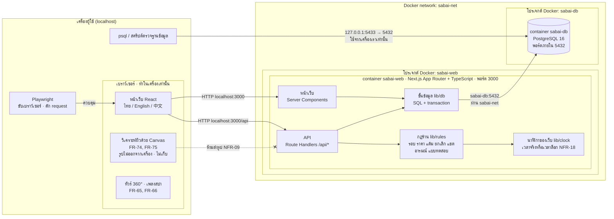
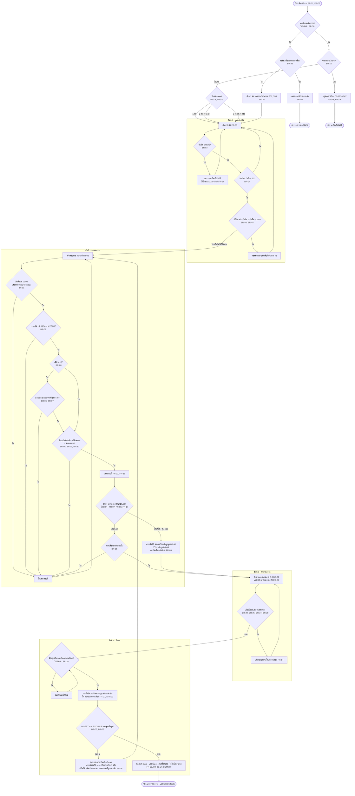
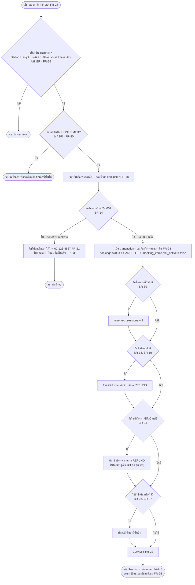
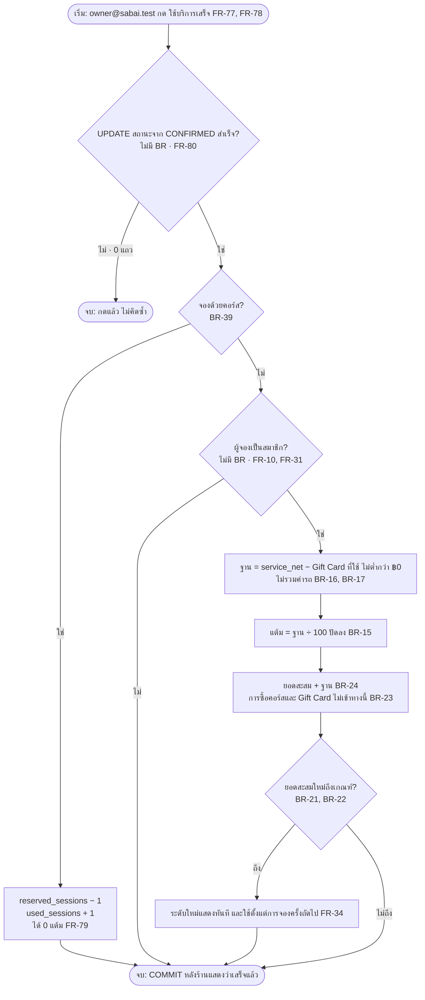
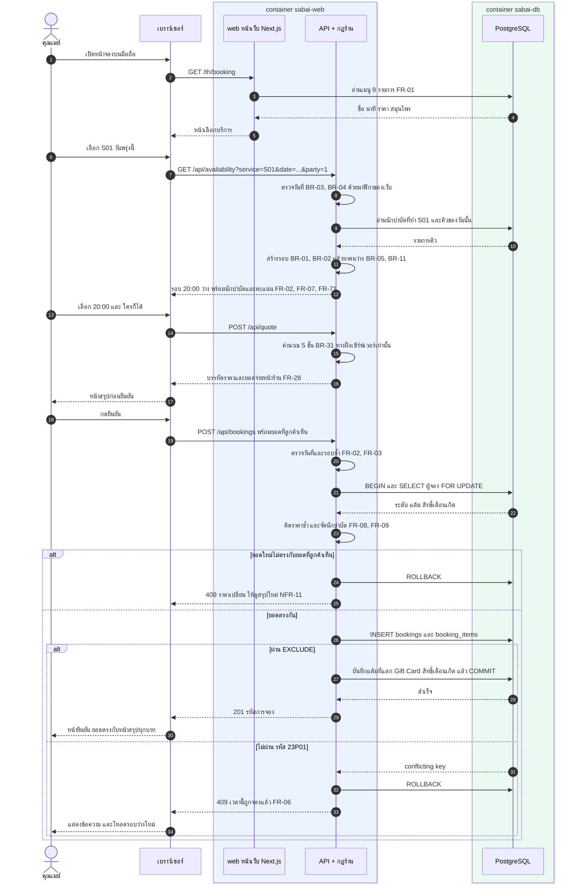
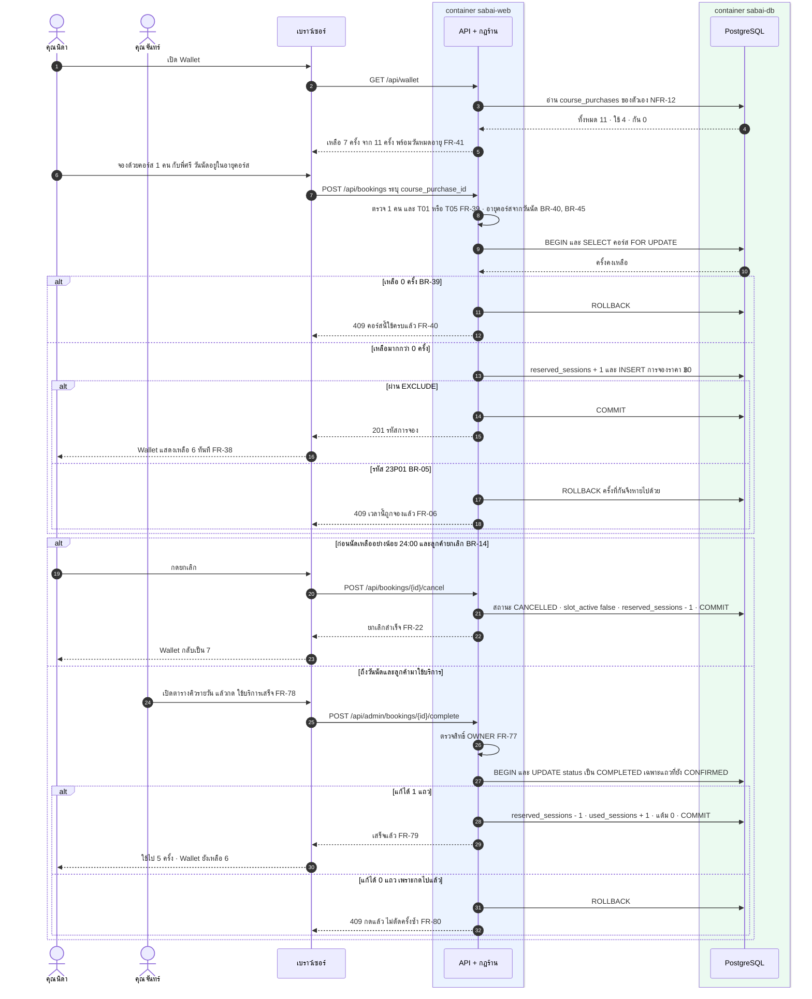
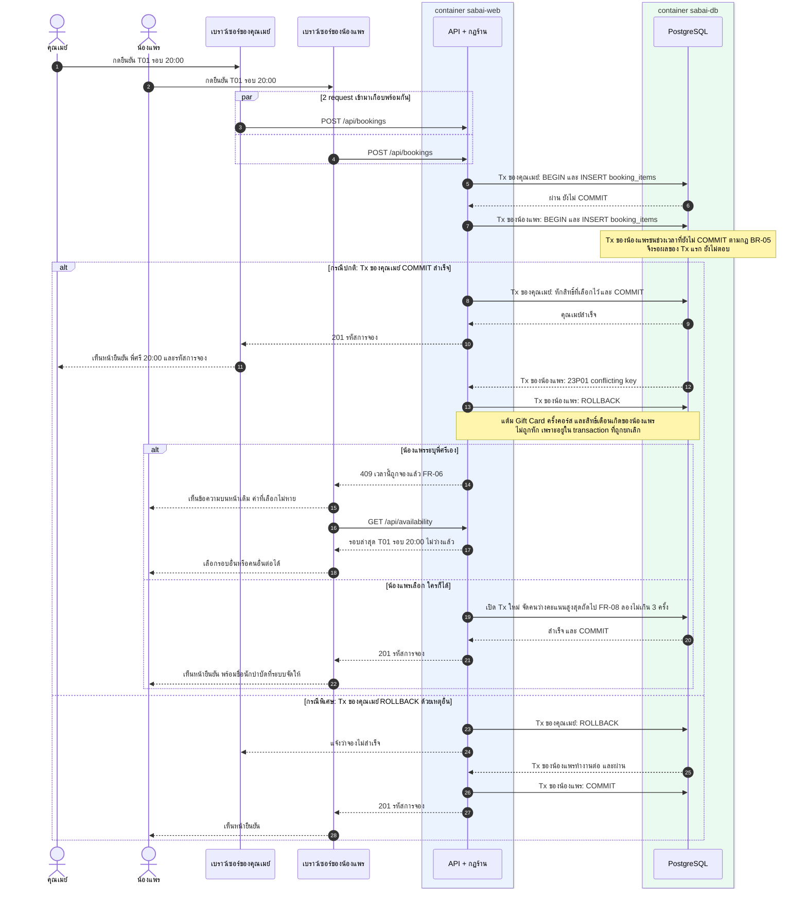

# Design · สบายใจ สปา (Sabai Jai Wellness Spa)

ที่มา: `USER-STORIES.md`, `REQUIREMENTS.md`, `interview/` · ขั้นนี้เป็นแบบเท่านั้น ยังไม่มีโค้ดเว็บ

**วิธีอ่าน**

- ทุกแผนภาพเขียนด้วย Mermaid ในไฟล์นี้ และมีภาพที่ render แล้วอยู่ใน `design/<ชื่อ>.png`
- FR, BR, NFR, A-xx คือรหัสใน `REQUIREMENTS.md` · US-xx คือรหัสใน `USER-STORIES.md` · D-xx คือคำถามในหัวข้อ 6 ของไฟล์นี้
- **"ไม่มี BR · FR-xx"** ในแผนภาพ คือจุดตัดสินใจที่ `REQUIREMENTS.md` ยังไม่มีรหัส BR รองรับ ทีมไม่ตั้งรหัสเอง และสรุปไว้ที่ D-21

---

## 1. System Architecture

<!-- diagram: architecture -->


ภาพ: `design/architecture.png`

| ชั้น | อยู่ที่ไหน | หน้าที่ | ทดสอบด้วยอะไร |
|---|---|---|---|
| หน้าเว็บ (ฝั่งเบราว์เซอร์) | เบราว์เซอร์ในเครื่องผู้ใช้ | แสดงผล 3 ภาษา รับข้อมูลจอง และแสดงยอดที่ API คำนวณให้ ไม่คิดราคาเอง | Playwright ขนาด 375×812 และ 1280 (NFR-01, NFR-03, NFR-07, NFR-19) |
| วิเคราะห์ผิว | เบราว์เซอร์ในเครื่องผู้ใช้ | อ่านรูปลง Canvas คิดความสว่างเฉลี่ย เทียบตาราง แล้วทิ้งรูป | Playwright ดักทุก request และตรวจ localStorage, IndexedDB, Cache (NFR-09) · รันซ้ำ 20 รอบ (NFR-14) |
| ทัวร์ 360° และเพลงสปา | เบราว์เซอร์ในเครื่องผู้ใช้ | หมุนภาพ `pano-couple` · เล่นเพลงเมื่อกดเท่านั้น | Playwright (NFR-04, NFR-10) |
| หน้าเว็บ (ฝั่งเซิร์ฟเวอร์) | container `sabai-web` | สร้างหน้าตามภาษา `/th` `/en` `/zh` ดึงเมนูจากฐานข้อมูล ใช้รูปจาก `brand-kit/` | Playwright · Lighthouse (NFR-02) · สคริปต์เทียบรูป (NFR-06) |
| API | container `sabai-web` | ตรวจสิทธิ์ เรียกกฎร้าน เปิด transaction และแปลง error เป็นข้อความให้ลูกค้า | Playwright ยิง API ตรง (NFR-11, NFR-12) · Vitest ต่อฐานข้อมูลทดสอบ |
| กฎร้าน | container `sabai-web` ใน `lib/rules` | ฟังก์ชันล้วน ไม่แตะฐานข้อมูล รับค่าเข้า คืนผลลัพธ์เดิมเสมอ | Vitest ครบทุกค่าขอบในตาราง BR (ต่ำกว่า / ที่ขอบ / เกินขอบ) · รันซ้ำ 20 รอบ (NFR-14) |
| นาฬิกาและโหมดทดสอบ | container `sabai-web` ใน `lib/clock` + ตาราง `app_settings` | ให้ "ตอนนี้" แบบ Asia/Bangkok แก่ทุกกฎ · ล็อกเวลาและรีเซ็ตข้อมูลเมื่อ `TEST_MODE=true` เท่านั้น | Playwright (NFR-15, NFR-16, NFR-18) · ปิดโหมดแล้ว API ต้องตอบ 404 |
| ชั้นข้อมูล | container `sabai-web` ใน `lib/db` | SQL และ transaction ทั้งหมด ล็อกแถวตามลำดับเดียวกัน | Vitest ต่อฐานข้อมูลทดสอบ |
| ฐานข้อมูล | container `sabai-db` | เก็บข้อมูลจริง และบังคับกฎสุดท้ายด้วย EXCLUDE, UNIQUE, CHECK | สคริปต์ SQL ผ่าน `127.0.0.1:5433` (NFR-13) · Playwright กดจองพร้อมกัน 2 หน้าต่าง |
| เครือข่าย Docker | network `sabai-net` | ให้ 2 โปรเจกต์คุยกันด้วยชื่อ container | เรียก `/api/health` จากเครื่องเรา ต้องตอบว่าต่อ `sabai-db:5432` ได้ |

**อะไรทำที่ไหน**

| ทำในเบราว์เซอร์ | ทำที่เซิร์ฟเวอร์ (`sabai-web`) |
|---|---|
| วิเคราะห์ผิวจากเซลฟี่ (FR-74, FR-75) | ตรวจวันที่และรอบ (FR-02, FR-03) · จับคู่นักบำบัด (FR-07, FR-08) |
| ทัวร์ 360° (FR-65) · เปิดปิดเพลง (FR-66) | คำนวณราคา แต้ม และยอดสะสม (FR-27, FR-79) |
| จำค่าที่เลือกระหว่างขั้นจอง และภาษาที่เลือก | จอง ยกเลิก กดใช้บริการเสร็จ (FR-05, FR-20, FR-79) |
| วาดกราฟรอบเอวจากข้อมูลที่ API ส่งให้ (FR-43) | แชต อารมณ์ แบบทดสอบ ด้วยตารางกฎตายตัว (FR-58, FR-67, FR-69) |
| — | สมัคร เข้าสู่ระบบ และตรวจสิทธิ์หลังร้าน (FR-12, FR-77) |

**ข้อตกลงการเชื่อมต่อ**

- สร้าง network ก่อนครั้งเดียวด้วย `docker network create sabai-net` แล้วทั้ง 2 โปรเจกต์ประกาศเป็น `external: true`
- `sabai-web` ใช้ `DATABASE_URL=postgres://…@sabai-db:5432/sabai` · ห้ามใส่พอร์ต 5433 เพราะพอร์ตนี้มีเฉพาะฝั่งเครื่องเรา
- `sabai-db` เปิดพอร์ตแบบ `127.0.0.1:5433:5432` เครื่องอื่นในเครือข่ายจึงเข้าไม่ได้
- ไม่มีบริการภายนอก: AI ไม่มี (NFR-14) · LINE และ email เป็นการจำลอง (FR-48) · เงินเป็นการจ่ายจำลอง (FR-30)
- เวลาในโค้ดอ่านจาก `lib/clock` เท่านั้น ห้ามใช้ `Date.now()` หรือ `now()` ของ PostgreSQL ในกฎร้าน เพราะ NFR-18 ต้องล็อกเวลาได้ และ container ปกติเป็น UTC

---

## 2. Use Case

Mermaid ไม่มีแผนภาพชนิด Use Case จึงใช้ `flowchart LR` · actor เป็นรูปแคปซูล เพราะ Mermaid รุ่น 12.3 ไม่มีวงรีจริง · ระบบเป็น subgraph · เส้นประคือ "เป็นลูกค้ากลุ่มหนึ่ง" ดังนั้นคนในกลุ่มลูกค้าทุกคนทำ use case ของ "ลูกค้าทุกกลุ่ม" ได้ด้วย

```mermaid
---
config:
  flowchart:
    wrappingWidth: 500
---
flowchart LR
  A1(["พนักงานออฟฟิศ<br/>(คุณเมย์)"])
  A2(["นักท่องเที่ยวจีน<br/>(Mr. Li Wei)"])
  A3(["คู่รัก<br/>(คุณต้น & คุณฝน)"])
  A4(["ลูกค้าทำคอร์ส<br/>(คุณนิดา)"])
  A5(["สาวรักผิว<br/>(น้องแพร)"])
  ALL(["ลูกค้าทุกกลุ่ม<br/>(คุณเมย์, Mr. Li Wei,<br/>คุณต้น & คุณฝน, คุณนิดา, น้องแพร)"])
  OWNER(["เจ้าของร้าน<br/>(คุณจันทร์)"])

  A1 -.-> ALL
  A2 -.-> ALL
  A3 -.-> ALL
  A4 -.-> ALL
  A5 -.-> ALL

  subgraph SYS["ระบบเว็บสบายใจ สปา"]
    subgraph G0["ใช้ร่วมกันทุกกลุ่ม"]
      UC01["UC-01 ดูเมนูและราคา<br/>FR-01"]
      UC02["UC-02 จองคิว 1 คน<br/>FR-02, 03, 04, 05, 06, 07"]
      UC03["UC-03 เลือก ใครก็ได้<br/>FR-08, FR-09"]
      UC07["UC-07 ดูสรุปราคาก่อนยืนยัน<br/>FR-27, 28, 29, 31"]
      UC10["UC-10 ยกเลิกนัดเอง<br/>FR-20, 21, 22, 23, 24, 25"]
      UC12["UC-12 สมัครและเข้าสู่ระบบ<br/>FR-12, FR-13, FR-73"]
      UC25["UC-25 สลับภาษา<br/>FR-56, FR-57"]
      UC28["UC-28 ดูรูปร้านและทีมงาน<br/>FR-61, FR-62"]
      UC31["UC-31 เปิดปิดเพลงสปา<br/>FR-66"]
    end
    subgraph G1["ช่วยเลือกบริการ"]
      UC32["UC-32 เลือกอารมณ์<br/>FR-67, FR-68"]
      UC33["UC-33 ทำแบบทดสอบ<br/>FR-69, FR-70"]
      UC34["UC-34 ดูและกรองรีวิว<br/>FR-71, FR-72"]
    end
    subgraph G2["นักท่องเที่ยว กลุ่ม และแชต"]
      UC04["UC-04 จองโดยไม่สมัครสมาชิก<br/>FR-10, FR-11"]
      UC06["UC-06 จองกลุ่ม 3–6 คน<br/>FR-16, 17, 18, 19"]
      UC11["UC-11 ยกเลิกด้วยรหัสการจองและเบอร์<br/>FR-26"]
      UC23["UC-23 จอง Bangkok Relax<br/>FR-51, FR-52"]
      UC24["UC-24 ขอรถรับส่ง<br/>FR-53, 54, 55"]
      UC26["UC-26 ถามแชต<br/>FR-58, FR-59"]
      UC27["UC-27 จองผ่านแชต<br/>FR-60"]
    end
    subgraph G3["จองคู่ ส่วนลด และ Gift Card"]
      UC05["UC-05 จองคู่ Couple Suite<br/>FR-14, FR-15, FR-17"]
      UC08["UC-08 แลกแต้ม<br/>FR-32"]
      UC09["UC-09 ใช้สิทธิ์เดือนเกิด<br/>FR-33"]
      UC20["UC-20 ซื้อ Gift Card<br/>FR-30, FR-47, FR-50"]
      UC21["UC-21 ส่งทาง LINE หรือ email แบบจำลอง<br/>FR-48"]
      UC22["UC-22 ใช้บัตรจ่ายค่าจอง<br/>FR-49, FR-50"]
      UC30["UC-30 ทัวร์ห้อง 360°<br/>FR-65"]
    end
    subgraph G4["สมาชิก คอร์ส และประวัติ"]
      UC13["UC-13 ดูระดับ ยอดสะสม แต้ม<br/>FR-34, FR-35, FR-36"]
      UC14["UC-14 ซื้อคอร์ส<br/>FR-30, FR-37"]
      UC15["UC-15 จองด้วยคอร์ส<br/>FR-38, 39, 40, 42"]
      UC16["UC-16 ดูคอร์สใน Wallet<br/>FR-41"]
      UC17["UC-17 ดูกราฟรอบเอว<br/>FR-43, FR-44"]
      UC18["UC-18 ดูประวัติทรีตเมนต์<br/>FR-45"]
      UC19["UC-19 ดูรูป before/after<br/>FR-44, FR-46"]
    end
    subgraph G5["สมุนไพรและดูแลผิว"]
      UC29["UC-29 ดูสมุนไพรของบริการ<br/>FR-63, FR-64"]
      UC35["UC-35 วิเคราะห์เซลฟี่ในเครื่อง<br/>FR-74, FR-75"]
      UC36["UC-36 ดูภาพจำลองก่อน/หลัง<br/>FR-76"]
    end
    subgraph G6["หลังร้าน"]
      UC37["UC-37 เข้าสู่หลังร้าน<br/>FR-77"]
      UC38["UC-38 ดูตารางคิวรายวัน<br/>FR-78"]
      UC39["UC-39 กด ใช้บริการเสร็จ<br/>FR-79, FR-80"]
    end
  end

  ALL --- UC01
  ALL --- UC02
  ALL --- UC03
  ALL --- UC07
  ALL --- UC10
  ALL --- UC12
  ALL --- UC25
  ALL --- UC28
  ALL --- UC31
  %% คนที่ขอเรื่องนั้น ๆ โยงตรงกับกลุ่มของตัวเอง เพื่อไม่ให้เส้นไขว้กัน

  A1 --- UC32
  A1 --- UC33
  A1 --- UC34

  A2 --- UC04
  A2 --- UC06
  A2 --- UC11
  A2 --- UC23
  A2 --- UC24
  A2 --- UC26
  A2 --- UC27

  A3 --- UC05
  A3 --- UC08
  A3 --- UC09
  A3 --- UC20
  A3 --- UC21
  A3 --- UC22
  A3 --- UC30

  A4 --- UC13
  A4 --- UC14
  A4 --- UC15
  A4 --- UC16
  A4 --- UC17
  A4 --- UC18
  A4 --- UC19

  A5 --- UC29
  A5 --- UC35
  A5 --- UC36

  UC37 --- OWNER
  UC38 --- OWNER
  UC39 --- OWNER
```

<!-- diagram: use-case -->


ภาพ: `design/use-case.png`

เส้นโยงแสดงคนที่ขอเรื่องนั้นในบันทึกสัมภาษณ์ หรือเป็นผู้ใช้หลักของเรื่องนั้น ไม่ได้แปลว่าคนอื่นใช้ไม่ได้ เช่น สมาชิกทุกคนแลกแต้มได้ · Mr. Li Wei โยงกับการจองแบบไม่สมัครสมาชิกตาม Q7 แต่ §5 ก็มีบัญชีทดสอบของเขาด้วย จึงทดสอบได้ทั้ง 2 แบบ (ดู D-14)

---

## 3. Flowchart

### 3.1 จองคิว

<!-- diagram: flow-booking -->


ภาพ: `design/flow-booking.png`

ขั้นของแผนภาพนี้คือขั้นของระบบ ส่วนขั้นที่ลูกค้าเห็นมี 3 หน้าจอตาม NFR-03 คือ เลือกบริการและจำนวนคน → เลือกวันเวลาและนักบำบัด → สรุปราคา เลือกส่วนลด กรอกข้อมูล และยืนยัน (ดู D-22)

### 3.2 ยกเลิกนัด

<!-- diagram: flow-cancel -->


ภาพ: `design/flow-cancel.png`

### 3.3 คำนวณราคาสุทธิตามลำดับของร้าน

ลำดับ 5 ขั้นมาจาก BR-31 · ทุกขั้นอยู่ในฟังก์ชันเดียวใน `lib/rules` และหน้าจอง แชต และการยืนยันเรียกฟังก์ชันนี้ทั้งหมด (FR-27, NFR-11)

```mermaid
---
config:
  flowchart:
    wrappingWidth: 500
---
flowchart TD
  START(["รับค่า: บริการ จำนวนคน ผู้จอง ตัวเลือกส่วนลด ระยะรถ บัตร<br/>BR-31"]) --> Q_K{"จองด้วยคอร์ส?<br/>ไม่มี BR · FR-38"}

  subgraph STEP1["ขั้น 1 · ราคาเต็ม"]
    Q_K -->|"ใช่"| FULL0["ราคาเต็ม = ฿0<br/>ครั้งคอร์สถูกกันแทน"]
    Q_K -->|"ไม่"| FULL["ราคาเต็ม = ราคาต่อคน × จำนวนคน"]
  end

  subgraph STEP2["ขั้น 2 · ส่วนลด % ที่มากที่สุด 1 อัน"]
    FULL --> Q_P01{"เป็น Bangkok Relax?<br/>BR-30"}
    Q_P01 -->|"ใช่"| PCT0["% = 0"]
    Q_P01 -->|"ไม่"| Q_MEM{"เป็นสมาชิก และถึงระดับ?<br/>BR-21, BR-22"}
    Q_MEM -->|"Gold"| P5["ตัวเลือก 5%"] --> Q_GRP
    Q_MEM -->|"Platinum"| P10["ตัวเลือก 10%"] --> Q_GRP
    Q_MEM -->|"Silver หรือไม่สมัคร"| Q_GRP{"4 คนขึ้นไป?<br/>BR-13"}
    Q_GRP -->|"ใช่"| PG["ตัวเลือก 10%"] --> Q_BD1
    Q_GRP -->|"ไม่"| Q_BD1{"สมาชิกกดเลือกเดือนเกิด<br/>และเดือนของวันนัดตรง?<br/>BR-25"}
    Q_BD1 -->|"ไม่"| MAXP
    Q_BD1 -->|"ใช่"| Q_BD2{"ปีปฏิทินของวันนัด<br/>ยังไม่ใช้สิทธิ์?<br/>BR-26, BR-27"}
    Q_BD2 -->|"ไม่"| MAXP
    Q_BD2 -->|"ใช่"| Q_BD3{"บริการอยู่ใน S01–S07?<br/>BR-28"}
    Q_BD3 -->|"ไม่"| MAXP
    Q_BD3 -->|"ใช่"| PB["ตัวเลือก 20%"] --> MAXP
    MAXP["เลือก % ที่มากที่สุด 1 อัน BR-29"] --> FLOOR
    PCT0 --> FLOOR["หลังส่วนลด = ราคาเต็ม × (1 − %)<br/>เศษสตางค์ปัดลง BR-32"]
  end

  subgraph STEP3["ขั้น 3 · หักแต้ม"]
    FLOOR --> Q_RD{"สมาชิกเลือกแลกแต้ม<br/>และมีอย่างน้อย 100 แต้ม?<br/>BR-18"}
    Q_RD -->|"ไม่"| NET
    Q_RD -->|"ใช่"| Q_SET{"จำนวนเป็นชุดละ 100?<br/>BR-19"}
    Q_SET -->|"ไม่"| REJ_P["ปฏิเสธ ให้เลือกใหม่"]
    Q_SET -->|"ใช่"| Q_CAP{"ส่วนลดจากแต้ม ≤ ยอดหลังส่วนลด?<br/>BR-20"}
    Q_CAP -->|"ไม่"| REJ_P
    Q_CAP -->|"ใช่"| MINUS["หัก ฿50 ต่อชุด"] --> NET["ค่าบริการสุทธิ service_net"]
  end

  subgraph STEP4["ขั้น 4 · บวกค่ารถ"]
    FULL0 --> Q_NEED
    NET --> Q_NEED{"ต้องใช้ระยะรถ?<br/>P01 ทุกครั้ง หรือติ๊กรถรับส่ง<br/>ไม่มี BR · FR-52, FR-53"}
    Q_NEED -->|"ไม่"| F0["ค่ารถ = ฿0"]
    Q_NEED -->|"ใช่"| Q_FMT{"ระยะไม่ติดลบ<br/>ทศนิยมไม่เกิน 1 ตำแหน่ง?<br/>BR-38"}
    Q_FMT -->|"ไม่"| REJ_D["ปฏิเสธ ให้แก้ระยะ"]
    Q_FMT -->|"ใช่"| Q_15{"ไม่เกิน 15.0 กม.?<br/>BR-35, BR-37"}
    Q_15 -->|"ไม่"| REJ_F["แจ้งว่าไม่รับ ก่อนยืนยัน FR-54"]
    Q_15 -->|"ใช่"| Q_INC{"เป็น Bangkok Relax?<br/>BR-37"}
    Q_INC -->|"ใช่"| F0
    Q_INC -->|"ไม่"| Q_5{"ไม่เกิน 5.0 กม.?<br/>BR-34"}
    Q_5 -->|"ใช่"| F0
    Q_5 -->|"ไม่"| F300["จำนวนคัน = จำนวนคน ÷ 4 ปัดขึ้น<br/>ค่ารถ = ฿300 × จำนวนคัน BR-36"]
    F0 --> TOTAL["ยอดก่อนหักบัตร = service_net + ค่ารถ"]
    F300 --> TOTAL
  end

  subgraph STEP5["ขั้น 5 · หัก Gift Card"]
    TOTAL --> Q_GC{"ใส่บัตร และยังไม่หมดอายุ<br/>ณ วันที่ใช้บัตร?<br/>BR-44, BR-45"}
    Q_GC -->|"ไม่ใส่"| PAY
    Q_GC -->|"หมดอายุ"| REJ_G["แจ้งว่าบัตรหมดอายุ"]
    Q_GC -->|"ใช้ได้"| CUT["หักได้ = ค่าน้อยกว่าระหว่างยอดในบัตรกับยอดก่อนหักบัตร<br/>BR-33 · FR-49"] --> PAY
    PAY["จ่ายหน้าร้าน = ยอดก่อนหักบัตร − ที่หัก<br/>ต่ำสุด ฿0 BR-33"]
  end

  PAY --> E_OK(["ส่งบรรทัดให้หน้าสรุป FR-28<br/>ไม่รับเงินออนไลน์ FR-29"])
```

<!-- diagram: flow-price -->


ภาพ: `design/flow-price.png`

ตรวจแผนภาพกับตัวอย่างใน `REQUIREMENTS.md`

| กรณี | ขั้น 1 | ขั้น 2 | ขั้น 3 | ขั้น 4 | ขั้น 5 | จ่ายหน้าร้าน |
|---|---:|---:|---:|---:|---:|---:|
| คุณฝน S04 แลก 200 แต้ม รถ 12 กม. บัตร ฿500 (BR-31) | ฿2,000 | ฿2,000 | ฿1,900 | ฿2,200 | −฿500 | ฿1,700 |
| Mr. Li Wei 4 คน S01 รถ 12 กม. (US-26) | ฿4,000 | ฿3,600 | ฿3,600 | ฿3,900 | — | ฿3,900 |
| คุณต้น S01 เลือกเดือนเกิด (US-13) | ฿1,000 | ฿800 | ฿800 | ฿800 | — | ฿800 |
| Platinum กลุ่ม 4 คน S01 (BR-29) | ฿4,000 | ฿3,600 | ฿3,600 | ฿3,600 | — | ฿3,600 |
| Bangkok Relax 2 คน Platinum 15.0 กม. (BR-30, BR-37) | ฿5,800 | ฿5,800 | ฿5,800 | ฿5,800 | — | ฿5,800 |

### 3.4 ร้านกด "ใช้บริการเสร็จ"

เพิ่มจากที่ขอ เพราะแต้ม ยอดสะสม และการตัดครั้งคอร์สเกิดที่จุดนี้ และรูป 3.3 ไม่ครอบคลุม

<!-- diagram: flow-complete -->


ภาพ: `design/flow-complete.png`

---

## 4. ERD

```mermaid
erDiagram
  users |o--o{ bookings : "จอง ไม่สมัครเป็น NULL"
  users ||--o{ course_purchases : "ซื้อคอร์ส"
  users ||--o{ point_transactions : "มีรายการแต้ม"
  users ||--o{ birthday_redemptions : "ใช้สิทธิ์เดือนเกิด"
  users |o--o{ gift_cards : "ซื้อบัตร"
  users ||--o{ waist_measurements : "มีผลวัด"
  users ||--o{ before_after_photos : "มีรูป"
  services ||--o{ bookings : "ถูกจอง"
  services ||--o{ course_purchases : "ขายเป็นคอร์ส"
  services ||--o{ service_herbs : "ใช้"
  herbs ||--o{ service_herbs : "อยู่ใน"
  services ||--o{ therapist_services : "ทำโดย"
  therapists ||--o{ therapist_services : "ทำได้"
  therapists ||--o{ therapist_reviews : "มีรีวิวเก่า"
  therapists ||--o{ booking_items : "รับคิว"
  bookings ||--|{ booking_items : "มีคนละ 1 แถว"
  hotels |o--o{ bookings : "รับส่ง"
  course_purchases |o--o{ bookings : "ใช้จอง"
  gift_cards |o--o{ bookings : "ใช้จ่าย"
  gift_cards ||--o{ gift_card_transactions : "มีรายการ"
  bookings |o--o{ gift_card_transactions : "เกิดจาก"
  bookings |o--o{ point_transactions : "เกิดจาก"
  bookings |o--o{ birthday_redemptions : "ใช้สิทธิ์"

  users {
    UUID id PK
    TEXT email UK "owner@sabai.test เป็น OWNER"
    TEXT password_hash "NFR-13"
    TEXT role "CUSTOMER หรือ OWNER"
    TEXT full_name
    TEXT phone
    DATE birth_date "FR-13 ลูกค้าแก้เองไม่ได้"
    NUMERIC lifetime_spend "NUMERIC(12,2) ยอดสะสม ≥ 0"
    INTEGER points_balance "INTEGER แต้มคงเหลือ ≥ 0"
  }
  services {
    CHAR(3) id PK "S01-S07 P01 K01"
    TEXT kind "SERVICE PACKAGE COURSE"
    TEXT name_th
    TEXT name_en
    TEXT name_zh
    SMALLINT duration_minutes "60 90 120"
    NUMERIC price "NUMERIC(10,2) ราคาต่อคน K01 ราคาต่อคอร์ส"
  }
  herbs {
    SERIAL id PK
    TEXT name_th
    TEXT name_en
    TEXT name_zh
    TEXT image_path
  }
  service_herbs {
    CHAR(3) service_id PK,FK
    INTEGER herb_id PK,FK
  }
  therapists {
    CHAR(3) id PK "T01-T06 ไม่มีน้องบัว"
    TEXT name_th
    TEXT name_en
    TEXT name_zh
    TEXT title
    TEXT photo_path
  }
  therapist_services {
    CHAR(3) therapist_id PK,FK
    CHAR(3) service_id PK,FK
  }
  therapist_reviews {
    SERIAL id PK
    CHAR(3) therapist_id FK
    SMALLINT stars "1-5 เฉลี่ยด้วย ROUND ของ NUMERIC BR-48"
  }
  hotels {
    CHAR(3) id PK "H01-H06"
    TEXT name_th
    TEXT name_en
    TEXT name_zh
    NUMERIC distance_km "NUMERIC(4,1)"
  }
  bookings {
    UUID id PK
    TEXT booking_code UK "FR-26"
    UUID user_id FK "NULL เมื่อไม่สมัคร"
    TEXT guest_name
    TEXT guest_phone
    CHAR(3) service_id FK
    TEXT booking_type "SINGLE COUPLE GROUP"
    SMALLINT party_size "CHECK 1-6"
    TIMESTAMPTZ start_at
    TIMESTAMPTZ end_at
    TSTZRANGE period "สร้างจาก start_at end_at แบบ [ )"
    BOOLEAN is_couple_suite "EXCLUDE ห้องซ้อน BR-06"
    TEXT status "CONFIRMED COMPLETED CANCELLED"
    NUMERIC full_price "NUMERIC(10,2) ขั้น 1"
    SMALLINT discount_percent "0 5 10 20"
    TEXT discount_source "NONE TIER GROUP BIRTHDAY"
    NUMERIC discount_amount "NUMERIC(10,2) ขั้น 2"
    INTEGER points_redeemed "INTEGER แต้มที่แลก"
    NUMERIC points_discount "NUMERIC(10,2) ขั้น 3"
    NUMERIC service_net "NUMERIC(10,2) ฐานแต้ม"
    CHAR(3) hotel_id FK
    NUMERIC distance_km "NUMERIC(4,1) BR-38"
    SMALLINT cars "BR-36"
    NUMERIC transport_fee "NUMERIC(10,2) ขั้น 4"
    UUID gift_card_id FK
    NUMERIC gift_card_amount "NUMERIC(10,2) ขั้น 5"
    NUMERIC pay_at_shop "NUMERIC(10,2) ≥ 0"
    UUID course_purchase_id FK
    INTEGER points_earned "INTEGER ได้ตอนกดเสร็จ"
    TIMESTAMPTZ completed_at "FR-80"
  }
  booking_items {
    UUID id PK
    UUID booking_id FK
    SMALLINT person_no "1-6"
    CHAR(3) therapist_id FK
    TSTZRANGE period "EXCLUDE ซ้อนนักบำบัด BR-05"
    BOOLEAN slot_active "false เมื่อยกเลิก"
  }
  course_purchases {
    UUID id PK
    UUID user_id FK
    CHAR(3) service_id FK "K01"
    NUMERIC price_paid "NUMERIC(10,2) ฿15000 ไม่มี % BR-46"
    SMALLINT total_sessions "SMALLINT จำนวนครั้งทั้งหมด 11"
    SMALLINT used_sessions "SMALLINT ใช้จริงแล้ว"
    SMALLINT reserved_sessions "SMALLINT กันไว้รอวันนัด"
    DATE purchased_on "วันที่ 0 BR-45"
    DATE expires_on "วันซื้อ + 180 BR-40"
    TEXT payment_status "SIMULATED FR-30"
  }
  gift_cards {
    UUID id PK
    TEXT code UK
    UUID buyer_user_id FK "NULL เมื่อไม่สมัคร"
    TEXT design "ORCHID LOTUS GOLD"
    NUMERIC initial_value "NUMERIC(10,2) CHECK 500-10000 จำนวนเต็ม BR-41 BR-42 BR-43"
    NUMERIC balance "NUMERIC(10,2) ≥ 0 FR-49"
    DATE purchased_on "วันที่ 0 BR-45"
    DATE expires_on "วันซื้อ + 365 BR-44"
    TEXT delivery_channel "LINE EMAIL จำลอง FR-48"
    TEXT payment_status "SIMULATED FR-30"
  }
  gift_card_transactions {
    UUID id PK
    UUID gift_card_id FK
    UUID booking_id FK
    TEXT type "REDEEM REFUND"
    NUMERIC amount "NUMERIC(10,2) มากกว่า 0"
  }
  point_transactions {
    UUID id PK
    UUID user_id FK
    UUID booking_id FK
    TEXT type "EARN REDEEM REFUND"
    INTEGER points "INTEGER บวกหรือลบ"
  }
  birthday_redemptions {
    UUID id PK
    UUID user_id FK
    SMALLINT benefit_year "ปีของวันนัด BR-27"
    UUID booking_id FK "NULL เฉพาะข้อมูลตั้งต้น"
    TIMESTAMPTZ released_at "NOT NULL เมื่อคืนสิทธิ์"
  }
  waist_measurements {
    UUID id PK
    UUID user_id FK
    DATE measured_on
    NUMERIC waist_cm "NUMERIC(4,1) FR-43"
  }
  before_after_photos {
    UUID id PK
    UUID user_id FK
    TEXT kind "BEFORE AFTER"
    DATE taken_on
    TEXT file_path "เฉพาะรูปร่างกาย FR-46"
  }
  app_settings {
    TEXT key PK "locked_now"
    TEXT value "NFR-18"
  }
```

<!-- diagram: erd -->


ภาพ: `design/erd.png`

Mermaid เขียนจุลภาคในช่องชนิดข้อมูลไม่ได้ จึงระบุ `NUMERIC(10,2)` ไว้ในช่องหมายเหตุ · ชนิดจริงของคอลัมน์สำคัญคือตารางนี้

| เรื่อง | คอลัมน์ | ชนิดข้อมูล | ข้อบังคับในฐานข้อมูล |
|---|---|---|---|
| เงิน | `services.price`, `bookings.full_price`, `discount_amount`, `points_discount`, `service_net`, `transport_fee`, `gift_card_amount`, `pay_at_shop` | `NUMERIC(10,2)` | `CHECK (ค่า >= 0)` |
| เงิน | `users.lifetime_spend` | `NUMERIC(12,2)` | `CHECK (lifetime_spend >= 0)` |
| เงิน | `gift_cards.initial_value` | `NUMERIC(10,2)` | `CHECK (initial_value BETWEEN 500 AND 10000 AND initial_value = trunc(initial_value))` (BR-41, BR-42, BR-43) |
| เงิน | `gift_cards.balance` | `NUMERIC(10,2)` | `CHECK (balance >= 0 AND balance <= initial_value)` |
| เงิน | `gift_card_transactions.amount`, `course_purchases.price_paid` | `NUMERIC(10,2)` | `CHECK (ค่า > 0)` |
| แต้ม | `users.points_balance`, `bookings.points_redeemed`, `bookings.points_earned` | `INTEGER` | `CHECK (ค่า >= 0)` · `points_redeemed % 100 = 0` (BR-19) |
| แต้ม | `point_transactions.points` | `INTEGER` | บวกเมื่อได้หรือคืน ลบเมื่อแลก |
| ครั้งคอร์ส | `course_purchases.total_sessions`, `used_sessions`, `reserved_sessions` | `SMALLINT` | `CHECK (used_sessions >= 0 AND reserved_sessions >= 0 AND used_sessions + reserved_sessions <= total_sessions)` |
| ระยะและรอบเอว | `hotels.distance_km`, `bookings.distance_km`, `waist_measurements.waist_cm` | `NUMERIC(4,1)` | ไม่ใช้ float เพราะต้องเทียบ 5.0, 5.1, 15.0, 15.1 ตรงตัว |

**เงินไม่ใช้ float** เพราะเลขฐานสองเก็บทศนิยมบางค่าไม่ตรง ยอดจึงอาจคลาด ฿0.01 และผิด NFR-11 · ฝั่งโค้ด driver ส่ง `NUMERIC` มาเป็นข้อความ `lib/rules` จึงคิดเป็นสตางค์แบบจำนวนเต็ม ไม่แปลงเป็น `number` ที่มีทศนิยม

**จำนวนคงเหลือของคอร์ส** = `total_sessions − used_sessions − reserved_sessions` · เดินตาม US-17 และ US-40 ได้ดังนี้

| เหตุการณ์ของคุณนิดา | ทั้งหมด | ใช้จริง | กันไว้ | Wallet แสดงเหลือ |
|---|---:|---:|---:|---:|
| ค่าตั้งต้น §5 | 11 | 4 | 0 | 7 |
| จองด้วยคอร์ส | 11 | 4 | 1 | 6 |
| ยกเลิกทันเวลา | 11 | 4 | 0 | 7 |
| จองแล้วร้านกดเสร็จ | 11 | 5 | 0 | 6 |

**ระดับสมาชิกไม่เก็บเป็นคอลัมน์** คำนวณจาก `lifetime_spend` เสมอ ยอดนี้มีแต่เพิ่ม ระดับจึงไม่ลดลงตาม FR-34 และไม่มีวันไม่ตรงกับยอด

**ราคาเก็บเป็นสำเนาใน `bookings`** ทุกบรรทัดของหน้าสรุปถูกเก็บไว้ หลังร้านจึงอ่านยอดเดียวกับที่ลูกค้าเห็นโดยไม่ต้องคิดใหม่ (NFR-11)

**ไม่มีตารางสำหรับเซลฟี่** เพื่อให้เก็บรูปหน้าลูกค้าไม่ได้ตั้งแต่ระดับโครงสร้าง (FR-74, NFR-08) · แชต อารมณ์ แบบทดสอบ เป็นตารางกฎในโค้ด ไม่มีตารางเช่นกัน

### กลไกห้ามจองทับกัน

ใช้ **Exclusion Constraint ของ PostgreSQL (`EXCLUDE USING gist`)** ร่วมกับ extension `btree_gist` และช่วงเวลาแบบ `tstzrange` ปิดหน้าเปิดหลัง `[ )`

```sql
CREATE EXTENSION btree_gist;

-- นักบำบัด 1 คนรับได้ 1 คิว (BR-05)
ALTER TABLE booking_items ADD CONSTRAINT no_overlap_therapist
  EXCLUDE USING gist (therapist_id WITH =, period WITH &&)
  WHERE (slot_active);

-- Couple Suite มี 1 ห้อง (BR-06, BR-07)
ALTER TABLE bookings ADD CONSTRAINT no_overlap_couple_suite
  EXCLUDE USING gist (period WITH &&)
  WHERE (is_couple_suite AND status <> 'CANCELLED');

-- คืนสิทธิ์เดือนเกิดแล้วใช้ใหม่ได้ แต่ใช้ซ้อนในปีเดียวกันไม่ได้ (BR-26, BR-27)
CREATE UNIQUE INDEX one_birthday_per_year
  ON birthday_redemptions (user_id, benefit_year)
  WHERE released_at IS NULL;
```

- `[ )` ทำให้คิว 14:00–15:00 กับ 15:00–16:00 ไม่นับว่าทับกัน ตรงกับเวลาพัก 0 นาที (BR-05, BR-07)
- `WHERE` ทำให้นัดที่ยกเลิกแล้วไม่กันรอบอีก รอบจึงว่างทันที (FR-20) · นัดที่ `COMPLETED` ยังกันรอบอยู่
- เมื่อทับกัน PostgreSQL ส่ง error รหัส `23P01` และ API แปลงเป็น HTTP 409 พร้อมข้อความ "เวลานี้ถูกจองแล้ว" (FR-06)
- การ `SELECT` ดูรอบว่างก่อน `INSERT` ใช้เพื่อแสดงผลเท่านั้น ไม่ได้กันการจองทับ เพราะ 2 คนอาจเห็นว่ารอบว่างพร้อมกัน ฐานข้อมูลจึงเป็นด่านสุดท้าย
- ยอดอื่นที่อาจถูกใช้ซ้อนกัน ใช้ `SELECT … FOR UPDATE` ตามลำดับ `users` → `course_purchases` → `gift_cards` และมี `CHECK` กันค่าติดลบ

**ทดลองแล้วบน PostgreSQL 16.15 (container ชั่วคราว ลบแล้ว)**

| กรณี | ผล |
|---|---|
| T01 มีคิว 14:00–15:00 แล้วจอง 14:00 ซ้ำ | `23P01` ✓ |
| T01 จอง 14:30 ซึ่งคาบเกี่ยว | `23P01` ✓ |
| T01 จอง 15:00 ต่อทันที | สำเร็จ ✓ |
| T02 จอง 14:00 คนละนักบำบัด | สำเร็จ ✓ |
| ตั้ง `slot_active = false` แล้วจองรอบเดิม | สำเร็จ ✓ |
| Couple Suite คู่แรก 18:00–19:00 แล้วคู่ที่ 2 เริ่ม 18:30 | `23P01` ✓ |
| Couple Suite เริ่ม 19:00 ต่อทันที | สำเร็จ ✓ |
| 2 transaction จองรอบเดียวกัน คนแรก COMMIT | คนที่ 2 รอจนคนแรกจบ แล้วได้ `23P01` เหลือ 1 แถว ✓ |
| 2 transaction จองรอบเดียวกัน คนแรก ROLLBACK | คนที่ 2 จองสำเร็จ ✓ |
| คอร์สเหลือ 1 ครั้ง กันครั้ง แล้วกันซ้ำ | ครั้งแรกเหลือ 0 · ครั้งที่ 2 ถูก `CHECK` ปฏิเสธ ✓ |
| สิทธิ์เดือนเกิดปี 2026 ใช้ซ้ำ · ใช้ปี 2027 · คืนสิทธิ์ปี 2026 แล้วใช้ใหม่ | ซ้ำถูก UNIQUE ปฏิเสธ · ปี 2027 สำเร็จ · ใช้ใหม่สำเร็จ ✓ |
| Gift Card มูลค่า ฿499, ฿500, ฿2,150, ฿2,150.50, ฿10,000, ฿10,001 | ฿500, ฿2,150, ฿10,000 สำเร็จ · ที่เหลือถูก `CHECK` ปฏิเสธ ✓ |
| หักบัตร ฿500 เกินยอด | ถูก `CHECK` ปฏิเสธ ✓ |
| คะแนนเฉลี่ยด้วย `round(avg(stars), 1)` จากรีวิวใน §2 | T01 5.0 · T02 4.5 · T03 4.4 · T05 4.6 · T06 4.0 ตรงกับ US-36 ✓ |
| `round()` ของค่า 4.44, 4.45, 4.46 ชนิด `NUMERIC` | 4.4, 4.5, 4.5 ตรงกับ BR-48 ✓ |

ตารางนี้ทดสอบเฉพาะกลไกของฐานข้อมูลด้วยตารางย่อ ยังไม่ใช่ schema เต็มตาม ERD

---

## 5. Sequence

### 5.1 ลูกค้าจองคิว

<!-- diagram: seq-booking -->


ภาพ: `design/seq-booking.png`

### 5.2 จองด้วยคอร์ส: กันครั้งตอนจอง แล้วตัดครั้งตอนร้านกดเสร็จ

<!-- diagram: seq-course -->


ภาพ: `design/seq-course.png`

### 5.3 2 คนกดจองรอบเดียวกันพร้อมกัน

ตัวอย่าง: ทั้งสองคนเลือก S01 พี่ศรี (T01) รอบ 20:00 และหน้าจอของทั้งคู่แสดงว่ารอบนี้ว่าง

<!-- diagram: seq-race -->


ภาพ: `design/seq-race.png`

| | ได้คิวไหม | เห็นอะไร |
|---|---|---|
| คนที่ INSERT ถึงฐานข้อมูลก่อน และ COMMIT สำเร็จ | ได้ | หน้ายืนยัน พร้อมรหัสการจอง |
| คนที่ตามมาทีหลัง | ไม่ได้ | "เวลานี้ถูกจองแล้ว" อยู่หน้าเดิม รอบถูกโหลดใหม่ ไม่มีอะไรถูกหัก |

ผู้ชนะคือคนที่ถึงฐานข้อมูลก่อน ซึ่งอาจไม่ใช่คนที่นิ้วกดก่อน · ทดสอบด้วย Playwright 2 browser context กดพร้อมกันด้วย `Promise.all` แล้วตรวจว่าได้ 201 กับ 409 อย่างละ 1 และมี 1 แถวในฐานข้อมูล

---

## 6. คำถามที่ได้จากการออกแบบ

เรื่องเหล่านี้ `USER-STORIES.md` และ `REQUIREMENTS.md` ยังไม่บอก และยังไม่มีคำตอบใน A-01 ถึง A-48 · ทีมออกแบบตามสมมติฐานในตารางไปก่อน เปลี่ยนได้เมื่อได้คำตอบ

### ต้องถามร้าน

| รหัส | เรื่องที่ยังไม่บอก | สมมติฐานที่ใช้ | กระทบ |
|---|---|---|---|
| D-01 | มาด้วยกัน 2 คนต้องเข้า Couple Suite เสมอไหม เพราะ BR-08 นับ 2 คนเป็นจองคู่ ส่วน 3 คนขึ้นไปไม่จำกัดห้อง (A-03) · เพื่อนนักท่องเที่ยว 2 คนซื้อ Bangkok Relax จึงจองไม่ได้ถ้าห้องไม่ว่าง ทั้งที่ 3 คนจองได้ | 2 คนในการจองเดียวต้องใช้ Couple Suite เสมอ รวม P01 · ถ้าห้องไม่ว่าง ลูกค้าแยกจอง 1 คน 2 ครั้งได้ และระบบไม่ผูกกัน | BR-06, BR-08, FR-14, US-24 |
| D-02 | จองคนเดียวใช้ห้องอะไร ร้านมีห้องนวดกี่ห้อง | ไม่จำกัดห้อง จำกัดเฉพาะนักบำบัด เหมือน A-03 และไม่มีตารางห้อง | ERD, FR-05 |
| D-03 | ลูกค้าโทรยกเลิกตอนเหลือไม่ถึง 24 ชม. แล้วร้านทำอะไรในเว็บ · FR-77 ถึง FR-80 ไม่มีปุ่มร้านยกเลิก นัดจึงค้าง `CONFIRMED` รอบไม่ว่าง และครั้งคอร์สถูกกันตลอดไป | รุ่นนี้ไม่มีปุ่ม นัดค้างตามนั้น · เสนอให้เพิ่มปุ่มร้านยกเลิก เป็น FR ใหม่ | FR-21, FR-23, FR-80, ตารางคิว |
| D-04 | ร้านกด "ใช้บริการเสร็จ" ก่อนถึงเวลานัดได้ไหม | ได้ ตรวจแค่สถานะ CONFIRMED เพื่อให้ทดสอบได้โดยไม่ต้องขยับนาฬิกา | FR-79, FR-80 |
| D-05 | ยกเลิกแล้วคืนเงินเข้าบัตรที่หมดอายุระหว่างนั้น เงินจะเป็นอย่างไร · คอร์สที่หมดอายุแล้วได้ครั้งคืนก็เช่นกัน | คืนยอดตามจริง ไม่ต่ออายุ จึงอาจใช้ต่อไม่ได้ | FR-22, BR-40, BR-44 |
| D-06 | "วันที่ใช้บัตร" ใน BR-44 คือวันจองหรือวันนัด | วันจอง เพราะหักบัตรทันทีตอนจอง (FR-29) · ต่างจากคอร์สที่ดูวันนัด (BR-40) | BR-44 |
| D-07 | 1 การจองใช้ Gift Card ได้กี่ใบ | 1 ใบ จึงมี `bookings.gift_card_id` คอลัมน์เดียว | ERD, FR-49 |
| D-08 | ลูกค้าไม่สมัครสมาชิกซื้อ Gift Card และคอร์สได้ไหม | Gift Card ได้ เพราะ FR-11 ให้ใช้บัตรได้ · คอร์สต้องเป็นสมาชิก เพราะต้องดูใน Wallet | FR-37, FR-47, ERD |
| D-09 | จองด้วยคอร์สแล้วขอรถรับส่งได้ไหม คิดค่ารถอย่างไร | ได้ คิดตาม BR-34 ถึง BR-36 จ่ายหน้าร้าน ใช้ Gift Card จ่ายได้ และได้ 0 แต้ม | BR-31, FR-79 |
| D-10 | ปัดเศษ BR-32 ทำที่ขั้นไหน · เมนูปัจจุบันยังไม่เกิดเศษ | ปัดหลังขั้น % เพราะเป็นขั้นเดียวที่เกิดเศษได้ | BR-31, BR-32 |
| D-11 | ระดับที่ให้ส่วนลดดูตอนจองหรือตอนมาใช้บริการ ถ้าระดับขึ้นระหว่างรอ | ใช้ระดับตอนจอง และราคาไม่เปลี่ยนหลังจองแล้ว | BR-21, BR-22, NFR-11 |
| D-12 | จองพรุ่งนี้โดยเหลือไม่ถึง 24 ชม. จะยกเลิกเองไม่ได้ตั้งแต่จองเสร็จ · ต้องเตือนก่อนยืนยันไหม | เตือนบนหน้าสรุปเมื่อเข้ากรณีนี้ · ข้อความเป็นของทีม | BR-03, BR-14, FR-28 |
| D-13 | จำกัดจำนวนนัดต่อคนไหม ลูกค้าไม่สมัครจองได้ไม่ต้องมัดจำ จึงอาจกันคิวจำนวนมาก · คนเดียวจองเวลาซ้อนตัวเองได้ไหม | ไม่จำกัด และไม่ตรวจเวลาซ้อนของลูกค้า | FR-10, ตารางคิว |
| D-14 | Mr. Li Wei จองแบบไม่สมัครสมาชิก (Q7) หรือมีบัญชี (§5) | มีทั้งคู่ · ค่าตั้งต้นมีบัญชีตาม §5 แต่เว็บต้องจองแบบไม่เข้าสู่ระบบได้ | Use Case, FR-10, NFR-16 |
| D-15 | ลูกค้าไม่สมัครได้รหัสการจองทางไหน เว็บไม่ส่ง SMS หรือ email จริง · ถ้าลืมรหัสทำอย่างไร | แสดงบนหน้ายืนยันเท่านั้น รหัสสุ่ม 8 ตัวอักษร · ลืมแล้วโทรร้าน | FR-26 |
| D-16 | คู่และกลุ่มต้องเก็บชื่อคนอื่นในกลุ่มไหม | เก็บชื่อผู้จองคนเดียว และหลังร้านแสดงจำนวนคน | FR-78, ERD |
| D-17 | จองผ่านแชตเลือกแต้ม เดือนเกิด Gift Card และรถรับส่งได้ไหม · ระบุตัวสมาชิกอย่างไร | รับเฉพาะบริการ วันเวลา จำนวนคน และชื่อกับเบอร์ · ถ้าเข้าสู่ระบบอยู่ใช้ส่วนลดระดับอัตโนมัติ ที่เหลือให้ไปหน้าจอง | FR-27, FR-60 |
| D-18 | §5 ให้แค่เดือนเกิด แต่ FR-13 ให้เก็บวันเกิด · ข้อกำหนดรหัสผ่านและเบอร์โทรไม่มี · ลืมรหัสผ่านทำอย่างไร | เก็บ `DATE` ข้อมูลตั้งต้นใช้วันที่ 1 · รหัสอย่างน้อย 8 ตัว เบอร์เป็นตัวเลข 9–10 หลัก · รุ่นนี้ไม่มีหน้าลืมรหัส | FR-12, FR-13, NFR-16 |
| D-19 | เอกสารเดิมบอกว่ายังไม่มี `brand-kit/people/` (US-30, Q17, A-39) แต่ตอนนี้มีแล้ว และ `brand-kit/README.md` บอกว่าเป็นภาพจำลอง · ยังขาดไฟล์เพลง และรูป before/after ของคุณนิดา | ใช้รูปจาก `brand-kit/` จริง · `pano-couple` ใช้ทำทัวร์ 360° · เพลงและ before/after ใช้ไฟล์ชั่วคราวที่ติดป้าย · ยังไม่นำ `cust-*.jpg` ขึ้นเว็บจนกว่าร้านยืนยันตาม A-39 | FR-46, FR-61, FR-62, FR-66, A-39 |
| D-20 | นักบำบัดลาหรือหยุดได้ไหม · §2 บอกว่าทำงานทุกคนทุกวัน | ไม่มีตารางลา ทุกคนว่างถ้าไม่มีคิว | BR-05, ERD |

### ทีมตัดสินใจเอง

| รหัส | เรื่องที่ยังไม่บอก | สมมติฐานที่ใช้ | กระทบ |
|---|---|---|---|
| D-21 | จุดตัดสินใจบางจุดไม่มี BR รองรับ: จองด้วยคอร์สไหม · เลือกนักบำบัดเองไหม · กรอกชื่อและเบอร์ครบไหม · เป็นเจ้าของการจองไหม · สถานะเป็น CONFIRMED ไหม · ต้องใช้ระยะรถไหม · ผู้จองเป็นสมาชิกไหม | เขียน "ไม่มี BR" พร้อม FR ที่รองรับ ไม่ตั้งรหัส BR เอง · ถ้าอยากให้ครบ ต้องเพิ่ม BR ใน `REQUIREMENTS.md` ก่อน | แผนภาพ 3.1–3.4 |
| D-22 | NFR-03 ให้จองจบใน 3 ขั้น แต่ต้องเก็บค่าถึง 10 อย่าง | จัด 3 หน้าจอตามข้อความใต้แผนภาพ 3.1 · ส่วนเสริมซ่อนไว้จนกว่าจะกดเปิด | NFR-03, FR-28 |
| D-23 | "วันนี้" และ "24 ชม." ใช้เขตเวลาไหน | Asia/Bangkok ทุกกฎ · เก็บ `TIMESTAMPTZ` และเก็บวันหมดอายุเป็น `DATE` | BR-03, BR-04, BR-14, BR-25, BR-40, BR-44 |
| D-24 | ล็อกเวลาแล้วข้อมูลตั้งต้นที่อิงเวลาทำอย่างไร เช่น เดือนเกิดของคุณต้นกับน้องแพร (NFR-18) และคอร์สซื้อก่อน 90 วัน (A-44) | กดล็อกแล้วปรับเดือนเกิดของ 2 คนนี้และปีของสิทธิ์ตามเวลาล็อก · คอร์สคิดใหม่เมื่อกดรีเซ็ต จึงควรรีเซ็ตหลังล็อก | NFR-15, NFR-16, NFR-18 |
| D-25 | ปิดโหมดทดสอบแล้วปุ่มหายอย่างเดียวพอไหม (NFR-15) | API รีเซ็ตและล็อกเวลาต้องตอบ 404 ด้วย เพราะคนเรียก API ตรงได้ | NFR-15, NFR-18 |
| D-26 | เปิดภาพจำลองอย่างไรเมื่อ FR-76 ยังไม่ให้เปิดใช้ | ใช้ตัวแปร `FEATURE_SKIN_PREVIEW` ค่าเริ่มต้นปิด เปิดในโหมดทดสอบ | FR-76 |
| D-27 | เครื่องมือและเวอร์ชันที่เอกสารไม่กำหนด | ใช้ SQL migration ตรง ๆ กับ `pg` เพราะ `EXCLUDE` เขียนเป็น SQL · Vitest สำหรับกฎร้าน · รหัสผ่านใช้ Argon2id · session เป็น cookie แบบ HttpOnly ที่เซ็นแล้ว | สถาปัตยกรรม, NFR-13 |
| D-28 | การสำรองข้อมูล และการขึ้นเว็บจริงยังไม่พูดถึง | แบบนี้ครอบคลุมเครื่องพัฒนาเท่านั้น · รหัสฐานข้อมูลอยู่ใน `.env` ไม่เก็บในโค้ด | สถาปัตยกรรม |
| D-29 | "ใครก็ได้" หรือคู่และกลุ่มชนกันตอนยืนยัน จะบอกว่าไม่ว่างเลย หรือจัดคนใหม่ | จัดคนใหม่ใน transaction ใหม่ ไม่เกิน 3 ครั้ง · เลือกคนเองแล้วชน บอก "เวลานี้ถูกจองแล้ว" ทันที | FR-06, FR-08, FR-16 |
