# บท 05 · ส่วน 01 — Agent Skills: เลิกสร้าง agent ใหม่ แล้วสอน AI ให้ "รู้งาน" ด้วย skill

ในบท 02–04 เราได้ผลดีมาก แต่ทุกครั้งที่เปิดแชตใหม่ เราต้อง **copy-paste พรอมต์ทีละ LAB ใหม่ทั้งหมด**
บทนี้ตอบคำถามว่า "ทำยังไงให้ AI จำ **วิธีทำงานแบบของเรา** ได้ แล้วสั่งสั้น ๆ ประโยคเดียวก็ทำครบ"
คำตอบคือ **Agent Skill** ตามที่ทีม Anthropic เสนอไว้ในทอล์ค *Don't Build Agents, Build Skills Instead*

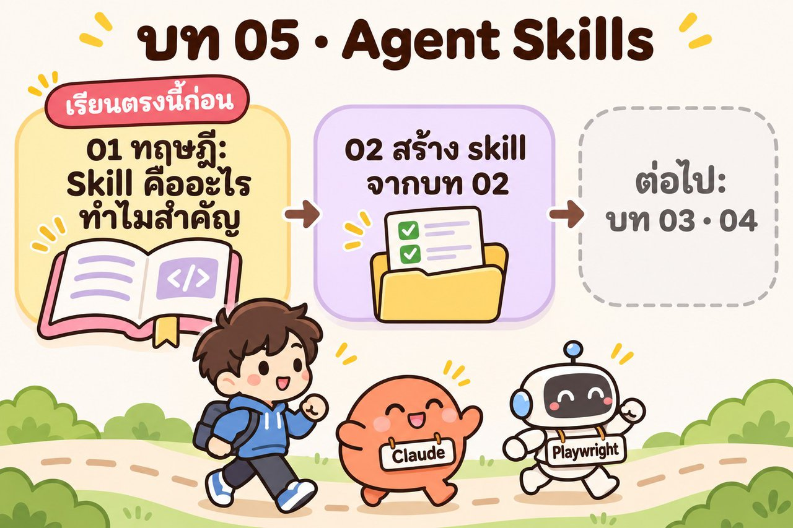

> **ส่วนนี้เป็นทฤษฎีล้วน** อ่านให้เข้าใจก่อน แล้วจึงไปลงมือใน [ส่วน 02](../02_skill-test-from-plan/) ที่จะเปลี่ยนบท 02 ทั้งบทให้เป็น skill
> เนื้อหาเรียบเรียงจาก 2 คลิป (ลิงก์อยู่ท้ายบท) แล้วเปลี่ยนตัวอย่างให้เป็นงานทดสอบเว็บของเรา

## 🎯 อ่านจบแล้วต้องตอบได้

1. ทำไมทีม Anthropic **เลิกสร้าง agent แยกตามงาน** แล้วใช้ agent ตัวเดียว + skill
2. "อัจฉริยะ IQ 300" กับ "คนธรรมดาที่ทำงานนี้มา 10 ปี" ต่างกันตรงไหน และ AI วันนี้เป็นแบบไหน
3. skill หน้าตาเป็นยังไง เก็บอยู่ที่ไหนในเครื่อง (Windows / Mac) และ `SKILL.md` มีส่วนไหนสำคัญที่สุด
4. ทำไม AI มี skill เป็นร้อยตัวได้โดยไม่สับสน (เปิดทีละชั้น)
5. ทำไม skill ที่ AI เขียนเองล้วน ๆ ถึง **แย่กว่าไม่มี** และคนต้องทำอะไร

## 📢 ใครเสนอเรื่องนี้ และข้อมูลในบทนี้มาจากไหน

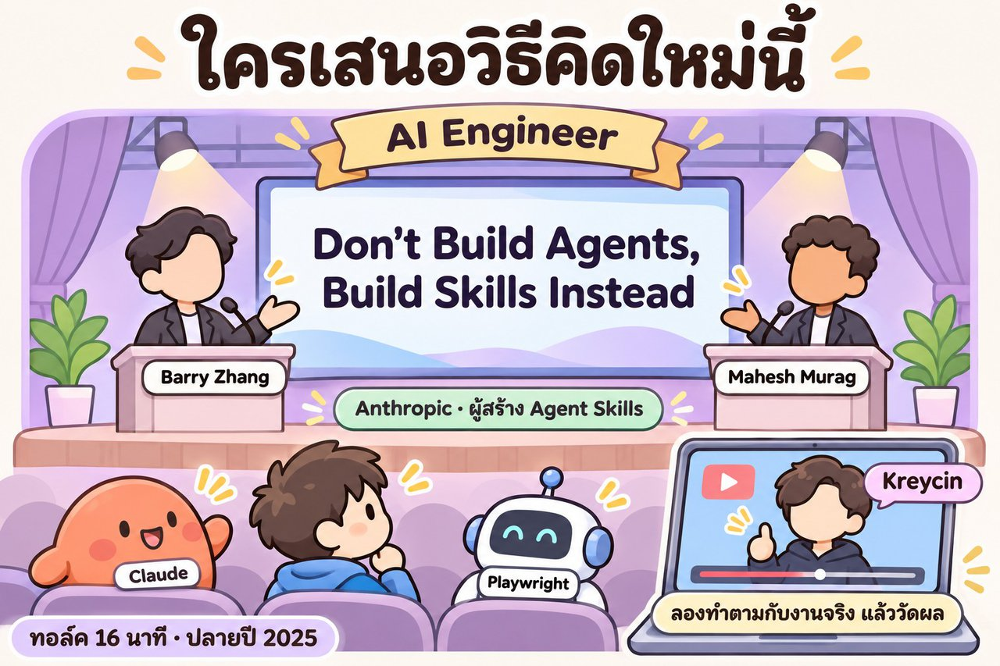

วิธีคิดใหม่ "**เลิกสร้าง agent ใหม่ แล้วสร้าง skill แทน**" ไม่ได้มาจากผู้สอน แต่มาจาก **ทีมที่สร้าง Agent Skills เอง**

| | แหล่งที่ 1 · ต้นทางของแนวคิด | แหล่งที่ 2 · คนลองทำตามแล้ววัดผล |
|---|---|---|
| ชื่อ | ทอล์ค **Don't Build Agents, Build Skills Instead** | คลิป **ผมลองทำตามทอล์ค Anthropic กับงานจริงของผม ได้ผลแบบนี้** |
| ใคร | **Barry Zhang** และ **Mahesh Murag** ทีมเทคนิคของ **Anthropic** (บริษัทที่ทำ Claude) ทั้งคู่เป็นผู้สร้าง Agent Skills · Barry เคยเขียนบทความสอนสร้าง agent ของ Anthropic · Mahesh เคยทำ MCP | **Kreycin** ยูทูบเบอร์ไทยที่ทำหนังแอนิเมชันด้วย Claude Code และมี skill ทำเอง 13 ตัว |
| ที่ไหน | เวทีสัมมนา **AI Engineer** (ช่อง YouTube "AI Engineer") ปลายปี 2025 ราว 5 สัปดาห์หลัง Anthropic เปิดตัว Agent Skills | ช่อง YouTube Kreycin |
| ยาว | 16:19 นาที (ซับอังกฤษ) | 16:54 นาที (ซับไทย) |
| ให้อะไรกับบทนี้ | วิธีคิดเดิม → วิธีคิดใหม่ · นิยาม skill · การเปิดทีละชั้น · สถาปัตยกรรม · อนาคตของ skill | หลักการ 4 ข้อ · ตัวเลขงานวิจัย (SkillsBench) · 6 ขั้นสร้าง skill แรก · ผลทดลอง skill วันแรก vs วันนี้ · ความปลอดภัย |
| ลิงก์ | [youtube.com/watch?v=CEvIs9y1uog](https://www.youtube.com/watch?v=CEvIs9y1uog) | [youtube.com/watch?v=SaL8dtnSBxw](https://www.youtube.com/watch?v=SaL8dtnSBxw) |

> 📌 **ทุกหัวข้อในบทนี้มีบรรทัด "ที่มา" พร้อมลิงก์เวลาในคลิป** กดแล้วกระโดดไปฟังช่วงนั้นได้เลย
> 🅰️ = ทอล์ค Anthropic · 🅺 = คลิป Kreycin · ตัวอย่างงานทดสอบ (PawPantry, บท 02) เป็นของบทเรียนเราเอง ไม่ได้มาจากคลิป

## 🗺️ เส้นทางของส่วนนี้

| # | หัวข้อ | คำถามที่ตอบ |
|---|---|---|
| 1 | ปัญหาของเรา | ทำไม copy-paste ทุก LAB ถึงเป็นปัญหา |
| 2 | **วิธีคิดเดิม**: งานละ agent | ทำไมไม่สร้าง "Testing agent" แยกไปเลย |
| 3 | **วิธีคิดใหม่**: agent ตัวเดียว + skill | ทำไม agent ตัวเดียวพอ และใครค้นพบ |
| 4 | อัจฉริยะ vs คนที่รู้งาน ⭐ | แล้ว agent ตัวเดียวยังขาดอะไร |
| 5 | รู้ว่าอะไร vs รู้ว่าทำยังไง | ความรู้ที่ขาดคือความรู้ชนิดไหน |
| 6 | skill คือโฟลเดอร์ | หน้าตาของ skill |
| 7 | ข้างใน `SKILL.md` | ส่วนไหนสำคัญที่สุด |
| 8 | skill อยู่ที่ไหนในเครื่อง | Windows / Mac / โปรเจกต์ |
| 9 | สคริปต์ใน skill | งานไหนให้โค้ด งานไหนให้ AI |
| 10 | เปิดทีละชั้น | มี skill เป็นร้อยตัว ทำไมไม่สับสน |
| 11 | agent เพิ่ม vs skill เพิ่ม ⭐ | สรุปว่าทำไม skill ดีกว่า (และ agent หลายตัวในบท 02 ผิดไหม) |
| 12 | agent ทั่วไป 4 ชิ้น | skill อยู่ตรงไหนของระบบ |
| 13 | ใครสร้าง skill และ skill = ซอฟต์แวร์ | ทดสอบ เก็บเวอร์ชัน ประกอบกัน |
| 14 | AI เรียนรู้ได้ยังไง | Claude วันที่ 30 เก่งกว่าวันที่ 1 จริงไหม |
| 15 | ตัวเลขจากงานวิจัย ⚠️ | ทำไมคนต้องตรวจ skill |
| 16 | สร้าง skill แรกใน 6 ขั้น | ส่วน 02 จะทำอะไร |
| 17 | ความปลอดภัย | skill ของคนอื่นอันตรายไหม |

---

## 1. ปัญหาของเรา: ทุกแชตใหม่ ต้อง copy-paste ใหม่หมด

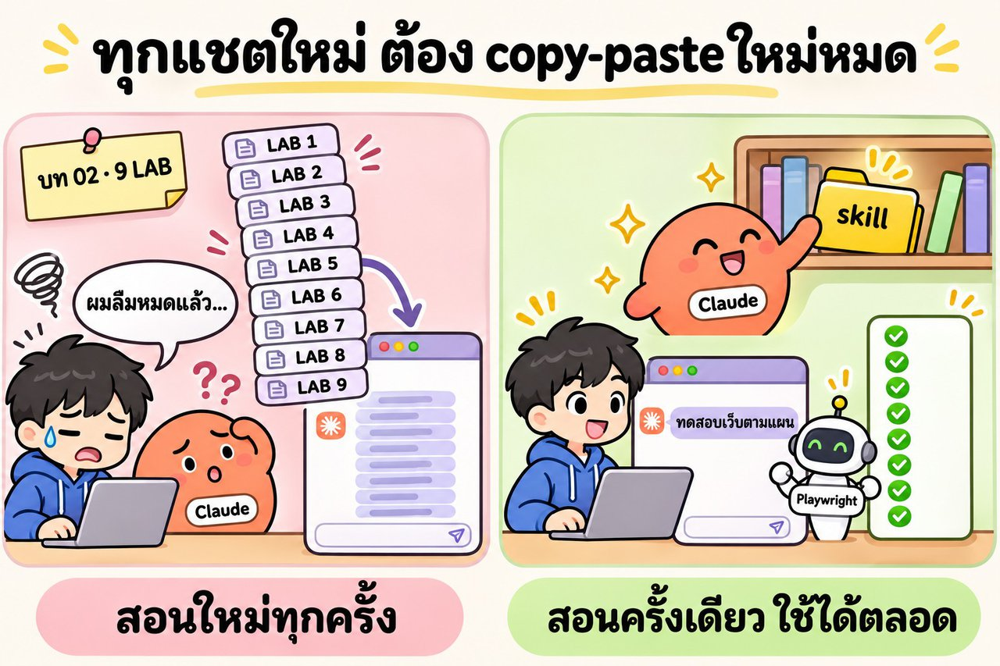

ลองนึกถึงบท 02 (ทดสอบ PawPantry ตามแผน) เราทำ 9 LAB แต่ละ LAB มีพรอมต์ยาว ๆ ที่เราเขียนกติกาไว้แน่นมาก เช่นส่วนหนึ่งของพรอมต์ LAB 4

```text
2. เปิดเว็บจริงด้วย Playwright MCP ลองทำตามทีละข้อ เพื่อดูว่าต้องกดปุ่มไหน
3. เขียน test ลง e2e/tests ชื่อ test ขึ้นต้นด้วย ID และติด tag ตามระดับ (@P1 / @P2)
4. รันด้วย Chromium ที่ติดตั้งไว้จากบท 01 (ห้ามโหลดเบราว์เซอร์ใหม่)
   ให้คนดูทัน: เดินช้าลง และค้างหน้าผลลัพธ์ไว้ จน GIF แต่ละไฟล์ยาวอย่างน้อย 5 วินาที
กติกา
- ห้ามเปิดโฟลเดอร์ petshop และ _solution
- ห้ามอ่าน TEST-PLAN.md หัวข้อ 8 และห้ามแก้โค้ดเว็บ
- ผลการทดลองเก็บใน e2e และไม่ขึ้น git
```

บรรทัดพวกนี้ **ไม่ใช่ความรู้ทั่วไป** แต่เป็น **"วิธีทำงานแบบของเรา"** ที่เราค่อย ๆ เรียนรู้มา (บท 02 มีตาราง "ส่วนของพรอมต์ | มีไว้ทำไม" อธิบายว่าทุกบรรทัดมีเหตุผล)

ปัญหาคือ

| สิ่งที่เกิด | ผลเสีย |
|---|---|
| เปิดแชตใหม่ AI ลืมทุกอย่าง | ต้องวางพรอมต์ใหม่ทุกครั้ง 9 LAB = 9 ครั้ง |
| ลืมวางบรรทัดใดบรรทัดหนึ่ง | AI แอบอ่านโค้ดเว็บ โหลดเบราว์เซอร์ซ้ำ หรือแก้ test ให้ผ่านเฉย ๆ |
| เจอบทเรียนใหม่ (เช่น บั๊ก TC-AUTH-02 ที่เฉลยเดิมพลาด) | ต้องจำเองว่าจะเติมกติกาลงพรอมต์ไหน |
| บท 03, 04 ก็มีพรอมต์ชุดของตัวเองอีก 8 และ 12 LAB | งานซ้ำทวีคูณ |

**คำถามของบทนี้:** ทำยังไงให้ "วิธีทำงานแบบของเรา" อยู่กับ AI ถาวร แล้วเราสั่งแค่ "ทดสอบเว็บตามแผนให้หน่อย"

> 📌 **ที่มา** ปัญหานี้มาจากบทเรียนเราเอง (พรอมต์ LAB 4 ของบท 02) · ไอเดีย "แชตใหม่ลืมหมด" ตรงกับ 🅺 [02:40](https://youtu.be/SaL8dtnSBxw?t=160) ที่ผู้ทำคลิปต้องเล่าวิธีทำคลิปใหม่ทุกแชต

---

## 2. วิธีคิดเดิม: งานละ agent


### 2.1 วิธีคิดเดิมคืออะไร

> **งานใหม่ 1 แบบ = สร้าง agent ใหม่ 1 ตัว**

คำตอบแรกที่คนส่วนใหญ่คิด (รวมถึงทีม Anthropic เองเมื่อต้นปี 2025) คือ **"สร้าง agent เฉพาะทางขึ้นมาสักตัว"**
เช่น สร้าง *Testing agent* ที่มีเครื่องมือทดสอบ มีพรอมต์ระบบเรื่องการทดสอบ มีโค้ดควบคุม (scaffolding) ของตัวเอง

Barry เล่าบนเวทีว่าเมื่อก่อนทีมเชื่อว่า agent แต่ละสายงาน **หน้าตาต่างกันมาก** จึงต้องมี Coding agent, Research agent, Finance agent, Marketing agent แยกกัน ตัวละชุดเครื่องมือ และต้องมี agent แยกตาม use case และตามสายงาน

### 2.2 ทำไมวิธีนี้ไม่เวิร์ค

วิธีนี้มีปัญหาเมื่อทำจริง

| ปัญหา | ตัวอย่างในงานของเรา |
|---|---|
| ต้องสร้างและดูแลทีละตัว | Testing agent, Test-plan agent, Spec agent… แต่ละตัวต้องตั้งค่าแยก |
| ความรู้ติดอยู่ในตัว agent | กติกา "ห้ามเปิดโค้ดเว็บ" ต้องใส่ซ้ำในทุก agent ที่เกี่ยวกับการทดสอบ |
| แก้ที่เดียวไม่ได้ | เจอบทเรียนใหม่ ต้องไล่แก้ทุก agent |
| งานที่ข้ามสาย ทำยาก | การทดสอบต้องเปิด Docker + เขียนโค้ด + ทำรายงาน = ต้องเรียก agent หลายตัวคุยกัน |

> 📌 **ที่มา** 🅰️ ความเชื่อเดิม "How we used to think about agents" [01:20](https://youtu.be/CEvIs9y1uog?t=80) · [01:36](https://youtu.be/CEvIs9y1uog?t=96) · 🅺 [01:14](https://youtu.be/SaL8dtnSBxw?t=74) · ตารางปัญหาและตัวอย่าง Testing agent เป็นของบทเรียนเรา

---

## 3. วิธีคิดใหม่: agent ตัวเดียว + skill

> **งานใหม่ 1 แบบ = เพิ่มโฟลเดอร์ skill 1 โฟลเดอร์ ให้ agent ตัวเดิม**

### 3.1 ทีม Anthropic ค้นพบอะไร

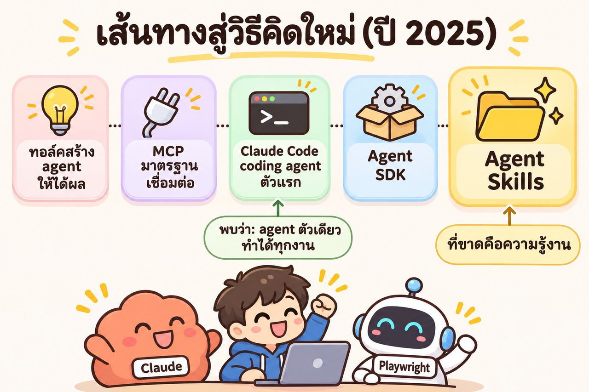

Barry เล่าเส้นทางตลอดปี 2025 บนสไลด์ "Year of agents": ทอล์คสร้าง agent ให้ได้ผล (Barry) และทอล์ค MCP (Mahesh) → MCP กลายเป็นมาตรฐานเชื่อมต่อ → เปิดตัว **Claude Code** → Claude Agent SDK
จุดเปลี่ยนอยู่ที่ Claude Code


หลังทีม Anthropic สร้าง **Claude Code** (เดิมตั้งใจให้เป็นแค่ coding agent) เขาค้นพบว่า

> **โค้ดไม่ใช่แค่งานอย่างหนึ่ง แต่เป็น "ทางเข้าสู่โลกดิจิทัลทั้งหมด"** (code is the universal interface)

ตัวอย่างในทอล์ค — ทำ **รายงานการเงิน** ไม่ต้องมี Finance agent เลย

1. เขียนโค้ดเรียก API ดึงข้อมูล
2. จัดไฟล์เก็บในเครื่อง
3. วิเคราะห์ด้วย Python
4. เขียนรายงานออกมาเป็นไฟล์ — **ทุกขั้นคือการเขียนโค้ด**

แกนของ agent จึงบางลงเหลือแค่ 2 อย่าง: **สั่งคำสั่งได้ (bash)** กับ **มีไฟล์ให้ใช้ (file system)** ทอล์คสรุปว่า *"แค่โค้ดก็พอแล้ว"* (code is all we need)

**ตัวอย่างของเรา:** ในบท 02 เราไม่ได้สร้าง Testing agent เลย Claude Code ตัวเดียวทำได้ครบ

| งานในบท 02 | Claude ทำผ่านโค้ดยังไง |
|---|---|
| LAB 2 เปิดเว็บ | รัน `docker compose up` |
| LAB 4–5 เขียน test | เขียนไฟล์ `*.spec.ts` แล้วรัน Playwright |
| LAB 6 อัด GIF | เขียนสคริปต์เรียก ffmpeg |
| LAB 7 รายงาน | เขียนไฟล์ `TEST-REPORT.md` |

> ⚠️ ชื่อทอล์ค "Don't Build Agents" **ไม่ได้แปลว่าเลิกใช้ agent** แต่แปลว่า **เลิกสร้าง agent ใหม่ทุกงาน** ใช้ agent ตัวเดิม แล้วเติมความรู้แทน

### 3.2 เทียบวิธีคิดเดิมกับวิธีคิดใหม่

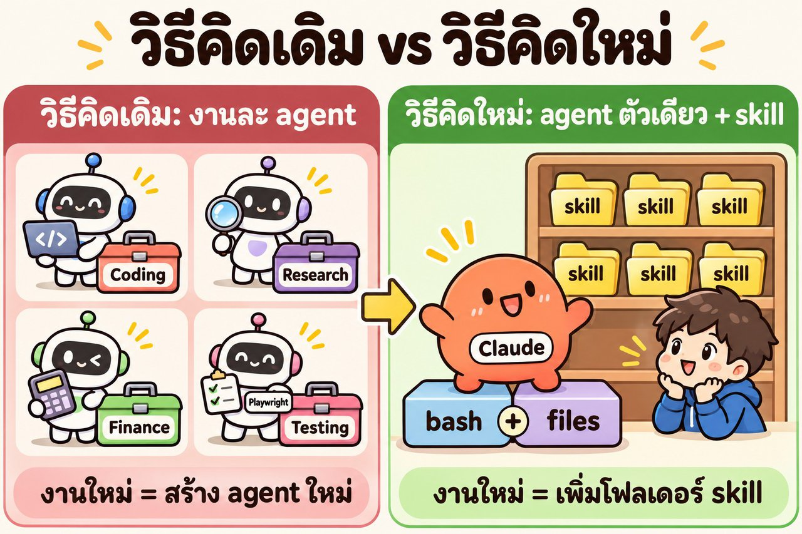

| | ❌ วิธีคิดเดิม | ✅ วิธีคิดใหม่ |
|---|---|---|
| หลักคิด | agent แต่ละสายงานต่างกันมาก | agent ข้างใต้เหมือนกันหมด ต่างกันแค่ "ความรู้งาน" |
| ตัว agent | หลายตัว ตัวละสายงาน | **ตัวเดียว** (bash + ไฟล์) |
| เครื่องมือ | ผูกกับ agent แต่ละตัว | เขียนโค้ด / สคริปต์ใน skill |
| ความรู้งานอยู่ที่ | ฝังในโค้ดและพรอมต์ของ agent | **โฟลเดอร์ skill** |
| งานใหม่ | สร้าง agent ใหม่ | **เพิ่ม skill ใหม่** |
| ใครทำได้ | โปรแกรมเมอร์ | ใครก็ได้ |
| ในบท 02 ของเรา | สร้าง "PawPantry Testing agent" | Claude Code + skill `test-from-plan` |

แต่ agent ตัวเดียวที่ทำได้ทุกอย่าง **ยังขาดอยู่อย่างหนึ่ง** ซึ่งเป็นเหตุผลที่ต้องมี skill → หัวข้อ 4

> 📌 **ที่มา** 🅰️ Year of agents [00:53](https://youtu.be/CEvIs9y1uog?t=53) · [01:10](https://youtu.be/CEvIs9y1uog?t=70) · code is the universal interface [01:38](https://youtu.be/CEvIs9y1uog?t=98) · general purpose agent [01:44](https://youtu.be/CEvIs9y1uog?t=104) · ตัวอย่างรายงานการเงิน [01:50](https://youtu.be/CEvIs9y1uog?t=110) · bash + file system [02:02](https://youtu.be/CEvIs9y1uog?t=122) · 🅺 "ไม่ได้แปลว่าเลิกใช้ agent" [01:14](https://youtu.be/SaL8dtnSBxw?t=74) · [02:03](https://youtu.be/SaL8dtnSBxw?t=123)

---

## 4. ⭐ อัจฉริยะ IQ 300 vs คนธรรมดาที่ทำงานนี้มา 10 ปี

ถ้า agent ตัวเดียวทำได้ทุกอย่างแล้ว ทำไมบท 02 ยังต้องเขียนพรอมต์ยาวขนาดนั้น? ทอล์คตอบด้วยคำถามง่าย ๆ ข้อเดียว

### 4.1 คำถาม: อยากให้ใครทำภาษีให้คุณ?

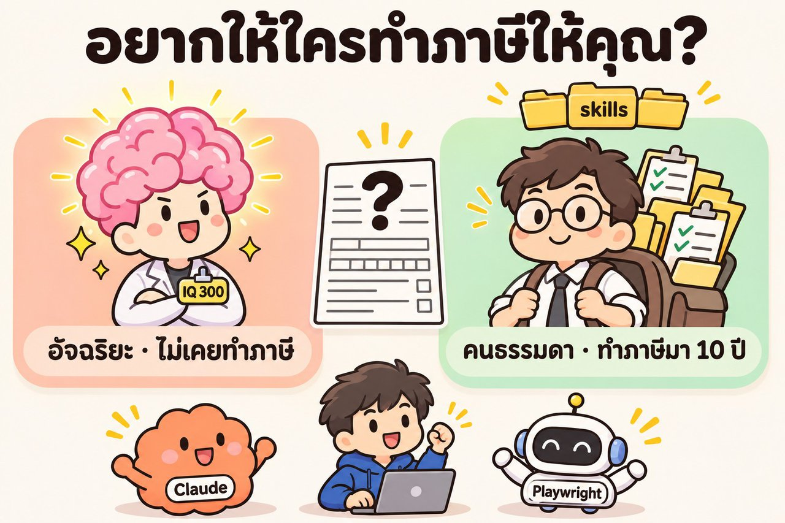

| | 🧠 อัจฉริยะ (Mahesh) | 📁 นักภาษี (Barry) |
|---|---|---|
| ความฉลาด | IQ 300 คณิตศาสตร์ระดับโลก | คนธรรมดา |
| เคยทำภาษีไหม | **ไม่เคยเลย** | **ทำมาเป็นสิบปี** |
| มีอะไรติดตัว | สมองล้วน ๆ | ขั้นตอน checklist ข้อควรระวัง ที่สะสมจากการทำจริง |

(Mahesh กับ Barry คือผู้พูดสองคนบนเวทีเอง ทอล์คติดป้ายไว้ว่าเป็นตัวอย่างสมมติ)

**คนส่วนใหญ่เลือกนักภาษี** ทั้งที่อัจฉริยะฉลาดกว่ามาก เพราะอะไร?

### 4.2 ผลลัพธ์ต่างกันยังไง

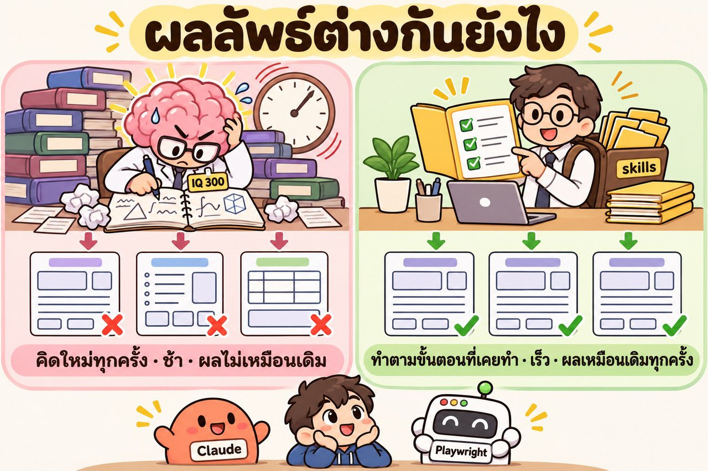

ทอล์คบอกว่า "เราไม่อยากให้อัจฉริยะมานั่ง **คิดกฎหมายภาษีปีนี้ใหม่จากศูนย์** (first principles)" สิ่งที่เราต้องการคือ **ทำออกมาถูกและเหมือนเดิมทุกครั้ง** (consistent execution) จากคนที่รู้งาน

| | อัจฉริยะ | นักภาษี |
|---|---|---|
| วิธีทำ | คิดใหม่จากศูนย์ทุกครั้ง | ทำตามขั้นตอนที่เคยพิสูจน์แล้ว |
| ความเร็ว | ช้า (ต้องอ่าน ต้องคิด) | เร็ว |
| ผลลัพธ์ 3 รอบ | อาจต่างกันทั้ง 3 รอบ | เหมือนกันทั้ง 3 รอบ |
| จุดพลาดที่คนเคยพลาด | ต้องพลาดเองก่อนถึงจะรู้ | รู้อยู่แล้ว ระวังไว้ก่อน |

**ข้อสรุปสำคัญ:** ความฉลาดทั่วไป **แทน** ความเชี่ยวชาญในงานไม่ได้

### 4.3 แล้ว AI วันนี้เป็นแบบไหน?

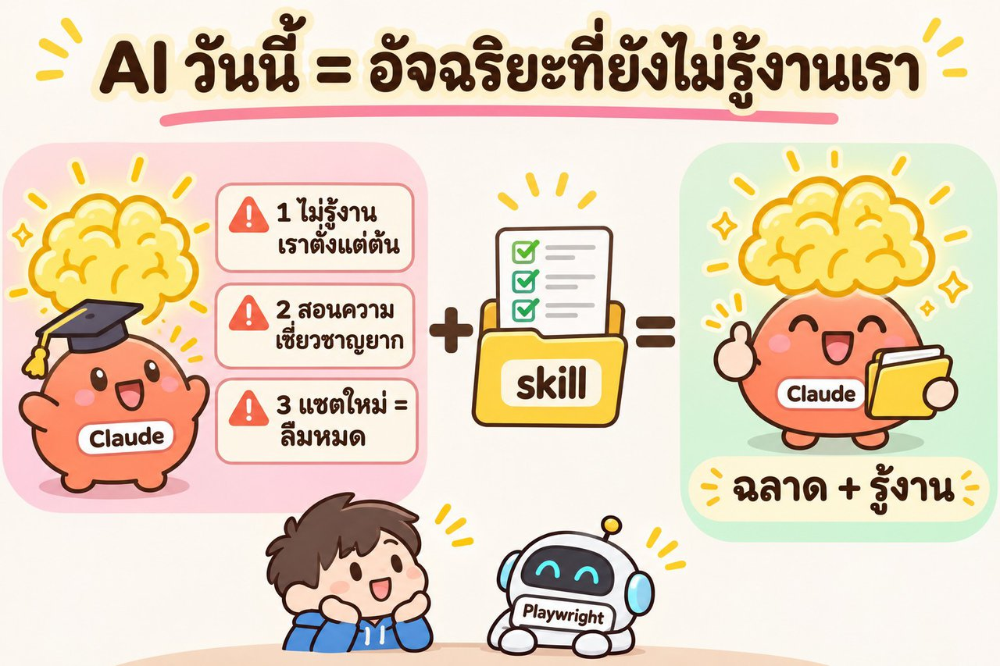

ทอล์คบอกตรง ๆ ว่า **"agent วันนี้เหมือน Mahesh"** — ฉลาดล้ำ แต่ขาดความเชี่ยวชาญ 3 ข้อ

1. **ไม่รู้งานเราตั้งแต่ต้น** ขาด context สำคัญตั้งแต่เริ่ม
2. **ซึมซับความเชี่ยวชาญของเราได้ยาก** ต้องอธิบายยาวทุกครั้ง
3. **ไม่เรียนรู้ข้ามเวลา** เปิดแชตใหม่ก็ลืมหมด

### 4.4 เทียบกับงานทดสอบของเรา

Claude "ฉลาด" เรื่องการทดสอบมาก รู้ Playwright, TypeScript, HTTP, Docker ดีกว่าพวกเราหลายคน แต่ **ไม่รู้ว่าห้องเรียนเราทดสอบกันแบบไหน**

| 🧠 สิ่งที่ Claude รู้อยู่แล้ว (อัจฉริยะ) | 📁 สิ่งที่ Claude ไม่รู้ ถ้าเราไม่บอก (ความรู้ของนักภาษี) |
|---|---|
| เขียน Playwright test ได้ | เราทดสอบแบบ **black-box** ห้ามเปิดโค้ดเว็บ `petshop/` |
| อ่าน markdown ได้ | อ่านแผนได้แค่หัวข้อ 5 กับ 7 **ห้ามอ่านหัวข้อ 8** (เฉลยบั๊ก) |
| ติดตั้งเบราว์เซอร์ได้ | ให้ใช้ Chromium จากบท 01 **ห้ามโหลดใหม่** |
| ตั้งชื่อ test ได้ | ชื่อ test ต้องขึ้นต้นด้วย **รหัส TC** และติด tag **P1/P2/P3** |
| แก้ test ที่ล้มได้ | test ล้ม **ห้ามแก้ให้ผ่านเฉย ๆ** ต้องแยกก่อนว่า "บั๊กเว็บ" หรือ "test ผิด" |
| ทำรายงานได้ | รายงานต้องตัดสินตาม **เกณฑ์ผ่านหัวข้อ 6** (P1 ผ่านหมด + ≥ 95%) |

ฝั่งซ้ายคือเหตุผลที่ไม่ต้องสร้าง agent ใหม่ ฝั่งขวาคือ **สิ่งที่ต้องสอน** และพรอมต์ยาว ๆ ในบท 02 ก็คือการสอนฝั่งขวาซ้ำทุกแชตนั่นเอง

> **ทางออก:** ไม่ต้องหา AI ที่ฉลาดกว่า แต่ **ยื่นแฟ้ม checklist ของนักภาษีให้อัจฉริยะ** → ได้ทั้งฉลาดและรู้งาน แฟ้มนั้นแหละคือ **skill**

> 📌 **ที่มา** 🅰️ ภาษี Mahesh vs Barry [02:16](https://youtu.be/CEvIs9y1uog?t=136) · consistent execution [02:29](https://youtu.be/CEvIs9y1uog?t=149) · agent วันนี้เหมือน Mahesh และขาด 3 ข้อ [02:33](https://youtu.be/CEvIs9y1uog?t=153) – [02:50](https://youtu.be/CEvIs9y1uog?t=170) · 🅺 [02:03](https://youtu.be/SaL8dtnSBxw?t=123) · [02:46](https://youtu.be/SaL8dtnSBxw?t=166) · ตาราง 4.4 (งานทดสอบ) เป็นของบทเรียนเรา

---

## 5. รู้ว่าอะไร vs รู้ว่าทำยังไง


ทำไมนักภาษีชนะ? นักจิตวิทยาแบ่งความรู้เป็น 2 แบบ

| แบบ | ความหมาย | ได้มาจาก | ตัวอย่าง |
|---|---|---|---|
| **รู้ว่าอะไร** (declarative) | รู้ข้อเท็จจริง | อ่าน | รู้ว่ากฎหมายภาษีเขียนว่าอะไร · รู้ว่า `page.click()` ทำอะไร |
| **รู้ว่าทำยังไง** (procedural) | รู้วิธีลงมือทำ ทีละขั้น | ลงมือทำ | ขี่จักรยาน (อ่านหนังสือร้อยเล่มก็ขี่ไม่เป็น) · ลำดับ LAB 2→7 ของเรา |

งานวิจัย CoALA (Princeton) นำแนวคิดนี้มาแบ่งความจำของ AI agent และเรียกความรู้แบบที่สองว่า **procedural memory**

- AI อ่านมาทั้งอินเทอร์เน็ต → **"รู้ว่าอะไร" เยอะมาก**
- แต่ไม่เคยทำงานของเรา → **"รู้ว่าทำยังไง" ของงานเราเป็นศูนย์**

**skill คือที่เก็บความรู้แบบที่สอง** ถ้าลองดูพรอมต์บท 02 ทุกบรรทัดจะพบว่าเกือบทั้งหมดเป็น "ทำยังไง" ไม่ใช่ "อะไร"

> 📌 **ที่มา** 🅺 หลักการที่ 1 declarative/procedural [02:40](https://youtu.be/SaL8dtnSBxw?t=160) · ขี่จักรยาน [04:00](https://youtu.be/SaL8dtnSBxw?t=240) · CoALA procedural memory [03:39](https://youtu.be/SaL8dtnSBxw?t=219) (ทอล์ค Anthropic ไม่ได้พูดเรื่อง CoALA ผู้ทำคลิปเสริมเอง)

---

## 6. Agent Skill คืออะไร: แค่โฟลเดอร์

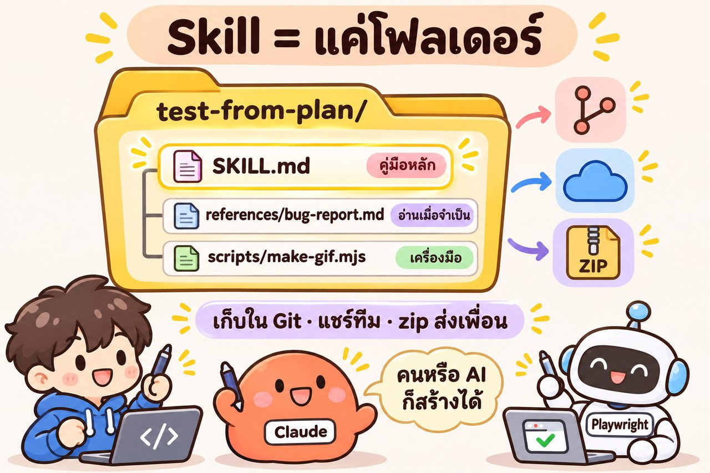

นิยามบนสไลด์ของทอล์ค

> *Skills are organized collections of files that package composable procedural knowledge for agents.*

แยกทีละคำ

| คำ | แปลว่า | ในงานของเรา |
|---|---|---|
| **organized collection of files** | ชุดไฟล์ที่จัดเป็นระเบียบ = **โฟลเดอร์** | โฟลเดอร์ `test-from-plan/` |
| **procedural knowledge** | ความรู้ "ทำยังไง" | ลำดับ: เปิดเว็บ → เขียน test → รัน → อัด GIF → รายงาน + กติกา |
| **composable** | หยิบมาประกอบกับ skill อื่นได้ | skill ทดสอบ + skill ทำ GIF + skill รายงานบั๊ก |
| **for agents** | ให้ agent อ่าน | Claude Code (และ agent อื่นที่รองรับมาตรฐานเดียวกัน) |

พูดสั้น ๆ: **skill ก็คือโฟลเดอร์** ทีมตั้งใจให้ง่ายแบบนี้ เพราะ

- **ใครก็สร้างได้** ทั้งคนและ AI ขอแค่มีคอมพิวเตอร์
- **ใช้กับเครื่องมือเดิมได้หมด** เก็บเวอร์ชันใน Git, ใส่ Google Drive, zip ส่งเพื่อน
- **ไฟล์** เป็นสิ่งที่ทุกคนใช้มาหลายสิบปี ไม่ต้องเรียนอะไรใหม่

ตัวอย่างจริงบนสไลด์คือโฟลเดอร์ `anthropic_brand/` ที่สอน Claude เรื่องสีและฟอนต์ของบริษัท

```text
anthropic_brand/
├─ SKILL.md            ← คู่มือหลัก: ภาพรวม สีหลัก และบอกว่าเมื่อไหร่ต้องเปิดไฟล์ไหน
├─ slide-decks.md      ← กฎสำหรับสไลด์
├─ docs.md             ← กฎสำหรับเอกสาร
└─ apply_template.py   ← สคริปต์ใส่สีแบรนด์ให้ไฟล์ pptx
```

ส่วน skill ของเราที่สร้างจริงใน [ส่วน 02](../02_skill-test-from-plan/) (ย่อ)

```text
test-from-plan/
├─ SKILL.md                 ← กติกา black-box + ขั้นตอนทดสอบตามแผน
├─ references/
│  ├─ decisions.md          ← จุดตัดสินใจ/กับดักจากการรันจริง (เปิดเมื่อ SKILL.md สั่ง)
│  └─ plan-answers/         ← คำตอบของเจ้าของแผน (ใช้เฉพาะแผนที่ตรงกัน)
└─ scripts/
   ├─ make-gifs.mjs         ← แปลงวิดีโอเป็น GIF แบบเดิมทุกครั้ง
   └─ build-report.mjs      ← ทำรายงาน + คำนวณคำตัดสินตามเกณฑ์ในแผน
```

> skill เป็น **มาตรฐานเปิด** (agentskills.io) ไม่ได้ผูกกับ Claude เจ้าเดียว agent อื่นอย่าง Codex หรือ GitHub Copilot ก็อ่านได้

> 📌 **ที่มา** 🅰️ นิยาม "What are Agent Skills?" [03:05](https://youtu.be/CEvIs9y1uog?t=185) · skill คือโฟลเดอร์ [03:07](https://youtu.be/CEvIs9y1uog?t=187) · ทำไมเป็นโฟลเดอร์ [03:10](https://youtu.be/CEvIs9y1uog?t=190) – [03:24](https://youtu.be/CEvIs9y1uog?t=204) · ตัวอย่าง anthropic_brand [03:29](https://youtu.be/CEvIs9y1uog?t=209) · 🅺 มาตรฐานเปิด [09:50](https://youtu.be/SaL8dtnSBxw?t=590)

---

## 7. ข้างในไฟล์ `SKILL.md`

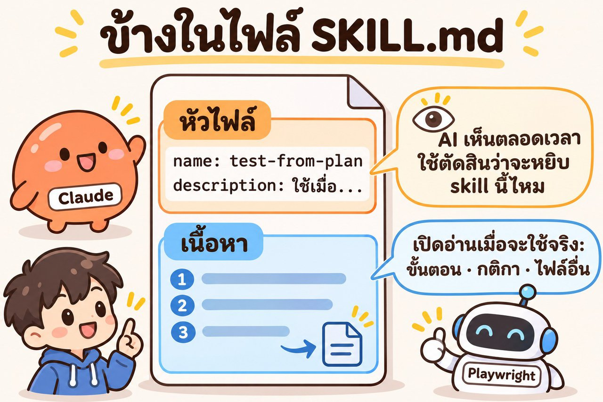

`SKILL.md` มี 2 ส่วน

```markdown
---
name: test-from-plan
description: ทดสอบเว็บแบบ black-box ตาม TEST-PLAN.md ด้วย Playwright จนได้รายงานและคำตัดสินว่าปล่อยได้ไหม
  ใช้เมื่อผู้ใช้สั่ง "ทดสอบเว็บตามแผน", "รัน test ตาม TEST-PLAN", "เขียน e2e ตามแผนทดสอบ"
---

# ทดสอบเว็บตามแผน

## กติกา (ห้ามละเมิด)
- อ่าน TEST-PLAN.md ได้แค่หัวข้อ 5 และ 7 ห้ามอ่านหัวข้อ 8
- ห้ามเปิดโค้ดเว็บ ทดสอบจากหน้าเว็บจริงเท่านั้น
- test ล้ม ห้ามแก้ให้ผ่านเฉย ๆ

## ขั้นตอน
1. เปิดเว็บด้วย docker compose แล้วรอจน healthy
2. ...
5. ถ้ามี test ล้ม อ่าน references/bug-report.md แล้วเขียนรายงานบั๊ก
```

(นี่คือตัวอย่างย่อเพื่ออธิบาย ของจริงจะสร้างใน ส่วน 02)

| ส่วน | มีอะไร | AI เห็นเมื่อไหร่ | สำคัญยังไง |
|---|---|---|---|
| **หัวไฟล์** (frontmatter ระหว่าง `---`) | `name` + `description` | **ตลอดเวลา** ทุกแชต | AI ใช้ตัดสินว่าจะหยิบ skill นี้มาใช้ไหม |
| **เนื้อหา** | ขั้นตอน กติกา ชี้ไปไฟล์อื่น | เมื่อ AI ตัดสินใจใช้ skill นี้ | คือ "checklist ของนักภาษี" |

### `description` คือบรรทัดที่สำคัญที่สุด

AI ไม่ได้อ่าน skill ทุกตัวทั้งไฟล์ (ดูหัวข้อ 10) มันเห็นแค่ `description` แล้วเดาว่า "งานนี้ใช่ skill นี้ไหม" ถ้าเขียนไม่ดี skill ก็ไม่ถูกหยิบมาใช้เลย

| ❌ description แย่ | ✅ description ดี |
|---|---|
| `ช่วยเรื่องการทดสอบ` | `ทดสอบเว็บแบบ black-box ตาม TEST-PLAN.md ด้วย Playwright จนได้รายงานและคำตัดสินว่าปล่อยได้ไหม` |
| กว้างเกิน AI ไม่รู้ว่าทดสอบอะไร ด้วยอะไร | บอก **ทำอะไร** · **ด้วยอะไร** · **ได้อะไรออกมา** |
| ไม่บอกว่าใช้ตอนไหน | บอก **คำที่ผู้ใช้มักพิมพ์** เช่น "ทดสอบเว็บตามแผน" |

> 📌 **ที่มา** 🅰️ YAML frontmatter (name, description) ที่โมเดลเห็นตอน runtime [04:29](https://youtu.be/CEvIs9y1uog?t=269) · [04:34](https://youtu.be/CEvIs9y1uog?t=274) · 🅺 ขั้น 4 "ดูหัวไฟล์ให้ชัดว่าใช้ตอนไหน" [13:19](https://youtu.be/SaL8dtnSBxw?t=799) · ตัวอย่าง SKILL.md และ description ดี/แย่ เป็นของบทเรียนเรา

---

## 8. skill เก็บอยู่ที่ไหนในเครื่อง (Windows / Mac)


skill ของ Claude Code อยู่ได้ 2 ที่ ข้างในเป็น **1 โฟลเดอร์ต่อ 1 skill** และต้องมีไฟล์ `SKILL.md`

| ชนิด | ที่อยู่ | ใช้ได้ที่ไหน | เหมาะกับ |
|---|---|---|---|
| **skill ส่วนตัว** | Windows: `C:\Users\<ชื่อผู้ใช้>\.claude\skills\`<br>Mac: `/Users/<ชื่อผู้ใช้>/.claude/skills/` | **ทุกโฟลเดอร์** ที่เปิด Claude Code | วิธีทำงานของเราเอง เช่น skill ทดสอบที่จะใช้ทั้งบท 02, 03, 04 |
| **skill ของโปรเจกต์** | `<โฟลเดอร์โปรเจกต์>/.claude/skills/` | เฉพาะตอนเปิด Claude Code ในโปรเจกต์นั้น | กติกาของทีม แชร์ให้เพื่อนผ่าน Git |

> `.claude` ขึ้นต้นด้วยจุด จึงเป็นโฟลเดอร์ซ่อน ถ้าเปิดหาเองไม่เจอ ให้สั่ง Claude เปิดให้ง่ายกว่า ถ้ายังไม่เคยมี skill เลย โฟลเดอร์นี้อาจยังไม่ถูกสร้าง

### 🔍 ลองดูของจริง: ให้ Claude เปิดโฟลเดอร์ skill

💬 **พรอมต์** (วางใน Claude Code ที่โฟลเดอร์ไหนก็ได้)

```text
ช่วยเปิดโฟลเดอร์ skill ของผมให้หน่อย แล้วบอกว่ามันอยู่ที่ไหน มี skill อะไรบ้าง
```

✅ **ผลจริง** (เครื่องผู้สอน Windows · ใช้เวลา 19 วินาที) หน้าต่าง File Explorer เด้งขึ้นมาที่โฟลเดอร์ skill และ Claude ตอบว่า

```text
เปิดโฟลเดอร์ใน File Explorer ให้แล้วครับ
ตำแหน่ง: C:\Users\<ชื่อผู้ใช้>\.claude\skills
นี่คือ skill ระดับผู้ใช้ ใช้ได้ในทุกโปรเจกต์ ส่วนโปรเจกต์ปัจจุบันไม่มีโฟลเดอร์ .claude\skills ของตัวเอง
Skill ในโฟลเดอร์ (8 รายการ): devtools-lab, exam-mcq, k8s-lab, maccount, media-use, yt-lesson, yt-transcript, synced
```

👀 **สังเกต**
- Claude แยกให้เองว่า skill ส่วนตัวอยู่ที่ไหน และโปรเจกต์นี้มี skill ของตัวเองไหม
- ของผู้เรียนอาจยังว่าง หรือยังไม่มีโฟลเดอร์เลย ไม่เป็นไร ใน ส่วน 02 เราจะสร้าง skill แรกลงที่นี่
- บน Mac จะเด้งเป็นหน้าต่าง Finder แทน

> 📌 **ที่มา** ตำแหน่งโฟลเดอร์มาจากการทำงานของ Claude Code (ทอล์คไม่ได้พูดถึง) · ผลจริงจากการรันพรอมต์บนเครื่องผู้สอน · 🅺 ผู้ทำคลิปเก็บ skill ไว้ที่ `~/.claude/skills` [05:38](https://youtu.be/SaL8dtnSBxw?t=338)

---

## 9. สคริปต์ใน skill: งานซ้ำให้โค้ด งานคิดให้ AI

skill ไม่ได้มีแค่ข้อความ **ใส่สคริปต์ไว้เป็นเครื่องมือได้ด้วย** และทอล์คบอกว่านี่คือจุดที่ทรงพลังที่สุด

### 9.1 เรื่องเล่าจากทีม Anthropic

ทีมสังเกตว่า Claude **เขียนสคริปต์ Python ตัวเดิมซ้ำแล้วซ้ำเล่า** เพื่อใส่สีให้สไลด์ ทุกรอบเขียนใหม่ ผลจึงต่างกันเล็กน้อยทุกครั้ง และเปลือง token
ทีมเลยสั่งให้ Claude **เก็บสคริปต์นั้นไว้ใน skill ให้ "ตัวเองในอนาคต" ใช้** ตอนนี้แค่รันสคริปต์เดิม ผลออกมาเหมือนเดิมทุกครั้งและเร็วขึ้น

ในบท 02 ก็เกิดเหมือนกันเป๊ะ: ทุกครั้งที่สั่งอัด GIF Claude ต้องเขียนสคริปต์แปลงวิดีโอเป็น GIF ขึ้นมาเอง (เฉลยบท 02 เก็บไว้เป็น `make-gifs.js`) ถ้าเปิดแชตใหม่ มันก็จะเขียนใหม่อีก และอาจตั้งค่าความช้า ขนาด เวลาค้างหน้าผล (≥ 5 วินาที) ไม่เหมือนเดิม **นี่คือสคริปต์ที่ควรเก็บเข้า skill**

### 9.2 ทำไมสคริปต์ดีกว่า tool แบบเดิม

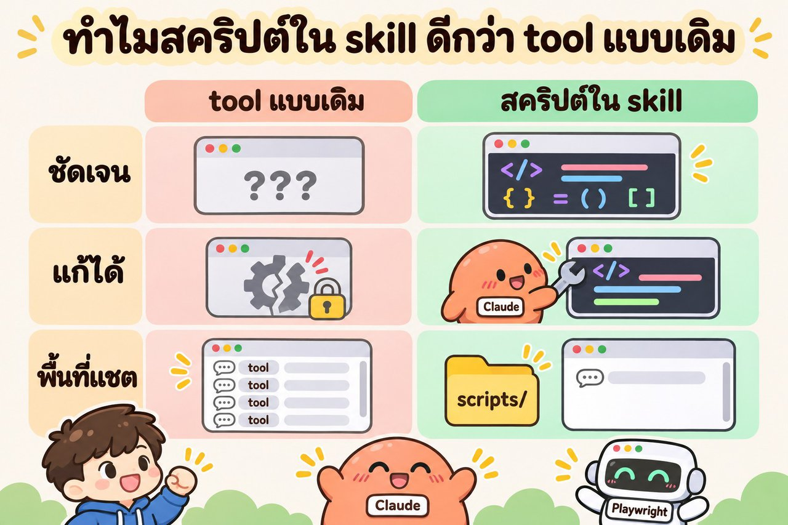

"tool แบบเดิม" คือเครื่องมือที่โปรแกรมเมอร์ผูกไว้กับ agent (มีชื่อ + คำอธิบายสั้น ๆ ให้ AI เรียก)

| | tool แบบเดิม | สคริปต์ใน skill |
|---|---|---|
| **ชัดเจน** | คำอธิบายมักกำกวม AI ใช้ผิดได้ | เปิดอ่านโค้ดแล้วรู้เลยว่าทำอะไร |
| **แก้ได้** | พังแล้ว AI แก้เองไม่ได้ ติดอยู่แบบนั้น | AI เปิดไฟล์แก้เองได้ |
| **พื้นที่แชต** | รายชื่อ tool อยู่ในแชตตลอดเวลา | อยู่ในไฟล์ จนกว่าจะถูกเรียกใช้ |

### 9.3 กฎแบ่งงาน

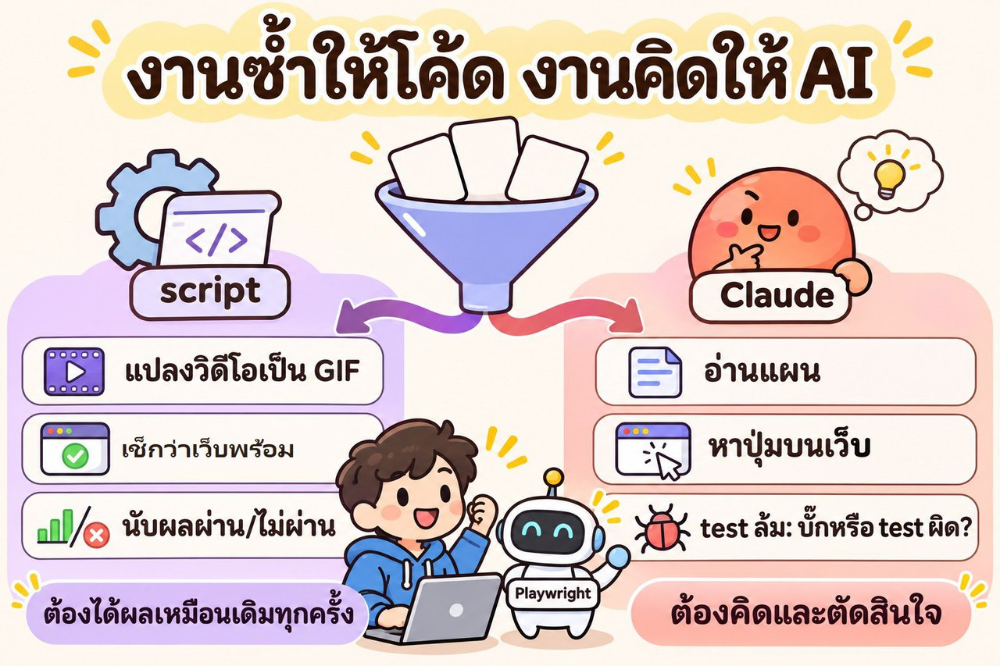

> **งานที่ต้องได้ผลเหมือนเดิมทุกครั้ง → ให้โค้ดทำ · งานที่ต้องคิดตัดสินใจ → ให้ AI ทำ**

| งานในการทดสอบ | ใครทำ | เหตุผล |
|---|---|---|
| แปลงวิดีโอเป็น GIF ขนาด ความเร็วเท่าเดิม | 🔧 สคริปต์ | ต้องเหมือนเดิมทุกครั้ง |
| เช็กว่าเว็บ healthy ก่อนรัน | 🔧 สคริปต์ | ขั้นตอนตายตัว |
| นับผ่าน/ไม่ผ่าน คิด % เทียบเกณฑ์ 95% | 🔧 สคริปต์ | เลขต้องถูกทุกครั้ง AI คิดเลขพลาดได้ |
| อ่านแผนแล้วออกแบบขั้นตอน test | 🧠 AI | ต้องเข้าใจภาษาคน |
| หาปุ่ม หาช่องบนหน้าเว็บ | 🧠 AI | เว็บแต่ละเว็บไม่เหมือนกัน |
| test ล้ม: บั๊กของเว็บ หรือ test เขียนผิด | 🧠 AI (+ คนตัดสิน) | ต้องดูหลักฐานแล้วคิด |

ผู้ทำคลิปที่สองมี skill ทำเอง 13 ตัว รวมสคริปต์ **107 ไฟล์** แปลว่างานซ้ำส่วนใหญ่ เขาไม่ให้ AI คิดใหม่แล้ว

> 📌 **ที่มา** 🅰️ ปัญหา tool แบบเดิม [03:35](https://youtu.be/CEvIs9y1uog?t=215) · code ดีกว่า [03:50](https://youtu.be/CEvIs9y1uog?t=230) · เรื่องสคริปต์ใส่สีสไลด์ [03:58](https://youtu.be/CEvIs9y1uog?t=238) – [04:12](https://youtu.be/CEvIs9y1uog?t=252) · สไลด์ scripts as tools [04:19](https://youtu.be/CEvIs9y1uog?t=259) · 🅺 กฎ "งานซ้ำให้โค้ด งานคิดให้ AI" [05:30](https://youtu.be/SaL8dtnSBxw?t=330) · 13 skill / 107 สคริปต์ [05:38](https://youtu.be/SaL8dtnSBxw?t=338) · ตารางงานทดสอบเป็นของบทเรียนเรา

---

## 10. เปิดทีละชั้น (progressive disclosure): มี skill เป็นร้อยตัว ทำไมไม่สับสน

ถ้าเราสร้าง skill เพิ่มเรื่อย ๆ บท 02, 03, 04, ทำ GIF, เขียนรายงาน… AI ต้องอ่านทุกตัวทุกครั้งไหม? **ไม่** เพราะ skill ถูกออกแบบให้ **เปิดทีละชั้น**

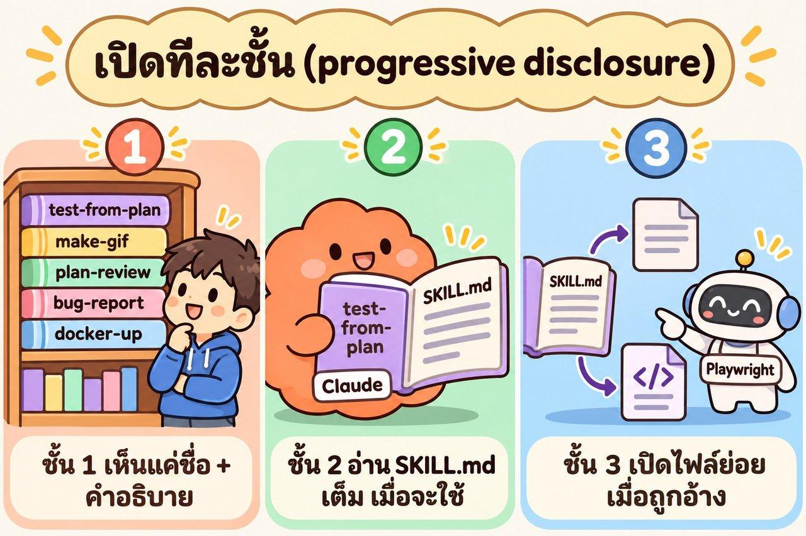

| ชั้น | AI เห็นอะไร | เห็นเมื่อไหร่ | อุปมาห้องสมุด | ตัวอย่างของเรา |
|---|---|---|---|---|
| **1** | `name` + `description` ของ **ทุก** skill | ตลอดเวลา | อ่านสันหนังสือทั้งชั้น | เห็นว่ามี `test-from-plan` "ใช้เมื่อสั่งทดสอบเว็บตามแผน" |
| **2** | เนื้อหา `SKILL.md` ทั้งไฟล์ ของ skill ที่เลือก | เมื่อตัดสินใจใช้ | หยิบเล่มเดียวมาเปิดสารบัญ | อ่านกติกา black-box + ขั้นตอน 1–5 |
| **3** | ไฟล์ย่อย / สคริปต์ | เมื่อ `SKILL.md` ชี้ไป และงานถึงขั้นนั้น | เปิดภาคผนวกเมื่อบทนั้นอ้าง | เจอ test ล้ม → ค่อยเปิด `references/bug-report.md` |

### 🔍 ลองดูของจริง: ชั้น 1 หน้าตาเป็นยังไง

💬 **พรอมต์**

```text
ตอนนี้คุณเห็น skill อะไรบ้าง บอกแค่ชื่อกับคำอธิบายสั้นๆ ที่คุณเห็นอยู่แล้ว ห้ามเปิดอ่านไฟล์ SKILL.md ใดๆ
แล้วตอบด้วยว่าคุณเห็นเนื้อหาข้างใน SKILL.md ของ skill เหล่านี้หรือยัง
```

✅ **ผลจริง** (เครื่องผู้สอน · 27 วินาที) Claude ไล่รายชื่อ skill มาหลายสิบตัวพร้อมคำอธิบายบรรทัดเดียว แล้วตอบท้ายว่า

```text
เรื่องเนื้อหาข้างใน SKILL.md: ยังไม่เห็นเลยครับ ผมเห็นเฉพาะชื่อกับคำอธิบายสั้นๆ ในรายการที่ระบบแนบมาเท่านั้น
ไม่ได้เปิดอ่านไฟล์ SKILL.md ใดๆ (เนื้อหาเต็มจะโหลดเข้ามาก็ต่อเมื่อเรียกใช้ skill นั้นจริง)
```

👀 นี่คือ **ชั้น 1** ของจริง: มี skill หลายสิบตัว แต่ที่อยู่ในแชตมีแค่ "สันหนังสือ" → นี่คือเหตุผลที่ `description` สำคัญที่สุด (หัวข้อ 7)

### ทำไมต้องประหยัดขนาดนี้: งบความสนใจ (attention budget)

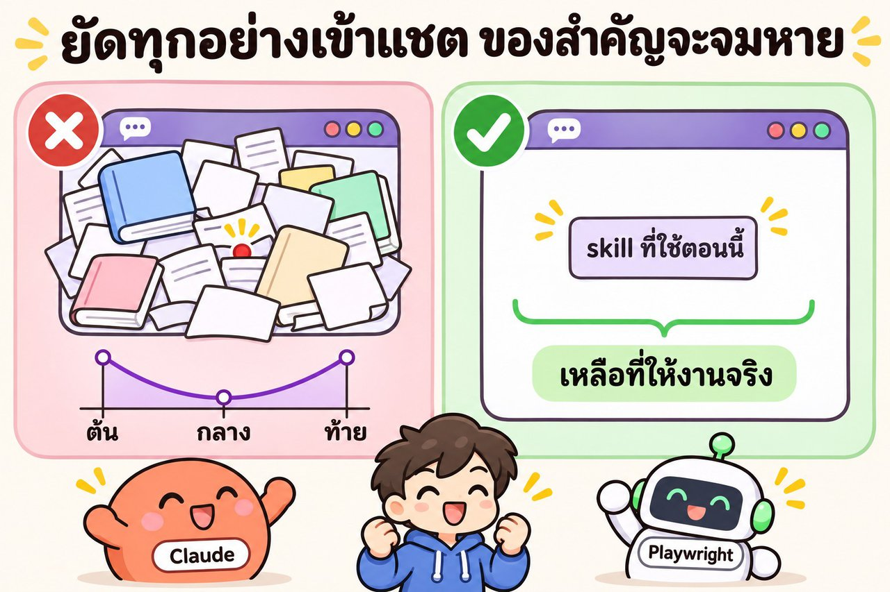

- ทุกข้อความในแชต AI ต้อง **อ่านใหม่หมดทุกครั้งที่ตอบ** ยิ่งยาวยิ่งต้องแบ่งความสนใจ Anthropic เรียกว่า **งบความสนใจ** ทุกคำที่เพิ่มเข้าไปแย่งความสนใจจากคำอื่น
- งานวิจัย **Lost in the Middle** พบว่า AI หาข้อมูลเจอดีเมื่ออยู่ **ต้นหรือท้าย** ของข้อความยาว แต่ถ้าอยู่ **ตรงกลาง** ผลแย่ลงชัดเจน
- แปลว่า **ยัดคู่มือทุกเล่มเข้าแชต ไม่ได้ทำให้ AI ฉลาดขึ้น แต่ทำให้ของสำคัญจมหาย**

ผู้ทำคลิปที่สองวัดของตัวเอง: หัวไฟล์ของ 13 skill รวมกัน ยาวแค่ประมาณ **1 ใน 27** ของเนื้อหา `SKILL.md` ทั้งหมด → ที่เหลืออีก 26 ส่วนไม่ต้องอยู่ในแชตจนกว่าจะใช้

> เคยรู้สึกไหมว่า "พรอมต์ยิ่งยาว AI ยิ่งพลาดบรรทัดที่สำคัญ" — นี่คือเหตุผล และ skill แก้ตรงนี้

> 📌 **ที่มา** 🅰️ ปกป้อง context [04:21](https://youtu.be/CEvIs9y1uog?t=261) · 3 ชั้น [04:29](https://youtu.be/CEvIs9y1uog?t=269) – [04:57](https://youtu.be/CEvIs9y1uog?t=297) · 🅺 อุปมาสันหนังสือ [06:05](https://youtu.be/SaL8dtnSBxw?t=365) · งบความสนใจ [06:12](https://youtu.be/SaL8dtnSBxw?t=372) · Lost in the Middle [06:30](https://youtu.be/SaL8dtnSBxw?t=390) · 1 ใน 27 [06:50](https://youtu.be/SaL8dtnSBxw?t=410) · ผล "ลองดูของจริง" รันบนเครื่องผู้สอน

---

## 11. ⭐ สรุป: สร้าง agent เพิ่ม vs เพิ่ม skill


| เรื่อง | 🤖🤖🤖 สร้าง agent ใหม่ทุกงาน | 🤖 + 📁 agent ตัวเดียว + skill |
|---|---|---|
| เริ่มงานใหม่ | สร้าง agent ตัวใหม่ เครื่องมือใหม่ | เพิ่มโฟลเดอร์ 1 โฟลเดอร์ |
| ความรู้งานอยู่ที่ | กระจายในตัว agent แต่ละตัว | ที่เดียว ในโฟลเดอร์ skill |
| เจอบทเรียนใหม่ | ไล่แก้ทุก agent | แก้ `SKILL.md` ไฟล์เดียว |
| ใครสร้างได้ | โปรแกรมเมอร์ | ใครก็ได้ (เขียน markdown เป็น) |
| แชร์ให้เพื่อน | ส่งโปรแกรมทั้งตัว | zip โฟลเดอร์ / Git |
| พื้นที่แชต | เครื่องมือทุกตัวอยู่ในแชตตลอด | เห็นแค่ชื่อ เปิดเมื่อใช้ |
| ความสม่ำเสมอ | แต่ละตัวคิดเอง | ทำตาม checklist เดิม + สคริปต์เดิม |

### แล้ว LAB 5 ในบท 02 ที่ใช้ agent 8 ตัวพร้อมกัน ผิดไหม?

**ไม่ผิด** ต้องแยก 2 คำนี้ให้ออก

| | **agent ย่อย (subagent)** ใน LAB 5 | **"สร้าง agent ใหม่"** ที่ทอล์คบอกว่าอย่าทำ |
|---|---|---|
| คืออะไร | Claude ตัวเดิม แตกตัวไปช่วยทำงานขนาน | โปรแกรม agent ใหม่ที่ออกแบบเฉพาะสายงาน |
| ความรู้งาน | ใช้ skill ชุดเดียวกับตัวหลัก | ฝังอยู่ในตัว agent นั้น |
| เปรียบเป็น | พนักงานหลายคนในบริษัทเดียว ถือคู่มือเล่มเดียวกัน | ตั้งบริษัทใหม่ทุกครั้งที่มีงานใหม่ |

> **agent = คนทำงาน · skill = ความรู้งาน** — จะมีคนทำงานกี่คนก็ได้ แต่ความรู้งานควรอยู่ที่เดียว และทุกคนเปิดอ่านได้

> 📌 **ที่มา** ตารางเทียบรวบรวมจากหัวข้อ 2–10 · เรื่อง subagent กับ agent ย่อยใน LAB 5 เป็นคำอธิบายของบทเรียนเรา (ทอล์คพูดถึงการ "สร้าง" agent ใหม่ ไม่ได้ห้ามใช้ agent ย่อย)

---

## 12. agent ทั่วไป มี 4 ชิ้น: skill อยู่ตรงไหน


ทอล์คบอกว่าทุกคนกำลังมาเจอกันที่สถาปัตยกรรมเดียวกัน

| ชิ้น | หน้าที่ | อุปมา | ในงานของเรา |
|---|---|---|---|
| **Agent loop** | คุมว่าอะไรเข้า-ออก context | ผู้จัดการโต๊ะทำงาน | Claude Code |
| **Runtime** | มีไฟล์ + รันโค้ดได้ | โต๊ะและเครื่องมือช่าง | เครื่องเรา: terminal, Docker, Node.js |
| **MCP** | ต่อเครื่องมือ/ข้อมูลภายนอก | **มือ** | Playwright MCP (ให้ Claude ใช้เบราว์เซอร์) |
| **Skills** | ความรู้ "ทำยังไง" โหลดเมื่อใช้ | **ประสบการณ์** | `test-from-plan` |

> **MCP คือมือ · skill คือประสบการณ์** — Playwright ให้ "มือ" กดเว็บได้ แต่ไม่ได้บอกว่า "ห้องเราทดสอบกันแบบไหน" skill เติมส่วนนั้น
> อยากให้ AI ทำงานสายใหม่ → เพิ่ม MCP ที่ใช่ + skill ที่ใช่ **ไม่ต้องสร้าง agent ใหม่**

> 📌 **ที่มา** 🅰️ architecture ของ general agent [09:07](https://youtu.be/CEvIs9y1uog?t=547) · agent loop / runtime [09:15](https://youtu.be/CEvIs9y1uog?t=555) · [09:24](https://youtu.be/CEvIs9y1uog?t=564) · 🅺 "MCP คือมือ skill คือประสบการณ์" [07:52](https://youtu.be/SaL8dtnSBxw?t=472) · ภาพ 4 ชิ้น [09:24](https://youtu.be/SaL8dtnSBxw?t=564)

---

## 13. ใครสร้าง skill บ้าง และดูแล skill เหมือนซอฟต์แวร์

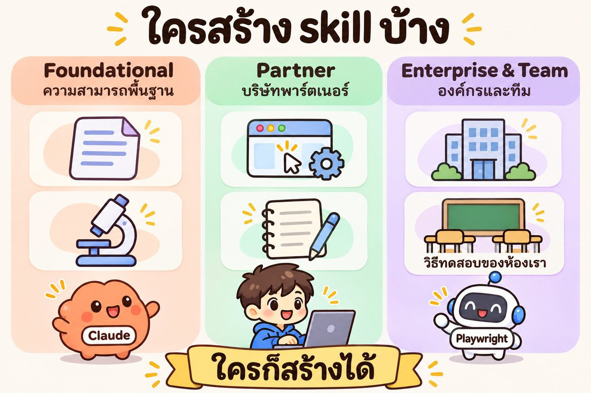

| ประเภท | ใครสร้าง | ตัวอย่างจากทอล์ค |
|---|---|---|
| **Foundational** | Anthropic และผู้เชี่ยวชาญ | สร้าง/แก้ไฟล์ Word Excel PowerPoint PDF · skill วิทยาศาสตร์ 120+ ตัว |
| **Partner** | บริษัทที่อยากให้ Claude ใช้ผลิตภัณฑ์ตัวเองเก่ง | skill คุมเบราว์เซอร์อัตโนมัติ · skill ค้นข้อมูลใน workspace |
| **Enterprise & Team** | องค์กร/ทีม | กติกาภายในบริษัท Fortune 100 · code style ของทีมนักพัฒนาหลายพันคน → **skill ทดสอบของห้องเรา อยู่กลุ่มนี้** |

ทอล์คเห็น **แนวโน้ม 3 อย่าง**: skill ซับซ้อนขึ้นจนเหมือนโปรแกรม (มี scripts, templates, tests) · ใช้คู่กับ MCP · คนที่ไม่ใช่โปรแกรมเมอร์ (การเงิน HR กฎหมาย) เริ่มเขียน skill เอง

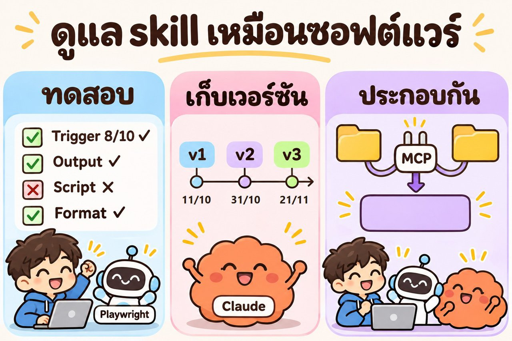

เมื่อ skill ซับซ้อนขึ้น ต้อง **ดูแลเหมือนซอฟต์แวร์**

| เรื่อง | ความหมาย | ตัวอย่างบนสไลด์ | ในงานของเรา |
|---|---|---|---|
| **ทดสอบ** | skill ถูกหยิบใช้ถูกจังหวะไหม ผลดีไหม | Trigger ถูก 8/10 ✓ · ผลตรงรูปแบบ ✓ · สคริปต์ `apply_template.py` ล้ม ✗ | พิมพ์ "ทดสอบเว็บตามแผน" ในแชตใหม่ → หยิบ `test-from-plan` ไหม |
| **เก็บเวอร์ชัน** | ติดตามว่าแก้อะไร เมื่อไหร่ | 3 รุ่น ลงวันที่ 11 ต.ค. · 31 ต.ค. · 21 พ.ย. 2025 | เก็บ skill ใน Git ดู diff ทุกครั้งที่สั่งแก้ |
| **ประกอบกัน** | skill เรียกใช้ skill/MCP อื่นได้ | Branded Decks = Brand Style + PowerPoint | ทดสอบ = test-from-plan + Playwright MCP |

> 📌 **ที่มา** 🅰️ 3 ประเภท [05:06](https://youtu.be/CEvIs9y1uog?t=306) – [07:26](https://youtu.be/CEvIs9y1uog?t=446) · แนวโน้ม 3 อย่าง [07:28](https://youtu.be/CEvIs9y1uog?t=448) · ดูแลเหมือนซอฟต์แวร์ [10:37](https://youtu.be/CEvIs9y1uog?t=637) · 🅺 สไลด์ Exploring how Skills evolve [09:59](https://youtu.be/SaL8dtnSBxw?t=599)

---

## 14. AI "เรียนรู้" ได้ยังไง: Claude วันที่ 30 เก่งกว่าวันที่ 1 จริงไหม

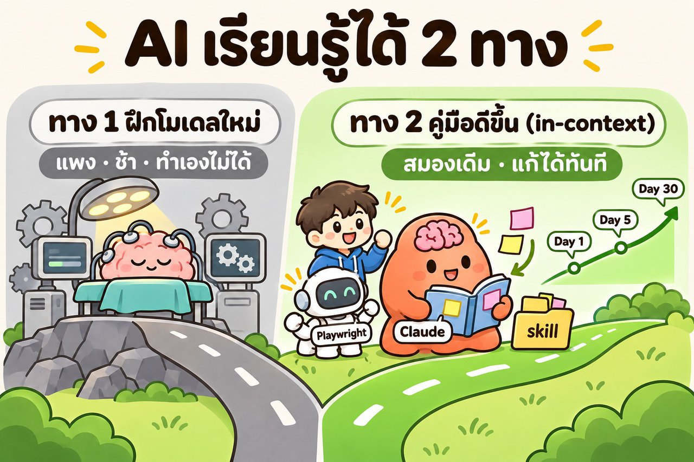

ทอล์คปิดด้วยประโยคที่คนจำได้มากที่สุด: **"Claude วันที่ 30 ที่ทำงานกับคุณ จะเก่งกว่า Claude วันที่ 1 มาก"** (Day 1 ไม่มี skill · Day 5 มีไม่กี่ตัว · Day 30 มีเยอะ)

แต่โมเดลไม่ได้เปลี่ยนเลย แล้ว "เก่งขึ้น" ได้ยังไง? AI เรียนรู้ได้ 2 ทาง

| ทาง | ทำยังไง | ข้อดี / ข้อเสีย |
|---|---|---|
| 1. ฝึกโมเดลใหม่ | แก้ "สมอง" จริง ๆ | แพง ช้า คนทั่วไปทำเองไม่ได้ |
| 2. in-context learning | ให้อ่านความรู้ตอนทำงาน | **สมองเดิม แต่คู่มือดีขึ้นทุกวัน และแก้ได้ทันที** |

**skill คือทาง 2** — skill ไม่ได้เก็บ "ข้อมูลทุกอย่าง" แต่เก็บ **"วิธีทำ"** ที่ AI ใช้กับงานเฉพาะได้

### การทดลองจริงของผู้ทำคลิปที่สอง

เขามี skill ทำคลิปยาวที่ **แก้มาแล้ว 37 รอบในสามวัน** ทุกรอบมาจากจุดที่เขาเห็นว่ามันพลาด แล้วทดลองแบบนี้

- เอา skill **วันแรก** กับ skill **วันนี้** มาเขียนบทคลิป 8 นาทีเรื่องเดียวกัน **ฝั่งละ 3 รอบ**
- ตรวจด้วยกฎ 2 กอง: **กฎเดิม 10 ข้อ** (วันแรกมีอยู่แล้ว) และ **กฎใหม่ 6 ข้อ** (เพิ่มทีหลังจากที่เห็นมันพลาด)

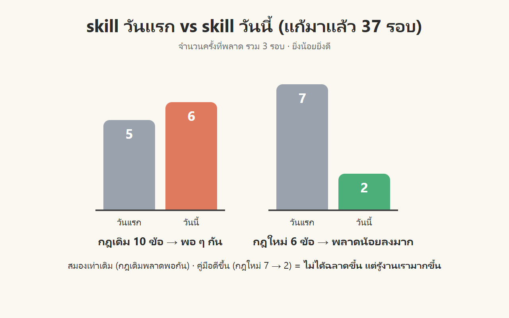

| | skill วันแรก | skill วันนี้ | อ่านผลว่า |
|---|---|---|---|
| พลาดกฎเดิม (10 ข้อ) | 5 | 6 | **สมองเท่าเดิม** ทำได้พอ ๆ กัน |
| พลาดกฎใหม่ (6 ข้อ) | 7 | **2** | **คู่มือดีขึ้น** บทเรียนที่จดไว้ใช้ได้จริง |
| เวลาเฉลี่ย | 9:40 นาที | 9:27 นาที | ไม่ได้เร็วขึ้น |

> **Claude วันที่ 30 ไม่ได้ฉลาดขึ้น แต่รู้งานเรามากขึ้น**

ข้อสังเกตเพิ่ม
- จาก 36 รอบที่แก้หลังวันแรก มีแค่ 6 รอบที่เกี่ยวกับการเขียนบท อีก **30 รอบคือความสามารถใหม่** ที่วันแรกทำไม่ได้เลย (ตัด Shorts, ตรวจเสียง, ทำปก ฯลฯ)
- skill วันนี้ก็ยังพลาด: มีรอบหนึ่งให้เขาเรียกตัวเองว่า "พี่" ถึง 13 บรรทัด ไม่มีกฎข้อไหนจับได้ เขาต้องเห็นเองแล้วสั่งให้จดเพิ่ม
- ข้อจำกัด: ทดลองแค่ฝั่งละ 3 รอบ เป็นแค่ "ผลในการทดลองนี้"

**เทียบกับบท 02:** เฉลยรุ่นแรกที่คนเขียนไว้ตรวจ TC-AUTH-02 แค่ 4 ช่อง จึงพลาดบั๊กช่องยืนยันรหัสผ่าน บทเรียนนี้ถ้าจดลง skill ว่า "ตรวจให้ครบทุกคำในผลที่คาดหวัง" รอบหน้าก็ไม่พลาดอีก — นี่คือ Day 1 → Day 30 ของเรา

> 📌 **ที่มา** 🅰️ continuous learning / Day 1 → Day 30 [13:13](https://youtu.be/CEvIs9y1uog?t=793) · 🅺 หลักการที่ 4 สองทางของการเรียนรู้ [11:04](https://youtu.be/SaL8dtnSBxw?t=664) – [11:19](https://youtu.be/SaL8dtnSBxw?t=679) · การทดลอง 37 รอบ [13:56](https://youtu.be/SaL8dtnSBxw?t=836) – [15:52](https://youtu.be/SaL8dtnSBxw?t=952) · "ไม่ได้ฉลาดขึ้น แต่รู้งานเรามากขึ้น" [16:02](https://youtu.be/SaL8dtnSBxw?t=962) · ตัวอย่าง TC-AUTH-02 มาจากบท 02 ของเรา

---

## 15. ⚠️ ตัวเลขจากงานวิจัย: ทำไมคนต้องตรวจ skill

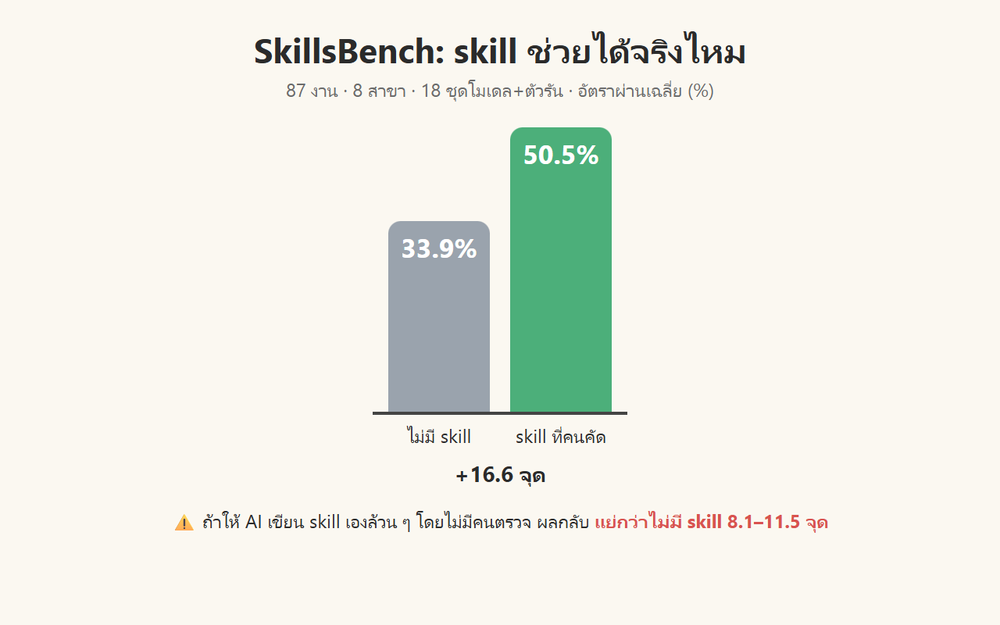

งานวิจัย **SkillsBench** ทดสอบ AI กับ 87 งานใน 8 สาขา

| สิ่งที่พบ | ตัวเลข | แปลว่า |
|---|---|---|
| ใส่ skill ที่ **คนคัด/ตรวจแล้ว** | อัตราผ่าน 33.9% → **50.5%** (+16.6 จุด) | skill ช่วยจริง |
| skill **เล็ก โฟกัสงานเดียว** (ไม่เกิน 3 ส่วน) | ดีกว่าคู่มือยาวที่ครอบทุกอย่าง | 1 skill = 1 งาน |
| ให้ AI **เขียน skill เองล้วน ๆ** ไม่มีคนช่วย | **แย่กว่าไม่มี skill 8.1–11.5 จุด** | ❗ ต้องมีคนตรวจ |
| โมเดลเล็ก + skill | ทำได้ใกล้โมเดลใหญ่ที่ไม่มี skill | ความรู้งานชดเชยขนาดสมองได้ |

**บทเรียน:** ให้ AI **ช่วยร่าง** skill ได้ (เร็วมาก) แต่ **คนต้องอ่าน และชี้จุดผิด** เสมอ เพราะคนเท่านั้นที่รู้ว่า "วิธีทำงานที่ถูก" ของเราคืออะไร
ในบท 02 คนที่รู้ว่า "ห้ามแก้ test ให้ผ่านเฉย ๆ" คือ tester ไม่ใช่ AI

> 📌 **ที่มา** 🅺 SkillsBench [06:51](https://youtu.be/SaL8dtnSBxw?t=411) – [07:33](https://youtu.be/SaL8dtnSBxw?t=453) (arXiv 2602.12670) · AI เขียน skill เองล้วน −8.1 ถึง −11.5 [12:42](https://youtu.be/SaL8dtnSBxw?t=762) · ทอล์ค Anthropic ไม่ได้อ้าง SkillsBench ผู้ทำคลิปเสริมเอง

---

## 16. สร้าง skill แรกใน 6 ขั้น (สิ่งที่จะทำใน ส่วน 02)


| ขั้น | ทำอะไร | ในส่วน 02 (บท 02 PawPantry) |
|---|---|---|
| 1 | **เลือกงานที่สั่ง AI ซ้ำบ่อยที่สุด** | "ทดสอบเว็บตามแผน" = LAB 2, 4–7 ที่ต้อง copy-paste ทุกครั้ง |
| 2 | **ทำงานนั้นกับ Claude 1 รอบ** จนได้ผลที่ชอบ | ให้ Claude อ่าน README บท 02 แล้วทำตามจนได้รายงาน |
| 3 | **สั่งประโยคเดียว "เก็บวิธีทำงานนี้เป็น skill"** | ได้โฟลเดอร์ `test-from-plan/` + สคริปต์ทำ GIF |
| 4 | **ตรวจหัวไฟล์** ว่าบอกชัดว่าใช้ตอนไหน | อ่าน `description` |
| 5 | **อ่าน skill ที่มันเขียน ตรงไหนผิดสั่งแก้** ⭐ ขั้นสำคัญที่สุด | เช็กว่ากติกา black-box ครบไหม |
| 6 | **เปิดแชตใหม่ สั่งงานเดิมสั้น ๆ** ดูว่าหยิบ skill เองไหม | "ทดสอบเว็บตามแผนให้หน่อย" |
| 🔁 | ทุกครั้งที่พลาด สั่ง **"จดบทเรียนนี้ลง skill"** | เช่น เปิดโหมดฝังบั๊กแล้วพลาด → จดเพิ่ม |

> ขั้น 2 คือสิ่งที่ผู้ใช้หลายคนข้าม: **ให้ AI ลงมือทำจริงก่อน** แล้วค่อยเก็บเป็น skill เพราะ skill ที่ดีมาจาก "วิธีที่ทำแล้วได้ผลจริง" ไม่ใช่จากการเดา

> 📌 **ที่มา** 🅺 6 ขั้น [12:39](https://youtu.be/SaL8dtnSBxw?t=759) – [13:53](https://youtu.be/SaL8dtnSBxw?t=833) · "จดบทเรียนนี้ลง skill" [13:56](https://youtu.be/SaL8dtnSBxw?t=836) · คอลัมน์ "ในส่วน 02" เป็นแผนของบทเรียนเรา

---

## 17. ความปลอดภัย: skill ของคนอื่น = โค้ดของคนแปลกหน้า


เพราะ skill ใส่สคริปต์ได้ และ AI จะ **รันสคริปต์นั้นในเครื่องเรา**

- บริษัทความปลอดภัย **Snyk** สแกน skill ในคลังชุมชนเกือบ **4,000 ตัว** (รายงาน ToxicSkills) ผู้ทำคลิปบอกว่าเจอตัวที่ **ตั้งใจร้าย 76 ตัว** บางตัวแอบขโมยรหัสเข้าระบบคลาวด์ และรายงานยังระบุว่าราว 13% มีปัญหาความปลอดภัยระดับร้ายแรงอย่างน้อย 1 ข้อ
- **กฎ:** ก่อนติดตั้ง skill ของคนอื่น **เปิดอ่าน `SKILL.md` และสคริปต์ทุกไฟล์** หรือสั่ง Claude อ่านแล้วสรุปให้ก่อนว่าสคริปต์ทำอะไร ส่งข้อมูลไปไหน
- skill ที่เราสร้างเองจากงานของเรา ปลอดภัยที่สุด

> 📌 **ที่มา** 🅺 Snyk ToxicSkills [15:54](https://youtu.be/SaL8dtnSBxw?t=954) – [16:22](https://youtu.be/SaL8dtnSBxw?t=982) (ตัวเลข 76 มาจากคำพูดในคลิป ส่วน ~13% มาจากหน้ารายงานบนจอ)

---

## 🧱 ภาพใหญ่: ทำไมเรื่องนี้สำคัญกับอนาคต

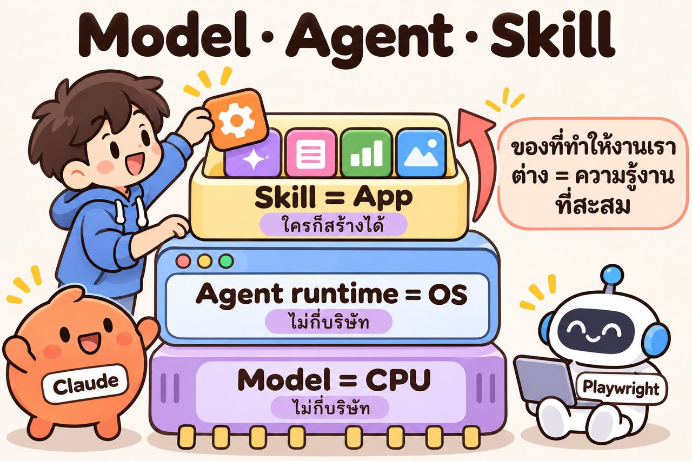

ทอล์คเปรียบกับคอมพิวเตอร์

| คอมพิวเตอร์ | AI | ใครสร้าง |
|---|---|---|
| CPU | Model (โมเดล) | ไม่กี่บริษัท ลงทุนมหาศาล |
| ระบบปฏิบัติการ (OS) | Agent runtime เช่น Claude Code | ไม่กี่บริษัท |
| **แอป** | **Skill** | **ใครก็สร้างได้** |

ถ้าทุกคนใช้โมเดลเดียวกัน สิ่งที่ทำให้งานของเราดีกว่าคนอื่นคือ **ความรู้งานที่เราสะสมไว้ในรูป skill**
tester ที่มี skill ทดสอบที่ขัดเกลามา 30 วัน จะทำงานได้ต่างจาก tester ที่เริ่มจากแชตเปล่าทุกวัน

> 📌 **ที่มา** 🅰️ Moving up the stack [14:33](https://youtu.be/CEvIs9y1uog?t=873) · 🅺 [11:58](https://youtu.be/SaL8dtnSBxw?t=718) – [12:17](https://youtu.be/SaL8dtnSBxw?t=737)

---

## ✅ สรุป 10 ข้อ

1. ทีม Anthropic **เลิกสร้าง agent ใหม่ทุกงาน** เพราะ agent ตัวเดียว (bash + ไฟล์) ทำได้เกือบทุกงานผ่านโค้ด
2. สิ่งที่ AI ขาดไม่ใช่ความฉลาด แต่คือ **ความรู้งานของเรา** — อัจฉริยะ IQ 300 แพ้นักภาษีที่ทำงานมา 10 ปี
3. ความรู้ที่ขาดคือ **"รู้ว่าทำยังไง"** (procedural) ได้มาจากการลงมือทำ
4. **skill = โฟลเดอร์** มี `SKILL.md` (+ ไฟล์ประกอบ + สคริปต์)
5. `description` ในหัวไฟล์สำคัญที่สุด เพราะเป็นส่วนเดียวที่ AI เห็นก่อนตัดสินใจ
6. skill ส่วนตัวอยู่ที่ `~/.claude/skills/` (ใช้ได้ทุกโปรเจกต์) skill ของโปรเจกต์อยู่ที่ `<โปรเจกต์>/.claude/skills/`
7. **งานซ้ำให้สคริปต์ งานคิดให้ AI**
8. **เปิดทีละชั้น** ทำให้มี skill เป็นร้อยได้โดยไม่เปลืองงบความสนใจ
9. **agent = คนทำงาน · skill = ความรู้งาน** — agent ย่อยหลายตัวใช้ skill ชุดเดียวกันได้
10. skill ที่ **คนตรวจ** ช่วยมาก (+16.6 จุด) แต่ skill ที่ AI เขียนเองล้วน **แย่กว่าไม่มี** → ทำ 1 รอบ → เก็บ → ตรวจ → ทดสอบ → จดบทเรียนทุกครั้งที่พลาด

## 📝 คำถามทบทวน

1. ถ้าเพื่อนบอกว่า "จะสร้าง Testing agent ตัวใหม่ แยกจาก Claude Code" จะอธิบายเพื่อนยังไงว่าทำไมการทำ skill ดีกว่า (ตอบอย่างน้อย 3 เหตุผล)
2. ในตาราง 4.4 ยกตัวอย่าง "ความรู้ของนักภาษี" ในงานทดสอบของเรามา 3 ข้อ และบอกว่าถ้า AI ไม่รู้ จะเกิดอะไร
3. งานต่อไปนี้ควรให้สคริปต์หรือ AI ทำ: (ก) แปลงไฟล์ผลรันเป็นตารางสรุป % (ข) ตัดสินว่า test ที่ล้มเป็นบั๊กเว็บไหม (ค) ตั้งค่า GIF ให้ช้าพอคนดูทัน
4. มี skill 50 ตัว แต่ละตัว `SKILL.md` ยาว 2,000 คำ ทำไมการยัดทั้งหมดลงแชตเป็นความคิดที่ไม่ดี
5. description `ช่วยเรื่องเว็บ` มีปัญหาอะไร ลองเขียนใหม่ให้ดีขึ้น
6. ทำไมผลทดลอง "กฎเดิม 5 vs 6 · กฎใหม่ 7 vs 2" ถึงสรุปว่า "ไม่ได้ฉลาดขึ้น แต่รู้งานมากขึ้น"

<details>
<summary>✅ แนวคำตอบ</summary>

1. ความรู้อยู่ที่เดียว แก้ไฟล์เดียว · ไม่ต้องสร้าง/ดูแลโปรแกรมใหม่ · แชร์ได้ด้วย zip/Git · Claude Code ทำงานทดสอบได้อยู่แล้ว (bash + ไฟล์) ที่ขาดคือความรู้งาน ไม่ใช่ตัว agent · เปิดทีละชั้น ไม่เปลือง context
2. เช่น ห้ามเปิด `petshop/` (ไม่งั้นทดสอบแบบโกง ไม่ใช่ black-box) · ห้ามอ่านหัวข้อ 8 (เห็นเฉลยบั๊ก) · ใช้ Chromium เดิม (ไม่งั้นโหลดเบราว์เซอร์หลายร้อย MB) · test ล้มห้ามแก้ให้ผ่าน (ไม่งั้นบั๊กหลุด)
3. (ก) สคริปต์ — ต้องคิดเลขถูกทุกครั้ง · (ข) AI + คนตัดสิน — ต้องดูหลักฐานแล้วคิด · (ค) สคริปต์ — ต้องเหมือนเดิมทุกครั้ง
4. กินงบความสนใจ ข้อมูลสำคัญจมกลางข้อความ (Lost in the Middle) เหลือที่ให้งานจริงน้อย → ใช้ progressive disclosure ให้เห็นแค่ชื่อ+คำอธิบาย
5. กว้างเกิน AI ไม่รู้ว่าใช้ตอนไหน เช่นเขียนใหม่: `ทดสอบเว็บแบบ black-box ตาม TEST-PLAN.md ด้วย Playwright จนได้รายงานและคำตัดสิน ใช้เมื่อผู้ใช้สั่ง "ทดสอบเว็บตามแผน"`
6. กฎเดิมพลาดพอกัน = ความสามารถพื้นฐาน (สมอง) ไม่เปลี่ยน · กฎใหม่พลาดลดจาก 7 เหลือ 2 = เพราะ skill จดบทเรียนไว้ (คู่มือดีขึ้น)

</details>

## 📖 คำศัพท์

| คำ | ความหมายง่าย ๆ |
|---|---|
| **Agent** | AI ที่ทำงานเป็นขั้น ๆ เองได้ สั่งคำสั่ง อ่านเขียนไฟล์ได้ เช่น Claude Code |
| **Subagent / agent ย่อย** | agent ตัวเดิมแตกตัวไปช่วยทำงานขนาน |
| **Skill** | โฟลเดอร์ความรู้ "ทำยังไง" ที่ agent เปิดใช้เมื่อถึงงานนั้น |
| **`SKILL.md`** | ไฟล์หลักของ skill มีหัวไฟล์ (name, description) + ขั้นตอน |
| **Frontmatter / หัวไฟล์** | ส่วนบนสุดของ `SKILL.md` ระหว่าง `---` สองเส้น |
| **Declarative / Procedural** | รู้ว่าอะไร / รู้ว่าทำยังไง |
| **Progressive disclosure** | เปิดเผยทีละชั้น: ชื่อ → เนื้อหา → ไฟล์ย่อย |
| **Context / งบความสนใจ** | ข้อความทั้งหมดที่ AI เห็นในแชต ยิ่งยาวยิ่งแบ่งความสนใจ |
| **MCP** | มาตรฐานต่อ AI กับเครื่องมือภายนอก ("มือ") |
| **In-context learning** | AI ทำงานใหม่ได้จากความรู้ที่อ่านตอนทำงาน โดยไม่ต้องฝึกใหม่ |

## 📚 แหล่งที่มา

| แหล่ง | สรุปไว้ที่ |
|---|---|
| ทอล์ค *Don't Build Agents, Build Skills Instead* — Barry Zhang & Mahesh Murag (Anthropic), AI Engineer · [YouTube](https://www.youtube.com/watch?v=CEvIs9y1uog) | `mlflow/_yt_lesson/2026-10-31_AI_Engineer_Dont_Build_Agents_Build_Skills_Instead/lesson.md` |
| *ผมลองทำตามทอล์ค Anthropic กับงานจริงของผม ได้ผลแบบนี้* — Kreycin · [YouTube](https://www.youtube.com/watch?v=SaL8dtnSBxw) | `mlflow/_yt_lesson/2026-10-31_Kreycin_ผมลองทำตามทอล์ค_Anthropic_กับงานจริงของผม_ได้ผลแบบนี้/lesson.md` |
| งานวิจัยที่อ้างในคลิป: SkillsBench (arXiv 2602.12670) · CoALA (arXiv 2309.02427) · Lost in the Middle (arXiv 2307.03172) · Snyk ToxicSkills | — |

ภาพประกอบทุกภาพสร้างใหม่ให้เข้ากับบทนี้ ไม่ได้ตัดจากวิดีโอ กราฟตัวเลข 2 ภาพวาดจากตัวเลขจริงในคลิป

### ไฟล์ในส่วนนี้

```text
05_agent-skills/
├─ 01_skill-theory/      # ส่วนนี้: ทฤษฎี
│  ├─ README.md
│  └─ img/
└─ 02_skill-test-from-plan/   # ถัดไป: สร้าง skill จากบท 02 (กำลังทำ)
```
