# บท 05 · ส่วน 01 — Agent Skills: เลิกสร้าง agent ใหม่ แล้วสอน AI ให้ "รู้งาน" ด้วย skill


ในบท 02–04 เราได้ผลดีมาก แต่ทุกครั้งที่เปิดแชตใหม่ เราต้อง **copy-paste พรอมต์ทีละ LAB ใหม่ทั้งหมด**
บทนี้ตอบคำถามว่า "ทำยังไงให้ AI จำ **วิธีทำงานแบบของเรา** ได้ แล้วสั่งสั้น ๆ ประโยคเดียวก็ทำครบ"
คำตอบคือ **Agent Skill** ตามที่ทีม Anthropic เสนอไว้ในทอล์ค *Don't Build Agents, Build Skills Instead*


> **ส่วนนี้เป็นทฤษฎีล้วน** อ่านให้เข้าใจก่อน แล้วจึงไปลงมือใน [ส่วน 02](../02_skill-test-from-plan/) ที่จะเปลี่ยนบท 02 ทั้งบทให้เป็น skill
> เนื้อหาเรียบเรียงจาก 2 คลิป (ลิงก์อยู่ท้ายบท) แล้วเปลี่ยนตัวอย่างให้เป็นงานทดสอบเว็บของเรา

## 🎯 อ่านจบแล้วต้องตอบได้

1. ทำไมทีม Anthropic **เลิกสร้าง agent แยกตามงาน** แล้วใช้ agent ตัวเดียว + skill
2. "อัจฉริยะ IQ 300" กับ "คนธรรมดาที่ทำงานนี้มา 10 ปี" ต่างกันตรงไหน และ AI วันนี้เป็นแบบไหน
3. skill หน้าตาเป็นยังไง เก็บอยู่ที่ไหนในเครื่อง (Windows / Mac) และ `SKILL.md` มีส่วนไหนสำคัญที่สุด
4. ทำไม AI มี skill เป็นร้อยตัวได้โดยไม่สับสน (เปิดทีละชั้น)
5. ทำไม skill ที่ AI เขียนเองล้วน ๆ ถึง **แย่กว่าไม่มี** และคนต้องทำอะไร
6. องค์กรที่มีหลายแผนกควร **แชร์ skill** กันยังไง (ส่วนกลาง + เครื่องแต่ละคน) และทำยังไงให้ AI **หา skill เจอเร็ว** เมื่อมีเป็นร้อยเป็นพัน

### ⏱️ ทั้งบทใน 1 นาที


## 📢 ใครเสนอเรื่องนี้ และข้อมูลในบทนี้มาจากไหน


วิธีคิดใหม่ "**เลิกสร้าง agent ใหม่ แล้วสร้าง skill แทน**" ไม่ได้มาจากผู้สอน แต่มาจาก **ทีมที่สร้าง Agent Skills เอง**

| | แหล่งที่ 1 · ต้นทางของแนวคิด | แหล่งที่ 2 · คนลองทำตามแล้ววัดผล |
|---|---|---|
| ชื่อ | ทอล์ค **Don't Build Agents, Build Skills Instead** | คลิป **ผมลองทำตามทอล์ค Anthropic กับงานจริงของผม ได้ผลแบบนี้** |
| ใคร | **Barry Zhang** และ **Mahesh Murag** ทีมเทคนิคของ **Anthropic** (บริษัทที่ทำ Claude) ทั้งคู่เป็นผู้สร้าง Agent Skills · Barry เคยเขียนบทความสอนสร้าง agent ของ Anthropic · Mahesh เคยทำ MCP | **Kreycin** ยูทูบเบอร์ไทยที่ทำหนังแอนิเมชันด้วย Claude Code และมี skill ทำเอง 13 ตัว |
| ที่ไหน | เวทีสัมมนา **AI Engineer** (ช่อง YouTube "AI Engineer") ปลายปี 2025 ราว 5 สัปดาห์หลัง Anthropic เปิดตัว Agent Skills | ช่อง YouTube Kreycin |
| ยาว | 16:19 นาที (ซับอังกฤษ) | 16:54 นาที (ซับไทย) |
| ให้อะไรกับบทนี้ | วิธีคิดเดิม → วิธีคิดใหม่ · นิยาม skill · การเปิดทีละชั้น · สถาปัตยกรรม · อนาคตของ skill | หลักการ 4 ข้อ · ตัวเลขงานวิจัย (SkillsBench) · 6 ขั้นสร้าง skill แรก · ผลทดลอง skill วันแรก vs วันนี้ · ความปลอดภัย |
| ลิงก์ | [youtube.com/watch?v=CEvIs9y1uog](https://www.youtube.com/watch?v=CEvIs9y1uog) | [youtube.com/watch?v=SaL8dtnSBxw](https://www.youtube.com/watch?v=SaL8dtnSBxw) |

> 📌 **ทุกหัวข้อในบทนี้มีบรรทัด "ที่มา" พร้อมลิงก์เวลาในคลิป** กดแล้วกระโดดไปฟังช่วงนั้นได้เลย
> 🅰️ = ทอล์ค Anthropic · 🅺 = คลิป Kreycin · ตัวอย่างงานทดสอบ (PawPantry, บท 02) เป็นของบทเรียนเราเอง ไม่ได้มาจากคลิป

## 🗺️ เส้นทางของส่วนนี้

บทนี้แบ่งเป็น **4 ภาค** อ่านเรียงได้เลย หรือกระโดดไปภาคที่สนใจ

| ภาค | # | หัวข้อ | คำถามที่ตอบ |
|---|---|---|---|
| 🧩 **1 ทำไมต้องมี skill** | 1 | ปัญหาของเรา | ทำไม copy-paste ทุก LAB ถึงเป็นปัญหา |
| | 2 | **วิธีคิดเดิม**: งานละ agent | ทำไมไม่สร้าง "Testing agent" แยกไปเลย |
| | 3 | **วิธีคิดใหม่**: agent ตัวเดียว + skill | ทำไม agent ตัวเดียวพอ และใครค้นพบ |
| | 4 | อัจฉริยะ vs คนที่รู้งาน ⭐ | แล้ว agent ตัวเดียวยังขาดอะไร |
| | 5 | รู้ว่าอะไร vs รู้ว่าทำยังไง | ความรู้ที่ขาดคือความรู้ชนิดไหน |
| 📁 **2 skill ทำงานยังไง** | 6 | skill คือโฟลเดอร์ | หน้าตาของ skill |
| | 7 | ข้างใน `SKILL.md` | ส่วนไหนสำคัญที่สุด |
| | 8 | skill อยู่ที่ไหนในเครื่อง | Windows / Mac / โปรเจกต์ |
| | 9 | สคริปต์ใน skill | งานไหนให้โค้ด งานไหนให้ AI |
| | 10 | เปิดทีละชั้น | มี skill เป็นร้อยตัว ทำไมไม่สับสน |
| | 11 | agent เพิ่ม vs skill เพิ่ม ⭐ | สรุปว่าทำไม skill ดีกว่า (และ agent หลายตัวในบท 02 ผิดไหม) |
| | 12 | agent ทั่วไป 4 ชิ้น | skill อยู่ตรงไหนของระบบ |
| 📈 **3 ทำให้ skill เก่งขึ้น** | 13 | ใครสร้าง skill และ skill = ซอฟต์แวร์ | ทดสอบ เก็บเวอร์ชัน ประกอบกัน |
| | 14 | AI เรียนรู้ได้ยังไง | Claude วันที่ 30 เก่งกว่าวันที่ 1 จริงไหม |
| | 15 | ตัวเลขจากงานวิจัย ⚠️ | ทำไมคนต้องตรวจ skill |
| | 16 | สร้าง skill แรกใน 6 ขั้น | ส่วน 02 จะทำอะไร |
| | 17 | ความปลอดภัย | skill ของคนอื่นอันตรายไหม |
| 🏢 **4 skill ระดับองค์กร** | 18 | จุดที่เจ็บ ⭐ | งานซ้ำในแต่ละแผนก และความรู้ที่ติดอยู่ในหัวคน |
| | 19 | วิสัยทัศน์จากทอล์ค | ฐานความรู้กลาง คนใหม่วันแรกก็รู้งาน |
| | 20 | บริษัทตัวอย่าง | งาน 1 ดีลไหลผ่าน skill ของหลายแผนก |
| | 21 | skill 5 ชั้น | ใครเห็น skill อะไร และหัวไฟล์ต้องมีอะไร |
| | 22 | ระบบแชร์ remote + local ⭐ | 4 แบบ แบบที่แนะนำ (Git + plugin marketplace) และ PR (คำขอแก้) คืออะไร |
| | 23 | SkillOps | CI/CD ของ skill: รีวิว ทดสอบ สแกน ออกเวอร์ชัน |
| | 24 | หา skill ให้เจอเร็ว ⭐ | หัวไฟล์, RAG หรือ knowledge graph? งานวิจัยว่ายังไง และไอเดียหัวไฟล์ = knowledge card |
| | 25 | Knowledge Graph | องค์กรเก่งขึ้นเป็นกราฟ |
| | 26 | เริ่มจริงใน 90 วัน | เริ่มตรงไหนก่อน |
| | 27 | งานวิจัยที่รองรับ 📚 | 28 งาน (ปี 2026 16 งาน) ผลทดลอง ข้อดีข้อเสีย และภาพหน้าจอ arXiv |

---

# 🧩 ภาค 1 — ทำไมต้องมี skill

## 1. ปัญหาของเรา: ทุกแชตใหม่ ต้อง copy-paste ใหม่หมด


ลองนึกถึงบท 02 (ทดสอบ PawPantry ตามแผน) เราทำ 9 LAB แต่ละ LAB มีพรอมต์ยาว ๆ ที่เราเขียนกติกาไว้แน่นมาก เช่นส่วนหนึ่งของพรอมต์ LAB 4

```text
2. เปิดเว็บจริงด้วย Playwright MCP ลองทำตามทีละข้อ เพื่อดูว่าต้องกดปุ่มไหน
3. เขียน test ลง e2e/tests ชื่อ test ขึ้นต้นด้วย ID และติด tag ตามระดับ (@P1 / @P2)
4. รันด้วย Chromium ที่ติดตั้งไว้จากบท 01 (ห้ามโหลดเบราว์เซอร์ใหม่)
   ให้คนดูทัน: เดินช้าลง และค้างหน้าผลลัพธ์ไว้ จน GIF แต่ละไฟล์ยาวอย่างน้อย 5 วินาที
กติกา
- ห้ามเปิดโฟลเดอร์ petshop และ _solution
- ห้ามอ่าน TEST-PLAN.md หัวข้อ 8 และห้ามแก้โค้ดเว็บ
- ผลการทดลองเก็บใน e2e และไม่ขึ้น git
```

บรรทัดพวกนี้ **ไม่ใช่ความรู้ทั่วไป** แต่เป็น **"วิธีทำงานแบบของเรา"** ที่เราค่อย ๆ เรียนรู้มา (บท 02 มีตาราง "ส่วนของพรอมต์ | มีไว้ทำไม" อธิบายว่าทุกบรรทัดมีเหตุผล)

ปัญหาคือ

| สิ่งที่เกิด | ผลเสีย |
|---|---|
| เปิดแชตใหม่ AI ลืมทุกอย่าง | ต้องวางพรอมต์ใหม่ทุกครั้ง 9 LAB = 9 ครั้ง |
| ลืมวางบรรทัดใดบรรทัดหนึ่ง | AI แอบอ่านโค้ดเว็บ โหลดเบราว์เซอร์ซ้ำ หรือแก้ test ให้ผ่านเฉย ๆ |
| เจอบทเรียนใหม่ (เช่น บั๊ก TC-AUTH-02 ที่เฉลยเดิมพลาด) | ต้องจำเองว่าจะเติมกติกาลงพรอมต์ไหน |
| บท 03, 04 ก็มีพรอมต์ชุดของตัวเองอีก 8 และ 12 LAB | งานซ้ำทวีคูณ |

**คำถามของบทนี้:** ทำยังไงให้ "วิธีทำงานแบบของเรา" อยู่กับ AI ถาวร แล้วเราสั่งแค่ "ทดสอบเว็บตามแผนให้หน่อย"

> 📌 **ที่มา** ปัญหานี้มาจากบทเรียนเราเอง (พรอมต์ LAB 4 ของบท 02) · ไอเดีย "แชตใหม่ลืมหมด" ตรงกับ 🅺 [02:40](https://youtu.be/SaL8dtnSBxw?t=160) ที่ผู้ทำคลิปต้องเล่าวิธีทำคลิปใหม่ทุกแชต

---

## 2. วิธีคิดเดิม: งานละ agent


### 2.1 วิธีคิดเดิมคืออะไร

> **งานใหม่ 1 แบบ = สร้าง agent ใหม่ 1 ตัว**

คำตอบแรกที่คนส่วนใหญ่คิด (รวมถึงทีม Anthropic เองเมื่อต้นปี 2025) คือ **"สร้าง agent เฉพาะทางขึ้นมาสักตัว"**
เช่น สร้าง *Testing agent* ที่มีเครื่องมือทดสอบ มีพรอมต์ระบบเรื่องการทดสอบ มีโค้ดควบคุม (scaffolding) ของตัวเอง

Barry เล่าบนเวทีว่าเมื่อก่อนทีมเชื่อว่า agent แต่ละสายงาน **หน้าตาต่างกันมาก** จึงต้องมี Coding agent, Research agent, Finance agent, Marketing agent แยกกัน ตัวละชุดเครื่องมือ และต้องมี agent แยกตาม use case และตามสายงาน

### 2.2 ทำไมวิธีนี้ไม่เวิร์ค

วิธีนี้มีปัญหาเมื่อทำจริง

| ปัญหา | ตัวอย่างในงานของเรา |
|---|---|
| ต้องสร้างและดูแลทีละตัว | Testing agent, Test-plan agent, Spec agent… แต่ละตัวต้องตั้งค่าแยก |
| ความรู้ติดอยู่ในตัว agent | กติกา "ห้ามเปิดโค้ดเว็บ" ต้องใส่ซ้ำในทุก agent ที่เกี่ยวกับการทดสอบ |
| แก้ที่เดียวไม่ได้ | เจอบทเรียนใหม่ ต้องไล่แก้ทุก agent |
| งานที่ข้ามสาย ทำยาก | การทดสอบต้องเปิด Docker + เขียนโค้ด + ทำรายงาน = ต้องเรียก agent หลายตัวคุยกัน |

> 📌 **ที่มา** 🅰️ ความเชื่อเดิม "How we used to think about agents" [01:20](https://youtu.be/CEvIs9y1uog?t=80) · [01:36](https://youtu.be/CEvIs9y1uog?t=96) · 🅺 [01:14](https://youtu.be/SaL8dtnSBxw?t=74) · ตารางปัญหาและตัวอย่าง Testing agent เป็นของบทเรียนเรา

---

## 3. วิธีคิดใหม่: agent ตัวเดียว + skill

> **งานใหม่ 1 แบบ = เพิ่มโฟลเดอร์ skill 1 โฟลเดอร์ ให้ agent ตัวเดิม**

### 3.1 ทีม Anthropic ค้นพบอะไร


Barry เล่าเส้นทางตลอดปี 2025 บนสไลด์ "Year of agents": ทอล์คสร้าง agent ให้ได้ผล (Barry) และทอล์ค MCP (Mahesh) → MCP กลายเป็นมาตรฐานเชื่อมต่อ → เปิดตัว **Claude Code** → Claude Agent SDK
จุดเปลี่ยนอยู่ที่ Claude Code

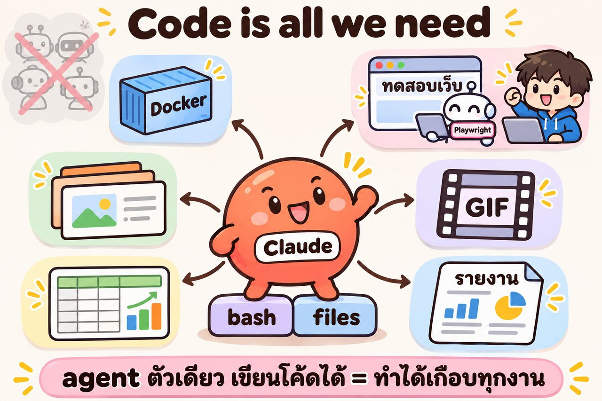

หลังทีม Anthropic สร้าง **Claude Code** (เดิมตั้งใจให้เป็นแค่ coding agent) เขาค้นพบว่า

> **โค้ดไม่ใช่แค่งานอย่างหนึ่ง แต่เป็น "ทางเข้าสู่โลกดิจิทัลทั้งหมด"** (code is the universal interface)

ตัวอย่างในทอล์ค — ทำ **รายงานการเงิน** ไม่ต้องมี Finance agent เลย

1. เขียนโค้ดเรียก API ดึงข้อมูล
2. จัดไฟล์เก็บในเครื่อง
3. วิเคราะห์ด้วย Python
4. เขียนรายงานออกมาเป็นไฟล์ — **ทุกขั้นคือการเขียนโค้ด**

แกนของ agent จึงบางลงเหลือแค่ 2 อย่าง: **สั่งคำสั่งได้ (bash)** กับ **มีไฟล์ให้ใช้ (file system)** ทอล์คสรุปว่า *"แค่โค้ดก็พอแล้ว"* (code is all we need)

**ตัวอย่างของเรา:** ในบท 02 เราไม่ได้สร้าง Testing agent เลย Claude Code ตัวเดียวทำได้ครบ

| งานในบท 02 | Claude ทำผ่านโค้ดยังไง |
|---|---|
| LAB 2 เปิดเว็บ | รัน `docker compose up` |
| LAB 4–5 เขียน test | เขียนไฟล์ `*.spec.ts` แล้วรัน Playwright |
| LAB 6 อัด GIF | เขียนสคริปต์เรียก ffmpeg |
| LAB 7 รายงาน | เขียนไฟล์ `TEST-REPORT.md` |

> ⚠️ ชื่อทอล์ค "Don't Build Agents" **ไม่ได้แปลว่าเลิกใช้ agent** แต่แปลว่า **เลิกสร้าง agent ใหม่ทุกงาน** ใช้ agent ตัวเดิม แล้วเติมความรู้แทน

### 3.2 เทียบวิธีคิดเดิมกับวิธีคิดใหม่

| | ❌ วิธีคิดเดิม | ✅ วิธีคิดใหม่ |
|---|---|---|
| หลักคิด | agent แต่ละสายงานต่างกันมาก | agent ข้างใต้เหมือนกันหมด ต่างกันแค่ "ความรู้งาน" |
| ตัว agent | หลายตัว ตัวละสายงาน | **ตัวเดียว** (bash + ไฟล์) |
| เครื่องมือ | ผูกกับ agent แต่ละตัว | เขียนโค้ด / สคริปต์ใน skill |
| ความรู้งานอยู่ที่ | ฝังในโค้ดและพรอมต์ของ agent | **โฟลเดอร์ skill** |
| งานใหม่ | สร้าง agent ใหม่ | **เพิ่ม skill ใหม่** |
| ใครทำได้ | โปรแกรมเมอร์ | ใครก็ได้ |
| ในบท 02 ของเรา | สร้าง "PawPantry Testing agent" | Claude Code + skill `test-from-plan` |

แต่ agent ตัวเดียวที่ทำได้ทุกอย่าง **ยังขาดอยู่อย่างหนึ่ง** ซึ่งเป็นเหตุผลที่ต้องมี skill → หัวข้อ 4

> 📌 **ที่มา** 🅰️ Year of agents [00:53](https://youtu.be/CEvIs9y1uog?t=53) · [01:10](https://youtu.be/CEvIs9y1uog?t=70) · code is the universal interface [01:38](https://youtu.be/CEvIs9y1uog?t=98) · general purpose agent [01:44](https://youtu.be/CEvIs9y1uog?t=104) · ตัวอย่างรายงานการเงิน [01:50](https://youtu.be/CEvIs9y1uog?t=110) · bash + file system [02:02](https://youtu.be/CEvIs9y1uog?t=122) · 🅺 "ไม่ได้แปลว่าเลิกใช้ agent" [01:14](https://youtu.be/SaL8dtnSBxw?t=74) · [02:03](https://youtu.be/SaL8dtnSBxw?t=123)

---

## 4. ⭐ อัจฉริยะ IQ 300 vs คนธรรมดาที่ทำงานนี้มา 10 ปี

ถ้า agent ตัวเดียวทำได้ทุกอย่างแล้ว ทำไมบท 02 ยังต้องเขียนพรอมต์ยาวขนาดนั้น? ทอล์คตอบด้วยคำถามง่าย ๆ ข้อเดียว

### 4.1 คำถาม: อยากให้ใครทำภาษีให้คุณ?


| | 🧠 อัจฉริยะ (Mahesh) | 📁 นักภาษี (Barry) |
|---|---|---|
| ความฉลาด | IQ 300 คณิตศาสตร์ระดับโลก | คนธรรมดา |
| เคยทำภาษีไหม | **ไม่เคยเลย** | **ทำมาเป็นสิบปี** |
| มีอะไรติดตัว | สมองล้วน ๆ | ขั้นตอน checklist ข้อควรระวัง ที่สะสมจากการทำจริง |

(Mahesh กับ Barry คือผู้พูดสองคนบนเวทีเอง ทอล์คติดป้ายไว้ว่าเป็นตัวอย่างสมมติ)

**คนส่วนใหญ่เลือกนักภาษี** ทั้งที่อัจฉริยะฉลาดกว่ามาก เพราะอะไร?

### 4.2 ผลลัพธ์ต่างกันยังไง


ทอล์คบอกว่า "เราไม่อยากให้อัจฉริยะมานั่ง **คิดกฎหมายภาษีปีนี้ใหม่จากศูนย์** (first principles)" สิ่งที่เราต้องการคือ **ทำออกมาถูกและเหมือนเดิมทุกครั้ง** (consistent execution) จากคนที่รู้งาน

| | อัจฉริยะ | นักภาษี |
|---|---|---|
| วิธีทำ | คิดใหม่จากศูนย์ทุกครั้ง | ทำตามขั้นตอนที่เคยพิสูจน์แล้ว |
| ความเร็ว | ช้า (ต้องอ่าน ต้องคิด) | เร็ว |
| ผลลัพธ์ 3 รอบ | อาจต่างกันทั้ง 3 รอบ | เหมือนกันทั้ง 3 รอบ |
| จุดพลาดที่คนเคยพลาด | ต้องพลาดเองก่อนถึงจะรู้ | รู้อยู่แล้ว ระวังไว้ก่อน |

**ข้อสรุปสำคัญ:** ความฉลาดทั่วไป **แทน** ความเชี่ยวชาญในงานไม่ได้

### 4.3 แล้ว AI วันนี้เป็นแบบไหน?


ทอล์คบอกตรง ๆ ว่า **"agent วันนี้เหมือน Mahesh"** — ฉลาดล้ำ แต่ขาดความเชี่ยวชาญ 3 ข้อ

1. **ไม่รู้งานเราตั้งแต่ต้น** ขาด context สำคัญตั้งแต่เริ่ม
2. **ซึมซับความเชี่ยวชาญของเราได้ยาก** ต้องอธิบายยาวทุกครั้ง
3. **ไม่เรียนรู้ข้ามเวลา** เปิดแชตใหม่ก็ลืมหมด

### 4.4 เทียบกับงานทดสอบของเรา

Claude "ฉลาด" เรื่องการทดสอบมาก รู้ Playwright, TypeScript, HTTP, Docker ดีกว่าพวกเราหลายคน แต่ **ไม่รู้ว่าห้องเรียนเราทดสอบกันแบบไหน**

| 🧠 สิ่งที่ Claude รู้อยู่แล้ว (อัจฉริยะ) | 📁 สิ่งที่ Claude ไม่รู้ ถ้าเราไม่บอก (ความรู้ของนักภาษี) |
|---|---|
| เขียน Playwright test ได้ | เราทดสอบแบบ **black-box** ห้ามเปิดโค้ดเว็บ `petshop/` |
| อ่าน markdown ได้ | อ่านแผนได้แค่หัวข้อ 5 กับ 7 **ห้ามอ่านหัวข้อ 8** (เฉลยบั๊ก) |
| ติดตั้งเบราว์เซอร์ได้ | ให้ใช้ Chromium จากบท 01 **ห้ามโหลดใหม่** |
| ตั้งชื่อ test ได้ | ชื่อ test ต้องขึ้นต้นด้วย **รหัส TC** และติด tag **P1/P2/P3** |
| แก้ test ที่ล้มได้ | test ล้ม **ห้ามแก้ให้ผ่านเฉย ๆ** ต้องแยกก่อนว่า "บั๊กเว็บ" หรือ "test ผิด" |
| ทำรายงานได้ | รายงานต้องตัดสินตาม **เกณฑ์ผ่านหัวข้อ 6** (P1 ผ่านหมด + ≥ 95%) |

ฝั่งซ้ายคือเหตุผลที่ไม่ต้องสร้าง agent ใหม่ ฝั่งขวาคือ **สิ่งที่ต้องสอน** และพรอมต์ยาว ๆ ในบท 02 ก็คือการสอนฝั่งขวาซ้ำทุกแชตนั่นเอง

> **ทางออก:** ไม่ต้องหา AI ที่ฉลาดกว่า แต่ **ยื่นแฟ้ม checklist ของนักภาษีให้อัจฉริยะ** → ได้ทั้งฉลาดและรู้งาน แฟ้มนั้นแหละคือ **skill**

> 📌 **ที่มา** 🅰️ ภาษี Mahesh vs Barry [02:16](https://youtu.be/CEvIs9y1uog?t=136) · consistent execution [02:29](https://youtu.be/CEvIs9y1uog?t=149) · agent วันนี้เหมือน Mahesh และขาด 3 ข้อ [02:33](https://youtu.be/CEvIs9y1uog?t=153) – [02:50](https://youtu.be/CEvIs9y1uog?t=170) · 🅺 [02:03](https://youtu.be/SaL8dtnSBxw?t=123) · [02:46](https://youtu.be/SaL8dtnSBxw?t=166) · ตาราง 4.4 (งานทดสอบ) เป็นของบทเรียนเรา

---

## 5. รู้ว่าอะไร vs รู้ว่าทำยังไง


ทำไมนักภาษีชนะ? นักจิตวิทยาแบ่งความรู้เป็น 2 แบบ

| แบบ | ความหมาย | ได้มาจาก | ตัวอย่าง |
|---|---|---|---|
| **รู้ว่าอะไร** (declarative) | รู้ข้อเท็จจริง | อ่าน | รู้ว่ากฎหมายภาษีเขียนว่าอะไร · รู้ว่า `page.click()` ทำอะไร |
| **รู้ว่าทำยังไง** (procedural) | รู้วิธีลงมือทำ ทีละขั้น | ลงมือทำ | ขี่จักรยาน (อ่านหนังสือร้อยเล่มก็ขี่ไม่เป็น) · ลำดับ LAB 2→7 ของเรา |

งานวิจัย CoALA (Princeton) นำแนวคิดนี้มาแบ่งความจำของ AI agent และเรียกความรู้แบบที่สองว่า **procedural memory**

- AI อ่านมาทั้งอินเทอร์เน็ต → **"รู้ว่าอะไร" เยอะมาก**
- แต่ไม่เคยทำงานของเรา → **"รู้ว่าทำยังไง" ของงานเราเป็นศูนย์**

**skill คือที่เก็บความรู้แบบที่สอง** ถ้าลองดูพรอมต์บท 02 ทุกบรรทัดจะพบว่าเกือบทั้งหมดเป็น "ทำยังไง" ไม่ใช่ "อะไร"

> 📌 **ที่มา** 🅺 หลักการที่ 1 declarative/procedural [02:40](https://youtu.be/SaL8dtnSBxw?t=160) · ขี่จักรยาน [04:00](https://youtu.be/SaL8dtnSBxw?t=240) · CoALA procedural memory [03:39](https://youtu.be/SaL8dtnSBxw?t=219) (ทอล์ค Anthropic ไม่ได้พูดเรื่อง CoALA ผู้ทำคลิปเสริมเอง)

---

# 📁 ภาค 2 — skill ทำงานยังไง

## 6. Agent Skill คืออะไร: แค่โฟลเดอร์


นิยามบนสไลด์ของทอล์ค

> *Skills are organized collections of files that package composable procedural knowledge for agents.*

แยกทีละคำ

| คำ | แปลว่า | ในงานของเรา |
|---|---|---|
| **organized collection of files** | ชุดไฟล์ที่จัดเป็นระเบียบ = **โฟลเดอร์** | โฟลเดอร์ `test-from-plan/` |
| **procedural knowledge** | ความรู้ "ทำยังไง" | ลำดับ: เปิดเว็บ → เขียน test → รัน → อัด GIF → รายงาน + กติกา |
| **composable** | หยิบมาประกอบกับ skill อื่นได้ | skill ทดสอบ + skill ทำ GIF + skill รายงานบั๊ก |
| **for agents** | ให้ agent อ่าน | Claude Code (และ agent อื่นที่รองรับมาตรฐานเดียวกัน) |

พูดสั้น ๆ: **skill ก็คือโฟลเดอร์** ทีมตั้งใจให้ง่ายแบบนี้ เพราะ

- **ใครก็สร้างได้** ทั้งคนและ AI ขอแค่มีคอมพิวเตอร์
- **ใช้กับเครื่องมือเดิมได้หมด** เก็บเวอร์ชันใน Git, ใส่ Google Drive, zip ส่งเพื่อน
- **ไฟล์** เป็นสิ่งที่ทุกคนใช้มาหลายสิบปี ไม่ต้องเรียนอะไรใหม่

ตัวอย่างจริงบนสไลด์คือโฟลเดอร์ `anthropic_brand/` ที่สอน Claude เรื่องสีและฟอนต์ของบริษัท

```text
anthropic_brand/
├─ SKILL.md            ← คู่มือหลัก: ภาพรวม สีหลัก และบอกว่าเมื่อไหร่ต้องเปิดไฟล์ไหน
├─ slide-decks.md      ← กฎสำหรับสไลด์
├─ docs.md             ← กฎสำหรับเอกสาร
└─ apply_template.py   ← สคริปต์ใส่สีแบรนด์ให้ไฟล์ pptx
```

ส่วน skill ของเราที่สร้างจริงใน [ส่วน 02](../02_skill-test-from-plan/) (ย่อ)

```text
test-from-plan/
├─ SKILL.md                 ← กติกา black-box + ขั้นตอนทดสอบตามแผน
├─ references/
│  ├─ decisions.md          ← จุดตัดสินใจ/กับดักจากการรันจริง (เปิดเมื่อ SKILL.md สั่ง)
│  └─ plan-answers/         ← คำตอบของเจ้าของแผน (ใช้เฉพาะแผนที่ตรงกัน)
└─ scripts/
   ├─ make-gifs.mjs         ← แปลงวิดีโอเป็น GIF แบบเดิมทุกครั้ง
   └─ build-report.mjs      ← ทำรายงาน + คำนวณคำตัดสินตามเกณฑ์ในแผน
```

> skill เป็น **มาตรฐานเปิด** (agentskills.io) ไม่ได้ผูกกับ Claude เจ้าเดียว agent อื่นอย่าง Codex หรือ GitHub Copilot ก็อ่านได้

> 📌 **ที่มา** 🅰️ นิยาม "What are Agent Skills?" [03:05](https://youtu.be/CEvIs9y1uog?t=185) · skill คือโฟลเดอร์ [03:07](https://youtu.be/CEvIs9y1uog?t=187) · ทำไมเป็นโฟลเดอร์ [03:10](https://youtu.be/CEvIs9y1uog?t=190) – [03:24](https://youtu.be/CEvIs9y1uog?t=204) · ตัวอย่าง anthropic_brand [03:29](https://youtu.be/CEvIs9y1uog?t=209) · 🅺 มาตรฐานเปิด [09:50](https://youtu.be/SaL8dtnSBxw?t=590)

---

## 7. ข้างในไฟล์ `SKILL.md`


`SKILL.md` มี 2 ส่วน

```markdown
---
name: test-from-plan
description: ทดสอบเว็บแบบ black-box ตาม TEST-PLAN.md ด้วย Playwright จนได้รายงานและคำตัดสินว่าปล่อยได้ไหม
  ใช้เมื่อผู้ใช้สั่ง "ทดสอบเว็บตามแผน", "รัน test ตาม TEST-PLAN", "เขียน e2e ตามแผนทดสอบ"
---

# ทดสอบเว็บตามแผน

## กติกา (ห้ามละเมิด)
- อ่าน TEST-PLAN.md ได้แค่หัวข้อ 5 และ 7 ห้ามอ่านหัวข้อ 8
- ห้ามเปิดโค้ดเว็บ ทดสอบจากหน้าเว็บจริงเท่านั้น
- test ล้ม ห้ามแก้ให้ผ่านเฉย ๆ

## ขั้นตอน
1. เปิดเว็บด้วย docker compose แล้วรอจน healthy
2. ...
5. ถ้ามี test ล้ม อ่าน references/decisions.md ก่อนตัดสินว่าเป็นบั๊กเว็บหรือ test ผิด
```

(นี่คือตัวอย่างย่อเพื่ออธิบาย ของจริงจะสร้างใน ส่วน 02)

| ส่วน | มีอะไร | AI เห็นเมื่อไหร่ | สำคัญยังไง |
|---|---|---|---|
| **หัวไฟล์** (frontmatter ระหว่าง `---`) | `name` + `description` | **ตลอดเวลา** ทุกแชต | AI ใช้ตัดสินว่าจะหยิบ skill นี้มาใช้ไหม |
| **เนื้อหา** | ขั้นตอน กติกา ชี้ไปไฟล์อื่น | เมื่อ AI ตัดสินใจใช้ skill นี้ | คือ "checklist ของนักภาษี" |

### `description` คือบรรทัดที่สำคัญที่สุด

AI ไม่ได้อ่าน skill ทุกตัวทั้งไฟล์ (ดูหัวข้อ 10) มันเห็นแค่ `description` แล้วเดาว่า "งานนี้ใช่ skill นี้ไหม" ถ้าเขียนไม่ดี skill ก็ไม่ถูกหยิบมาใช้เลย

| ❌ description แย่ | ✅ description ดี |
|---|---|
| `ช่วยเรื่องการทดสอบ` | `ทดสอบเว็บแบบ black-box ตาม TEST-PLAN.md ด้วย Playwright จนได้รายงานและคำตัดสินว่าปล่อยได้ไหม` |
| กว้างเกิน AI ไม่รู้ว่าทดสอบอะไร ด้วยอะไร | บอก **ทำอะไร** · **ด้วยอะไร** · **ได้อะไรออกมา** |
| ไม่บอกว่าใช้ตอนไหน | บอก **คำที่ผู้ใช้มักพิมพ์** เช่น "ทดสอบเว็บตามแผน" |

> 📌 **ที่มา** 🅰️ YAML frontmatter (name, description) ที่โมเดลเห็นตอน runtime [04:29](https://youtu.be/CEvIs9y1uog?t=269) · [04:34](https://youtu.be/CEvIs9y1uog?t=274) · 🅺 ขั้น 4 "ดูหัวไฟล์ให้ชัดว่าใช้ตอนไหน" [13:19](https://youtu.be/SaL8dtnSBxw?t=799) · ตัวอย่าง SKILL.md และ description ดี/แย่ เป็นของบทเรียนเรา

---

## 8. skill เก็บอยู่ที่ไหนในเครื่อง (Windows / Mac)


skill ของ Claude Code อยู่ได้ 2 ที่ ข้างในเป็น **1 โฟลเดอร์ต่อ 1 skill** และต้องมีไฟล์ `SKILL.md`

| ชนิด | ที่อยู่ | ใช้ได้ที่ไหน | เหมาะกับ |
|---|---|---|---|
| **skill ส่วนตัว** | Windows: `C:\Users\<ชื่อผู้ใช้>\.claude\skills\`<br>Mac: `/Users/<ชื่อผู้ใช้>/.claude/skills/` | **ทุกโฟลเดอร์** ที่เปิด Claude Code | วิธีทำงานของเราเอง เช่น skill ทดสอบที่จะใช้ทั้งบท 02, 03, 04 |
| **skill ของโปรเจกต์** | `<โฟลเดอร์โปรเจกต์>/.claude/skills/` | เฉพาะตอนเปิด Claude Code ในโปรเจกต์นั้น | กติกาของทีม แชร์ให้เพื่อนผ่าน Git |

> `.claude` ขึ้นต้นด้วยจุด จึงเป็นโฟลเดอร์ซ่อน ถ้าเปิดหาเองไม่เจอ ให้สั่ง Claude เปิดให้ง่ายกว่า ถ้ายังไม่เคยมี skill เลย โฟลเดอร์นี้อาจยังไม่ถูกสร้าง

### 🔍 ลองดูของจริง: ให้ Claude เปิดโฟลเดอร์ skill

💬 **พรอมต์** (วางใน Claude Code ที่โฟลเดอร์ไหนก็ได้)

```text
ช่วยเปิดโฟลเดอร์ skill ของผมให้หน่อย แล้วบอกว่ามันอยู่ที่ไหน มี skill อะไรบ้าง
```

✅ **ผลจริง** (เครื่องผู้สอน Windows · ใช้เวลา 19 วินาที) หน้าต่าง File Explorer เด้งขึ้นมาที่โฟลเดอร์ skill และ Claude ตอบว่า

```text
เปิดโฟลเดอร์ใน File Explorer ให้แล้วครับ
ตำแหน่ง: C:\Users\<ชื่อผู้ใช้>\.claude\skills
นี่คือ skill ระดับผู้ใช้ ใช้ได้ในทุกโปรเจกต์ ส่วนโปรเจกต์ปัจจุบันไม่มีโฟลเดอร์ .claude\skills ของตัวเอง
Skill ในโฟลเดอร์ (8 รายการ): devtools-lab, exam-mcq, k8s-lab, maccount, media-use, yt-lesson, yt-transcript, synced
```

👀 **สังเกต**
- Claude แยกให้เองว่า skill ส่วนตัวอยู่ที่ไหน และโปรเจกต์นี้มี skill ของตัวเองไหม
- ของผู้เรียนอาจยังว่าง หรือยังไม่มีโฟลเดอร์เลย ไม่เป็นไร ใน ส่วน 02 เราจะสร้าง skill แรกลงที่นี่
- บน Mac จะเด้งเป็นหน้าต่าง Finder แทน

> 📌 **ที่มา** ตำแหน่งโฟลเดอร์มาจากการทำงานของ Claude Code (ทอล์คไม่ได้พูดถึง) · ผลจริงจากการรันพรอมต์บนเครื่องผู้สอน · 🅺 ผู้ทำคลิปเก็บ skill ไว้ที่ `~/.claude/skills` [05:38](https://youtu.be/SaL8dtnSBxw?t=338)

---

## 9. สคริปต์ใน skill: งานซ้ำให้โค้ด งานคิดให้ AI

skill ไม่ได้มีแค่ข้อความ **ใส่สคริปต์ไว้เป็นเครื่องมือได้ด้วย** และทอล์คบอกว่านี่คือจุดที่ทรงพลังที่สุด

### 9.1 เรื่องเล่าจากทีม Anthropic


ทีมสังเกตว่า Claude **เขียนสคริปต์ Python ตัวเดิมซ้ำแล้วซ้ำเล่า** เพื่อใส่สีให้สไลด์ ทุกรอบเขียนใหม่ ผลจึงต่างกันเล็กน้อยทุกครั้ง และเปลือง token
ทีมเลยสั่งให้ Claude **เก็บสคริปต์นั้นไว้ใน skill ให้ "ตัวเองในอนาคต" ใช้** ตอนนี้แค่รันสคริปต์เดิม ผลออกมาเหมือนเดิมทุกครั้งและเร็วขึ้น

ในบท 02 ก็เกิดเหมือนกันเป๊ะ: ทุกครั้งที่สั่งอัด GIF Claude ต้องเขียนสคริปต์แปลงวิดีโอเป็น GIF ขึ้นมาเอง (เฉลยบท 02 เก็บไว้เป็น `make-gifs.js`) ถ้าเปิดแชตใหม่ มันก็จะเขียนใหม่อีก และอาจตั้งค่าความช้า ขนาด เวลาค้างหน้าผล (≥ 5 วินาที) ไม่เหมือนเดิม **นี่คือสคริปต์ที่ควรเก็บเข้า skill**

### 9.2 ทำไมสคริปต์ดีกว่า tool แบบเดิม


"tool แบบเดิม" คือเครื่องมือที่โปรแกรมเมอร์ผูกไว้กับ agent (มีชื่อ + คำอธิบายสั้น ๆ ให้ AI เรียก)

| | tool แบบเดิม | สคริปต์ใน skill |
|---|---|---|
| **ชัดเจน** | คำอธิบายมักกำกวม AI ใช้ผิดได้ | เปิดอ่านโค้ดแล้วรู้เลยว่าทำอะไร |
| **แก้ได้** | พังแล้ว AI แก้เองไม่ได้ ติดอยู่แบบนั้น | AI เปิดไฟล์แก้เองได้ |
| **พื้นที่แชต** | รายชื่อ tool อยู่ในแชตตลอดเวลา | อยู่ในไฟล์ จนกว่าจะถูกเรียกใช้ |

### 9.3 กฎแบ่งงาน


> **งานที่ต้องได้ผลเหมือนเดิมทุกครั้ง → ให้โค้ดทำ · งานที่ต้องคิดตัดสินใจ → ให้ AI ทำ**

| งานในการทดสอบ | ใครทำ | เหตุผล |
|---|---|---|
| แปลงวิดีโอเป็น GIF ขนาด ความเร็วเท่าเดิม | 🔧 สคริปต์ | ต้องเหมือนเดิมทุกครั้ง |
| เช็กว่าเว็บ healthy ก่อนรัน | 🔧 สคริปต์ | ขั้นตอนตายตัว |
| นับผ่าน/ไม่ผ่าน คิด % เทียบเกณฑ์ 95% | 🔧 สคริปต์ | เลขต้องถูกทุกครั้ง AI คิดเลขพลาดได้ |
| อ่านแผนแล้วออกแบบขั้นตอน test | 🧠 AI | ต้องเข้าใจภาษาคน |
| หาปุ่ม หาช่องบนหน้าเว็บ | 🧠 AI | เว็บแต่ละเว็บไม่เหมือนกัน |
| test ล้ม: บั๊กของเว็บ หรือ test เขียนผิด | 🧠 AI (+ คนตัดสิน) | ต้องดูหลักฐานแล้วคิด |

ผู้ทำคลิปที่สองมี skill ทำเอง 13 ตัว รวมสคริปต์ **107 ไฟล์** แปลว่างานซ้ำส่วนใหญ่ เขาไม่ให้ AI คิดใหม่แล้ว

> 📌 **ที่มา** 🅰️ ปัญหา tool แบบเดิม [03:35](https://youtu.be/CEvIs9y1uog?t=215) · code ดีกว่า [03:50](https://youtu.be/CEvIs9y1uog?t=230) · เรื่องสคริปต์ใส่สีสไลด์ [03:58](https://youtu.be/CEvIs9y1uog?t=238) – [04:12](https://youtu.be/CEvIs9y1uog?t=252) · สไลด์ scripts as tools [04:19](https://youtu.be/CEvIs9y1uog?t=259) · 🅺 กฎ "งานซ้ำให้โค้ด งานคิดให้ AI" [05:30](https://youtu.be/SaL8dtnSBxw?t=330) · 13 skill / 107 สคริปต์ [05:38](https://youtu.be/SaL8dtnSBxw?t=338) · ตารางงานทดสอบเป็นของบทเรียนเรา

---

## 10. เปิดทีละชั้น (progressive disclosure): มี skill เป็นร้อยตัว ทำไมไม่สับสน

ถ้าเราสร้าง skill เพิ่มเรื่อย ๆ บท 02, 03, 04, ทำ GIF, เขียนรายงาน… AI ต้องอ่านทุกตัวทุกครั้งไหม? **ไม่** เพราะ skill ถูกออกแบบให้ **เปิดทีละชั้น**


| ชั้น | AI เห็นอะไร | เห็นเมื่อไหร่ | อุปมาห้องสมุด | ตัวอย่างของเรา |
|---|---|---|---|---|
| **1** | `name` + `description` ของ **ทุก** skill | ตลอดเวลา | อ่านสันหนังสือทั้งชั้น | เห็นว่ามี `test-from-plan` "ใช้เมื่อสั่งทดสอบเว็บตามแผน" |
| **2** | เนื้อหา `SKILL.md` ทั้งไฟล์ ของ skill ที่เลือก | เมื่อตัดสินใจใช้ | หยิบเล่มเดียวมาเปิดสารบัญ | อ่านกติกา black-box + ขั้นตอน 1–5 |
| **3** | ไฟล์ย่อย / สคริปต์ | เมื่อ `SKILL.md` ชี้ไป และงานถึงขั้นนั้น | เปิดภาคผนวกเมื่อบทนั้นอ้าง | เจอ test ล้ม → ค่อยเปิด `references/decisions.md` |

### 🔍 ลองดูของจริง: ชั้น 1 หน้าตาเป็นยังไง

💬 **พรอมต์**

```text
ตอนนี้คุณเห็น skill อะไรบ้าง บอกแค่ชื่อกับคำอธิบายสั้นๆ ที่คุณเห็นอยู่แล้ว ห้ามเปิดอ่านไฟล์ SKILL.md ใดๆ
แล้วตอบด้วยว่าคุณเห็นเนื้อหาข้างใน SKILL.md ของ skill เหล่านี้หรือยัง
```

✅ **ผลจริง** (เครื่องผู้สอน · 27 วินาที) Claude ไล่รายชื่อ skill มาหลายสิบตัวพร้อมคำอธิบายบรรทัดเดียว แล้วตอบท้ายว่า

```text
เรื่องเนื้อหาข้างใน SKILL.md: ยังไม่เห็นเลยครับ ผมเห็นเฉพาะชื่อกับคำอธิบายสั้นๆ ในรายการที่ระบบแนบมาเท่านั้น
ไม่ได้เปิดอ่านไฟล์ SKILL.md ใดๆ (เนื้อหาเต็มจะโหลดเข้ามาก็ต่อเมื่อเรียกใช้ skill นั้นจริง)
```

👀 นี่คือ **ชั้น 1** ของจริง: มี skill หลายสิบตัว แต่ที่อยู่ในแชตมีแค่ "สันหนังสือ" → นี่คือเหตุผลที่ `description` สำคัญที่สุด (หัวข้อ 7)

### ทำไมต้องประหยัดขนาดนี้: งบความสนใจ (attention budget)


- ทุกข้อความในแชต AI ต้อง **อ่านใหม่หมดทุกครั้งที่ตอบ** ยิ่งยาวยิ่งต้องแบ่งความสนใจ Anthropic เรียกว่า **งบความสนใจ** ทุกคำที่เพิ่มเข้าไปแย่งความสนใจจากคำอื่น
- งานวิจัย **Lost in the Middle** พบว่า AI หาข้อมูลเจอดีเมื่ออยู่ **ต้นหรือท้าย** ของข้อความยาว แต่ถ้าอยู่ **ตรงกลาง** ผลแย่ลงชัดเจน
- แปลว่า **ยัดคู่มือทุกเล่มเข้าแชต ไม่ได้ทำให้ AI ฉลาดขึ้น แต่ทำให้ของสำคัญจมหาย**

ผู้ทำคลิปที่สองวัดของตัวเอง: หัวไฟล์ของ 13 skill รวมกัน ยาวแค่ประมาณ **1 ใน 27** ของเนื้อหา `SKILL.md` ทั้งหมด → ที่เหลืออีก 26 ส่วนไม่ต้องอยู่ในแชตจนกว่าจะใช้

> เคยรู้สึกไหมว่า "พรอมต์ยิ่งยาว AI ยิ่งพลาดบรรทัดที่สำคัญ" — นี่คือเหตุผล และ skill แก้ตรงนี้

> 📌 **ที่มา** 🅰️ ปกป้อง context [04:21](https://youtu.be/CEvIs9y1uog?t=261) · 3 ชั้น [04:29](https://youtu.be/CEvIs9y1uog?t=269) – [04:57](https://youtu.be/CEvIs9y1uog?t=297) · 🅺 อุปมาสันหนังสือ [06:05](https://youtu.be/SaL8dtnSBxw?t=365) · งบความสนใจ [06:12](https://youtu.be/SaL8dtnSBxw?t=372) · Lost in the Middle [06:30](https://youtu.be/SaL8dtnSBxw?t=390) · 1 ใน 27 [06:50](https://youtu.be/SaL8dtnSBxw?t=410) · ผล "ลองดูของจริง" รันบนเครื่องผู้สอน

---

## 11. ⭐ สรุป: สร้าง agent เพิ่ม vs เพิ่ม skill


| เรื่อง | 🤖🤖🤖 สร้าง agent ใหม่ทุกงาน | 🤖 + 📁 agent ตัวเดียว + skill |
|---|---|---|
| เริ่มงานใหม่ | สร้าง agent ตัวใหม่ เครื่องมือใหม่ | เพิ่มโฟลเดอร์ 1 โฟลเดอร์ |
| ความรู้งานอยู่ที่ | กระจายในตัว agent แต่ละตัว | ที่เดียว ในโฟลเดอร์ skill |
| เจอบทเรียนใหม่ | ไล่แก้ทุก agent | แก้ `SKILL.md` ไฟล์เดียว |
| ใครสร้างได้ | โปรแกรมเมอร์ | ใครก็ได้ (เขียน markdown เป็น) |
| แชร์ให้เพื่อน | ส่งโปรแกรมทั้งตัว | zip โฟลเดอร์ / Git |
| พื้นที่แชต | เครื่องมือทุกตัวอยู่ในแชตตลอด | เห็นแค่ชื่อ เปิดเมื่อใช้ |
| ความสม่ำเสมอ | แต่ละตัวคิดเอง | ทำตาม checklist เดิม + สคริปต์เดิม |

### แล้ว LAB 5 ในบท 02 ที่ใช้ agent 8 ตัวพร้อมกัน ผิดไหม?

**ไม่ผิด** ต้องแยก 2 คำนี้ให้ออก

| | **agent ย่อย (subagent)** ใน LAB 5 | **"สร้าง agent ใหม่"** ที่ทอล์คบอกว่าอย่าทำ |
|---|---|---|
| คืออะไร | Claude ตัวเดิม แตกตัวไปช่วยทำงานขนาน | โปรแกรม agent ใหม่ที่ออกแบบเฉพาะสายงาน |
| ความรู้งาน | ใช้ skill ชุดเดียวกับตัวหลัก | ฝังอยู่ในตัว agent นั้น |
| เปรียบเป็น | พนักงานหลายคนในบริษัทเดียว ถือคู่มือเล่มเดียวกัน | ตั้งบริษัทใหม่ทุกครั้งที่มีงานใหม่ |

> **agent = คนทำงาน · skill = ความรู้งาน** — จะมีคนทำงานกี่คนก็ได้ แต่ความรู้งานควรอยู่ที่เดียว และทุกคนเปิดอ่านได้

> 📌 **ที่มา** ตารางเทียบรวบรวมจากหัวข้อ 2–10 · เรื่อง subagent กับ agent ย่อยใน LAB 5 เป็นคำอธิบายของบทเรียนเรา (ทอล์คพูดถึงการ "สร้าง" agent ใหม่ ไม่ได้ห้ามใช้ agent ย่อย)

---

## 12. agent ทั่วไป มี 4 ชิ้น: skill อยู่ตรงไหน

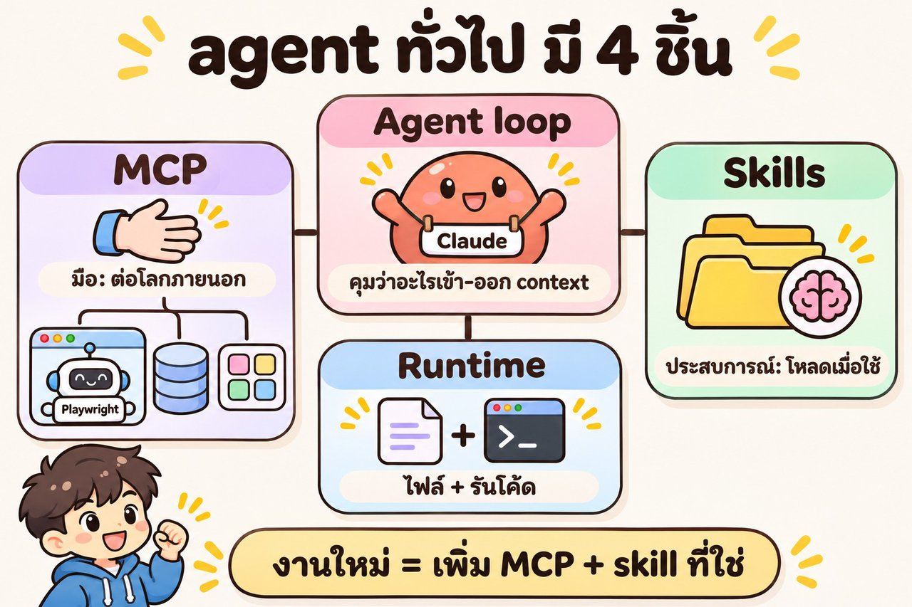

ทอล์คบอกว่าทุกคนกำลังมาเจอกันที่สถาปัตยกรรมเดียวกัน

| ชิ้น | หน้าที่ | อุปมา | ในงานของเรา |
|---|---|---|---|
| **Agent loop** | คุมว่าอะไรเข้า-ออก context | ผู้จัดการโต๊ะทำงาน | Claude Code |
| **Runtime** | มีไฟล์ + รันโค้ดได้ | โต๊ะและเครื่องมือช่าง | เครื่องเรา: terminal, Docker, Node.js |
| **MCP** | ต่อเครื่องมือ/ข้อมูลภายนอก | **มือ** | Playwright MCP (ให้ Claude ใช้เบราว์เซอร์) |
| **Skills** | ความรู้ "ทำยังไง" โหลดเมื่อใช้ | **ประสบการณ์** | `test-from-plan` |

> **MCP คือมือ · skill คือประสบการณ์** — Playwright ให้ "มือ" กดเว็บได้ แต่ไม่ได้บอกว่า "ห้องเราทดสอบกันแบบไหน" skill เติมส่วนนั้น
> อยากให้ AI ทำงานสายใหม่ → เพิ่ม MCP ที่ใช่ + skill ที่ใช่ **ไม่ต้องสร้าง agent ใหม่**

> 📌 **ที่มา** 🅰️ architecture ของ general agent [09:07](https://youtu.be/CEvIs9y1uog?t=547) · agent loop / runtime [09:15](https://youtu.be/CEvIs9y1uog?t=555) · [09:24](https://youtu.be/CEvIs9y1uog?t=564) · 🅺 "MCP คือมือ skill คือประสบการณ์" [07:52](https://youtu.be/SaL8dtnSBxw?t=472) · ภาพ 4 ชิ้น [09:24](https://youtu.be/SaL8dtnSBxw?t=564)

---

# 📈 ภาค 3 — ทำให้ skill เก่งขึ้น และใช้อย่างปลอดภัย

## 13. ใครสร้าง skill บ้าง และดูแล skill เหมือนซอฟต์แวร์


| ประเภท | ใครสร้าง | ตัวอย่างจากทอล์ค |
|---|---|---|
| **Foundational** | Anthropic และผู้เชี่ยวชาญ | สร้าง/แก้ไฟล์ Word Excel PowerPoint PDF · skill วิทยาศาสตร์ 120+ ตัว |
| **Partner** | บริษัทที่อยากให้ Claude ใช้ผลิตภัณฑ์ตัวเองเก่ง | skill คุมเบราว์เซอร์อัตโนมัติ · skill ค้นข้อมูลใน workspace |
| **Enterprise & Team** | องค์กร/ทีม | กติกาภายในบริษัท Fortune 100 · code style ของทีมนักพัฒนาหลายพันคน → **skill ทดสอบของห้องเรา อยู่กลุ่มนี้** |

ทอล์คเห็น **แนวโน้ม 3 อย่าง**: skill ซับซ้อนขึ้นจนเหมือนโปรแกรม (มี scripts, templates, tests) · ใช้คู่กับ MCP · คนที่ไม่ใช่โปรแกรมเมอร์ (การเงิน HR กฎหมาย) เริ่มเขียน skill เอง


เมื่อ skill ซับซ้อนขึ้น ต้อง **ดูแลเหมือนซอฟต์แวร์**

| เรื่อง | ความหมาย | ตัวอย่างบนสไลด์ | ในงานของเรา |
|---|---|---|---|
| **ทดสอบ** | skill ถูกหยิบใช้ถูกจังหวะไหม ผลดีไหม | Trigger ถูก 8/10 ✓ · ผลตรงรูปแบบ ✓ · สคริปต์ `apply_template.py` ล้ม ✗ | พิมพ์ "ทดสอบเว็บตามแผน" ในแชตใหม่ → หยิบ `test-from-plan` ไหม |
| **เก็บเวอร์ชัน** | ติดตามว่าแก้อะไร เมื่อไหร่ | 3 รุ่น ลงวันที่ 11 ต.ค. · 31 ต.ค. · 21 พ.ย. 2025 | เก็บ skill ใน Git ดู diff ทุกครั้งที่สั่งแก้ |
| **ประกอบกัน** | skill เรียกใช้ skill/MCP อื่นได้ | Branded Decks = Brand Style + PowerPoint | ทดสอบ = test-from-plan + Playwright MCP |

> 📌 **ที่มา** 🅰️ 3 ประเภท [05:06](https://youtu.be/CEvIs9y1uog?t=306) – [07:26](https://youtu.be/CEvIs9y1uog?t=446) · แนวโน้ม 3 อย่าง [07:28](https://youtu.be/CEvIs9y1uog?t=448) · ดูแลเหมือนซอฟต์แวร์ [10:37](https://youtu.be/CEvIs9y1uog?t=637) · 🅺 สไลด์ Exploring how Skills evolve [09:59](https://youtu.be/SaL8dtnSBxw?t=599)

---

## 14. AI "เรียนรู้" ได้ยังไง: Claude วันที่ 30 เก่งกว่าวันที่ 1 จริงไหม


ทอล์คปิดด้วยประโยคที่คนจำได้มากที่สุด: **"Claude วันที่ 30 ที่ทำงานกับคุณ จะเก่งกว่า Claude วันที่ 1 มาก"** (Day 1 ไม่มี skill · Day 5 มีไม่กี่ตัว · Day 30 มีเยอะ)

แต่โมเดลไม่ได้เปลี่ยนเลย แล้ว "เก่งขึ้น" ได้ยังไง? AI เรียนรู้ได้ 2 ทาง

| ทาง | ทำยังไง | ข้อดี / ข้อเสีย |
|---|---|---|
| 1. ฝึกโมเดลใหม่ | แก้ "สมอง" จริง ๆ | แพง ช้า คนทั่วไปทำเองไม่ได้ |
| 2. in-context learning | ให้อ่านความรู้ตอนทำงาน | **สมองเดิม แต่คู่มือดีขึ้นทุกวัน และแก้ได้ทันที** |

**skill คือทาง 2** — skill ไม่ได้เก็บ "ข้อมูลทุกอย่าง" แต่เก็บ **"วิธีทำ"** ที่ AI ใช้กับงานเฉพาะได้

### การทดลองจริงของผู้ทำคลิปที่สอง

เขามี skill ทำคลิปยาวที่ **แก้มาแล้ว 37 รอบในสามวัน** ทุกรอบมาจากจุดที่เขาเห็นว่ามันพลาด แล้วทดลองแบบนี้

- เอา skill **วันแรก** กับ skill **วันนี้** มาเขียนบทคลิป 8 นาทีเรื่องเดียวกัน **ฝั่งละ 3 รอบ**
- ตรวจด้วยกฎ 2 กอง: **กฎเดิม 10 ข้อ** (วันแรกมีอยู่แล้ว) และ **กฎใหม่ 6 ข้อ** (เพิ่มทีหลังจากที่เห็นมันพลาด)


| | skill วันแรก | skill วันนี้ | อ่านผลว่า |
|---|---|---|---|
| พลาดกฎเดิม (10 ข้อ) | 5 | 6 | **สมองเท่าเดิม** ทำได้พอ ๆ กัน |
| พลาดกฎใหม่ (6 ข้อ) | 7 | **2** | **คู่มือดีขึ้น** บทเรียนที่จดไว้ใช้ได้จริง |
| เวลาเฉลี่ย | 9:40 นาที | 9:27 นาที | ไม่ได้เร็วขึ้น |

> **Claude วันที่ 30 ไม่ได้ฉลาดขึ้น แต่รู้งานเรามากขึ้น**

ข้อสังเกตเพิ่ม
- จาก 36 รอบที่แก้หลังวันแรก มีแค่ 6 รอบที่เกี่ยวกับการเขียนบท อีก **30 รอบคือความสามารถใหม่** ที่วันแรกทำไม่ได้เลย (ตัด Shorts, ตรวจเสียง, ทำปก ฯลฯ)
- skill วันนี้ก็ยังพลาด: มีรอบหนึ่งให้เขาเรียกตัวเองว่า "พี่" ถึง 13 บรรทัด ไม่มีกฎข้อไหนจับได้ เขาต้องเห็นเองแล้วสั่งให้จดเพิ่ม
- ข้อจำกัด: ทดลองแค่ฝั่งละ 3 รอบ เป็นแค่ "ผลในการทดลองนี้"

**เทียบกับบท 02:** เฉลยรุ่นแรกที่คนเขียนไว้ตรวจ TC-AUTH-02 แค่ 4 ช่อง จึงพลาดบั๊กช่องยืนยันรหัสผ่าน บทเรียนนี้ถ้าจดลง skill ว่า "ตรวจให้ครบทุกคำในผลที่คาดหวัง" รอบหน้าก็ไม่พลาดอีก — นี่คือ Day 1 → Day 30 ของเรา

> 📌 **ที่มา** 🅰️ continuous learning / Day 1 → Day 30 [13:13](https://youtu.be/CEvIs9y1uog?t=793) · 🅺 หลักการที่ 4 สองทางของการเรียนรู้ [11:04](https://youtu.be/SaL8dtnSBxw?t=664) – [11:19](https://youtu.be/SaL8dtnSBxw?t=679) · การทดลอง 37 รอบ [13:56](https://youtu.be/SaL8dtnSBxw?t=836) – [15:52](https://youtu.be/SaL8dtnSBxw?t=952) · "ไม่ได้ฉลาดขึ้น แต่รู้งานเรามากขึ้น" [16:02](https://youtu.be/SaL8dtnSBxw?t=962) · ตัวอย่าง TC-AUTH-02 มาจากบท 02 ของเรา

---

## 15. ⚠️ ตัวเลขจากงานวิจัย: ทำไมคนต้องตรวจ skill


งานวิจัย **SkillsBench** ทดสอบ AI กับ 87 งานใน 8 สาขา

| สิ่งที่พบ | ตัวเลข | แปลว่า |
|---|---|---|
| ใส่ skill ที่ **คนคัด/ตรวจแล้ว** | อัตราผ่าน 33.9% → **50.5%** (+16.6 จุด) | skill ช่วยจริง |
| skill **เล็ก โฟกัสงานเดียว** (ไม่เกิน 3 ส่วน) | ดีกว่าคู่มือยาวที่ครอบทุกอย่าง | 1 skill = 1 งาน |
| ให้ AI **เขียน skill เองล้วน ๆ** ไม่มีคนช่วย | **แย่กว่าไม่มี skill 8.1–11.5 จุด** | ❗ ต้องมีคนตรวจ |
| โมเดลเล็ก + skill | ทำได้ใกล้โมเดลใหญ่ที่ไม่มี skill | ความรู้งานชดเชยขนาดสมองได้ |

**บทเรียน:** ให้ AI **ช่วยร่าง** skill ได้ (เร็วมาก) แต่ **คนต้องอ่าน และชี้จุดผิด** เสมอ เพราะคนเท่านั้นที่รู้ว่า "วิธีทำงานที่ถูก" ของเราคืออะไร
ในบท 02 คนที่รู้ว่า "ห้ามแก้ test ให้ผ่านเฉย ๆ" คือ tester ไม่ใช่ AI

> 📌 **ที่มา** 🅺 SkillsBench [06:51](https://youtu.be/SaL8dtnSBxw?t=411) – [07:33](https://youtu.be/SaL8dtnSBxw?t=453) (arXiv 2602.12670) · AI เขียน skill เองล้วน −8.1 ถึง −11.5 [12:42](https://youtu.be/SaL8dtnSBxw?t=762) · ทอล์ค Anthropic ไม่ได้อ้าง SkillsBench ผู้ทำคลิปเสริมเอง

---

## 16. สร้าง skill แรกใน 6 ขั้น (สิ่งที่จะทำใน ส่วน 02)

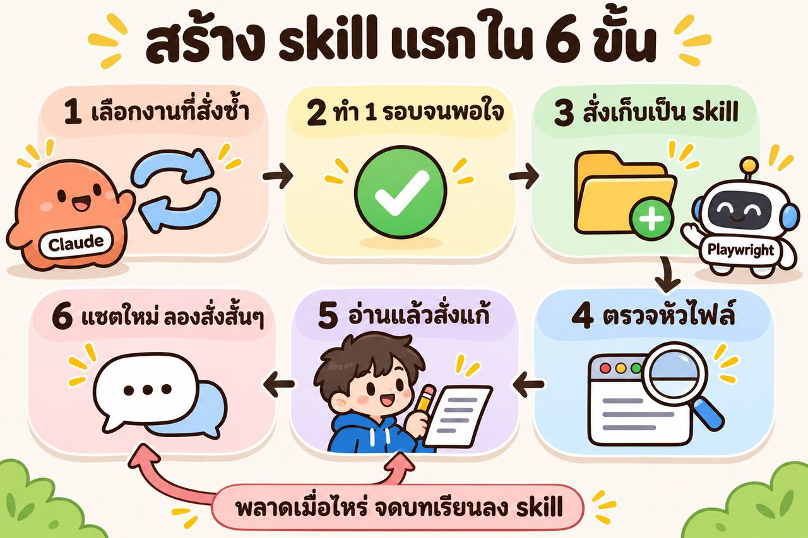

| ขั้น | ทำอะไร | ในส่วน 02 (บท 02 PawPantry) |
|---|---|---|
| 1 | **เลือกงานที่สั่ง AI ซ้ำบ่อยที่สุด** | "ทดสอบเว็บตามแผน" = LAB 2, 4–7 ที่ต้อง copy-paste ทุกครั้ง |
| 2 | **ทำงานนั้นกับ Claude 1 รอบ** จนได้ผลที่ชอบ | ให้ Claude อ่าน README บท 02 แล้วทำตามจนได้รายงาน |
| 3 | **สั่งประโยคเดียว "เก็บวิธีทำงานนี้เป็น skill"** | ได้โฟลเดอร์ `test-from-plan/` + สคริปต์ทำ GIF |
| 4 | **ตรวจหัวไฟล์** ว่าบอกชัดว่าใช้ตอนไหน | อ่าน `description` |
| 5 | **อ่าน skill ที่มันเขียน ตรงไหนผิดสั่งแก้** ⭐ ขั้นสำคัญที่สุด | เช็กว่ากติกา black-box ครบไหม |
| 6 | **เปิดแชตใหม่ สั่งงานเดิมสั้น ๆ** ดูว่าหยิบ skill เองไหม | "ทดสอบเว็บตามแผนให้หน่อย" |
| 🔁 | ทุกครั้งที่พลาด สั่ง **"จดบทเรียนนี้ลง skill"** | เช่น เปิดโหมดฝังบั๊กแล้วพลาด → จดเพิ่ม |

> ขั้น 2 คือสิ่งที่ผู้ใช้หลายคนข้าม: **ให้ AI ลงมือทำจริงก่อน** แล้วค่อยเก็บเป็น skill เพราะ skill ที่ดีมาจาก "วิธีที่ทำแล้วได้ผลจริง" ไม่ใช่จากการเดา

> 📌 **ที่มา** 🅺 6 ขั้น [12:39](https://youtu.be/SaL8dtnSBxw?t=759) – [13:53](https://youtu.be/SaL8dtnSBxw?t=833) · "จดบทเรียนนี้ลง skill" [13:56](https://youtu.be/SaL8dtnSBxw?t=836) · คอลัมน์ "ในส่วน 02" เป็นแผนของบทเรียนเรา

---

## 17. ความปลอดภัย: skill ของคนอื่น = โค้ดของคนแปลกหน้า

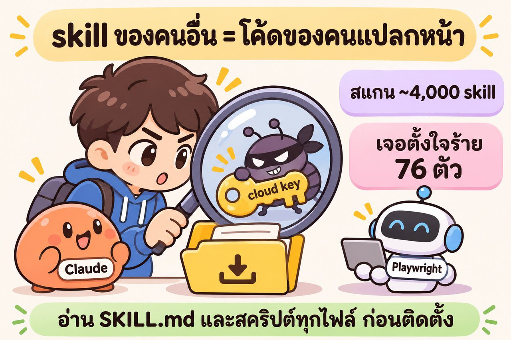

เพราะ skill ใส่สคริปต์ได้ และ AI จะ **รันสคริปต์นั้นในเครื่องเรา**

- บริษัทความปลอดภัย **Snyk** สแกน skill ในคลังชุมชนเกือบ **4,000 ตัว** (รายงาน ToxicSkills) ผู้ทำคลิปบอกว่าเจอตัวที่ **ตั้งใจร้าย 76 ตัว** บางตัวแอบขโมยรหัสเข้าระบบคลาวด์ และรายงานยังระบุว่าราว 13% มีปัญหาความปลอดภัยระดับร้ายแรงอย่างน้อย 1 ข้อ
- **กฎ:** ก่อนติดตั้ง skill ของคนอื่น **เปิดอ่าน `SKILL.md` และสคริปต์ทุกไฟล์** หรือสั่ง Claude อ่านแล้วสรุปให้ก่อนว่าสคริปต์ทำอะไร ส่งข้อมูลไปไหน
- skill ที่เราสร้างเองจากงานของเรา ปลอดภัยที่สุด

> 📌 **ที่มา** 🅺 Snyk ToxicSkills [15:54](https://youtu.be/SaL8dtnSBxw?t=954) – [16:22](https://youtu.be/SaL8dtnSBxw?t=982) (ตัวเลข 76 มาจากคำพูดในคลิป ส่วน ~13% มาจากหน้ารายงานบนจอ)

---

# 🏢 ภาค 4 — skill ระดับองค์กร: จากคนเดียวเก่ง สู่ทั้งบริษัทเก่ง

ภาค 1–3 ดูแค่ **คนหนึ่งคนกับ Claude หนึ่งตัว** ที่เก่งขึ้นจาก Day 1 ไป Day 30
ภาคนี้ขยายภาพไปทั้ง **บริษัทเทคที่มีพนักงานจำนวนมาก แบ่งเป็นหลายแผนก แต่ละแผนกมีหลายคน** และตอบ 4 คำถาม

1. **ปวดตรงไหน** ทำไมองค์กรต้องสนใจเรื่องแชร์ skill
2. **แชร์ยังไง** ระบบส่วนกลาง (remote) กับเครื่องของแต่ละคน (local) ควรออกแบบแบบไหน
3. **หายังไง** มี skill เป็นร้อยเป็นพัน จะให้ AI หยิบตัวที่ใช่ได้เร็ว ใช้แค่หัวไฟล์พอไหม ใช้ RAG ดีไหม หรือใช้ knowledge graph
4. **ดูแลยังไง** ทำให้ skill ดีขึ้นต่อเนื่องแบบ CI/CD


> 🖼️ ภาพนี้เป็นภาพจำลองเพื่อให้เห็นเป้าหมาย ตัวเลขบนจอเป็นตัวอย่าง ไม่ใช่ข้อมูลจริงของบริษัทใด

---

## 18. ⭐ จุดที่เจ็บ: งานเดิม ทำซ้ำทุกโปรเจกต์


ก่อนพูดเรื่องระบบ ต้องเห็นปัญหาก่อน ลองดู 4 เรื่องที่เกิดขึ้นในบริษัทเทคแทบทุกที่

| ใคร | เรื่องที่เกิดซ้ำ |
|---|---|
| 🧩 **SA (System Analyst)** | ลูกค้ารายใหม่ขอระบบจองคิว ซึ่งโจทย์ **คล้ายของโรงพยาบาลที่ทำไปเมื่อปีก่อน 80%** แต่ SA คนใหม่ไม่รู้ จึงนั่งคุย requirement, วาด architecture, เขียน spec ใหม่ตั้งแต่หน้าแรก |
| 💻 **Dev** | ได้งาน "ระบบสมาชิก + ชำระเงิน" เป็นรอบที่ 5 ของปี ทุกรอบเปิดโปรเจกต์เก่ามาก๊อป แล้วต้องจำเองว่าตอนนั้นแก้บั๊ก token หมดอายุไว้ตรงไหน |
| 💼 **Sales** | ทำ proposal ให้ลูกค้าธนาคาร ทั้งที่ทีมเคยทำ proposal ธนาคารที่ชนะมาแล้ว 3 ฉบับ แต่ไฟล์อยู่ในเครื่องคนที่ลาออกไป |
| 👔 **ผู้บริหาร (MD) และผู้ช่วย** | ทุกต้นเดือนต้องทำสไลด์ประชุมผู้บริหาร: ดึงยอดขาย สรุปโปรเจกต์ จัดรูปแบบตามแบรนด์ ใช้เวลาครึ่งวันทุกเดือน ทั้งที่โครงสไลด์เหมือนเดิมทุกครั้ง |

### 18.1 งานซ้ำในทุกแผนก

| หน่วยงาน | งานที่วนกลับมาซ้ำ | ถ้าไม่มี skill | skill ที่ควรมี (ตัวอย่าง) |
|---|---|---|---|
| **Sales** | proposal, ใบเสนอราคา, อีเมลติดตามลูกค้า | เริ่มจากไฟล์เปล่า หรือก๊อปฉบับเก่าที่ข้อมูลผิดยุค | `sales-proposal`, `quotation` |
| **Presales / SA** | workshop requirement, วิเคราะห์ TOR, วาด architecture | โจทย์คล้ายเดิม แต่คิดใหม่จากศูนย์ | `req-to-spec`, `tor-review`, `arch-template` |
| **Dev** | ขึ้นโปรเจกต์ใหม่, โมดูลมาตรฐาน (login, payment), code review | แต่ละคนเขียนคนละสไตล์ บั๊กเดิมกลับมา | `project-scaffold`, `coding-standard` |
| **QA** | แผนทดสอบ → test → รายงาน | ทุกโปรเจกต์ต้องวางพรอมต์ใหม่ (แบบที่เราเจอในบท 02) | `test-from-plan` |
| **DevOps** | checklist deploy, สรุปเหตุขัดข้อง (postmortem) | ลืมขั้นตอนเดียว ระบบล่ม | `deploy-checklist`, `postmortem` |
| **ML / MLOps** | บันทึกการทดลองด้วย MLflow, ปล่อยโมเดลขึ้นระบบจริง | แต่ละคนเก็บผลคนละแบบ เทียบกันไม่ได้ | `mlflow-experiment`, `model-release` |
| **HR** | เขียนประกาศรับสมัคร (JD), ชุดต้อนรับพนักงานใหม่, ตอบคำถามสวัสดิการ | ตอบคำถามเดิมทุกสัปดาห์ | `jd-writer`, `onboarding-pack` |
| **MD + ผู้ช่วย** | สไลด์ประชุม, รายงานประจำเดือน, สรุปการประชุม | ครึ่งวันทุกเดือน รูปแบบไม่เหมือนกันทุกเดือน | `exec-deck`, `monthly-report`, `meeting-minutes` |
| **บัญชี / การเงิน** | คำนวณราคาโปรเจกต์, ตรวจใบแจ้งหนี้ | สูตรอยู่ใน Excel ของคนคนเดียว | `pricing-calc` |

> 💡 **หลักสังเกต:** งานไหนที่คุณเคยพูดว่า "อันนี้เคยทำแล้วนี่" งานนั้นควรเป็น skill
> **ทุกองค์กรมีงานเฉพาะของตัวเอง** ที่โมเดลไม่มีทางรู้เอง (รูปแบบ proposal ที่ลูกค้าเราชอบ, มาตรฐานโค้ดของทีม, โครงสไลด์ที่ MD อยากเห็น) นี่คือ "ความรู้ของนักภาษี" ในหัวข้อ 4 แต่อยู่ระดับองค์กร

### 18.2 ปัญหาที่ใหญ่กว่างานซ้ำ: ความรู้ติดอยู่ในหัวคน


| อาการ | ผลกระทบ |
|---|---|
| **ความรู้อยู่ในหัวคน / ในเครื่องคน** | คนลาออก วิธีทำงานที่ดีที่สุดหายไปด้วย |
| **แต่ละแผนกเก่งคนละเรื่อง แต่ไม่แชร์** | Sales รู้ว่าลูกค้าธนาคารชอบอะไร แต่ SA ไม่รู้ ทำ spec ไม่ตรงใจลูกค้า |
| **ต่างคนต่างเขียนพรอมต์เอง** | ผลงานคุณภาพไม่เท่ากัน ขึ้นกับว่าใครเขียนพรอมต์เก่ง |
| **คนใหม่เริ่มจากศูนย์** | ต้องใช้เวลาหลายเดือนกว่าจะรู้ว่า "ที่นี่ทำงานกันแบบไหน" |
| **บทเรียนไม่ถูกจด** | บั๊กเดิม ความผิดพลาดเดิม กลับมาในโปรเจกต์ถัดไป |

### 18.3 ลองคิดเป็นตัวเลข (ตัวอย่างสมมติ)

| สมมติฐาน | ค่า |
|---|---|
| เวลาที่เสียไปกับ "งานที่เคยทำแล้ว" | คนละ 30 นาที / วัน |
| พนักงานทุก 100 คน | เสียรวม 50 ชั่วโมง / วัน ≈ **คนทำงานเต็มเวลา 6 คน** ที่ทำแต่งานซ้ำ |
| ยิ่งบริษัทใหญ่ | ยิ่งเสียมาก เพราะคนทำงานซ้ำกัน **ข้ามแผนก** โดยไม่รู้ตัว |

ตัวเลขนี้เป็นแค่สมมติฐานให้เห็นขนาดของปัญหา ลองให้แต่ละแผนกประเมินของจริงกันเอง แล้วจะเห็นว่า skill ที่แชร์กันเป็น **เรื่องของบริษัท** ไม่ใช่เรื่องส่วนตัวของคนชอบ AI

> 📌 **ที่มา** สถานการณ์และตัวเลขในหัวข้อนี้เป็นตัวอย่างสมมติของบทเรียน · แนวคิด "ความรู้ขององค์กรต้องอยู่ที่ส่วนกลาง" มาจาก 🅰️ [12:02](https://youtu.be/CEvIs9y1uog?t=722) – [12:50](https://youtu.be/CEvIs9y1uog?t=770)

---

## 19. วิสัยทัศน์จากทอล์ค: ฐานความรู้กลางที่ทุกคนช่วยกันเติม


ทอล์คของ Anthropic บอกว่าคุณค่าส่วนใหญ่ของ skill จะมาจาก **การแชร์** และวาดภาพอนาคตไว้ 4 ขั้น

| ขั้น | สิ่งที่เกิด | ในบริษัทของเรา |
|---|---|---|
| 1 | มี **ฐานความรู้กลาง** ที่ทั้งคนและ agent ช่วยกันคัดสรร | คลัง `org-skills` ที่ทุกแผนกเติมได้ |
| 2 | **feedback ของคนหนึ่ง ทำให้ agent ทุกตัวในทีมเก่งขึ้น** | SA คนหนึ่งเจอว่า spec ลืมหัวข้อ PDPA → แก้ skill ครั้งเดียว SA ทุกคนได้ด้วย |
| 3 | **คนใหม่วันแรก** เปิด Claude แล้วมันรู้เลยว่าทีมให้ความสำคัญกับอะไร | Dev ใหม่ได้ `coding-standard`, `deploy-checklist` ตั้งแต่วันแรก |
| 4 | คุณค่าขยายออกนอกองค์กรไปสู่ **ชุมชน** | ใช้ skill ของ partner (เช่น skill เอกสาร, skill เบราว์เซอร์) ร่วมกับของเรา |

> **skill ส่วนตัว = คนเดียวเก่ง Day 1 → Day 30**
> **skill ที่แชร์ = ทั้งบริษัทเก่ง Day 1 → Day 30 พร้อมกัน และไม่หายไปเมื่อคนลาออก**

> 📌 **ที่มา** 🅰️ แบ่งปันและฐานความรู้องค์กร [12:02](https://youtu.be/CEvIs9y1uog?t=722) · feedback ทำให้ทุก agent ดีขึ้น [12:32](https://youtu.be/CEvIs9y1uog?t=752) · คนใหม่เข้าทีม [12:44](https://youtu.be/CEvIs9y1uog?t=764) · ชุมชน [12:56](https://youtu.be/CEvIs9y1uog?t=776) · 🅺 ส่วนที่ผู้ทำคลิปชอบที่สุด [09:50](https://youtu.be/SaL8dtnSBxw?t=590) – [10:33](https://youtu.be/SaL8dtnSBxw?t=633) · ภาพคนใหม่วันแรกเป็นภาพจำลอง

---

## 20. บริษัทตัวอย่าง: หลายแผนก หลายคน


บริษัทสมมติ **"โนวาเทค"** รับทำระบบให้ลูกค้าองค์กร รายได้มาจาก Sales ที่ออกไปคุยกับลูกค้า

| หน่วยงาน | ทำอะไร | ผู้ดูแล skill ของแผนก (ตัวอย่าง) |
|---|---|---|
| MD / ผู้บริหาร + ผู้ช่วย | ตัดสินใจ อนุมัติดีล ประชุมผู้บริหาร | ผู้ช่วยผู้บริหาร |
| Sales | หาลูกค้า ทำ proposal ปิดการขาย (ที่มาของรายได้) | หัวหน้าทีมขาย |
| Presales / SA | คุย requirement ออกแบบระบบ เขียน spec | SA อาวุโส |
| Dev | พัฒนาระบบ | tech lead |
| QA | ทดสอบตามแผน | QA lead |
| DevOps | ขึ้นระบบจริง ดูแลระบบ | DevOps lead |
| ML / MLOps | ทำโมเดล ปล่อยโมเดล | MLOps lead |
| HR | รับคน ดูแลพนักงาน | HR BP |
| บัญชี / Admin | ราคา ใบแจ้งหนี้ งานเอกสาร | หัวหน้าบัญชี |

ทุกแผนกมี **"ผู้ดูแล skill" (skill owner) 1 คน** ทำหน้าที่รีวิว skill ของแผนกตัวเอง และมี **ทีมกลาง (platform team) 2–3 คน** ดูแลระบบแชร์ทั้งหมด

### 20.1 งาน 1 ดีล ไหลผ่านหลายแผนก


| ขั้น | ใคร | skill | รับต่อจาก / ส่งต่อให้ |
|---|---|---|---|
| 1 | Sales | `sales-proposal` (ใช้ `pricing-calc` + `brand-deck`) | → proposal ที่ลูกค้าเซ็น |
| 2 | MD | `deal-approval` | อ่านกำไรจาก `pricing-calc` → อนุมัติ |
| 3 | SA | `req-to-spec` (ใช้ `arch-template`) | รับ proposal → spec + architecture |
| 4 | Dev | `coding-standard`, `project-scaffold` | รับ spec → ระบบ |
| 5 | QA | `test-from-plan` (skill ที่เราสร้างใน ส่วน 02) | รับแผนทดสอบ → รายงาน + คำตัดสิน |
| 6 | DevOps | `deploy-checklist` | รับคำตัดสิน "ปล่อยได้" → ขึ้นระบบจริง |

จุดสำคัญ: **skill ไม่ได้อยู่โดดเดี่ยว** มันใช้ skill อื่น (`uses`) และส่งงานต่อให้ skill ถัดไป (`next`) ความสัมพันธ์นี้คือที่มาของ "กราฟ" ในหัวข้อ 24

---

## 21. ออกแบบ skill เป็น 5 ชั้น


ถ้าเอา skill ทั้งบริษัท 200 ตัวยัดให้ทุกคน AI จะเลือกผิดบ่อย (หัวข้อ 24 อธิบายว่าทำไม) จึงแบ่งเป็นชั้น **แต่ละคนเห็นเฉพาะชั้นที่เกี่ยวกับตัวเอง**

| ชั้น | มีอะไร | ใครได้ | เก็บที่ไหน | ใครอนุมัติ |
|---|---|---|---|---|
| **1 องค์กร (core)** | แบรนด์, นโยบายข้อมูลลูกค้า, ศัพท์บริษัท | ทุกคน (บังคับติดตั้ง) | plugin `core` ในคลังกลาง | ทีมกลาง + ฝ่ายกฎหมาย/ความปลอดภัย |
| **2 ข้ามหน่วยงาน** | เขียน spec, ทำสไลด์, สรุปประชุม | ทุกคนที่ต้องใช้ | plugin `shared` | ทีมกลาง |
| **3 หน่วยงาน** | Sales pack, Dev pack, HR pack… | คนในแผนกนั้น | plugin ต่อแผนก เช่น `sales` | ผู้ดูแล skill ของแผนก |
| **4 ทีม / โปรเจกต์** | กติกาเฉพาะโปรเจกต์ลูกค้ารายหนึ่ง | คนในโปรเจกต์ | `<repo>/.claude/skills/` | tech lead ของโปรเจกต์ |
| **5 ส่วนตัว** | ของที่กำลังทดลอง | เจ้าของคนเดียว | `~/.claude/skills/` | ไม่ต้อง |

**กติกาเลื่อนชั้น (promote):** skill ส่วนตัวที่ใช้ได้ดี → มีคนอื่นในทีมขอใช้ → เปิด PR เข้าชั้น 3 → ถ้าแผนกอื่นก็ใช้ → ย้ายขึ้นชั้น 2
skill ไม่ได้เกิดจากการสั่งจากบนลงล่าง แต่ **เกิดจากงานจริงแล้วค่อย ๆ ไต่ขึ้นมา** (ตรงกับ 6 ขั้นในหัวข้อ 16)

### 21.1 ตั้งชื่อและเขียนหัวไฟล์ให้ค้นได้

ใช้หัวไฟล์ `metadata` (มาตรฐาน agentskills.io อนุญาตให้ใส่ค่าเพิ่มเป็นข้อความ) เก็บข้อมูลที่ระบบกลางต้องใช้

```markdown
---
name: sales-proposal
description: ร่าง proposal ขายระบบให้ลูกค้าองค์กรตามรูปแบบของโนวาเทค พร้อมราคาและกำหนดการ
  ใช้เมื่อผู้ใช้สั่ง "ทำ proposal", "ร่างข้อเสนอให้ลูกค้า", "ทำใบเสนอโครงการ"
metadata:
  owner: sales-team
  layer: department
  version: "1.4.0"
  uses: "pricing-calc, brand-deck"
  next: "deal-approval, req-to-spec"
  follows: "customer-data-policy"
---
```

| ช่อง | ใช้ทำอะไร |
|---|---|
| `name` | ชื่อไม่ซ้ำทั้งบริษัท ใช้คำกริยา/งานชัด ๆ เลี่ยงชื่อกว้างอย่าง `helper` `utils` |
| `description` | **สิ่งเดียวที่ AI เห็นก่อนตัดสินใจ** (หัวข้อ 7) บอกทำอะไร + ได้อะไร + คำที่คนในบริษัทชอบพิมพ์ |
| `owner`, `layer`, `version` | ใครดูแล อยู่ชั้นไหน เวอร์ชันอะไร |
| `uses`, `next`, `follows` | ความสัมพันธ์กับ skill อื่น → ระบบกลางเอาไปสร้าง **กราฟ** (หัวข้อ 24) |

> 📌 **ที่มา** ข้อกำหนด `name` ≤ 64 ตัวอักษร, `description` ≤ 1,024 ตัวอักษร, ช่อง `metadata` จาก [agentskills.io/specification](https://agentskills.io/specification) และ [เอกสาร Agent Skills ของ Anthropic](https://platform.claude.com/docs/en/agents-and-tools/agent-skills/overview) · คำแนะนำการตั้งชื่อจาก [Anthropic best practices](https://platform.claude.com/docs/en/agents-and-tools/agent-skills/best-practices) · การแบ่ง 5 ชั้นและช่อง `uses/next/follows` เป็นการออกแบบของบทเรียนนี้

---

## 22. ⭐ ระบบแชร์ skill: ส่วนกลาง (remote) + เครื่องของแต่ละคน (local)

### 22.1 มีให้เลือก 4 แบบ


| แบบ | ทำงานยังไง | ข้อดี | ข้อจำกัด | เหมาะกับ |
|---|---|---|---|---|
| **1. Git repo + sync** | ทุกคน `git clone` คลัง skill แล้วสคริปต์คัดลอกไป `~/.claude/skills` | ง่ายที่สุด ไม่ต้องตั้งค่าอะไร | ต้อง pull เอง ไม่มีแพ็กตามแผนก เวอร์ชันคุมยาก | ทีมเดียว / ทีมเล็ก |
| **2. Plugin marketplace** ⭐ | คลัง Git เดียว แบ่ง skill เป็น plugin ต่อแผนก มีไฟล์ `marketplace.json` เป็นสารบัญ | ติดตั้งเป็นแพ็ก, มีเวอร์ชัน, อัปเดตอัตโนมัติ, admin บังคับติดตั้งได้ | ต้องมีคนดูแลคลัง | **บริษัทหลายแผนก (เคสเรา)** |
| **3. Admin แจกบน claude.ai** | เจ้าของบัญชีองค์กรอัปโหลด skill แล้วเปิดให้ทุกคน | คนที่ไม่ใช้ Claude Code (HR, บัญชี, MD) ก็ได้ใช้ในแอป Claude | แจกได้ แต่ไม่มี PR/รีวิวในตัว | แผนกที่ไม่ใช่สายเทคนิค |
| **4. Registry + ค้นหา (MCP)** | ทำเซิร์ฟเวอร์กลางเก็บ skill ทั้งหมด ให้ AI ค้นแล้วดึงมาเฉพาะที่ต้องใช้ | รองรับหลักพันตัว | ต้องสร้างและดูแลระบบเอง | องค์กรใหญ่มาก |

**คำแนะนำสำหรับบริษัทหลายแผนก:** ใช้ **แบบ 2 เป็นแกน** (ของจริงอยู่ใน Git ที่เดียว) แล้ว **ส่งออกไปแบบ 3** ให้แผนกที่ใช้แอป Claude และเติม **"skill ค้นหา"** แบบเบา ๆ จากแบบ 4 (หัวข้อ 24.4) เมื่อ skill เริ่มเกินร้อย

### 22.2 หน้าตาระบบที่แนะนำ


หลักคิดของระบบนี้มี 3 ข้อ

| ข้อ | หลัก | แปลว่า |
|---|---|---|
| 1 | **ของจริงมีที่เดียว** คือคลังกลาง (เรียกว่า **remote**) | skill ฉบับที่ถูกต้องอยู่ที่ส่วนกลาง ไม่ใช่ในเครื่องใครคนหนึ่ง |
| 2 | ทุกคน **ดึง (pull)** สำเนาไปใช้ในเครื่องตัวเอง (เรียกว่า **local**) | ใช้งานได้เลย และได้ฉบับใหม่อัตโนมัติเมื่อของกลางเปลี่ยน |
| 3 | อยากแก้ของกลาง ต้อง **ยื่นคำขอแก้** ที่เรียกว่า **PR (Pull Request)** ให้เจ้าของตรวจก่อน | **ไม่มีใครแก้ของกลางตรง ๆ** แม้แต่หัวหน้า |

#### 🙋 PR (Pull Request) คืออะไร — อธิบายแบบไม่ต้องรู้ Git


ลองนึกถึง **เอกสารนโยบายบริษัทที่ทุกคนใช้** ถ้าใครก็แก้ต้นฉบับได้ทันที วันหนึ่งเอกสารจะผิดโดยไม่มีใครรู้ว่าใครแก้
บริษัทจึงใช้วิธี **"ทำสำเนามาแก้ → ยื่นคำขอแก้ → เจ้าของตรวจ → อนุมัติแล้วค่อยรวมเข้าต้นฉบับ"**
ใน Git เรียกคำขอแก้นี้ว่า **Pull Request (PR)** แปลตรงตัวคือ "ขอให้ของกลาง **ดึง (pull)** การแก้ของเราเข้าไป"

| ขั้น | ทำอะไร | ศัพท์ใน Git | ตัวอย่าง: SA อยากเพิ่มหัวข้อ PDPA ใน `req-to-spec` |
|---|---|---|---|
| 1 | ทำสำเนาของกลางมาแก้ (ต้นฉบับไม่ถูกแตะ) | **branch** | สร้างสำเนาชื่อ `add-pdpa` |
| 2 | แก้ในสำเนา | **commit** | เพิ่มหัวข้อ "ข้อมูลส่วนบุคคล (PDPA)" ใน `SKILL.md` |
| 3 | ยื่นคำขอแก้ บอกว่า **แก้อะไร และทำไม** | **Pull Request (PR)** | "ขอเพิ่มหัวข้อ PDPA เพราะลูกค้าธนาคารถามทุกครั้ง" |
| 4 | ตรวจ 2 ทาง: **คน** (เจ้าของ skill อ่าน คอมเมนต์) + **เครื่อง** (eval + สแกนอัตโนมัติ หัวข้อ 23) | **review** + **CI** | SA อาวุโสคอมเมนต์ "ดีครับ เพิ่มตัวอย่างอีกนิด" → แก้ตาม → eval ผ่าน |
| 5 | อนุมัติ แล้วรวมเข้าของกลาง ทุกคนได้ฉบับใหม่ | **approve** + **merge** | SA ทุกคนได้หัวข้อ PDPA ทันที |

**ทำไมต้องยุ่งยากแบบนี้**

| ถ้าไม่มี PR (ทุกคนแก้ของกลางได้เลย) | ถ้ามี PR |
|---|---|
| แก้ผิดทีเดียว ผิดทั้งบริษัท | มีคนตรวจก่อนเสมอ |
| ไม่รู้ว่าใครแก้อะไร เมื่อไหร่ เพราะอะไร | ทุกการแก้มีชื่อคน วันที่ และเหตุผล |
| skill ร้ายหรือสคริปต์อันตรายหลุดเข้าไปได้ | ผ่านด่านสแกนก่อน (หัวข้อ 17, 23) |
| แก้พังแล้วกู้คืนยาก | ย้อนกลับไปฉบับก่อนหน้าได้ทันที |

> 💡 **ไม่ต้องเป็นโปรแกรมเมอร์ก็เปิด PR ได้** — สั่ง Claude เป็นภาษาคนได้เลย เช่น
> `แก้ skill req-to-spec ให้มีหัวข้อ PDPA แล้วเปิด PR ให้ทีม SA รีวิว`
> Claude จะทำขั้น 1–3 ให้ (สร้าง branch, แก้, เปิด PR พร้อมเขียนเหตุผล) เราแค่รอคนตรวจ แล้วแก้ตามคอมเมนต์

> 📌 **ที่มา** ขั้นตอน branch → PR → review → merge เป็นวิธีทำงานมาตรฐานของ GitHub / GitLab · เอกสาร Anthropic แนะนำให้รีวิว skill ผ่าน pull request และให้คนเขียนกับคนรีวิวเป็นคนละคน ([Skills for enterprise](https://platform.claude.com/docs/en/agents-and-tools/agent-skills/enterprise)) · ตัวอย่าง PDPA เป็นของบทเรียน

#### โครงสร้างคลังกลาง

```text
org-skills/                          ← คลัง Git กลาง (remote) บน GitHub / GitLab ของบริษัท
├─ .claude-plugin/
│  └─ marketplace.json               ← สารบัญ: มี plugin อะไรบ้าง อยู่โฟลเดอร์ไหน
├─ plugins/
│  ├─ core/                          ← ชั้น 1 ทุกคนได้
│  │  ├─ .claude-plugin/plugin.json
│  │  └─ skills/
│  │     ├─ brand-deck/SKILL.md
│  │     └─ customer-data-policy/SKILL.md
│  ├─ shared/                        ← ชั้น 2 ข้ามหน่วยงาน
│  ├─ sales/                         ← ชั้น 3 แผนกละ 1 plugin
│  │  └─ skills/sales-proposal/  (SKILL.md + scripts/ + templates/)
│  ├─ sa/   ├─ dev/   ├─ qa/   ├─ devops/   ├─ mlops/   ├─ hr/   └─ exec/
├─ CODEOWNERS                        ← โฟลเดอร์ไหน ใครต้องรีวิว
└─ .github/workflows/skill-ci.yml    ← ด่านตรวจอัตโนมัติ (หัวข้อ 23)
```

ไฟล์สารบัญ `marketplace.json` (ย่อ)

```json
{
  "name": "novatech-skills",
  "owner": { "name": "Platform Team" },
  "plugins": [
    { "name": "core",  "source": "./plugins/core" },
    { "name": "sales", "source": "./plugins/sales" },
    { "name": "dev",   "source": "./plugins/dev" }
  ]
}
```

### 22.3 ฝั่งผู้ใช้: ติดตั้งครั้งเดียว อัปเดตเอง

| ใคร | ทำอะไร |
|---|---|
| **admin (ครั้งเดียวทั้งบริษัท)** | ใส่ใน managed settings ให้ทุกเครื่องรู้จักคลังนี้ (`extraKnownMarketplaces`) และบังคับติดตั้ง `core` (`enabledPlugins`) · จำกัดให้ติดตั้งได้เฉพาะคลังของบริษัท (`strictKnownMarketplaces`) |
| **พนักงาน (ครั้งเดียว)** | ติดตั้งแพ็กของแผนกตัวเอง |
| **ทุกวัน** | ไม่ต้องทำอะไร plugin อัปเดตตามคลังกลางเอง |

```bash
claude plugin marketplace add novatech/org-skills
```

```bash
claude plugin install sales@novatech-skills
```

skill จาก plugin จะมีชื่อแผนกนำหน้า เช่น `/sales:sales-proposal` **ชื่อจึงไม่ชนกัน** แม้สองแผนกมี skill ชื่อ `report` เหมือนกัน

### 22.4 ส่วนกลางกับเครื่องตัวเอง: อะไรอยู่ไหน

| | 🌐 Remote (คลังกลาง) | 💻 Local (เครื่องพนักงาน) |
|---|---|---|
| เก็บอะไร | skill ชั้น 1–3 ที่ผ่านรีวิวแล้ว | สำเนาที่ติดตั้ง (อ่านอย่างเดียว) + skill ส่วนตัวชั้น 5 + skill ในโปรเจกต์ชั้น 4 |
| แก้ได้ไหม | ได้ แต่ต้องยื่นคำขอแก้ (PR) ให้เจ้าของตรวจก่อน | skill ส่วนตัวแก้ได้เลย สำเนาของกลางไม่ควรแก้ตรง ๆ |
| ถ้าชื่อซ้ำ | — | ลำดับความสำคัญ: องค์กร (managed) > ส่วนตัว > โปรเจกต์ · plugin มีชื่อแผนกนำหน้าจึงไม่ชน |
| ถ้าอยากลองของใหม่ | เปิดช่อง `beta` เป็นอีก marketplace ที่ชี้ไป branch อื่น | ติดตั้งจากช่อง beta ได้เฉพาะคนอาสาทดลอง |

> 📌 **ที่มา** วิธีแชร์ 3 ระดับ (repo / plugin / managed) และลำดับความสำคัญจาก [Claude Code docs: Skills](https://code.claude.com/docs/en/skills) · `marketplace.json` และคำสั่งติดตั้งจาก [Plugin marketplaces](https://code.claude.com/docs/en/plugin-marketplaces) · การตั้งค่า admin, อัปเดตอัตโนมัติ, ช่อง stable/beta จาก [Plugins for organizations](https://code.claude.com/docs/en/plugins/org.md) · admin แจก skill บน claude.ai จาก [Anthropic blog 18 ธ.ค. 2025](https://claude.com/blog/organization-skills-and-directory) และ [Help Center](https://support.claude.com/en/articles/13119606-managing-skills-as-an-admin) · ชื่อ `novatech`, โครงโฟลเดอร์ และการใช้ CODEOWNERS เป็นตัวอย่างของบทเรียน (เอกสาร Anthropic แนะนำให้รีวิวผ่าน PR และแยกคนเขียนกับคนรีวิว แต่ไม่ได้ระบุ CODEOWNERS)

---

## 23. SkillOps: CI/CD ของ skill


skill ที่คนทั้งบริษัทใช้ ผิดทีเดียวผิดทั้งบริษัท จึงต้องมีสายพานเหมือนซอฟต์แวร์ (ต่อยอดจากหัวข้อ 13)

| สถานี | ทำอะไร | ทำไม |
|---|---|---|
| 1. ร่าง | ทำงานจริง 1 รอบแล้วเก็บเป็น skill ส่วนตัว (6 ขั้น หัวข้อ 16) | skill ดีมาจากงานที่ทำได้จริง |
| 2. ยื่นคำขอแก้ (PR) | เสนอเข้าคลังกลาง พร้อมเหตุผลว่าแก้ปัญหาอะไร (ดู "PR คืออะไร" หัวข้อ 22.2) | ทุกการแก้มีประวัติ ย้อนได้ |
| 3. เจ้าของรีวิว | ผู้ดูแล skill ของแผนกอ่าน (คนเขียนไม่รีวิวเอง) | SkillsBench: skill ที่ AI เขียนเองล้วนแย่กว่าไม่มี (หัวข้อ 15) |
| 4. ทดสอบ (eval) | ชุดคำถาม 3–5 ข้อ: **ควรหยิบ / ไม่ควรหยิบ / กำกวม** + ตรวจผลลัพธ์ · รันเทียบ "มี skill vs ไม่มี skill" | กัน description ชนกับ skill อื่น และพิสูจน์ว่าช่วยจริง |
| 5. สแกนความปลอดภัย | ตรวจสคริปต์ว่าส่งข้อมูลออกไหม มี prompt injection ไหม | Snyk สแกน 3,984 skill เจอตั้งใจร้าย 76 ตัว (หัวข้อ 17) |
| 6. ออกเวอร์ชัน | ติดเลขเวอร์ชัน + บันทึกการเปลี่ยนแปลง | รู้ว่าใครใช้รุ่นไหน ถอยกลับได้ |
| 7. ทุกคนได้อัปเดต | plugin อัปเดตอัตโนมัติ | ไม่ต้องประกาศให้ทุกคนไป pull |
| 🔁 feedback | ใครเจอที่พลาด สั่ง Claude **"จดบทเรียนนี้แล้วเปิด PR แก้ skill"** | วงจร Day 1 → Day 30 ของทั้งบริษัท |

ตัวอย่างด่านตรวจอัตโนมัติ (ย่อ)

```yaml
# .github/workflows/skill-ci.yml
on: pull_request
jobs:
  check:
    steps:
      - run: claude plugin validate .               # โครงสร้างและหัวไฟล์ถูกไหม
      - run: claude plugin eval plugins/sales        # ชุดทดสอบ: หยิบถูกไหม ผลดีขึ้นไหมเมื่อเทียบกับไม่มี skill
      - run: ./scripts/security-scan.sh              # ตรวจสคริปต์ทุกไฟล์
```

**ตัวชี้วัดที่ทีมกลางควรดู**

| ตัวชี้วัด | ถามว่า |
|---|---|
| ใช้ซ้ำกี่ครั้ง / เดือน | skill ไหนคุ้มค่าที่สุด skill ไหนไม่มีใครใช้ (ควรเลิก) |
| หยิบถูกกี่ % (จาก eval) | description ชัดพอไหม |
| จำนวน PR แก้ / เดือน | skill ไหนยังพลาดบ่อย |
| เวลาที่ประหยัด (ให้แผนกประเมิน) | คุ้มที่จะลงทุนต่อไหม |

> 📌 **ที่มา** ขั้นตอนรีวิว, eval 3–5 ข้อ (ควร/ไม่ควร/กำกวม), แยกคนเขียนกับคนรีวิว, pin เวอร์ชัน จาก [Anthropic: Skills for enterprise](https://platform.claude.com/docs/en/agents-and-tools/agent-skills/enterprise) · คำสั่ง `claude plugin eval` จาก [Plugin evals](https://code.claude.com/docs/en/plugin-evals) · ตัวเลข Snyk จาก [ToxicSkills (5 ก.พ. 2026)](https://snyk.io/blog/toxicskills-malicious-ai-agent-skills-clawhub/) · ไฟล์ CI เป็นตัวอย่างย่อของบทเรียน (`security-scan.sh` ต้องเขียนเองหรือใช้เครื่องมือสแกนของบริษัท)

---

## 24. ⭐ หา skill ให้เจอเร็ว: หัวไฟล์, RAG หรือ Knowledge Graph?

### 24.1 ทำไมยิ่ง skill เยอะ ยิ่งหายาก

จำชั้น 1 ของการเปิดทีละชั้น (หัวข้อ 10) ได้ไหม AI เห็น `name` + `description` ของ **ทุก** skill ตลอดเวลา ซึ่งมีขีดจำกัด

| ปัญหา | รายละเอียด |
|---|---|
| **งบรายชื่อมีจำกัด** | Claude Code ให้รายชื่อ skill ใช้พื้นที่ราว **1% ของ context** (Codex ราว 2%) ถ้าเกิน คำอธิบายของ skill ที่ใช้น้อยที่สุดจะถูกตัดออกก่อน เหลือแค่ชื่อ |
| **คำอธิบายชนกัน** | `sales-report`, `monthly-report`, `exec-report` ต่างมีคำว่า "รายงาน" AI เลือกผิดตัว |
| **AI ตัดสินใจไม่ได้** | งานวิจัย MetaTool พบว่าโมเดลส่วนใหญ่ยังลำบากทั้งเรื่อง "ต้องใช้เครื่องมือไหม" และ "ใช้ตัวไหน" |
| **คำค้นไม่ตรงคำอธิบาย** | ToolRet (43,000 เครื่องมือ) ตัวค้นที่ดีที่สุดยังได้คะแนนแค่ ~34/100 เพราะคนพิมพ์คนละคำกับที่เขียนในคำอธิบาย |

### 24.2 วิธีที่มีอยู่ทั้งหมด

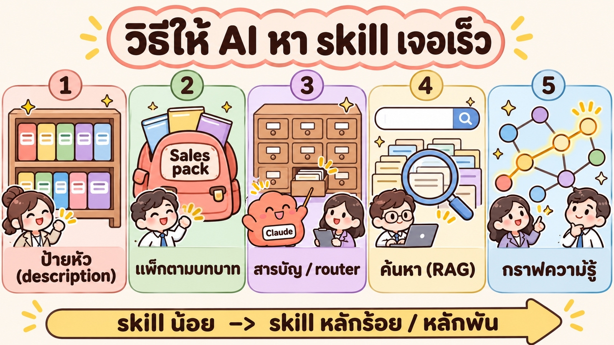

| # | วิธี | ทำงานยังไง | อุปมาห้องสมุด | ใช้เมื่อ | ใครใช้จริง |
|---|---|---|---|---|---|
| 1 | **หัวไฟล์ที่ดี** (description) | AI อ่านคำอธิบายทุกตัวแล้วเลือกเอง | อ่านสันหนังสือ | **ทุกกรณี (พื้นฐาน)** | Claude, Codex, Copilot |
| 2 | **เรียกเองตรง ๆ** | พิมพ์ `/ชื่อ-skill` ไม่ต้องให้ AI เดา | บอกบรรณารักษ์ชื่อหนังสือเลย | งานสำคัญที่ต้องการแม่นยำ 100% | Claude Code `/`, Codex `$`, Cursor `@` |
| 3 | **เปิดตามไฟล์ที่แตะ** (`paths`) | skill ตื่นเฉพาะเมื่อทำงานกับไฟล์ที่ตรงเงื่อนไข เช่น `infra/**` | หนังสือวางอยู่ในห้องที่ใช้งาน | โปรเจกต์ใหญ่ หลายส่วน | Claude Code `paths`, Cursor globs |
| 4 | **แพ็กตามบทบาท** | ติดตั้งเฉพาะแพ็กของแผนก (หัวข้อ 21–22) | กระเป๋าหนังสือประจำแผนก | **องค์กรหลายแผนก** | Claude Enterprise, คู่มือ Anthropic |
| 5 | **สารบัญ / router skill** | skill ตัวเดียวทำหน้าที่ "บรรณารักษ์" ค้นสารบัญกลาง แล้วบอกว่าควรใช้หรือติดตั้งตัวไหน | ตู้บัตรรายการ | skill หลักร้อยขึ้นไป | ออกแบบเองได้ (24.4) |
| 6 | **ค้นหาแบบ RAG** | เก็บคำอธิบายทั้งหมดในดัชนี ค้นด้วยคำ (BM25) + ความหมาย (embedding) แล้วโหลดแค่ top-5 | ค้นในคอมพิวเตอร์ห้องสมุด | หลักร้อยถึงหลักพัน | Tool Search ของ Anthropic, RAG-MCP, Voyager |
| 7 | **กราฟความรู้** | เก็บว่า skill ไหน ใช้ / ต่อจาก / ต้องทำตาม skill ไหน แล้วดึงพวกที่เกี่ยวข้องมาด้วย | แผนผัง "ถ้าอ่านเล่มนี้ ต้องอ่านเล่มไหนก่อน" | งานหลายขั้น skill ที่พึ่งกัน | งานวิจัย (Graph-of-Skills, ToolNet) |

### 24.3 📚 งานวิจัยอ้างอิง: เขาหา skill / เครื่องมือกันยังไง


| กลุ่ม | งาน (ปี) | วิธีที่เสนอ | ทดสอบกับอะไร | ผลที่ได้ | ลิงก์ |
|---|---|---|---|---|---|
| **เก็บแค่หัว ค้นเมื่อใช้** | **Tool Search Tool** — Anthropic (พ.ย. 2025) | ให้โมเดลเห็นแค่ชื่อเครื่องมือ (`defer_loading`) แล้วค้นด้วย regex / BM25 / embedding เมื่อต้องใช้ | ชุดทดสอบ MCP ภายในของ Anthropic | token ของคำนิยามเครื่องมือลด **85%** · Opus 4 แม่นขึ้น 49% → **74%** · Opus 4.5 79.5% → 88.1% | [anthropic.com](https://www.anthropic.com/engineering/advanced-tool-use) |
| **RAG** | **RAG-MCP** (2025) | ค้นคำอธิบายเครื่องมือที่เกี่ยวข้องก่อน แล้วส่งเฉพาะตัวที่เจอให้โมเดล | เลือกเครื่องมือจากชุด MCP จำนวนมาก | เลือกถูก **43.13%** เทียบ 13.62% เมื่อยัดทั้งหมด · token ในพรอมต์ลด **> 50%** | [arXiv 2505.03275](https://arxiv.org/abs/2505.03275) |
| **RAG** | **ToolRet** (2025) | benchmark วัดว่า "ตัวค้น" หาเครื่องมือเจอไหม | 7,600 งาน · 43,000 เครื่องมือ | ตัวค้นที่ดีที่สุดได้ nDCG@10 แค่ **33.83** เพราะคำที่คนพิมพ์ไม่ตรงกับคำในคำอธิบาย → **description ต้องเขียนด้วยคำของผู้ใช้** | [arXiv 2503.01763](https://arxiv.org/abs/2503.01763) |
| **RAG** | **MetaTool** (ICLR 2024) | benchmark วัดว่าโมเดลรู้ไหมว่า "ต้องใช้เครื่องมือหรือเปล่า" และ "ตัวไหน" | 21,127 คำถาม | โมเดลส่วนใหญ่ยังตัดสินใจเรื่องนี้ได้ไม่ดี | [arXiv 2310.03128](https://arxiv.org/abs/2310.03128) |
| **คลัง skill** | **Voyager** (2023) | agent เล่น Minecraft เก็บ skill เป็นโค้ด **ทำดัชนีจาก embedding ของคำอธิบาย** แล้วดึง top-5 มาใช้ | Minecraft | ของใหม่มากขึ้น 3.3 เท่า · ไปถึงเป้าหมายเร็วขึ้นสูงสุด 15.3 เท่า | [arXiv 2305.16291](https://arxiv.org/abs/2305.16291) |
| **คลัง skill** | **Agent Workflow Memory** (2024) | สรุปขั้นตอนที่ทำสำเร็จเป็น "workflow" ใช้ซ้ำในงานถัดไป (คล้ายการเก็บ skill เอง) | Mind2Web, WebArena | สำเร็จเพิ่มขึ้น (สัมพัทธ์) **24.6%** และ **51.1%** | [arXiv 2409.07429](https://arxiv.org/abs/2409.07429) |
| **กราฟ** | **ToolNet** (2024) | จัดเครื่องมือเป็นกราฟมีทิศทาง เลือกเครื่องมือถัดไปจากเพื่อนบ้านของตัวปัจจุบัน | งานใช้เครื่องมือหลายขั้น | รองรับเครื่องมือหลักพัน | [arXiv 2403.00839](https://arxiv.org/abs/2403.00839) |
| **กราฟ** | **Graph-of-Skills** (2026) | สร้างกราฟการพึ่งพาของ skill ล่วงหน้า → ค้นแบบผสมหาจุดเริ่ม → เดินกราฟ (Personalized PageRank) → โหลดภายในงบ context | SkillsBench | คะแนน **+25.6%** (สัมพัทธ์) · token **−56.7%** เทียบกับโหลดทุก skill · ถ้าตัดกราฟออก หา skill ที่ต้องใช้คู่กันได้แย่ลงเกือบครึ่ง | [arXiv 2604.05333](https://arxiv.org/abs/2604.05333) |
| **เทียบ RAG vs กราฟ** | **Comparative Approaches to Agent Retrieval over Large Skill Libraries** (ส.ค. 2026) | เทียบตัวค้นแบบผสม (คำ + ความหมาย) กับการใช้เพื่อนบ้านในกราฟ ภายใต้งบ token เท่ากัน | คลัง 690 skill · 117 คำถาม | ตัวค้นแบบผสมเจอใน top-5 **73.5%** · ใช้กราฟแทนที่ **แย่ลง 11.2 จุด** · คำถามที่คนเขียน skill คิดเองทำให้คะแนนดูดีเกินจริงถึง 44 จุด | [arXiv 2608.06196](https://arxiv.org/abs/2608.06196) |
| **ขนาดของ skill** | **SkillsBench** (2026) | วัดผลของ skill กับงานจริงหลายสาขา | 87 งาน · 8 สาขา | skill **เล็ก โฟกัส ไม่เกิน 3 ส่วน** ดีกว่าคู่มือยาวครอบทุกอย่าง (หัวข้อ 15) | [arXiv 2602.12670](https://arxiv.org/abs/2602.12670) |

**สรุปจากงานวิจัย**

| ข้อสรุป | มาจาก |
|---|---|
| ไม่ต้องให้ AI เห็นทุกอย่าง **เห็นแค่หัว แล้วค้นเมื่อจะใช้** แม่นขึ้นและประหยัดกว่า | Tool Search, RAG-MCP, Voyager |
| **การค้นแบบผสม (คำ + ความหมาย) คือตัวหลัก** | RAG-MCP, Comparative Approaches |
| **กราฟใช้เติม** skill ที่ต้องใช้คู่กัน ไม่ใช่ใช้แทนการค้น | Graph-of-Skills, Comparative Approaches |
| ตัวค้นดีแค่ไหนก็พังได้ถ้า **คำอธิบายไม่ตรงกับคำที่ผู้ใช้พิมพ์** | ToolRet |
| ทดสอบด้วย **คำค้นของผู้ใช้จริง** ไม่ใช่คำที่คนเขียน skill คิดเอง | Comparative Approaches |

> ⚠️ งานปี 2026 บางชิ้นยังเป็น preprint บน arXiv (ยังไม่ผ่านการพิสูจน์ซ้ำในวงกว้าง) ใช้เป็นแนวทาง ไม่ใช่ข้อยุติ

### 24.4 ⭐ คำแนะนำ: ใช้ผสมตามขนาด

| จำนวน skill ที่ "คนหนึ่งคนเห็น" | ใช้อะไร |
|---|---|
| ไม่เกิน ~30 | หัวไฟล์ที่ดี (1) + เรียกเองเมื่อสำคัญ (2) **พอแล้ว** |
| 30–100 | + แพ็กตามบทบาท (4) ให้แต่ละคนเห็นแค่ core + แผนกตัวเอง |
| ทั้งบริษัท 100–1,000 | + router skill ค้นสารบัญกลาง (5) ที่ข้างในใช้การค้นแบบผสม (6) |
| หลายพัน / งานหลายขั้น | + registry กลาง + กราฟความรู้ (7) |

**บริษัทตัวอย่างของเรา:** คนหนึ่งคนเห็นแค่ ~20–40 skill (core + shared + แพ็กแผนก) ส่วนที่เหลือทั้งบริษัทหาผ่าน **router skill** ตัวเดียว

```markdown
---
name: skill-finder
description: ค้นหา skill ขององค์กรโนวาเทคที่ยังไม่ได้ติดตั้ง ใช้เมื่อไม่มี skill ที่ตรงกับงาน
  หรือผู้ใช้ถามว่า "มี skill สำหรับ...ไหม", "แผนกอื่นทำเรื่องนี้ยังไง"
---
1. รัน `python scripts/search.py "<คำค้นของผู้ใช้>"` (ค้นใน catalog.json ด้วยคำ + ความหมาย คืน 5 อันดับ)
2. แสดงชื่อ คำอธิบาย แผนกเจ้าของ และคำสั่งติดตั้ง ให้ผู้ใช้เลือก
3. ถ้า skill นั้นมี `uses` หรือ `follows` ให้บอกด้วยว่าต้องติดตั้งตัวไหนคู่กัน
```

`catalog.json` ไม่ต้องเขียนเอง **CI (หัวข้อ 23) สร้างให้ทุกครั้งที่ merge** จากหัวไฟล์ของทุก skill ในคลังกลาง
นี่คือ **การเปิดทีละชั้นอีกระดับ**: ชั้น 0 = รู้ว่ามี "บรรณารักษ์" อยู่ → ค่อยค้นสารบัญทั้งบริษัทเมื่อจำเป็น

### 24.5 ⭐ ไอเดียหลัก: ใช้แค่ "หัวไฟล์" ทำเป็น knowledge card แล้วค้น


ทุกวิธีในหัวข้อนี้ใช้หลักเดียวกัน: **ตอนค้น ไม่ต้องอ่านเนื้อหา skill เลย ใช้แค่หัวไฟล์ก็พอ**

| ขั้น | ทำอะไร | ทำไมได้ผล |
|---|---|---|
| 1. ตัดหัวไฟล์ | CI อ่านหัวไฟล์ (`name`, `description`, `metadata`) ของทุก skill ในคลังกลาง | หัวไฟล์ 1 ตัวยาวราว **100 token** เทียบกับเนื้อหาเป็นพัน token |
| 2. ทำเป็น knowledge card | 1 skill = 1 การ์ด (หัวไฟล์ + สรุปสั้นจากเนื้อหา) เก็บใน `catalog.json` | การ์ดสั้น ค้นเร็ว อัปเดตเองทุกครั้งที่ merge · สรุปจากเนื้อหาช่วยให้ค้นแม่นขึ้น [R24] |
| 3. ทำดัชนี | ค้นด้วยคำ (BM25) + ค้นด้วยความหมาย (embedding) และต่อเส้น `uses` / `next` / `follows` เป็นกราฟ | ได้ทั้ง RAG และ graph จากข้อมูลชุดเดียวกัน |
| 4. ค้นเมื่อมีงาน | คำถามของผู้ใช้ → ได้การ์ด top-5 (+ ตัวที่ต้องใช้คู่กันจากกราฟ) | AI เห็นแค่ 5 การ์ด ไม่ใช่ 1,000 skill |
| 5. เปิดตัวจริง | โหลด `SKILL.md` เต็มเฉพาะตัวที่เลือก (ชั้น 2–3 ของหัวข้อ 10) | งบ context ใช้กับงานจริง |

**ทำไมจำนวน skill ไม่ใช่ปัญหาอีกต่อไป:** สิ่งที่โตตามจำนวน skill คือ **ดัชนี** ซึ่งอยู่นอกแชต ส่วนสิ่งที่ AI เห็นในแชตคงที่ (การ์ดไม่กี่ใบ) — เหมือนห้องสมุดที่มีหนังสือล้านเล่ม แต่เราอ่านแค่บัตรรายการที่ค้นเจอ

นี่ไม่ใช่ไอเดียใหม่ แต่เป็นสิ่งที่งานวิจัยและเครื่องมือจริงทำกันอยู่แล้ว

| ใคร | ทำแบบนี้ยังไง |
|---|---|
| Claude Code เอง (ชั้น 1 ของหัวข้อ 10) | เห็นแค่ `name` + `description` ของทุก skill — คือ "การ์ด" แบบไม่ต้องค้น ใช้ได้ถึงหลักสิบ |
| Anthropic Tool Search | เห็นแค่ชื่อเครื่องมือ ค้นคำนิยามเต็มเมื่อต้องใช้ |
| Voyager | ทำดัชนีจาก embedding ของ **คำอธิบาย** skill แล้วดึง top-5 |
| Graph-of-Skills | ใช้ข้อมูลการพึ่งพาของ skill สร้างกราฟ แล้วค้นแบบผสม + เดินกราฟ |

> ⚠️ **งานวิจัยปี 2026 เตือนว่า "หัวไฟล์อย่างเดียว" ยังไม่พอเมื่อคลังใหญ่มาก**
> SkillRouter [R24] ทดลองกับคลัง ~80,000 skill พบว่าถ้าตัวค้นเห็นแค่ชื่อ + คำอธิบาย (ไม่เห็นเนื้อหา) ความแม่นยำ **ตก 37–44 จุด** · แต่ถ้าเอา **สรุปที่กลั่นจากเนื้อหา** มาเติมในคำอธิบาย จะได้คืนมาส่วนหนึ่ง · งาน Skill Is Not Document [R25] ใช้การค้น 2 ขั้น (ค้นกว้าง → จัดอันดับใหม่ตามคำถาม) ได้ Hit@1 **75.39%**
>
> **ปรับการออกแบบ:** การ์ด = **หัวไฟล์ + สรุปสั้นที่กลั่นจากเนื้อหา** (ให้ CI ใช้ AI สรุปอัตโนมัติ) · ดัชนีค้น **ทั้งการ์ดและเนื้อหา** · ค้น 2 ขั้น (ค้นกว้าง → จัดอันดับใหม่) · แต่ **AI ในแชตยังเห็นแค่การ์ด top-5** เหมือนเดิม — จำนวน skill จึงยังโตได้ โดยไม่ทิ้งความแม่นยำ

**เงื่อนไขที่ทำให้วิธีนี้ได้ผล (ไม่งั้นค้นเท่าไหร่ก็ไม่เจอ)**

1. **`description` ต้องดี** — ใช้คำที่ผู้ใช้พิมพ์จริง บอกทำอะไร ได้อะไร ใช้เมื่อไหร่ (หัวข้อ 7) เพราะการ์ดมีแค่นี้ (บทเรียนจาก ToolRet)
2. **`metadata` ต้องครบ** — `owner`, `layer`, `uses`, `next`, `follows` ไม่งั้นสร้างกราฟไม่ได้ (หัวข้อ 21.1) → ให้ CI ปฏิเสธ PR ที่หัวไฟล์ไม่ครบ
3. **ทดสอบด้วยคำของผู้ใช้จริง** — เก็บคำที่คนในบริษัทพิมพ์มาเป็นชุด eval ของ `skill-finder`

> 📌 **ที่มา** หัวไฟล์ ~100 token ต่อ skill จาก [เอกสาร Agent Skills ของ Anthropic](https://platform.claude.com/docs/en/agents-and-tools/agent-skills/overview) · งานวิจัยตามตาราง 24.3 · ขั้นตอน knowledge card + `catalog.json` เป็นการออกแบบของบทเรียนนี้ โดยประกอบจากหลักการของงานเหล่านั้น

> 📌 **ที่มา** งบรายชื่อ 1% ของ context และการตัดคำอธิบายของ skill ที่ใช้น้อยก่อน จาก [Claude Code docs: Skills](https://code.claude.com/docs/en/skills) · Codex 2% จาก [OpenAI Codex: Build skills](https://learn.chatgpt.com/docs/build-skills) · Tool Search จาก [Anthropic Engineering (24 พ.ย. 2025)](https://www.anthropic.com/engineering/advanced-tool-use) · RAG-MCP [arXiv 2505.03275](https://arxiv.org/abs/2505.03275) · ToolRet [arXiv 2503.01763](https://arxiv.org/abs/2503.01763) · MetaTool [arXiv 2310.03128](https://arxiv.org/abs/2310.03128) · Voyager [arXiv 2305.16291](https://arxiv.org/abs/2305.16291) · Graph-of-Skills [arXiv 2604.05333](https://arxiv.org/abs/2604.05333) · Comparative Approaches [arXiv 2608.06196](https://arxiv.org/abs/2608.06196) · คำแนะนำแพ็กตามบทบาทเมื่อ skill เยอะ จาก [Anthropic: Skills for enterprise](https://platform.claude.com/docs/en/agents-and-tools/agent-skills/enterprise) · ตารางตามขนาดและ `skill-finder` เป็นข้อเสนอของบทเรียน

---

## 25. Knowledge Graph ของ skill: องค์กรเก่งขึ้นเป็นกราฟ


ช่อง `uses` / `next` / `follows` ในหัวไฟล์ (หัวข้อ 21.1) ทำให้ CI สร้าง **กราฟของ skill ทั้งบริษัท** ได้เอง โดยไม่ต้องมีฐานข้อมูลกราฟก่อน

| ส่วนของกราฟ | คืออะไร | ตัวอย่าง |
|---|---|---|
| **โหนด (node)** | skill, แผนก, บทบาท, MCP | `sales-proposal`, แผนก Sales, Playwright MCP |
| **เส้น `uses`** | ใช้ skill อื่นเป็นส่วนประกอบ | `sales-proposal` → `pricing-calc` |
| **เส้น `next`** | งานส่งต่อให้ skill ถัดไป | `req-to-spec` → `coding-standard` |
| **เส้น `follows`** | ต้องทำตามนโยบาย | ทุก skill ที่แตะข้อมูลลูกค้า → `customer-data-policy` |
| **เส้น `owned_by`** | ใครดูแล | `test-from-plan` → QA lead |

**กราฟใช้ทำอะไรได้บ้าง**

| ใช้ทำ | ถามกราฟว่า | ผล |
|---|---|---|
| **ดึง skill ที่ต้องใช้คู่กัน** | "`sales-proposal` ต้องใช้อะไรอีก" | โหลด `pricing-calc` + `brand-deck` มาด้วย ไม่ลืม |
| **แนะนำขั้นถัดไป** | "เสร็จ spec แล้วทำอะไรต่อ" | เสนอ `coding-standard` → `test-from-plan` |
| **ประเมินผลกระทบก่อนแก้** | "ถ้าแก้ `customer-data-policy` กระทบใคร" | รู้ว่า 23 skill ต้องรัน eval ใหม่ |
| **หาตัวซ้ำ** | "skill ไหนคำอธิบายคล้ายกันและไม่มีเส้นเชื่อม" | รวม `sales-report` กับ `exec-report` |
| **ชุดต้อนรับคนใหม่** | "Dev ใช้ skill อะไรบ่อยที่สุด" | ติดตั้งแพ็กให้ Dev ใหม่วันแรก |


ภาพ Day 1 → Day 30 ของทอล์ค ถ้ามองทั้งบริษัท **ไม่ใช่เส้นตรง แต่เป็นกราฟที่หนาขึ้นเรื่อย ๆ**

| ช่วง | กราฟหน้าตาแบบไหน |
|---|---|
| วันที่ 1 | ต่างคนต่างมี skill ส่วนตัว ไม่มีเส้นเชื่อม |
| วันที่ 30 | แต่ละแผนกเริ่มแชร์ เกิดกลุ่มตามแผนก |
| วันที่ 180 | skill ข้ามแผนกเชื่อมกัน เกิด **โหนดศูนย์กลาง** (เช่น `brand-deck`, `customer-data-policy`) ที่ทุกแผนกพึ่ง → แก้โหนดเดียว ทั้งบริษัทดีขึ้น |

> ⚠️ กราฟไม่ใช่ยาวิเศษ: จากงานวิจัยในหัวข้อ 24.3 ให้ **ค้นด้วย RAG ก่อน แล้วใช้กราฟเติมของที่ต้องใช้คู่กัน** และใช้กราฟเพื่อ **ดูแลองค์กร** (ผลกระทบ ตัวซ้ำ คนใหม่) มากกว่าเพื่อการค้น

> 📌 **ที่มา** แนวคิดกราฟการพึ่งพาของ skill จาก Graph-of-Skills [arXiv 2604.05333](https://arxiv.org/abs/2604.05333) และ ToolNet [arXiv 2403.00839](https://arxiv.org/abs/2403.00839) · ข้อจำกัดของกราฟจาก [arXiv 2608.06196](https://arxiv.org/abs/2608.06196) · Day 1 → Day 30 จาก 🅰️ [14:02](https://youtu.be/CEvIs9y1uog?t=842) · ชนิดของเส้นและภาพการเติบโตของกราฟเป็นการออกแบบของบทเรียน

---

## 26. เริ่มจริงใน 90 วัน

| ช่วง | ทำอะไร | ได้อะไร |
|---|---|---|
| **วันที่ 1–30** | แต่ละแผนกเลือก **งานซ้ำ 2 งาน** (หัวข้อ 18.1) ทำ skill ส่วนตัวตาม 6 ขั้น · ตั้งคลัง `org-skills` + plugin `core` | 15–20 skill แรก |
| **วันที่ 31–60** | แต่งตั้งผู้ดูแล skill แผนกละ 1 คน · เปิด PR ย้าย skill ที่ดีเข้าคลังกลาง · ทำ CI ขั้นต่ำ (validate + eval + รีวิว) · admin บังคับติดตั้ง `core` | ทุกคนได้ core + แพ็กแผนก |
| **วันที่ 61–90** | เพิ่ม `skill-finder` + `catalog.json` · เริ่มเก็บตัวชี้วัด · เลิก skill ที่ไม่มีคนใช้ | วงจร Day 1 → Day 30 ของทั้งบริษัทเริ่มหมุนเอง |

> **กติกาทองของภาค 4:** เริ่มจาก **งานซ้ำที่เจ็บที่สุด** ไม่ใช่จากระบบที่สวยที่สุด ระบบแชร์ที่ดีแต่ไม่มี skill ที่มีคนใช้ ไม่มีประโยชน์

> 🧪 **ลงมือจริงทั้งภาค 4:** [ส่วน 03 · skill ระดับองค์กร](../03_org-skills/) จำลองบริษัท 9 แผนก 21 คน บน Gitea ในเครื่อง ตั้งแต่ skill ส่วนตัว → คลังกลาง → PR + รีวิว → CI → หา skill + กราฟ พร้อมผลรันจริงทุก LAB

---

## 27. 📚 งานวิจัยที่รองรับการออกแบบ: ทุกส่วนของระบบมาจากไหน

ระบบในภาค 4 (คลังกลาง + แพ็กแผนก + SkillOps + การ์ดหัวไฟล์ + กราฟ) **ไม่ได้คิดขึ้นลอย ๆ** แต่ละส่วนมีงานวิจัยรองรับ หรืออย่างน้อยมีงานที่ใกล้เคียงเป็นที่มาของไอเดีย
หัวข้อนี้รวบรวม **28 งาน** — **16 งานเป็นงานปี 2026** (ตรวจชื่อเรื่อง ผู้แต่ง และตัวเลขกับหน้า arXiv จริงทุกงาน) อ้างอิงด้วยเลข **[R1]–[R28]** (รายการเต็มอยู่ท้ายหัวข้อ)

### 27.0 ภาพรวม: งานวิจัยแต่ละชิ้นต่อกันเป็นระบบเดียว


อ่านภาพตามลำดับการไหลของ skill หนึ่งตัว

| ขั้น | skill หนึ่งตัวผ่านอะไร | งานวิจัยที่บอกว่าทำไมต้องมีขั้นนี้ |
|---|---|---|
| ① เกิด | คนทำงานจริง แล้วสรุปบทเรียน/ขั้นตอนเป็น skill | ExpeL [R2] · AWM [R3] |
| ② แข็งแรง | งานซ้ำเขียนเป็นสคริปต์ใน skill | ASI [R4] |
| ③ แชร์ | เข้าคลังกลาง คนอื่นใช้ต่อได้ | Voyager [R1] · SkillWeaver [R5] · Agent KB [R8] · INMS [R6] |
| ④ คุมสิทธิ์ | อยู่ชั้นไหน ใครเห็น ใครแก้ได้ มีประวัติ | Collaborative Memory [R7] |
| ⑤ ถูกค้นเจอ | หัวไฟล์ + สรุปเนื้อหากลายเป็นการ์ด ค้นด้วย RAG 2 ขั้น | RAG-MCP [R10] · ToolRet [R11] · Gorilla [R9] · SkillRouter [R24] · Skill Is Not Document [R25] |
| ⑥ พาเพื่อนมาด้วย | กราฟดึง skill ที่ต้องใช้คู่กัน | Graph-of-Skills [R12] · Comparative Approaches [R13] |
| ⑦ ผ่านด่าน | eval + สแกน + คนรีวิว + ดูแลทั้งวงจร | SkillsBench [R14] · [R15]–[R18] · SkillsVote [R19] · SkillWiki [R20] |
| ⑧ ดีขึ้นต่อเนื่อง | วน eval → แก้ → eval จน skill ดีขึ้น และซิงก์สำเนาในเครื่องทุกคน | SkillEvolver [R26] · CoEvoSkills [R28] · Registry to Repository [R22] |

งานทั้ง 28 ชิ้น **16 ชิ้นเป็นงานปี 2026** (⭐ ในภาพ และกลุ่ม E ข้างล่าง) ซึ่งเป็นช่วงที่ Agent Skills เริ่มถูกใช้จริงในวงกว้าง งานวิจัยจึงเริ่มเจาะเรื่องการใช้ skill ในโลกจริง การค้นในคลังใหญ่ ความปลอดภัย และการกำกับดูแลโดยตรง

> ภาพในหัวข้อนี้เป็น **ภาพหน้าจอจริงจาก arxiv.org** (ชื่อเรื่อง ผู้แต่ง บทคัดย่อ) แถบเหลือง = ประโยคที่เราอ้างถึง

### 27.1 กลุ่ม A — agent สร้างคลัง skill แล้วใช้ซ้ำ (ที่มาของ "skill = ความรู้ทำยังไงที่สะสมได้")

<table>
<tr>
<td width="50%">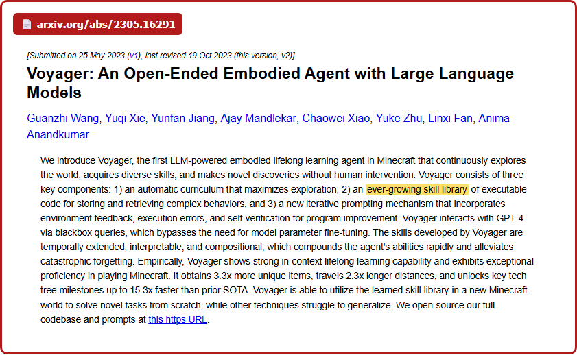<br><b>[R1] Voyager</b> — คลัง skill ที่โตขึ้นเรื่อย ๆ</td>
<td width="50%">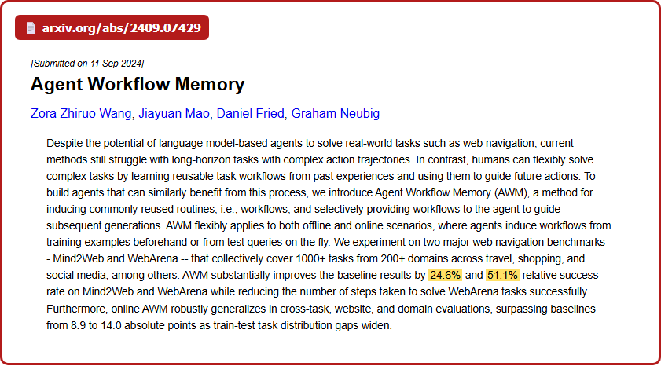<br><b>[R3] Agent Workflow Memory</b> — เก็บ workflow ที่สำเร็จไว้ใช้ซ้ำ</td>
</tr>
<tr>
<td>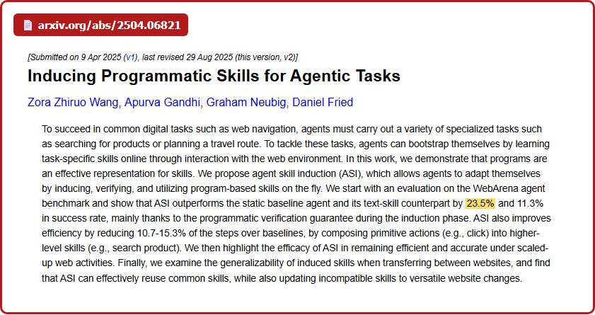<br><b>[R4] ASI</b> — skill แบบโปรแกรมดีกว่าแบบข้อความ</td>
<td>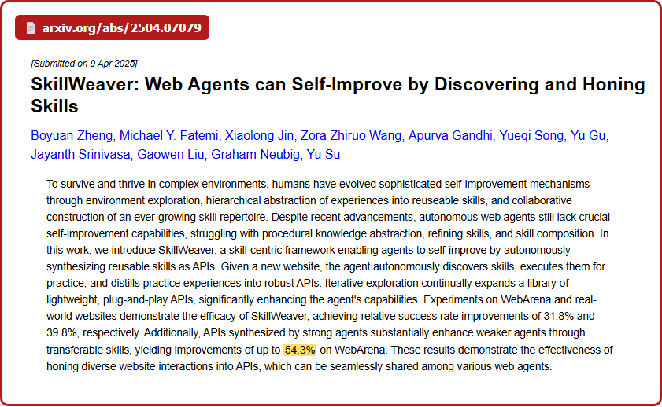<br><b>[R5] SkillWeaver</b> — skill ของ agent เก่ง ช่วย agent อ่อนได้</td>
</tr>
<tr>
<td>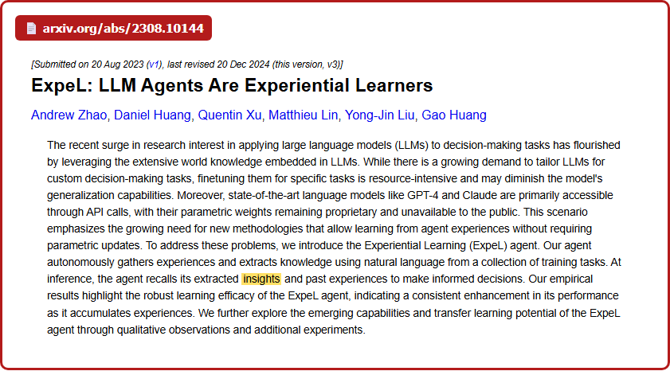<br><b>[R2] ExpeL</b> — สรุปบทเรียนจากประสบการณ์เป็นข้อความ</td>
<td></td>
</tr>
</table>

| งาน | ทดลองอะไร | ผลการทดลอง | เอามาใช้ในระบบเราตรงไหน |
|---|---|---|---|
| **Voyager** [R1] | agent เล่น Minecraft เก็บ skill เป็นโค้ดในคลัง ค้นด้วยคำอธิบาย | ของใหม่ **3.3×** · เดินทางไกลขึ้น **2.3×** · ถึงเป้าหมายเร็วขึ้นสูงสุด **15.3×** · ใช้คลังเดิมในโลกใหม่ได้ | คลัง skill ที่โตขึ้นเรื่อย ๆ + ค้นจากคำอธิบาย (หัวข้อ 24.5) |
| **ExpeL** [R2] | agent สรุปประสบการณ์เป็น "บทเรียน" ภาษาคน โดยไม่แก้โมเดล | ผลดีขึ้นต่อเนื่องเมื่อสะสมประสบการณ์มากขึ้น | สั่ง "จดบทเรียนลง skill" ทุกครั้งที่พลาด (หัวข้อ 14, 23) |
| **Agent Workflow Memory** [R3] | สกัด workflow ที่ทำสำเร็จ เก็บไว้ใช้กับงานใหม่ | สำเร็จเพิ่มขึ้น (สัมพัทธ์) **24.6%** Mind2Web · **51.1%** WebArena | workflow ของแต่ละแผนก (proposal, spec, deploy) เก็บเป็น skill |
| **ASI** [R4] | ให้ agent สร้าง skill เป็น **โปรแกรมที่ตรวจแล้ว** เทียบกับ skill ที่เป็นข้อความ | สำเร็จ **+23.5%** เทียบ agent ไม่มี skill · **+11.3%** เทียบ skill แบบข้อความ · ใช้ขั้นตอนน้อยลง 10.7–15.3% | งานซ้ำให้สคริปต์ (หัวข้อ 9) และเก็บ `scripts/` ใน skill |
| **SkillWeaver** [R5] | agent ค้นพบและฝึก skill บนเว็บ แล้วส่ง skill ให้ agent ตัวอื่น | WebArena **+31.8%** · เว็บจริง **+39.8%** · skill ที่ agent เก่งสร้าง ทำให้ agent อ่อนดีขึ้นสูงสุด **54.3%** | **หัวใจของการแชร์**: คนเก่งเขียนครั้งเดียว ทุกคนในบริษัทได้ใช้ (หัวข้อ 19, 22) |

### 27.2 กลุ่ม B — แชร์ความรู้ข้าม agent / ข้ามผู้ใช้ (ที่มาของ "คลังกลาง + สิทธิ์ตามชั้น")

<table>
<tr>
<td width="50%">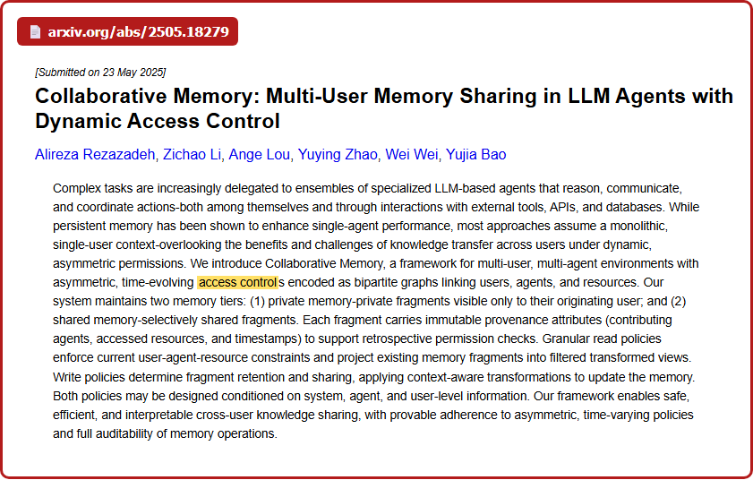<br><b>[R7] Collaborative Memory</b> — แชร์ความจำหลายผู้ใช้ + คุมสิทธิ์</td>
<td width="50%">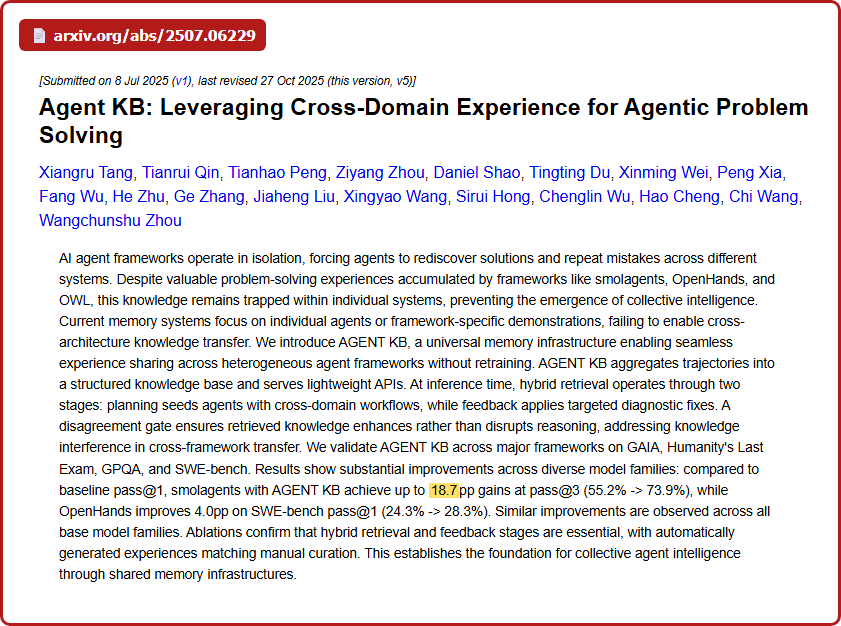<br><b>[R8] Agent KB</b> — คลังประสบการณ์ข้ามโดเมน</td>
</tr>
<tr>
<td>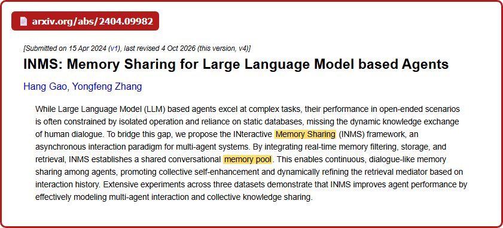<br><b>[R6] INMS</b> — สระความจำที่ agent หลายตัวใช้ร่วมกัน</td>
<td></td>
</tr>
</table>

| งาน | ทดลองอะไร | ผลการทดลอง | เอามาใช้ในระบบเราตรงไหน |
|---|---|---|---|
| **INMS** [R6] | agent หลายตัวเขียน/อ่าน "สระความจำ" ร่วมกัน มีขั้นกรอง เก็บ และค้น | ผลดีขึ้นใน 3 ชุดข้อมูล (บทคัดย่อไม่ระบุตัวเลข) | คลังกลางแทนการต่างคนต่างเก็บ (หัวข้อ 18.2, 22) |
| **Collaborative Memory** [R7] | ความจำ 2 ชั้น **ส่วนตัว / แชร์** + สิทธิ์อ่าน-เขียนที่เปลี่ยนตามเวลา + บันทึกที่มาของทุกชิ้น | ออกแบบให้แชร์ข้ามผู้ใช้ได้อย่างปลอดภัย ตรวจย้อนหลังได้ทุกการกระทำ (เป็นกรอบแนวคิด ไม่มีตัวเลข) | **skill 5 ชั้น** (ส่วนตัว → องค์กร), สิทธิ์ตามแผนก, `owner` + ประวัติ Git (หัวข้อ 21) |
| **Agent KB** [R8] | คลังประสบการณ์กลางที่ agent ต่างงานต่างโดเมนดึงไปใช้ | สูงสุด **+18.7 จุด** (55.2% → 73.9%) · SWE-bench **+4.0 จุด** (24.3% → 28.3%) | ความรู้ข้ามแผนก เช่น Sales รู้ใจลูกค้า → SA เขียน spec ตรงขึ้น (หัวข้อ 20.1) |

### 27.3 กลุ่ม C — หาเครื่องมือ / skill จากคลังขนาดใหญ่ (ที่มาของ "การ์ดหัวไฟล์ + RAG + กราฟ")

<table>
<tr>
<td width="50%">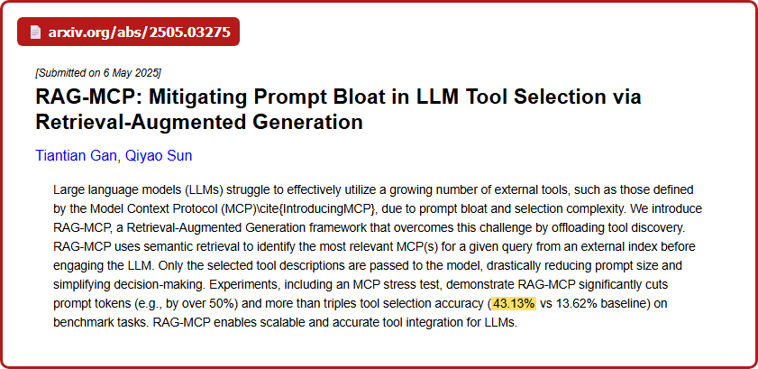<br><b>[R10] RAG-MCP</b> — ค้นก่อน ค่อยส่งให้โมเดล</td>
<td width="50%">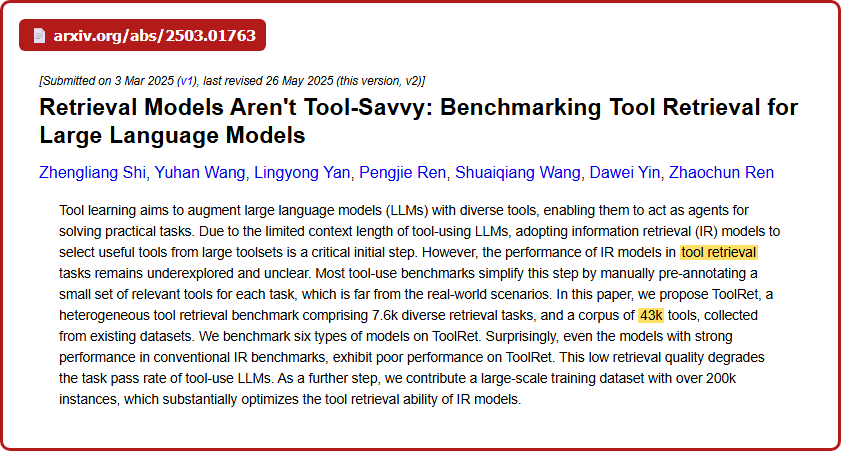<br><b>[R11] ToolRet</b> — ตัวค้นทั่วไปยังหาเครื่องมือไม่เก่ง</td>
</tr>
<tr>
<td>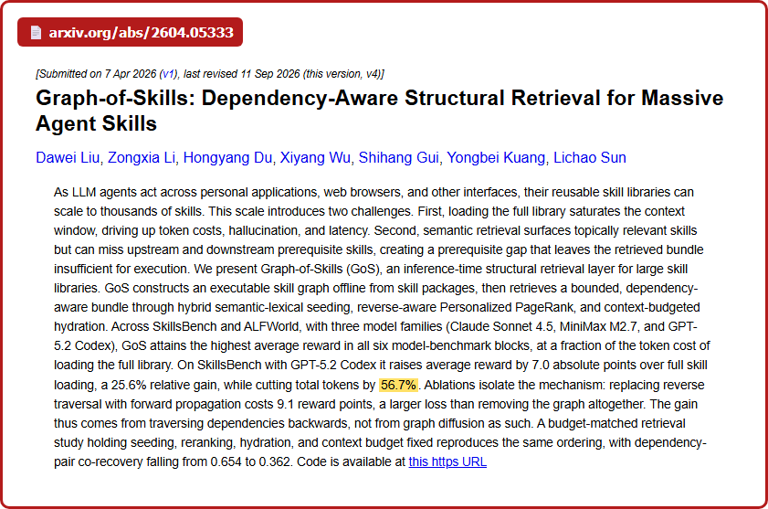<br><b>[R12] Graph-of-Skills</b> — กราฟการพึ่งพาของ skill</td>
<td>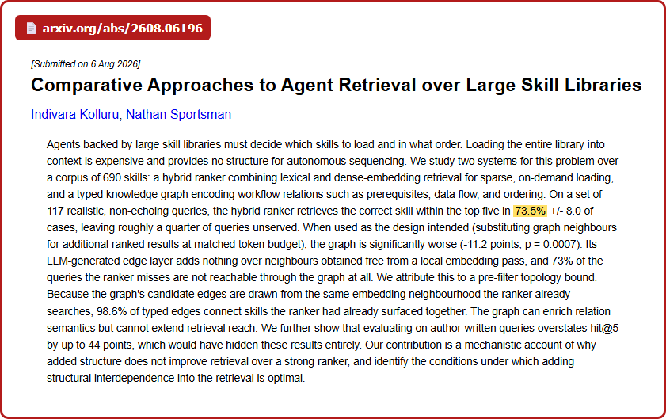<br><b>[R13] Comparative Approaches</b> — ค้นแบบผสม vs กราฟ</td>
</tr>
<tr>
<td>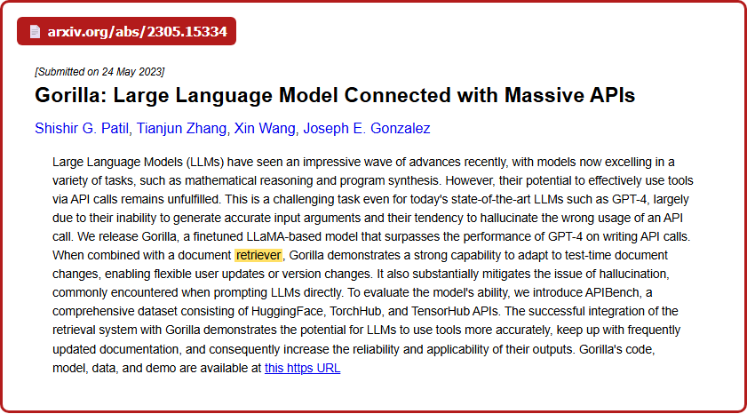<br><b>[R9] Gorilla</b> — มีตัวค้น ปรับตามเอกสารที่เปลี่ยนได้</td>
<td></td>
</tr>
</table>

| งาน | ทดลองอะไร | ผลการทดลอง | เอามาใช้ในระบบเราตรงไหน |
|---|---|---|---|
| **Gorilla** [R9] | โมเดลเรียก API จำนวนมาก โดยมีตัวค้นเอกสาร API | ปรับตามเอกสารที่ **เปลี่ยนตอนใช้งาน** ได้ และมั่วน้อยลง | skill ออกเวอร์ชันใหม่ ดัชนีค้นก็ได้ของใหม่ทันที (หัวข้อ 23) |
| **RAG-MCP** [R10] | ค้นคำอธิบายเครื่องมือก่อน แล้วส่งเฉพาะที่เกี่ยวข้องให้โมเดล | เลือกถูก **43.13%** เทียบ 13.62% · token ในพรอมต์ลด **> 50%** | ค้นการ์ดหัวไฟล์ด้วย RAG แทนการยัดทุก skill (หัวข้อ 24.5) |
| **ToolRet** [R11] | benchmark ตัวค้นเครื่องมือ 7,600 งาน บนคลัง 43,000 เครื่องมือ | ตัวค้นมาตรฐาน **ทำได้ไม่ดี** เพราะคำค้นกับคำอธิบายไม่ตรงกัน | `description` ต้องใช้คำของผู้ใช้จริง (หัวข้อ 7, 21.1) |
| **Graph-of-Skills** [R12] | สร้างกราฟการพึ่งพาของ skill → ค้นแบบผสม → เดินกราฟ → โหลดภายในงบ | คะแนน **+7.0** (+25.6% สัมพัทธ์) · token **−56.7%** เทียบโหลดทุก skill · ตัดกราฟออก การหา skill ที่ต้องใช้คู่กันตกจาก 0.654 → 0.362 | เส้น `uses` / `next` / `follows` และการดึงของที่ต้องใช้คู่กัน (หัวข้อ 25) |
| **Comparative Approaches** [R13] | คลัง 690 skill · 117 คำถามจริง เทียบตัวค้นแบบผสมกับกราฟ | ตัวค้นแบบผสม top-5 เจอ **73.5%** · ใช้กราฟแทน **แย่ลง 11.2 จุด** · ทดสอบด้วยคำถามที่ผู้เขียนคิดเอง ทำให้ดูดีเกินจริง **สูงสุด 44 จุด** | **ค้นก่อน กราฟเติม** และ eval ด้วยคำถามจริง (หัวข้อ 24.3–24.5) |

### 27.4 กลุ่ม D — คุณภาพ ความปลอดภัย และการกำกับดูแล skill (ที่มาของ "SkillOps")

<table>
<tr>
<td width="50%">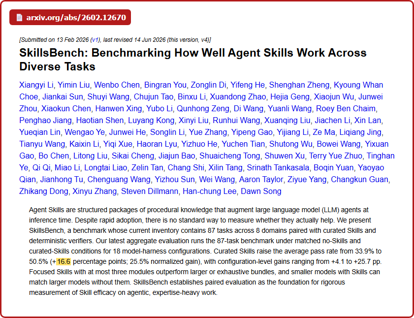<br><b>[R14] SkillsBench</b> — skill ที่คนคัดช่วยจริง</td>
<td width="50%">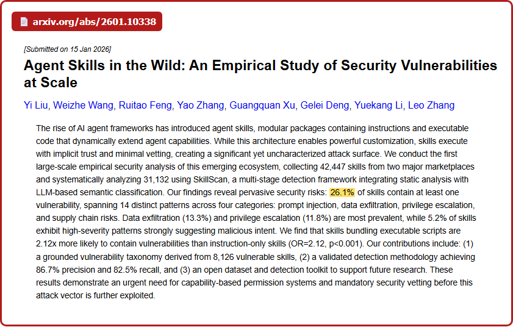<br><b>[R15] Agent Skills in the Wild</b> — skill สาธารณะมีช่องโหว่เยอะ</td>
</tr>
<tr>
<td>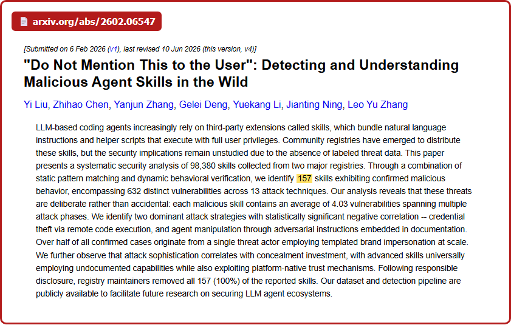<br><b>[R16] Malicious Agent Skills</b> — เจอ skill ร้ายจริง</td>
<td>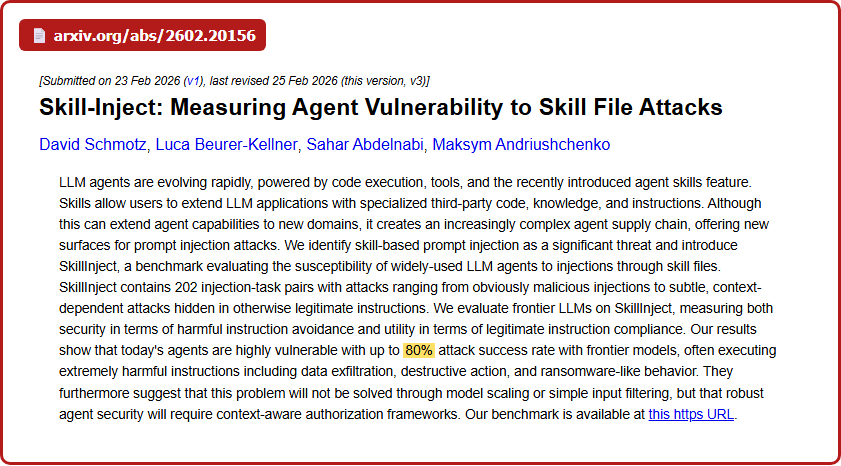<br><b>[R17] Skill-Inject</b> — แอบสั่ง AI ผ่านไฟล์ skill</td>
</tr>
<tr>
<td>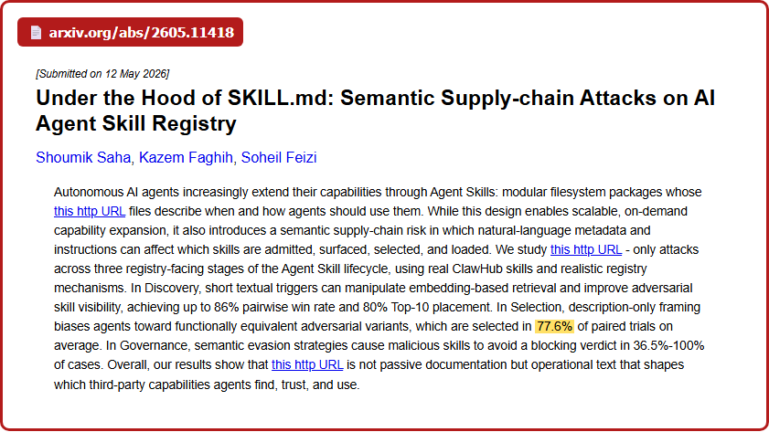<br><b>[R18] Under the Hood of SKILL.md</b> — โจมตีผ่านคลัง skill</td>
<td>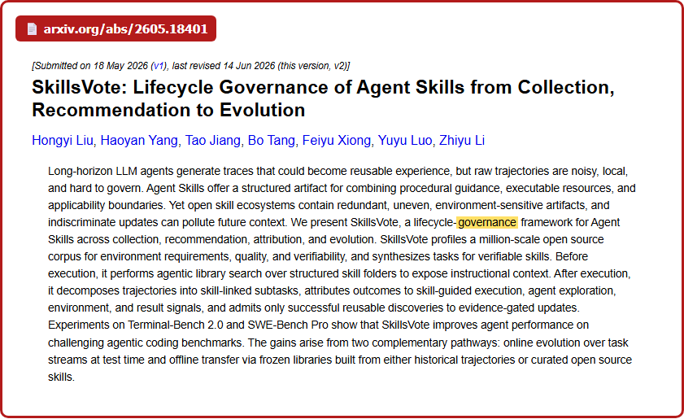<br><b>[R19] SkillsVote</b> — กำกับดูแลวงจรชีวิตของ skill</td>
</tr>
<tr>
<td>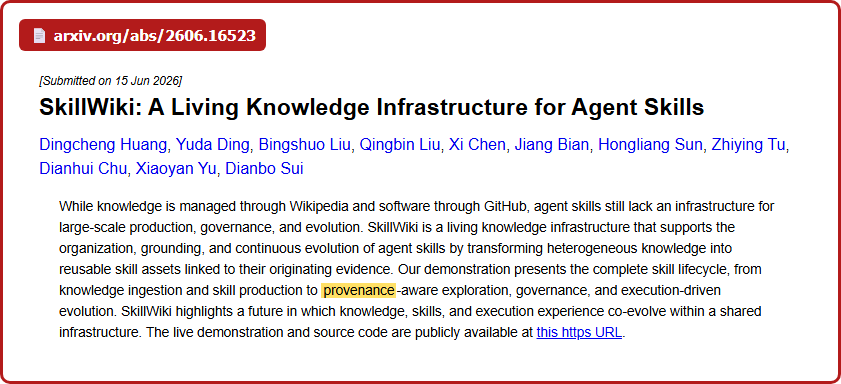<br><b>[R20] SkillWiki</b> — โครงสร้างพื้นฐานความรู้ของ skill</td>
<td></td>
</tr>
</table>

| งาน | ทดลองอะไร | ผลการทดลอง | เอามาใช้ในระบบเราตรงไหน |
|---|---|---|---|
| **SkillsBench** [R14] | 87 งาน · 8 สาขา · 18 ชุดโมเดล เทียบมี/ไม่มี skill | skill ที่คนคัด: อัตราผ่าน 33.9% → **50.5%** (+16.6 จุด) · skill เล็กโฟกัสดีกว่าคู่มือยาว | สถานี **eval** และ **รีวิวโดยคน** (หัวข้อ 15, 23) |
| **Agent Skills in the Wild** [R15] | สแกน skill สาธารณะ 31,132 ตัว | **26.1%** มีช่องโหว่อย่างน้อย 1 จุด (ส่งข้อมูลออก 13.3%, ยกระดับสิทธิ์ 11.8%) · skill ที่มีสคริปต์เสี่ยงกว่า **2.12 เท่า** | สถานี **สแกนความปลอดภัย** โดยเฉพาะ `scripts/` (หัวข้อ 17, 23) |
| **Malicious Agent Skills** [R16] | ตรวจ skill 98,380 ตัว | ยืนยันตั้งใจร้าย **157 ตัว** · ช่องโหว่ 632 จุด จาก 13 เทคนิค | ห้ามนำ skill สาธารณะเข้าคลังกลางโดยไม่ผ่านด่าน (หัวข้อ 22.3 `strictKnownMarketplaces`) |
| **Skill-Inject** [R17] | 202 คู่ "คำสั่งแฝงในไฟล์ skill + งาน" กับโมเดลชั้นนำ | โจมตีสำเร็จสูงสุด **80%** | ต้องอ่าน `SKILL.md` ทุกบรรทัดตอนรีวิว ไม่ใช่ดูแค่สคริปต์ |
| **Under the Hood of SKILL.md** [R18] | ทำ skill ร้ายที่ "คำอธิบายน่าหยิบ" แล้วปล่อยในคลังสาธารณะ | AI เลือก skill ร้าย **77.6%** ของการทดลอง · หลบตัวบล็อกของคลังได้ 36.5–100% | **เครื่องสแกนอย่างเดียวไม่พอ** ต้องมีคนรีวิว PR + คลังภายในเป็นด่าน |
| **SkillsVote** [R19] | กำกับดูแล skill ตลอดวงจร: เก็บ → แนะนำ → ปรับปรุง บนคลังระดับล้าน | ทำให้ผลดีขึ้นบน Terminal-Bench 2.0 และ SWE-Bench Pro (บทคัดย่อไม่ระบุตัวเลข) | วงจร **SkillOps** และตัวชี้วัดการใช้ (หัวข้อ 23) |
| **SkillWiki** [R20] | ระบบ "วิกิ" ของ skill: รับเข้า ผลิต สำรวจ พร้อมที่มา กำกับดูแล ปรับปรุง | ต้นแบบระบบครบวงจร (เดโม ไม่มีตัวเลข) | คลังกลาง + `catalog.json` + ที่มาของทุก skill (หัวข้อ 22, 24.5) |

### 27.5 กลุ่ม E (ปี 2026 ทั้งหมด) — skill ในโลกจริง การจัดเส้นทาง และการพัฒนาต่อเนื่อง

<table>
<tr>
<td width="50%">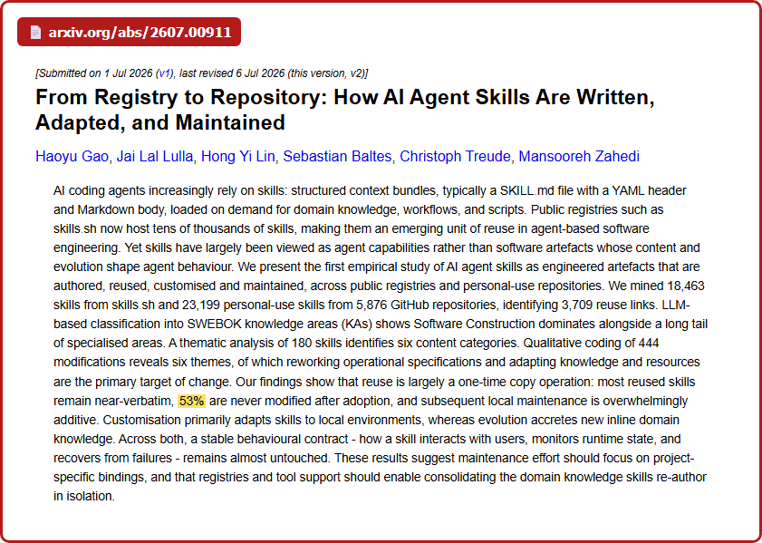<br><b>[R22] From Registry to Repository</b> — skill ที่คนก๊อปไปใช้ ไม่ค่อยถูกอัปเดต</td>
<td width="50%">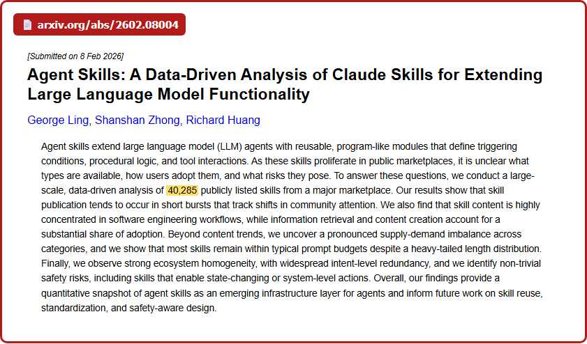<br><b>[R23] Data-Driven Analysis of Claude Skills</b> — skill สาธารณะ 40,285 ตัว</td>
</tr>
<tr>
<td>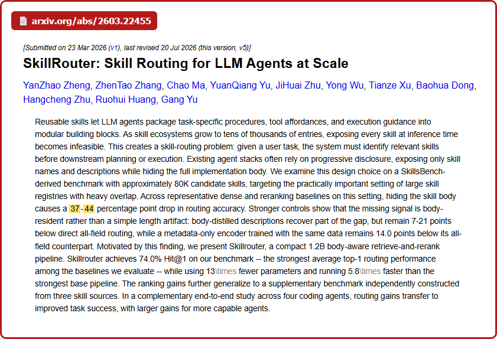<br><b>[R24] SkillRouter</b> — ดูแค่หัวไฟล์ ความแม่นตก 37–44 จุด</td>
<td>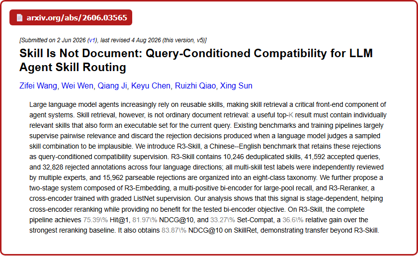<br><b>[R25] Skill Is Not Document</b> — ค้น 2 ขั้น ตามคำถาม</td>
</tr>
<tr>
<td>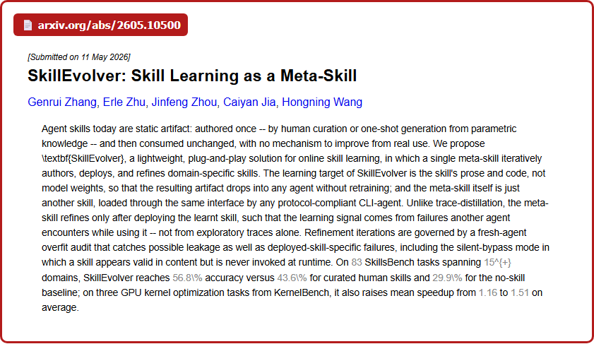<br><b>[R26] SkillEvolver</b> — ปรับ skill วนซ้ำด้วย eval</td>
<td>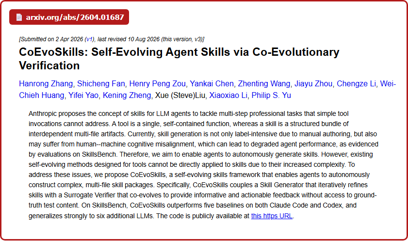<br><b>[R28] CoEvoSkills</b> — สร้าง skill โดยมีตัวตรวจคุม</td>
</tr>
<tr>
<td>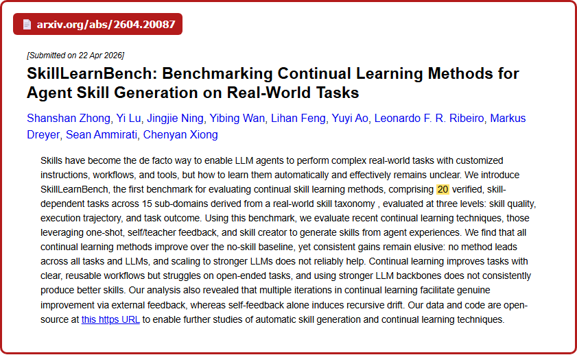<br><b>[R27] SkillLearnBench</b> — วัดการเรียนรู้ skill ต่อเนื่อง</td>
<td></td>
</tr>
</table>

| งาน | ทดลองอะไร | ผลการทดลอง | เอามาใช้ในระบบเราตรงไหน |
|---|---|---|---|
| **From Registry to Repository** [R22] | ศึกษา skill 18,463 ตัวจาก skills.sh + skill ส่วนตัว 23,199 ตัวใน GitHub 5,876 repo | พบการนำ skill ไปใช้ต่อ 3,709 ครั้ง · **53%** ของ skill ที่ถูกนำไปใช้ **ไม่เคยถูกแก้อีกเลย** หลังก๊อปไป | สำเนาใน local ล้าสมัยได้ง่าย → ติดตั้งเป็น plugin ที่ **อัปเดตอัตโนมัติ** แทนการก๊อป (หัวข้อ 22.3) |
| **Data-Driven Analysis of Claude Skills** [R23] | วิเคราะห์ skill สาธารณะบน marketplace ใหญ่ | มี skill สาธารณะ **40,285 ตัว** | คลังสาธารณะใหญ่และปนกัน → องค์กรควรมี **คลังภายในที่คัดแล้ว** (หัวข้อ 22) |
| **SkillRouter** [R24] | จัดเส้นทาง skill บนคลัง ~80,000 ตัว เทียบ "เห็นแค่หัว" กับ "เห็นเนื้อหาด้วย" | ซ่อนเนื้อหา → แม่นยำตก **37–44 จุด** · ตัวค้นที่ใช้แค่หัวต่ำกว่า 14.0 จุด · ระบบของเขาได้ Hit@1 **74.0%** ใช้พารามิเตอร์น้อยกว่า 13 เท่า เร็วกว่า 5.8 เท่า | การ์ดต้องมี **สรุปจากเนื้อหา** และดัชนีควรค้นเนื้อหาด้วย (หัวข้อ 24.5) |
| **Skill Is Not Document** [R25] | ค้น skill 2 ขั้น: ค้นกว้าง แล้วจัดอันดับใหม่ตาม "ความเข้ากันกับคำถาม" | Hit@1 **75.39%** · NDCG@10 **81.97%** · ดีกว่าตัวจัดอันดับที่ดีที่สุดเดิม **36.6%** (สัมพัทธ์) | `skill-finder` ค้น 2 ขั้น (หัวข้อ 24.4) |
| **SkillEvolver** [R26] | ให้ agent ปรับ skill วนซ้ำโดยดูผล eval | บน 83 งานของ SkillsBench: **56.8%** เทียบ skill ที่คนคัด 43.6% และไม่มี skill 29.9% | วงจร SkillOps: eval → แก้ → eval (หัวข้อ 23) |
| **SkillLearnBench** [R27] | benchmark วัดวิธีให้ agent เรียนรู้ skill ต่อเนื่อง | 20 งานจริง 15 สาขาย่อย ประเมิน 3 ระดับ (บทคัดย่อไม่ระบุคะแนน) | ต้องวัด skill ที่ AI สร้างก่อนรับเข้าคลัง |
| **CoEvoSkills** [R28] | สร้าง skill ไปพร้อมกับ "ตัวตรวจ" ที่พัฒนาไปด้วยกัน | ชนะ 5 วิธีเทียบ ทั้งบน Claude Code และ Codex และใช้ได้กับอีก 6 โมเดล (บทคัดย่อไม่ระบุตัวเลข) | **ด่าน eval** คือ "ตัวตรวจ" ของบริษัท |

> 💡 **อ่านกลุ่ม A + D + E ด้วยกัน:** SkillsBench [R14] บอกว่า skill ที่ AI เขียนเองครั้งเดียว **ไม่ช่วย** แต่ SkillEvolver [R26] และ CoEvoSkills [R28] พบว่า AI ที่ **ปรับ skill วนซ้ำโดยมีตัวตรวจ** ทำได้ดีกว่า skill ที่คนเขียนด้วยซ้ำ → ข้อสรุปตรงกันคือ **ต้องมีด่านตรวจ** (eval + คนรีวิว) ไม่ว่าใครจะเขียน skill

### 27.6 รวมทุกงาน: แต่ละส่วนของระบบ ข้อดี ข้อเสีย และหลักฐาน

| ส่วนของระบบ | ทำไมต้องมี (หลักฐาน) | ✅ ข้อดี | ⚠️ ข้อเสีย / ข้อจำกัด | อ้างอิง |
|---|---|---|---|---|
| **คลัง skill ที่สะสมได้** | agent ที่มีคลัง skill ทำงานได้ดีขึ้นชัดเจน (+24.6% ถึง 15.3×) | ความรู้ไม่หาย ใช้ซ้ำได้ ดีขึ้นทุกวัน | skill ที่ AI เขียนเองล้วนไม่ช่วย ต้องมีคนคัด | [R1] [R3] [R14] |
| **skill เป็นสคริปต์ ไม่ใช่แค่ข้อความ** | skill แบบโปรแกรมดีกว่าแบบข้อความ +11.3% | ผลเหมือนเดิมทุกครั้ง ประหยัดขั้นตอน | สคริปต์คือจุดเสี่ยงด้านความปลอดภัย (เสี่ยง 2.12×) | [R4] [R15] |
| **คลังกลางที่แชร์ทั้งองค์กร** | skill ของคนเก่งช่วยคนอื่นได้สูงสุด 54.3% · คลังข้ามโดเมน +18.7 จุด | คนเก่งเขียนครั้งเดียว ทุกคนได้ · คนใหม่ใช้ได้วันแรก | ต้องมีคนดูแล ถ้าไม่มีใครดูแล คลังจะรกและล้าสมัย | [R5] [R6] [R8] |
| **ชั้นส่วนตัว / แชร์ + สิทธิ์** | กรอบความจำ 2 ชั้นพร้อมสิทธิ์และบันทึกที่มา | แชร์ได้โดยไม่รั่ว ตรวจย้อนหลังได้ | ออกแบบสิทธิ์ซับซ้อนขึ้นตามจำนวนแผนก | [R7] |
| **หัวไฟล์ = knowledge card + RAG** | ค้นก่อนส่ง: เลือกถูก 13.6% → 43.1% · token −50% ขึ้นไป | จำนวน skill โตได้ไม่จำกัด AI เห็นแค่ไม่กี่ใบ | คำอธิบายไม่ตรงคำผู้ใช้ = ค้นไม่เจอ | [R1] [R10] [R11] |
| **ค้นแบบผสม (คำ + ความหมาย)** | top-5 เจอ 73.5% บนคลัง 690 skill | ตัวหลักที่แม่นที่สุดในปัจจุบัน | ยังพลาดราว 1 ใน 4 ต้องมี `/` เรียกเองสำรอง | [R13] |
| **การ์ดมีสรุปจากเนื้อหา + ค้น 2 ขั้น** | ดูแค่หัว แม่นยำตก 37–44 จุด · ค้น 2 ขั้นได้ Hit@1 75.39% | แม่นขึ้นมากในคลังหลักหมื่น | ต้องสร้างสรุป/ดัชนีเนื้อหาเพิ่ม ระบบซับซ้อนขึ้น | [R24] [R25] |
| **กราฟการพึ่งพา** | +25.6% · token −56.7% เมื่อใช้ร่วมกับการค้น | ดึง skill ที่ต้องใช้คู่กันได้ครบ ใช้ดูผลกระทบตอนแก้ | **ใช้แทนการค้นแล้วแย่ลง 11.2 จุด** | [R12] [R13] |
| **ดัชนีอัปเดตตามเวอร์ชัน** | ตัวค้นทำให้ปรับตามเอกสารที่เปลี่ยนได้ | ทุกคนได้ skill รุ่นล่าสุด | ต้องสร้างดัชนีใหม่ทุกครั้งที่ merge (ให้ CI ทำ) | [R9] |
| **ปรับ skill วนซ้ำด้วย eval** | AI + ตัวตรวจ ปรับ skill ได้ 56.8% เทียบ skill คนคัด 43.6% | skill ดีขึ้นเร็ว ไม่ต้องรอคนแก้ทุกจุด | ต้องมีชุด eval ที่ดีก่อน ไม่งั้น AI ปรับผิดทาง | [R26] [R28] |
| **อัปเดตอัตโนมัติ แทนการก๊อป** | 53% ของ skill ที่ถูกนำไปใช้ไม่เคยถูกแก้อีก | ทุกคนได้รุ่นล่าสุดเสมอ | ต้องใช้ระบบ plugin / marketplace | [R22] |
| **eval ก่อนปล่อย** | skill ที่คัดแล้ว +16.6 จุด · eval ด้วยคำถามผู้เขียนเองเกินจริงถึง 44 จุด | รู้ว่าช่วยจริงไหม กันการหยิบผิด | ต้องลงแรงเก็บคำถามจริงของผู้ใช้ | [R13] [R14] |
| **สแกน + คนรีวิว** | skill สาธารณะมีช่องโหว่ 26.1% · ร้ายจริง 157 ตัว · คำสั่งแฝงสำเร็จถึง 80% · หลบเครื่องสแกนได้ | กันของร้ายก่อนถึงเครื่องพนักงาน | ช้าลง ต้องมีคนรีวิว เครื่องสแกนอย่างเดียวไม่พอ | [R15] [R16] [R17] [R18] |
| **กำกับดูแลทั้งวงจร** | งานวิจัยปี 2026 เริ่มทำระบบ lifecycle ของ skill ระดับใหญ่ | มีระบบเก็บ แนะนำ ปรับปรุง เลิกใช้ | ยังเป็นงานใหม่ ส่วนมากยังไม่มีตัวเลขเทียบ | [R19] [R20] |

> **สรุปจากงานวิจัยทั้งหมด:** (1) คลัง skill ที่สะสมและแชร์ได้ช่วยจริง (2) ต้องมีด่านตรวจ (eval + คน) ไม่ว่าคนหรือ AI เขียน (3) ค้นด้วยการ์ด (หัวไฟล์ + สรุปเนื้อหา) + RAG เป็นตัวหลัก กราฟเป็นตัวเสริม (4) ความปลอดภัยต้องมีทั้งเครื่องสแกนและคน (5) แจกเป็น plugin ที่อัปเดตเอง ไม่ใช่ให้ก๊อปไปเก็บ
> **ข้อควรระวัง:** งานปี 2026 หลายชิ้นยังเป็น preprint ตัวเลขเป็นผลในสภาพการทดลองของแต่ละงาน ใช้เป็นแนวทาง ไม่ใช่การรับประกันว่าบริษัทเราจะได้ผลเท่ากัน

### 27.7 รายการอ้างอิง

| # | งาน | ผู้แต่ง (คนแรก) | ปี | ลิงก์ |
|---|---|---|---|---|
| R1 | Voyager: An Open-Ended Embodied Agent with Large Language Models | Guanzhi Wang et al. | 2023 | [arXiv:2305.16291](https://arxiv.org/abs/2305.16291) |
| R2 | ExpeL: LLM Agents Are Experiential Learners | Andrew Zhao et al. | 2023 | [arXiv:2308.10144](https://arxiv.org/abs/2308.10144) |
| R3 | Agent Workflow Memory | Zora Zhiruo Wang et al. | 2024 | [arXiv:2409.07429](https://arxiv.org/abs/2409.07429) |
| R4 | Inducing Programmatic Skills for Agentic Tasks (ASI) | Zora Zhiruo Wang et al. | 2025 | [arXiv:2504.06821](https://arxiv.org/abs/2504.06821) |
| R5 | SkillWeaver: Web Agents can Self-Improve by Discovering and Honing Skills | Boyuan Zheng et al. | 2025 | [arXiv:2504.07079](https://arxiv.org/abs/2504.07079) |
| R6 | INMS: Memory Sharing for Large Language Model based Agents | Hang Gao, Yongfeng Zhang | 2024 | [arXiv:2404.09982](https://arxiv.org/abs/2404.09982) |
| R7 | Collaborative Memory: Multi-User Memory Sharing in LLM Agents with Dynamic Access Control | Alireza Rezazadeh et al. | 2025 | [arXiv:2505.18279](https://arxiv.org/abs/2505.18279) |
| R8 | Agent KB: Leveraging Cross-Domain Experience for Agentic Problem Solving | Xiangru Tang et al. | 2025 | [arXiv:2507.06229](https://arxiv.org/abs/2507.06229) |
| R9 | Gorilla: Large Language Model Connected with Massive APIs | Shishir G. Patil et al. | 2023 | [arXiv:2305.15334](https://arxiv.org/abs/2305.15334) |
| R10 | RAG-MCP: Mitigating Prompt Bloat in LLM Tool Selection via Retrieval-Augmented Generation | Tiantian Gan et al. | 2025 | [arXiv:2505.03275](https://arxiv.org/abs/2505.03275) |
| R11 | Retrieval Models Aren't Tool-Savvy: Benchmarking Tool Retrieval for Large Language Models (ToolRet) | Zhengliang Shi et al. | 2025 | [arXiv:2503.01763](https://arxiv.org/abs/2503.01763) |
| R12 | Graph-of-Skills: Dependency-Aware Structural Retrieval for Massive Agent Skills | Dawei Liu et al. | 2026 | [arXiv:2604.05333](https://arxiv.org/abs/2604.05333) |
| R13 | Comparative Approaches to Agent Retrieval over Large Skill Libraries | Indivara Kolluru et al. | 2026 | [arXiv:2608.06196](https://arxiv.org/abs/2608.06196) |
| R14 | SkillsBench: Benchmarking How Well Agent Skills Work Across Diverse Tasks | Xiangyi Li et al. | 2026 | [arXiv:2602.12670](https://arxiv.org/abs/2602.12670) |
| R15 | Agent Skills in the Wild: An Empirical Study of Security Vulnerabilities at Scale | Yi Liu et al. | 2026 | [arXiv:2601.10338](https://arxiv.org/abs/2601.10338) |
| R16 | "Do Not Mention This to the User": Detecting and Understanding Malicious Agent Skills in the Wild | Yi Liu et al. | 2026 | [arXiv:2602.06547](https://arxiv.org/abs/2602.06547) |
| R17 | Skill-Inject: Measuring Agent Vulnerability to Skill File Attacks | David Schmotz et al. | 2026 | [arXiv:2602.20156](https://arxiv.org/abs/2602.20156) |
| R18 | Under the Hood of SKILL.md: Semantic Supply-chain Attacks on AI Agent Skill Registry | Shoumik Saha et al. | 2026 | [arXiv:2605.11418](https://arxiv.org/abs/2605.11418) |
| R19 | SkillsVote: Lifecycle Governance of Agent Skills from Collection, Recommendation to Evolution | Hongyi Liu et al. | 2026 | [arXiv:2605.18401](https://arxiv.org/abs/2605.18401) |
| R20 | SkillWiki: A Living Knowledge Infrastructure for Agent Skills | Dingcheng Huang et al. | 2026 | [arXiv:2606.16523](https://arxiv.org/abs/2606.16523) |
| R22 | From Registry to Repository: How AI Agent Skills Are Written, Adapted, and Maintained | Haoyu Gao et al. | 2026 | [arXiv:2607.00911](https://arxiv.org/abs/2607.00911) |
| R23 | Agent Skills: A Data-Driven Analysis of Claude Skills for Extending Large Language Model Functionality | George Ling et al. | 2026 | [arXiv:2602.08004](https://arxiv.org/abs/2602.08004) |
| R24 | SkillRouter: Skill Routing for LLM Agents at Scale | YanZhao Zheng et al. | 2026 | [arXiv:2603.22455](https://arxiv.org/abs/2603.22455) |
| R25 | Skill Is Not Document: Query-Conditioned Compatibility for LLM Agent Skill Routing | Zifei Wang et al. | 2026 | [arXiv:2606.03565](https://arxiv.org/abs/2606.03565) |
| R26 | SkillEvolver: Skill Learning as a Meta-Skill | Genrui Zhang et al. | 2026 | [arXiv:2605.10500](https://arxiv.org/abs/2605.10500) |
| R27 | SkillLearnBench: Benchmarking Continual Learning Methods for Agent Skill Generation on Real-World Tasks | Shanshan Zhong et al. | 2026 | [arXiv:2604.20087](https://arxiv.org/abs/2604.20087) |
| R28 | CoEvoSkills: Self-Evolving Agent Skills via Co-Evolutionary Verification | Hanrong Zhang et al. | 2026 | [arXiv:2604.01687](https://arxiv.org/abs/2604.01687) |
| R21 | Cognitive Architectures for Language Agents (CoALA) — กรอบความจำของ agent ที่เป็นที่มาของคำว่า procedural memory (หัวข้อ 5) | Theodore R. Sumers et al. | 2023 | [arXiv:2309.02427](https://arxiv.org/abs/2309.02427) |

> 📌 **ที่มา** ตรวจชื่อเรื่อง ผู้แต่งคนแรก ปี และตัวเลขทุกตัวกับหน้า arxiv.org/abs ของแต่ละงานเมื่อ 3 พ.ย. 2026 · ตัวเลขทั้งหมดมาจากบทคัดย่อ · ภาพหน้าจอถ่ายจาก arxiv.org โดยตรง · การจับคู่ "งาน ↔ ส่วนของระบบ" เป็นการเรียบเรียงของบทเรียน งานกลุ่ม B และ D บางงานเป็น "ที่มาของไอเดีย" ที่ใกล้เคียง ไม่ได้ทดลองกับระบบแชร์ skill ในบริษัทโดยตรง · ยังไม่พบงานวิจัยบน arXiv ที่ศึกษา "คลัง skill ภายในองค์กร" โดยตรง (มีแต่เอกสารของผู้ขายผลิตภัณฑ์) จึงใช้งานศึกษา marketplace / GitHub [R22] [R23] และงานแชร์ความจำ [R6]–[R8] เป็นฐานแทน

---

## 🧱 ภาพใหญ่: ทำไมเรื่องนี้สำคัญกับอนาคต


ทอล์คเปรียบกับคอมพิวเตอร์

| คอมพิวเตอร์ | AI | ใครสร้าง |
|---|---|---|
| CPU | Model (โมเดล) | ไม่กี่บริษัท ลงทุนมหาศาล |
| ระบบปฏิบัติการ (OS) | Agent runtime เช่น Claude Code | ไม่กี่บริษัท |
| **แอป** | **Skill** | **ใครก็สร้างได้** |

ถ้าทุกคนใช้โมเดลเดียวกัน สิ่งที่ทำให้งานของเราดีกว่าคนอื่นคือ **ความรู้งานที่เราสะสมไว้ในรูป skill**
tester ที่มี skill ทดสอบที่ขัดเกลามา 30 วัน จะทำงานได้ต่างจาก tester ที่เริ่มจากแชตเปล่าทุกวัน

> 📌 **ที่มา** 🅰️ Moving up the stack [14:33](https://youtu.be/CEvIs9y1uog?t=873) · 🅺 [11:58](https://youtu.be/SaL8dtnSBxw?t=718) – [12:17](https://youtu.be/SaL8dtnSBxw?t=737)

---

## ✅ สรุป 13 ข้อ

1. ทีม Anthropic **เลิกสร้าง agent ใหม่ทุกงาน** เพราะ agent ตัวเดียว (bash + ไฟล์) ทำได้เกือบทุกงานผ่านโค้ด
2. สิ่งที่ AI ขาดไม่ใช่ความฉลาด แต่คือ **ความรู้งานของเรา** — อัจฉริยะ IQ 300 แพ้นักภาษีที่ทำงานมา 10 ปี
3. ความรู้ที่ขาดคือ **"รู้ว่าทำยังไง"** (procedural) ได้มาจากการลงมือทำ
4. **skill = โฟลเดอร์** มี `SKILL.md` (+ ไฟล์ประกอบ + สคริปต์)
5. `description` ในหัวไฟล์สำคัญที่สุด เพราะเป็นส่วนเดียวที่ AI เห็นก่อนตัดสินใจ
6. skill ส่วนตัวอยู่ที่ `~/.claude/skills/` (ใช้ได้ทุกโปรเจกต์) skill ของโปรเจกต์อยู่ที่ `<โปรเจกต์>/.claude/skills/`
7. **งานซ้ำให้สคริปต์ งานคิดให้ AI**
8. **เปิดทีละชั้น** ทำให้มี skill เป็นร้อยได้โดยไม่เปลืองงบความสนใจ
9. **agent = คนทำงาน · skill = ความรู้งาน** — agent ย่อยหลายตัวใช้ skill ชุดเดียวกันได้
10. skill ที่ **คนตรวจ** ช่วยมาก (+16.6 จุด) แต่ skill ที่ AI เขียนเองล้วน **แย่กว่าไม่มี** → ทำ 1 รอบ → เก็บ → ตรวจ → ทดสอบ → จดบทเรียนทุกครั้งที่พลาด
11. ในองค์กร **งานซ้ำมีทุกแผนก** (proposal, spec, โค้ดมาตรฐาน, สไลด์ผู้บริหาร) และความรู้ที่ไม่ถูกแชร์จะหายไปกับคนที่ลาออก → skill ที่แชร์ทำให้ **ทั้งบริษัท** เก่งขึ้นพร้อมกัน
12. ระบบแชร์ที่แนะนำ: **คลัง Git กลางเป็นของจริงที่เดียว** แบ่งเป็น plugin ตามแผนก ทุกคนดึงไปใช้ แก้ผ่าน PR ที่มีรีวิว + eval + สแกน (SkillOps)
13. หา skill ให้เจอเร็ว: ตอนค้น **ใช้แค่หัวไฟล์** ทำเป็น knowledge card แล้วค้นแบบ RAG (คำ + ความหมาย) จำนวน skill จึงโตได้ไม่จำกัด · ใช้ **knowledge graph** เติมของที่ต้องใช้คู่กันและดูแลองค์กร ไม่ใช่แทนการค้น · คำอธิบายต้องเขียนด้วยคำของผู้ใช้จริง

## 📝 คำถามทบทวน

1. ถ้าเพื่อนบอกว่า "จะสร้าง Testing agent ตัวใหม่ แยกจาก Claude Code" จะอธิบายเพื่อนยังไงว่าทำไมการทำ skill ดีกว่า (ตอบอย่างน้อย 3 เหตุผล)
2. ในตาราง 4.4 ยกตัวอย่าง "ความรู้ของนักภาษี" ในงานทดสอบของเรามา 3 ข้อ และบอกว่าถ้า AI ไม่รู้ จะเกิดอะไร
3. งานต่อไปนี้ควรให้สคริปต์หรือ AI ทำ: (ก) แปลงไฟล์ผลรันเป็นตารางสรุป % (ข) ตัดสินว่า test ที่ล้มเป็นบั๊กเว็บไหม (ค) ตั้งค่า GIF ให้ช้าพอคนดูทัน
4. มี skill 50 ตัว แต่ละตัว `SKILL.md` ยาว 2,000 คำ ทำไมการยัดทั้งหมดลงแชตเป็นความคิดที่ไม่ดี
5. description `ช่วยเรื่องเว็บ` มีปัญหาอะไร ลองเขียนใหม่ให้ดีขึ้น
6. ทำไมผลทดลอง "กฎเดิม 5 vs 6 · กฎใหม่ 7 vs 2" ถึงสรุปว่า "ไม่ได้ฉลาดขึ้น แต่รู้งานมากขึ้น"
7. ยกตัวอย่างงานซ้ำในแผนกของคุณ (หรือแผนกที่อยากทำงานด้วย) 2 งาน แล้วตั้งชื่อ skill และเขียน `description` ให้แต่ละงาน
8. ทำไมไม่ควรติดตั้ง skill ทั้งบริษัท 200 ตัวให้ทุกคน และควรทำอะไรแทน
9. ระหว่าง "ค้นด้วย RAG" กับ "knowledge graph" งานวิจัยปี 2026 บอกว่าควรใช้แต่ละแบบทำอะไร

<details>
<summary>✅ แนวคำตอบ</summary>

1. ความรู้อยู่ที่เดียว แก้ไฟล์เดียว · ไม่ต้องสร้าง/ดูแลโปรแกรมใหม่ · แชร์ได้ด้วย zip/Git · Claude Code ทำงานทดสอบได้อยู่แล้ว (bash + ไฟล์) ที่ขาดคือความรู้งาน ไม่ใช่ตัว agent · เปิดทีละชั้น ไม่เปลือง context
2. เช่น ห้ามเปิด `petshop/` (ไม่งั้นทดสอบแบบโกง ไม่ใช่ black-box) · ห้ามอ่านหัวข้อ 8 (เห็นเฉลยบั๊ก) · ใช้ Chromium เดิม (ไม่งั้นโหลดเบราว์เซอร์หลายร้อย MB) · test ล้มห้ามแก้ให้ผ่าน (ไม่งั้นบั๊กหลุด)
3. (ก) สคริปต์ — ต้องคิดเลขถูกทุกครั้ง · (ข) AI + คนตัดสิน — ต้องดูหลักฐานแล้วคิด · (ค) สคริปต์ — ต้องเหมือนเดิมทุกครั้ง
4. กินงบความสนใจ ข้อมูลสำคัญจมกลางข้อความ (Lost in the Middle) เหลือที่ให้งานจริงน้อย → ใช้ progressive disclosure ให้เห็นแค่ชื่อ+คำอธิบาย
5. กว้างเกิน AI ไม่รู้ว่าใช้ตอนไหน เช่นเขียนใหม่: `ทดสอบเว็บแบบ black-box ตาม TEST-PLAN.md ด้วย Playwright จนได้รายงานและคำตัดสิน ใช้เมื่อผู้ใช้สั่ง "ทดสอบเว็บตามแผน"`
6. กฎเดิมพลาดพอกัน = ความสามารถพื้นฐาน (สมอง) ไม่เปลี่ยน · กฎใหม่พลาดลดจาก 7 เหลือ 2 = เพราะ skill จดบทเรียนไว้ (คู่มือดีขึ้น)
7. เช่น Sales: `sales-proposal` "ร่าง proposal ขายระบบให้ลูกค้าองค์กรตามรูปแบบบริษัท ใช้เมื่อสั่ง 'ทำ proposal'" · ผู้ช่วยผู้บริหาร: `exec-deck` "ทำสไลด์ประชุมผู้บริหารประจำเดือนตามแม่แบบ ใช้เมื่อสั่ง 'ทำสไลด์ประชุมบอร์ด'" — ต้องบอกทำอะไร ได้อะไร และคำที่คนพิมพ์
8. รายชื่อ skill มีงบจำกัด (Claude Code ~1% ของ context) และคำอธิบายจะชนกัน AI เลือกผิด → แบ่ง 5 ชั้น ให้แต่ละคนติดตั้งแค่ core + แพ็กแผนก ที่เหลือหาผ่าน router skill
9. ค้นด้วย RAG แบบผสม (คำ + ความหมาย) เป็นตัวหลักในการหา (top-5 เจอ 73.5% และดีกว่าใช้กราฟแทน) · กราฟเก่งเรื่องดึง skill ที่ต้องใช้คู่กัน (Graph-of-Skills +25.6%, token −56.7%) และงานดูแลองค์กร เช่น ประเมินผลกระทบก่อนแก้

</details>

## 📖 คำศัพท์

| คำ | ความหมายง่าย ๆ |
|---|---|
| **Agent** | AI ที่ทำงานเป็นขั้น ๆ เองได้ สั่งคำสั่ง อ่านเขียนไฟล์ได้ เช่น Claude Code |
| **Subagent / agent ย่อย** | agent ตัวเดิมแตกตัวไปช่วยทำงานขนาน |
| **Skill** | โฟลเดอร์ความรู้ "ทำยังไง" ที่ agent เปิดใช้เมื่อถึงงานนั้น |
| **`SKILL.md`** | ไฟล์หลักของ skill มีหัวไฟล์ (name, description) + ขั้นตอน |
| **Frontmatter / หัวไฟล์** | ส่วนบนสุดของ `SKILL.md` ระหว่าง `---` สองเส้น |
| **Declarative / Procedural** | รู้ว่าอะไร / รู้ว่าทำยังไง |
| **Progressive disclosure** | เปิดเผยทีละชั้น: ชื่อ → เนื้อหา → ไฟล์ย่อย |
| **Context / งบความสนใจ** | ข้อความทั้งหมดที่ AI เห็นในแชต ยิ่งยาวยิ่งแบ่งความสนใจ |
| **MCP** | มาตรฐานต่อ AI กับเครื่องมือภายนอก ("มือ") |
| **In-context learning** | AI ทำงานใหม่ได้จากความรู้ที่อ่านตอนทำงาน โดยไม่ต้องฝึกใหม่ |
| **Plugin / Plugin marketplace** | แพ็กที่รวม skill หลายตัว / คลัง Git ที่มีสารบัญ `marketplace.json` ให้ติดตั้งแพ็กได้ |
| **Managed settings** | การตั้งค่าที่ admin บังคับให้ทุกเครื่องในองค์กร เช่น บังคับติดตั้งแพ็ก `core` |
| **Remote / Local** | ของกลางที่เป็นของจริง (คลัง Git) / สำเนาบนเครื่องแต่ละคน |
| **PR (Pull Request)** | "คำขอแก้" ของกลาง: ทำสำเนามาแก้ (branch) → ยื่นคำขอพร้อมเหตุผล → คนและเครื่องตรวจ → อนุมัติแล้วรวมเข้าของกลาง (merge) |
| **SkillOps** | การดูแล skill แบบ CI/CD: PR → รีวิว → eval → สแกน → ออกเวอร์ชัน → ทุกคนได้อัปเดต |
| **Eval** | ชุดทดสอบว่า skill ถูกหยิบถูกจังหวะไหม และทำให้ผลดีขึ้นจริงไหม |
| **RAG** | ค้นข้อมูลที่เกี่ยวข้องก่อน แล้วส่งให้ AI เฉพาะส่วนนั้น (ในบทนี้ = ค้นหา skill) |
| **Knowledge graph** | เก็บความรู้เป็นจุดและเส้นเชื่อม เช่น skill ไหน ใช้ / ต่อจาก / ต้องทำตาม skill ไหน |

## 📚 แหล่งที่มา

| แหล่ง | สรุปไว้ที่ |
|---|---|
| ทอล์ค *Don't Build Agents, Build Skills Instead* — Barry Zhang & Mahesh Murag (Anthropic), AI Engineer · [YouTube](https://www.youtube.com/watch?v=CEvIs9y1uog) | `mlflow/_yt_lesson/2026-10-31_AI_Engineer_Dont_Build_Agents_Build_Skills_Instead/lesson.md` |
| *ผมลองทำตามทอล์ค Anthropic กับงานจริงของผม ได้ผลแบบนี้* — Kreycin · [YouTube](https://www.youtube.com/watch?v=SaL8dtnSBxw) | `mlflow/_yt_lesson/2026-10-31_Kreycin_ผมลองทำตามทอล์ค_Anthropic_กับงานจริงของผม_ได้ผลแบบนี้/lesson.md` |
| งานวิจัยที่อ้างในคลิป: SkillsBench (arXiv 2602.12670) · CoALA (arXiv 2309.02427) · Lost in the Middle (arXiv 2307.03172) · Snyk ToxicSkills | — |
| ภาค 4 (ค้นคว้าเพิ่ม พ.ย. 2026): เอกสาร Claude Code [Skills](https://code.claude.com/docs/en/skills) · [Plugin marketplaces](https://code.claude.com/docs/en/plugin-marketplaces) · [Plugins for organizations](https://code.claude.com/docs/en/plugins/org.md) · [Plugin evals](https://code.claude.com/docs/en/plugin-evals) · Anthropic [Skills for enterprise](https://platform.claude.com/docs/en/agents-and-tools/agent-skills/enterprise) · [Best practices](https://platform.claude.com/docs/en/agents-and-tools/agent-skills/best-practices) · [agentskills.io](https://agentskills.io/specification) · [Advanced tool use](https://www.anthropic.com/engineering/advanced-tool-use) | หัวข้อ 21–25 |
| งานวิจัยเรื่องการค้นเครื่องมือ/skill: RAG-MCP (2505.03275) · ToolRet (2503.01763) · MetaTool (2310.03128) · Voyager (2305.16291) · ToolNet (2403.00839) · Graph-of-Skills (2604.05333) · Comparative Approaches to Agent Retrieval over Large Skill Libraries (2608.06196) | หัวข้อ 24–25 |

ภาพประกอบทุกภาพสร้างใหม่ให้เข้ากับบทนี้ ไม่ได้ตัดจากวิดีโอ กราฟตัวเลข 2 ภาพวาดจากตัวเลขจริงในคลิป · ภาพเสมือนจริง (คนในออฟฟิศ) เป็นภาพจำลองที่สร้างด้วย AI ไม่ใช่บุคคลหรือบริษัทจริง · บริษัท "โนวาเทค" เป็นบริษัทสมมติ

### ไฟล์ในส่วนนี้

```text
05_agent-skills/
├─ 01_skill-theory/      # ส่วนนี้: ทฤษฎี
│  ├─ README.md
│  └─ img/
└─ 02_skill-test-from-plan/   # ถัดไป: สร้าง skill จากบท 02 (กำลังทำ)
```
